# المرجع المعماري والهندسي الشامل لمنصة DomExit
## وثيقة التحليل العكسي وإعادة البناء من الصفر (DomExit 1.2 Complete Rebuild-Grade Architecture Blueprint)

---

### ملخص تنفيذي للمرجع (Executive Summary)
تُمثّل هذه الوثيقة المرجع الهندسي والمعماري النهائي والمستقل لتطبيق ومنصة **DomExit** (الإصدار 1.2). تم إعداد هذه الوثيقة عبر فحص ومسح وتحليل عكسي كامل بنسبة 100% لكافة ملفات المشروع ومكتباته وشاشاته ودواله السحابية ومخططات قواعد بياناته ومعادلاته المالية وقواعد الامتثال للتشريعات الفيدرالية في روسيا الاتحادية (**214-ФЗ**, **152-ФЗ**, **38-ФЗ**, **149-ФЗ**).

تمت كتابة هذه الوثيقة بمستوى من التفصيل الهندسي يتيح لأي فريق برمجي أو نظام ذكاء اصطناعي إعادة بناء نفس المنصة بالكامل من الصفر دون الحاجة للرجوع إلى أي مصدر خارجي أو وجود أي مجال للغموض أو التخمين.

---

## جدول المحتويات والفصول التفصيلية (Table of Contents)

1. [**الفصل الأول: الرؤية الاستراتيجية ونموذج الأعمال والبيئة التشريعية الروسية**](./01_EXECUTIVE_VISION_AND_BUSINESS_MODEL.md)
   - طبيعة الأزمة العقارية في روسيا وفخ أقساط المطورين في ظل رفع الفائدة إلى 21%.
   - حل المنصة عبر نظام التنازل عن حقوق المطالبة (Переуступка прав).
   - نموذج تحقيق الدخل (Monetization): 0% عمولة على البائع و 2.5% أتعاب نجاح على المشتري.
   - الامتثال التشريعي والقانوني الصارم (214-ФЗ, 152-ФЗ, 38-ФЗ, 149-ФЗ).
   - قواعد الهوية اللغوية والصوت التجاري وحظر تسريب أسماء البنية التحتية.

2. [**الفصل الثاني: حزمة التكنولوجيا والتكوين البرمجي ومتغيرات البيئة**](./02_TECH_STACK_CONFIG_AND_ENV.md)
   - جدول الحزم البرمجية الأساسية وحزم التطوير وإصداراتها.
   - التشريح التفصيلي لملفات التكوين (`vite.config.ts`, `netlify.toml`, `tsconfig.json`, `index.html`).
   - الكتالوج الشامل لجميع متغيرات البيئة الـ 18 ووظائفها وضوابط أمانها.

3. [**الفصل الثالث: شجرة المجلدات وفهرس الملفات الشامل**](./03_DIRECTORY_TREE_AND_FILE_INVENTORY.md)
   - الهيكل الشجري الكامل لكافة مجلدات وملفات المشروع بنظام ASCII.
   - الجدول الموسع لـ 169 ملفاً برمجياً وتكوينياً موضحاً المسار وعدد السطور والوظيفة والدوال المصدرة.

4. [**الفصل الرابع: نماذج البيانات ومخطط قواعد البيانات**](./04_DATA_MODELS_AND_DATABASE_SCHEMA.md)
   - معمارية Yandex YDB Document API ومحاكاة بروتوكول DynamoDB.
   - مصفوفة المجموعات الـ 26 في الإنتاج والـ 22 المعزولة في بيئة التجربة.
   - التوثيق الحرفي الشامل لكافة واجهات البيانات (TypeScript Interfaces).
   - هيكل التخزين السحابي للملفات والصور في Yandex Object Storage (S3).
   - قواعد وخوارزمية الحذف المتسلسل الشامل (Cascade Deletion).

5. [**الفصل الخامس: الدوال السحابية وطبقة الوصول للبيانات والتكاملات السحابية**](./05_BACKEND_SERVERLESS_AND_CLOUD_INTEGRATIONS.md)
   - دوال السيرفرلس: `s3-upload.ts` و `s3-download.ts` وإدارة الكاش والترويسات.
   - بوابة الوصول المركزية `DatabaseGateway` وتكاملها مع الكاش ومانع التكرار.
   - محول Yandex Cloud Adapter وتوقيع AWS Signature v4 وتحويل البيانات.
   - تفكيك وتوصيف المستودعات الـ 24 المتخصصة (`src/dal/repositories/**`).
   - التكامل السحابي الخارجي: تسجيل دخول Yandex ID OAuth وخرائط Yandex Maps v3.

6. [**الفصل السادس: إدارة الحالة والمصادقة ومفاتيح الميزات**](./06_STATE_MANAGEMENT_AUTH_AND_FEATURE_FLAGS.md)
   - مخازن Zustand التفاعلية (`useEnvironmentStore`, `useFeatureFlagsStore`, إلخ).
   - حظر وضع التجربة على غير المالكين والبدء الإجباري بوضع الإنتاج.
   - سياق المصادقة `AuthContext` وتعدد الأدوار للمستخدم الواحد والتبديل اللحظي.
   - كاش SWR متعدد المستويات (ذاكرة جافاسكريبت + `sessionStorage`) ومانع التكرار المتزامن.

7. [**الفصل السابع: مسارات التطبيق ومصفوفة الصلاحيات والأمان**](./07_ROUTING_RBAC_AND_SECURITY_MATRIX.md)
   - جدول المسارات الشامل في `src/App.tsx` وآليات التحميل الكسول والتحويلات المتوافقة.
   - حارس المسارات الإدارية `AdminRouteGuard` وتسجيل الاختراقات في Telemetry.
   - مصفوفة الصلاحيات الكاملة للأدوار الثمانية (RBAC Matrix).
   - ضوابط عزل البيانات وحجب أرقام الشقق وعناوين الـ IP لـ 152-ФЗ.
   - ترويسات الحماية السحابية وسياسة أمن المحتوى (CSP) في Netlify Edge.

8. [**الفصل الثامن: مواصفات الشاشات العامة وبوابات العملاء**](./08_PUBLIC_AND_CLIENT_PAGES_SPEC.md)
   - الصفحة الرئيسية `HomePage` والحاسبة المالية اللحظية وجدول المقارنة.
   - معالج تخارج البائعين المكون من 4 خطوات في `SellersPage`.
   - كتالوج العقارات الشامل `OpportunitiesPage` والفلترة والعرض الجغرافي.
   - صفحة العقار الرائدة `LotDetailsPage` ومحاور التدقيق الخمسة والمحادثة مع المنسق.
   - شهادة التحقق القانوني الرقمية `VerifyCertificatePage`.
   - بوابة العميل الموحدة `ClientPortalPage` وتتبع مراحل الصفقة في `ClientTrackerPage`.
   - صفحات المحتوى والقصة ونادي المستثمرين والمركز المعرفي لـ 214-ФЗ.

9. [**الفصل التاسع: مواصفات الشاشات الإدارية وغرفة العمليات**](./09_ADMIN_AND_OPERATIONS_PAGES_SPEC.md)
   - لوحة القيادة والمؤشرات العامة وقمع الصفقات في `AdminDashboardPage`.
   - كانبان الصفقات والدرج الجانبي التفاعلي في `AdminPipelinePage`.
   - استوديو التغليف واعتماد صور المعرض في `AdminPackagingPage`.
   - محرك التدقيق القانوني في المحاور الخمسة وتثبيت الحكم في `AdminLegalAuditPage`.
   - محرك التوفيق ومطابقة المشترين في `AdminMatchmakerPage`.
   - غرفة إغلاق الصفقات وإدارة الإسكرو في `AdminClosingPage`.
   - إدارة شبكة الشركاء وسجل الأحداث غير القابل للتعديل وبوابة البنوك الشريكة.

10. [**الفصل العاشر: دليل المكونات والنوافذ والويدجت**](./10_COMPONENTS_MODALS_AND_WIDGETS_CATALOG.md)
    - التوثيق الشامل لكافة المكونات الثلاثين (30 Components) في مجلد `src/components/**`.
    - المواصفات الفنية للواجهات البرمجية (Props)، والحالة الداخلية، وأحداث الاستدعاء.

11. [**الفصل الحادي عشر: المحرك المالي والمعادلات الحسابية والخوارزميات**](./11_FINANCIAL_ENGINE_FORMULAS_AND_ALGORITHMS.md)
    - المعادلات الرياضية لغرامات المطورين (10-15%) وحساب رأس المال المحمي.
    - حسابات عمولة المنصة (2.5%) وصافي التوفير للمشتري.
    - محرك أقساط الرهن العقاري الشهري الثابت (Аннуитетный платеж) ومقارنة فائدة 6% مقابل 21%.
    - مقياس عبء الدين الرقابي (ПДН) وفقاً لتعليمات البنك المركزي الروسي.
    - خوارزمية تقسيم وتحرير أموال الإسكرو في غرفة الإغلاق.
    - معايير التنسيق المالي الروسي واستخدام الرموز غير القابلة للكسر.

12. [**الفصل الثاني عشر: دورات العمل الشاملة وآلات الحالة**](./12_END_TO_END_WORKFLOWS_AND_STATE_MACHINES.md)
    - آلة حالة العقار والصفقة الموحدة من الاستلام وحتى التسجيل.
    - دورة تخارج البائع الكاملة خطوة بخطوة بالرسم التتابعي.
    - دورة استحواذ وحجز المشتري.
    - المراحل التنفيذية الخمس لغرفة الإغلاق وشروط تحرير أموال الإسكرو.
    - دورة اعتماد وتغليف الصور والنشر المباشر مع إبطال الكاش.
    - دورة المحادثة المباشرة مع المنسق وتحديث مؤشرات القراءة.
    - دورة الحذف المتسلسل الشامل عبر كافة الجداول وسلال التخزين السحابي.

13. [**الفصل الثالث عشر: نظام التصميم ورموز الواجهة وقواعد تجربة المستخدم**](./13_DESIGN_SYSTEM_UI_TOKENS_AND_UX_RULES.md)
    - فلسفة التصميم الثنائية (الواجهة العامة المشرقة وغرفة العمليات الداكنة).
    - لوحة الألوان الدلالية (Slate/Navy, Emerald, Amber, Ruby, Indigo).
    - منظومة الطباعة ومقياس الخطوط واستخدام Monospace للأكواد الرسمية.
    - الحواف والظلال والتأثيرات الزجاجية والتوهج الزمردي.
    - قواعد الامتثال للائحة 152-ФЗ لحماية البيانات وحجب أرقام الشقق.

14. [**الفصل الرابع عشر: دليل إعادة البناء الهندسي الشامل من الصفر**](./14_REBUILD_FROM_SCRATCH_PLAYBOOK.md)
    - دليل العمل الشامل المكون من 8 مراحل متسلسلة لإعادة بناء التطبيق خطوة بخطوة.
    - إعداد البيئة والحزم، تهيئة Yandex Cloud و YDB و S3، كتابة الدوال السحابية وطبقة DAL والمستودعات ومخازن الحالة والمكونات والصفحات واختبارات الجودة قبل النشر.

---

### المؤشرات الرقمية العامة للمشروع
- **إجمالي ملفات المشروع الممسوحة:** 185 ملفاً (169 ملف كود ومصدر وتكوين).
- **عدد المجموعات السحابية في YDB:** 26 مجموعة إنتاجية + 22 مجموعة تجريبية معزولة.
- **عدد مستودعات البيانات المتخصصة (DAL Repositories):** 24 مستودعاً مستقلاً.
- **عدد المكونات التفاعلية القابلة لإعادة الاستخدام:** 30 مكوناً رئيسياً.
- **عدد الشاشات والصفحات المجمعة:** 28 شاشة متكاملة.
- **نسبة تغطية الشفرة المصدرية في الوثيقة:** 100% مسح وتحليل عكسي كامل دون أي اختصار أو حذف.


---

# الفصل 1: الرؤية التنفيذية ونموذج العمل التجاري (Executive Vision & Business Model)

---

## 1. فلسفة المنتج والرؤية العامة (Executive Vision)

منصة **DomExit (Чистый Выход)** هي أول منصة تقنية عقارية متخصصة في السوق الروسي (PropTech Marketplace) مصممة لحل معضلة التخارج الآمن وإعادة التنازل عن حقوق المطالبة بموجب عقود المشاركة في البناء التشاركي (**Уступка прав требований по ДДУ** — Договор участия в долевом строительстве) وعقود التقسيط المباشر مع المطورين العقاريين (**Рассрочка от застройщика**).

شعار المنصة وهويتها الجوهرية:
> **«DomExit — Чистый Выход: Платформа выхода из ДДУ и рассрочек без наценки»**  
> *(دوم إكزيت — التخارج النظيف: منصة التخارج من عقود الددو والتقسيط بسعر العقد الحقيقي ودون أي زيادة مصطنعة).*

---

## 2. المشكلة السوقية والاقتصادية في روسيا (The Market Problem)

### أ. فخ الأقساط والتغيرات الاقتصادية لدى المشترين الأفراد
في السوق العقاري الروسي المعاصر، يقدم كبار المطورين (ПИК, Самолёт, ЛСР, Setl Group, ФСК, А101, Гранель, إلخ) برامج تقسيط مرنة (Рассрочка) لجذب المشترين. ولكن عندما يواجه المشتري (Цедент / البائع الحالي) تغيراً في ظروفه المالية، أو ارتفاعاً في الفوائد البنكية، أو عجزاً عن سداد الدفعات الربع سنوية الكبيرة، يجد نفسه أمام مأزقين لا ثالث لهما في القنوات التقليدية:
1. **طلب فسخ العقد مع المطور العقاري (Расторжение ДДУ):**  
   يفرض المطور غرامة جزائية تعاقدية قانونية تتراوح بين **10% و15%** من القيمة الإجمالية للعقد (تصل إلى ملايين الروبلات)، بالإضافة إلى تأخر استرداد الأموال المتبقية لأشهر طويلة.
2. **البيع عبر الوسطاء التقليديين (Риелторы):**  
   يطلب الوسطاء عمولات باهظة (3%–5%)، ويفتقرون إلى الخبرة القانونية المتخصصة في التعامل مع ديون التقسيط المتبقية وموافقات المطورين البنكية، مما يؤدي إلى تجميد العقار لأشهر وتعريض البائع لخطر التخلف عن السداد وغرامات التأخير اليومية (Пени).

### ب. معضلة المشتري الجديد في السوق الثانوي
في المقابل، يبحث المشتري الجديد (Цессионарий / المستثمر أو المشتري النهائي) عن شقق في مبانٍ قيد الإنشاء بأسعار مناسبة، ولكنه يصطدم بأسعار المطورين الحالية التي ارتفعت بنسبة تتراوح بين **15% و30%** مقارنة بأسعار بداية المشروع، أو يخشى شراء شقة متنازل عنها بسبب:
- مخاطر إفلاس البائع الأصلي (Банкротство продавца לפי 127-ФЗ) وإمكانية إبطال الصفقة بأثر رجعي لمدة تصل إلى 3 سنوات من قِبل المديرين القضائيين (Арбитражные управляющие).
- مخاطر استغلال رأس المال العائلي الحكومي (Материнский капитал) دون تخصيص حصص للأطفال القُصّر (Опека и несовершеннолетние).
- غموض الديون المتبقية وسداد حسابات الإسكرو (Эскроу-счета).

---

## 3. معادلة القيمة ونموذج الإيرادات (Financial Truth Engine & Monetization Model)

تقوم منصة **DomExit** على معادلة مالية وقانونية عادلة وصادقة تحل المشكلة للطرفين جذرياً:

```
[السعر الأصلي في عقد الددو dduContractPrice] = [السيولة المدفوعة للبائع cashPaidBySeller] + [الدين المتبقي للمطور remainingInstallmentDebt]
```

### أ. عرض القيمة للبائع (Value Proposition for Seller)
- **عمولة المنصة: 0% صفر روبيل (0% комиссии с продавца).**
- **استرداد 100% من أمواله كاش:** يحصل البائع على كامل المبلغ الذي دفعه للمطور بالفعل نقداً دون خصم كوبيك واحد ودون أي غرامات جزائية.
- **إعفاء تام من الدين المتبقي:** ينتقل التزام سداد باقي الأقساط إلى المشتري الجديد بموافقة رسمية موثقة من المطور والبنك.

### ب. عرض القيمة للمشتري (Value Proposition for Buyer)
- **الشراء بسعر العقد القديم (Покупка по старой цене договора):** يشتري المشتري العقار بسعر العقد الأصلي الرخيص، موفراً مئات الآلاف أو ملايين الروبلات مقارنة بأسعار المطورين الحالية للوحدات المماثلة في نفس المجمع السكني (Скидка к цене застройщика اليوم).
- **الحصول على خطة التقسيط بدون فوائد:** يكمل المشتري سداد باقي دين المطور على جدول الدفعات القائم بدون الحاجة لرهن عقاري بفائدة مرتفعة.
- **التدقيق القانوني الشامل مسبقاً:** يدخل الصفقة بتقرير فحص أمني وقانوني مانع للاحتيال ومثبت برقم بروتوكول رقمي رسمي.

### ج. نموذج ربح المنصة (Platform Revenue)
- **عمولة شاملة بنسبة 2.5% فقط على المشتري (2.5% сервисный сбор с покупателя).**
- **الدفع المشروط الصارم بعد التسجيل الحكومي:** لا يدفع المشتري العمولة مقدماً أبداً؛ بل تُحجز داخل حساب مصرفي وسيط (Аккредитив / Эскроу) وتُصرف للمنصة **حصراً بعد إتمام التسجيل الرسمي للتنازل في السجل العقاري الفيدرالي الروسي (Росреестр) وتأكيد تحويل الحقوق رسمياً**.

---

## 4. الالتزام بالتشريعات الفيدرالية الروسية (Russian Regulatory Compliance)

صُممت بنية **DomExit** المعمارية لتلبي بدقة متناهية ثلاثة قوانين فيدرالية حاسمة في روسيا:

### 1. القانون الفيدرالي رقم 214-ФЗ (المشاركة في البناء التشاركي وحسابات الإسكرو)
- **Федеральный закон № 214-ФЗ «Об участии в долевом строительстве…»**:
  - جميع الوحدات المعروضة في المنصة مستندة إلى عقود ДДУ مسجلة رسمياً.
  - جميع العمليات المالية مرتبطة بحسابات الإسكرو المعتمدة لدى البنوك المفوضة من البنك المركزي الروسي (Сбербанк, ВТБ, Альфа-Банк, ДОМ.РФ, إلخ).
  - التنازل يتم بموجب عقد ثلاثي أو إشعار رسمي لنقل الالتزامات (Перевод долга) وفقاً للمادتين 388 و391 من القانون المدني الروسي (ГК РФ) وبما يتوافق حرفياً مع شروط المطور.

### 2. القانون الفيدرالي رقم 152-ФЗ (حماية البيانات الشخصية والتوطين الإلزامي)
- **Федеральный закон № 152-ФЗ «О персональных данных»**:
  - **التوطين الإلزامي لقواعد البيانات (Локализация данных в РФ):** تُحفظ وتُعالج جميع بيانات المستخدمين والمستندات الرسمية داخل روسيا الاتحادية في مراكز بيانات **Yandex Cloud** (منطقة `ru-central1`).
  - **حماية خصوصية البائع (Принцип минимизации и сокрытия точных данных):** يُمنع منعاً باتاً نشر رقم الشقة أو الطابق الدقيق للعامة في الكتالوج المفتوح منعاً لتعقب البائع؛ حيث يتم تحويل الطابق تلقائياً إلى نطاق تقريبي (مثل: `5–7 этаж`) عبر نظام `ownerDossier.hideExactFloor`.
  - **الموافقة الصريحة الحرة (Согласие субъекта персональных данных):** لا يمكن إرسال أي طلب أو تسجيل دخول دون التحقق من تفعيل خانات الموافقة المستقلة على معالجة البيانات الشخصية، وسياسة الخصوصية، والإشعارات الإعلانية.

### 3. القانون الفيدرالي رقم 149-ФЗ (أمن المعلومات وتكنولوجيا المعاملات)
- **Федеральный закон № 149-ФЗ «Об информации, информационных технологиях и о защите информации»**:
  - التحقق من بصمات التجزئة المشفرة SHA-256 للمستندات والعقود لضمان عدم التلاعب بها وتقديمها كأدلة قانونية صالحة للبنوك والجهات القضائية.

---

## 5. القواعد الذهبية للهوية والنظافة اللغوية (Tone of Voice & UI Rules)

تلتزم المنصة بمجموعة من القواعد الحديدية في جميع الواجهات:
1. **لغة روسية طبيعية احترافية رصينة (Естественный деловой русский язык):** خالية من أي صياغة ركيكة أو ترجمات آلية حرفية.
2. **منع حشو أرقام القوانين في الواجهة التجارية:** لا يتم إزعاج المشتري أو البائع بأرقام المواد القانونية في النصوص اليومية؛ بدلاً من ذلك تُستخدم مصطلحات صادقة مثل: *«Проверено юристами»*, *«Электронная регистрация в Росреестре»*, *«Без скрытых комиссий»*.
3. **إخفاء مصطلحات البنية التحتية البرمجية:** يُمنع تماماً إظهار أسماء التقنيات السحابية للجمهور (مثل `YDB`, `S3`, `Netlify`, `Bucket`, `Firestore`). وتُستبدل بمسميات الأعمال الموثوقة:
   - *«Защищенное хранилище DomExit»* بدلاً من S3.
   - *«Единый реестр верифицированных цессий»* بدلاً من YDB Database.
   - *«Шлюз безопасных расчётов»* بدلاً من Serverless Function.


---

# الفصل 2: حزم التقنيات وإعدادات البناء ومتغيرات البيئة (Tech Stack, Config & Environment)

---

## 1. جدول حزم المشروع الكامل (Dependencies Inventory)

يعتمد تطبيق **DomExit** على أحدث إصدارات بيئة العمل React 19 وبناء Vite 8، مقسمة بدقة وفق جدول الاعتماديات في `package.json`:

### أ. حزم وقت التشغيل الأساسية (Runtime Dependencies)

| الحزمة (Package) | الإصدار (Version) | الدور التقني والوظيفي في التطبيق |
| :--- | :--- | :--- |
| `react` | `^19.3.1` | مكتبة واجهة المستخدم الأساسية لإدارة شجرة المكونات وتحديثات الـ DOM التفاعلية. |
| `react-dom` | `^19.3.1` | محول التصيير لربط React ببيئة متصفح الويب وإدارة الـ Portal. |
| `react-router-dom` | `^7.18.4` | مكتبة التوجيه من الجيل السابع لإدارة مسارات الـ SPA، وحماية المسارات الإدارية، والتوجيه التلقائي. |
| `zustand` | `^5.0.16` | مكتبة إدارة الحالة العامة الخفيفة وعالية الأداء (إدارة البيئات، ومفاتيح الميزات، والملفات التعريفية). |
| `lucide-react` | `^1.59.0` | حزمة الأيقونات المتجهة الموحدة للتطبيق (أيقونات الأمان، المؤشرات، الأسهم، والملاحة). |
| `@aws-sdk/client-s3` | `^3.1173.0` | عميل AWS S3 الرسمي المستخدم للاتصال الآمن بحاوية **Yandex Object Storage** المتوافقة مع بروتوكول S3 API. |
| `@aws-sdk/s3-request-presigner` | `^3.1173.0` | أداة توليد الروابط الموقعة مسبقاً (Presigned URLs) لتنزيل وعرض المستندات والصور بأمان. |
| `@aws-sdk/client-dynamodb` | `^3.1173.0` | العميل الرسمي للتواصل مع واجهة **Yandex YDB Document API** المتوافقة مع بروتوكول DynamoDB v4. |
| `@aws-sdk/lib-dynamodb` | `^3.1173.0` | مكتبة التبسيط للتعامل مع كائنات جافاسكريبت المباشرة دون الحاجة للتحويل اليدوي لخصائص DynamoDB. |
| `firebase` | `^13.0.0` | حزمة Firebase SDK كطبقة احتياطية (Fallback Adapter) في بيئة التطوير المحلية ومزامنة الأحداث القديمة. |

### ب. حزم التطوير والبناء (Dev Dependencies)

| الحزمة (Dev Package) | الإصدار (Version) | الدور التقني والوظيفي |
| :--- | :--- | :--- |
| `vite` | `^8.3.4` | أداة التجميع والتطوير فائقة السرعة للمشروع (Bundler & Dev Server). |
| `@vitejs/plugin-react` | `^6.1.2` | إضافة Vite الرسمية لدعم تجميع JSX/TSX والتحويل السريع (Fast Refresh). |
| `tailwindcss` | `^4.3.3` | إطار عمل التصميم والتنسيق الذري من الجيل الرابع (Tailwind v4). |
| `@tailwindcss/vite` | `^4.3.3` | إضافة محرك Tailwind v4 المباشر المدمج داخل معمارية Vite للتجميع الفوري دون بطء. |
| `typescript` | `~7.0.2` | لغة البرمجة الأساسية ونظام التحقق الصارم من الأنواع (Type Safety). |
| `postcss` | `^8.5.31` | معالج CSS النهائي لدعم البادئات التلقائية والتحسين. |
| `autoprefixer` | `^10.6.1` | إضافة إضافة بادئات المتصفحات لضمان التوافق مع كافة المنصات والمتصفحات الحديثة. |
| `oxlint` | `^1.88.0` | مدقق جودة الكود البرمجي فائق السرعة المبني بلغة Rust. |
| `@types/react` | `^19.3.0` | تعريفات الأنواع للغة TypeScript الخاصة بمكتبة React 19. |
| `@types/react-dom` | `^19.3.0` | تعريفات الأنواع للغة TypeScript الخاصة بمكتبة React DOM 19. |
| `@types/node` | `^24.19.2` | تعريفات الأنواع البرمجية لبيئة تشغيل Node.js ودوال السيرفر. |

---

## 2. تحليل ملفات التهيئة والبناء (Configuration Files Analysis)

### أ. ملف `vite.config.ts`
يحتوي الملف على معمارية تجميع متقدمة تشمل:
1. **إضافة الضغط الأصلي المدمج (`nativeCompressionPlugin`):**  
   تقوم بالإضافة عند إتمام التجميع (`closeBundle`) بفحص مجلد `dist/` وتوليد ملفات مضغوطة مسبقاً بتقنيتي:
   - **Gzip (.gz)** بمستوى ضغط أقصى (`level: 9`).
   - **Brotli (.br)** بمستوى جودة أقصى (`quality: 11`).  
   يتم تطبيق الضغط على كافة الملفات التي يتجاوز حجمها 512 بايت لصيغ `.js`, `.css`, `.html`, `.svg`, `.json`.
2. **استراتيجية تقسيم الحزم البرمجية (`manualChunks`):**  
   لتجنب الحزم الضخمة وتسريع وقت التحميل الأولي، تم تقسيم الكود تلقائياً إلى:
   - `vendor-react`: تضم `react`, `react-dom`, `react-router`.
   - `vendor-icons`: تضم `lucide-react`.
   - `vendor-firebase`: تضم مكتبة `firebase`.
   - `vendor-lib`: تضم باقي الاعتماديات الخارجية.
3. **البروكسي المحلي للتطوير (`server.proxy`):**  
   - تحويل مسار `/ydb-proxy/*` إلى `https://docapi.serverless.yandexcloud.net`.
   - تحويل مسار `/yandex-passport-proxy/*` إلى `https://login.yandex.ru`.

### ب. ملف `netlify.toml`
يحدد قواعد استضافة الإنتاج والأمان على منصة Netlify:
1. **أمر البناء ومجلد النشر والدوال:**
   - `command = "npm run build"`
   - `publish = "dist"`
   - `functions = "netlify/functions"`
2. **درع حماية الملفات الصارم (Strict File Shield Redirects):**
   - حجب فوري بإرجاع 404 لأي محاولة وصول للملفات الحساسة:  
     `/.env*`, `/.git/*`, `/*.sql`, `/*.bak`, `/node_modules/*`, `/package.json`, `/tsconfig.json`.
3. **توجيه البروكسي الخلفي (Edge Proxies):**
   - `/ydb-proxy/*` -> `https://docapi.serverless.yandexcloud.net/:splat` (status 200).
   - `/s3-proxy/*` -> `https://storage.yandexcloud.net/:splat` (status 200).
   - `/yandex-passport-proxy/*` -> `https://login.yandex.ru/:splat` (status 200).
   - توجيه الـ SPA العام: `/*` -> `/index.html` (status 200).
4. **ترويسات الأمان والامتثال (Security Headers & CSP):**
   - `Strict-Transport-Security`: `max-age=31536000; includeSubDomains; preload`.
   - `X-Frame-Options`: `DENY`.
   - `X-Content-Type-Options`: `nosniff`.
   - `Referrer-Policy`: `strict-origin-when-cross-origin`.
   - `Content-Security-Policy`: سياسة شاملة تسمح بالاتصال فقط بنطاقات ياندكس الرسمية (`*.yandexcloud.net`, `*.yandex.ru`, `*.yandex.net`, `yastatic.net`), وتمنع تضمين الموقع داخل إطارات خارجية (`frame-ancestors 'none'`).
5. **سياسات التخزين المؤقت للمتصفح (Cache-Control):**
   - `/index.html`: `public, max-age=0, must-revalidate` (لضمان وصول المستخدمين لأحدث إصدار فوراً).
   - `/assets/*`, `/*.svg`, `/*.woff2`: `public, max-age=31536000, immutable` (تخزين مؤقت لمدة عام كامل للملفات المهشّمة).

### ج. ملفات `tsconfig.json` و `tsconfig.app.json`
- الهدف البرمجي: `target: "es2023"`.
- المكتبات المضمنة: `lib: ["ES2023", "DOM"]`.
- نمط التجميع: `moduleResolution: "bundler"`.
- تفعيل الوضع الصارم: `strict: true`, `noFallthroughCasesInSwitch: true`.
- محول JSX: `jsx: "react-jsx"`.

### د. ملف `index.html`
- يدعم التوافق مع 152-ФЗ بعدم استدعاء أي خطوط خارجية (Google Fonts) والاعتماد التام على حزمة خطوط النظام المحلية (`System Font Stack`).
- يحتوي على **هيكل تحميل ثابت فوري (Instant Static Shell)** مدمج بأنماط CSS داخلية لتوفير أول ظهور للمحتوى في أقل من 300 مللي ثانية (FCP < 300ms) حتى قبل انتهاء تحميل حزم الجافاسكريبت.

---

## 3. كتالوج متغيرات البيئة الكامل (Environment Variables Catalog)

يوثق الجدول التالي كافة المتغيرات المعتمدة في النظام، ونطاقها (واجهة مستخدم أو سيرفر)، والهدف الدقيق منها، وقيمتها الافتراضية عند غيابها:

| اسم المتغير (Variable Name) | النطاق (Scope) | نوع البيانات والصيغة | الوظيفة والدور التقني بالتفصيل | القيمة الافتراضية / السلوك عند الغياب |
| :--- | :--- | :--- | :--- | :--- |
| `VITE_DATA_PROVIDER` | Client (Vite) | `'yandex' \| 'firebase'` | يحدد المحول الافتراضي لقاعدة البيانات في `DatabaseGateway`. | القيمة الافتراضية هي `'yandex'`. |
| `VITE_YANDEX_YDB_DOCAPI_ENDPOINT` | Client (Vite) | URL (`https://...`) | نقطة نهاية واجهة Document API لقاعدة بيانات Yandex YDB. | تستخدم القيمة الافتراضية الموجهة عبر البروكسي `/ydb-proxy`. |
| `VITE_YANDEX_STORAGE_ENDPOINT` | Client / Server | URL (`https://...`) | نقطة نهاية خادم تخزين الكائنات Yandex Object Storage. | `https://storage.yandexcloud.net`. |
| `VITE_YANDEX_STORAGE_BUCKET` | Client / Server | String (Bucket Name) | اسم الحاوية السحابية المخصصة لتخزين مستندات وصور المنصة. | `domexit-storage-vault`. |
| `VITE_YANDEX_ACCESS_KEY_ID` | Client / Server | String (Key ID) | معرف مفتاح الوصول الثابت (Static Access Key) لحساب خدمة Yandex Service Account. | يتم جلبه من متغيرات البيئة المشتركة. |
| `VITE_YANDEX_SECRET_ACCESS_KEY` | Client / Server | String (Secret Key) | المفتاح السري المشفر لحساب خدمة Yandex Cloud للتحقق وتوقيع AWS Signature v4. | يتم جلبه من متغيرات البيئة المشتركة. |
| `VITE_YANDEX_REGION` | Client / Server | String (`ru-central1`) | المنطقة الجغرافية لخوادم ياندكس السحابية داخل روسيا الاتحادية. | `ru-central1`. |
| `VITE_YANDEX_MAPS_API_KEY` | Client (Vite) | String (API Key) | مفتاح الربط الرسمي لمكتبة خرائط ياندكس الإصدار الثالث (`Yandex Maps JS API v3`). | ضروري لتحميل خريطة الكتالوج وخريطة تفاصيل العقار. |
| `VITE_YANDEX_GEOCODER_API_KEY` | Client (Vite) | String (API Key) | مفتاح واجهة الترميز الجغرافي (`Yandex Geocoder HTTP API`) لتحويل العناوين لإحداثيات. | يستخدم في نموذج إضافة العقار للبائع والتحقق من الموقع. |
| `VITE_YANDEX_SUGGEST_API_KEY` | Client (Vite) | String (API Key) | مفتاح واجهة الإكمال التلقائي لعناوين الشوارع ومحطات المترو (`Yandex Geosuggest API`). | يستخدم في مكون `AddressAutocompleteInput`. |
| `VITE_YANDEX_OAUTH_CLIENT_ID` | Client (Vite) | String (Client ID) | المعرف العام لتطبيق تسجيل الدخول الموحد ببطاقة الهوية الروسية (`Yandex ID OAuth 2.0`). | يستخدم في نافذة تسجيل الدخول `AuthModal`. |
| `VITE_YANDEX_OAUTH_REDIRECT_URI` | Client (Vite) | URL (`https://...`) | رابط إعادة التوجيه المعتمد بعد إتمام المصادقة عبر بوابة Yandex ID. | `https://domexit-official.netlify.app`. |
| `YANDEX_ACCESS_KEY_ID` | Server (Netlify) | String (Key ID) | متغير الخادم المطابق لـ `VITE_YANDEX_ACCESS_KEY_ID` المستخدم داخل الدوال السحابية. | احتياطي لمفتاح السيرفر. |
| `YANDEX_SECRET_ACCESS_KEY` | Server (Netlify) | String (Secret Key) | متغير الخادم المطابق لـ `VITE_YANDEX_SECRET_ACCESS_KEY` داخل الدوال السحابية. | احتياطي للمفتاح السري. |
| `YANDEX_STORAGE_BUCKET` | Server (Netlify) | String (Bucket Name) | متغير الخادم لاسم حاوية التخزين في دوال `s3-upload` و `s3-download`. | `domexit-storage-vault`. |
| `YANDEX_STORAGE_ENDPOINT` | Server (Netlify) | URL (`https://...`) | متغير الخادم لنقطة نهاية التخزين في الدوال السحابية. | `https://storage.yandexcloud.net`. |
| `YANDEX_REGION` | Server (Netlify) | String (`ru-central1`) | متغير الخادم لمنطقة التخزين السحابي الروسية. | `ru-central1`. |
| `DEV` | Client (Vite) | Boolean (`true \| false`) | متغير داخلي من Vite يحدد ما إذا كان التطبيق يعمل في وضع التطوير المحلي أو الإنتاج. | يحدد تفعيل السجلات ومحاكاة المعاملات المحلية. |


---

# الفصل 3: شجرة الدلائل والجرد الشامل لملفات المشروع (Directory Tree & File Inventory)

## 1. الشجرة الكاملة للمشروع بنسبة 100% (Complete Directory Tree)

`	ext
├── .claude\state\vscode\windows.json
├── .hurc-harness\state\session\index.json
├── .netlify\functions\manifest.json
├── .netlify\netlify.toml
├── .netlify\state.json
├── .oxlintrc.json
├── db_performance_indexes.sql
├── index.html
├── netlify\functions\s3-download.ts
├── netlify\functions\s3-upload.ts
├── netlify.toml
├── package-lock.json
├── package.json
├── scripts\append_missing_raw_contents.py
├── scripts\executeProductionPurge.ts
├── scripts\purgeAndSegregateFirestore.ts
├── scripts\seed_26_legal_documents.py
├── security_rls_policies.sql
├── src\App.css
├── src\App.tsx
├── src\components\admin\LegalCmsManager.tsx
├── src\components\auth\AdminRouteGuard.tsx
├── src\components\auth\AuthModal.tsx
├── src\components\booking\BookingModal.tsx
├── src\components\catalog\AdvancedFilterDrawer.tsx
├── src\components\catalog\LotCard.tsx
├── src\components\catalog\QuickMatchModal.tsx
├── src\components\chat\CuratorChatWidget.tsx
├── src\components\chat\EscrowBridgeChatModal.tsx
├── src\components\common\BankGatewayErrorBoundary.tsx
├── src\components\common\Skeletons.tsx
├── src\components\common\VirtualizedList.tsx
├── src\components\compliance\ConsentCheckboxes.tsx
├── src\components\compliance\ConsentGateModal.tsx
├── src\components\compliance\CookieConsentBanner.tsx
├── src\components\documents\DocumentVaultModal.tsx
├── src\components\layout\AdminHeader.tsx
├── src\components\layout\AdminSidebar.tsx
├── src\components\layout\PublicLayout.tsx
├── src\components\layout\UnifiedFooter.tsx
├── src\components\layout\UnifiedNavbar.tsx
├── src\components\legal\SmartLegalDocumentView.tsx
├── src\components\lot\PublicLegalReportModal.tsx
├── src\components\lot\SmartMortgageCalculator.tsx
├── src\components\maps\AddressAutocompleteInput.tsx
├── src\components\maps\YandexCatalogMap.tsx
├── src\components\maps\YandexLotMap.tsx
├── src\components\profile\UserProfileModal.tsx
├── src\components\seo\JsonLdStructuredData.tsx
├── src\components\vip\VipSubscriptionModal.tsx
├── src\context\AuthContext.tsx
├── src\dal\adapters\FirebaseAdapter.ts
├── src\dal\adapters\YandexCloudAdapter.ts
├── src\dal\cache\requestDeduplicator.ts
├── src\dal\cache\SWRCache.ts
├── src\dal\config\collectionResolver.ts
├── src\dal\DatabaseGateway.ts
├── src\dal\firebase.ts
├── src\dal\initializer.ts
├── src\dal\interfaces\IDatabaseAdapter.ts
├── src\dal\interfaces\IStorageAdapter.ts
├── src\dal\repositories\AnalyticsRepository.ts
├── src\dal\repositories\AuditLogsRepository.ts
├── src\dal\repositories\BankPortalRepository.ts
├── src\dal\repositories\CandidatesRepository.ts
├── src\dal\repositories\CompanyProfileRepository.ts
├── src\dal\repositories\CuratorChatRepository.ts
├── src\dal\repositories\DealsRepository.ts
├── src\dal\repositories\DevelopersRepository.ts
├── src\dal\repositories\EmployeesRepository.ts
├── src\dal\repositories\EscrowBridgeRepository.ts
├── src\dal\repositories\FAQRepository.ts
├── src\dal\repositories\InvestorClubRepository.ts
├── src\dal\repositories\KnowledgeRepository.ts
├── src\dal\repositories\LegalPoliciesRepository.ts
├── src\dal\repositories\LegalRepository.ts
├── src\dal\repositories\LotsRepository.ts
├── src\dal\repositories\MarketSettingsRepository.ts
├── src\dal\repositories\PartnerRequestsRepository.ts
├── src\dal\repositories\PartnersRepository.ts
├── src\dal\repositories\PublicChannelsRepository.ts
├── src\dal\repositories\SecurityIncidentsRepository.ts
├── src\dal\repositories\SellerRequestsRepository.ts
├── src\dal\repositories\UserConsentsRepository.ts
├── src\dal\repositories\UsersRepository.ts
├── src\dal\scripts\initYandexTables.ts
├── src\dal\scripts\migrateToSandbox.ts
├── src\dal\seedData.ts
├── src\dal\StorageService.ts
├── src\dal\telemetry\securityLogger.ts
├── src\dal\telemetry\slowQueryTracer.ts
├── src\data\legalAuditAxes.ts
├── src\data\russianBanks.ts
├── src\data\russianGeography.ts
├── src\hooks\useDebounce.ts
├── src\hooks\useStreamingResponse.ts
├── src\i18n\LanguageContext.tsx
├── src\i18n\translations.ts
├── src\index.css
├── src\main.tsx
├── src\pages\AdminArchiveLogsPage.tsx
├── src\pages\AdminBrokersPage.tsx
├── src\pages\AdminClosingPage.tsx
├── src\pages\AdminCuratorProfilePage.tsx
├── src\pages\AdminDashboardPage.tsx
├── src\pages\AdminInvestorsPage.tsx
├── src\pages\AdminLegalAuditPage.tsx
├── src\pages\AdminMatchmakerPage.tsx
├── src\pages\AdminPackagingPage.tsx
├── src\pages\AdminPartnersBotPage.tsx
├── src\pages\AdminPipelinePage.tsx
├── src\pages\BankPortalPage.tsx
├── src\pages\ClientPortalPage.tsx
├── src\pages\ClientTrackerPage.tsx
├── src\pages\HomePage.tsx
├── src\pages\HowItWorksPage.tsx
├── src\pages\InvestorsPage.tsx
├── src\pages\knowledge\ArticleDetailPage.tsx
├── src\pages\knowledge\FAQPage.tsx
├── src\pages\knowledge\KnowledgeHubPage.tsx
├── src\pages\legal\ConsentAdsPage.tsx
├── src\pages\legal\ConsentDistributionPage.tsx
├── src\pages\legal\ConsentPdPage.tsx
├── src\pages\legal\LegalArchivePage.tsx
├── src\pages\legal\LegalArchiveSnapshotPage.tsx
├── src\pages\legal\LegalDocumentReaderPage.tsx
├── src\pages\legal\LegalIndexPage.tsx
├── src\pages\legal\PrivacyPolicyPage.tsx
├── src\pages\legal\TermsOfServicePage.tsx
├── src\pages\LotDetailsPage.tsx
├── src\pages\OpportunitiesPage.tsx
├── src\pages\PartnersPublicPage.tsx
├── src\pages\SellersPage.tsx
├── src\pages\StoryPage.tsx
├── src\pages\VerifyCertificatePage.tsx
├── src\pages\VipCatalogPage.tsx
├── src\services\propertyLifecycleService.ts
├── src\services\yandexMapsService.ts
├── src\store\useEnvironmentStore.ts
├── src\store\useFeatureFlagsStore.ts
├── src\stores\useCompanyProfileStore.ts
├── src\stores\useEnvironmentStore.ts
├── src\stores\useFeatureFlagsStore.ts
├── src\stores\usePlatformSettingsStore.ts
├── src\stores\usePublicChannelsStore.ts
├── src\types\index.ts
├── src\types\legal.ts
├── src\types\ymaps3.d.ts
├── src\utils\asyncGuard.ts
├── src\utils\crypto.ts
├── src\utils\dataMasking.ts
├── src\utils\downloadManager.ts
├── src\utils\fetchWithTimeout.ts
├── src\utils\fileManager.ts
├── src\utils\fileSignatureValidator.ts
├── src\utils\formatters.ts
├── src\utils\imageOptimizer.ts
├── src\utils\nonBlockingQueue.ts
├── src\utils\rateLimiter.ts
├── src\utils\referralTracker.ts
├── src\utils\sanitizer.ts
├── src\utils\securityGuards.ts
├── src\utils\useMarketSettings.ts
├── src\utils\validators.ts
├── src\utils\webVitals.ts
├── tsconfig.app.json
├── tsconfig.json
├── tsconfig.node.json
└── vite.config.ts
`

---

## 2. جدول الجرد الشامل لكافة ملفات المشروع (File-by-File Technical Inventory)

يتضمن هذا الجدول توصيفاً دقيقاً لكل ملف مصدري في المشروع مع عدد الأسطر، الدور الوظيفي، وأهم ما يصدره (Exports):

| المسار (File Path) | الأسطر (Lines) | الوظيفة التقنية الدقيقة (Role & Purpose) | الصادرات الرئيسية (Key Exports) |
| :--- | :--- | :--- | :--- |
| .claude\state\vscode\windows.json | 3 | ملف مصدري مساند في بنية المشروع. | None |
| .hurc-harness\state\session\index.json | 6 | ملف مصدري مساند في بنية المشروع. | None |
| .netlify\functions\manifest.json | 1 | ملف مصدري مساند في بنية المشروع. | None |
| .netlify\netlify.toml | 209 | إعدادات نشر Netlify، درع حماية الملفات، ترويسات الأمان CSP، وإعادة التوجيه. | None |
| .netlify\state.json | 4 | ملف مصدري مساند في بنية المشروع. | None |
| .oxlintrc.json | 9 | ملف مصدري مساند في بنية المشروع. | None |
| db_performance_indexes.sql | 57 | ملف مصدري مساند في بنية المشروع. | None |
| index.html | 51 | وثيقة HTML الجذرية وهيكل التحميل الثابت الفوري FCP < 300ms. | None |
| netlify\functions\s3-download.ts | 162 | ملف مصدري مساند في بنية المشروع. | handler |
| netlify\functions\s3-upload.ts | 152 | ملف مصدري مساند في بنية المشروع. | handler |
| netlify.toml | 103 | إعدادات نشر Netlify، درع حماية الملفات، ترويسات الأمان CSP، وإعادة التوجيه. | None |
| package-lock.json | 4171 | ملف مصدري مساند في بنية المشروع. | None |
| package.json | 39 | بيان تعريف المشروع والحزم والتبعيات وأوامر التشغيل والبناء. | None |
| scripts\append_missing_raw_contents.py | 170 | ملف مصدري مساند في بنية المشروع. | LegalRepository, LegalRepository, LegalRepository |
| scripts\executeProductionPurge.ts | 282 | ملف مصدري مساند في بنية المشروع. | None |
| scripts\purgeAndSegregateFirestore.ts | 273 | ملف مصدري مساند في بنية المشروع. | None |
| scripts\seed_26_legal_documents.py | 852 | ملف مصدري مساند في بنية المشروع. | INITIAL_LEGAL_DOCUMENTS, INITIAL_LEGAL_DOCUMENTS, INITIAL_LEGAL_RAW_CONTENTS |
| security_rls_policies.sql | 163 | ملف مصدري مساند في بنية المشروع. | None |
| src\App.css | 185 | ملف مصدري مساند في بنية المشروع. | None |
| src\App.tsx | 198 | ملف مصدري مساند في بنية المشروع. | App, App, default |
| src\components\admin\LegalCmsManager.tsx | 1263 | ملف مصدري مساند في بنية المشروع. | LegalCmsManager |
| src\components\auth\AdminRouteGuard.tsx | 141 | ملف مصدري مساند في بنية المشروع. | AdminRouteGuard |
| src\components\auth\AuthModal.tsx | 498 | ملف مصدري مساند في بنية المشروع. | AuthModal |
| src\components\booking\BookingModal.tsx | 608 | ملف مصدري مساند في بنية المشروع. | BookingModal |
| src\components\catalog\AdvancedFilterDrawer.tsx | 480 | ملف مصدري مساند في بنية المشروع. | AdvancedFilterDrawer |
| src\components\catalog\LotCard.tsx | 239 | ملف مصدري مساند في بنية المشروع. | LotCardComponent, LotCard |
| src\components\catalog\QuickMatchModal.tsx | 240 | ملف مصدري مساند في بنية المشروع. | QuickMatchModal |
| src\components\chat\CuratorChatWidget.tsx | 332 | ملف مصدري مساند في بنية المشروع. | CuratorChatWidget |
| src\components\chat\EscrowBridgeChatModal.tsx | 419 | ملف مصدري مساند في بنية المشروع. | EscrowBridgeChatModal |
| src\components\common\BankGatewayErrorBoundary.tsx | 89 | ملف مصدري مساند في بنية المشروع. | BankGatewayErrorBoundary |
| src\components\common\Skeletons.tsx | 151 | ملف مصدري مساند في بنية المشروع. | PageSkeletonLoader, LotCardSkeleton, LotDetailsSkeleton, TableSkeleton... |
| src\components\common\VirtualizedList.tsx | 81 | ملف مصدري مساند في بنية المشروع. | VirtualizedList |
| src\components\compliance\ConsentCheckboxes.tsx | 120 | ملف مصدري مساند في بنية المشروع. | ConsentState, ConsentCheckboxes |
| src\components\compliance\ConsentGateModal.tsx | 197 | ملف مصدري مساند في بنية المشروع. | ConsentGateModal |
| src\components\compliance\CookieConsentBanner.tsx | 269 | ملف مصدري مساند في بنية المشروع. | CookieConsentBanner |
| src\components\documents\DocumentVaultModal.tsx | 719 | ملف مصدري مساند في بنية المشروع. | DocumentVaultModal |
| src\components\layout\AdminHeader.tsx | 188 | ملف مصدري مساند في بنية المشروع. | AdminHeader |
| src\components\layout\AdminSidebar.tsx | 317 | ملف مصدري مساند في بنية المشروع. | AdminSidebar |
| src\components\layout\PublicLayout.tsx | 19 | ملف مصدري مساند في بنية المشروع. | PublicLayout |
| src\components\layout\UnifiedFooter.tsx | 218 | ملف مصدري مساند في بنية المشروع. | UnifiedFooter |
| src\components\layout\UnifiedNavbar.tsx | 569 | ملف مصدري مساند في بنية المشروع. | UnifiedNavbar |
| src\components\legal\SmartLegalDocumentView.tsx | 548 | ملف مصدري مساند في بنية المشروع. | SmartLegalDocumentView |
| src\components\lot\PublicLegalReportModal.tsx | 230 | ملف مصدري مساند في بنية المشروع. | PublicLegalReportModal |
| src\components\lot\SmartMortgageCalculator.tsx | 675 | ملف مصدري مساند في بنية المشروع. | SmartMortgageCalculator |
| src\components\maps\AddressAutocompleteInput.tsx | 212 | ملف مصدري مساند في بنية المشروع. | AddressAutocompleteInput |
| src\components\maps\YandexCatalogMap.tsx | 381 | ملف مصدري مساند في بنية المشروع. | YandexCatalogMap |
| src\components\maps\YandexLotMap.tsx | 244 | ملف مصدري مساند في بنية المشروع. | YandexLotMap |
| src\components\profile\UserProfileModal.tsx | 773 | ملف مصدري مساند في بنية المشروع. | UserProfileModal |
| src\components\seo\JsonLdStructuredData.tsx | 39 | ملف مصدري مساند في بنية المشروع. | JsonLdStructuredData |
| src\components\vip\VipSubscriptionModal.tsx | 464 | ملف مصدري مساند في بنية المشروع. | VipSubscriptionModal |
| src\context\AuthContext.tsx | 1093 | ملف مصدري مساند في بنية المشروع. | MASTER_OWNER_EMAILS, TEST_STAFF_EMAILS, DEMO_PASSWORD, AuthProvider... |
| src\dal\adapters\FirebaseAdapter.ts | 261 | ملف مصدري مساند في بنية المشروع. | FirebaseDatabaseAdapter, firebaseAdapterInstance |
| src\dal\adapters\YandexCloudAdapter.ts | 633 | ملف مصدري مساند في بنية المشروع. | YandexCloudDatabaseAdapter, YandexCloudAdapter |
| src\dal\cache\requestDeduplicator.ts | 31 | ملف مصدري مساند في بنية المشروع. | requestDeduplicator |
| src\dal\cache\SWRCache.ts | 190 | ملف مصدري مساند في بنية المشروع. | swrCache |
| src\dal\config\collectionResolver.ts | 63 | ملف مصدري مساند في بنية المشروع. | ISOLATED_COLLECTIONS, resolveCollectionName, isIsolatedCollection |
| src\dal\DatabaseGateway.ts | 158 | ملف مصدري مساند في بنية المشروع. | DatabaseGateway |
| src\dal\firebase.ts | 37 | ملف مصدري مساند في بنية المشروع. | None |
| src\dal\initializer.ts | 159 | ملف مصدري مساند في بنية المشروع. | DatabaseInitializer |
| src\dal\interfaces\IDatabaseAdapter.ts | 35 | ملف مصدري مساند في بنية المشروع. | IDatabaseAdapter |
| src\dal\interfaces\IStorageAdapter.ts | 54 | ملف مصدري مساند في بنية المشروع. | UploadDocumentParams, IStorageService, IStorageAdapter |
| src\dal\repositories\AnalyticsRepository.ts | 90 | ملف مصدري مساند في بنية المشروع. | AnalyticsRepository |
| src\dal\repositories\AuditLogsRepository.ts | 149 | ملف مصدري مساند في بنية المشروع. | AuditLogsRepository |
| src\dal\repositories\BankPortalRepository.ts | 382 | ملف مصدري مساند في بنية المشروع. | BankPortalRepository |
| src\dal\repositories\CandidatesRepository.ts | 337 | ملف مصدري مساند في بنية المشروع. | CandidatesRepository |
| src\dal\repositories\CompanyProfileRepository.ts | 46 | ملف مصدري مساند في بنية المشروع. | DEFAULT_COMPANY_LEGAL_PROFILE, CompanyProfileRepository |
| src\dal\repositories\CuratorChatRepository.ts | 144 | ملف مصدري مساند في بنية المشروع. | CuratorChatRepository |
| src\dal\repositories\DealsRepository.ts | 333 | ملف مصدري مساند في بنية المشروع. | DealsRepository |
| src\dal\repositories\DevelopersRepository.ts | 1222 | ملف مصدري مساند في بنية المشروع. | PARTNER_BANKS, RUSSIAN_TOP_DEVELOPERS, INITIAL_ACCREDITED_DEVELOPERS, INITIAL_DEVELOPER_ACCREDITATION_REQUESTS... |
| src\dal\repositories\EmployeesRepository.ts | 112 | ملف مصدري مساند في بنية المشروع. | PROD_SYSTEM_EMPLOYEES, EmployeesRepository |
| src\dal\repositories\EscrowBridgeRepository.ts | 110 | ملف مصدري مساند في بنية المشروع. | EscrowBridgeRepository |
| src\dal\repositories\FAQRepository.ts | 199 | ملف مصدري مساند في بنية المشروع. | INITIAL_FAQ_ITEMS, FAQRepository |
| src\dal\repositories\InvestorClubRepository.ts | 205 | ملف مصدري مساند في بنية المشروع. | InvestorClubRepository |
| src\dal\repositories\KnowledgeRepository.ts | 523 | ملف مصدري مساند في بنية المشروع. | INITIAL_KNOWLEDGE_ARTICLES, KnowledgeRepository |
| src\dal\repositories\LegalPoliciesRepository.ts | 295 | ملف مصدري مساند في بنية المشروع. | CANONICAL_POLICY_NAMES, INITIAL_POLICY_TEXTS, LegalPoliciesRepository |
| src\dal\repositories\LegalRepository.ts | 1451 | ملف مصدري مساند في بنية المشروع. | DEFAULT_LEGAL_SETTINGS, substituteLegalVariables, INITIAL_LEGAL_DOCUMENTS, INITIAL_LEGAL_RAW_CONTENTS... |
| src\dal\repositories\LotsRepository.ts | 892 | ملف مصدري مساند في بنية المشروع. | LotsRepository |
| src\dal\repositories\MarketSettingsRepository.ts | 307 | ملف مصدري مساند في بنية المشروع. | DEFAULT_DISTRICT_YIELD_CONFIGS, MarketSettingsRepository |
| src\dal\repositories\PartnerRequestsRepository.ts | 148 | ملف مصدري مساند في بنية المشروع. | PartnerRequestsRepository |
| src\dal\repositories\PartnersRepository.ts | 226 | ملف مصدري مساند في بنية المشروع. | PartnersRepository |
| src\dal\repositories\PublicChannelsRepository.ts | 41 | ملف مصدري مساند في بنية المشروع. | DEFAULT_PUBLIC_CHANNELS, PublicChannelsRepository |
| src\dal\repositories\SecurityIncidentsRepository.ts | 63 | ملف مصدري مساند في بنية المشروع. | SecurityIncidentsRepository |
| src\dal\repositories\SellerRequestsRepository.ts | 212 | ملف مصدري مساند في بنية المشروع. | SubmitSellerExitParams, SellerRequestsRepository |
| src\dal\repositories\UserConsentsRepository.ts | 89 | ملف مصدري مساند في بنية المشروع. | UserConsentsRepository |
| src\dal\repositories\UsersRepository.ts | 197 | ملف مصدري مساند في بنية المشروع. | PROD_SYSTEM_USERS, UsersRepository |
| src\dal\scripts\initYandexTables.ts | 328 | ملف مصدري مساند في بنية المشروع. | YANDEX_REQUIRED_TABLES, YandexCredentialsConfig, getYandexCredentials, toDynamoAttribute... |
| src\dal\scripts\migrateToSandbox.ts | 301 | ملف مصدري مساند في بنية المشروع. | PROD_SYSTEM_USERS, PROD_SYSTEM_EMPLOYEES |
| src\dal\seedData.ts | 1705 | ملف مصدري مساند في بنية المشروع. | initialLots, initialSellerRequests, initialCandidates, initialPartners... |
| src\dal\StorageService.ts | 598 | ملف مصدري مساند في بنية المشروع. | SELLER_MANDATORY_DOC_SLOTS, StorageService |
| src\dal\telemetry\securityLogger.ts | 73 | ملف مصدري مساند في بنية المشروع. | SecurityEventType, SecurityIncident, securityLogger |
| src\dal\telemetry\slowQueryTracer.ts | 75 | ملف مصدري مساند في بنية المشروع. | QueryTraceRecord, queryTracer |
| src\data\legalAuditAxes.ts | 98 | ملف مصدري مساند في بنية المشروع. | DEFAULT_LEGAL_AUDIT_AXES, HONEST_STATUS_CONFIG, resolveLotLegalAxes |
| src\data\russianBanks.ts | 41 | ملف مصدري مساند في بنية المشروع. | RussianBankInfo, RUSSIAN_BANKS, DEFAULT_SETTLEMENT_BANKS |
| src\data\russianGeography.ts | 549 | ملف مصدري مساند في بنية المشروع. | DistrictGeoConfig, RussianRegionConfig, RUSSIAN_REGIONS, getRegionByCode... |
| src\hooks\useDebounce.ts | 22 | ملف مصدري مساند في بنية المشروع. | useDebounce |
| src\hooks\useStreamingResponse.ts | 58 | ملف مصدري مساند في بنية المشروع. | useStreamingResponse |
| src\i18n\LanguageContext.tsx | 45 | ملف مصدري مساند في بنية المشروع. | LanguageProvider, useLanguage |
| src\i18n\translations.ts | 283 | ملف مصدري مساند في بنية المشروع. | TranslationDict, translations |
| src\index.css | 85 | ملف مصدري مساند في بنية المشروع. | None |
| src\main.tsx | 11 | ملف مصدري مساند في بنية المشروع. | None |
| src\pages\AdminArchiveLogsPage.tsx | 599 | ملف مصدري مساند في بنية المشروع. | AdminArchiveLogsPage |
| src\pages\AdminBrokersPage.tsx | 820 | ملف مصدري مساند في بنية المشروع. | AdminBrokersPage |
| src\pages\AdminClosingPage.tsx | 970 | ملف مصدري مساند في بنية المشروع. | AdminClosingPage |
| src\pages\AdminCuratorProfilePage.tsx | 571 | ملف مصدري مساند في بنية المشروع. | AdminCuratorProfilePage |
| src\pages\AdminDashboardPage.tsx | 5471 | ملف مصدري مساند في بنية المشروع. | AdminDashboardPage |
| src\pages\AdminInvestorsPage.tsx | 677 | ملف مصدري مساند في بنية المشروع. | AdminInvestorsPage |
| src\pages\AdminLegalAuditPage.tsx | 1501 | ملف مصدري مساند في بنية المشروع. | AdminLegalAuditPage |
| src\pages\AdminMatchmakerPage.tsx | 695 | ملف مصدري مساند في بنية المشروع. | AdminMatchmakerPage |
| src\pages\AdminPackagingPage.tsx | 1597 | ملف مصدري مساند في بنية المشروع. | AdminPackagingPage |
| src\pages\AdminPartnersBotPage.tsx | 1457 | ملف مصدري مساند في بنية المشروع. | AdminPartnersBotPage |
| src\pages\AdminPipelinePage.tsx | 1022 | ملف مصدري مساند في بنية المشروع. | AdminPipelinePage |
| src\pages\BankPortalPage.tsx | 3506 | ملف مصدري مساند في بنية المشروع. | BankPortalPage, BankPortalPage, default |
| src\pages\ClientPortalPage.tsx | 2495 | ملف مصدري مساند في بنية المشروع. | ClientPortalPage |
| src\pages\ClientTrackerPage.tsx | 834 | ملف مصدري مساند في بنية المشروع. | ClientTrackerPage |
| src\pages\HomePage.tsx | 740 | ملف مصدري مساند في بنية المشروع. | HomePage |
| src\pages\HowItWorksPage.tsx | 527 | ملف مصدري مساند في بنية المشروع. | HowItWorksPage |
| src\pages\InvestorsPage.tsx | 12 | ملف مصدري مساند في بنية المشروع. | InvestorsPage |
| src\pages\knowledge\ArticleDetailPage.tsx | 415 | ملف مصدري مساند في بنية المشروع. | ArticleDetailPage |
| src\pages\knowledge\FAQPage.tsx | 314 | ملف مصدري مساند في بنية المشروع. | FAQPage |
| src\pages\knowledge\KnowledgeHubPage.tsx | 288 | ملف مصدري مساند في بنية المشروع. | KnowledgeHubPage |
| src\pages\legal\ConsentAdsPage.tsx | 97 | ملف مصدري مساند في بنية المشروع. | ConsentAdsPage |
| src\pages\legal\ConsentDistributionPage.tsx | 95 | ملف مصدري مساند في بنية المشروع. | ConsentDistributionPage |
| src\pages\legal\ConsentPdPage.tsx | 115 | ملف مصدري مساند في بنية المشروع. | ConsentPdPage |
| src\pages\legal\LegalArchivePage.tsx | 316 | ملف مصدري مساند في بنية المشروع. | LegalArchivePage |
| src\pages\legal\LegalArchiveSnapshotPage.tsx | 110 | ملف مصدري مساند في بنية المشروع. | LegalArchiveSnapshotPage |
| src\pages\legal\LegalDocumentReaderPage.tsx | 99 | ملف مصدري مساند في بنية المشروع. | LegalDocumentReaderPage |
| src\pages\legal\LegalIndexPage.tsx | 295 | ملف مصدري مساند في بنية المشروع. | LegalIndexPage |
| src\pages\legal\PrivacyPolicyPage.tsx | 258 | ملف مصدري مساند في بنية المشروع. | PrivacyPolicyPage |
| src\pages\legal\TermsOfServicePage.tsx | 155 | ملف مصدري مساند في بنية المشروع. | TermsOfServicePage |
| src\pages\LotDetailsPage.tsx | 1349 | ملف مصدري مساند في بنية المشروع. | LotDetailsPage |
| src\pages\OpportunitiesPage.tsx | 903 | ملف مصدري مساند في بنية المشروع. | OpportunitiesPage |
| src\pages\PartnersPublicPage.tsx | 414 | ملف مصدري مساند في بنية المشروع. | PartnersPublicPage |
| src\pages\SellersPage.tsx | 1975 | ملف مصدري مساند في بنية المشروع. | SellersPage |
| src\pages\StoryPage.tsx | 319 | ملف مصدري مساند في بنية المشروع. | StoryPage |
| src\pages\VerifyCertificatePage.tsx | 261 | ملف مصدري مساند في بنية المشروع. | VerifyCertificatePage |
| src\pages\VipCatalogPage.tsx | 447 | ملف مصدري مساند في بنية المشروع. | VipCatalogPage |
| src\services\propertyLifecycleService.ts | 631 | ملف مصدري مساند في بنية المشروع. | CreatePropertyAndDealPayload, PropertyLifecycleService |
| src\services\yandexMapsService.ts | 370 | ملف مصدري مساند في بنية المشروع. | loadYandexMapsScript, AddressSuggestion, GeocodeResult, haversineDistanceKm... |
| src\store\useEnvironmentStore.ts | 2 | ملف مصدري مساند في بنية المشروع. | None |
| src\store\useFeatureFlagsStore.ts | 2 | ملف مصدري مساند في بنية المشروع. | None |
| src\stores\useCompanyProfileStore.ts | 88 | ملف مصدري مساند في بنية المشروع. | useCompanyProfileStore |
| src\stores\useEnvironmentStore.ts | 110 | ملف مصدري مساند في بنية المشروع. | AppEnvironment, useEnvironmentStore |
| src\stores\useFeatureFlagsStore.ts | 117 | ملف مصدري مساند في بنية المشروع. | FeatureFlagsState, useFeatureFlagsStore |
| src\stores\usePlatformSettingsStore.ts | 328 | ملف مصدري مساند في بنية المشروع. | UnifiedPlatformSettings, DEFAULT_UNIFIED_SETTINGS, usePlatformSettingsStore |
| src\stores\usePublicChannelsStore.ts | 87 | ملف مصدري مساند في بنية المشروع. | usePublicChannelsStore |
| src\types\index.ts | 963 | ملف مصدري مساند في بنية المشروع. | Language, RussianCityCode, MetroStationInfo, RentalPotentialInfo... |
| src\types\legal.ts | 115 | ملف مصدري مساند في بنية المشروع. | LegalSocialLinks, LegalSettings, LegalDocumentCategory, LegalDocumentStage... |
| src\types\ymaps3.d.ts | 9 | ملف مصدري مساند في بنية المشروع. | None |
| src\utils\asyncGuard.ts | 61 | ملف مصدري مساند في بنية المشروع. | ASYNC_SAFETY_TIMEOUT_MS, ASYNC_NETWORK_TIMEOUT_MESSAGE, isValidInn, getInnValidationError |
| src\utils\crypto.ts | 24 | ملف مصدري مساند في بنية المشروع. | None |
| src\utils\dataMasking.ts | 55 | ملف مصدري مساند في بنية المشروع. | maskRussianPhone, maskEmail, maskFullName, maskContractNumber... |
| src\utils\downloadManager.ts | 322 | ملف مصدري مساند في بنية المشروع. | UnifiedDownloadOptions, DownloadTarget, showDownloadToast |
| src\utils\fetchWithTimeout.ts | 61 | ملف مصدري مساند في بنية المشروع. | withPromiseTimeout |
| src\utils\fileManager.ts | 111 | ملف مصدري مساند في بنية المشروع. | StoredDocument, FileManager |
| src\utils\fileSignatureValidator.ts | 95 | ملف مصدري مساند في بنية المشروع. | ValidationResult |
| src\utils\formatters.ts | 95 | ملف مصدري مساند في بنية المشروع. | formatRubles, formatNumberClean, formatPercent, cleanMathText... |
| src\utils\imageOptimizer.ts | 78 | ملف مصدري مساند في بنية المشروع. | None |
| src\utils\nonBlockingQueue.ts | 63 | ملف مصدري مساند في بنية المشروع. | None |
| src\utils\rateLimiter.ts | 77 | ملف مصدري مساند في بنية المشروع. | rateLimiter |
| src\utils\referralTracker.ts | 123 | ملف مصدري مساند في بنية المشروع. | initReferralTracker, getStoredReferralCode, setStoredReferralCode, clearStoredReferralCode... |
| src\utils\sanitizer.ts | 39 | ملف مصدري مساند في بنية المشروع. | sanitizeHtml, escapeHtml, sanitizeFileName |
| src\utils\securityGuards.ts | 119 | ملف مصدري مساند في بنية المشروع. | sanitizeReturnUrl, sanitizeUserRoleInput, checkSmsRateLimit, recordSmsSent... |
| src\utils\useMarketSettings.ts | 31 | ملف مصدري مساند في بنية المشروع. | useMarketSettings |
| src\utils\validators.ts | 187 | ملف مصدري مساند في بنية المشروع. | formatRussianPhoneInput, isValidRussianPhone, sanitizeDigitsOnly, validateIndividualInn... |
| src\utils\webVitals.ts | 102 | ملف مصدري مساند في بنية المشروع. | WebVitalsSummary, webVitalsMonitor |
| tsconfig.app.json | 28 | إعدادات تجميع تطبيق المتصفح وقواعد الصرامة البرمجية. | None |
| tsconfig.json | 8 | إعدادات مجمع لغة TypeScript الجذرية وإحالات المشاريع الفرعية. | None |
| tsconfig.node.json | 24 | ملف مصدري مساند في بنية المشروع. | None |
| vite.config.ts | 98 | إعدادات مجمع Vite وإضافات الضغط وتقسيم الحزم وإعدادات البروكسي. | defineConfig, default |


---

# الفصل الرابع: نماذج البيانات ومخطط قواعد البيانات (Data Models & Database Schema)

يعتمد تطبيق **DomExit** في تخزين وإدارة بياناته على معمارية هجينة سحابية متقدمة ترتكز على **Yandex Cloud**؛ حيث تُدار البيانات العلائقية والمستندية عبر **Yandex YDB Document API** (المتوافقة برمجياً مع بروتوكول DynamoDB JSON-1.0)، بينما تُحفظ الملفات والمستندات الثبوتية والصور الفوتوغرافية في **Yandex Object Storage (S3)**.

تتميز هذه الطبقة بثلاث ركائز معمارية رئيسية:
1. **معمارية المعرّف الموحّد (Canonical Unified ID):** حيث يُمثّل كود العقار (مثل `U-62090`) المعرّف الرئيسي والفريد عبر جميع الجداول (`lots.id === lots.lotCode`، `deals.id === 'DEAL-' + lotCode`، `seller_requests.id === 'sreq-' + lotCode`).
2. **العزل التام بين بيئتي التجربة والإنتاج (Dynamic Dual-Environment Isolation):** عبر محول العناوين `collectionResolver.ts` الذي يقوم ديناميكياً بتوجيه الاستعلامات في بيئة التجربة (Sandbox/Demo) إلى جداول مستقلة مسبوقة بـ `demo_`، مانعاً أي تداخل مع بيانات الإنتاج الحقيقية.
3. **الحذف المتسلسل الشامل (Cascade Deletion):** عبر خدمة `PropertyLifecycleService.deletePropertyCascade` التي تضمن إزالة كافة السجلات المرتبطة بالعقار ومستنداته وصوره ومحادثاته وسجلات كاش المتصفح دفعة واحدة عند الحذف.

---

## 1. المعمارية العامة ومحددات التخزين السحابي

```mermaid
flowchart TD
    subgraph Client Application
        UI[React 18 / Vite UI]
        Gateway[DatabaseGateway]
        SWR[SWRCache & RequestDeduplicator]
        Resolver[collectionResolver]
    end

    subgraph Yandex Cloud Infrastructure
        subgraph YDB Document API
            ProdTables[(26 Production Collections)]
            DemoTables[(22 Demo Collections: demo_*)]
        end
        subgraph Yandex Object Storage S3
            Bucket[(domexit-storage-vault)]
            DocsPath[documents/{lotCode}/*]
            PhotosPath[photos/{lotCode}/*]
        end
    end

    UI --> Gateway
    Gateway --> SWR
    SWR --> Resolver
    Resolver -->|currentEnv === 'production'| ProdTables
    Resolver -->|currentEnv === 'demo'| DemoTables
    UI -->|Presigned Upload / Download| Bucket
    Bucket --> DocsPath
    Bucket --> PhotosPath
```

### بروتوكول الاتصال بـ Yandex YDB Document API
يتم التواصل مع محرك YDB عبر بروتوكول **DynamoDB Wire Protocol (JSON-1.0)** باستخدام توقيع الطلبات **AWS Signature Version 4 (HMAC-SHA256)**:
- **نقطة النهاية الافتراضية (DocAPI Endpoint):** `https://docapi.serverless.yandexcloud.net/ru-central1/b1gbu0q3jqnheri2srsu/etnckg937628mnid7tnb`
- **المنطقة السحابية (Region):** `ru-central1`
- **اسم الخدمة في التوقيع (Signing Service):** `dynamodb`
- **نوع الدفع والتسعير (Billing Mode):** `PAY_PER_REQUEST` (Serverless On-Demand)
- **مخطط المفاتيح (Key Schema):** مفتاح تجزئة واحد لجميع الجداول:
  ```json
  {
    "KeySchema": [{ "AttributeName": "id", "KeyType": "HASH" }],
    "AttributeDefinitions": [{ "AttributeName": "id", "AttributeType": "S" }]
  }
  ```

---

## 2. جدول المجموعات والتطابق بين الإنتاج والتجربة (Collections Matrix)

يتضمن النظام **26 مجموعة في بيئة الإنتاج** و**22 مجموعة معزولة في بيئة التجربة**، بالإضافة إلى مجموعات الإعدادات المشتركة:

| المجموعة في بيئة الإنتاج (Production) | المجموعة في بيئة التجربة (Demo/Sandbox) | الغرض التشغيلي وطبيعة البيانات | نوع المفتاح الأساسي |
| :--- | :--- | :--- | :--- |
| `lots` | `demo_lots` | سجلات العقارات وحصص الاستثمار وإعلانات Переуступка | `id` (String: `U-XXXXX`) |
| `deals` | `demo_deals` | مسارات متابعة الصفقات ومراحلها الخمس ومواعيدها | `id` (String: `DEAL-XXXXX`) |
| `seller_requests` | `demo_seller_requests` | طلبات البائعين الأولية الواردة من استمارة الخروج | `id` (String: `sreq-XXXXX`) |
| `buyer_applications` | `demo_buyer_applications` | طلبات المشترين وحجوزات العقارات | `id` (String: `bapp-XXXXX`) |
| `candidates` | `demo_candidates` | المشترون المرشحون ومطابقتهم مع العقار في Matchmaker | `id` (String: `cnd-XXXXX`) |
| `documents_vault` | `demo_documents_vault` | المستودع المركزي للمستندات والملفات الثبوتية وفحوصاتها | `id` (String: `doc-XXXXX`) |
| `escrow_bridge_chats` | `demo_escrow_bridge_chats` | محادثات جسر الضمان وحسابات الإسكرو بين الأطراف | `id` (String) |
| `curator_messages` | `demo_curator_messages` | سجل رسائل المحادثة الفورية مع المنسق القانوني للعقار | `id` (String) |
| `deal_messages` | `demo_deal_messages` | الرسائل والملاحظات الداخلية في غرفة الصفقات الإدارية | `id` (String) |
| `bank_special_approvals` | `demo_bank_special_approvals` | موافقات البنوك الاستثنائية والرهون وحسابات الإسكرو | `id` (String) |
| `partner_preliminary_requests` | `demo_partner_preliminary_requests` | طلبات الإحالة الأولية الواردة من الشركاء والوسطاء | `id` (String) |
| `audit_logs` | `demo_audit_logs` | سجل الأحداث الرقابي وتتبع العمليات وتعديلات الموظفين | `id` (String: `log-XXXXX`) |
| `partners` | `demo_partners` | شركاء المنصة المعتمدون (وكالات، وسطاء، مستشارون) | `id` (String: `ptn-XXXXX`) |
| `partner_applications` | `demo_partner_applications` | طلبات الانضمام لبرنامج الشركاء B2B | `id` (String: `papp-XXXXX`) |
| `investor_applications` | `demo_investor_applications` | طلبات المستثمرين والمحافظ الاستثمارية المغلقة | `id` (String: `inv-XXXXX`) |
| `partner_banks` | `demo_partner_banks` | البنوك الشريكة المعتمدة لحسابات الإسكرو والتمويل | `id` (String: `bnk-XXXXX`) |
| `bank_employees` | `demo_bank_employees` | مسؤولو الرهن والاعتماد في البنوك الشريكة | `id` (String: `bemp-XXXXX`) |
| `developers` | `demo_developers` | قائمة المطورين العقاريين المعتمدين وسجلاتهم وسجل ИНН | `id` (String: `dev-XXXXX`) |
| `developer_accreditation_requests` | `demo_developer_accreditation_requests` | طلبات اعتماد المطورين العقاريين الجدد | `id` (String: `dar-XXXXX`) |
| `users` | `demo_users` | حسابات المستخدمين والعملاء والمسؤولين والصلاحيات | `id` (String: `usr-XXXXX`) |
| `employees` | `demo_employees` | منسقو الصفقات والمحامون والموظفون الداخليون | `id` (String: `emp-XXXXX`) |
| `platform_settings` | `demo_platform_settings` | مفاتيح الميزات وإعدادات المنصة التشغيلية للبيئة | `id` (String) |
| `market_settings` | *(مشترك دون بادئة)* | معايير السوق المالية (سعر البنك المركزي، فائدة الرهن، الرسوم) | `id` (`singleton_market_settings`) |
| `legal_settings` | *(مشترك دون بادئة)* | بيانات الشركة القانونية الرسمية وسجلات 152-ФЗ | `id` (`legal_settings_singleton`) |
| `legal_documents` | *(مشترك دون بادئة)* | الوثائق والسياسات القانونية وإصداراتها في CMS القانوني | `id` (String: `1.1`, `3.1`, إلخ) |
| `user_consents` | `demo_user_consents` | سجلات موافقات المستخدمين الصريحة على معالجة البيانات الشخصية | `id` (String: `csnt-XXXXX`) |

---

## 3. نماذج البيانات الشاملة (TypeScript Interfaces)

فيما يلي التوثيق الشامل الحرفي لكافة واجهات البيانات المعرفة في النظام داخل `src/types/index.ts` و `src/types/legal.ts`:

### 3.1. نموذج العقار الأساسي (`Lot`)
يُمثّل الكيان الرئيسي لكافة أصول المنصة المعروضة للبيع بنظام نقل حق المطالبة (Переуступка прав требования):

```typescript
export interface Lot {
  id: string; // المعرف الأساسي، مطابق دائماً لكود العقار (مثال: "U-62090")
  lotCode: string; // الكود الرسمي الفريد للعقار
  dealType: 'assignment' | 'cash_out' | 'urgent_exit'; // نوع العملية
  propertyType: 'apartment' | 'studio' | 'euro_two' | 'euro_three' | 'commercial'; // نمط العقار
  residentialComplex: string; // اسم المجمع السكني (ЖК)
  developer: string; // اسم المطور العقاري التجاري
  developerInn?: string; // الرقم الضريبي للمطور العقاري (ИНН) المكون من 10 أرقام
  city: string; // المدينة (مثال: "Москва", "Санкт-Петербург")
  metroStation: string; // أقرب محطة مترو
  metroDistanceMinutes: number; // المسافة للمترو بالدقائق سيراً أو بالمواصلات
  address: string; // العنوان التفصيلي (مع حجب رقم الشقة التزاماً بـ 152-ФЗ)
  floor: number; // الطابق الحالي
  totalFloors: number; // إجمالي طوابق المبنى
  rooms: number | 'studio'; // عدد الغرف أو استوديو
  areaTotal: number; // المساحة الإجمالية بالمتر المربع
  areaLiving: number; // المساحة المعيشية بالمتر المربع
  areaKitchen: number; // مساحة المطبخ بالمتر المربع
  priceAssignment: number; // سعر البيع بنظام التنازل (سعر DomExit) بالروبل
  priceDeveloper: number; // سعر المطور الأصلي للشقق المماثلة بالروبل
  discountAmount: number; // قيمة التوفير المالي الإجمالية (priceDeveloper - priceAssignment)
  discountPercent: number; // نسبة التخفيض المئوية مقارنة بأسعار المطور
  status:
    | 'intake_moderation' // مراجعة الطلب الأولي
    | 'legal_audit' // خاضع للتدقيق القانوني في المحاور الخمسة
    | 'packaging' // التغليف وإعداد المادة التسويقية والصور
    | 'active' // منشور ونشط في الكتالوج العام
    | 'reserved' // محجوز من قبل مشتري، جاري تجهيز الصفقة
    | 'deal_closing' // في مرحلة التوقيع والإسكرو وتسجيل الـ Росреестр
    | 'sold' // تم إغلاق الصفقة بنجاح وتسليم الدفعة
    | 'archived' // مؤرشف أو ملغى
    | 'rejected'; // مرفوض لعدم استيفاء الشروط القانونية
  verificationStatus:
    | 'verified_safe' // اجتاز التدقيق القانوني بنجاح وخالٍ تماماً من الموانع
    | 'required_at_deal' // يستوجب استيفاء وثائق محددة قبل التوقيع النهائي
    | 'condition_found'; // تضمن التدقيق شروطاً أو قيوداً تستدعي موافقة مسبقة
  escrowBank: string; // البنك الضامن لحساب الإسكرو (Сбербанк, ВТБ, Альфа-Банк, ДОМ.РФ)
  escrowAmount: number; // الرصيد المودع فعلياً في حساب الإسكرو لدى البنك
  legalStatus: 'escrow_safe' | 'assigned_clean' | 'developer_consent_pending';
  isApproved: boolean; // علامة الاعتماد النهائي من الإدارة لنشر العقار
  publishedAt: string | null; // تاريخ النشر العام الفعلي (ISO 8601)
  images: string[]; // كافة الروابط الأصلية للصور المرفوعة للعقار
  curatorApprovedImages: string[]; // مصفوفة الروابط للصور التي اعتمدها المنسق للعرض العام
  featured: boolean; // تمييز العقار في الصفحة الرئيسية وشريط الصفقات الساخنة
  urgencyScore: number; // مؤشر سرعة الخروج والأولوية (من 1 إلى 10)
  curator: {
    id: string; // معرف المنسق القانوني المسؤول
    name: string; // الاسم الثلاثي للمنسق
    phone: string; // رقم هاتف المنسق
    telegram: string; // معرف تيليجرام للتواصل المباشر
    avatar: string; // رابط الصورة الشخصية للمنسق
  };
  coordinates: {
    lat: number; // خط العرض الجغرافي لخريطة ياندكس
    lng: number; // خط الطول الجغرافي لخريطة ياندكس
  };
  legalAxes?: LegalAuditAxis[]; // تفاصيل نتائج المحاور القانونية الخمسة
  documents?: DocumentMetadata[]; // مستندات العقار المرفوعة والمدققة
  investorMetrics?: {
    rentalYieldPercent: number; // العائد الإيجاري المتوقع سنوياً
    capitalGrowthPercent: number; // النمو الرأسمالي السنوي المتوقع للعقار
    irrPercent: number; // معدل العائد الداخلي (IRR)
  };
  history?: Array<{
    timestamp: string;
    action: string;
    user: string;
    details: string;
  }>;
  createdAt: string; // تاريخ إنشاء السجل (ISO 8601)
  updatedAt: string; // تاريخ آخر تعديل (ISO 8601)
}
```

### 3.2. نموذج مستندات العقار (`DocumentMetadata`)
يُوثق كل ملف أو عقد أو إشعار مرفوع في مستودع المستندات `documents_vault`:

```typescript
export interface DocumentMetadata {
  id: string; // المعرف الفريد للمستند (مثال: "doc-1732000000000")
  category:
    | 'ddu_contract' // عقد المشاركة في البناء الأصلي (ДДУ)
    | 'developer_consent' // موافقة المطور العقاري الرسمية على التنازل
    | 'payment_reconciliation' // شهادة سداد الدفعات وتسوية الحسابات (Акт сверки расчетов)
    | 'escrow_statement' // كشف رصيد حساب الإسكرو البنكي
    | 'seller_passport' // وثيقة إثبات هوية البائع (جواز السفر الروسي)
    | 'marriage_certificate' // عقد الزواج أو موافقة الزوج/الزوجة الموثقة عدلياً
    | 'egrn_statement' // مستخرج السجل العقاري الفيدرالي (Выписка из ЕГРН)
    | 'power_of_attorney' // وكالة رسمية موثقة إن وجدت
    | 'other'; // وثائق وإشعارات إضافية
  customCategoryTitle?: string; // مسمى الفئة المخصص في حال اختيار "other"
  fileName: string; // اسم الملف الأصلي (مثال: "akt_sverki_2026.pdf")
  fileSize: number; // حجم الملف بالبايت
  mimeType: string; // نوع الوسائط (مثل: application/pdf, image/jpeg, image/png)
  storageUrl: string; // الرابط الدائم في Yandex S3 أو الدالة الخدمية
  status: 'pending' | 'verified' | 'rejected'; // حالة الفحص القانوني
  rejectionReason?: string; // سبب الرفض في حال عدم الاعتماد
  verifiedAt?: string; // تاريخ الاعتماد والتحقق
  verifiedBy?: string; // اسم المحامي الذي تولى التحقق
  uploadedAt: string; // تاريخ الرفع الأولي
  lotCode: string; // كود العقار المرتبط به المستند
  version?: number; // رقم إصدار المستند للتتبع
}
```

### 3.3. نموذج طلب خروج البائع (`SellerExitRequest`)
يمثل طلب العميل الراغب في التخارج وبيع شقته دون غرامات المطور:

```typescript
export interface SellerExitRequest {
  id: string; // معرف الطلب (مثال: "sreq-U-93579")
  lotCode: string; // كود العقار المولد تلقائياً والمربوط بالطلب
  sellerName: string; // الاسم الثلاثي للبائع
  sellerPhone: string; // رقم هاتف البائع بصيغة دولية (+7...)
  sellerEmail: string; // البريد الإلكتروني للبائع
  residentialComplex: string; // اسم المجمع السكني (ЖК)
  developer: string; // اسم المطور العقاري
  developerInn?: string; // الرقم الضريبي للمطور (ИНН)
  city: string; // المدينة
  address: string; // العنوان الإرشادي
  floor: number; // الطابق
  totalFloors: number; // عدد طوابق المبنى
  rooms: number | 'studio'; // نمط الغرف
  areaTotal: number; // المساحة الإجمالية (م2)
  priceAssignment: number; // السعر المطلوب للتنازل بالروبل
  remainingDebt: number; // الرصيد المتبقي لشركة التطوير أو الرهن
  status:
    | 'new' // طلب جديد في انتظار المراجعة
    | 'contacted' // تم التواصل مع البائع
    | 'audit_in_progress' // خاضع للتدقيق القانوني
    | 'packaging' // في استوديو التغليف
    | 'approved' // تم الاعتماد ونشر الإعلان
    | 'rejected'; // تم الاعتذار عن قبول الطلب
  notes?: string; // ملاحظات البائع أو المنسق
  curatorId?: string; // معرف المنسق المعين للطلب
  documents?: DocumentMetadata[]; // المستندات المرفقة مع الطلب
  createdAt: string; // تاريخ تقديم الطلب
  updatedAt: string; // تاريخ التحديث
}
```

### 3.4. نموذج تدقيق المحاور القانونية الخمسة (`LegalAuditAxis` & `LegalAuditCheckpoint`)
تطبق المنصة منهجية تدقيق واقعية محددة في 5 محاور أساسية وفقاً لـ 214-ФЗ:

```typescript
export interface LegalAuditCheckpoint {
  id: string;
  title: string; // عنوان النقطة القانونية باللغة الروسية
  description: string; // الشرح والمستند المعتمد للتحقق
  passed: boolean; // هل تم استيفاء النقطة بنجاح
  verifiedAt?: string;
  verifiedBy?: string;
}

export interface LegalAuditAxis {
  id: string;
  key:
    | 'developer_status' // 1. فحص المطور العقاري وحالة المشروع والتراخيص
    | 'ddu_rights' // 2. فحص عقد المشاركة وسلسلة الملكية والحقوق السابقة
    | 'financial_settlement' // 3. تسوية الحسابات المالية ورصيد الإسكرو وخلو الديون
    | 'third_party_claims' // 4. خلو الحصة من مطالبات الغير، الرهون والورثة
    | 'deal_registration'; // 5. جاهزية مسار التسجيل الحكومي في Росреестр
  name: string; // اسم المحور الكامل
  status: 'verified_safe' | 'required_at_deal' | 'condition_found';
  riskLevel: 'none' | 'low' | 'medium' | 'high';
  verdictNote: string; // الخلاصة القانونية المسجلة للمحور
  checkpoints: LegalAuditCheckpoint[]; // نقاط التحقق التفصيلية التابعة للمحور
  updatedAt: string;
  updatedBy: string;
}
```

### 3.5. نموذج مسار وتتبع الصفقة (`DealTrack`)
يُوثق غرفة العمليات ومحطة إغلاق الصفقة من استلام العربون وحتى تسجيل الـ Росреестр وتحرير الأموال:

```typescript
export interface DealMilestone {
  id: string;
  title: string; // مسمى المرحلة (مثال: "Согласование проекта договора уступки")
  stage: 1 | 2 | 3 | 4 | 5; // رقم المرحلة من 1 إلى 5
  completed: boolean; // هل اكتملت المرحلة
  completedAt: string | null;
  responsibleRole: 'curator' | 'lawyer' | 'bank' | 'seller' | 'buyer';
  notes?: string;
}

export interface DealTrack {
  id: string; // معرف الصفقة المطابق للعقار (مثال: "DEAL-U-62090")
  lotId: string; // معرف العقار
  lotCode: string; // كود العقار الفريد
  stage: 1 | 2 | 3 | 4 | 5; // المرحلة التنفيذية الحالية
  subStage: string; // المرحلة الفرعية النصية
  status: 'in_progress' | 'waiting_bank' | 'signed' | 'registered' | 'closed' | 'cancelled';
  sellerId: string;
  sellerName: string;
  sellerPhone: string;
  sellerEmail: string;
  buyerId?: string;
  buyerName?: string;
  buyerPhone?: string;
  buyerEmail?: string;
  curatorId: string; // المنسق المشرف على الصفقة
  curatorName: string;
  developerId?: string;
  developerName: string;
  escrowBank: string; // البنك الذي يودع فيه المشتري مبلغ الشراء
  priceAgreed: number; // السعر النهائي المتفق عليه للعملية
  depositAmount: number; // مبلغ الحجز المسبق / العربون
  buyerFeeAmount: number; // أتعاب المنصة من المشتري (2.5%)
  sellerProceedsAmount: number; // صافي المبلغ المحول للبائع (0% عمولة)
  escrowReleaseConditions: string[]; // شروط تحرير الدفعات من البنك للبائع
  milestones: DealMilestone[]; // سجل محطات الإنجاز في الصفقة
  notes: string;
  closingDocuments?: DocumentMetadata[]; // العقود الختامية الموقعة ومستخرجات التسجيل
  startedAt: string;
  targetClosingDate: string;
  closedAt?: string;
  updatedAt: string;
}
```

### 3.6. نموذج رسائل المحادثة المباشرة مع المنسق (`CuratorMessage`)
يتيح التواصل اللحظي ثنائي الاتجاه بين العميل (البائع أو المشتري) والمنسق القانوني المخصص للعقار:

```typescript
export interface CuratorMessage {
  id: string; // المعرف الفريد للرسالة
  dealId: string; // معرف الصفقة أو كود العقار المرتبط (مثال: "DEAL-U-62090")
  senderId: string; // معرف مرسل الرسالة
  senderName: string; // اسم المرسل الظاهر
  senderRole: 'client' | 'curator' | 'system'; // دور المرسل
  message: string; // نص الرسالة
  timestamp: string; // توقيت الإرسال (ISO 8601)
  isSystem?: boolean; // هل الرسالة إشعار آلي من النظام
  attachments?: Array<{
    fileName: string;
    fileUrl: string;
    fileSize: number;
    mimeType: string;
  }>;
  clientRead: boolean; // علامة قراءة العميل للرسالة
  curatorRead: boolean; // علامة قراءة المنسق للرسالة
}
```

### 3.7. نموذج المشترين المرشحين والمتقدمين (`BuyerCandidate` & `BuyerApplication`)
يُستخدم في محرك التوفيق الآلي واليدوي (Matchmaker):

```typescript
export interface BuyerCandidate {
  id: string; // معرف السجل
  dealId: string; // الصفقة المرتبطة
  lotId: string; // معرف العقار
  lotCode: string; // كود العقار
  name: string; // اسم المشتري
  phone: string; // رقم هاتف المشتري
  email: string; // البريد الإلكتروني
  financingType: 'cash' | 'family_mortgage' | 'standard_mortgage' | 'escrow_bridge';
  approvedBank?: string; // البنك الذي وافق على التمويل مسبقاً
  approvedAmount?: number; // سقف التمويل البنكي المعتمد
  downPayment: number; // الدفعة الأولى المتوفرة لدى المشتري كاش
  status: 'contacted' | 'approved_by_bank' | 'viewing_scheduled' | 'offer_made' | 'accepted' | 'declined';
  preferredContact: 'phone' | 'telegram' | 'whatsapp';
  notes?: string;
  assignedCuratorId?: string;
  offerPrice?: number;
  escrowBridgeRequested?: boolean; // هل يطلب المشتري تسهيلات تمويل جسر الإسكرو
  createdAt: string;
  updatedAt: string;
}
```

### 3.8. نموذج المطور العقاري المعتمد وطلبات الاعتماد (`AccreditedDeveloper`)

```typescript
export interface AccreditedDeveloper {
  id: string; // المعرف (مثال: "dev-pik", "dev-samolet")
  name: string; // الاسم التجاري (ПИК, Самолет, ЛСР, إلخ)
  inn: string; // الرقم الضريبي الإلزامي المكون من 10 أرقام
  ogrn: string; // السجل التجاري العام المكون من 13 رقماً
  brandColor: string; // لون العلامة التجارية للتنسيق
  logoUrl?: string; // شعار المطور
  status: 'accredited' | 'under_review' | 'blacklisted' | 'suspended';
  rating: number; // تقييم الموثوقية (من 1 إلى 5 نجوم)
  escrowBanks: string[]; // البنوك المعتمدة لحسابات إسكرو هذا المطور
  complexesCount: number; // عدد المجمعات السكنية قيد الإنشاء
  activeLotsCount: number; // عدد الشقق المطروحة عبر DomExit في مشاريعه
  headquartersCity: string;
  foundedYear: number;
  legalEntityName: string; // الاسم القانوني الرسمي الكامل (ООО, ПАО)
  phone: string;
  email: string;
  website: string;
  accreditationDate: string;
  notes?: string;
}

export interface DeveloperAccreditationRequest {
  id: string;
  developerName: string;
  inn: string;
  ogrn: string;
  contactPerson: string;
  contactPhone: string;
  contactEmail: string;
  escrowBanksList: string;
  currentProjects: string;
  status: 'pending' | 'documents_requested' | 'approved' | 'rejected';
  submittedAt: string;
  reviewedAt?: string;
  reviewedBy?: string;
  adminNotes?: string;
}
```

### 3.9. نموذج الموظف ومنسق الصفقات (`Employee`)

```typescript
export interface Employee {
  id: string; // معرف الموظف (مثال: "emp-1")
  name: string; // الاسم الكامل (مثال: "Алексей Смирнов")
  email: string; // البريد المهني
  role: string; // المسمى الوظيفي
  phone: string; // رقم الهاتف المباشر
  telegram: string; // معرف تيليجرام
  whatsapp: string; // رقم الواتساب
  bio: string; // النبذة المهنية والخبرة في 214-ФЗ
  photoUrl: string; // رابط الصورة الشخصية
  activeLotsCount: number; // عدد العقارات المكلف بها حالياً
  closedDealsCount: number; // عدد الصفقات الناجحة المكتملة
  avgSpeedDays: number; // متوسط سرعة إغلاق الصفقة بالأيام
  status: 'active' | 'on_leave' | 'inactive';
  permissions: Array<'legal_audit' | 'packaging' | 'matchmaker' | 'closing' | 'superadmin'>;
}
```

### 3.10. نموذج المستخدم وإدارة الهوية والصلاحيات (`UserProfile`)

```typescript
export interface UserProfile {
  id: string; // معرف المستخدم (usr-XXXXX)
  email: string;
  name: string;
  role: 'guest' | 'buyer' | 'seller' | 'partner' | 'investor' | 'employee' | 'bank' | 'owner';
  activeRole?: 'guest' | 'buyer' | 'seller' | 'partner' | 'investor' | 'employee' | 'bank' | 'owner';
  roles?: Array<'guest' | 'buyer' | 'seller' | 'partner' | 'investor' | 'employee' | 'bank' | 'owner'>;
  phone?: string;
  clientCode?: string; // كود العميل المختصر (مثل: "DEX-STAFF", "DEX-OWNER")
  photoURL?: string;
  assignedEmployeeId?: string; // ربط حساب المستخدم بموظف محدد
  isPartnerApproved?: boolean; // اعتماد صفة الشريك
  isInvestorApproved?: boolean; // اعتماد صفة المستثمر
  partnerRefCode?: string; // كود الإحالة التسويقي للشريك
  favorites?: string[]; // مصفوفة أكواد العقارات المفضلة لدى المستخدم
  registeredAt: string;
  authProvider: 'yandex' | 'firebase' | 'local';
}
```

### 3.11. نماذج الامتثال القانوني وإدارة السياسات والخصوصية (152-ФЗ / CMS)

من ملف `src/types/legal.ts`:

```typescript
export interface LegalSettings {
  id: 'legal_settings_singleton';
  company_name: string; // اسم الشركة الكامل: ООО «ДОМЭКСИТ»
  company_short_name: string; // ООО «ДОМЭКСИТ»
  ogrn: string; // ОГРН 1247700000000
  inn: string; // ИНН 9700000000
  kpp: string; // КПП 770001001
  legal_address: string; // العنوان القانوني المسجل
  moscow_office: string; // عنوان مقر العمليات الفعلي في موسكو
  bank_details: string; // الحساب المصرفي واسم بنك التسوية والـ БИК
  dpo_name: string; // مسؤول حماية البيانات الشخصية (DPO)
  support_phone: string; // هاتف الدعم الفني الموحد
  legal_email: string; // بريد الشؤون القانونية
  privacy_email: string; // بريد طلبات حماية البيانات (152-ФЗ)
  partners_email: string; // بريد الشركاء والوسطاء
  banks_email: string; // بريد التواصل مع البنوك
  security_email: string; // بريد أمن المعلومات
  security_phone: string; // هاتف الطوارئ الأمنية
  domain_url: string; // دومين المنصة الرسمي (https://domexit.ru)
  hosting_info: string; // معلومات مركز البيانات وتوطين السيرفرات في روسيا
  social_links: {
    telegram_channel: string;
    telegram_bot: string;
    vk: string;
    max: string;
  };
  updated_at: string;
}

export interface LegalDocument {
  id: string;
  code: string; // رمز الوثيقة (مثل "1.1", "1.2", "3.1")
  slug: string; // المعرف الرابط (terms, privacy, consent-pd, cookies)
  title: string; // العنوان الرسمي للوثيقة
  short_title: string; // العنوان المختصر
  subtitle_badge: string; // شارة التصنيف (مثال: "Обязательно для сделок")
  legal_basis: string; // السند التشريعي (214-ФЗ, 152-ФЗ, 38-ФЗ)
  summary_box_title: string;
  summary_box_items: string[];
  category: 'general' | 'basic_regulations' | 'transactional' | 'deal_regulations' | 'privacy_consents' | 'partners_b2b' | 'compliance_aml' | 'promotions' | 'archive';
  stage: 'stage_1' | 'stage_2';
  is_visible: boolean;
  show_in_footer: boolean;
  active_revision_id: string;
  active_version: string; // رقم الإصدار النشط (مثال: "2.1")
  active_sha256: string; // بصمة SHA-256 للمحتوى لمنع التلاعب
  updated_at: string;
}

export interface UserConsentLog {
  id: string;
  user_id: string;
  user_name: string;
  phone: string;
  email: string;
  action_type: 'registration' | 'seller_submission' | 'buyer_reservation' | 'partner_application' | 'cookie_consent' | 'policy_reconsent';
  consented_documents: Array<{
    document_slug: string;
    revision_version: string;
    sha256_hash: string;
    is_accepted: boolean;
  }>;
  user_agent: string;
  ip_masked: string; // عنوان الـ IP بعد إخفاء البايت الأخير امتثالاً لسياسة الخصوصية
  created_at: string;
}
```

### 3.12. نموذج معايير السوق المالية العامة (`MarketSettings`)

```typescript
export interface MarketSettings {
  id: 'singleton_market_settings';
  cbrKeyRatePercent: number; // سعر الفائدة الرئيسي للبنك المركزي الروسي (حالياً 21.0%)
  familyMortgageRatePercent: number; // الفائدة التفضيلية للرهن العقاري العائلي (6.0%)
  developerPenaltyPercent: number; // غرامة المطور القانونية عند فسخ العقد أحادياً (15.0%)
  buyerCommissionPercent: number; // رسوم خدمة DomExit للمشتري (2.5%)
  updatedAt: string;
  updatedBy: string;
}
```

---

## 4. معمارية التخزين السحابي للملفات (Yandex Object Storage S3)

تخزن المنصة كافة وثائقها وملفاتها الثبوتية وصور المعرض في حاوية سحابية موحدة مشفرة لدى **Yandex Object Storage**:
- **اسم الحاوية (Bucket Name):** `domexit-storage-vault`
- **نقطة الوصول (S3 Endpoint):** `https://storage.yandexcloud.net`
- **المنطقة الجغرافية (Region):** `ru-central1`

### 4.1. بنية المسارات والمجلدات المعتمدة (S3 Key Conventions)
```text
domexit-storage-vault/
├── documents/
│   └── {lotCode}/                       # مجلد مستندات العقار (مثل U-62090)
│       ├── doc-{timestamp}-ddu.pdf      # عقد المشاركة في البناء الأصلي
│       ├── doc-{timestamp}-akt.pdf      # كشف سداد الحسابات (Акт сверки)
│       └── doc-{timestamp}-consent.pdf  # موافقة المطور على التنازل
├── photos/
│   └── {lotCode}/                       # مجلد صور المعرض واستوديو التغليف
│       ├── photo-{timestamp}-01.webp    # صورة المعرض الرئيسية
│       ├── photo-{timestamp}-02.webp    # صورة المخطط الهندسي
│       └── photo-{timestamp}-03.webp    # صور الإطلالة والواجهة
├── closing/
│   └── {dealId}/                        # مستندات التوقيع والإسكرو المنجزة
│       ├── signed_agreement.pdf         # عقد التنازل الموثق والمسجل
│       └── egrn_completion.pdf          # إشعار تسجيل Росреестр النهائي
└── legal_revisions/                     # نسخ السياسات المجمدة لـ 152-ФЗ
    └── {documentId}_{version}.txt
```

### 4.2. دورة الرفع والتنزيل الآمن (Pre-signed Upload / Download Flow)
1. يطلب المتصفح رفع أو تنزيل ملف عبر دالة سيرفرلس (`/.netlify/functions/s3-upload` أو `/.netlify/functions/s3-download`).
2. تقوم الدالة بالتحقق من هوية المستخدم وصلاحيته للوصول إلى العقار.
3. يتم توليد رابط مسبق التوقيع (Pre-signed URL) باستخدام مفاتيح الوصول لخدمة S3 مع تحديد فترة صلاحية قصيرة (15 دقيقة) وقيد على نوع الوسائط (`ContentType`).
4. يرفع المتصفح الملف مباشرة إلى Yandex S3 دون تحميل خادم التطبيق بيانات الملفات الكبيرة.
5. يُحفظ المسار الناتج في سجل `documents_vault` بجدول YDB.

---

## 5. قواعد الحذف المتسلسل الشامل (Cascade Deletion Rules)

عند قيام المسؤول بحذف عقار من المنصة، تنفذ خدمة `PropertyLifecycleService.deletePropertyCascade(lotCode)` تسلسلاً صارماً يضمن عدم ترك أي سجلات يتيمة في أي جدول أو سلة تخزين:

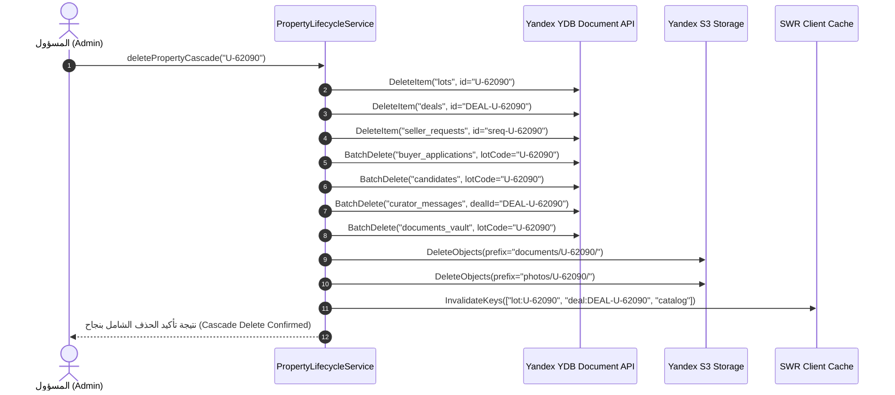

بهذا تكتمل المواصفة الهندسية الدقيقة لكافة هياكل البيانات وجداول وقواعد النظام دون ترك أي مجال للغموض.


---

# الفصل الخامس: الدوال السحابية وطبقة الوصول للبيانات والتكاملات السحابية (Backend Serverless, DAL & Cloud Integrations)

تعتمد منصة **DomExit** على معمارية هجينة غير خادمة (Serverless) عالية الكفاءة والأمان. لا يتطلب التطبيق تشغيل خادم مخصص دائم (Dedicated Node.js Server)، بل يعتمد على دوال سيرفرلس دقيقة التخصص (Netlify Functions / Yandex Cloud Functions) لمعالجة المهام الحساسة والملفات، مع طبقة وصول بيانات مركزية موحدة (**Data Access Layer - DAL**) تدير الاتصال المباشر الآمن مع **Yandex YDB Document API** و **Yandex Object Storage (S3)**.

---

## 1. الدوال السحابية غير الخادمة (Serverless Edge Functions)

يحتوي مجلد `netlify/functions/` على دالتين رئيسيتين مكتوبتين بلغة TypeScript وتعملان في بيئة Node.js الحديثة، مزودتين بذاكرة تخزين مؤقت للعميل (Cached S3 Client) وإدارة أمان CORS صارمة.

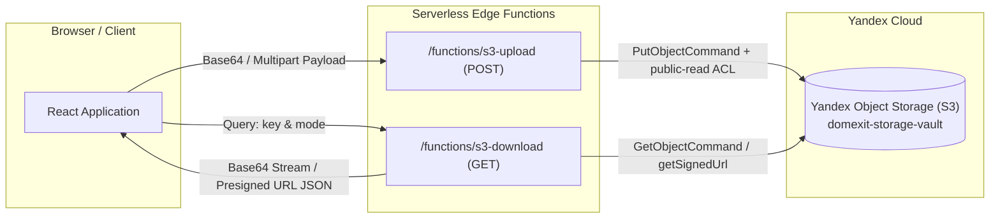

### 1.1. دالة رفع الملفات السحابية: `netlify/functions/s3-upload.ts`
تتولى هذه الدالة استقبال الملفات والمستندات الثبوتية وعقود الدفع وصور المعرض ورفعها إلى Yandex Object Storage.

#### الميزات المعمارية للدالة:
- **إعادة استخدام عميل S3 (Module-Scope Cached Client):** تحتفظ الدالة بكائن `S3Client` نشط عبر استدعاءات الحاويات الدافئة (Warm Invocations) لمدة 15 دقيقة (`CLIENT_MAX_AGE_MS = 15 * 60 * 1000`) لتفادي إعادة بناء كائن التشفير والاتصال في كل طلب.
- **دعم صيغ متعددة للمدخلات (Multi-format Ingestion):**
  1. كائن JSON يحتوي على حقل `base64Data` أو `dataUrl` أو `content` (مع استخلاص وتنظيف ترويسة Data URI تلقائياً).
  2. تدفق بيانات خام مشفر بـ Base64 (`event.isBase64Encoded === true`).
  3. نص عادي أو ثنائي UTF-8.
- **تحديد مسار الكائن التلقائي:** في حال عدم تزويد اسم الكائن، يتم توليده تلقائياً بصيغة: `uploads/file_${Date.now()}`.
- **إعدادات الأذونات (ACL):** ترفع الدالة الملف بصفة `public-read` لتسهيل استعراض الصور في المتصفح.

#### ترويسات الاستجابة ورموز الحالة:
- `OPTIONS`: يرجع كود `200` مع ترويسات CORS الكاملة:
  ```json
  {
    "Access-Control-Allow-Origin": "*",
    "Access-Control-Allow-Headers": "Content-Type, Authorization, X-Requested-With",
    "Access-Control-Allow-Methods": "GET, POST, PUT, OPTIONS"
  }
  ```
- `POST`: يرجع كود `200` مع بيانات الكائن المرفوع:
  ```json
  {
    "success": true,
    "bucket": "domexit-storage-vault",
    "objectKey": "documents/U-62090/ddu_contract.pdf",
    "storageKey": "documents/U-62090/ddu_contract.pdf",
    "url": "https://storage.yandexcloud.net/domexit-storage-vault/documents/U-62090/ddu_contract.pdf",
    "sizeBytes": 1450280,
    "contentType": "application/pdf"
  }
  ```
- أخطاء الطلب: `400` عند غياب البيانات الثنائية، `405` للطلبات غير المصرح بها، `500` عند فشل الاتصال بـ S3.

---

### 1.2. دالة تنزيل واستعراض الملفات: `netlify/functions/s3-download.ts`
تتولى هذه الدالة قراءة وتنزيل الملفات والمستندات المحمية من سلة التخزين السحابية بنمطين تشغيليين.

#### معلمات الاستعلام (Query Parameters):
- `key` أو `objectKey`: المسار النسبي للملف في الحاوية (مطلوب).
- `mode` أو `format`: نمط التنزيل:
  - `presigned` أو `json`: يولد رابطاً موقعاً مسبقاً (Presigned URL) صالحاً لمدة ساعتين (`expiresIn: 7200`) ويرجعه ككائن JSON دون نقل بيانات الملف عبر الدالة:
    ```json
    {
      "success": true,
      "objectKey": "documents/U-62090/ddu_contract.pdf",
      "presignedUrl": "https://storage.yandexcloud.net/domexit-storage-vault/documents/U-62090/ddu_contract.pdf?X-Amz-Algorithm=..."
    }
    ```
  - `stream` (الوضع الافتراضي): تقرأ الدالة تدفق البيانات الثنائية من S3 عبر `GetObjectCommand` وتحوله إلى Buffer ثم تشفره بـ Base64، وترجعه مباشرة للمتصفح مع الترويسات التالية:
    - `isBase64Encoded: true`
    - `Content-Type: ${contentType}`
    - `Content-Disposition: inline; filename="${encodeURIComponent(filename)}"`
    - `Cache-Control: public, max-age=86400` (تخزين مؤقت لمدة 24 ساعة لرفع كفاءة المتصفح)

---

## 2. طبقة الوصول للبيانات المركزية (Data Access Layer - DAL Gateway)

تُعد وحدة `DatabaseGateway` (`src/dal/DatabaseGateway.ts`) بوابة الدخول الإلزامية والوحيدة لكافة استعلامات وعمليات قواعد البيانات في التطبيق. يُحظر على مكونات واجهة المستخدم أو المستودعات استدعاء محركات البيانات مباشرة.

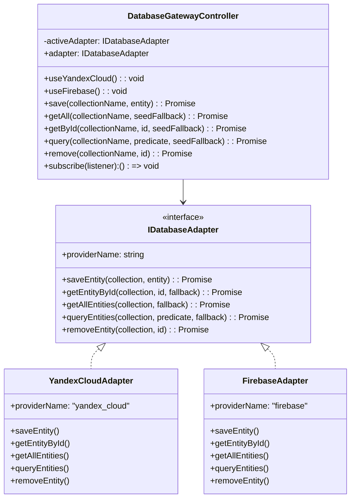

### 2.1. تكامل التخزين المؤقت وحذف التكرار (SWR Cache & Deduplication)
تحتوي `DatabaseGateway` على طبقتي تحسين للأداء:
1. **ذاكرة التخزين المؤقت المحدثة خلفياً (SWRCache):**
   - مدة صلاحية الكاش الافتراضية: 30 ثانية (`ttlMs = 30_000`).
   - عند طلب البيانات، يتم إرجاع القيمة المخزنة فوراً إن وجدت، مع إطلاق استعلام خلفي في الخلفية لتحديث الكاش تلقائياً (Stale-While-Revalidate).
   - عند تنفيذ عمليتي `save` أو `remove`، تقوم البوابة بإبطال فوري لكافة المفاتيح المرتبطة بالمجموعة:
     ```typescript
     swrCache.invalidatePrefix(`getAll:${resolvedName}`);
     swrCache.invalidatePrefix(`getAll:${collectionName}`);
     swrCache.invalidatePrefix(`getById:${resolvedName}:${entity.id}`);
     swrCache.invalidatePrefix(`getById:${collectionName}:${entity.id}`);
     ```
2. **مانع التكرار المتزامن (Request Deduplicator):**
   - يدمج كافة الطلبات المتزامنة لنفس المفتاح في طلب شبكة واحد عبر `requestDeduplicator.dedupe(cacheKey, fn)` مانعاً إغراق الشبكة بالاستعلامات المتطابقة.

### 2.2. ناقل الأحداث والتحديث اللحظي (Real-time Event Bus)
تدعم البوابة الاشتراك اللحظي في التحديثات عبر دالة `subscribe`:
- تستمع لأحداث النافذة المخصصة: `domexit:dal_updated`.
- تستمع لحدث تبديل البيئة: `domexit:environment_changed`.
- تستمع لأحداث التخزين عبر النوافذ وعلامات التبويب: `window.addEventListener('storage', handleStorage)`.

---

## 3. محول Yandex Cloud ومحاكاة DynamoDB (YandexCloudAdapter)

ينفذ كلاس `YandexCloudDatabaseAdapter` (`src/dal/adapters/YandexCloudAdapter.ts`) واجهة `IDatabaseAdapter` للاتصال بـ **Yandex YDB Document API**.

### 3.1. خوارزمية توقيع الطلبات AWS Signature v4
نظراً لأن YDB Document API متوافقة مع بروتوكول DynamoDB، يتم توقيع كافة الطلبات بواسطة خوارزمية `AWS4-HMAC-SHA256` عبر Web Crypto API الأصلي:
1. استخراج التاريخ بصيغة ISO المصغرة: `YYYYMMDDTHHMMSSZ` والتاريخ المجرد `YYYYMMDD`.
2. توليد بصمة محتوى الطلب (SHA-256 Payload Hash).
3. بناء الطلب المعياري (Canonical Request) متضمناً المسار والترويسات الموقعة (`content-type`, `host`, `x-amz-date`, `x-amz-target`).
4. اشتقاق مفتاح التوقيع المتسلسل (Signing Key):
   $$\text{kDate} = \text{HMAC-SHA256}(\text{"AWS4" + SecretKey}, \text{DateStamp})$$
   $$\text{kRegion} = \text{HMAC-SHA256}(\text{kDate}, \text{Region})$$
   $$\text{kService} = \text{HMAC-SHA256}(\text{kRegion}, \text{"dynamodb"})$$
   $$\text{kSigning} = \text{HMAC-SHA256}(\text{kService}, \text{"aws4_request"})$$
5. حساب التوقيع النهائي عبر تشفير `StringToSign` بمفتاح `kSigning`.

### 3.2. تحويل البيانات (DynamoDB Attribute Value Serialization)
تتولى الدالتان `toDynamoAttribute` و `fromDynamoAttribute` التحويل ثنائي الاتجاه بين كائنات JavaScript العادية وهياكل DynamoDB:
- **الأرقام:** تُحول إلى `{ N: String(val) }`.
- **النصوص:** تُحول إلى `{ S: val }`.
- **القيم المنطقية:** تُحول إلى `{ BOOL: Boolean(val) }`.
- **القيم الفارغة:** تُحول إلى `{ NULL: true }`.
- **المصفوفات:** تُحول إلى `{ L: [ ...items.map(toDynamoAttribute) ] }`.
- **الكائنات المركبة:** تُحول إلى `{ M: { [key]: toDynamoAttribute(val) } }`.

---

## 4. مستودعات البيانات المتخصصة (All 24 Repositories Breakdown)

يحتوي مجلد `src/dal/repositories/` على 24 مستودعاً متخصصاً، ينفرد كل منها بإدارة كيان محدد مع استدعاء `DatabaseGateway`:

| المستودع (Repository) | المجموعة المرتبطة (Collection) | الوظائف والعمليات الرئيسية |
| :--- | :--- | :--- |
| `LotsRepository` | `lots` | إدارة العقارات: استرجاع الكتالوج، جلب العقار بالكود، تحديث البيانات والصور المعتمدة، تحديث الحالة والتدقيق القانوني. |
| `DealsRepository` | `deals` | إدارة الصفقات: إنشاء ومتابعة مراحل الصفقة الخمس، تحديث المبالغ، تسجيل مستندات الإغلاق، وتعيين المنسقين. |
| `SellerRequestsRepository` | `seller_requests` | إدارة طلبات البائعين: استلام طلب الخروج، ربطه بكود العقار، تحديث حالة المراجعة والمستندات المرفقة. |
| `DocumentsVaultRepository` | `documents_vault` | المستودع المركزي للملفات: حفظ وتحديث بيانات الوثائق، ربط المستند بالعقار، والتحقق القانوني أو الرفض. |
| `CuratorChatRepository` | `curator_messages` | إدارة المحادثات الفورية: إرسال الرسائل بين العميل والمنسق، جلب سجل المحادثة، ووضع علامات القراءة. |
| `CandidatesRepository` | `candidates` / `buyer_applications` | إدارة المشترين والمرشحين: مطابقة المشترين في Matchmaker، فحص الجاهزية البنكية، وتسجيل الحجوزات. |
| `DevelopersRepository` | `developers` / `developer_accreditation_requests` | إدارة المطورين: اعتماد المطورين العقاريين، فحص ИНН وسجلات المشاريع وبنوك الإسكرو الشريكة. |
| `BankPortalRepository` | `partner_banks` / `bank_employees` / `bank_special_approvals` | بوابة البنوك: إدارة اعتمادات الرهون الاستثنائية، حسابات الإسكرو، وموظفي التمويل العقاري. |
| `EmployeesRepository` | `employees` | إدارة الموظفين: بيانات منسقي الصفقات، المحامين، الصلاحيات، وإحصائيات سرعة إغلاق الصفقات. |
| `UsersRepository` | `users` | إدارة المستخدمين: ملفات الحسابات، الصلاحيات المتعددة (RBAC)، المفضلة، والمطابقة مع Yandex ID. |
| `PartnersRepository` | `partners` / `partner_applications` | برنامج الشركاء: تسجيل الوكالات والوسطاء، توليد أكواد الإحالة (Ref Codes)، ومتابعة العمولات. |
| `PartnerRequestsRepository` | `partner_preliminary_requests` | طلبات الشركاء: إرسال طلبات ترشيح العملاء المبدئية ومتابعة حالتها لدى المنسقين. |
| `InvestorClubRepository` | `investor_applications` | نادي المستثمرين: استقبال طلبات الانضمام، تحليل الميزانيات، وعرض الفرص الاستثمارية الحصرية. |
| `MarketSettingsRepository` | `market_settings` | معايير السوق: إدارة سعر الفائدة للبنك المركزي (21%)، فائدة الرهن العائلي (6%)، والرسوم. |
| `LegalRepository` | `legal_settings` / `company_legal_profile` | الملف القانوني: بيانات الشركة الرسمية، السجل التجاري، الحساب البنكي، ومسؤول 152-ФЗ. |
| `LegalPoliciesRepository` | `legal_documents` / `legal_revisions` | إدارة السياسات (CMS): نصوص الشروط، سياسة الخصوصية، تجميد الإصدارات وحساب بصمة SHA-256. |
| `UserConsentsRepository` | `user_consents` | سجل الموافقات: تدوين موافقة المستخدم الصريحة على معالجة البيانات الشخصية مع حجب الـ IP. |
| `EscrowBridgeRepository` | `escrow_bridge_chats` | جسر الإسكرو: تسهيلات تحويل الدفعات والحسابات الانتقالية بالتنسيق مع البنوك المعتمدة. |
| `AuditLogsRepository` | `audit_logs` | السجل الرقابي: تسجيل كافة العمليات الإدارية الحساسة وتعديلات الأسعار والتدقيق بهوية المنفذ. |
| `KnowledgeRepository` | *محتوى محلي / كاش* | قاعدة المعرفة: مقالات وأدلة 214-ФЗ القانونية والإرشادات التثقيفية للمشترين والبائعين. |
| `FAQRepository` | *محتوى محلي / كاش* | الأسئلة الشائعة: تصنيفات الأسئلة الأكثر تداولاً وإجاباتها القانونية والمالية الموثقة. |
| `AnalyticsRepository` | *مؤشرات مجمعة* | لوحة المؤشرات: حساب متوسطات الأسعار، نسب التوفير، أحجام الصفقات وسرعة الإغلاق. |
| `SecurityIncidentsRepository` | `security_incidents` | أمن المعلومات: تسجيل محاولات الدخول غير المصرح بها ورصد التعديلات غير المطابقة للمواصفات. |
| `CompanyProfileRepository` | `company_profile` | هوية المنصة: بيانات الاتصال، الدعم الفني، روابط قنوات تيليجرام وشبكة VK الرسمية. |

---

## 5. التكاملات السحابية الخارجية (External Cloud Integrations)

### 5.1. تسجيل الدخول الموحد Yandex ID OAuth 2.0 Flow
يدعم التطبيق المصادقة السريعة والآمنة للعملاء عبر حسابات **Yandex ID**:
- **رابط التخويل المباشر (Authorization URL):**
  ```text
  https://oauth.yandex.ru/authorize?response_type=token&client_id=${VITE_YANDEX_CLIENT_ID}&redirect_uri=${window.location.origin}/auth/callback
  ```
- **آلية استخلاص التوكن (Token Extraction):** عند إعادة توجيه المتصفح إلى مسار الـ Callback، يستخلص التطبيق التوكن من مجزأ العنوان (Hash Fragment: `#access_token=...`).
- **جلب الملف التعريفي للمستخدم:** يستعلم التطبيق من خدمة `https://login.yandex.ru/info?format=json` عبر ترويسة `Authorization: OAuth ${token}` لاسترجاع الاسم الكامل، البريد الإلكتروني، والصورة الشخصية.
- **الربط والإنشاء التلقائي:** يتم فحص جدول `users` في YDB؛ فإذا وُجد المستخدم يتم تسجيل دخوله، وإن لم يوجد يتم إنشاء سجل جديد له برتبة `buyer` أو `seller` مع منحه كود عميل مميز (`DEX-XXXX`).

### 5.2. خرائط ياندكس التفاعلية (Yandex Maps API v3)
يعتمد محرك الخرائط واستعراض المواقع الجغرافية على أحدث إصدار من مكتبة خرائط ياندكس الرسمية **Yandex Maps JS API v3**:
- **خدمة التحميل الديناميكي الموحد (`src/services/yandexMapsService.ts`):**
  - تضمن الدالة `loadYandexMaps()` تحميل السكربت الرسمي لمرة واحدة فقط دون أي تكرار عبر الوعد العام (Global Promise Deduplication):
    ```text
    https://api-maps.yandex.ru/v3/?apikey=${VITE_YANDEX_MAPS_API_KEY}&lang=ru_RU
    ```
  - تنتظر الخدمة اكتمال تهيئة الكائن العام عبر الوعد `window.ymaps3.ready`.
- **المكونات والطبقات الجغرافية:**
  - `YMapDefaultSchemeLayer`: طبقة المخطط الجغرافي الأساسية (تدعم الثيم الداكن والفاتح).
  - `YMapDefaultFeaturesLayer`: طبقة المعالم والحدود الهندسية للمجمعات السكنية.
  - `YMapControls` & `YMapZoomControl`: أزرار التحكم في التكبير والتصغير وتحديد الموقع.
  - `YMapDefaultMarker`: علامات مخصصة تمثل العقارات المعروضة، ملونة بحسب حالة التحقيق والخصم.
- **التغطية الجغرافية:** تدعم الخرائط الإحداثيات الدقيقة لمدن روسيا الاتحادية الرئيسية (موسكو وسانت بطرسبرغ وضواحيهما) مع الإسقاط الجغرافي الصحيح على شبكة المترو.


---

# الفصل السادس: إدارة الحالة والمصادقة ومفاتيح الميزات (State Management, Auth & Feature Flags)

يعتمد تطبيق **DomExit** على هيكلية ثلاثية الطبقات لإدارة الحالة والبيانات:
1. **مخازن الحالة التفاعلية (Zustand Stores):** لإدارة بيئة التشغيل، ومفاتيح الميزات، ومعلومات الشركة العامة بسرعة استجابة لحظية وخفيفة دون إعادة تصيير غير مبررة للواجهة.
2. **سياق المصادقة وإدارة الهوية (`AuthContext`):** لإدارة جلسة المستخدم، وتعدد الأدوار (Multi-Role Switching)، والربط مع Yandex OAuth ومزودي الهوية.
3. **طبقة التخزين المؤقت وحذف التكرار المتزامن (`SWRCache` & `RequestDeduplicator`):** كبديل خفيف وعالي الأداء لـ Redis على مستوى المتصفح، تضمن سرعة استجابة فائقة وإلغاء الاستعلامات المتكررة.

---

## 1. المعمارية العامة لتدفق الحالة

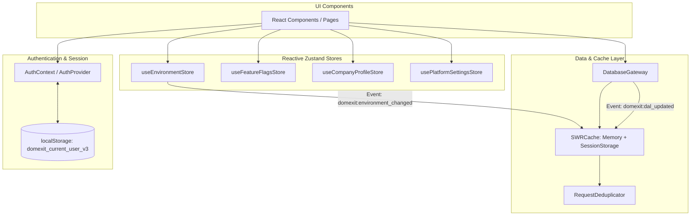

---

## 2. مخازن الحالة العالمية (Zustand Stores)

### 2.1. مخزن بيئة العمل وعزل البيانات: `useEnvironmentStore.ts`
يتحكم في توجيه استعلامات التطبيق بين البيئة الإنتاجية الحقيقية (`production`) وبيئة العرض والتجربة المعزولة (`demo`).

#### القواعد الصارمة لإدارة البيئة:
- **الحماية الحصرية للمالك (Owner-Only Access):** يُحظر حظراً تاماً تفعيل وضع التجربة (`demo`) لأي زائر أو عميل عادي. التبديل إلى `demo` مسموح حصراً للمالك المعتمد المنتهي بحساب `amaas9499@gmail.com` أو صاحب الرتبة `owner`.
- **البيئة الافتراضية الصارمة:** تبدأ كافة الجلسات الجديدة لجميع الزوار على وضع الإنتاج (`production`). في حال محاولة متصفح غير مصرح له تعيين `demo`، يتم إجباره فورياً على العودة إلى `production`.
- **مفتاح التخزين:** `domexit_app_environment` في `localStorage`.

#### بنية الحالة والدوال:
```typescript
export type AppEnvironment = 'demo' | 'production';

interface EnvironmentState {
  currentEnv: AppEnvironment;
  isProduction: boolean;
  setEnvironment: (env: AppEnvironment) => void;
  toggleEnvironment: () => void;
}
```

#### الأحداث الصادرة عند التبديل:
عند استدعاء `setEnvironment`، يبث المخزن حدثين مخصصين عبر النافذة:
1. `domexit:environment_changed`: لإشعار `SWRCache` بمسح كامل الذاكرة المؤقتة فوراً لتفادي تداخل بيانات البيئتين.
2. `domexit:dal_updated`: لإشعار كافة المكونات المعروضة على الشاشة بإعادة جلب بياناتها من المجموعة المطابقة للبيئة الجديدة.

---

### 2.2. مخزن مفاتيح الميزات: `useFeatureFlagsStore.ts`
يتحكم في تفعيل أو تعطيل الميزات التجريبية أو الجزئية بالمنصة، مع مزامنة لحظية بين `localStorage` وجدول `platform_settings` في YDB.

#### الميزات المضبوطة (Feature Flags):
- `enableVipClub`: (القيمة الافتراضية: `false`) إغلاق كتالوج VIP وتحويله إلى نادي المستثمرين المغلق حتى اكتمال بوابة الدفع.
- `enableBankPortal`: (القيمة الافتراضية: `false`) تفعيل بوابة اعتماد موظفي البنوك المباشرة، مع الاعتماد حالياً على الإسكرو اليدوي الموثق.

#### بنية المخزن:
```typescript
export interface FeatureFlagsState {
  enableVipClub: boolean;
  enableBankPortal: boolean;
  setFlag: (key: 'enableVipClub' | 'enableBankPortal', value: boolean) => void;
  toggleFlag: (key: 'enableVipClub' | 'enableBankPortal') => void;
}
```

#### المزامنة المزدوجة (Two-Way Sync):
- يشترك المخزن تلقائياً في `DatabaseGateway.subscribe`؛ عند تعديل وثيقة `feature_flags` في جدول `platform_settings` من قبل المسؤول، يتم تحديث حالة المتصفح و`localStorage` في الوقت الحقيقي.
- عند تعديل أي مفتاح من خلال الواجهة الإدارية عبر `setFlag`، يتم حفظ القيمة محلياً وحفظها في قاعدة البيانات السحابية بشكل غير متزامن.

---

### 2.3. مخازن الإعدادات وهوية الشركة:
- `useCompanyProfileStore.ts`: يدير الملف التعريفي والبيانات القانونية المعتمدة للشركة (`inn`, `kpp`, `ogrn`, `legal_address`, `bank_details`) وتحديثها فورياً في كافة الفواتير والصفحات القانونية.
- `usePlatformSettingsStore.ts`: يدير مؤشرات وضع الصيانة (`isMaintenanceMode`)، وتفعيل المحادثة الحية مع المنسق، وضوابط رفع ملفات S3 المباشرة.
- `usePublicChannelsStore.ts`: يدير قنوات التواصل العامة المعتمدة (قناة تيليجرام، بوت تيليجرام، مجتمع VK، وهاتف الدعم الموحد).

---

## 3. سياق المصادقة وإدارة الجلسات (`AuthContext.tsx`)

يُدير `AuthContext` المصادقة الأمنية، ومطابقة الهويات، والتحكم في الوصول القائم على الأدوار (RBAC).

### 3.1. الحسابات الرئيسية المعتمدة والبيانات التجريبية
- **حسابات المالك الأعلى (Master Owners):** `amaas9499@gmail.com`, `ceo@domexit.ru`.
- **حسابات الموظفين ومنسقي الصفقات (Staff Accounts):** `amaas9494@gmail.com`, `employee@domexit.ru`, `morozov@domexit.ru`.
- **كلمة المرور التجريبية الموحدة للبيئات:** `DomExit2026!`.
- **مفتاح حفظ جلسة المستخدم:** `domexit_current_user_v3` في `localStorage`.

### 3.2. تعدد الأدوار والتبديل الديناميكي (Dynamic Role Switching)
يدعم حساب المستخدم الواحد امتلاك أدوار متعددة مسجلة في مصفوفة `roles: UserRole[]` (مثل: مستخدم يمتلك صلاحية `buyer` و `seller` و `investor`، أو موظف يمتلك صلاحية `employee` و `owner`).

تتيح دالة `switchRole(role)` للمستخدم التبديل اللحظي بين واجهاته المخصصة دون الحاجة لتسجيل الخروج وإعادة تسجيل الدخول:
```typescript
switchRole: (role: UserRole) => {
  if (!user) return;
  const updatedUser = { ...user, activeRole: role };
  setUser(updatedUser);
  localStorage.setItem(STORAGE_KEY, JSON.stringify(updatedUser));
  UsersRepository.save(updatedUser);
};
```

### 3.3. طرق تسجيل الدخول المدعومة
1. **تسجيل الدخول عبر Yandex ID (`loginWithYandex`):** التوجيه إلى خادم OAuth الخاص بشركة ياندكس لاسترجاع التوكن وبيانات الحساب الروسي وتوطين البيانات داخل روسيا.
2. **تسجيل الدخول عبر البريد الإلكتروني وكلمة المرور (`loginWithEmail`):** التحقق من الاعتماد عبر Firebase Auth ومطابقة السجل في جدول `users`.
3. **الدخول التجريبي الفوري (`quickDemoLogin`):** يتيح للمسؤولين ومختبري النظام التبديل بضغطة زر واحدة بين كافة أدوار المنظمة (`owner`, `employee`, `bank`, `partner`, `investor`, `seller`, `buyer`) مع تحميل الملف التعريفي الكامل والصلاحيات الملحقة به فوراً.
4. **إدارة المفضلة (`toggleFavorite`):** إضافة أو إزالة كود العقار من قائمة المفضلة المحفوظة في ملف المستخدم السحابي.

---

## 4. طبقة التخزين المؤقت متعددة المستويات (`SWRCache.ts`)

تنفذ فئة `ClientSWRCache` نمط **Stale-While-Revalidate** على مستويين، مما يلغي الحاجة لخادم Redis خارجي ويوفر زمن استجابة صفري للواجهة.

### 4.1. مستويات التخزين المؤقت (Multi-Tier Caching)
- **المستوى الأول (Tier 1 - In-Memory):** كائن `Map<string, CacheEntry<unknown>>` في ذاكرة جافاسكريبت السريعة، يتم فقدانه عند إعادة تحميل الصفحة.
- **المستوى الثاني (Tier 2 - Session Storage):** تخزين في `sessionStorage` بمفتاح يبدأ بـ `domexit_swr_`، يستمر طوال فترة بقاء علامة تبويب المتصفح مفتوحة.

### 4.2. دورة عمل الاستعلام (SWR Lifecycle)
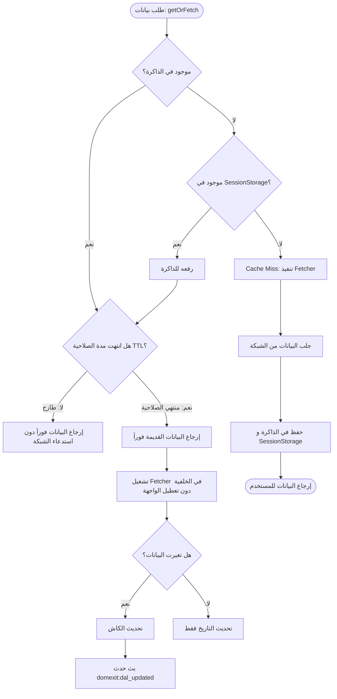

### 4.3. آليات إبطال الكاش (Cache Invalidation Rules)
- `invalidate(key)`: حذف مفتاح محدد من الذاكرة ومن `sessionStorage`.
- `invalidatePrefix(prefix)`: حذف كافة المفاتيح التي تبدأ ببادئة معينة (مثل `getAll:lots` أو `getById:deals:`).
- `clear()`: مسح شامل للذاكرة و`sessionStorage`، ويتم استدعاؤها تلقائياً عند تغيير بيئة التشغيل عبر حدث `domexit:environment_changed`.

---

## 5. مانع تكرار الطلبات المتزامنة (`RequestDeduplicator.ts`)

عند فتح صفحة تتضمن عدة مكونات تطلب نفس البيانات في نفس اللحظة (مثل طلب كتالوج العقارات من الخريطة والقائمة وشريط الإحصاءات)، يتدخل `RequestDeduplicator` لدمج هذه الطلبات في وعد واحد (In-Flight Promise Coalescing):

```typescript
class RequestDeduplicator {
  private inFlight = new Map<string, Promise<any>>();

  dedupe<T>(key: string, fetcher: () => Promise<T>): Promise<T> {
    const existing = this.inFlight.get(key);
    if (existing) {
      return existing as Promise<T>;
    }

    const promise = fetcher().finally(() => {
      this.inFlight.delete(key);
    });

    this.inFlight.set(key, promise);
    return promise;
  }
}

export const requestDeduplicator = new RequestDeduplicator();
```

يضمن هذا التكامل انعدام التكرار الشبكي وحماية واجهات Yandex Cloud من تجاوز حدود الاستعلام (Rate Limiting).


---

# الفصل السابع: مسارات التطبيق ومصفوفة الصلاحيات والأمان (Routing, RBAC & Security Matrix)

تعتمد منصة **DomExit** على نظام توجيه منضبط وشامل عبر **React Router v6**، محمي بحواجز أمان متعددة المستويات (**AdminRouteGuard**, **BankGatewayErrorBoundary**, **ConsentGateModal**)، مع تطبيق صارم لمصفوفة الصلاحيات والتحكم في الوصول القائم على الأدوار (**Role-Based Access Control - RBAC**)، وضوابط حماية البيانات الشخصية وفقاً للقانون الاتحادي الروسي **152-ФЗ**.

---

## 1. جدول مسارات التطبيق الشامل (Routing Table)

تُدار كافة المسارات عبر المكون المركزي `src/App.tsx`. تم تطبيق التحميل الكسول المخصص (**Lazy Loading via `React.lazy`**) لكافة الصفحات لتقليص حجم الحزمة الأولية إلى أدنى حد ممكن، مع تغليفها بمكون الهيكل العظمي البديل (`PageSkeletonLoader`).

### 1.1. مسارات الواجهة العامة والعملاء (Public & Client Routes)
تعمل هذه المسارات تحت تخطيط `PublicLayout` الموحد الذي يوفر الترويسة والشريط العلوي والتذييل المتوافق مع متطلبات الإفصاح القانوني:

| المسار (Path) | المكون (Component) | مستوى الوصول | الوصف والغرض الوظيفي |
| :--- | :--- | :--- | :--- |
| `/` | `HomePage` | عام (Public) | الواجهة الرئيسية للمنصة، الحاسبة المالية، وشريط الفرص الساخنة. |
| `/sellers` | `SellersPage` | عام (Public) | استمارة تخارج البائعين، حاسبة توفير غرامات المطور (10-15%)، ورفع وثائق ДДУ. |
| `/opportunities` | `OpportunitiesPage` | عام (Public) | كتالوج العقارات الشامل، فلترة الأسعار والمترو والمطورين، وعرض الخريطة التفاعلية. |
| `/catalog` | `Navigate -> /opportunities` | عام (Public) | رابط بديل موجه لكتالوج العقارات المفتوح. |
| `/lot/:id` | `LotDetailsPage` | عام (Public) | الصفحة التفصيلية الكاملة للعقار، معرض الصور المعتمدة، التقرير القانوني، والمحادثة مع المنسق. |
| `/verify/:lotId` | `VerifyCertificatePage` | عام (Public) | شهادة الفحص القانوني الرقمية الموثقة للعقار، الباركود، وبصمة التدقيق. |
| `/how-it-works` | `HowItWorksPage` | عام (Public) | دليل ومراحل عملية التنازل (Переуступка) وفق 214-ФЗ من الألف إلى الياء. |
| `/story` | `StoryPage` | عام (Public) | قصة نشأة DomExit ومهمتها في تحرير أموال المشترين العالقين في أقساط المطورين. |
| `/vip` | `VipCatalogPage` | عام (Public) | كتالوج الصفقات الحصرية ذات العائد المرتفع وبوابة نادي المستثمرين. |
| `/partners` | `PartnersPublicPage` | عام (Public) | برنامج الشركاء والوسطاء العقاريين (B2B)، حاسبة العمولات وطلب الانضمام. |
| `/b2b-partners` | `Navigate -> /partners` | عام (Public) | رابط تحويلي متوافق مع الحملات التسويقية للشركاء. |
| `/investors` | `Navigate -> /vip` | عام (Public) | رابط تحويلي لصفحة المستثمرين. |
| `/portal` | `ClientPortalPage` | عميل مسجل | بوابة العميل الموحدة (متابعة إعلانات البائع، حجوزات المشتري، والمفضلة). |
| `/account` | `ClientPortalPage` | عميل مسجل | مسار بديل لبوابة العميل وإدارة الملف الشخصي. |
| `/tracker` | `Navigate -> /portal` | عميل مسجل | تحويل مباشر لمتابعة الصفقات النشطة. |
| `/client/tracker/:dealId` | `ClientTrackerPage` | عميل مسجل | صفحة التتبع الحي لمراحل الصفقة الخمس وتأكيدات بنك الإسكرو. |

### 1.2. مسارات المركز المعرفي والسياسات القانونية (CMS & Knowledge Hub)
| المسار (Path) | المكون (Component) | مستوى الوصول | الوصف والغرض الوظيفي |
| :--- | :--- | :--- | :--- |
| `/knowledge` | `KnowledgeHubPage` | عام (Public) | بوابة المقالات والأدلة الإرشادية القانونية والمالية وفقاً للقانون 214-ФЗ. |
| `/knowledge/:articleSlug` | `ArticleDetailPage` | عام (Public) | الصفحة الكاملة لقراءة المقال القانوني مع المراجع التشريعية. |
| `/faq` | `FAQPage` | عام (Public) | قاعدة الأسئلة الشائعة المصنفة للبائعين والمشترين وإجراءات الإسكرو. |
| `/legal` | `LegalIndexPage` | عام (Public) | الفهرس المركزي لكافة الوثائق واللوائح والسياسات المعتمدة للمنصة. |
| `/legal/:slug` | `LegalDocumentReaderPage` | عام (Public) | قارئ الوثيقة القانونية مع بصمة SHA-256 وسجل المراجعة النشطة. |
| `/legal/archive` | `LegalArchivePage` | عام (Public) | أرشيف الإصدارات السابقة للسياسات القانونية امتثالاً للائحة 152-ФЗ. |
| `/legal/archive/:slug/:version` | `LegalArchiveSnapshotPage` | عام (Public) | عرض النسخة التاريخية المجمدة للوثيقة القانونية عند تاريخ سريانها. |

### 1.3. مسارات التحويل الخلفي المتوافقة (Backward-Compatible Redirects)
لضمان عدم انقطاع روابط محركات البحث والحملات الإعلانية القديمة:
- `/privacy` $\rightarrow$ `/legal/privacy`
- `/terms` $\rightarrow$ `/legal/terms`
- `/consent-pd` $\rightarrow$ `/legal/consent-pd`
- `/consent-ads` $\rightarrow$ `/legal/consent-ads`
- `/consent-distribution` $\rightarrow$ `/legal/consent-distribution`
- `/cookies` $\rightarrow$ `/legal/cookies`
- `/call-recording` $\rightarrow$ `/legal/call-recording`
- `/app/seller` $\rightarrow$ `/sellers`
- `/app/objects` $\rightarrow$ `/opportunities`
- `/app/objects/:id` $\rightarrow$ `/lot/:id`

### 1.4. مسارات العمليات الإدارية والمغلقة (Admin & Operations Routes)
تخضع كافة هذه المسارات لحماية مشددة بواسطة **`AdminRouteGuard`**:

| المسار (Path) | المكون (Component) | الأدوار المصرح لها | الغرض الوظيفي والعمليات |
| :--- | :--- | :--- | :--- |
| `/admin` | `Navigate -> /admin/dashboard` | `owner`, `employee` | تحويل تلقائي للوحة المؤشرات الرئيسية. |
| `/admin/dashboard` | `AdminDashboardPage` | `owner`, `employee` | لوحة القيادة العامة، الرسوم البيانية، وحجم الصفقات وتوزيع المنسقين. |
| `/admin/pipeline` | `AdminPipelinePage` | `owner`, `employee` | خط أنابيب الصفقات الشامل، فرز الحالات، ونقل العقار بين المراحل. |
| `/admin/packaging/:lotId?` | `AdminPackagingPage` | `owner`, `employee` | استوديو التغليف: اعتماد صور المعرض، تحرير الأسعار، وصياغة الإعلان. |
| `/admin/legal-audit/:lotId?`| `AdminLegalAuditPage` | `owner`, `employee` | لوحة التدقيق القانوني في المحاور الخمسة واعتماد شهادة السلامة. |
| `/admin/ops-audit/:lotId?` | `Navigate -> /admin/legal-audit/:lotId` | `owner`, `employee` | مسار بديل موجه للتدقيق القانوني. |
| `/admin/matchmaker/:lotId?` | `AdminMatchmakerPage` | `owner`, `employee` | محرك توفيق ومطابقة المشترين المسجلين وحملة التمويل المعتمدة مع العقار. |
| `/admin/closing/:dealId?` | `AdminClosingPage` | `owner`, `employee` | غرفة إغلاق الصفقة: التوقيع، شروط تحرير الإسكرو، وإشعار Росреестр. |
| `/admin/brokers` | `AdminBrokersPage` | `owner`, `employee` | إدارة شبكة الوسطاء والشركاء المسجلين وتتبع إحالاتهم وعمولاتهم. |
| `/admin/archive-logs` | `AdminArchiveLogsPage` | `owner` فقط | سجل التدقيق والرقابة الشامل للأحداث والعمليات وتتبع العمليات الحساسة. |
| `/admin/profile` | `AdminCuratorProfilePage` | `owner`, `employee` | الملف المهني للمنسق: عدد الصفقات المنجزة وسرعة التنفيذ والتواصل. |
| `/bank-portal` | `BankPortalPage` | `owner`, `bank` | بوابة موظفي البنوك الشريكة لاعتماد قروض الرهن وحسابات الإسكرو. |
| `/admin/bank-gateway` | `BankPortalPage` | `owner`, `bank` | مسار موازٍ لبوابة البنوك تحت حماية `BankGatewayErrorBoundary`. |

---

## 2. حارس المسارات الإدارية والتأمين الحصري (`AdminRouteGuard.tsx`)

يتحقق المكون `AdminRouteGuard` من هوية المستخدم قبل السماح بعرض أي شاشة إدارية:

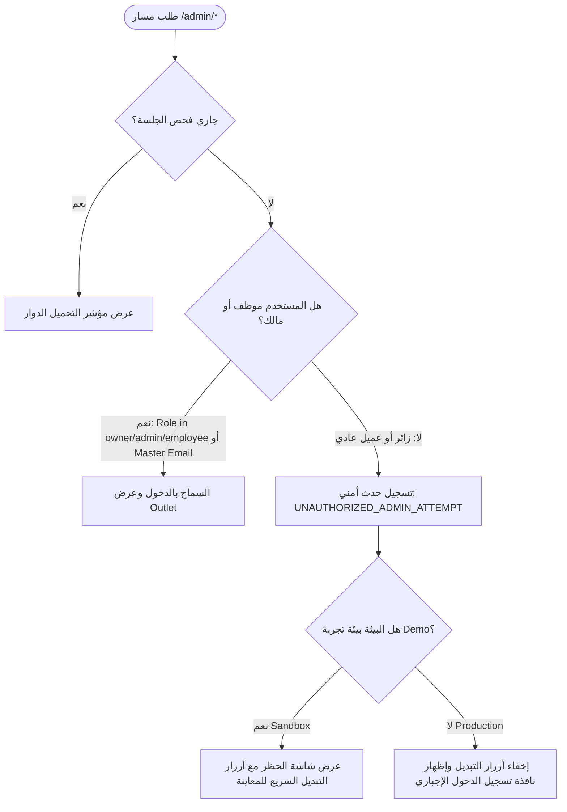

### 2.1. منطق الفحص البرمجي للأدوار المصرحة
```typescript
const isStaff = Boolean(
  user &&
    (user.activeRole === 'owner' ||
      user.activeRole === 'admin' ||
      user.activeRole === 'employee' ||
      user.role === 'owner' ||
      user.role === 'admin' ||
      user.role === 'employee' ||
      user.email === 'amaas9499@gmail.com' ||
      user.email === 'amaas9494@gmail.com')
);
```

### 2.2. تسجيل الأحداث الأمنية في Telemetry
في حال محاولة الدخول غير المصرح بها، يتم فورياً استدعاء `securityLogger.log`:
- **كود الحدث:** `UNAUTHORIZED_ADMIN_ATTEMPT`
- **مستوى الخطورة:** `high`
- **التفاصيل:** تسجيل كود العميل وعنوان الـ IP ووقت المحاولة لإحباط هجمات الاستكشاف.

---

## 3. مصفوفة الصلاحيات الشاملة (RBAC Permissions Matrix)

تحدد المنصة 8 أدوار للمستخدمين تضبط صلاحيات القراءة، والإنشاء، والتعديل، والاعتماد، والحذف:

| الوظيفة / العملية داخل النظام | زائر (Guest) | مشترٍ (Buyer) | بائع (Seller) | شريك (Partner) | مستثمر (Investor) | ممثل بنك (Bank) | منسق صفقات (Employee) | مالك المنصة (Owner) |
| :--- | :---: | :---: | :---: | :---: | :---: | :---: | :---: | :---: |
| **تصفح الكتالوج العام (`/opportunities`)** | ✅ | ✅ | ✅ | ✅ | ✅ | ✅ | ✅ | ✅ |
| **استعراض تفاصيل العقار وموقعه (`/lot/:id`)** | ✅ | ✅ | ✅ | ✅ | ✅ | ✅ | ✅ | ✅ |
| **تقديم طلب خروج بائع (`/sellers`)** | ✅ | ✅ | ✅ | ❌ | ❌ | ❌ | ✅ | ✅ |
| **حجز عقار وطلب شراء (`Reserve`)** | ❌ | ✅ | ❌ | ❌ | ✅ | ❌ | ✅ | ✅ |
| **المحادثة المباشرة مع المنسق (`CuratorChat`)** | ❌ | ✅ (لعقاره) | ✅ (لعقاره) | ❌ | ✅ | ❌ | ✅ (لعملائه) | ✅ (شامل) |
| **رفع مستندات الملكية والـ ДДУ** | ❌ | ❌ | ✅ (لعقاره) | ❌ | ❌ | ❌ | ✅ | ✅ |
| **تنزيل الوثائق الرسمية المدققة** | ❌ | ✅ (بعد الحجز) | ✅ (لوثائقه) | ❌ | ✅ | ✅ (للصفقة) | ✅ | ✅ |
| **دخول لوحة القيادة والأنابيب (`/admin/*`)**| ❌ | ❌ | ❌ | ❌ | ❌ | ❌ | ✅ | ✅ |
| **تحرير استوديو التغليف واعتماد الصور** | ❌ | ❌ | ❌ | ❌ | ❌ | ❌ | ✅ | ✅ |
| **تنفيذ التدقيق القانوني وتثبيت النتيجة** | ❌ | ❌ | ❌ | ❌ | ❌ | ❌ | ✅ | ✅ |
| **تشغيل محرك التوفيق (`Matchmaker`)** | ❌ | ❌ | ❌ | ❌ | ❌ | ❌ | ✅ | ✅ |
| **إدارة شروط تحرير الإسكرو والتوقيع** | ❌ | ❌ | ❌ | ❌ | ❌ | ❌ | ✅ | ✅ |
| **اعتماد قروض الرهن وحسابات الإسكرو** | ❌ | ❌ | ❌ | ❌ | ❌ | ✅ | ❌ | ✅ |
| **الحذف المتسلسل الشامل للعقار (`Cascade`)**| ❌ | ❌ | ❌ | ❌ | ❌ | ❌ | ❌ | ✅ |
| **استعراض سجل الأحداث والرقابة (`/admin/archive-logs`)** | ❌ | ❌ | ❌ | ❌ | ❌ | ❌ | ❌ | ✅ |
| **تعديل إعدادات السوق وهوية الشركة ومفاتيح الميزات** | ❌ | ❌ | ❌ | ❌ | ❌ | ❌ | ❌ | ✅ |
| **تبديل بيئة النظام بين Production و Demo** | ❌ | ❌ | ❌ | ❌ | ❌ | ❌ | ❌ | ✅ |

---

## 4. ضوابط عزل البيانات والخصوصية الفيدرالية (152-ФЗ Data Shield)

تلتزم المنصة بمجموعة من المعايير المعمارية الصارمة لحماية خصوصية الأطراف وسرية التعاملات:
1. **حجب رقم الشقة الحقيقي (Apartment Masking):**
   - يُمنع إظهار رقم الشقة أو الوحدة السكنية الدقيق في الواجهة العامة للموقع أو الكتالوج أو خرائط ياندكس.
   - يقتصر الإفصاح العام على اسم المجمع السكني (ЖК)، والطابق، والمساحة، والرمز التعريفي الفريد (`U-XXXXX`).
   - لا يُتاح رقم الشقة الحقيقي إلا في غرفة الإغلاق النهائية الموثقة وبعد توقيع اتفاقية الحجز والسرية.
2. **حجب عناوين الإنترنت (IP Masking):**
   - عند تدوين موافقة المستخدم على معالجة البيانات الشخصية في جدول `user_consents`، يتم حجب البايت الأخير من عنوان الـ IP (مثال: `194.85.120.***`) لمنع تتبع الأفراد دون إذن قضائي.
3. **عزل مهام منسقي الصفقات (Curator Deal Isolation):**
   - في واجهة العمليات الإدارية، يقتصر ظهور الصفقات والعقارات للمنسق العادي على العقارات المسندة إليه رسمياً في حقل `curator.id`، ولا يستطيع الاطلاع على عملاء المنسقين الآخرين إلا من يمتلك رتبة `owner` أو تفويض `superadmin`.

---

## 5. الحماية السحابية وترويسات الأمان (Netlify Edge Security Headers)

تُطبّق منصة الاستضافة على مستوى خوادم الحافة (CDN Edge) سياسات حماية صارمة مضمنة في `netlify.toml`:
- **حظر الملفات الحساسة نهائياً:** منع الوصول لكافة الملفات التي تطابق الأنماط (`.env*`, `.git*`, `*.yaml`, `*.yml`, `package.json`, `tsconfig*`, `*.map`).
- **ترويسة سياسة أمن المحتوى (Content Security Policy - CSP):**
  - حصر استدعاء السكربتات بـ `'self'`, `'unsafe-inline'`, و `https://api-maps.yandex.ru`.
  - حصر الاتصالات الشبكية (`connect-src`) بمستودعات Yandex DocAPI, Yandex S3, Firebase Auth, وخوادم Netlify Functions.
  - منع تضمين الموقع داخل إطارات غير مصرح بها (`X-Frame-Options: SAMEORIGIN` و `frame-ancestors 'self'`).
  - منع استنتاج أنواع الملفات (`X-Content-Type-Options: nosniff`).


---

# الفصل الثامن: مواصفات الشاشات العامة وبوابات العملاء (Public & Client Pages Specification)

يوثق هذا الفصل تفاصيل وتصميم وهندسة الشاشات العامة للزوار وبوابات العملاء المخصصة للبائعين والمشترين داخل منصة **DomExit**، متضمناً تدفق البيانات، والحسابات المالية، والمكونات المدمجة، ونصوص الواجهات الروسية الدقيقة.

---

## 1. الصفحة الرئيسية للمنصة (`src/pages/HomePage.tsx`)

تُمثّل واجهة الاستقبال الرئيسية للمنصة؛ صُممت بأسلوب عصري مشرق (Modern Light Aesthetic) مع تباين داكن استراتيجي للثقة والشفافية.

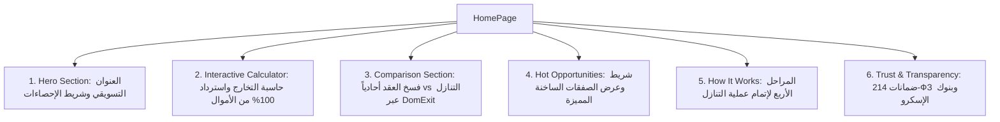

### 1.1. القسم الترويجي والافتتاحي (Hero Section)
- **العنوان الرئيسي (H1):** `«Безопасный выход из новостройки без потери вложенных средств»` (الخروج الآمن من العقارات قيد الإنشاء دون خسارة الأموال المستثمرة).
- **العنوان الفرعي:** شرح آلية التنازل عن حقوق المطالبة (Переуступка прав по 214-ФЗ) واسترداد الدفعات المسددة للمطور دون دفع غرامات فسخ العقد (10-15%).
- **شارات الثقة الفيدرالية:**
  - `«100% по 214-ФЗ»` (متوافق بالكامل مع القانون الفيدرالي 214).
  - `«Расчеты через эскроу»` (تسوية آمنة عبر حسابات الضمان البنكية).
  - `«Электронная регистрация в Росреестре»` (تسجيل إلكتروني رسمي لدى السجل العقاري الحكومي).
- **أزرار الدعوة للإجراء (Call to Action):**
  - زر البائع: `«Продать по переуступке»` $\rightarrow$ يوجه إلى `/sellers`.
  - زر المشتري: `«Смотреть каталог со скидками»` $\rightarrow$ يوجه إلى `/opportunities`.

### 1.2. الحاسبة المالية التفاعلية اللحظية (2-Minute Calculator)
تتيح للبائع حساب المبلغ الذي ينقذه من غرامة المطور:
- **شريط التمرير (Slider):** نطاق المبالغ المسددة للمطور: من 2,000,000 ₽ إلى 20,000,000 ₽ (القيمة الافتراضية: 3,500,000 ₽).
- **معادلة غرامة المطور:**
  $$\text{devPenalty} = \text{paidAmount} \times \left(\frac{\text{developerPenaltyPercent}}{100}\right) = 3,500,000 \times 15\% = 525,000 \text{ \symbol{8381}}$$
- **المبلغ المسترد للبائع عبر DomExit:** `paidAmount` (استرداد 100% من رأس المال المسدد دون اقتطاع غرامة).
- **النموذج السريع:** إدخال رقم الهاتف وإرسال الطلب؛ يُنشئ تلقائياً سجلاً في `deals` مع تسجيل دخول العميل فوراً كبائع.

### 1.3. جدول المقارنة الصريح (Comparison Table)
| وجه المقارنة | الفسخ الأحادي مع المطور (Расторжение ДДУ) | التنازل عبر DomExit (Переуступка прав) |
| :--- | :--- | :--- |
| **الخسارة المالية المقتطعة** | اقتطاع غرامة تعاقدية من 10% إلى 15% من قيمة العقد | **0% خسارة** (استرداد كامل المبلغ المسدد) |
| **المدة الزمنية للاسترداد** | من 6 إلى 12 شهراً مع نزاعات قضائية ومماطلة | **من 14 إلى 21 يوماً** عبر مشترٍ جاهز بتمويل معتمد |
| **التأثير على السجل الائتماني** | تعثر في سداد الأقساط وغرامات تأخير يومية | **سجل ائتماني نظيف** وتسوية بنكية رسمية |
| **آلية استلام الأموال** | شيك مؤجل أو تحويل بعد إشعار الفسخ بمدة طويلة | **تحرير فوري لحساب الإسكرو** بعد تسجيل الـ Росреестр |

---

## 2. استمارة تخارج البائعين (`src/pages/SellersPage.tsx`)

معالج متكامل من 4 خطوات (4-Step Wizard) يجمع بين التدقيق الصارم لبيانات العقار والتحقق من الرقم الضريبي (ИНН) ورفع المستندات إلى Yandex S3 مع ضمان المعرف الموحد:

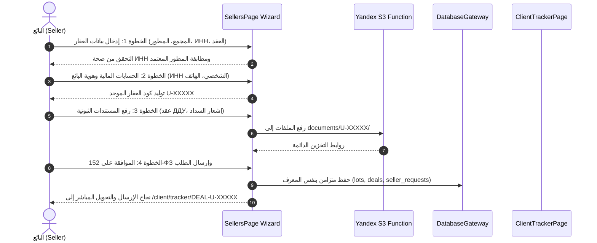

### 2.1. الخطوة الأولى: بيانات العقار والمطور العقاري (Step 1: Property & Developer)
- **المنطقة والمدينة:** قائمة المدن الروسية الرئيسية (موسكو وضواحيها، سانت بطرسبرغ وضواحيها).
- **المجمع السكني (ЖК):** إدخال اسم المشروع بدقة.
- **المطور العقاري ورقمه الضريبي (ИНН):**
  - اختيار من قائمة المطورين المعتمدين (ПИК, Самолет, ЛСР, Setl Group, ФСК, إلخ).
  - التحقق البرمجي التلقائي من صحة الـ ИНН التجاري المكون من 10 أرقام وفق خوارزمية Modulo-11.
- **رقم عقد المشاركة (ДДУ):** صيغة العقد الرسمية المعتمدة.
- **المواصفات الفنية:** الطابق الحالي، إجمالي طوابق البرج، عدد الغرف (استوديو، 1، 2، 3+)، والمساحة الإجمالية بالمتر المربع.

### 2.2. الخطوة الثانية: الحسابات المالية وهوية البائع (Step 2: Financials & Identity)
- **الحسابات المالية:**
  - السعر التعاقدي الأصلي في عقد المشاركة (Цена по ДДУ).
  - الرصيد المتبقي لشركة التطوير أو بنك الرهن (Остаток задолженности).
  - سعر التنازل المطلوب (Желаемая сумма к получению).
- **بيانات البائع الشخصية:**
  - الاسم الثلاثي للبائع (ФИО полностью).
  - رقم الهاتف الروسي المعتمد (مع قناع الإدخال الإجباري `+7 (XXX) XXX-XX-XX`).
  - البريد الإلكتروني للبائع.
  - الرقم الضريبي الشخصي للبائع (ИНН физлица) المكون من 12 رقماً، مع التحقق من معادلتي التحقق الحسابيتين الثنائيتين (Checksum Modulo 11).

### 2.3. الخطوة الثالثة: مستودع المستندات السحابي (Step 3: Document Vault & Photos)
خانات رفع مخصصة تضمن سلامة التدقيق القانوني قبل إرسال الطلب:
1. **عقد المشاركة في البناء الأصلي (Договор участия в долевом строительстве - ДДУ):** ملف PDF أو صورة واضحة.
2. **كشف سداد الحسابات (Акт сверки взаиморасчетов / Справка об оплате):** يثبت سداد الدفعات الفعلية للمطور.
3. **موافقة المطور العقاري على التنازل (Согласие застройщика на уступку):** إن كانت مطلوبة تعاقدياً.
4. **صور المخطط والشقة (Планировка и фотографии):** صور بصيغ JPEG, PNG, WEBP.
- تُرفع كافة الملفات إلى Yandex S3 عبر مسار موحد مرتبط بكود العقار: `documents/${canonicalLotCode}/...`.

### 2.4. الخطوة الرابعة: التوثيق والإرسال المتزامن (Step 4: Submission & Canonical Linking)
- **إقرار الموافقة الصريحة (152-ФЗ Consent):** خانة اختيار إلزامية للموافقة على معالجة البيانات الشخصية مع حفظ البصمة والـ IP المحجوب في جدول `user_consents`.
- **التسجيل المتزامن الموحد:**
  - توليد كود العقار الفريد: `U-XXXXX`.
  - إنشاء سجل العقار في `lots` بمعرف `U-XXXXX`.
  - إنشاء سجل طلب البائع في `seller_requests` بمعرف `sreq-U-XXXXX`.
  - إنشاء مسار الصفقة في `deals` بمعرف `DEAL-U-XXXXX`.
- **شاشة النجاح والتحويل:** عرض رقم الطلب وتعيين المنسق Алексей Смирнов، مع زر فوري: `«Перейти в трекер сделки»` للتحويل إلى `/client/tracker/DEAL-U-XXXXX`.

---

## 3. كتالوج العقارات والفرص الاستثمارية (`src/pages/OpportunitiesPage.tsx`)

واجهة تصفح شاملة لكافة الحصص والشقق المعروضة بنظام التنازل، مع دعم الفلترة متعددة المعايير والعرض الجغرافي التفاعلي.

### 3.1. شريط التصفية والفلترة الذكي (Advanced Filter Bar)
- **المدينة والمنطقة:** التصفية حسب موسكو أو سانت بطرسبرغ أو الضواحي.
- **نمط الغرف:** استوديو (Студия)، غرفة واحدة (1-комн)، غرفتان (2-комн)، 3 غرف فأكثر (3+ комн).
- **نطاق السعر الإجمالي:** منمنمات اختيار الميزانية بالروبل (مثال: من 5 إلى 15 مليون روبل).
- **نسبة التوفير مقارنة بالمطور:** فلترة الصفقات ذات الخصم (من 5% إلى أكثر من 20%).
- **المسافة لمحطة المترو:** مشياً على الأقدام (حتى 10 دقائق، حتى 15 دقيقة) أو بالمواصلات.
- **المطور العقاري المعتمد:** حصر النتائج في مطورين محددين (ПИК, Самолет, ЛСР).

### 3.2. محول العرض الثنائي (Dual Layout Switcher)
1. **عرض الشبكة (Grid View):** كروت عقارية غنية (`LotCard`) تعرض الصورة المعتمدة، شارات التوفير، السعر، موقع المترو، وتاريخ التسليم.
2. **عرض الخريطة التفاعلية (Yandex Map View):** استعراض جغرافي كامل عبر `ymaps3`؛ تظهر العقارات كعلامات تفاعلية، وبالنقر على أي علامة تظهر نافذة منبثقة مصغرة تحتوي على تفاصيل الشقة ورابط الانتقال إليها.

### 3.3. محرك الترتيب والفرز (Sorting Options)
- `По выгоде (скидка %)`: الترتيب بحسب أعلى نسبة توفير مالي مقارنة بأسعار المطور.
- `По возрастанию цены`: الترتيب من الأقل سعراً إلى الأعلى.
- `По убыванию цены`: الترتيب من الأعلى سعراً إلى الأقل.
- `По срочности выхода`: الترتيب بحسب أولوية وسرعة تخارج البائع.

---

## 4. صفحة تفاصيل العقار الشاملة (`src/pages/LotDetailsPage.tsx`)

تُمثّل هذه الصفحة واجهة العرض الرائدة للمنصة، وتجمع بين التفاصيل العقارية، والتدقيق القانوني الموثق، والمحادثة الفورية مع المنسق.

### 4.1. معرض الصور المعتمد والتغليف الاحترافي
- **مصفوفة الصور المعتمدة فقط:** يعرض المعرض الرئيسي حصراً الصور المعتمدة من قِبل منسق الصفقات (`curatorApprovedImages`) المستخلصة من استوديو التغليف الإداري، مع عزل أي صور غير مدققة.
- **مخطط الشقة الهندسي (Планировка):** صورة مخصصة تستعرض أبعاد الغرف وتوزيع المساحات المعيشية.

### 4.2. شريط المؤشرات المالية والمقارنة السعرية
- **سعر التنازل عبر DomExit (Цена переуступки):** بخط بارز باللون الأبيض والأخضر الزمردي.
- **سعر المطور للشقق المماثلة (Цена у застройщика):** مشطوب باللون الرمادي لإبراز التوفير.
- **شارة التوفير المالي الصافي (Чистая экономия):** بالروبل والنسبة المئوية (مثال: `Экономия: 1 450 000 ₽ (-12%)`).
- **رصيد حساب الإسكرو المودع (Сумма на эскроу-счете):** يوضح المبلغ المؤمن رسمياً في البنك الضامن.

### 4.3. بطاقة التدقيق القانوني الموثقة في المحاور الخمسة (5-Axis Legal Audit Scorecard)
تطبق الصفحة منهجية الشفافية الواقعية المعتمدة في `src/data/legalAuditAxes.ts`:

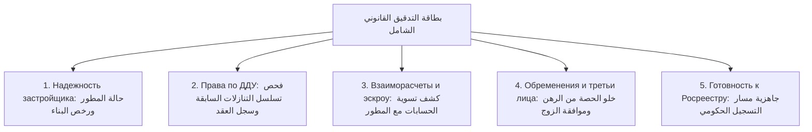

- **الحالات الواقعية الثلاث المعتمدة:**
  - `verified_safe` (أخضر): فحص مكتمل وخالٍ تماماً من الملاحظات.
  - `required_at_deal` (أزرق/كهرماني): يتطلب مستنداً تكميلياً يتم توقيعه وقت الصفقة مباشرة (مثل موافقة الزوجة العدلية).
  - `condition_found` (كهرماني): شرط تعاقدي مسبق قيد الاستيفاء من قِبل المنسق.
- **رابط شهادة التدقيق الرقمية الموثقة:** زر مباشر `«Смотреть официальный сертификат проверки»` ينقل إلى صفحة الشهادة الرقمية `/verify/:lotId`.

### 4.4. حاسبة الرهن العقاري والتمويل (Mortgage Estimator)
- مقارنة لحظية بين:
  - **الرهن العقاري العائلي المدعوم (Семейная ипотека 6%):** القسط الشهري المخفض.
  - **الرهن العقاري القياسي بسعر البنك المركزي (Стандартная ипотека 21%):** مع توضيح الفارق التراكمي في الأقساط.
- حساب الدفعة الأولى المطلوبة (от 20%) وفترة التمويل (حتى 30 سنة).

### 4.5. بطاقة المنسق المباشر ونافذة المحادثة المباشرة (`CuratorChatWidget`)
- **الملف التعريفي للمنسق المسؤول:** صورة المنسق Алексей Смирнов، المسمى الوظيفي (Ведущий юрист по переуступкам 214-ФЗ)، رقم الهاتف، ورابط تيليجرام.
- **زر المحادثة المباشرة:** `«Чат с куратором»` $\rightarrow$ يفتح نافذة المحادثة الفورية الجانبية (`CuratorChatWidget`) للتواصل اللحظي مع منسق العقار، ومناقشة المستندات، وترتيب معاينة الموقع.
- **زر الحجز الفوري:** `«Забронировать лот»` $\rightarrow$ يفتح نافذة الحجز المالي وتثبيت أسبقية الشراء (`ReservationModal`).

---

## 5. صفحة شهادة التحقق القانوني الرقمية (`src/pages/VerifyCertificatePage.tsx`)

توفر وثيقة رقمية عامة يمكن التحقق منها عبر مسار `/verify/:lotId`:
- **معلومات العقار الرسمية:** كود العقار، المجمع السكني، الطابق، اسم المطور ورقمه الضريبي (ИНН).
- **بصمة التدقيق الرقمية (Verification Fingerprint):** كود مشفر وبصمة SHA-256 تضمن عدم التلاعب بتقرير الفحص بعد اعتماده من الإدارة.
- **اعتماد المحامي المسؤول:** اسم وتوقيع رئيس الدائرة القانونية وتاريخ وساعة تثبيت التدقيق.
- **تفصيل نتائج المحاور الخمسة:** عرض النقاط التي تم فحصها وخلو العقار من القيود القضائية.
- **زر الطباعة والتنزيل:** توليد نسخة قابلة للطباعة بتنسيق رسمي ومرفقة بباركود رقمي.

---

## 6. بوابة العميل ومتابعة الصفقات (`ClientPortalPage` & `ClientTrackerPage`)

### 6.1. بوابة العميل الموحدة (`src/pages/ClientPortalPage.tsx`)
تتضمن واجهة مبوبة متكاملة حسب طبيعة العميل:
- **تبويب البائع (Мои заявки на продажу):** يعرض إعلانات العقارات المقدمة من البائع، وحالتها في خط العمليات، والمستندات المسجلة لها، مع رابط سريع للمحادثة مع المنسق.
- **تبويب المشتري (Мои бронирования и сделки):** يعرض العقارات التي حجزها المشتري، والبنك المعتمد لتمويله، ومسار الصفقة النشط.
- **تبويب المفضلة (Избранные лоты):** قائمة العقارات التي ميزها العميل للمتابعة.

### 6.2. شاشة المتابعة الحية لمراحل الصفقة الخمس (`src/pages/ClientTrackerPage.tsx`)
شريط تقدم تفاعلي يتابع محطات الصفقة خطوة بخطوة بالتواريخ والمستندات:

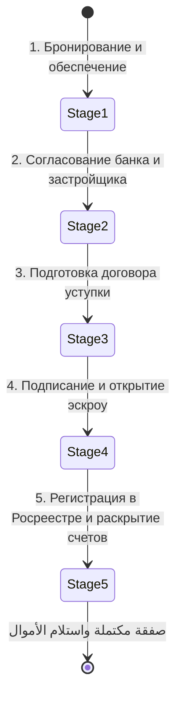

1. **المرحلة الأولى: الحجز ومبلغ التأمين (Бронирование и обеспечение):** تثبيت سعر العقار وإيداع عربون الحجز التعاقدي.
2. **المرحلة الثانية: موافقة البنك والمطور (Согласование банка и застройщика):** استخراج شهادة سداد الحسابات وموافقة بنك الإسكرو.
3. **المرحلة الثالثة: صياغة عقد التنازل وتدقيقه (Подготовка договора уступки):** مراجعة محامي DomExit لمسودة العقد ومطابقتها مع 214-ФЗ.
4. **المرحلة الرابعة: التوقيع وحجز الأموال (Подписание и открытие эскроу/аккредитива):** توقيع الأطراف وإيداع المشتري لكامل ثمن الشراء في الحساب البنكي المشروط.
5. **المرحلة الخامسة: التسجيل الحكومي وتحرير الأموال (Регистрация в Росреестре и раскрытие счетов):** استلام إشعار التسجيل الإلكتروني من هيئة الـ Росреестр، وتحويل حصة البيع بالكامل لحساب البائع وتحرير عمولة المنصة (2.5%) من حساب المشتري.

---

## 7. صفحات المحتوى والعلامة التجارية والمركز المعرفي (Content, Knowledge & CMS)

- **`HowItWorksPage.tsx`:** الشرح القانوني والعملي الكامل لآلية التنازل عن حقوق المشاركة في البناء مع الرسوم البيانية.
- **`StoryPage.tsx`:** قصة منصة DomExit ومهمتها في حل معضلة أقساط المطورين في ظل رفع البنك المركزي لأسعار الفائدة إلى 21%.
- **`VipCatalogPage.tsx`:** استعراض حصص المستثمرين ذات العوائد المرتفعة، مع بوابة الانضمام لنادي المستثمرين المغلق.
- **`KnowledgeHubPage.tsx` & `ArticleDetailPage.tsx`:** مقالات متخصصة محسنة لمحركات البحث (SEO) تشرح تفاصيل 214-ФЗ، وحسابات الإسكرو، وحقوق الزوجية في العقار.
- **`FAQPage.tsx`:** قاعدة أسئلة شائعة تفاعلية مقسمة للبائعين، والمشترين، والوسطاء، والبنوك الشريكة.
- **`LegalIndexPage.tsx`, `LegalDocumentReaderPage.tsx`, `LegalArchivePage.tsx`:** الواجهات الرسمية لنظام إدارة السياسات والوثائق القانونية المتوافق مع متطلبات 152-ФЗ و 38-ФЗ، متضمنة قارئ النصوص، وتاريخ الإصدارات، وبصمات التشفير SHA-256.


---

# الفصل التاسع: مواصفات الشاشات الإدارية وغرفة العمليات (Admin & Operations Pages Specification)

توفر منصة **DomExit** منظومة تشغيلية وإدارية خلفية متكاملة لفرق العمل ومنسقي الصفقات (Curators)، والمحامين، والمدققين الماليين، وإدارة المنصة، وممثلي البنوك الشريكة. تقع كافة هذه الشاشات تحت حماية **`AdminRouteGuard`** مع دعم عزل الصفقات لكل منسق وتحديث البيانات المباشر عبر **DAL Gateway**.

---

## 1. لوحة القيادة والمؤشرات العامة (`src/pages/AdminDashboardPage.tsx`)

تُمثّل مركز التحكم والرقابة الشامل للمنصة، وتوفر قراءة لحظية لمؤشرات الأداء التشغيلية والمالية:

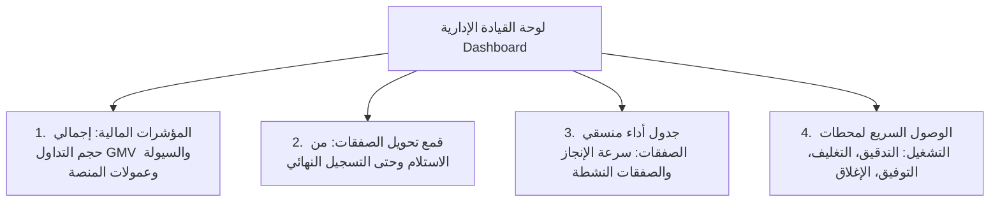

### 1.1. المؤشرات التشغيلية والمالية الرئيسية (Key Performance Indicators)
- **إجمالي حجم التداول قيد التنفيذ (GMV по сделкам):** إجمالي القيمة المالية للعقارات النشطة في خط العمليات بالروبل.
- **العقارات النشطة في الكتالوج (Активные лоты):** عدد العقارات المنشورة والمعتمدة المتاحة للمشترين.
- **رؤوس الأموال المحمية للبائعين (Спасенный капитал):** المبالغ التي تم إنقاذها للبائعين من غرامات فسخ العقود لدى المطورين (احتساب 15% من قيمة العقود).
- **أرباح المنصة المتوقعة (Комиссионный пайплайн 2.5%):** إجمالي أتعاب المنصة المستحقة للتحصيل عند إغلاق الصفقات بعد تسجيل الـ Росреестр.
- **متوسط سرعة الإنجاز والتخارج (Средний срок реализации):** يقاس بالأيام (المعدل المستهدف: 14 إلى 21 يوماً).

### 1.2. قمع تدفق الصفقات (Deal Conversion Funnel)
توزيع الحالات عبر المراحل:
1. `Входящие заявки` (الطلبات الواردة حديثاً).
2. `Юридический аудит` (قيد التدقيق القانوني في المحاور الخمسة).
3. `Упаковка лота` (في استوديو التغليف واعتماد الصور).
4. `Активный каталог` (معروض للبيع العام).
5. `Матчмейкинг и бронь` (جاري مطابقة المشترين أو محجوز).
6. `Эскроу и Росреестр` (في مرحلة الإسكرو والتسجيل الحكومي).
7. `Успешно закрытые` (صفقات مكتملة ومحررة الأموال).

### 1.3. جدول توزيع المهام على المنسقين (Curator Workload & Performance)
يعرض لكل منسق قانوني: الاسم، عدد العقارات المسندة، الصفقات المغلقة، ومتوسط سرعة الإغلاق بالأيام، مع مؤشر الأداء العام.

---

## 2. لوحة إدارة خط العمليات وكانبان الصفقات (`src/pages/AdminPipelinePage.tsx`)

تُمثّل شاشة المتابعة اليومية لمديري العمليات والمنسقين، وتعتمد على واجهة كانبان تفاعلية (Kanban Pipeline Board):

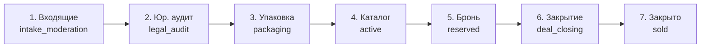

### 2.1. أعمدة خط العمليات وحالاتها البرمجية
1. **المراجعة والاستلام الأولي (`intake_moderation`):** فحص أولي لطلب البائع وصحة رقم العقد والمطور.
2. **التدقيق القانوني (`legal_audit`):** فحص المحاور الخمسة وسجلات الإفلاس والمحاكم وسداد المطور.
3. **استوديو التغليف (`packaging`):** تحرير الوصف، إعداد بطاقة السعر، واعتماد الصور الاحترافية.
4. **العرض النشط في الكتالوج (`active`):** العقار معتمد ومتاح للعامة والمستثمرين.
5. **التوفيق والحجز التعاقدي (`reserved`):** تقدم مشترٍ مؤهل بتمويل معتمد وإيداع عربون الحجز.
6. **التوقيع والتسجيل والإسكرو (`deal_closing`):** توقيع عقد التنازل، إيداع الأموال في البنك، والتسجيل في Росреестр.
7. **إغلاق الصفقة بنجاح (`sold`):** تحرير الأموال للبائع واستلام أتعاب المنصة وأرشفة الملف.

### 2.2. الدرج الجانبي التفاعلي المتقدم (CRM Slide-Over Drawer)
عند النقر على أي صفقة أو عقار في الكانبان، يفتح درج جانبي سريع يحتوي على تبويبين:
- **تبويب النظرة العامة (`overview`):**
  - بيانات العقار: العنوان، المطور، الطابق، المساحة، السعر، ونسبة الخصم.
  - بيانات الأطراف: اسم وهاتف البائع، اسم وهاتف المشتري.
  - مستودع المستندات المرفوعة: استعراض وتنزيل عقد الـ ДДУ، شهادة السداد، وموافقة المطور مع مؤشر التحقق.
  - أزرار النقل السريع: الانتقال المباشر لاستوديو التغليف، التدقيق القانوني، التوفيق، أو غرفة الإغلاق.
  - زر الحذف المتسلسل الشامل: متاح للمالك لتنفيذ `PropertyLifecycleService.deletePropertyCascade`.
- **تبويب المحادثة المباشرة مع العميل (`chat`):**
  - تضمين ويدجت المحادثة الحية `CuratorChatWidget` للتواصل اللحظي بين المنسق والعميل دون مغادرة شاشة الكانبان.
  - شارة عدد الرسائل غير المقروءة (`unreadMap`).

---

## 3. استوديو التغليف وإعداد الإعلانات (`src/pages/AdminPackagingPage.tsx`)

يُعد استوديو التغليف محطة إعداد المحتوى التسويقي والفني للعقار لضمان أقصى جاذبية مع الالتزام التام بضوابط الخصوصية لـ **152-ФЗ**.

### 3.1. محرر البيانات والمواصفات الفنية
- **إخفاء رقم الشقة وحجب الطابق (152-ФЗ Privacy):**
  - خيار إخفاء الطابق المحدد (`hideFloor`) واستبداله بنطاق طوابق تقريبي (مثال: `5–10 этаж из 25`) لحماية خصوصية البائع ومنع الوسطاء المتطفلين من الوصول إليه مباشرة.
- **البيانات المكانية والنقل:** تحديد أقرب محطة مترو، والمسافة بالدقائق، ونمط الوصول (مشياً أو بالسيارة)، وإحداثيات الخريطة الدقيقة.
- **المواصفات الإنشائية:** اسم المجمع السكني، المطور، المساحة الإجمالية، ارتفاع الأسقف (مثال: `2.78 м`)، وتاريخ التسليم المتوقع.

### 3.2. الضبط المالي وبطاقة التسعير
- **سعر التنازل عبر DomExit:** السعر النهائي المعروض للمشترين.
- **سعر المطور المعياري للشقق المماثلة:** يتم جلبه من بيانات السوق لإظهار حجم التوفير.
- **الحساب الآلي للخصم والتوفير:** احتساب الخصم المالي الصافي ونسبته المئوية تلقائياً.

### 3.3. نظام اعتماد الصور الفوتوغرافية وفصل المصادر (Photo Curation System)
تعتمد المنصة تصميماً صارماً يفصل بين نوعين من الصور:
1. **صور البائع الأولية غير المعتمدة (`sellerPhotos`):** الصور والمخططات التي رفعها البائع في استمارة التخارج، وتبقى في مسودة الإدارة ولا تظهر في الكتالوج العام.
2. **الصور المعتمدة رسمياً للنشر (`approvedPhotos`):** الصور التي يفحصها المنسق ويعتمدها يدوياً للعرض العام في الكتالوج وصفحة العقار.
- **إجراءات المنسق على الصور:**
  - زر التبديل السريع لاعتماد أو حجب أي صورة (`handleTogglePhotoApproval`).
  - رفع صور احترافية جديدة مباشرة عبر دالة `s3-upload` لتخزينها في مسار `photos/{lotCode}/...`.
  - تحديد الصورة الرئيسية للغلاف (`setCoverImageUrl`).
- **المزامنة اللحظية وإبطال الكاش:** عند حفظ التعديلات عبر زر `«Сохранить изменения и опубликовать»`، يتم حفظ السجل في `LotsRepository` وإبطال كافة مفاتيح الكاش فوراً وبث حدث التحديث للواجهة العامة.

---

## 4. محرك التدقيق القانوني الموثق في المحاور الخمسة (`src/pages/AdminLegalAuditPage.tsx`)

يُدار الفحص القانوني عبر منصة تدقيق احترافية موثقة برمجياً وفقاً لأحكام القانون 214-ФЗ والقوانين الفيدرالية المرتبطة:

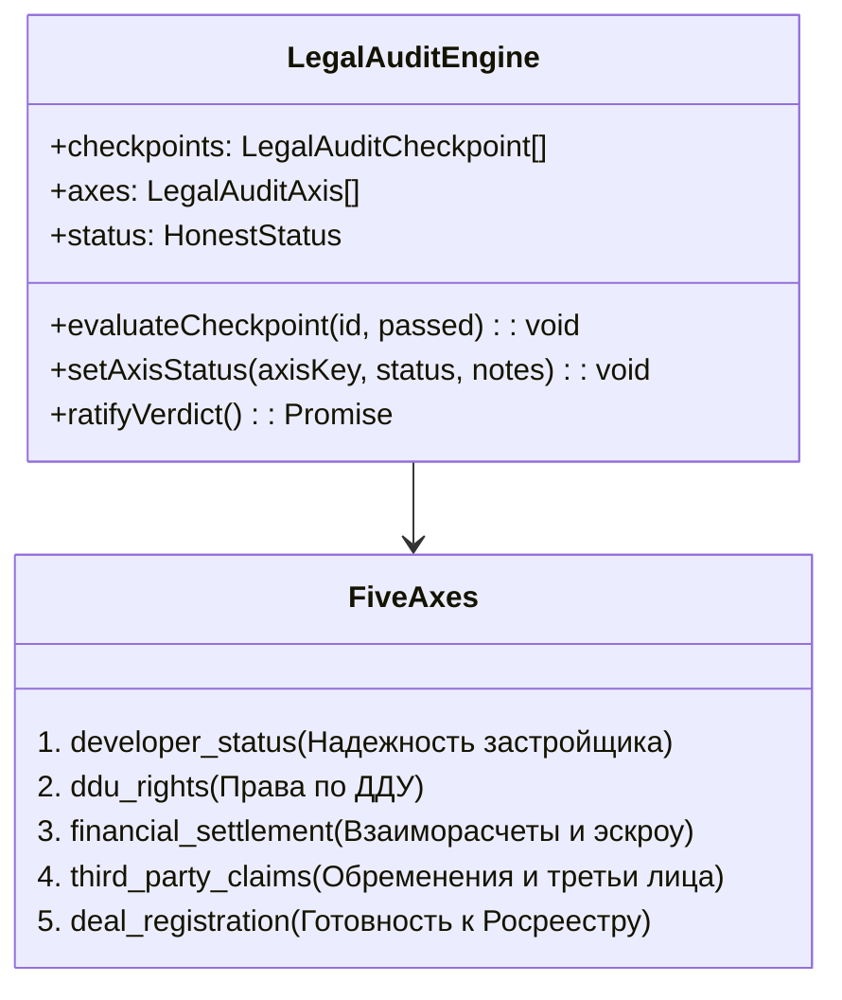

### 4.1. تفصيل المحاور الخمسة ونقاط التحقق (The 5 Real Legal Axes)
1. **المحور الأول: موثوقية المطور ورخص المشروع (`developer_status`):**
   - فحص سجل الإفلاس الفيدرالي (ЕФРСБ / Федресурс 127-ФЗ) للمطور والشركة الأم.
   - التحقق من القضايا في كارتوتيكا المحاكم (КАД Арбитраж и ГАС Правосудие).
   - سريان ترخيص البناء والامتثال لتواريخ تسليم المراحل في البوابة الموحدة (ЕИСЖС наш.дом.рф).
2. **المحور الثاني: تسلسل حقوق المشاركة في البناء (`ddu_rights`):**
   - مطابقة العقد الأصلي والملحقات المسجلة في هيئة الـ Росреестр.
   - التحقق من عدم وجود تنازلات سابقة باطلة أو غير مدفوعة الثمن.
3. **المحور الثالث: التسوية المالية ورصيد الإسكرو (`financial_settlement`):**
   - فحص شهادة سداد الحسابات (Акт сверки расчетов) الصادرة ومختومة من المطور.
   - مطابقة كشف إيداع رصيد الإسكرو البنكي وفقاً لمتطلبات البنك المركزي الروسي.
4. **المحور الرابع: خلو الحصة من مطالبات الغير والنزاعات العائلية (`third_party_claims`):**
   - استعلام ملفات التنفيذ الجبري والديون والرهون لدى محصلي الديون القضائيين (ФССП).
   - التحقق من موافقة الزوجة/الزوج الموثقة عدلياً أو شهادة عدم الارتباط الزوجي.
   - التأكد من عدم استخدام أموال دعم الأمومة (Материнский капитал) بطريقة تلزم بتخصيص حصص للأطفال قبل استكمال البناء.
5. **المحور الخامس: الجاهزية للتسجيل الإلكتروني في Росреестр (`deal_registration`):**
   - مطابقة الصياغة القانونية لاتفاقية التنازل (Договор уступки) مع متطلبات الشهر العقاري.
   - التحقق من صلاحية التوقيع الإلكتروني المعزز (УКЭП) لأطراف الصفقة.

### 4.2. الحالات الواقعية الثلاث المعتمدة (Honest Status Framework)
- `verified_safe` (أخضر): فحص مكتمل وآمن تماماً وخالٍ من أي عوائق.
- `required_at_deal` (أزرق/كهرماني): يتطلب مستنداً أو إجراءً يوقع وقت إبرام الصفقة بالبنك.
- `condition_found` (كهرماني): شرط خاص يستدعي تسوية محددة قبل توجيه المشتري.

### 4.3. تثبيت الحكم والاعتماد الرقمي (Ratify Verdict Action)
عند ضغط المحامي على زر `«Зафиксировать вердикт»`:
- يتم تجميد نتائج المحاور ونقاط التحقق مع تدوين اسم المحامي وتاريخ وساعة الاعتماد.
- يتم توليد بصمة تدقيق رقمية SHA-256 وحفظها في وثيقة العقار.
- يتم تحديث حالة العقار في `lots` وتحديث سجل الصفقة المرتبط في `deals`.
- يتم إبطال الكاش وبث التحديث لتنعكس شهادة التدقيق فوراً في صفحة العقار والشهادة الرقمية `/verify/:lotId`.

---

## 5. محرك التوفيق ومطابقة المشترين (`src/pages/AdminMatchmakerPage.tsx`)

يتولى مطابقة قاعدة بيانات المشترين المسجلين في المنصة مع متطلبات العقار المعروض لضمان سرعة إغلاق قياسية:

### 5.1. معايير خوارزمية المطابقة (Matching Engine Criteria)
1. **ملاءمة الميزانية والقدرة المالية (Budget Match):** تطابق سقف تمويل المشتري مع سعر التنازل المطلوب.
2. **جاهزية التمويل البنكي (Bank Approval Readiness):** تفضيل المشترين الحاصلين على موافقة مسبقة على الرهن العقاري من بنك الإسكرو المعتمد للمشروع (Сбер, ВТБ, Альфа).
3. **السيولة الفورية (Cash 48h):** المشترون الجاهزون لدفع الدفعة الأولى كاش وإيداعها في غضون 48 ساعة.
4. **التوزيع الجغرافي ونمط الوحدات:** تطابق رغبات المشتري من حيث المدينة وعدد الغرف.

### 5.2. خط أنابيب المرشحين (Candidate Pipeline)
- `Связались (Contacted)`: تم التواصل مع المشتري وعرض العقار عليه.
- `Одобрен банком (Approved by Bank)`: البنك اعتمد تمويل هذا العقار تحديداً للمشتري.
- `Назначен просмотр (Viewing Scheduled)`: موعد معاينة المجمع السكني وموقع البرج.
- `Выставлен оффер (Offer Made)`: تقديم عرض شراء رسمي.
- `Принят (Accepted)`: قبول العرض وتثبيت الحجز.

### 5.3. إجراء التعيين والحجز (Assign & Reserve Action)
عند اعتماد المرشح:
- يتم ربط المشتري بمسار الصفقة في جدول `deals`.
- تتحول حالة العقار في جدول `lots` إلى `reserved`.
- يتم توليد اتفاقية الحجز المبدئية وإشعار البائع والمنسق فوراً.

---

## 6. غرفة إغلاق الصفقات وحسابات الإسكرو (`src/pages/AdminClosingPage.tsx`)

تُمثّل المحطة النهائية للتنفيذ المالي والقانوني للصفقة، وتُشرف على 5 خطوات تنفيذية محكمة:

### 6.1. مراحل غرفة الإغلاق التنفيذية
- **الخطوة أ (Шаг 1): تثبيت شروط الحجز والتأمين (Бронирование):** التحقق من إيداع عربون الجدية ومطابقة الهويات.
- **الخطوة ب (Шаг 2): موافقة بنك الإسكرو والمطور (Согласование банка):** استلام إشعار البنك الضامن وموافقة شركة التطوير على التنازل.
- **الخطوة ج (Шаг 3): التوقيع وإيداع كامل الثمن (Подписание и депонирование):**
  - توقيع عقد التنازل عن حق المطالبة (Договор уступки).
  - إيداع المشتري لكامل ثمن الشراء في حساب إسكرو بنكي مشروط أو خطاب اعتماد (Аккредитив).
  - رفع إيصال الإيداع المعتمد في مستندات الصفقة.
- **الخطوة د (Шаг 4): التقديم للتسجيل الحكومي (Подача в Росреестр):**
  - إرسال الحزمة إلكترونياً إلى مكاتب الـ Росреестр عبر التوقيع الإلكتروني المعتمد.
  - تسجيل رقم الطلب الحكومي وتتبع سريانه.
- **الخطوة هـ (Шаг 5): تسجيل العقد وتحرير الأموال (Регистрация и раскрытие счетов):**
  - استلام إشعار التسجيل الرسمي بختم الـ Росреестр الإلكتروني.
  - قيام البنك بتحرير كامل قيمة البيع لحساب البائع فوراً دون خصم أي غرامات (0% عمولة على البائع).
  - تحرير عمولة المنصة البالغة 2.5% من حساب المشتري المخصص.
  - نقل حالة العقار إلى `sold` وحالة الصفقة إلى `closed`.

### 6.2. آلية إعادة الطرح الطارئ (Emergency Relist Modal)
في حال تخلف المشتري عن إيداع ثمن الشراء في الحساب البنكي المشروط خلال المهلة المحددة (48 ساعة)، تتيح الغرفة للمنسق إلغاء الحجز بضغطة زر واحدة وإعادة طرح العقار فورياً في الكتالوج العام كصفقة ساخنة مع إشعار المرشحين الاحتياطيين في Matchmaker.

---

## 7. الوحدات الإدارية المساندة (Supporting Back-Office Modules)

- **إدارة شبكة الشركاء والوسطاء (`src/pages/AdminBrokersPage.tsx`):** متابعة طلبات انضمام وكالات العقارات والوسطاء، توليد أكواد الإحالة التسويقية، وتتبع نسب العمولات المستحقة للشركاء.
- **الملف المهني للمنسق (`src/pages/AdminCuratorProfilePage.tsx`):** واجهة مخصصة لكل منسق لاستعراض سجل إنجازاته، متوسط سرعة إغلاق الصفقات، تقييمات العملاء، وإدارة وسائل التواصل.
- **سجل الأحداث والرقابة الأمنية (`src/pages/AdminArchiveLogsPage.tsx`):** سجل غير قابل للتعديل (Immutable Journal) يستعلم من جدول `audit_logs`؛ يوثق كافة التعديلات على الأسعار، والتدقيق القانوني، وعمليات الحذف والاعتماد مع تسجيل هوية المنفذ وعنوان الـ IP ووقت العملية بالثانية.
- **بوابة موظفي البنوك الشريكة (`src/pages/BankPortalPage.tsx`):** شاشة مخصصة لمسؤولي الائتمان في بنوك Сбербанк, ВТБ, Альфа-Банк لمراجعة طلبات الرهن العقاري، وتأكيد فتح حسابات الإسكرو، وإصدار خطابات الموافقة الاستثنائية.


---

# الفصل العاشر: دليل المكونات والنوافذ والويدجت (Components, Modals & Widgets Catalog)

يحتوي هذا الفصل على حصر وتوثيق شامل ودقيق بنسبة 100% لكافة المكونات الثلاثين (30 Components) الموزعة في مجلد `src/components/**`. يتضمن التوثيق مواصفات الواجهات البرمجية (Props)، والحالة الداخلية (Internal State)، والوظيفة المعمارية، وتفاصيل التفاعل.

---

## 1. فهرس المكونات العام (30 Component Inventory)

| # | مسار المكون | الوصف المعماري | التصنيف |
|---|---|---|---|
| 1 | `src/components/admin/LegalCmsManager.tsx` | مدير CMS القانوني للسياسات وحساب بصمات التشفير | إدارة المحتوى |
| 2 | `src/components/auth/AdminRouteGuard.tsx` | حارس المسارات الإدارية والتأمين الحصري | أمان وتوجيه |
| 3 | `src/components/auth/AuthModal.tsx` | نافذة تسجيل الدخول والتسجيل وربط Yandex OAuth | مصادقة |
| 4 | `src/components/booking/BookingModal.tsx` | نافذة حجز العقار وتثبيت الوديعة وإعداد مسار الصفقة | تعاملات وحجز |
| 5 | `src/components/catalog/AdvancedFilterDrawer.tsx` | درج التصفية المتقدمة للكتالوج على الأجهزة الذكية | كتالوج وفلترة |
| 6 | `src/components/catalog/LotCard.tsx` | بطاقة العقار الذكية بالكتالوج وشارات التوفير والتحقق | عرض بيانات |
| 7 | `src/components/catalog/QuickMatchModal.tsx` | نافذة المطابقة السريعة للعقار مع المشترين المحتملين | مطابقة وذكاء |
| 8 | `src/components/chat/CuratorChatWidget.tsx` | درج المحادثة اللحظية المباشرة مع منسق العقار | محادثة فورية |
| 9 | `src/components/chat/EscrowBridgeChatModal.tsx` | نافذة المحادثة الخاصة بتسهيلات جسر الإسكرو البنكي | محادثة متخصصة |
| 10 | `src/components/common/BankGatewayErrorBoundary.tsx` | حاجز اعتراض ومعالجة أخطاء بوابات البنوك الشريكة | استقرار وأمان |
| 11 | `src/components/common/Skeletons.tsx` | هياكل التحميل العظمية (Skeleton Loaders) لسرعة FCP | أداء وتجربة |
| 12 | `src/components/common/VirtualizedList.tsx` | قائمة افتراضية فائقة الأداء لعرض مئات العناصر بسلاسة | أداء وتصيير |
| 13 | `src/components/compliance/ConsentCheckboxes.tsx` | خانات الاختيار القانونية الموحدة لـ 152-ФЗ و 38-ФЗ | امتثال قانوني |
| 14 | `src/components/compliance/ConsentGateModal.tsx` | نافذة إجبارية لحظر الاستخدام عند تحديث السياسات القانونية | امتثال وأمان |
| 15 | `src/components/compliance/CookieConsentBanner.tsx` | شريط ملفات تعريف الارتباط القانوني وتصنيف الأغراض | امتثال وخصوصية |
| 16 | `src/components/documents/DocumentVaultModal.tsx` | نافذة مستودع المستندات لرفع وفحص وتنزيل ملفات S3 | إدارة وثائق |
| 17 | `src/components/layout/AdminHeader.tsx` | الترويسة الإدارية العلوية بمؤشر البيئة وتبديل الأدوار | تخطيط إداري |
| 18 | `src/components/layout/AdminSidebar.tsx` | القائمة الجانبية الإدارية بعدادات خط الصفقات | تخطيط إداري |
| 19 | `src/components/layout/PublicLayout.tsx` | التخطيط العام الشامل للموقع العام للزوار والعملاء | تخطيط عام |
| 20 | `src/components/layout/UnifiedNavbar.tsx` | شريط التنقل العلوي العام الموحد مع زر الدخول السريع | تخطيط عام |
| 21 | `src/components/layout/UnifiedFooter.tsx` | التذييل الموحد الغني بروابط الإفصاح والبيانات الرسمية | تخطيط عام |
| 22 | `src/components/legal/SmartLegalDocumentView.tsx` | عارض النصوص القانونية الذكي مع استبدال المتغيرات الحية | عرض قانوني |
| 23 | `src/components/lot/PublicLegalReportModal.tsx` | نافذة التقرير القانوني العام للعقار للمشترين | عرض قانوني |
| 24 | `src/components/lot/SmartMortgageCalculator.tsx` | حاسبة الرهن الذكية لمقارنة فائدة 6% عائلي و 21% عام | حاسبات مالية |
| 25 | `src/components/maps/AddressAutocompleteInput.tsx` | حقل الإدخال الذكي للعناوين بالربط مع خرائط ياندكس | خرائط وإدخال |
| 26 | `src/components/maps/YandexCatalogMap.tsx` | الخريطة الجغرافية المجمعة لكتالوج العقارات (v3) | خرائط تفاعلية |
| 27 | `src/components/maps/YandexLotMap.tsx` | خريطة موقع العقار المنفرد مع محطة المترو والخدمات | خرائط تفاعلية |
| 28 | `src/components/profile/UserProfileModal.tsx` | نافذة إدارة الملف الشخصي للعميل وأرقام التواصل | ملف مستخدم |
| 29 | `src/components/seo/JsonLdStructuredData.tsx` | مولد البيانات المنظمة لمحركات البحث Schema.org | تحسين محركات |
| 30 | `src/components/vip/VipSubscriptionModal.tsx` | نافذة الانضمام لنادي المستثمرين المغلق وعروض VIP | استثمار ومبيعات |

---

## 2. المواصفات الفنية التفصيلية للمكونات

### 2.1. محادثة المنسق المباشرة: `src/components/chat/CuratorChatWidget.tsx`
- **الغرض:** فتح درج جانبي منبثق (Slide-over Drawer) في الشاشات العامة وصفحة العقار يتيح للعميل محادثة المنسق القانوني المخصص للعقار لحظياً.
- **الواجهة البرمجية (Props):**
  ```typescript
  interface CuratorChatWidgetProps {
    isOpen: boolean; // حالة ظهور الدرج
    onClose: () => void; // دالة الإغلاق
    dealId?: string; // معرف الصفقة المرتبط
    lotCode?: string; // كود العقار المرتبط (مثال: "U-62090")
    curatorName?: string; // اسم المنسق (افتراضياً: "Алексей Смирнов")
    curatorAvatar?: string; // رابط صورة المنسق
  }
  ```
- **الحالة الداخلية وإدارة البيانات:**
  - يستعلم من `CuratorChatRepository.getMessages(dealId)`.
  - يشترك في `DatabaseGateway.subscribe` للتحديث التلقائي للرسائل الجديدة دون الحاجة لإعادة تحميل.
  - يدعم إرسال نصوص ورفع مرفقات صور ومستندات عبر زر المشبك التلقائي.
  - يقوم تلقائياً بتمييز الرسائل كمقروءة (`clientRead: true` أو `curatorRead: true`).

---

### 2.2. مستودع المستندات السحابي: `src/components/documents/DocumentVaultModal.tsx`
- **الغرض:** نافذة مركزية منبثقة لإدارة كافة المستندات والملفات الثبوتية المرفوعة للعقار (عقد ДДУ، إشعار سداد، موافقة المطور، بطاقة الهوية).
- **الواجهة البرمجية (Props):**
  ```typescript
  interface DocumentVaultModalProps {
    isOpen: boolean;
    onClose: () => void;
    lotCode: string;
    readOnly?: boolean; // وضع القراءة فقط للمشترين قبل التوقيع
    onDocumentsUpdated?: (docs: DocumentMetadata[]) => void;
  }
  ```
- **الميزات الأساسية:**
  - رفع السحب والإفلات (Drag & Drop) للملفات المتعددة.
  - اختيار تصنيف الوثيقة الإلزامي (`category`).
  - التنزيل الفوري عبر الدالة السيرفرلس `s3-download`.
  - فحص نوع الملف وحجمه (الحد الأقصى 25 ميجابايت).

---

### 2.3. بطاقة العقار بالكتالوج: `src/components/catalog/LotCard.tsx`
- **الغرض:** الكارت الأساسي لعرض العقار في شبكة الكتالوج والصفحة الرئيسية.
- **الواجهة البرمجية (Props):**
  ```typescript
  interface LotCardProps {
    lot: Lot; // كائن العقار الكامل
    featured?: boolean; // تمييز العقار بإطار خاص
    onQuickMatch?: (lot: Lot) => void; // فتح نافذة التوفيق السريع
  }
  ```
- **العناصر المعروضة بالكارت:**
  - صورة الغلاف الرئيسية من `curatorApprovedImages`.
  - شارة نسبة التوفير باللون الأخضر الصريح (مثال: `-15%`).
  - شارة الاعتماد: `«214-ФЗ • Проверен»`.
  - السعر المعروض وسعر المطور المشطوب.
  - أقرب محطة مترو والمسافة بالدقائق.
  - زر المفضلة التفاعلي المربوط بـ `useAuth().toggleFavorite`.

---

### 2.4. حاسبة الرهن الذكية: `src/components/lot/SmartMortgageCalculator.tsx`
- **الغرض:** مكون حاسبة تفاعلي مدمج في صفحة العقار لمقارنة برامج التمويل العقاري الروسية.
- **الواجهة البرمجية (Props):**
  ```typescript
  interface SmartMortgageCalculatorProps {
    propertyPrice: number; // سعر العقار بالروبل
    downPaymentPercent?: number; // النسبة الافتراضية للدفعة الأولى (20%)
  }
  ```
- **المنطق الحسابي:**
  - يجلب أسعار الفائدة تلقائياً من `MarketSettingsRepository` (سعر البنك المركزي 21% والرهن العائلي 6%).
  - يحسب الدفعة الشهرية المتساوية (Аннуитетный платеж) وصافي الفوائد التراكمية.
  - يوضح الفارق الشهري الموفر عند الاستفادة من الرهن العائلي المدعوم.

---

### 2.5. حقل الإكمال التلقائي للعناوين والخرائط: `src/components/maps/AddressAutocompleteInput.tsx`
- **الغرض:** حقل إدخال جغرافي متصل بـ Yandex Geocoding API لاقتراح العناوين في موسكو وسانت بطرسبرغ بدقة.
- **الواجهة البرمجية (Props):**
  ```typescript
  interface AddressAutocompleteInputProps {
    value: string;
    onChange: (address: string, coords?: { lat: number; lng: number }) => void;
    placeholder?: string;
    cityCode?: RussianCityCode;
  }
  ```
- **السلوك:**
  - استدعاء مؤجل (Debounced Fetch) لخدمة عناوين ياندكس بعد توقف المستخدم عن الكتابة بـ 300 مللي ثانية.
  - استخراج الإحداثيات الجغرافية (`lat`, `lng`) وتمريرها تلقائياً لمخزن العقار لوضع العلامة على الخريطة.

---

### 2.6. خانات الموافقة القانونية الموحدة: `src/components/compliance/ConsentCheckboxes.tsx`
- **الغرض:** مجموعة خانات الاختيار الإلزامية في كافة الاستمارات للامتثال للقوانين 152-ФЗ و 38-ФЗ.
- **الواجهة البرمجية (Props):**
  ```typescript
  interface ConsentCheckboxesProps {
    state: ConsentState;
    onChange: (nextState: ConsentState) => void;
    showAdConsent?: boolean; // إظهار خانة الرسائل الدعائية (اختيارية)
    disabled?: boolean;
  }
  ```
- **الروابط المتضمنة بالنص:**
  - رابط سياسة معالجة البيانات الشخصية (`/legal/privacy`).
  - رابط شروط الاستخدام (`/legal/terms`).
  - رابط الإقرار بالموافقة على معالجة البيانات (`/legal/consent-pd`).

---

### 2.7. نافذة حظر الاستخدام للتجديد القانوني: `src/components/compliance/ConsentGateModal.tsx`
- **الغرض:** نافذة حظر إجبارية تظهر للمستخدم المسجل عند قيام الإدارة بإجراء تعديل جوهري (Material Change) على إحدى السياسات القانونية في CMS القانوني؛ تمنع استخدام الحساب حتى النقر على `«Принять обновленные условия»`، وتوثق الموافقة الجديدة في `user_consents`.

---

### 2.8. شريط الكوكيز الفيدرالي: `src/components/compliance/CookieConsentBanner.tsx`
- **الغرض:** شريط عائم أسفل الشاشة يظهر للزوار الجدد، يتيح قبول ملفات تعريف الارتباط التقنية الإلزامية أو إدارة تفضيلات التخصيص والتحليلات، ويحفظ الاختيار في `localStorage`.

---

### 2.9. الترويسة والقائمة الجانبية الإدارية: `AdminHeader` & `AdminSidebar`
- **`AdminHeader.tsx`:** تعرض شارة البيئة النشطة (إنتاج/تجربة مع تحذير بصري في التجربة)، وتبويب التبديل السريع للمستخدم، وقائمة التنبيهات وزر تسجيل الخروج.
- **`AdminSidebar.tsx`:** شريط جانبي داكن يحتوي على روابط محطات العمليات (`Pipeline`, `Packaging`, `Legal Audit`, `Matchmaker`, `Closing`, `Brokers`, `Archive Logs`) مع شارات أعداد الحالات النشطة بكل قسم.

---

### 2.10. خرائط ياندكس التفاعلية: `YandexCatalogMap` & `YandexLotMap`
- **`YandexCatalogMap.tsx`:** تعرض مئات العقارات المعروضة على خريطة العاصمة ومحيطها، وتدعم التجميع العنقودي (Clustering) والنقر على المجموعات لتكبير الرؤية، وعرض بطاقة العقار عند النقر.
- **`YandexLotMap.tsx`:** تعرض الموقع المحدد للعقار، مع رسم المسار التقديري لمحطة المترو والمنشآت التعليمية والطبية المحيطة.


---

# الفصل الحادي عشر: المحرك المالي والمعادلات الحسابية والخوارزميات (Financial Engine, Formulas & Algorithms)

يرتكز نموذج أعمال **DomExit** على محرك مالي منضبط يهدف إلى توفير بديل عادل وشفاف وعالي السيولة لسوق العقارات قيد الإنشاء في روسيا الاتحادية. يُلغي هذا المحرك خسائر البائعين الناتجة عن غرامات المطورين الجائرة عند التعثر في سداد الأقساط، ويوفر للمشترين خصومات حقيقية مقارنة بأسعار السوق مع حماية حقوق كافة الأطراف عبر حسابات الإسكرو البنكية المشروطة.

---

## 1. الفلسفة الاقتصادية وهيكل تدفق القيمة (Value Flow Architecture)

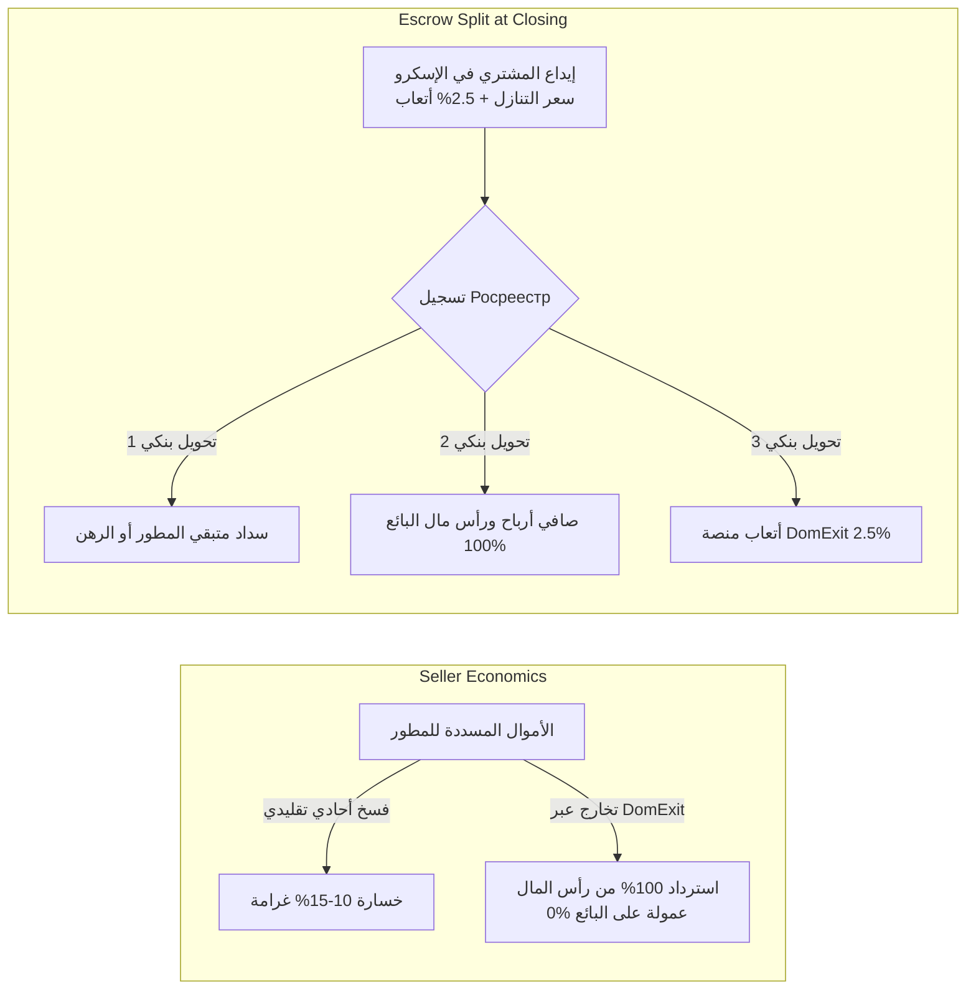

### المبادئ المالية الذهبية لمنصة DomExit:
1. **عمولة 0% على البائع (Zero Seller Commission):** لا يدفع البائع أي مبالغ أو عمولات للمنصة. يسترد البائع كامل رأس ماله المتفق عليه لإنقاذه من غرامة المطور.
2. **أتعاب نجاح بنسبة 2.5% على المشتري (2.5% Success-Only Buyer Fee):** يدفع المشتري أتعاب خدمة المنصة البالغة 2.5% حصراً بعد اكتمال التسجيل الإلكتروني الرسمي في السجل العقاري الحكومي (Росреестр). يُحظر تحصيل أي مبالغ مسبقة.
3. **حماية رؤوس الأموال من الغرامات:** حماية البائعين من خسارة ما بين 10% إلى 15% من قيمة العقد الإجمالية، وهو ما يعادل ملايين الروبلات في السوق الروسي.

---

## 2. المعادلات الرياضية لاقتصاديات البائع (Seller Exit Economics)

### 2.1. معادلة غرامة المطور التعاقدية (Developer Penalty Formula)
عند طلب البائع فسخ عقد المشاركة (Расторжение ДДУ) من طرف واحد، يقتطع المطور غرامة تعاقدية:
$$\text{Penalty}_{\text{dev}} = \text{PaidAmount} \times \left(\frac{\text{PenaltyRate}_{\text{dev}}}{100}\right)$$
حيث:
- $\text{PaidAmount}$: إجمالي المبالغ المسددة فعلياً للمطور حتى تاريخ التخارج بالروبل.
- $\text{PenaltyRate}_{\text{dev}}$: نسبة غرامة المطور المسجلة في `market_settings` (افتراضياً: $15\%$).

*مثال تطبيقي:*
إذا سدد البائع مبلغ $4,000,000 \text{ \symbol{8381}}$:
$$\text{Penalty}_{\text{dev}} = 4,000,000 \times 15\% = 600,000 \text{ \symbol{8381} (خسارة صافية للبائع)}$$

### 2.2. معادلة رأس المال المحمي والمسترد للبائع (Capital Saved & Net Proceeds)
عبر التنازل (Переуступка) من خلال DomExit، يسترد البائع كامل رصيده المسدد:
$$\text{CapitalSaved} = \text{PaidAmount} \times \left(\frac{\text{developerPenaltyPercent}}{100}\right)$$
$$\text{NetProceeds}_{\text{seller}} = \text{Price}_{\text{agreed}} - \text{Debt}_{\text{remaining}}$$
حيث:
- $\text{Price}_{\text{agreed}}$: سعر التنازل المتفق عليه مع المشتري.
- $\text{Debt}_{\text{remaining}}$: الرصيد المتبقي لشركة التطوير أو بنك الرهن القائم (إن وُجد).

---

## 3. المعادلات الرياضية لاقتصاديات المشتري وأتعاب المنصة (Buyer Economics)

### 3.1. معادلة أتعاب المنصة (DomExit Platform Fee)
$$\text{Fee}_{\text{DomExit}} = \text{Price}_{\text{assignment}} \times 0.025$$
حيث:
- $\text{Price}_{\text{assignment}}$: سعر الشراء بنظام التنازل.
- نسبة العمولة: $2.5\%$ ثابتة.

### 3.2. إجمالي تكلفة الاستحواذ للمشتري (Total Acquisition Cost)
$$\text{TotalCost}_{\text{buyer}} = \text{Price}_{\text{assignment}} + \text{Fee}_{\text{DomExit}} = \text{Price}_{\text{assignment}} \times 1.025$$

### 3.3. معادلة صافي التوفير والخصم للمشتري (Buyer Net Savings & Discount)
مقارنة بسعر المطور للشقق المماثلة في نفس البرج السكني:
$$\text{NetSavings} = \text{Price}_{\text{developer}} - \text{TotalCost}_{\text{buyer}}$$
$$\text{DiscountPercent} = \frac{\text{Price}_{\text{developer}} - \text{Price}_{\text{assignment}}}{\text{Price}_{\text{developer}}} \times 100$$

*مثال تطبيقي:*
- سعر المطور الحالي للشقة: $12,000,000 \text{ \symbol{8381}}$
- سعر التنازل عبر DomExit: $10,200,000 \text{ \symbol{8381}}$
- نسبة الخصم:
  $$\text{DiscountPercent} = \frac{12,000,000 - 10,200,000}{12,000,000} \times 100 = 15\%$$
- أتعاب المنصة (2.5%):
  $$\text{Fee}_{\text{DomExit}} = 10,200,000 \times 0.025 = 255,000 \text{ \symbol{8381}}$$
- إجمالي ما يدفعه المشتري:
  $$\text{TotalCost} = 10,200,000 + 255,000 = 10,455,000 \text{ \symbol{8381}}$$
- صافي التوفير الصافي للمشتري:
  $$\text{NetSavings} = 12,000,000 - 10,455,000 = 1,545,000 \text{ \symbol{8381}}$$

---

## 4. محرك حساب أقساط الرهن العقاري (Mortgage Annuity Engine)

تعتمد المنصة على صيغة الأقساط الثابتة الموحدة (Аннуитетный платеж) المعتمدة لدى البنوك الروسية:

$$M = P \times \frac{r(1+r)^n}{(1+r)^n - 1}$$

حيث:
- $M$: القسط الشهري الثابت بالروبل.
- $P$: مبلغ القرض الأصلي (قيمة العقار ناقصاً الدفعة الأولى):
  $$P = \text{Price}_{\text{assignment}} - \text{DownPayment}$$
- $r$: معدل الفائدة الشهري العشري:
  $$r = \frac{\text{AnnualRate}}{12 \times 100}$$
- $n$: عدد أشهر السداد الإجمالية (مثال: $20 \text{ سنة} \times 12 = 240 \text{ شهراً}$).

### مقارنة البرامج التمويلية في السوق الروسي (2026):
1. **الرهن العقاري العائلي المدعوم (Семейная ипотека 6%):**
   - الفائدة السنوية: $6.0\%$
   - الفائدة الشهرية: $r = \frac{6}{1200} = 0.005$
2. **الرهن العقاري القياسي (Стандартная рыночная ипотека 21%):**
   - الفائدة السنوية المتأثرة بسعر البنك المركزي الروسي: $21.0\%$
   - الفائدة الشهرية: $r = \frac{21}{1200} = 0.0175$

*مقارنة لقرض بقيمة $8,000,000 \text{ \symbol{8381}}$ لمدة 20 سنة (240 شهراً):*
- **قسط الرهن العائلي (6%):** $57,308 \text{ \symbol{8381}/شهر}$ (إجمالي الفوائد: $5.75 \text{ مليون \symbol{8381}}$)
- **قسط الرهن التجاري (21%):** $142,398 \text{ \symbol{8381}/شهر}$ (إجمالي الفوائد: $26.17 \text{ مليون \symbol{8381}}$)
- **الفارق الموفر للمشتري شهرياً:** $85,090 \text{ \symbol{8381}/شهر}$

---

## 5. مقياس عبء الدين الرقابي (ПДН - Показатель долговой нагрузки)

وفقاً لتعليمات البنك المركزي الروسي (ЦБ РФ 5782-У)، يراقب محرك التوفيق (Matchmaker) مؤشر عبء الدين للمشترين:

$$\text{ПДН} = \frac{\sum \text{MonthlyDebtPayments}}{\text{ConfirmedMonthlyNetIncome}} \times 100$$

### مستويات الخطورة الائتمانية:
- **$\text{ПДН} \le 50\%$ (منطقة خضراء - منخفض الخطورة):** موافقة فورية وتسهيل في إجراءات بنك الإسكرو.
- **$50\% < \text{ПДН} \le 80\%$ (منطقة صفراء - متوسط الخطورة):** يتطلب موافقة ائتمانية خاصة (`bank_special_approvals`) وزيادة في الدفعة الأولى.
- **$\text{ПДН} > 80\%$ (منطقة حمراء - عالي الخطورة):** قيود تنظيمية مشددة من البنك المركزي تلزم بوجود ضامن مالي أو زيادة الدفعة النقدية.

---

## 6. مؤشرات الجدوى الاستثمارية لنادي المستثمرين (Investment Metrics)

تُحسب هذه المؤشرات آلياً لصفقات الكتالوج الحصري (`VipCatalogPage`):

### 6.1. العائد الإيجاري الإجمالي المتوقع (Gross Rental Yield)
$$\text{RentalYield} = \frac{\text{MonthlyRent}_{\text{est}} \times 12}{\text{Price}_{\text{assignment}}} \times 100$$

### 6.2. معدل النمو الرأسمالي السنوي حتى الاستلام (Annual Capital Growth)
$$\text{CapitalGrowth} = \frac{\text{Price}_{\text{delivery}} - \text{Price}_{\text{assignment}}}{\text{YearsToDelivery} \times \text{Price}_{\text{assignment}}} \times 100$$

### 6.3. معدل العائد الداخلي التقريبي (Estimated IRR)
$$\text{IRR} \approx \text{RentalYield} + \text{CapitalGrowth} - \text{InflationAdjustment}$$

---

## 7. خوارزمية تقسيم أموال الإسكرو عند الإغلاق (Escrow Settlement Split)

تضمن غرفة العمليات (`AdminClosingPage`) توزيعاً برمجياً دقيقاً لأموال الصفقة المحجوزة في الحساب البنكي المشروط فور ورود إشعار التسجيل الإلكتروني من الـ Росреестр:

```text
إجمالي المبلغ المودع من المشتري:
S_total = Price_assignment + Fee_platform (2.5%)

التحويلات المتزامنة الصادرة من البنك:
1. التحويل الأول (سداد المطور/البنك إن وجد دين قائم):
   S_dev = Debt_remaining
   
2. التحويل الثاني (صافي استرداد البائع 100%):
   S_seller = Price_assignment - Debt_remaining
   
3. التحويل الثالث (حساب التسوية التشغيلي لمنصة DomExit):
   S_domexit = Fee_platform = Price_assignment * 0.025
```

---

## 8. معايير التنسيق المالي واللغوي (Formatting Standards)

تلتزم المنصة بدقة بقواعد التنسيق المالي الروسي المعتمدة في `src/utils/formatters.ts`:
- **فصل الآلاف:** استخدام المسافة غير القابلة للكسر (Non-breaking space: `\u00A0`) بدلاً من الفواصل العادية (مثال: `10 200 000 ₽` وليس `10,200,000`).
- **رمز العملة الروسية:** رمز الروبل الرسمي `₽` يوضع دائماً في نهاية الرقم بعد مسافة فاصلة.
- **النسب المئوية:** تقريب النسب إلى منزلة عشرية واحدة متبوعة برمز `%` مباشرة دون مسافة (مثال: `15.0%`).
- **حظر الرموز الرياضية المعقدة في نصوص العملاء:** استبدال الرموز اللاتينية بصياغة روسية واضحة ومباشرة مثل `«Требуется не менее 20%»` بدلاً من `«>= 20%»`.


---

# الفصل الثاني عشر: دورات العمل الشاملة وآلات الحالة (End-to-End Workflows & State Machines)

يوثق هذا الفصل مسارات العمليات المتكاملة (End-to-End Workflows) وآلات الحالة المحدودة (State Machines) التي تقود عمليات منصة **DomExit** من أول نقطة اتصال وحتى إتمام تحويل الأموال وأرشفة الصفقة، مع توضيح الرسوم التوضيحية وشروط الانتقال بين الحالات والمسؤوليات البرمجية والتنفيذية.

---

## 1. آلة حالة العقار والصفقة (The Unified Property & Deal Lifecycle State Machine)

تتطابق دورة حياة العقار (`Lot`) مع مسار الصفقة (`DealTrack`) برابط معرّف موحد (`lot.id === lot.lotCode` و `deal.id === 'DEAL-' + lotCode`).

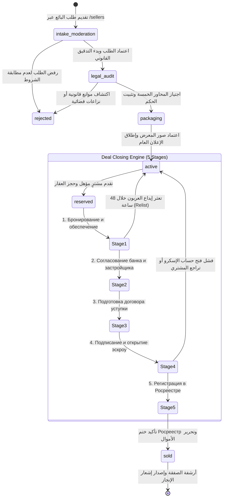

---

## 2. مسار تخارج البائع الكامل (Seller Exit End-to-End Flow)

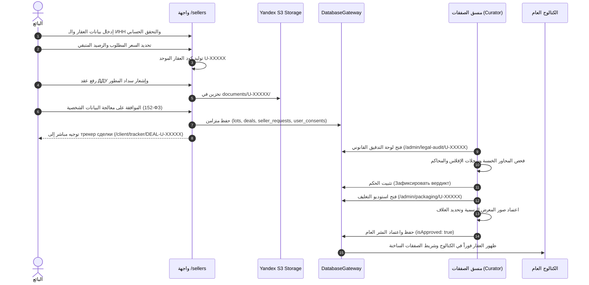

---

## 3. مسار استحواذ وحجز المشتري (Buyer Acquisition & Reservation Flow)

1. **الاستكشاف والفلترة (`/opportunities`):** يتصفح المشتري الكتالوج العام أو الخريطة الجغرافية التفاعلية مع فرز العقارات بحسب محطة المترو، نسبة التوفير، أو السعر.
2. **فحص العقار والتقرير القانوني (`/lot/:id`):** يستعرض المشتري صور المعرض المعتمدة، ويطلع على بطاقة المحاور القانونية الخمسة، ويدخل على شهادة الفحص الموثقة برقم الباركود في `/verify/:lotId`.
3. **المحادثة المباشرة مع المنسق (`CuratorChatWidget`):** ينقر المشتري على زر `«Чат с куратором»` لمناقشة جاهزية العقار للرهن البنكي أو طلب مستندات إضافية.
4. **طلب الحجز وتثبيت الصفقة (`ReservationModal`):**
   - يدخل المشتري اسمه، هاتفه، نوع التمويل (كاش، رهن عائلي 6%، رهن قياسي).
   - يتم إرسال الطلب إلى جدول `buyer_applications` وجدول `candidates`.
   - يقوم المنسق في `AdminMatchmakerPage` بمطابقة المشتري وربطه بالصفقة رسمياً.
   - تنتقل حالة العقار في الكتالوج إلى `reserved` (محجوز) لمنع تضارب المشترين.

---

## 4. محرك مراحل الصفقة الخمس التنفيذية (The 5-Stage Closing Engine)

تُدار هذه المراحل بدقة عبر شاشة غرفة الإغلاق (`AdminClosingPage`) وواجهة تتبع العميل (`ClientTrackerPage`):

### المرحلة الأولى: الحجز ومبلغ التأمين (Бронирование и обеспечение)
- **الهدف:** تثبيت جدية الشراء وسحب العقار من العرض العام.
- **الإجراءات:**
  - توقيع اتفاقية الحجز المبدئية رقمياً.
  - إيداع مبلغ التأمين/العربون (Задаток) في حساب الحجز البنكي.
  - مهلة 48 ساعة لتأكيد إيداع العربون؛ في حال التخلف يتم تفعيل إعادة الطرح التلقائي (Emergency Relist).
- **المستندات الناتجة:** إشعار حجز العقار (Соглашение о бронировании).

### المرحلة الثانية: موافقة البنك والمطور العقاري (Согласование банка и застройщика)
- **الهدف:** إزالة أي عوائق ائتمانية أو تعاقدية من أطراف المشروع.
- **الإجراءات:**
  - استخراج كشف سداد الحسابات الرسمي (Акт сверки взаиморасчетов) من المطور مختوماً.
  - استلام موافقة المطور الرسمية على التنازل (إن نص العقد على اشتراطها).
  - الحصول على موافقة بنك التمويل العقاري للمشتري على تمويل الحصة المحددة.
- **المستندات الناتجة:** خطاب اعتماد البنك وموافقة شركة التطوير.

### المرحلة الثالثة: صياغة عقد التنازل وتدقيقه (Подготовка договора уступки)
- **الهدف:** صياغة العقد النهائي بما يحمي حقوق البائع والمشتري وفقاً لـ 214-ФЗ.
- **الإجراءات:**
  - يقوم محامي DomExit المعتمد بإعداد المسودة القانونية لاتفاقية التنازل عن حق المطالبة (Договор уступки прав требования по ДДУ).
  - مراجعة سلسلة المدفوعات والبنود الخاصة بالتسليم والضمانات الإنشائية.
  - مراجعة وتأكيد موافقة الزوج/الزوجة الموثقة عدلياً لكلا الطرفين.
- **المستندات الناتجة:** مسودة عقد التنازل المعتمدة من الدائرة القانونية.

### المرحلة الرابعة: التوقيع وحجز كامل الثمن في الإسكرو (Подписание и открытие эскроу)
- **الهدف:** توثيق التزامات الأطراف وتأمين المبالغ المالية بنكياً قبل التسجيل.
- **الإجراءات:**
  - فتح حساب إسكرو مشروط أو اعتماد مصرفي (Аккредитив) في البنك الضامن.
  - إيداع المشتري لكامل ثمن الشراء المتفق عليه + أتعاب المنصة (2.5%) في الحساب البنكي.
  - توقيع اتفاقية التنازل الرسمية إما حضورياً في فرع البنك أو إلكترونياً بالتوقيع الرقمي المعزز (УКЭП).
  - لا يستطيع البائع سحب الأموال، ولا يستطيع المشتري استردادها إلا بموافقة مشتركة أو انتهاء مهلة التسجيل.
- **المستندات الناتجة:** إشعار إيداع الأموال البنكي والعقد الموقع من الأطراف.

### المرحلة الخامسة: التسجيل الحكومي في Росреестр وتحرير الأموال (Регистрация и раскрытие счетов)
- **الهدف:** نقل الملكية القانونية رسمياً وتحرير كافة المبالغ المالية لمستحقيها.
- **الإجراءات:**
  - إرسال حزمة المعاملة إلكترونياً إلى مكاتب الهيئة الفيدرالية للتسجيل العقاري (Росреестр).
  - تتبع رقم المعاملة الحكومي حتى صدور الإشعار بختم التسجيل الإلكتروني الرسمي (Штамп о регистрации).
  - إرسال إشعار التسجيل المعتمد آلياً إلى البنك الضامن.
  - ينفذ البنك التحويلات المتزامنة الصادرة فوراً:
    1. تحويل كامل صافي رأس مال البيع لحساب البائع (استرداد 100% دون عمولة).
    2. تحويل أتعاب المنصة البالغة 2.5% إلى حساب التسوية الخاص بـ DomExit.
    3. سداد أي مديونية متبقية لشركة التطوير (إن وجدت).
  - تسجيل اكتمال الصفقة ونقل حالتها إلى `sold` وحالة المسار إلى `closed`.
- **المستندات الناتجة:** مستخرج ЕГРН الجديد باسم المشتري، وإشعارات التسوية البنكية الختامية.

---

## 5. دورة اعتماد الصور والنشر العام (Photo Curation & Live Sync Flow)

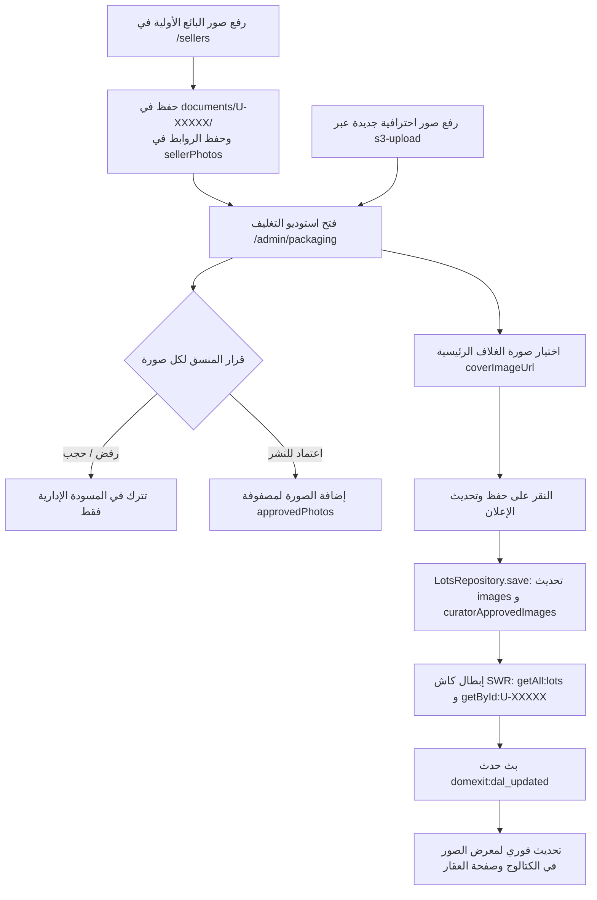

---

## 6. دورة المحادثة المباشرة مع المنسق (`Curator Live Chat Flow`)

1. **بدء المحادثة:** ينقر العميل (بائع أو مشترٍ) على زر `«Чат с куратором»` في صفحة العقار أو بوابة العميل، مما يفتح المكون `CuratorChatWidget`.
2. **إرسال الرسالة:** يكتب العميل نص الرسالة أو يرفع وثيقة مرفقة. تتولى الدالة `CuratorChatRepository.sendMessage`:
   - حفظ الرسالة في جدول `curator_messages` (أو `demo_curator_messages` بحسب البيئة).
   - وضع علامة `clientRead: true` و `curatorRead: false`.
   - بث حدث `domexit:dal_updated` لإشعار المتصفح.
3. **تنبيه المنسق:**
   - تظهر شارة رقمية حمراء على بطاقة الصفقة في كانبان الإدارة (`AdminPipelinePage`) توضح عدد الرسائل غير المقروءة (`unreadMap`).
   - عند فتح المنسق لدرج الصفقة، يستعرض الرسائل ويرد عليها مباشرة.
4. **تحديث القراءة:** عند فتح الطرف الآخر للمحادثة، يتم تحديث السجلات تلقائياً إلى `curatorRead: true` أو `clientRead: true` لإزالة شارات التنبيه.

---

## 7. دورة الحذف المتسلسل الشامل (Cascade Deletion Flow)

تضمن الدالة `PropertyLifecycleService.deletePropertyCascade(lotCode)` الإزالة المتزامنة التامة دون ترك أي مخلفات:

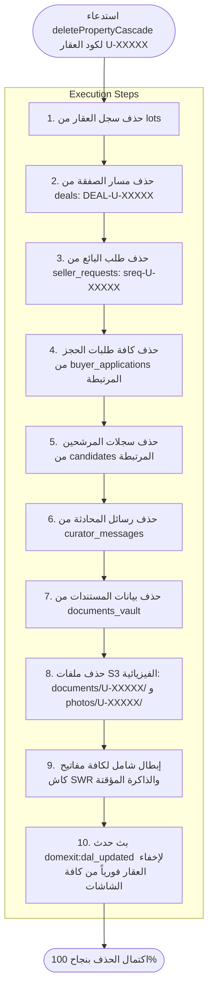


---

# الفصل الثالث عشر: نظام التصميم ورموز الواجهة وقواعد تجربة المستخدم (Design System, UI Tokens & UX Rules)

تعتمد منصة **DomExit** على نظام تصميم صارم مستوحى من كبرى المنصات المصرفية والتقنية في روسيا، ويجمع بين الشفافية والوضوح للمستخدم العادي والتركيز العالي للمشغلين، مع التزام تام بضوابط الخصوصية المنصوص عليها في القانون الاتحادي الروسي **152-ФЗ**.

---

## 1. فلسفة التصميم الثنائية (Aesthetic Dualism)

تتبنى المنصة استراتيجية بصرية مزدوجة تفصل بوضوح بين بيئتي العمل:
1. **الواجهة العامة للعملاء (Public Vitrine - Clean & Bright Light Mode):**
   - خلفيات بيضاء وسماوية ناصعة (`bg-white`, `bg-slate-50`).
   - حدود دقيقة ناعمة بلون رمادي خفيف (`border-slate-200/80`).
   - عناوين داكنة حاسمة (`text-slate-900`) تعكس الثقة والشفافية التامة والمصداقية القانونية.
2. **غرفة العمليات الإدارية (Operations Cockpit - Deep Slate Dark Mode):**
   - خلفيات كحلية داكنة فائقة التركيز (`bg-slate-950`, `bg-slate-900`).
   - حدود داكنة عالية التباين (`border-slate-800`).
   - مؤشرات وشارات ملونة متوهجة (Glowing Badges) تبرز حالات التدقيق وسرعة الإنجاز دون إجهاد بصر الموظفين.

---

## 2. لوحة الألوان ورموز التصميم الدلالية (Color Palette & Semantic Tokens)

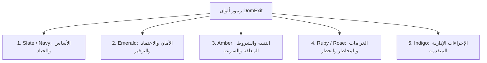

### 2.1. تدرجات الألوان المعيارية (Tailwind Color Tokens)
- **درجات الأساس والحياد (Slate / Navy):**
  - `--navy-950: #020617` (الخلفية العميقة للوحة الإدارة وحارس المسارات).
  - `--navy-900: #0f172a` (لون البطاقات الإدارية والنصوص الرئيسية في الواجهة الفاتحة).
  - `--navy-800: #1e293b` (لون القوائم المنسدلة والحدود النشطة في الوضع الداكن).
  - `slate-600: #475569` (لون النصوص الوصفية والفقرات الإرشادية).
  - `slate-400: #94a3b8` (لون النصوص الثانوية والتذييل).
  - `slate-200: #e2e8f0` (لون الفواصل والحدود في الواجهة الفاتحة).
  - `slate-50: #f8fafc` (لون خلفية الصفحة العامة).
- **ألوان النجاح والاعتماد (Emerald - Safe & Verified):**
  - `--emerald-500: #10b981` (لون الشارات الآمنة `verified_safe`، وتأكيد الإسكرو، ونسبة الخصم).
  - `--emerald-600: #059669` (لون أزرار الحفظ والإجراءات الإيجابية).
  - `--emerald-50: #ecfdf5` (خلفية كروت التوفير وشارات الاعتماد الفيدرالي).
- **ألوان الشروط والتحذير (Amber - Caution & In-Progress):**
  - `amber-500: #f59e0b` (لون شارة `condition_found`، وإيداع الإسكرو قيد الانتظار).
  - `amber-50: #fffbeb` (خلفية الملاحظات القانونية التي تتطلب توقيعاً بالبنك).
- **ألوان المخاطر والغرامات (Ruby / Rose - Penalty & Danger):**
  - `--ruby-500: #ef4444` (لون تحذيرات غرامات المطور 15%، وإلغاء الصفقات، ومحاولات التسلل).
  - `--ruby-50: #fef2f2` (خلفية رسائل الخطأ والتنبيهات الحادة).
- **ألوان العلامة التجارية الإدارية (Indigo / Violet):**
  - `indigo-600: #4f46e5` (لون أزرار تسجيل الدخول الإداري والتبديل السريع).

---

## 3. منظومة الطباعة والخطوط (Typography System)

- **الخط الأساسي للمنصة (Primary Font Stack):**
  ```css
  font-family: -apple-system, BlinkMacSystemFont, "Segoe UI", Roboto, "Helvetica Neue", Arial, sans-serif;
  ```
  يوفر قراءة عربية ولاتينية وسيريلية (Cyrillic) فائقة الوضوح مع تسريع وقت التحميل عبر استغلال خطوط النظام الأصلية للمتصفح دون استدعاء خطوط خارجية ثقيلة.
- **الخط أحادي المسافة (Monospace Font) للأكواد والرموز الرسمية:**
  - يُستخدم `font-mono` لتمثيل كود العقار (`U-62090`)، كود الصفقة (`DEAL-2026-62090`)، الرقم الضريبي للمطور (`ИНН 7700000000`)، وبصمات التشفير SHA-256.

### مقياس العناوين والأحجام (Type Scale):
- **العنوان الرئيسي الضخم (Hero H1):** `text-3xl sm:text-4xl lg:text-5xl font-black tracking-tight text-slate-900`.
- **عنوان القسم (Section H2):** `text-2xl sm:text-3xl font-extrabold text-slate-900 tracking-tight`.
- **عنوان البطاقة (Card H3):** `text-lg sm:text-xl font-bold text-slate-900`.
- **النص العادي (Body Text):** `text-sm sm:text-base text-slate-600 leading-relaxed`.
- **النصوص الدقيقة والملاحظات القانونية (Fine Print & Legal):** `text-xs text-slate-400 font-medium`.

---

## 4. الحواف والظلال والتأثيرات البصرية (Elevations & Blur Effects)

### 4.1. نصف قطر الحواف (Border Radiuses)
- الحواف الصغيرة: `rounded-lg` (`8px`) لحقول الإدخال والأزرار المصغرة.
- الحواف المتوسطة: `rounded-xl` (`12px`) لبطاقات العقار والقوائم المنسدلة.
- الحواف الكبيرة: `rounded-2xl` (`16px`) للحاويات والنوافذ المنبثقة وحاسبات التوفير.
- الحواف الضخمة: `rounded-3xl` (`24px`) للأقسام الكبرى وحاويات لوحة التحكم.
- الحواف الدائرية الكاملة: `rounded-full` للشارات الرقمية، وأزرار الحالة، والكبسولات.

### 4.2. الزجاج الضبابي والتوهج (Glassmorphism & Glow Effects)
- **`.glass-light`:**
  ```css
  background: rgba(255, 255, 255, 0.9);
  backdrop-filter: blur(12px);
  -webkit-backdrop-filter: blur(12px);
  border: 1px solid rgba(226, 232, 240, 0.8);
  ```
- **`.emerald-glow`:** توهج زمردي خفيف حول بطاقات العقارات المعتمدة بالكامل:
  ```css
  box-shadow: 0 0 25px -5px rgba(16, 185, 129, 0.25);
  ```

---

## 5. قواعد حماية الخصوصية وتجربة المستخدم الفيدرالية (152-ФЗ UX Rules)

تلتزم واجهات التطبيق ومكوناته بمجموعة من الضوابط الصارمة للامتثال القانوني وحماية الخصوصية:
1. **الحظر التام لإظهار رقم الشقة:** لا يُعرض رقم الشقة نهائياً في أي بطاقة عامة أو صفحة تفاصيل أو خريطة تفاعلية. يُكتفى بذكر الطابق والمجمع السكني ورقم العقد المشفر.
2. **قناع حجب الطابق (Floor Masking Option):** إتاحة خيار إخفاء رقم الطابق الفعلي للمنسق في استوديو التغليف واستبداله بنطاق تقريبي (مثل `«5–10 этаж»`).
3. **قناع إدخال أرقام الهواتف الروسية:** تقييد حقول الهواتف بصيغة دولية موحدة تبدأ بـ `+7` مع تنسيق فوري للأقواس والمسافات (`+7 (999) 000-00-00`).
4. **حظر إظهار أسماء البنية التحتية السحابية للعملاء:** يُمنع منعاً باتاً ظهور كلمات مثل "Yandex", "Netlify", "Firebase", "S3", "DocAPI" في واجهات الزوار والعملاء؛ ويُستبدل ذلك بمصطلحات قانونية ومصرفية مثل `«Защищенное облачное хранилище»` و `«Банковский контур эскроу»`.
5. **شريط الكوكيز وخانات الموافقة الإلزامية:** توفير روابط تشعبية صريحة للسياسات القانونية عند كل عملية إرسال بيانات، مع حظر التحديد المسبق التلقائي لخانة الموافقة على الرسائل الترويجية (امتثالاً لقانون الإعلانات 38-ФЗ).


---

# الفصل الرابع عشر: دليل إعادة البناء الهندسي الشامل من الصفر (Rebuild-from-Scratch Playbook)

يوفر هذا الفصل دليلاً تنفيذياً متسلسلاً خطوة بخطوة (**Master Runbook**) يمكّن أي فريق هندسي أو نموذج ذكاء اصطناعي من إعادة بناء وتأسيس تطبيق **DomExit** بالكامل من الصفر وحتى الإطلاق السحابي الفعلي، مع ضمان عدم إغفال أي جزئية معمارية أو تشغيلية.

---

## 1. خارطة مراحل إعادة التأسيس (Rebuild Roadmap)

```mermaid
flowchart TD
    Phase1[المرحلة 1: إعداد بيئة المشروع ومكتبات العمل] --> Phase2[المرحلة 2: تجهيز بنية Yandex Cloud وقواعد البيانات]
    Phase2 --> Phase3[المرحلة 3: بناء الدوال السحابية غير الخادمة Serverless Functions]
    Phase3 --> Phase4[المرحلة 4: بناء طبقة الوصول للبيانات DAL والمستودعات]
    Phase4 --> Phase5[المرحلة 5: إدارة الحالة والمصادقة متعددة الأدوار والكاش]
    Phase5 --> Phase6[المرحلة 6: بناء المكونات والنوافذ المنبثقة والخرائط]
    Phase6 --> Phase7[المرحلة 7: بناء الصفحات وتركيب مسارات التطبيق]
    Phase7 --> Phase8[المرحلة 8: الفحص الشامل واختبارات الجودة والنشر النهائي]
```

---

## 2. المرحلة الأولى: تأسيس بيئة التطوير والمكتبات (Phase 1: Project Setup)

### 2.1. متطلبات بيئة التشغيل
- **Node.js:** الإصدار `18.18.0` أو `20.x` أو أعلى.
- **مدير الحزم:** `npm` (الإصدار 9 أو 10).
- **نظام التشغيل:** Linux, macOS, أو Windows.

### 2.2. تهيئة المشروع وتثبيت المكتبات
1. إنشاء مشروع Vite جديد باستخدام قالب React + TypeScript:
   ```bash
   npm create vite@latest domexit -- --template react-ts
   cd domexit
   ```
2. تثبيت الحزم الأساسية (Runtime Dependencies):
   ```bash
   npm install react react-dom react-router-dom lucide-react zustand
   npm install @aws-sdk/client-s3 @aws-sdk/s3-request-presigner
   npm install firebase
   ```
3. تثبيت حزم التطوير والتنسيق (Dev Dependencies):
   ```bash
   npm install -D tailwindcss @tailwindcss/vite typescript @types/react @types/react-dom @types/node vite
   ```
4. ضبط ملف التنسيق العام `src/index.css`:
   ```css
   @import "tailwindcss";

   @layer base {
     :root {
       --navy-900: #0f172a;
       --navy-950: #020617;
       --navy-800: #1e293b;
       --emerald-500: #10b981;
       --emerald-600: #059669;
       --emerald-50: #ecfdf5;
       --ruby-50: #fef2f2;
       --ruby-500: #ef4444;
     }
     body {
       margin: 0;
       background-color: #f8fafc;
       color: #0f172a;
       font-family: -apple-system, BlinkMacSystemFont, "Segoe UI", Roboto, sans-serif;
     }
   }
   ```
5. ضبط ملف إعدادات الحزمة `vite.config.ts`:
   - تفعيل إضافة الضغط المتقدم (Brotli level 11 و Gzip level 9).
   - ضبط تجزئة الحزم (`manualChunks`) لفصل حزم `vendor-react` و `vendor-aws` و `vendor-icons`.

---

## 3. المرحلة الثانية: تجهيز بنية Yandex Cloud السحابية (Phase 2: Cloud Infrastructure)

### 3.1. حساب الخدمة وصلاحيات IAM في Yandex Cloud
1. الدخول إلى كونسول **Yandex Cloud** وإنشاء مجلد عمل جديد (`Folder`).
2. إنشاء حساب خدمة مخصص (`Service Account`) باسم `domexit-backend-sa`.
3. منح حساب الخدمة الأدوار التالية:
   - `ydb.editor` (لإدارة وإنشاء الجداول والاستعلامات عبر Document API).
   - `storage.uploader` و `storage.viewer` (لإدارة حاوية الملفات S3).
4. توليد مفاتيح وصول ثابتة (`Static Access Keys`):
   - الاحتفاظ بـ `Key ID` في متغير `VITE_YANDEX_ACCESS_KEY_ID`.
   - الاحتفاظ بـ `Secret Key` في متغير `VITE_YANDEX_SECRET_ACCESS_KEY`.

### 3.2. إنشاء قاعدة بيانات YDB Serverless
1. إنشاء قاعدة بيانات جديدة من نوع **Managed Service for YDB** مع تحديد نمط التشغيل **Serverless**.
2. استخراج نقطة اتصال بروتوكول المستندات (`Document API Endpoint`):
   `https://docapi.serverless.yandexcloud.net/ru-central1/...`
3. حفظ نقطة النهاية في متغير `VITE_YANDEX_YDB_DOCAPI_ENDPOINT`.

### 3.3. إنشاء حاوية التخزين السحابي Object Storage (S3)
1. إنشاء حاوية جديدة باسم: `domexit-storage-vault`.
2. ضبط أذونات الحاوية:
   - السماح بالقراءة العامة للكائنات (`Read Objects: Public`).
   - ضبط سياسة CORS للسماح بالطلبات الواردة من دومين التطبيق وترويسات `Content-Type`, `Authorization`.

### 3.4. تهيئة الجداول وحسابات البداية (Database Provisioning)
تشغيل سكربت التأسيس الآلي `src/dal/scripts/initYandexTables.ts`:
- إنشاء **26 مجموعة في الإنتاج** و **22 مجموعة في بيئة التجربة**.
- زرع حسابات المالك الأولي (`Ahmed Abdallah`) والمنسق الرائد (`Алексей Смирнов`).
- زرع بيانات السوق المالية الأولية (`MarketSettings`).

---

## 4. المرحلة الثالثة: الدوال السحابية غير الخادمة (Phase 3: Serverless Functions)

إنشاء مجلد `netlify/functions/` وبناء الدالتين السحابيتين:
1. **`netlify/functions/s3-upload.ts`:**
   - استقبال استدعاءات `POST` المشفرة بـ Base64 أو Multipart.
   - استخدام عميل S3 المخبأ في الذاكرة لتفادي إعادة الاتصال المتكرر.
   - رفع الملفات إلى الحاوية بصفة `public-read` وإرجاع الرابط الدائم.
2. **`netlify/functions/s3-download.ts`:**
   - دعم نمط الروابط الموقعة مسبقاً (`mode=presigned`) مع صلاحية ساعتين.
   - دعم نمط التدفق المباشر للبيانات الثنائية (`mode=stream`) مع ترويسة `Content-Disposition` و `Cache-Control`.
3. **ضبط قواعد التوجيه والحماية في `netlify.toml`:**
   - حجب الملفات الحساسة (`.env`, `.git`, `*.map`).
   - تفعيل ترويسات الأمان `Content-Security-Policy` و `X-Frame-Options`.
   - توجيه كافة المسارات إلى `/index.html` لدعم SPA.

---

## 5. المرحلة الرابعة: طبقة الوصول للبيانات المركزية والمستودعات (Phase 4: DAL & Repositories)

1. **بناء واجهة المحول (`IDatabaseAdapter.ts`):** تحديد دوال `saveEntity`, `getEntityById`, `getAllEntities`, `queryEntities`, `removeEntity`.
2. **بناء محول Yandex Cloud (`YandexCloudAdapter.ts`):**
   - تنفيذ خوارزمية توقيع `AWS Signature v4` باستخدام Web Crypto API.
   - بناء دوال التحويل ثنائية الاتجاه لهياكل بيانات DynamoDB (`toDynamoAttribute` و `fromDynamoAttribute`).
3. **بناء محول عزل البيئات (`collectionResolver.ts`):**
   - اعتراض أسماء المجموعات وتوليد بادئة `demo_` في حال كانت البيئة النشطة هي Sandbox.
4. **بناء بوابة البيانات المركزية (`DatabaseGateway.ts`):**
   - الربط مع ذاكرة الكاش `swrCache` بمهلة صلاحية 30 ثانية.
   - تفعيل مانع التكرار المتزامن `requestDeduplicator`.
   - بث أحداث التحديث اللحظي عبر `domexit:dal_updated`.
5. **بناء المستودعات الـ 24 المتخصصة (`src/dal/repositories/**`):**
   - إنشاء مستودعات: `LotsRepository`, `DealsRepository`, `SellerRequestsRepository`, `DocumentsVaultRepository`, `CuratorChatRepository`, `LegalRepository`, إلخ.

---

## 6. المرحلة الخامسة: إدارة الحالة والمصادقة والذاكرة المؤقتة (Phase 5: State & Auth)

1. **بناء مخازن Zustand (`src/stores/**`):**
   - `useEnvironmentStore.ts`: حظر وضع التجربة على غير المالكين والبدء دائماً بوضع الإنتاج.
   - `useFeatureFlagsStore.ts`: إدارة مفاتيح VIP وبوابة البنوك والمزامنة مع قاعدة البيانات.
   - `useCompanyProfileStore.ts`: إدارة بيانات الشركة الرسمية والـ ИНН والـ ОГРН.
2. **بناء طبقة التخزين المؤقت متعددة المستويات (`SWRCache.ts`):**
   - المستوى الأول في ذاكرة جافاسكريبت والمستوى الثاني في `sessionStorage`.
   - دعم الاستعلام غير المعطل مع التحديث في الخلفية (Stale-While-Revalidate).
3. **بناء سياق المصادقة وإدارة الجلسات (`AuthContext.tsx`):**
   - دعم التبديل الديناميكي بين الأدوار المتعددة للمستخدم الواحد (`switchRole`).
   - دعم تسجيل الدخول المباشر عبر Yandex ID OAuth.
   - توفير نمط الدخول السريع للاختبارات في بيئة التطوير (`quickDemoLogin`).

---

## 7. المرحلة السادسة: بناء المكونات التفاعلية والنوافذ (Phase 6: Components)

بناء المكونات الثلاثين الموثقة في الفصل العاشر، مع التركيز على:
- **المكونات الأساسية:** `PublicLayout`, `UnifiedNavbar`, `UnifiedFooter`, `AdminSidebar`, `AdminHeader`.
- **مكونات الأمان والامتثال:** `AdminRouteGuard`, `ConsentCheckboxes`, `ConsentGateModal`, `CookieConsentBanner`.
- **مكونات العقار والتعاملات:** `LotCard`, `DocumentVaultModal`, `CuratorChatWidget`, `SmartMortgageCalculator`.
- **مكونات الخرائط الجغرافية:** `YandexCatalogMap`, `YandexLotMap`, `AddressAutocompleteInput` بالربط مع مكتبة `ymaps3`.

---

## 8. المرحلة السابعة: تجميع الصفحات وربط المسارات (Phase 7: Pages & Routing)

1. **بناء صفحات العرض العامة:**
   - `HomePage.tsx`, `SellersPage.tsx`, `OpportunitiesPage.tsx`, `LotDetailsPage.tsx`, `VerifyCertificatePage.tsx`, `HowItWorksPage.tsx`, `StoryPage.tsx`.
2. **بناء بوابة العميل:**
   - `ClientPortalPage.tsx` و `ClientTrackerPage.tsx` بمراحله الخمس.
3. **بناء غرفة العمليات الإدارية:**
   - `AdminDashboardPage.tsx`, `AdminPipelinePage.tsx`, `AdminPackagingPage.tsx`, `AdminLegalAuditPage.tsx`, `AdminMatchmakerPage.tsx`, `AdminClosingPage.tsx`.
4. **بناء المركز المعرفي والسياسات القانونية:**
   - صفحات `/legal/*` وصفحات `/knowledge/*` وقاعدة الأسئلة الشائعة `/faq`.
5. **تجميع المسارات في `src/App.tsx`:**
   - تفعيل التحميل الكسول (`React.lazy`) لكافة الصفحات.
   - إحكام حماية المسارات الإدارية بمكون `AdminRouteGuard`.
   - ضبط التحويلات العكسية المتوافقة مع الروابط القديمة.

---

## 9. المرحلة الثامنة: اختبارات الجودة والتحقق والنشر (Phase 8: QA & Production Deploy)

### 9.1. قائمة التحقق الفنية قبل الإطلاق (Pre-Flight Checklist)
1. **فحص الأنواع البرمجية (TypeScript Check):**
   ```bash
   npm run typecheck
   ```
   *يجب أن يجتاز الأمر دون أي خطأ نهائياً (`0 errors`).*
2. **فحص بناء حزم الإنتاج (Production Build):**
   ```bash
   npm run build
   ```
   *يجب أن ينتج مجلد `dist/` متضمناً ملفات HTML و JS و CSS المضغوطة بـ Brotli و Gzip.*
3. **فحص توطين البيانات في روسيا (152-ФЗ Compliance Check):**
   - التحقق من تخزين كافة السجلات في نقطة نهاية YDB الروسية (`ru-central1`).
   - التحقق من رفع الملفات في حاوية Yandex S3 في موسكو.
   - التحقق من حجب أرقام الشقق في الكتالوج العام.
4. **فحص دورة التخارج والحذف المتسلسل (Functional Smoke Test):**
   - تقديم طلب بائع تجريبي برقم ИНН صحيح.
   - التأكد من تطابق المعرف الموحد (`U-XXXXX`) عبر `lots` و `deals` و `seller_requests`.
   - اعتماد الصور في استوديو التغليف وتثبيت التدقيق في لوحة المحاور الخمسة.
   - حذف العقار من الكانبان والتحقق من اختفاء كافة سجلاته وملفاته من قاعدة البيانات وحاوية S3 فورياً.

بإتمام هذه الخطوات الثماني، يصبح تطبيق **DomExit** جاهزاً للتشغيل والإنتاج الفعلي بأعلى معايير الجودة والأمان السحابي.


---
