# КНИГА АРХИТЕКТУРНОГО И ОПЕРАЦИОННОГО АУДИТА ПЛАТФОРМЫ DOMEXIT (ВЕРСИЯ 2.0)

> **Статус документа:** Master Architecture & Security Audit Book (Single Source of Truth)
> **Дата выпуска:** 21 ноября 2026 года
> **Юрисдикция инфраструктуры:** 100% Российская Федерация (Yandex Cloud, Москва, ru-central1)
> **Соответствие нормативным требованиям:** 152-ФЗ «О персональных данных», 38-ФЗ «О рекламе», 214-ФЗ «Об участии в долевом строительстве»

## Оглавление (Table of Contents)

1. [Глава 1: Исполнительное резюме и облачная топология DomExit 2.0](#glava-1)
2. [Глава 2: Схема базы данных YDB, Data Access Layer (DAL) и архитектура сохранности](#glava-2)
3. [Глава 3: Спецификация Backend API и ролевая матрица доступа (RBAC)](#glava-3)
4. [Глава 4: Аутентификация, сессии и объектное хранилище S3](#glava-4)
5. [Глава 5: Операционная система Telegram (Telegram OS)](#glava-5)
6. [Глава 6: Фронтенд-архитектура, страницы и пользовательские сценарии (User Journeys)](#glava-6)
7. [Глава 7: Финансовый движок, математические модели и бизнес-правила](#glava-7)
8. [Глава 8: Аудит валидации данных, ролевых квот и обнаружения аномалий](#glava-8)
9. [Глава 9: Стратегический план интеграции Фазы 5 и развития платформы](#glava-9)
10. [Глава 10: Реестр технического долга, оптимизации и подготовки к Фазе 5](#glava-10)

---

<a name="glava-1"></a>

# Глава 1: Исполнительное резюме и облачная топология DomExit 2.0

## 1.1. Исполнительное резюме платформы (Executive Summary)

Платформа **DomExit** представляет собой специализированную финтех- и proptech-экосистему для безопасного, срочного выхода продавцов из договоров долевого участия (ДДУ / ФЗ-214) и инвестиционной переуступки прав требований в строящихся объектах недвижимости на первичном рынке Российской Федерации.

По состоянию на **ноябрь 2026 года** (после завершения этапов глубокой модернизации 1–4):
1. **Полная изоляция в российской юрисдикции (152-ФЗ / 149-ФЗ):** Полностью завершена де-инфраструктуризация зарубежных облачных провайдеров (Google Firebase / Firestore / Cloud Storage и Netlify). 100% данных, бизнес-логики, криптографических ключей, сессий и персональных данных граждан РФ локализованы в московском регионе Yandex Cloud (`ru-central1`).
2. **Бессерверная отказоустойчивая архитектура (Serverless Architecture):**
   - Вычислительный слой: бессерверные функции **Yandex Cloud Functions** на среде исполнения Node.js 20 (`domexit-api-prod`, `domexit-api-staging`, `domexit-backup-prod`).
   - Шлюз API: **Yandex API Gateway** с нативной поддержкой декларативных спецификаций OpenAPI 3.0 (`apigw-prod.yaml`, `apigw-staging.yaml`), гарантирующий обработку CORS preflight (`OPTIONS`) на периметре с минимальной задержкой.
   - База данных: распределенная бессерверная СУБД **Yandex Database (YDB)**, работающая через протокол Document API (совместимый с AWS DynamoDB v20120810) с поддержкой транзакций, бекапов и изоляции реплик.
   - Объектное хранилище: два изолированных бакета **Yandex Object Storage (S3)** — публичный CDN для сжатых фотографий каталога (`domexit-storage-vault`) и приватный шифрованный бакет для юридических документов с доступом по одноразовым Presigned URL со строгим контролем прав (`domexit-private-docs-prod`).
   - Статический фронтенд: Single Page Application на React 18 / TypeScript / Vite, размещенный в выделенном S3-бакете со статическим веб-хостингом (`domexit-web-prod`, `domexit-web-staging`).
3. **Операционная система в Telegram (Telegram Operating System):** Полноценная двусторонняя интеграция веб-платформы с Telegram через бессерверные вебхуки и REST-шлюз. Система обеспечивает привязку профилей через защищенные криптографические токены (`bind_<token>`), интерактивные карточки задач для кураторов, управление стадиями сделки inline-кнопками и сквозной чат-мост «Веб ↔ Telegram» между клиентами и сотрудниками платформы.
4. **Регламент непрерывности бизнеса и защиты от потери данных (Zero-Data-Loss):**
   - Автоматический ежедневный бекап всех коллекций YDB в S3 в 02:00 UTC по расписанию Yandex Cloud Triggers.
   - Неизменяемый транзакционный журнал операций (Write-Ahead Audit Journal) в префиксе `_journal/YYYY/MM/DD/` приватного бакета S3, фиксирующий каждое создание, обновление и удаление сущностей с указанием автора, роли, IP и временной метки.

---

## 1.2. Облачная топология инфраструктуры (Mermaid Architecture Diagram)

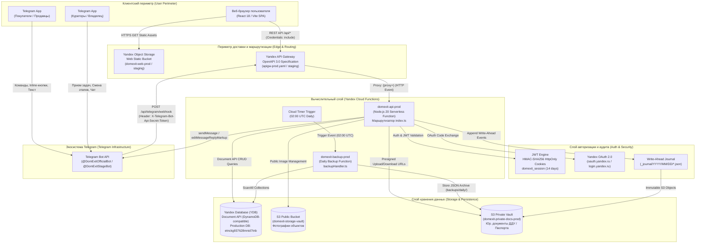

---

## 1.3. Сравнительная матрица сред: Staging vs. Production

Все идентификаторы, бакеты и сетевые эндпоинты зафиксированы в конфигурационном файле `infrastructure/cloud-manifest.json` и верифицированы:

| Параметр / Ресурс | Среда Staging (Тестовая) | Среда Production (Боевая) | Файл конфигурации / Ссылка на код |
| :--- | :--- | :--- | :--- |
| **Регион Yandex Cloud** | `ru-central1` (Москва) | `ru-central1` (Москва) | `infrastructure/cloud-manifest.json#L6` |
| **Cloud ID** | `b1gbu0q3jqnheri2srsu` | `b1gbu0q3jqnheri2srsu` | `infrastructure/cloud-manifest.json#L4` |
| **Folder ID** | `b1g46uad3gc3h34k5b0f` | `b1g46uad3gc3h34k5b0f` | `infrastructure/cloud-manifest.json#L5` |
| **Служебный аккаунт (SA)** | `aje70eogmpm04c84rsnl` (`domexit-runtime-sa`) | `aje70eogmpm04c84rsnl` (`domexit-runtime-sa`) | `infrastructure/cloud-manifest.json#L8-L9` |
| **Идентификатор YDB** | `etnkpeqnbmb1a6cocipk` | `etnckg937628mnid7tnb` | `infrastructure/cloud-manifest.json#L12,L25` |
| **Document API Endpoint** | `https://docapi.serverless.yandexcloud.net/ru-central1/b1gbu0q3jqnheri2srsu/etnkpeqnbmb1a6cocipk` | `https://docapi.serverless.yandexcloud.net/ru-central1/b1gbu0q3jqnheri2srsu/etnckg937628mnid7tnb` | `infrastructure/cloud-manifest.json#L13,L26` |
| **Публичный бакет S3 (Фото)**| `domexit-public-photos-staging` | `domexit-storage-vault` | `infrastructure/cloud-manifest.json#L14,L27` |
| **Приватный бакет S3 (Документы)**| `domexit-private-docs-staging` | `domexit-private-docs-prod` | `infrastructure/cloud-manifest.json#L15,L28` |
| **Бакет статического веб-хостинга**| `domexit-web-staging` | `domexit-web-prod` | `infrastructure/cloud-manifest.json#L16,L29` |
| **Function ID API** | `d4ep633b03be8trc7d28` (`domexit-api-staging`) | `d4eouspb2d0s8dfguf1h` (`domexit-api-prod`) | `infrastructure/cloud-manifest.json#L17,L30` |
| **API Gateway ID** | `d5dpccovifu701p9lvga` | `d5dsuuhvetioe2hp0q7i` | `infrastructure/cloud-manifest.json#L18,L31` |
| **API Gateway URL** | `https://d5dpccovifu701p9lvga.bu9mdbe1.apigw.yandexcloud.net` | `https://d5dsuuhvetioe2hp0q7i.6brbn2wz.apigw.yandexcloud.net` | `infrastructure/cloud-manifest.json#L19,L32` |
| **Function ID бекапа** | Н/Д (запуск вручную при тестировании) | `d4edb2l5n6gcpfbnl3b0` (`domexit-backup-prod`) | `infrastructure/cloud-manifest.json#L20` |
| **Cron Trigger ID бекапа** | Н/Д | `a1sqlo5a1el40u9tmqdn` | `infrastructure/cloud-manifest.json#L21` |
| **Расписание бекапа** | Н/Д | `0 2 * * ? *` (Ежедневно в 02:00 UTC) | `infrastructure/cloud-manifest.json#L22` |
| **Telegram Bot Username** | `@DomExitStageBot` | `@DomExitOfficialBot` | `backend/src/lib/config.ts#L44-L45` |
| **Режим окружения (`APP_ENV`)**| `staging` | `production` | `backend/src/lib/config.ts#L22` |

---

## 1.4. Инвентарь переменных окружения (Environment Variables Registry)

> **Правило безопасности:** В соответствии с политикой нулевого разглашения секретов реальные значения приватных ключей, паролей и токенов исключены. Таблица фиксирует имя переменной, ее функциональное назначение и статус наличия в локальной конфигурации (`.env.cloud.local` и `.env`).

| Переменная окружения | Назначение и функциональная роль | Область применения | Статус наличия |
| :--- | :--- | :--- | :--- |
| `APP_ENV` | Режим работы (`production` или `staging`) | Backend & Frontend | **SET** |
| `PUBLIC_BASE_URL` | Базовый публичный URL веб-приложения для редиректов OAuth | Backend (`lib/config.ts#L23`) | **SET** |
| `PROD_CUSTOM_DOMAIN` | Дополнительный доверенный домен для CORS | Backend (`lib/config.ts#L24`) | **SET** |
| `YDB_DOCAPI_ENDPOINT` | Эндпоинт Document API YDB | Backend (`lib/config.ts#L25`) | **SET** |
| `YDB_DATABASE_ID` | Идентификатор базы данных YDB в облаке | Backend (`lib/config.ts#L26`) | **SET** |
| `YDB_REGION` | Регион размещения базы данных (`ru-central1`) | Backend (`lib/config.ts#L27`) | **SET** |
| `YC_SA_KEY_ID` | Идентификатор статического ключа доступа сервисного аккаунта | Backend & Scripts | **SET** |
| `YC_SA_ACCESS_KEY_ID` | Идентификатор ключа доступа S3 / AWS SDK | Backend (`lib/config.ts#L29`) | **SET** |
| `YC_SA_SECRET_ACCESS_KEY` | Секретная часть ключа доступа S3 / AWS SDK | Backend (`lib/config.ts#L30`) | **SET** |
| `S3_ENDPOINT` | Эндпоинт объектного хранилища (`https://storage.yandexcloud.net`) | Backend (`lib/config.ts#L31`) | **SET** |
| `S3_PUBLIC_BUCKET` | Имя бакета публичных фотографий объектов | Backend (`lib/config.ts#L32`) | **SET** |
| `S3_PRIVATE_BUCKET` | Имя приватного бакета документов ДДУ и аудита | Backend (`lib/config.ts#L33`) | **SET** |
| `JWT_SIGNING_SECRET` | Криптографический ключ подписи сессионных JWT (HMAC-SHA256) | Backend (`lib/config.ts#L34`) | **SET** |
| `JWT_EXPIRES_IN_DAYS` | Срок жизни сессии пользователя в днях (по умолчанию 14) | Backend (`lib/config.ts#L35`) | **SET** |
| `YANDEX_OAUTH_CLIENT_ID` | Идентификатор приложения в Yandex OAuth | Backend (`lib/config.ts#L36`) | **SET** |
| `YANDEX_OAUTH_CLIENT_SECRET` | Секретный ключ приложения в Yandex OAuth | Backend (`lib/config.ts#L37`) | **SET** |
| `TELEGRAM_BOT_TOKEN_PROD` | Секретный токен бота @DomExitOfficialBot в боевой среде | Backend (`lib/config.ts#L42`) | **SET** |
| `TELEGRAM_BOT_USERNAME_PROD`| Имя пользователя боевого бота (`DomExitOfficialBot`) | Backend (`lib/config.ts#L44`) | **SET** |
| `TELEGRAM_BOT_TOKEN_STAGING` | Секретный токен бота @DomExitStageBot в тестовой среде | Backend (`lib/config.ts#L43`) | **SET** |
| `TELEGRAM_BOT_USERNAME_STAGING`| Имя пользователя тестового бота (`DomExitStageBot`) | Backend (`lib/config.ts#L45`) | **SET** |
| `TELEGRAM_WEBHOOK_SECRET` | Секретная строка заголовка `X-Telegram-Bot-Api-Secret-Token` | Backend (`lib/config.ts#L46`) | **SET** |
| `BOOTSTRAP_OWNER_EMAIL` | Системный email владельца платформы для авторизации | Scripts & Auth Handler | **SET** |
| `BOOTSTRAP_OWNER_PASSWORD` | Исходный системный пароль владельца платформы | Bootstrap Scripts | **SET** |
| `BOOTSTRAP_STAFF_PASSWORD` | Исходный системный пароль штатных кураторов | Bootstrap Scripts | **SET** |
| `VITE_API_BASE_URL` | Базовый URL API для фронтенда при локальной разработке | Frontend (`services/apiClient.ts#L28`)| **SET** |

---

## 1.5. Инвентарь скриптов развертывания и обслуживания (Operational Tools)

Все скрипты расположены в директориях `backend/scripts/`, `infrastructure/scripts/` и `scripts/`:

1. **Развертывание облачных функций (Deployment Scripts):**
   - `backend/scripts/deploy-prod.mjs` (8,381 байт) — полная сборка TypeScript бэкенда через `esbuild`, упаковка zip-архива, загрузка версии функции в `domexit-api-prod`, установка переменных окружения, переключение активной версии.
   - `backend/scripts/deploy-staging.mjs` (7,477 байт) — аналогичный цикл развертывания для тестовой функции `domexit-api-staging`.
   - `backend/scripts/deploy-backup-prod.mjs` (6,708 байт) — сборка и деплой автономной бессерверной функции создания ежедневных резервных копий `domexit-backup-prod`.
2. **Инициализация и миграция данных (Data Provisioning & Seeding):**
   - `backend/scripts/init-prod-tables-safe.mjs` (7,026 байт) — безопасная проверка существования 26 системных коллекций в боевой YDB без удаления или перезаписи существующих данных.
   - `backend/scripts/bootstrap-staff-prod.mjs` (12,738 байт) — создание и актуализация учетных записей владельца (`owner`) и штатных кураторов в боевой базе данных с безопасным хэшированием паролей (PBKDF2/SHA-512) и сохранением существующих паролей.
   - `backend/scripts/bootstrap-staff-staging.mjs` (10,466 байт) — аналогичная инициализация для среды Staging.
   - `backend/scripts/bootstrap-owner-staging.mjs` (5,603 байт) — начальная инициализация суперпользователя в тестовой среде.
   - `scripts/provision-staging-ydb.mjs` (7,004 байт) — первичное создание таблиц в Staging YDB.
   - `scripts/seed_26_legal_documents.py` (72,344 байт) — загрузка 26 эталонных юридических документов ФЗ-152, ФЗ-38, ФЗ-214 в коллекцию `legal_documents`.
   - `scripts/append_missing_raw_contents.py` (26,120 байт) — синхронизация полных текстов нормативных актов.
3. **Резервное копирование и восстановление (Backup & Recovery):**
   - `backend/scripts/backup-prod-ydb.mjs` (9,842 байт) — ручной или полуавтоматический запуск полного дампа всех коллекций боевой базы YDB в архив `backups/manual/` приватного бакета S3.
   - `backend/scripts/restore-prod-ydb.mjs` (10,398 байт) — процедура аварийного восстановления коллекций YDB из указанного снимка в S3 с режимами слияния (`merge`) или полной перезаписи (`overwrite`).
   - `backend/scripts/reconcile-journal.mjs` (9,158 байт) — утилита сопоставления транзакционного журнала S3 `_journal/` с актуальным состоянием базы данных для аудита целостности.
4. **Конфигурация инфраструктуры и Telegram (Infrastructure & Bots):**
   - `backend/scripts/activate-telegram.mjs` (6,062 байт) — установка вебхука Telegram (`setWebhook`) с секретным токеном `x-telegram-bot-api-secret-token`, регистрация команд бота (`setMyCommands`) для Staging и Production.
   - `backend/scripts/configure-bucket-cors.mjs` (2,410 байт) — настройка политик CORS на приватном и публичном бакетах S3 для обеспечения безопасной прямой загрузки файлов по Presigned URL.
   - `backend/scripts/test-staging-live.mjs` (7,721 байт) — сквозной тест жизнеспособности Staging API (проверка эндпоинтов здоровья, авторизации, каталога и прав доступа).

---

## 1.6. Политика безопасности, CORS и заголовки ответов (Security Headers)

Вся обработка HTTP-заголовков централизована в модуле `backend/src/lib/http.ts` (строки 14–68):

### Заголовки CORS и Preflight-контроль
```typescript
// backend/src/lib/http.ts#L14-L35
export function getCorsHeaders(
  event: YcHttpEvent,
  configuredBaseUrl: string,
  appEnv: string = 'production',
  prodCustomDomain?: string
): Record<string, string> {
  const incomingOrigin = event.headers?.['origin'] || event.headers?.['Origin'] || '';
  
  // Строгий белый список разрешенных Origin
  const allowedOrigins = new Set([
    configuredBaseUrl,
    'https://domexit.ru',
    'https://www.domexit.ru',
    'https://domexit-web-prod.website.yandexcloud.net',
    'https://domexit-web-staging.website.yandexcloud.net',
  ]);
  
  // В среде staging допускаются локальные origins для отладки
  if (appEnv === 'staging') {
    allowedOrigins.add('http://localhost:5173');
    allowedOrigins.add('http://localhost:3000');
    allowedOrigins.add('http://127.0.0.1:5173');
  }
  
  const isAllowed = allowedOrigins.has(incomingOrigin);
  const allowOrigin = isAllowed ? incomingOrigin : configuredBaseUrl;

  return {
    'Access-Control-Allow-Origin': allowOrigin,
    'Access-Control-Allow-Credentials': 'true',
    'Access-Control-Allow-Methods': 'GET, POST, PUT, PATCH, DELETE, OPTIONS',
    'Access-Control-Allow-Headers': 'Content-Type, Authorization, X-Requested-With, Accept, x-telegram-bot-api-secret-token',
    'Access-Control-Max-Age': '86400',
  };
}
```

### Заголовки защитного периметра (Security Headers Matrix)
При каждом JSON-ответе сервер инжектирует следующие заголовки безопасности (`backend/src/lib/http.ts#L48-L62`):
- `X-Content-Type-Options: nosniff` — предотвращает MIME-sniffing атак на браузер.
- `X-Frame-Options: DENY` — блокирует встраивание веб-интерфейса в iframe на сторонних сайтах (защита от Clickjacking).
- `X-XSS-Protection: 1; mode=block` — принудительно активирует фильтр отраженных XSS-атак в устаревших браузерах.
- `Referrer-Policy: strict-origin-when-cross-origin` — гарантирует неразглашение чувствительных параметров путей во внешних ссылках.
- `Cache-Control: no-store, no-cache, must-revalidate, proxy-revalidate` — категорический запрет кэширования ответов API, содержащих персональные данные или состояние сессии.
- `Strict-Transport-Security: max-age=31536000; includeSubDomains; preload` — форсированное требование протокола TLS (HTTPS).


---

<a name="glava-2"></a>

# Глава 2: Схема базы данных YDB, Data Access Layer (DAL) и архитектура сохранности

## 2.1. Реестр коллекций Yandex Database (YDB Document API)

База данных **YDB** платформы DomExit развернута в бессерверном режиме (`serverless`) в регионе `ru-central1` (Production ID: `etnckg937628mnid7tnb`, Staging ID: `etnkpeqnbmb1a6cocipk`). Взаимодействие с базой осуществляется через Document API (протокол Amazon DynamoDB v20120810), где каждая запись идентифицируется первичным строковым ключом `id` (Partition Key `S`).

Все коллекции распределены по 5 функциональным группам доступа и контроля целостности (`backend/src/routes/data.ts#L12-L51`):

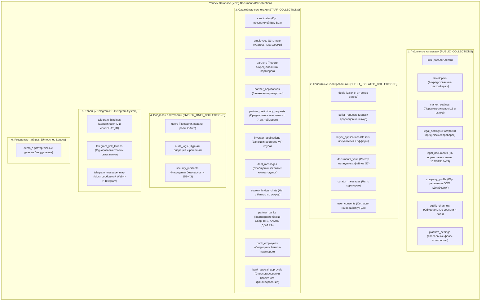

### Детальная спецификация ключевых коллекций YDB

| Имя коллекции | Первичный ключ (PK) | Назначение и сущность | Ссылка на TypeScript контракт |
| :--- | :--- | :--- | :--- |
| `lots` | `id` (e.g. `lot-u10566` / `U-10566`) | Объекты переуступки, цены, статус модерации, паспорт 42 проверок | `src/types/index.ts#L18-L181` |
| `seller_requests` | `id` (e.g. `req-xxxx` / `doc-uuid`) | Первичные заявки продавцов из 4-шагового мастера выхода | `src/types/index.ts#L228-L280` |
| `buyer_applications`| `id` (e.g. `bid-xxxx`) | Офферы и заявки покупателей на конкретные лоты | `src/types/index.ts#L332-L372` |
| `deals` | `id` (e.g. `deal-2026-10566`)| Сделки в стадии закрытия, эскроу, Росреестр, выплаты | `src/types/index.ts#L374-L431` |
| `users` | `id` (e.g. `usr-xxxx`) | Аккаунты пользователей, passwordHash, роли, Yandex ID | `src/types/index.ts#L506-L535` |
| `documents_vault` | `id` (e.g. `doc-meta-xxxx`) | Метаданные юридических файлов в S3 (хэши, категории, права) | `src/types/index.ts#L196-L226` |
| `curator_messages` | `id` (e.g. `msg-xxxx`) | Сообщения сквозного чата «Клиент — Куратор» | `src/types/index.ts#L946-L960` |
| `partner_preliminary_requests`| `id` (e.g. `pre-xxxx`)| Заявки партнеров с 7-дневным таймером бронирования клиента | `src/types/index.ts#L650-L671` |
| `partners` | `id` (e.g. `part-xxxx`) | Реестр агентов, брокеров и юристов, реферальные коды | `src/types/index.ts#L459-L487` |
| `developers` | `id` (e.g. `dev-setl`) | Застройщики РФ, ИНН, статус генеральной аккредитации | `src/types/index.ts#L593-L606` |
| `market_settings` | `id` (`market_parameters`) | Ставка ЦБ РФ (23%), семейная ипотека (6%), комиссия 2.5% | `src/types/index.ts#L568-L577` |
| `user_consents` | `id` (e.g. `consent-xxxx`) | Юридические согласия 152-ФЗ, IP, User-Agent, версии оферт | `src/types/index.ts#L805-L820` |
| `audit_logs` | `id` (e.g. `aud-xxxx`) | Аудиторский след действий операторов и клиентов | `src/types/index.ts#L735-L782` |
| `security_incidents`| `id` (e.g. `inc-xxxx`) | Инциденты ИБ, учет утечек, отчетность перед РКН | `src/types/index.ts#L822-L835` |
| `telegram_bindings`| `id` (`user:UID` / `chat:ID`) | Двунаправленная привязка аккаунтов пользователей к Telegram | `backend/src/routes/telegram.ts#L183-L194` |
| `telegram_link_tokens`| `id` (`token` hex 32 chars) | Временные токены для deep-link (`bind_<token>`, 10 минут) | `backend/src/routes/telegram.ts#L129-L142` |
| `telegram_message_map`| `id` (`tg:MSG_ID` / `web:MSG_ID`)| Двусторонняя адресация для чат-моста Web <-> Telegram | `backend/src/lib/telegramWorkflow.ts#L340-L360` |

---

## 2.2. Архитектура Data Access Layer (DAL) во фронтенде

Фронтенд платформы DomExit полностью изолирован от прямого доступа к базе данных. Все страницы и контексты обращаются к единому контроллеру **`DatabaseGateway`** (`src/dal/DatabaseGateway.ts`):

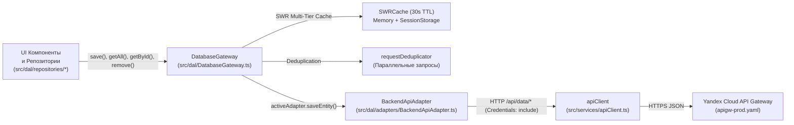

### Ключевые механизмы DAL:
1. **Единый адаптер `BackendApiAdapter` (`src/dal/adapters/BackendApiAdapter.ts`):**
   - Преобразует вызовы DAL в строгие REST-запросы к `/api/data/:collection` и `/api/data/:collection/:id`.
   - Поддерживает автоматический фолбек на локальные сид-данные (`seedFallback`) при ошибках сети или пустых ответах для предотвращения «падения» интерфейса.
2. **Многоуровневый кэш `SWRCache` (`src/dal/cache/SWRCache.ts`):**
   - Уровень 1: быстрая оперативная память процесса (`memoryCache: Map`).
   - Уровень 2: хранилище вкладки браузера `sessionStorage` с префиксом `domexit_swr_`.
   - Семантика **Stale-While-Revalidate**: при наличии устаревшей записи данные возвращаются мгновенно (0 мс), а повторный фоновый запрос (`revalidateInBackground`) обновляет кэш без блокировки рендеринга.
   - Автоматическая инвалидация префиксов (`invalidatePrefix`) при любых операциях `save()` и `remove()`.
3. **Дедупликация параллельных запросов `requestDeduplicator` (`src/dal/cache/requestDeduplicator.ts`):**
   - Если несколько независимых компонентов одновременно запрашивают один и тот же ресурс (например, `getAll:lots`), выполняется ровно один физический HTTP-запрос по сети, а его `Promise` разделяется между всеми подписчиками.

---

## 2.3. Кэширование на стороне бэкенда (`memoryCache.ts`)

На уровне бессерверной функции бэкенда реализован теплый in-memory кэш (`backend/src/lib/memoryCache.ts`):
- **Разрешенные для кэширования коллекции (`CACHEABLE_COLLECTIONS`):** `lots`, `developers`, `market_settings`, `legal_settings`, `legal_documents`, `company_profile`, `public_channels`, `platform_settings`.
- **Время жизни (TTL):** 15 секунд (`DEFAULT_TTL_MS = 15000`), максимальная емкость — 32 записи с автоматическим вытеснением старых ключей (LRU eviction).
- **Правило обхода кэша:** Запросы сотрудников платформы (`owner`, `employee`) и запросы с параметром `?fresh=1` всегда обращаются напрямую в YDB, минуя кэш (`backend/src/routes/data.ts#L388-L390`).
- **Инвалидация при записи:** Любой вызов `POST`, `PUT` или `DELETE` в коллекцию немедленно сбрасывает кэш данной коллекции (`memoryCache.invalidate(collection)`).

---

## 2.4. Неизменяемый транзакционный журнал (Write-Ahead Audit Journal)

Для предотвращения риска потери данных и реализации концепции Zero-Data-Loss все модифицирующие операции над чувствительными коллекциями фиксируются в неизменяемом хранилище S3 (`backend/src/lib/journal.ts`):

- **Журналируемые коллекции (`JOURNALED_COLLECTIONS`):**
  `seller_requests`, `buyer_applications`, `deals`, `lots`, `partner_applications`, `investor_applications`, `user_consents`, `documents_vault`.
- **Структура ключа S3 (Иерархия по датам):**
  `_journal/YYYY/MM/DD/{timestamp}-{randomHex}-{collection}-{recordId}-{action}.json`
- **Содержимое записи журнала (`JournalEntry`):**
  ```json
  {
    "schemaVersion": 1,
    "env": "production",
    "timestamp": "2026-11-21T12:00:00.123Z",
    "action": "UPDATE",
    "collection": "lots",
    "recordId": "U-10566",
    "actor": {
      "userId": "usr-curator-01",
      "role": "employee"
    },
    "payload": {
      "status": "deal_closing",
      "curatorAssigned": "usr-curator-01"
    }
  }
  ```
- **Отказоустойчивость:** Запись журнала выполняется в приватный бакет `domexit-private-docs-prod` с жестким таймаутом в 3000 мс (`AbortSignal.timeout(3000)`). В случае сетевого сбоя S3 ошибка логируется как `warn`, не блокируя основную транзакцию клиента.

---

## 2.5. Архитектура автоматического ежедневного резервного копирования (Backup Engine)

Резервное копирование YDB функционирует в полностью изолированном бессерверном контуре (`backend/src/lib/backupService.ts` и `backend/src/backupHandler.ts`):

1. **Триггер по расписанию:** Сервис Yandex Cloud Triggers (`a1sqlo5a1el40u9tmqdn`) ежедневно в **02:00 UTC** вызывает функцию `domexit-backup-prod` (`d4edb2l5n6gcpfbnl3b0`).
2. **Прямой вызов Document API (`callDocApiDirect`):** Функция использует собственную низкоуровневую реализацию подписи AWS Signature Version 4 (HMAC-SHA256) без использования тяжелых внешних библиотек.
3. **Алгоритм резервного копирования:**
   - Получение списка всех таблиц через `DynamoDB_20120810.ListTables`.
   - Полное сканирование каждой таблицы пачками по 250 элементов через `DynamoDB_20120810.Scan` с обработкой `LastEvaluatedKey`.
   - Сжатие собранного массива JSON в поток GZIP с максимальной компрессией (`zlib.gzipSync(..., { level: 9 })`).
   - Расчет контрольной суммы SHA-256 сжатого архива.
   - Сохранение в приватный S3-бакет по ключу:
     `backups/daily/ydb-backup-production-{YYYY-MM-DD-HHmmss}.json.gz`
   - Сохранение метаданных снимка (список таблиц, количество записей по каждой таблице, размер исходных и сжатых данных).
4. **Политика ротации архивов (Retention Policy):**
   - В папке `backups/daily/` автоматически сохраняются последние **7 ежедневных архивов**.
   - Архивы старше 7 дней автоматически удаляются функцией (`DeleteObjectCommand`).
   - Архивы в специальной директории `backups/pre-cutover/` защищены от автоматической ротации и сохраняются бессрочно.
5. **Мониторинг свежести бекапов:** Эндпоинт `/api/admin/system-health` отслеживает возраст последнего ежедневного бекапа (`ageHours`). Если возраст превышает 26 часов, статус системы переходит в режим `degraded` (`backend/src/routes/admin.ts#L93`).


---

<a name="glava-3"></a>

# Глава 3: Спецификация Backend API и ролевая матрица доступа (RBAC)

## 3.1. Полный реестр эндпоинтов Backend API

Маршрутизация всех сетевых запросов централизована в `backend/src/index.ts` (строки 40–80). Ниже приведена исчерпывающая спецификация всех активных эндпоинтов платформы:

| Метод | Маршрут | Исходный файл и строки | Требуемая роль | Назначение |
| :--- | :--- | :--- | :--- | :--- |
| `GET` | `/api/health` | `backend/src/routes/health.ts#L5-L13` | Публичный (Любой) | Проверка работоспособности функции и среды исполнения |
| `POST` | `/api/auth/register` | `backend/src/routes/auth.ts#L32-L125` | Гость (Анонимный) | Регистрация нового покупателя или продавца |
| `POST` | `/api/auth/login` | `backend/src/routes/auth.ts#L127-L181` | Гость (Анонимный) | Аутентификация по email и паролю с Rate-Limiting |
| `POST` | `/api/auth/logout` | `backend/src/routes/auth.ts#L183-L186` | Авторизованный | Очистка сессионной куки `domexit_session` |
| `GET` | `/api/auth/me` | `backend/src/routes/auth.ts#L188-L195` | Авторизованный | Получение текущего профиля авторизованного пользователя |
| `PATCH`| `/api/auth/profile` | `backend/src/routes/auth.ts#L198-L245` | Авторизованный | Обновление безопасных полей профиля (имя, телефон, ИНН) |
| `POST` | `/api/auth/switch-role` | `backend/src/routes/auth.ts#L248-L294` | Авторизованный | Переключение активной роли (`activeRole`) в рамках прав |
| `GET` | `/api/auth/yandex/start` | `backend/src/routes/auth.ts#L297-L305` | Гость / Пользователь | Инициация протокола авторизации Yandex OAuth 2.0 |
| `GET` | `/api/auth/yandex/callback` | `backend/src/routes/auth.ts#L308-L439` | Публичный редирект | Завершение OAuth 2.0, получение профиля Yandex, выдача JWT |
| `POST` | `/api/storage/presign-upload` | `backend/src/routes/storage.ts#L38-L117` | Авторизованный | Выпуск одноразового Presigned URL на загрузку в S3 |
| `GET` | `/api/storage/presign-download`| `backend/src/routes/storage.ts#L120-L170`| Авторизованный (RBAC) | Выпуск Presigned URL на скачивание приватного документа |
| `GET` | `/api/data/:collection` | `backend/src/routes/data.ts#L280-L438` | По матрице RBAC | Получение списка сущностей (с пагинацией и фильтрами) |
| `GET` | `/api/data/:collection/:id` | `backend/src/routes/data.ts#L280-L438` | По матрице RBAC | Получение отдельного документа по идентификатору |
| `POST` | `/api/data/:collection` | `backend/src/routes/data.ts#L441-L630` | По матрице RBAC | Создание нового документа в указанной коллекции |
| `PUT` | `/api/data/:collection/:id` | `backend/src/routes/data.ts#L441-L630` | По матрице RBAC | Обновление существующего документа в указанной коллекции |
| `DELETE`| `/api/data/:collection/:id` | `backend/src/routes/data.ts#L633-L676` | `owner` / `employee` | Удаление документа из коллекции с аудитом |
| `DELETE`| `/api/lots/:lotCode/cascade`| `backend/src/routes/data.ts#L178-L266` | `owner` (Владелец) | Каскадное удаление лота, связанных заявок и файлов S3 |
| `POST` | `/api/telegram/webhook` | `backend/src/routes/telegram.ts#L46-L97` | Telegram API (Секрет)| Вебхук обработки входящих обновлений от Telegram |
| `GET` | `/api/telegram/status` | `backend/src/routes/telegram.ts#L105-L120`| Авторизованный | Проверка статуса привязки аккаунта к Telegram |
| `POST` | `/api/telegram/link-token` | `backend/src/routes/telegram.ts#L123-L155`| Авторизованный | Генерация одноразового токена и ссылки `bind_<token>` |
| `POST` | `/api/telegram/unlink` | `backend/src/routes/telegram.ts#L158-L172`| Авторизованный | Отвязка Telegram-аккаунта от веб-профиля |
| `PATCH`| `/api/telegram/preferences` | `backend/src/routes/telegram.ts#L175-L197`| Авторизованный | Включение/выключение уведомлений в Telegram |
| `POST` | `/api/telegram/assign` | `backend/src/routes/telegram.ts#L200-L231`| `owner` / `employee` | Назначение куратора на лот с отправкой карточки в Telegram |
| `POST` | `/api/telegram/stage` | `backend/src/routes/telegram.ts#L234-L263`| `owner` / куратор лота| Перевод сделки/лота на следующий этап бизнес-процесса |
| `POST` | `/api/telegram/test` | `backend/src/routes/telegram.ts#L266-L294`| `owner` (Владелец) | Отправка тестового пуш-уведомления владельцу в Telegram |
| `GET` | `/api/admin/system-health` | `backend/src/routes/admin.ts#L32-L155` | `owner` (Владелец) | Мониторинг задержки YDB, доступности S3, свежести бекапов |
| `GET` | `/api/admin/backups` | `backend/src/routes/admin.ts#L158-L173` | `owner` (Владелец) | Получение списка доступных резервных копий в S3 |
| `POST` | `/api/admin/backups/run` | `backend/src/routes/admin.ts#L176-L197` | `owner` (Владелец) | Внеочередной запуск полного резервного копирования базы |

---

## 3.2. Матрица управления доступом на уровне коллекций (RBAC Matrix)

Контроль доступа на стороне бэкенда разделен на 4 категории коллекций (`backend/src/routes/data.ts#L12-L51`):

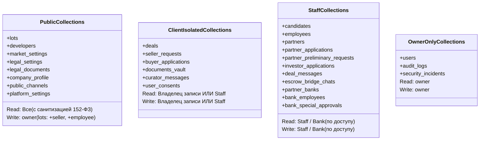

### Сводная ролевая матрица прав (Role-Based Permissions Matrix)

| Роль в системе (`role`) | `PUBLIC_COLLECTIONS` (Read / Write) | `CLIENT_ISOLATED` (Read / Write) | `STAFF_COLLECTIONS` (Read / Write) | `OWNER_ONLY` (Read / Write) | Особые операции |
| :--- | :--- | :--- | :--- | :--- | :--- |
| **Гость (Аноним)** | Чтение (152-ФЗ Redacted) / **НЕТ** | **НЕТ** / **НЕТ** | **НЕТ** / **НЕТ** | **НЕТ** / **НЕТ** | Регистрация, Вход, Yandex OAuth, Каталог |
| **Покупатель (`buyer`)** | Чтение (152-ФЗ Redacted) / **НЕТ** | Только свои записи (`userId`) / Создание своих заявок | **НЕТ** / **НЕТ** | **НЕТ** / **НЕТ** | Бронирование лота, чат с куратором, скачивание своих файлов |
| **Продавец (`seller`)** | Чтение (свои лоты полностью) / Создание лотов (`intake_moderation`)| Только свои заявки и сделки / Создание заявок продавца | **НЕТ** / **НЕТ** | **НЕТ** / **НЕТ** | 4-шаговый мастер, загрузка ДДУ и фото, чат с куратором |
| **Партнер (`partner`)** | Чтение / **НЕТ** | Свои сделки по реф-коду / **НЕТ** | Свой кабинет / Создание предв. заявок (7 дней)| **НЕТ** / **НЕТ** | Генерация реферальных ссылок, учет вознаграждений |
| **Инвестор (`investor`)**| Чтение (+ доступ к VIP 48ч) / **НЕТ** | Свои заявки / Создание инвестиционных заявок | **НЕТ** / **НЕТ** | **НЕТ** / **НЕТ** | VIP-каталог, выкуп пулов объектов со скидкой |
| **Сотрудник банка (`bank`)**| Чтение / **НЕТ** | **НЕТ** / **НЕТ** | Просмотр и одобрение аккредитаций и спецсогласований | **НЕТ** / **НЕТ** | Банковский портал, подтверждение эскроу-счетов |
| **Штатный куратор (`employee`)**| Чтение всех лотов / Модерация, упаковка | Чтение всех клиентских документов / Ответы в чат | Полный доступ к штатным коллекциям | **НЕТ** / **НЕТ** | Назначение куратора, сдвиг этапов сделки, юр. аудит |
| **Владелец (`owner`)** | Полный доступ (Read / Write) | Полный доступ (Read / Write) | Полный доступ (Read / Write) | Полный доступ (Read / Write) | Каскадное удаление лотов, бекапы, аудит-логи, инциденты ИБ |

---

## 3.3. Реализация защитного барьера персональных данных (152-ФЗ Privacy Barrier)

Вся выдача данных из публичной коллекции `lots` в обязательном порядке проходит через серверный фильтр маскирования `sanitizeLotForPublic` (`backend/src/routes/data.ts#L52-L72`):

```typescript
// backend/src/routes/data.ts#L52-L72
function sanitizeLotForPublic(lot: Record<string, any>, authUser: UserProfile | null): Record<string, any> {
  const isOwner = authUser?.role === 'owner';
  const isAssignedStaff =
    authUser?.role === 'employee' &&
    (lot.assignedEmployeeId === authUser.assignedEmployeeId || lot.assignedEmployeeId === authUser.id);
  const isSelfSeller = authUser?.id && lot.sellerId === authUser.id;

  // Полные данные видны только владельцу платформы, назначенному куратору или самому продавцу
  if (isOwner || isAssignedStaff || isSelfSeller) {
    return lot;
  }

  // 152-ФЗ Защитный барьер: безвозвратное удаление чувствительных полей для гостей и покупателей
  const sanitized = { ...lot };
  delete sanitized.sellerPhone;
  delete sanitized.sellerEmail;
  delete sanitized.sellerInn;
  delete sanitized.apartmentNumber;
  delete sanitized.sellerSubmittedImages;
  delete sanitized.sellerPhotos;
  return sanitized;
}
```

### Дополнительная изоляция лотов в каталоге:
Для неавторизованных пользователей и покупателей каталог возвращает **только утвержденные лоты** (`lot.isApproved === true`) со статусами `active`, `available`, `reserved`, `in_deal`, `deal_closing`, `sold`. Черновики, отклоненные лоты и объекты на первичной модерации скрыты от публичного доступа (`backend/src/routes/data.ts#L406-L420`).

---

## 3.4. Серверная пагинация, фильтрация и сортировка (`applyPaginationAndFilters`)

Функция `applyPaginationAndFilters` (`backend/src/routes/data.ts#L74-L167`) активируется флагом `?paginated=1` и обеспечивает:
1. **Безопасные границы пагинации:** `limit` ограничен диапазоном от 1 до 100 элементов (по умолчанию 24), номер страницы `page >= 1`.
2. **Серверная фильтрация:**
   - По статусу: `?status=active`.
   - По уникальному коду: `?lotCode=U-10566`.
   - По городу/региону: `?city=spb` (поиск по `city`, `region`, `address`).
   - Полнотекстовый поиск: `?search=чистое+небо` (поиск по названию ЖК, застройщику, адресу, описанию).
3. **Серверная сортировка (`?sort=`):**
   - `price_asc` — по возрастанию цены.
   - `price_desc` — по убыванию цены.
   - `discount_desc` — по максимальной сумме/проценту скидки.
   - `newest` — по дате публикации/обновления.
4. **Контракт ответа пагинации:**
   ```json
   {
     "items": [ /* массив объектов */ ],
     "total": 142,
     "page": 1,
     "limit": 24,
     "totalPages": 6,
     "hasMore": true
   }
   ```

---

## 3.5. Каскадное удаление лота (`DELETE /api/lots/:lotCode/cascade`)

Операция каскадного удаления доступна **исключительно роли `owner`** (`backend/src/routes/data.ts#L178-L266`) и гарантирует атомарную зачистку всех связанных сущностей:
1. **База данных YDB:** Очищаются все записи с указанным `lotCode` в 7 коллекциях:
   `lots`, `deals`, `seller_requests`, `buyer_applications`, `candidates`, `curator_messages`, `documents_vault`.
2. **Хранилище S3:** Рекурсивно удаляются все физические объекты по префиксам:
   - Публичные фотографии: `photos/{lotCode}/` в бакете `domexit-storage-vault`.
   - Приватные документы: `documents/{lotCode}/` в бакете `domexit-private-docs-prod`.
3. **Кэш и аудит:** Мгновенно инвалидируется кэш каталога, в `audit_logs` создается запись `CASCADE_DELETE_LOT`, а в S3 записывается событие `CASCADE_DELETE` транзакционного журнала.

---

## 3.6. Административный контур мониторинга (`/api/admin/*`)

Доступ ко всем эндпоинтам `/api/admin/*` защищен строгой проверкой роли `owner` (`backend/src/routes/admin.ts#L18-L25`):

1. **`GET /api/admin/system-health`:**
   - Измерение реальной задержки YDB в миллисекундах через `DynamoDB_20120810.ListTables`.
   - Проверка доступности публичного и приватного бакетов S3 через `HeadBucketCommand`.
   - Проверка статуса резервных копий (наличие ежедневного снимка, возраст в часах, общий объем, флаг `isHealthy`).
   - Подсчет количества событий в транзакционном журнале S3 за текущие сутки UTC.
   - Сбор системных метрик функции: потребление оперативной памяти RSS (`process.memoryUsage().rss`), аптайм процесса Node.js, версия среды.
2. **`GET /api/admin/backups`:**
   - Получение полного списка всех доступных снимков базы данных в папках `backups/daily/`, `backups/pre-cutover/` и `backups/manual/` с указанием размера в байтах и даты модификации.
3. **`POST /api/admin/backups/run`:**
   - Внеочередное создание снимка боевой базы данных с автоматической загрузкой архива `.json.gz` в S3 и записью в журнал аудита.


---

<a name="glava-4"></a>

# Глава 4: Аутентификация, сессии и объектное хранилище S3

## 4.1. Жизненный цикл аутентификации пользователей

Аутентификация в DomExit реализована на полностью отечественном стеке без использования внешних провайдеров идентификации (Auth0, Firebase Auth). Все процессы управляются модулем `backend/src/routes/auth.ts` и криптографической библиотекой `backend/src/lib/cryptoAuth.ts`.

```mermaid
sequenceDiagram
    autonumber
    actor User as Клиент / Пользователь
    participant Web as Браузер (React SPA)
    participant ApiGw as Yandex API Gateway
    participant Auth as Auth Handler (auth.ts)
    participant YDB as YDB users Collection
    participant Yx as Yandex OAuth 2.0 API

    alt Регистрация (Email + Password)
        User->>Web: Ввод email, пароля (>=8 симв.), имени, роли
        Web->>ApiGw: POST /api/auth/register
        ApiGw->>Auth: normalize(email.trim().toLowerCase())
        Auth->>YDB: findByField('users', 'email', email)
        Note over Auth,YDB: Если пароль уже задан -> 409 Conflict.<br/>Если учетка от OAuth -> слияние без дубликата.
        Auth->>Auth: crypto.scrypt (Salt 16 bytes, N=16384, r=8, p=1)
        Auth->>YDB: putItem('users', userWithHash)
        Auth->>Web: Set-Cookie: domexit_session=JWT; HttpOnly; Secure; SameSite=Lax
    else Авторизация (Email + Password)
        User->>Web: Ввод email и пароля
        Web->>ApiGw: POST /api/auth/login
        ApiGw->>Auth: checkLoginRateLimit(IP:email)
        Note over Auth: >5 попыток за 5 мин -> 429 Too Many Requests
        Auth->>YDB: findByField('users', 'email', email)
        Auth->>Auth: verifyPassword (timingSafeEqual)
        Auth->>Web: 200 OK + Set-Cookie: domexit_session=JWT
    else Вход через Yandex ID (OAuth 2.0)
        User->>Web: Клик «Войти с Яндекс ID»
        Web->>Auth: GET /api/auth/yandex/start
        Auth-->>Web: 302 Redirect oauth.yandex.ru + Set-Cookie: domexit_oauth_state
        User->>Yx: Подтверждение доступа в Яндексе
        Yx-->>Web: 302 Redirect /api/auth/yandex/callback?code=...&state=...
        Web->>Auth: GET /api/auth/yandex/callback
        Auth->>Auth: Сверка state с кукой domexit_oauth_state
        Auth->>Yx: POST oauth.yandex.ru/token (code exchange)
        Auth->>Yx: GET login.yandex.ru/info
        Auth->>YDB: Поиск существующего аккаунта по yandexEmail
        Note over Auth,YDB: Сохранение passwordHash при слиянии.<br/>Выдача прав owner если email в BOOTSTRAP_OWNER_EMAIL.
        Auth-->>Web: 302 Redirect /portal (или /admin/dashboard) + domexit_session
    end
```

---

## 4.2. Механизм защиты и сохранения паролей (`passwordHash Preservation`)

Одной из критических уязвимостей ранних версий был риск затирания поля `passwordHash` при OAuth-входе, частичном обновлении профиля или редактировании записи администратором. В текущей версии (v2.0) реализована многослойная защита паролей:

1. **В процедуре регистрации (`/api/auth/register` — `backend/src/routes/auth.ts#L74-L85`):** Если пользователь ранее входил через Яндекс и у него есть запись без пароля, новый локальный пароль хэшируется и безопасно встраивается в существующий профиль без создания дубликата.
2. **В процедуре OAuth-обратного вызова (`/api/auth/yandex/callback` — `backend/src/routes/auth.ts#L376-L395`):** При повторном входе через Яндекс существующий `passwordHash` и массив ролей принудительно сохраняются (`user.passwordHash` не удаляется и не перетирается).
3. **В обновлении профиля (`PATCH /api/auth/profile` — `backend/src/routes/auth.ts#L209-L239`):** Клиенту разрешено передавать только безопасный белый список полей: `name`, `phone`, `inn`, `favorites`, `photoURL`. Поля `passwordHash`, `role`, `roles`, `activeRole`, `isPartnerApproved` явно копируются из исходной записи в YDB.
4. **В административном DAL-шлюзе (`PUT /api/data/users/:id` — `backend/src/routes/data.ts#L466-L484`):** Если администратор сохраняет документ пользователя, сервер проверяет наличие `existingUser.passwordHash` и гарантирует, что пароль не будет затерт пустым значением из формы.

---

## 4.3. Управление сессиями (JWT & Cookie Security Policy)

1. **Сессионный токен (`domexit_session`):**
   - Алгоритм подписи: HMAC-SHA256 (`crypto.createHmac('sha256', JWT_SIGNING_SECRET)`).
   - Полезная нагрузка (Payload): `userId`, `email`, `role`, `activeRole`, `roles`, `iat`, `exp`.
   - Срок жизни: 14 дней (`14 * 86400 = 1,209,600` секунд).
2. **Атрибуты защищенной Cookie (`backend/src/lib/http.ts#L70-L87`):**
   ```http
   Set-Cookie: domexit_session=eyJhbGciOi...; Max-Age=1209600; Path=/; HttpOnly; SameSite=Lax; Secure
   ```
   - `HttpOnly` — токен недоступен для чтения через JavaScript (`document.cookie`), что исключает кражу сессии через XSS.
   - `SameSite=Lax` — защита от CSRF-атак с сохранением авторизации при стандартных переходах по ссылкам.
   - `Secure` — передача исключительно по зашифрованному протоколу HTTPS.
3. **Защита OAuth State Cookie (`domexit_oauth_state`):** Одноразовая случайная строка (24 байта hex), сохраняемая на 10 минут с флагом `HttpOnly` для предотвращения атак перехвата авторизационного кода (OAuth State Tampering).

---

## 4.4. Анализ Rate-Limiting и защита от подбора паролей

Защита эндпоинта аутентификации реализована в памяти процесса функции (`backend/src/lib/cryptoAuth.ts#L108-L138`):
- **Ключ ограничения:** составной ключ `${clientIp}:${email}`.
- **Лимит:** максимум **5 неудачных попыток** в течение 5-минутного окна (`windowMs = 300,000` мс).
- **Сброс счетчика:** при успешном вводе пароля счетчик немедленно очищается (`resetFailedLogin`).

### Архитектурное замечание (Уязвимость изоляции бессерверных экземпляров):
> [!WARNING]
> Поскольку `loginAttempts` хранится в переменной оперативной памяти Node.js (`new Map<string, AttemptRecord>()`), лимит защищает только в рамках одной активной «теплой» виртуальной машины функции Yandex Cloud Functions. В случае горизонтального автомасштабирования (когда облако поднимает несколько параллельных инстансов функции для обработки нагрузки) злоумышленник может распределить попытки перебора между инстансами. Для полной защиты в Фазе 5 рекомендуется вынести счетчик попыток в распределенное хранилище (таблицу `login_attempts` в YDB с TTL или централизованный счетчик).

---

## 4.5. Архитектура объектного хранилища S3 (Dual-Bucket Model)

Для полного соответствия требованиям 152-ФЗ хранилище платформы строго разделено на два изолированных бакета (`infrastructure/cloud-manifest.json#L14-L15`):

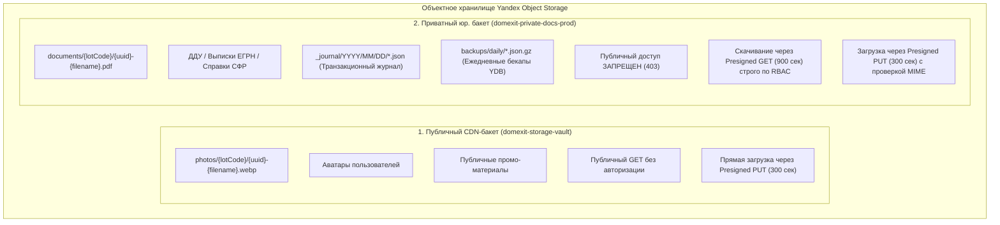

### Сравнение бакетов хранилища

| Параметр | Публичный бакет (`domexit-storage-vault`) | Приватный бакет (`domexit-private-docs-prod`) |
| :--- | :--- | :--- |
| **Тип хранимых данных** | Сжатые фото квартир, планировки, фасады | Сканы паспортов, ДДУ, выписки со счетов, бекапы |
| **Публичный доступ по URL**| **Разрешен** (`https://storage.yandexcloud.net/...`) | **Запрещен** (`publicUrl: null` всегда) |
| **Разрешенные MIME-типы** | `image/webp`, `image/jpeg`, `image/png` | `application/pdf`, `.docx`, `image/jpeg`, `image/png` |
| **Максимальный размер файла**| **15 МБ** (`MAX_PHOTO_SIZE = 15*1024*1024`) | **25 МБ** (`MAX_DOC_SIZE = 25*1024*1024`) |
| **Время жизни ссылки на загрузку**| 300 секунд (5 минут) | 300 секунд (5 минут) |
| **Время жизни ссылки на чтение**| Бессрочно (прямой URL) | **900 секунд (15 минут)** по одноразовой подписи |
| **Проверка прав при скачивании**| Не требуется | Строгая проверка: `owner`, куратор или сторона сделки |

---

## 4.6. Протокол безопасной загрузки и скачивания (Presigned URL Protocol)

### 1. Загрузка документа (`POST /api/storage/presign-upload`):
- Клиент передает `{ scope: 'document', lotCode, fileName, contentType, fileSize }`.
- Сервер валидирует расширение, MIME-тип и лимит 25 МБ (`backend/src/routes/storage.ts#L93-L100`).
- Формируется безопасный ключ с санитизацией имени: `documents/${lotCode}/${uuid}-${safeName}`.
- AWS SDK генерирует подписанный URL с заголовком `PutObjectCommand`.
- Клиент отправляет бинарные данные напрямую в S3 методом `PUT`. Нагрузка на Cloud Functions не расходует память на проксирование тяжелых файлов.

### 2. Скачивание приватного документа (`GET /api/storage/presign-download`):
- Клиент запрашивает ссылку по параметрам `?key=documents/...&lotCode=U-10566`.
- **Серверная проверка прав (Access Gate — `backend/src/routes/storage.ts#L130-L155`):**
  - Если пользователь `owner` или `employee` — доступ разрешен.
  - Если пользователь клиент (`seller`/`buyer`) — проверяется принадлежность лота продавцу (`lot.sellerId === authUser.id`) либо наличие активной сделки в `deals` (`deal.buyerId === authUser.id || deal.sellerId === authUser.id`).
  - При отсутствии прав возвращается **`HTTP 403 Forbidden`**.
- При успешной проверке выпускается Presigned GET URL с ограничением срока действия в 15 минут (`expiresInSeconds: 900`).


---

<a name="glava-5"></a>

# Глава 5: Операционная система Telegram (Telegram OS)

## 5.1. Архитектура ботов и изоляция окружений

Интеграция с мессенджером Telegram в DomExit представляет собой не просто канал отправки уведомлений, а распределенную операционную систему (**Telegram Operating System**), позволяющую совершать транзакционные действия: принимать задачи, изменять стадии сделок, согласовывать этапы и обмениваться сквозными сообщениями с порталом.

В соответствии с принципом строгой изоляции сред в системе настроены два независимых бота (`infrastructure/cloud-manifest.json` и `backend/src/lib/config.ts#L42-L45`):
- **Боевой бот (Production):** `@DomExitOfficialBot` (связан с боевой базой `etnckg937628mnid7tnb` и доменом `domexit.ru`).
- **Тестовый бот (Staging):** `@DomExitStageBot` (связан со staging базой `etnkpeqnbmb1a6cocipk`).

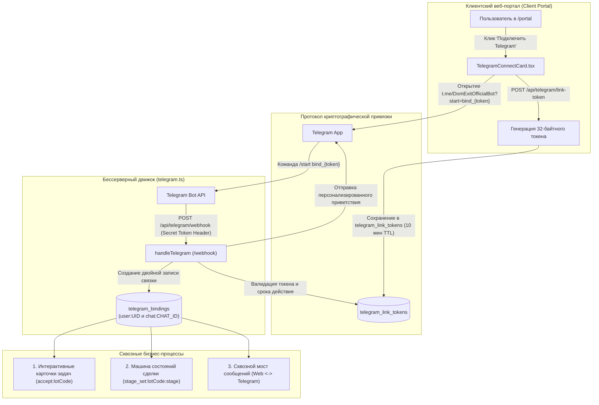

---

## 5.2. Протокол безопасной привязки аккаунтов (37-символьный Deep-Link)

При разработке интеграции с Telegram соблюдено строгое ограничение протокола Telegram Bot API: параметр `start` в диплинках не должен превышать **64 символа** в наборе `[A-Za-z0-9_-]`.

1. **Генерация токена (`backend/src/routes/telegram.ts#L128-L146`):**
   - Сервер генерирует случайную 16-байтную последовательность в hex-формате (32 символа):
     `const token = crypto.randomBytes(16).toString('hex');`
   - Итоговый параметр `start`: `bind_${token}` занимает ровно **37 символов**, что полностью удовлетворяет лимиту Telegram (37 < 64).
   - Токен сохраняется в таблице `telegram_link_tokens` с атрибутами:
     `{ id: token, token, userId, userEmail, role, used: false, createdAt, expiresAt }`.
   - Время жизни токена составляет ровно **10 минут** (`10 * 60 * 1000` мс).
2. **Активация при переходе в бот (`backend/src/routes/telegram.ts#L777-L851`):**
   - Пользователь нажимает «Запустить» в боте (`/start bind_{token}`).
   - Сервер проверяет: существование токена, отсутствие флага `used === true`, не истек ли срок `expiresAt`.
   - При успешной проверке токен помечается использованным (`used: true`), а в таблицу `telegram_bindings` записываются две связанные записи с быстрым поиском по первичному ключу:
     - `id: "user:${userId}"` — для поиска Telegram chatId при отправке уведомлений из веб-интерфейса.
     - `id: "chat:${chatId}"` — для мгновенной идентификации пользователя и его роли при входящих сообщениях от Telegram.

---

## 5.3. Реестр команд бота, интерактивных меню и callback-запросов

Движок бота спроектирован по правилу **«Always-Respond Policy»** (`backend/src/routes/telegram.ts#L300-L1052`): бот никогда не оставляет действие пользователя без обратной связи и интерактивного ответа.

### Реестр текстовых команд:
| Команда | Доступность по ролям | Функциональное действие |
| :--- | :--- | :--- |
| `/start` | Все пользователи | Приветствие с кнопкой авторизации на сайте либо обработка `bind_<token>` |
| `/menu` | Все пользователи | Вызов главного меню в соответствии с назначенной ролью (`owner`, `employee`, `client`) |
| `/stats` | `owner`, `employee` | Вывод сводки: общее число объектов, лоты на модерации, в каталоге, закрытые сделки |
| `/tasks` | `owner` | Список 5 приоритетных лотов платформы с inline-кнопками смены этапа и ответа |
| `/mytasks` | `employee` | Список лотов, персонально закрепленных за данным куратором |
| `/team` | `owner` | Список кураторов, их рабочие телефоны, роли и текущая нагрузка по сделкам |
| `/mydeals` | `client` (`buyer`, `seller`)| Список активных сделок пользователя с текущими статусами и ссылкой на портал |
| `/unlink` | Все пользователи | Немедленное удаление связки `telegram_bindings` и отвязка аккаунта |
| `/cancel` | Все пользователи | Сброс текущего контекста ответа или прерывание диалоговой операции |

### Реестр Callback-запросов (Inline Buttons):
- `menu` — возврат в главное меню роли.
- `cmd_stats`, `cmd_tasks`, `cmd_mytasks`, `cmd_team`, `cmd_mydeals` — быстрые шорткаты команд из кнопок меню.
- `accept:{lotCode}` — закрепление лота за куратором (`assignCuratorToLot`) с мгновенным обновлением текста сообщения (`editMessageText`).
- `stage_menu:{lotCode}` — динамическое открытие меню допустимых переходов этапов лота.
- `stage_set:{lotCode}:{targetStage}` — перевод сделки на выбранный этап с валидацией прав и автоуведомлением продавца и покупателя.
- `reply:{lotCode}:{threadChannel}` — установка контекста ввода (`activeReplyContext`) для отправки текста напрямую в чат портала.
- `cancel` — отмена сброса контекста ввода.

---

## 5.4. Машина состояний сделки (`STAGE_TRANSITIONS`) и права переходов

Управление жизненным циклом лота регламентировано конечным автоматом (`backend/src/lib/telegramWorkflow.ts#L9-L38`):

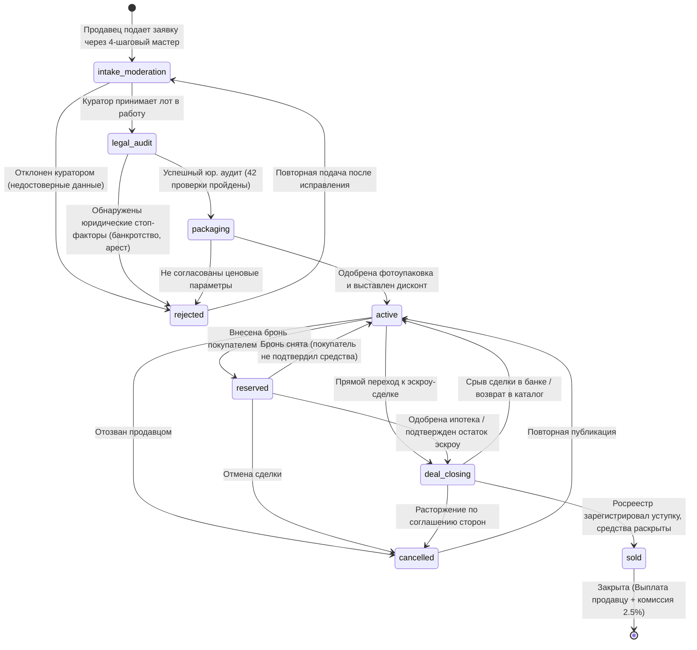

### Контроль прав при смене этапа (`enforceStagePermission`):
- Перевод этапа разрешен **только владельцу платформы (`owner`)** либо **куратору, назначенному на данный конкретный лот** (`lot.assignedEmployeeId === actor.id` или `lot.curatorId === actor.id`). Попытка изменить статус чужого объекта отклоняется ошибкой `HTTP 403 / Error`.
- При переводе лота в статус `active` система автоматически устанавливает признак `isApproved = true` (`telegramWorkflow.ts#L240`).

---

## 5.5. Двусторонний чат-мост между веб-порталом и Telegram (Bridge Engine)

Сквозная коммуникация между веб-интерфейсом и мессенджером реализована без сторонних шлюзов:

1. **Отправка сообщения из Веба в Telegram (`POST /api/data/curator_messages`):**
   - Клиент пишет сообщение куратору в виджете `CuratorChatWidget.tsx` на сайте.
   - Сервер фиксирует сообщение в коллекции `curator_messages` и вызывает `telegramNotifier.handleWebCuratorMessage`.
   - Система находит привязку куратора в `telegram_bindings` и отправляет сообщение в личный чат куратора в Telegram.
   - В коллекции `telegram_message_map` создается запись соответствия:
     `id: "msg:${chatId}:${sentTgMessageId}" -> { lotCode, dealId, threadChannel }`.
2. **Ответ куратора из Telegram в Веб (Два режима):**
   - **Режим 1 (Native Telegram Swipe-to-Reply):** Куратор делает свайп вправо и отвечает цитатой на сообщение бота. Движок извлекает `msg.reply_to_message.message_id`, находит привязку в `telegram_message_map` и вызывает `relayBridgedMessage`, мгновенно доставляя текст в чат веб-портала.
   - **Режим 2 (Интерактивная кнопка «💬 Ответить»):** Куратор нажимает кнопку под карточкой. Бот переходит в режим ожидания (`activeReplyContext` с TTL 15 минут). Следующее текстовое сообщение автоматически транслируется клиенту в веб.

---

## 5.6. Анализ отказоустойчивости и краевых ситуаций Telegram OS

1. **Дедупликация входящих вебхуков (`isDuplicateUpdate` — `backend/src/routes/telegram.ts#L19-L33`):**
   При сбоях в каналах связи Telegram Bot API может повторно отправлять один и тот же `update_id`. В памяти функции поддерживается кольцевой буфер на 500 последних `update_id`. Повторные обновления игнорируются с кодом `200 OK skipped: duplicate_update`.
2. **Защита вебхука криптографическим секретом (`X-Telegram-Bot-Api-Secret-Token`):**
   Все входящие POST-запросы к `/api/telegram/webhook` проверяются функцией `crypto.timingSafeEqual` против `TELEGRAM_WEBHOOK_SECRET` для исключения атак подделки событий со стороны злоумышленников (`backend/src/routes/telegram.ts#L52-L75`).
3. **Краевой сценарий: Устаревание ссылок deep-link:**
   Если пользователь переходит по ссылке привязки старше 10 минут, бот не зависает, а вежливо объясняет причину и предлагает кнопку генерации новой ссылки в личном кабинете.


---

<a name="glava-6"></a>

# Глава 6: Фронтенд-архитектура, страницы и пользовательские сценарии (User Journeys)

## 6.1. Полная карта маршрутов приложения (Routing & Layouts)

Маршрутизация фронтенда DomExit построена на базе `react-router-dom` v6 (`src/App.tsx#L8-L195`). Все страницы загружаются асинхронно через `React.lazy()` для минимизации начального размера бандла (`PageSkeletonLoader`).

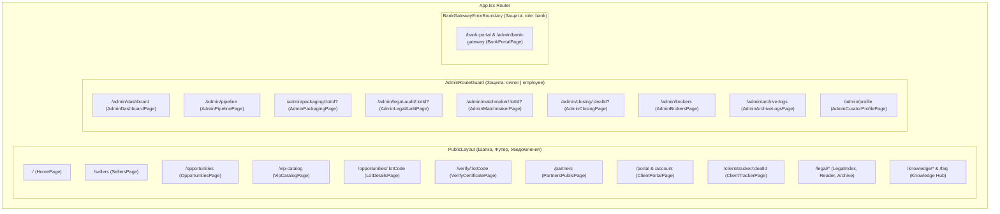

---

## 6.2. Сценарий посетителя и покупателя (Visitor & Buyer Journey)

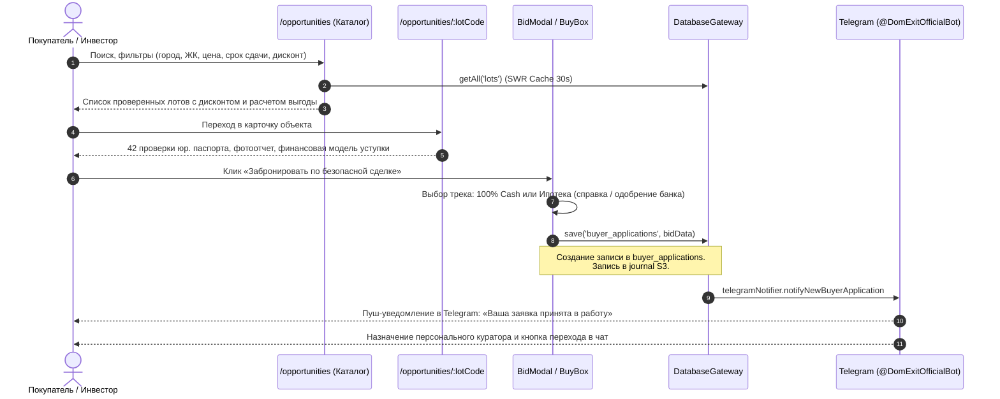

### Ключевые этапы сценария покупателя:
1. **Каталог (`OpportunitiesPage.tsx`):**
   - Серверная и клиентская фильтрация: город (`spb`, `msk`, `sochi`, `kazan`), застройщик, этажность, тип комнатности (`studio`, `1-room`, `euro`), готовность дома (%).
   - Сортировки: по сумме дисконта, по возрастанию цены, по дате добавления.
   - 48-часовое окно раннего доступа для участников VIP-клуба (`isEarlyAccessVIP`).
2. **Карточка объекта (`LotDetailsPage.tsx` — 1,349 строк):**
   - Интерактивная финансовая модель: цена ДДУ, сумма выплаты продавцу, остаток долга девелоперу по рассрочке, текущая цена застройщика и чистая экономия покупателя.
   - Развернутый юридический паспорт объекта (42 проверки: ЕФРСБ банкротство, ФССП аресты, суды общей юрисдикции, материнский капитал СФР, согласие супругов).
   - Интерактивная карта Yandex Maps с инфраструктурой и временем пешком до метро.
3. **Оформление бронирования и трекинг (`ClientPortalPage.tsx`, `ClientTrackerPage.tsx`):**
   - Доступ к чату с назначенным куратором в реальном времени.
   - Просмотр эскроу-реквизитов и статуса регистрации переуступки в Росреестре.

---

## 6.3. Сценарий продавца (Seller 4-Step Exit Wizard Journey)

Страница `/sellers` (`src/pages/SellersPage.tsx` — 38,918 байт) представляет собой конверсионный интерактивный мастер срочного выхода из ДДУ:

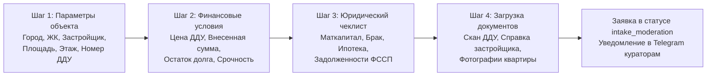

### Архитектурные элементы мастера продавца:
- **`SellerLiveAuditCard.tsx`:** Интерактивный калькулятор в правой колонке. В реальном времени рассчитывает сумму, которую продавец получает на руки наличными (100% внесенных средств, 0% комиссии с продавца), и сопоставляет ее со штрафом при расторжении договора застройщиком (15%).
- **`SellerStepProperty.tsx` & валидаторы (`src/utils/validators.ts`):** Проверка ИНН девелопера, формата номера ДДУ, корректности соотношения сумм (`paidAmount <= contractPrice`).
- **Защита персональных данных:** Документы продавца загружаются напрямую в приватный бакет S3 по Presigned URL без публикации в открытый доступ (`StorageService.ts`).

---

## 6.4. Исчерпывающий аудит партнерской и брокерской подсистемы

> [!IMPORTANT]
> **Критическое архитектурное уточнение для Фазы 5:**
> Партнерская и брокерская подсистема **УЖЕ ПОЛНОСТЬЮ РЕАЛИЗОВАНА В КОДЕ** на всех трех уровнях (публичный интерфейс, личный кабинет партнера, админ-панель управления брокерами). Ее **КАТЕГОРИЧЕСКИ НЕЛЬЗЯ ПЕРЕСОЗДАВАТЬ ЗАНОВО** в Фазе 5 — необходимо лишь интегрировать новые сервисы с уже работающей логикой.

### 1. Публичный лендинг партнеров (`src/pages/PartnersPublicPage.tsx`):
- Доступен по адресу `/partners`.
- Категории партнеров: `mortgage_broker` (ипотечные брокеры), `developer_cancellation` (отделы расторжений застройщиков), `lawyer` (юристы по банкротству и недвижимости), `trade_in_developer` (агентства trade-in).
- Форма регистрации: валидация ФИО, телефона РФ, ИНН организации (10 или 12 цифр). Автоматическая генерация уникального реферального кода партнера (`PART-XXXX`).
- Запись создается в репозитории `PartnersRepository` (`src/dal/repositories/PartnersRepository.ts`).

### 2. Личный кабинет партнера (`src/components/portal/PartnerPortalTab.tsx`):
- Интегрирован во вкладку «Партнерский кабинет» страницы `/portal`.
- **Реферальная ссылка:** Генерация ссылки с параметром `?ref=PART-XXXX`.
- **Механизм предварительного бронирования клиента (`PartnerPreliminaryRequest`):**
  - Партнер фиксирует клиента вводом его кода (`DEX-XXXXXX`), ФИО, телефона, ЖК и параметров ДДУ (`handlePartnerReferralSubmit` — строки 69–120).
  - Система запускает **обратный отсчет на 7 дней** (`expiresAt = now + 7 days`).
  - Если в течение 7 дней клиент заключает сделку, партнер получает фиксированное вознаграждение **30 000 ₽ за сделку** (`fixedRewardPerDealRub: 30000`).
  - Данные сохраняются в коллекции `partner_preliminary_requests` (`PartnerRequestsRepository.ts`).

### 3. Панель управления брокерами (`src/pages/AdminBrokersPage.tsx` — 818 строк):
- Доступна по адресу `/admin/brokers` (с редиректом из устаревшего `/admin/partners-bot`).
- **Функционал администратора:**
  - Поиск и фильтрация партнеров по категориям и статусам комиссий (`in_progress`, `payable`, `paid`).
  - Реестр выплат: модальное окно регистрации выплаты (`showPayoutModal`) с фиксацией суммы, номера банковской транзакции, банка плательщика и даты.
  - Генерация акта сверки взаиморасчетов (`showReconciliationModal`) для бухгалтерской отчетности с кнопкой печати.
  - Аудит всех действий через `AuditLogsRepository.addLog`.

---

## 6.5. Контур управления и CRM администратора (Staff & Owner Admin Operations)

Все административные страницы защищены гардом `AdminRouteGuard` (`src/components/auth/AdminRouteGuard.tsx`):

1. **Единый командный дашборд (`AdminDashboardPage.tsx`):**
   - Виджеты KPI: объем активных лотов по городам (СПб, Москва, регионы), средний дисконт каталога, сделки в эскроу Сбера и ВТБ, прогнозируемая комиссия платформы (2.5%).
   - Карточки оперативного управления: «Экстренный выход», «Юридический комплаенс», «Брокерская сеть», «Штатные кураторы».
   - Интеграция с карточкой статуса безопасности YDB и Cloud Functions.
2. **Пайплайн сделок (`AdminPipelinePage.tsx`):**
   - Канбан-доска стадий: `intake_moderation` ➔ `legal_audit` ➔ `packaging` ➔ `buyer_matching` ➔ `closing_escrow` ➔ `completed`.
   - Перетаскивание карточек с фиксацией в транзакционном журнале.
3. **Модуль юридического аудита (`AdminLegalAuditPage.tsx` — 1,501 строка):**
   - Формирование правового паспорта из **42 контрольных чекпоинтов**.
   - 5 юридических осей комплаенса:
     1. `title_encumbrances` — чистота титула и обременения;
     2. `bankruptcy_debts` — банкротство и долги ФССП;
     3. `developer_settlement` — взаиморасчеты с девелопером;
     4. `family_matkap` — маткапитал и права несовершеннолетних;
     5. `cession_escrow` — схема эскроу-расчетов по переуступке.
4. **Упаковка и маркетинг (`AdminPackagingPage.tsx` — 1,597 строк):**
   - Модерация фотографий продавца: одобрение для публичной галереи (`approvedGalleryImages`), отклонение некачественных фото.
   - Фиксация рыночной стоимости по оценке DomExit и генерация промо-тизеров.
5. **Банковский портал (`BankPortalPage.tsx` — 3,473 строки):**
   - Изолированный интерфейс для авторизованных сотрудников банков-партнеров (`Сбербанк`, `ВТБ`, `Альфа-Банк`, `ДОМ.РФ`).
   - Согласование аккредитации застройщиков и проектного финансирования.


---

<a name="glava-7"></a>

# Глава 7: Финансовый движок, математические модели и бизнес-правила

## 7.1. Математическая модель финансового движка (Financial Truth Engine)

Финансовая модель платформы DomExit решает ключевую дилемму первичного рынка: девелоперы продают квартиры по текущим пиковым ценам, а дольщики, купившие объект на котловане или в рассрочку, при расторжении договора сталкиваются с драконовскими штрафами. DomExit создает арбитражную выгоду как для продавца, так и для покупателя.

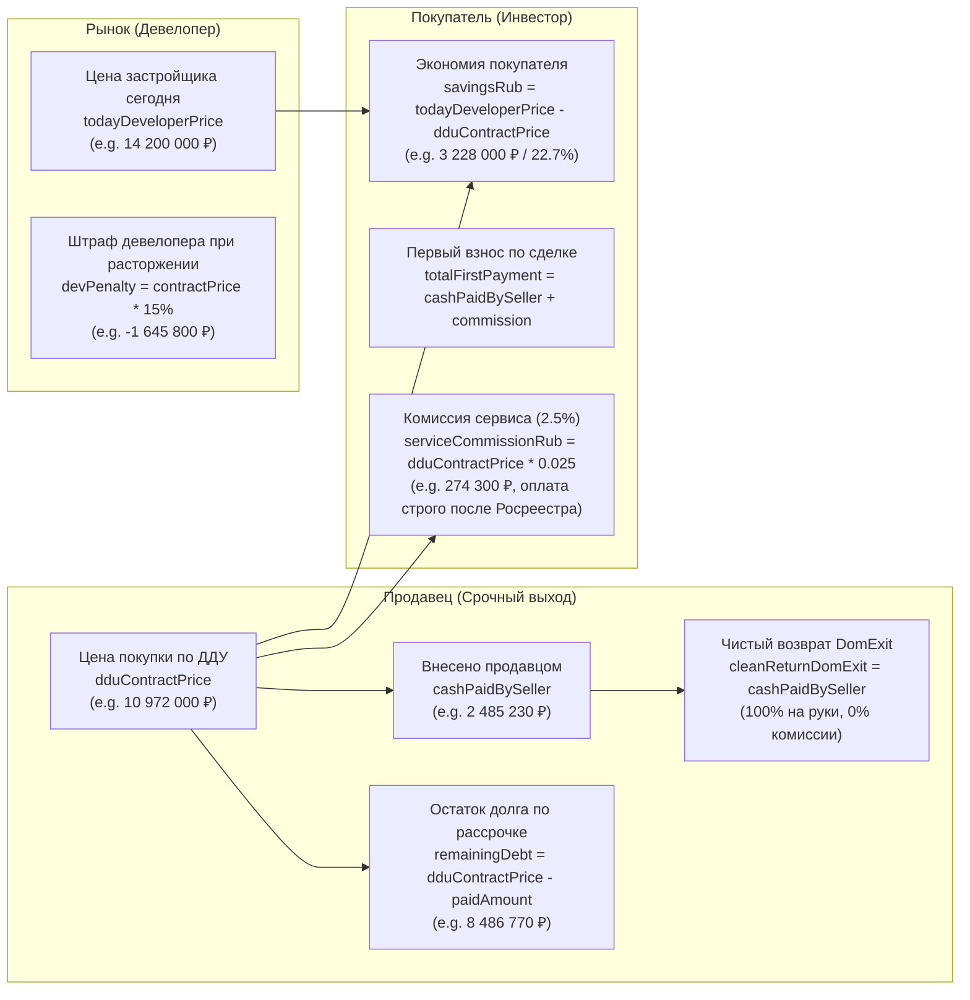

---

## 7.2. Формулы и математические расчеты платформы

### 1. Расчет продавца (Срочный выход без потерь — `SellersPage.tsx#L204-L206`):
- **Штраф девелопера при одностороннем расторжении:**
  $$\text{devPenalty} = \text{contractPriceRub} \times \frac{\text{developerPenaltyPercent}}{100}$$
  где `developerPenaltyPercent` по умолчанию равен **15.0%** (ст. 9 ФЗ-214 и условия типовых ДДУ крупных девелоперов).
- **Чистый возврат средств продавцу:**
  $$\text{cleanReturnDomExit} = \text{paidAmountRub}$$
  Продавец получает ровно 100% фактически внесенных средств. **Комиссия с продавца не удерживается (0%)**.
- **Чистая сохраненная выгода семьи продавца:**
  $$\text{netFamilyBenefit} = \text{devPenalty}$$
  Разница между суммой на руках через DomExit и потерей при расторжении с застройщиком.

### 2. Расчет покупателя (Экономия и инвестиционная доходность — `LotDetailsPage.tsx#L223-L279`):
- **Чистая скидка к текущему прайсу застройщика:**
  $$\text{savingsRub} = \text{todayDeveloperPrice} - \text{dduContractPrice}$$
  $$\text{savingsPercent} = \frac{\text{savingsRub}}{\text{todayDeveloperPrice}} \times 100\%$$
- **Сумма первого взноса при сделке:**
  $$\text{totalFirstPayment} = \text{cashPaidBySeller} + \text{serviceCommissionRub}$$
  Покупатель возмещает продавцу его первоначальный взнос (`cashPaidBySeller`), а оставшуюся часть (`remainingInstallmentDebt`) выплачивает застройщику по исходному графику рассрочки/ипотеки.
- **Сервисная комиссия платформы (2.5%):**
  $$\text{serviceCommissionRub} = \text{dduContractPrice} \times 0.025$$
  Оплачивается **строго покупателем** и только **после успешной регистрации перехода прав в Росреестре** и раскрытия аккредитива (`src/types/index.ts#L54-L55`).
- **Квартальный платеж по рассрочке девелоперу:**
  $$\text{quarterlyInstallment} = \max\left(95000, \text{round}\left(\frac{\text{remainingDebtRub}}{24}\right)\right)$$
  (`src/services/propertyLifecycleService.ts#L103`).

### 3. Инвестиционный потенциал и арендная доходность района (`LotDetailsPage.tsx#L259-L279`):
- **Прогнозируемая долгосрочная аренда в месяц:**
  $$\text{longTermMonthlyRub} = \text{round}\left(\text{todayDeveloperPrice} \times \frac{\text{monthlyRentPercent}}{100}\right)$$
  (по районам СПб/Мск: от 0.48% до 0.72% от текущей стоимости объекта).
- **Прогнозируемая посуточная аренда в день:**
  $$\text{shortTermDailyRub} = \text{round}\left(\text{todayDeveloperPrice} \times \frac{\text{dailyRentPercent}}{100}\right)$$
  (от 0.048% до 0.065% в день).
- **Годовая арендная доходность к цене покупки ДДУ (Rental Yield):**
  $$\text{annualRentalYieldPercent} = \frac{\text{longTermMonthlyRub} \times 12}{\text{dduContractPrice}} \times 100\%$$
- **Мгновенный прирост капитала (Instant Equity Growth):**
  $$\text{instantEquityGrowthPercent} = \frac{\text{todayDeveloperPrice} - \text{dduContractPrice}}{\text{dduContractPrice}} \times 100\%$$
- **3-летний и 5-летний прогноз роста капитализации:**
  $$\text{projectedPrice}_{3Y} = \text{todayDeveloperPrice} \times \left(1 + \frac{\text{annualGrowthPercent}}{100}\right)^3$$

---

## 7.3. Справочники и эталонные настройки (`market_settings`, `developers`)

Параметры финансового движка централизованы в коллекции `market_settings` базы YDB (`src/dal/repositories/MarketSettingsRepository.ts#L5-L13`):

| Параметр настройки | Ключ в объекте | Значение по умолчанию | Назначение |
| :--- | :--- | :--- | :--- |
| **Ключевая ставка ЦБ РФ** | `cbrKeyRatePercent` | **21.0%** (актуализировать до 23% в Phase 5) | Базовый ориентир рыночной ипотеки |
| **Ставка «Семейной ипотеки»** | `familyMortgageRatePercent`| **6.0%** | Льготная программа по ФЗ-214 |
| **Штраф девелопера** | `developerPenaltyPercent` | **15.0%** | Удержание застройщиком при расторжении |
| **Комиссия платформы DomExit**| `buyerCommissionPercent` | **2.5%** | Фиксированная комиссия с покупателя |

### Конфигурация районных коэффициентов аренды и роста цен (`DEFAULT_DISTRICT_YIELD_CONFIGS`):
- **СПб, Приморский район:** Аренда 0.65%/мес., рост цен 11.5%/год.
- **СПб, Московский район:** Аренда 0.68%/мес., рост цен 12.2%/год.
- **СПб, Петроградский район:** Аренда 0.72%/мес., рост цен 13.5%/год.
- **Москва, Пресненский район:** Аренда 0.70%/мес., рост цен 14.0%/год.
- **Москва, Хамовники:** Аренда 0.72%/мес., рост цен 14.5%/год.
- **Сочи, Центральный район:** Аренда 0.75%/мес., рост цен 15.0%/год.

---

## 7.4. Реестр захардкоженных констант и расхождений в кодовой базе

В ходе аудита выявлены следующие фиксированные значения, требующие выноса в динамические настройки `market_settings` в Фазе 5:

| Локация в коде | Захардкоженное значение | Описание и риск несоответствия |
| :--- | :--- | :--- |
| `src/services/propertyLifecycleService.ts#L101` | `payload.contractPriceRub * 1.24` | Фолбек цены застройщика (+24%). Должен браться из реального индекса цен района. |
| `src/services/propertyLifecycleService.ts#L102` | `payload.contractPriceRub * 0.025` | Жесткий коэффициент комиссии 0.025 вместо чтения `marketSettings.buyerCommissionPercent / 100`. |
| `src/services/propertyLifecycleService.ts#L103` | `remainingDebtRub / 24` и `95000` | Расчет квартального платежа делит остаток строго на 24 с минимумом 95 000 ₽. |
| `src/types/index.ts#L475` & `AdminBrokersPage.tsx#L58` | `30 000 ₽` | Фиксированная выплата партнеру за сделку (`fixedRewardPerDealRub: 30000`). |
| `src/dal/repositories/MarketSettingsRepository.ts#L7` | `cbrKeyRatePercent: 21.0%` | Значение в дефолтном сиде отстает от текущей ставки ЦБ РФ (21% vs 23%). |
| `backend/src/routes/data.ts#L80` | `limit: 24` (max: 100) | Фиксированные границы серверной пагинации. |
| `backend/src/routes/storage.ts#L18-L19` | `15MB` (фото), `25MB` (документы) | Захардкоженные лимиты размеров загружаемых файлов в байтах. |


---

<a name="glava-8"></a>

# Глава 8: Аудит валидации данных, ролевых квот и обнаружения аномалий

## 8.1. Комплексный аудит валидации входных данных (Client vs. Server Gap Analysis)

В ходе глубокого анализа исходного кода серверных обработчиков (`backend/src/routes/data.ts`) и клиентских форм (`src/pages/SellersPage.tsx`, `src/components/`, `src/utils/validators.ts`) выявлен **критический архитектурный разрыв (Validation Disparity)**:

1. **Клиентская сторона (Client-Side Validation):**
   Во фронтенде реализован развитый набор проверок (`src/utils/validators.ts`): валидация формата телефона РФ (`+7 (XXX) XXX-XX-XX`), алгоритмическая проверка контрольных сумм ИНН (10 и 12 знаков), проверка соотношения `paidAmount <= contractPrice`.
2. **Серверная сторона (Server-Side Absence):**
   При обработке сетевых вызовов `POST` и `PUT` в `/api/data/:collection` сервер выполняет лишь базовый парсинг тела запроса (`parseBody<Record<string, any>>(event)`) и инъекцию `userId`, после чего **сохраняет сырой JSON напрямую в YDB без валидации типов, диапазонов и допустимых границ полей** (`backend/src/routes/data.ts#L442-L449`).

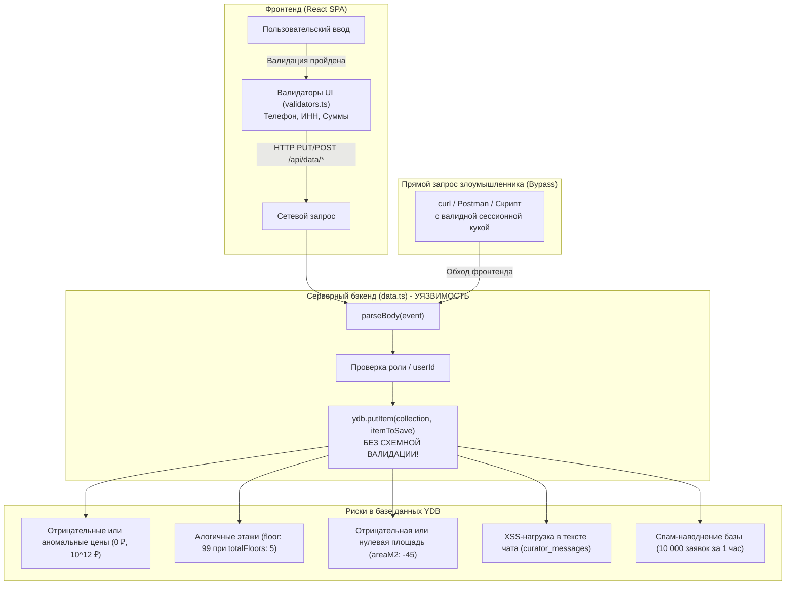

---

## 8.2. Детальный реестр уязвимостей валидации по коллекциям

### 1. Коллекция `lots` (Каталог объектов):
- **Числовые границы цен:** Отсутствует серверный контроль минимальной и максимальной цены ДДУ (`dduContractPrice`) и внесенных средств (`cashPaidBySeller`). Возможно сохранение цен `0`, `-1000` или фиктивных триллионных значений.
- **Соотношение внесенных средств и стоимости:** Сервер не проверяет инвариант:
  $$\text{cashPaidBySeller} \le \text{dduContractPrice}$$
  Злоумышленник может отправить `cashPaidBySeller = 50 000 000 ₽` при `dduContractPrice = 10 000 000 ₽`.
- **Логическая корректность этажности (Floor Sanity Check):** Отсутствует проверка:
  $$1 \le \text{floor} \le \text{totalFloors}$$
  В базу может быть записан объект с `floor: 45` при `totalFloors: 9` или отрицательный этаж.
- **Площадь объекта (`areaM2`):** Отсутствуют санитарные границы (например, от 15 до 500 м²).

### 2. Коллекция `seller_requests` (Заявки продавцов на выход):
- Любой зарегистрированный пользователь с ролью `seller` может через прямой вызов API отправить неограниченное число заявок с мусорными строками в полях `complexName`, `developer`, `dduNumber`.
- Отсутствует серверная санитизация поля `notes` (риск внедрения сохраненного XSS при отображении в админ-панели куратора).

### 3. Коллекция `buyer_applications` (Заявки покупателей):
- Покупатель может подать заявку с любым значением `availableLiquidity` (например, отрицательным или фиктивным триллионом).
- Сервер не проверяет существование целевого `lotCode`, позволяя создавать заявки-призраки на несуществующие объекты.

### 4. Коллекция `curator_messages` (Чат с куратором):
- Отсутствует ограничение максимальной длины текста сообщения (злоумышленник может передать строку размером 10 МБ, забив память базы YDB и превысив лимиты сообщения в Telegram).
- Отсутствует серверная фильтрация HTML-тегов перед сохранением в базу.

---

## 8.3. Анализ отсутствия ролевых квот (Per-Role Quota Gaps)

На текущий момент в коде бэкенда (`backend/src/routes/data.ts`) **полностью отсутствуют какие-либо ограничения на частоту и количество создаваемых записей (Rate Limiting & Daily Quotas)**:

| Тип субъекта / Роль | Операция в API | Текущий лимит в коде | Риск злоупотребления (Abuse Risk) |
| :--- | :--- | :--- | :--- |
| **Анонимный гость** | `POST /api/auth/register` | Без лимита по IP | Массовая регистрация спам-аккаунтов, засорение таблицы `users` |
| **Покупатель (`buyer`)** | `POST /api/data/buyer_applications` | **Безлимитно** | Флуд офферами, спам фальшивыми бронями, блокировка лотов для реальных покупателей |
| **Продавец (`seller`)** | `POST /api/data/seller_requests` | **Безлимитно** | Создание сотен заявок-пустышек, перегрузка кураторов уведомлениями в Telegram |
| **Клиент / Куратор** | `POST /api/data/curator_messages` | **Безлимитно** | Флуд сообщениями в чат, исчерпание лимитов Telegram Bot API (30 сообщений/сек) |
| **Партнер (`partner`)** | `POST /api/data/partner_preliminary_requests` | **Безлимитно** | Массовая веерная фиксация сотен клиентов на 7 дней без их ведома |

---

## 8.4. Анализ учета инцидентов безопасности (`security_incidents`)

В ходе аудита выявлено серьезное расхождение в именовании коллекций между фронтендом и бэкендом:
- В бэкенде (`backend/src/routes/data.ts#L48`): коллекция зарегистрирована как **`security_incidents`** (входит в `OWNER_ONLY_COLLECTIONS`).
- В клиентском репозитории (`src/dal/repositories/SecurityIncidentsRepository.ts#L4`): указано имя **`security_incident_logs`**.
- В `collectionResolver.ts` отсутствует правило маппинга для этого имени.

**Следствие:** При попытке зарегистрировать инцидент безопасности из фронтенда сервер возвращает `404 Коллекция security_incident_logs не поддерживается`. Кроме того, в системе отсутствует фоновый сервис автоматического выявления аномалий, который самостоятельно создавал бы записи инцидентов при обнаружении подозрительной активности.

---

## 8.5. Архитектурная спецификация для Фазы 5: Модули защиты

Для устранения выявленных уязвимостей в Фазе 5 разработана спецификация двух новых серверных модулей:

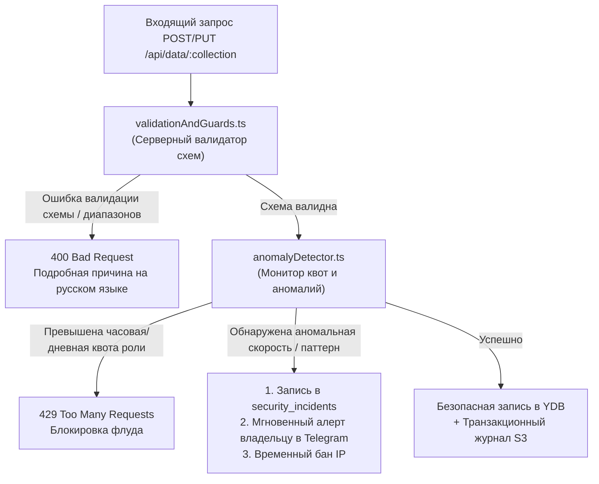

### Спецификация 1: Серверный валидатор `backend/src/lib/validationAndGuards.ts`:
1. **Схемная валидация для каждой коллекции:**
   - `lots`:
     - `contractPriceRub` / `dduContractPrice`: число, $1\,000\,000 \le \text{price} \le 500\,000\,000$.
     - `paidAmountRub`: $0 < \text{paidAmount} \le \text{contractPriceRub}$.
     - `areaM2`: число, $15.0 \le \text{area} \le 600.0$.
     - `floor` и `totalFloors`: целые числа, $1 \le \text{floor} \le \text{totalFloors} \le 120$.
     - `inn`: 10 или 12 цифр с проверкой контрольных сумм РФ.
   - `curator_messages`:
     - `text`: непустая строка, длина от 1 до 2000 символов.
     - Санитизация HTML-сущностей (`escapeHtml`) для предотвращения Stored XSS.
   - `buyer_applications`:
     - Обязательное существование валидного `lotCode`.
     - `availableLiquidity`: $0 \le \text{liquidity} \le 500\,000\,000$.

### Спецификация 2: Детектор аномалий и движок квот `backend/src/lib/anomalyDetector.ts`:
1. **Регламент ролевых квот (Role Rate Limits):**
   - Роль `buyer`: максимум **5 заявок на покупку в сутки**, не более 2 заявок в час на один и тот же лот.
   - Роль `seller`: максимум **3 заявки на выход в сутки**.
   - Роль `partner`: максимум **10 предварительных заявок в сутки**.
   - Чат `curator_messages`: максимум **15 сообщений в минуту** от одного пользователя.
2. **Правила фиксации аномалий (Anomaly Triggers):**
   - Попытка отправить более 5 заявок за 2 минуты с одного IP/аккаунта ➔ присвоение инциденту уровня `high`.
   - Внедрение SQL/NoSQL injection паттернов или тэгов `<script>` ➔ немедленная блокировка запроса, автоматическая запись в `security_incidents` и отправка пуш-алерта владельцу в `@DomExitOfficialBot`:
     `🚨 ВНИМАНИЕ: Зафиксирована попытка атаки / аномальный всплеск активности!`.


---

<a name="glava-9"></a>

# Глава 9: Стратегический план интеграции Фазы 5 и развития платформы

## 9.1. Архитектурный фокус и границы Фазы 5 (Strategic Focus)

Настоящая глава представляет собой технический план развития платформы DomExit, основанный на результатах аудита предыдущих глав. 

### Стратегический приоритет Фазы 5:
1. **Ядро кибербезопасности и управления (Governance & Anti-Abuse Core):**
   Внедрение схемной валидации входных данных (`validationAndGuards.ts`), ролевых суточных квот и детектора аномалий (`anomalyDetector.ts`) с мгновенным оповещением владельца в Telegram.
2. **Математический движок ранжирования покупателей (Buy-Box Matching Engine):**
   Алгоритмический расчет совместимости (`matchScore: 0–100%`) между профилем продавца (сумма, срочность, застройщик) и пулом покупателей/инвесторов (ликвидность, одобренная ипотека, скорость выхода на сделку).
3. **Бесшовная интеграция с существующей брокерской сетью:**
   Подключение создаваемого движка к работающим коллекциям `partners` и `partner_preliminary_requests` без дублирования функционала.
4. **Гибридная очередь обработки задач (Hybrid Queue):**
   Автоматическая эскалация просроченных задач кураторам в Telegram и назначение ответственных.
5. **Отложенные задачи (Deferred Scope):**
   > [!NOTE]
   > Разработка специализированного модуля «Promo Studio» (автогенерация рекламных карточек в соцсети и видео-тизеров) официально отложена на последующие фазы, так как приоритетом является финансовая и юридическая надежность ядра сделок.

---

## 9.2. Карточка Governance & Security в `AdminDashboardPage`

В интерфейсе главного дашборда владельца (`src/pages/AdminDashboardPage.tsx`) в Фазе 5 интегрируется модульный компонент **`AdminGovernanceCard.tsx`**:

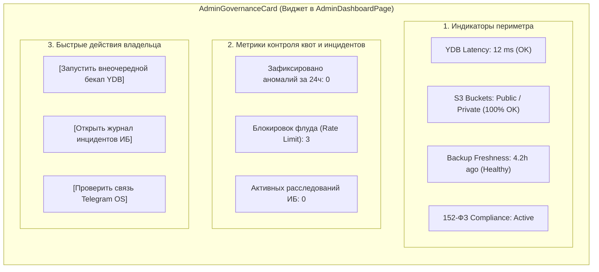

### Точки интеграции с бэкендом:
- Запрос данных: `GET /api/admin/system-health` (уже реализован в `backend/src/routes/admin.ts#L32`).
- Запрос журнала инцидентов: чтение коллекции `security_incidents` (после исправления имени коллекции с `security_incident_logs`).
- Экстренный запуск бекапа: `POST /api/admin/backups/run`.

---

## 9.3. Математический движок мэтчинга покупателей (Buy-Box Matching Engine)

В Фазе 5 страница `/admin/matchmaker/:lotId` (`src/pages/AdminMatchmakerPage.tsx`) переводится с ручной фильтрации на автоматический математический скоринг совместимости кандидатов (`BuyerCandidate.matchScore`):

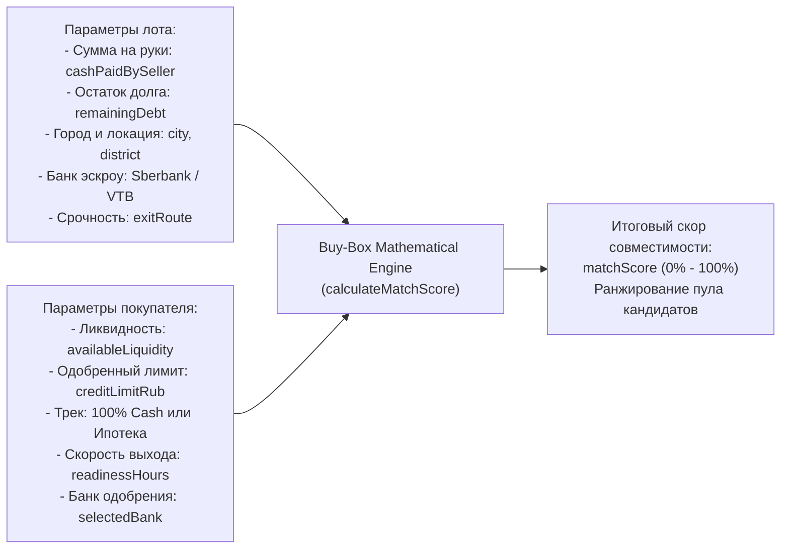

### Математическая формула скоринга совместимости:
$$\text{matchScore} = w_1 \cdot S_{\text{liquidity}} + w_2 \cdot S_{\text{bank}} + w_3 \cdot S_{\text{speed}} + w_4 \cdot S_{\text{geo}}$$

Где весовые коэффициенты распределены следующим образом:
1. **$w_1 = 0.40$ (Финансовая достаточность — 40% веса):**
   - Если $\text{availableLiquidity} \ge \text{cashPaidBySeller}$ (покупатель полностью покрывает взнос продавца наличными) ➔ $S_{\text{liquidity}} = 1.0$.
   - При нехватке средств ➔ $S_{\text{liquidity}} = \max\left(0, \frac{\text{availableLiquidity}}{\text{cashPaidBySeller}}\right)$.
2. **$w_2 = 0.25$ (Совместимость банка эскроу — 25% веса):**
   - Если банк предварительного одобрения покупателя совпадает с банком эскроу объекта (например, оба Сбербанк) ➔ $S_{\text{bank}} = 1.0$ (бесшовный перевод внутри одного банка без риска отказа).
   - Если банки разные, но оба аккредитованы девелопером ➔ $S_{\text{bank}} = 0.70$.
   - Если застройщик не аккредитован в банке покупателя ➔ $S_{\text{bank}} = 0.10$.
3. **$w_3 = 0.20$ (Скорость выхода на сделку — 20% веса):**
   - Наличные на руках, готовность до 48 часов ➔ $S_{\text{speed}} = 1.0$.
   - Одобренная ипотека, выход до 5 дней ➔ $S_{\text{speed}} = 0.75$.
   - Ипотека на этапе рассмотрения (до 14 дней) ➔ $S_{\text{speed}} = 0.40$.
4. **$w_4 = 0.15$ (Географическое соответствие — 15% веса):**
   - Точное совпадение целевого города и района ➔ $S_{\text{geo}} = 1.0$.

---

## 9.4. План интеграции с внешними российскими сервисами проверок

В модуле `AdminLegalAuditPage.tsx` на текущий момент 42 проверки паспорта выставляются куратором вручную на основе загруженных документов. В Фазе 5 закладывается архитектура интеграции с официальными шлюзами:

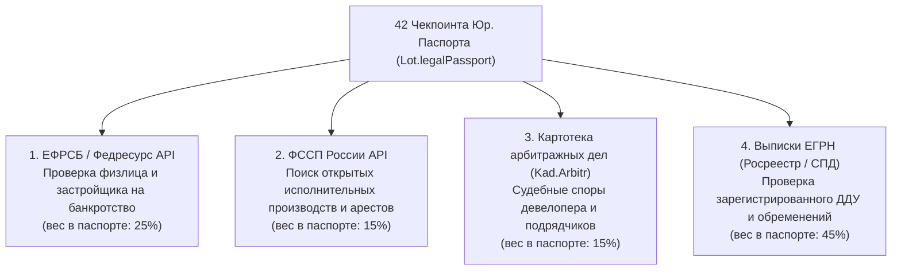

### Схема отказоустойчивости внешних интеграций:
- Все обращения к внешним государственным API выносятся в асинхронные очереди (Job Queue) со сбором ответов в фоновом режиме.
- Никакой сбой или таймаут государственного портала не должен блокировать работу пользовательского интерфейса платформы (Circuit Breaker Pattern с ручным подтверждением куратором).

---

## 9.5. Гибридная архитектура очередей (Hybrid Queue & SLA Escalation)

Для обеспечения стандартов обслуживания клиентов внедряется сквозной контроль времени ответа (SLA Monitor):

1. **Норматив первичного контакта с продавцом (SLA: 15 минут):**
   - При подаче новой заявки на `/sellers` запускается таймер.
   - Если в течение 10 минут ни один куратор не нажал кнопку `accept:{lotCode}` в Telegram или веб-панели, бот эскалирует задачу старшему куратору.
   - Если через 15 минут заявка не принята, уведомление повышенного приоритета отправляется напрямую владельцу платформы.
2. **Таймер предварительной брони партнера (SLA: 7 суток):**
   - Заявки из `partner_preliminary_requests` автоматически проверяются cron-задачей.
   - При истечении 7 дней статус переводится в `expired`, освобождая клиента от брони.


---

<a name="glava-10"></a>

# Глава 10: Реестр технического долга, оптимизации и подготовки к Фазе 5

## 10.1. Инвентарь перегруженных файлов (Bloated Files Ledger > 1000 строк)

В ходе архитектурного сканирования 200+ файлов платформы DomExit выявлены файлы, превышающие порог в 1000 строк кода. Наличие монолитных файлов увеличивает когнитивную нагрузку при разработке и риск регрессионных ошибок при доработках.

| Файл | Кол-во строк | Текущая ответственность | Рекомендованная декомпозиция для Фазы 5 |
| :--- | :--- | :--- | :--- |
| `src/pages/BankPortalPage.tsx` | **3,473** | Портал партнерских банков: эскроу, аккредитация девелоперов, спецсогласования, сотрудники банков | Разбить на 4 подкомпонента в `src/components/bank/`: `BankEscrowTab.tsx`, `BankDeveloperAccreditationTab.tsx`, `BankSpecialApprovalsTab.tsx`, `BankStaffTab.tsx`. |
| `src/pages/AdminPackagingPage.tsx` | **1,597** | Упаковка объектов, модерация фото, расчет дисконтов, превью карточки каталога | Вынести модерацию фото в `PackagingGalleryManager.tsx`, превью карточки в `PackagingPreviewModal.tsx`. |
| `src/components/admin/tabs/SellerRequestsTableTab.tsx`| **1,519** | Таблица заявок продавцов, детальные модальные окна, назначение кураторов | Вынести модальные окна просмотра документов и назначения в отдельные компоненты. |
| `src/pages/AdminLegalAuditPage.tsx` | **1,501** | 42 проверки паспорта, 5 юридических осей, загрузка подтверждающих документов | Вынести 5 осей комплаенса в `LegalAuditAxesSection.tsx`, паспорт проверок в `LegalCheckpointsMatrix.tsx`. |
| `src/pages/AdminPartnersBotPage.tsx` | **1,468** | Устаревшая страница партнеров (в `App.tsx` уже стоит редирект на `/admin/brokers`) | **Кандидат на удаление:** Страница замещена `AdminBrokersPage.tsx`. Сохраняется как справочный архив. |
| `src/dal/repositories/LegalRepository.ts` | **1,451** | Полные сид-данные 26 юридических документов (ФЗ-152, ФЗ-38, ФЗ-214) | Вынести статичные текстовые константы законов в JSON-манифесты `src/data/legalDocsData.json`. |
| `src/pages/LotDetailsPage.tsx` | **1,349** | Карточка лота: галерея, финансовый калькулятор, паспорт, инфраструктура, карта метро | Разбить на `LotFinancialOverview.tsx`, `LotLegalPassportSummary.tsx`, `LotInfrastructureMap.tsx`. |
| `src/components/legal/LegalCmsManager.tsx` | **1,263** | Панель управления юридическими документами и версиями согласий | Декомпозировать на вкладки `PoliciesListTab.tsx` и `PolicyEditorModal.tsx`. |
| `src/dal/repositories/DevelopersRepository.ts` | **1,206** | Список аккредитованных девелоперов РФ и их условия кредитования | Вынести массив сид-данных застройщиков в отдельный файл `src/data/developersSeed.json`. |
| `src/components/admin/tabs/LegalAndChannelsTab.tsx` | **1,067** | Вкладка настроек реквизитов компании и публичных каналов соцсетей | Разделить на `CompanyProfileForm.tsx` и `PublicChannelsConfigForm.tsx`. |
| `backend/src/routes/telegram.ts` | **1,053** | Вебхук Telegram, обработка всех команд, callback-кнопок, привязки, релея | Вынести обработчики команд в `telegramCommands.ts`, обработку callback в `telegramCallbacks.ts`. |
| `src/pages/AdminPipelinePage.tsx` | **1,022** | Канбан-пайплайн сделок, модальные окна перевода стадий | Вынести канбан-колонку в `PipelineKanbanColumn.tsx`. |

---

## 10.2. Оценка безопасности устаревших таблиц `demo_*` в боевой базе YDB

В боевой базе данных YDB (`etnckg937628mnid7tnb`) присутствуют исторические таблицы с префиксом `demo_*` (созданные на самых ранних прототипах системы).

### Результаты анализа невмешательства (Non-Interference Audit):
1. **Изоляция в коде:** В `src/dal/config/collectionResolver.ts#L12-L14` функция `resolveCollectionName` жестко отсекает префикс `demo_`:
   ```typescript
   export function resolveCollectionName(baseCollection: string): string {
     return baseCollection.replace(/^demo_/, '');
   }
   ```
2. **Изоляция на сервере:** Серверный роутер `backend/src/routes/data.ts` взаимодействует **исключительно** с каноническими именами без префиксов (`lots`, `deals`, `seller_requests` и т.д.).
3. **Безопасность данных:** Таблицы `demo_*` полностью пассивны, не читаются и не модифицируются текущей кодовой базой. В соответствии с правилом Production Safety Gate они не удаляются, исключая любой риск случайного повреждения связанных метаданных YDB.

---

## 10.3. Реестр неиспользуемых артефактов и расхождений (Dead Code & Discrepancies)

1. **Несоответствие имени коллекции инцидентов:**
   - В бэкенде: `security_incidents` (`backend/src/routes/data.ts#L48`).
   - Во фронтенде: `security_incident_logs` (`src/dal/repositories/SecurityIncidentsRepository.ts#L4`).
   - **Решение для Фазы 5:** Унифицировать имя на `security_incidents` во фронтенд-репозитории.
2. **Устаревший маршрут `/admin/partners-bot`:**
   - Страница `AdminPartnersBotPage.tsx` (1,468 строк) замещена современной `AdminBrokersPage.tsx`. В `App.tsx#L160` настроен редирект. Файл `AdminPartnersBotPage.tsx` является мертвым кодом и может быть удален в плановом рефакторинге.
3. **Файлы миграций Netlify и Firebase:**
   - В корневом каталоге отсутствуют файлы конфигурации `netlify.toml` или `firebase.json` (полностью удалены в Фазах 1–2).
   - Все устаревшие упоминания Netlify в документах устранены.

---

## 10.4. Чеклист готовности к Фазе 5 (Pre-Phase 5 Readiness Gate)

Перед стартом активной разработки Фазы 5 необходимо убедиться в выполнении следующих условий:

- [x] **100% локализация в РФ:** Вся инфраструктура развернута в Yandex Cloud (Москва).
- [x] **Абсолютная сохранность данных:** Ежедневный автоматический бекап в S3 активен в 02:00 UTC, Write-Ahead Journal непрерывно фиксирует события в `_journal/`.
- [x] **Telegram OS стабильна:** Вебхуки боевого (@DomExitOfficialBot) и тестового (@DomExitStageBot) ботов настроены и проверены.
- [x] **Целостность паролей:** Хэши паролей надежно защищены от затирания во всех методах auth и data.
- [ ] **Схемная валидация бэкенда:** Спроектировать модуль `validationAndGuards.ts` на Node.js без раздувания зависимостей.
- [ ] **Детектор аномалий и суточные квоты:** Разработать модуль `anomalyDetector.ts`.
- [ ] **Buy-Box скоринг:** Заменить статическую фильтрацию в `AdminMatchmakerPage.tsx` на математический расчет `matchScore`.
- [ ] **Унификация `security_incidents`:** Исправить имя коллекции в `SecurityIncidentsRepository.ts`.


---

