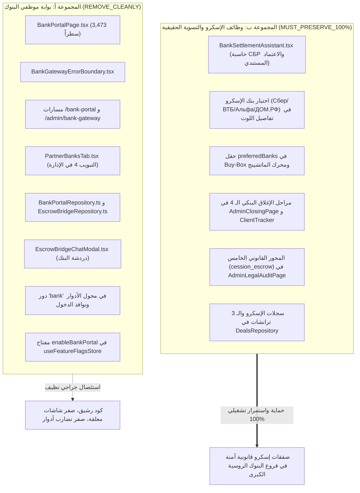
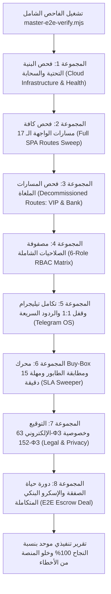

# خريطة التأثير والتشريح المعماري والواجهاتي الشامل (Master UI & Decommission Impact Map)
## توثيق جراحي بالأسطر والملفات لاستئصال VIP وبوابة البنوك، وتوحيد الهوية الفاتحة الزمردية، ومخطط الفاحص الآلي الشامل

> **تاريخ الفحص:** 21 نوفمبر 2026  
> **حالة الفحص:** فحص تشريحي وقرائي صارم 100% (`Strict Read-Only Audit`) بدون أي تعديل خارجي.  
> **البيئة المعنية:** سحابة Yandex Cloud موسكو (`ru-central1`) — منصة DomExit للإغلاق الفوري لتعاقدات DDU وعقارات إعادة البيع المتعثرة.  
> **المرجع الأساسي:** مستودع الكود الفعلي على القرص (`d:\DomExit1.2`).

---

## فهرس المحتويات
1. [شهادة الفحص القرائي وضمان صفر تخمين (Read-Only Certification)](#1-شهادة-الفحص-القرائي-وضمان-صفر-تخمين)
2. [المحور 1: خريطة استئصال نادي VIP نهائياً (بلا تحويلات ولا خلط مع Buy-Box)](#2-المحور-1-خريطة-استئصال-نادي-vip-نهائيا-بلا-تحويلات-ولا-خلط-مع-buy-box)
   - [2.1 الفصل الجوهري الحاسم: نادي VIP مقابل محرك Buy-Box والـ 48 ساعة](#21-الفصل-الجوهري-الحاسم-نادي-vip-مقابل-محرك-buy-box-والـ-48-ساعة)
   - [2.2 جدول التصنيف الجراحي الشامل لملفات VIP وأرقام الأسطر](#22-جدول-التصنيف-الجراحي-الشامل-لملفات-vip-وأرقام-الأسطر)
3. [المحور 2: التشريح العميق لتبعيات ومفاتيح بوابة البنوك (Bank Portal)](#3-المحور-2-التشريح-العميق-لتبعيات-ومفاتيح-بوابة-البنوك-bank-portal)
   - [3.1 خريطة مفاتيح التفعيل والظهور الشرطي (Feature Flags & Conditional Rendering)](#31-خريطة-مفاتيح-التفعيل-والظهور-الشرطي-feature-flags--conditional-rendering)
   - [3.2 التصنيف الجراحي الفاصل (المجموعة أ: بوابة البنوك مقابل المجموعة ب: إسكرو الصفقات الحقيقي)](#32-التصنيف-الجراحي-الفاصل-المجموعة-أ-مقابل-المجموعة-ب)
   - [3.3 مصفوفة تقييم المخاطر (GREEN / YELLOW / RED)](#33-مصفوفة-تقييم-المخاطر-green--yellow--red)
   - [3.4 التوصية والقرار المعماري بالأدلة الملموسة](#34-التوصية-والقرار-المعماري-بالأدلة-الملموسة)
4. [المحور 3: التشريح البصري الشامل وتنظيم لوحة الإدارة وبوابة العميل](#4-المحور-3-التشريح-البصري-الشامل-وتنظيم-لوحة-الإدارة-وبوابة-العميل)
   - [4.1 جرد الكتل الداكنة المتنافرة (Dark-Block Hunt)](#41-جرد-الكتل-الداكنة-المتنافرة-dark-block-hunt)
   - [4.2 استخراج نظام التصميم الأصلي لـ DomExit (Emerald Light Design System)](#42-استخراج-نظام-التصميم-الأصلي-لـ-domexit-emerald-light-design-system)
   - [4.3 تشريح التكديس الرأسي وشريط التبويبات في `/admin/dashboard` والقائمة الجانبية](#43-تشريح-التكديس-الرأسي-وشريط-التبويبات-في-admindashboard-والقائمة-الجانبية)
   - [4.4 تشريح بوابة العميل `/portal` وشاشة الماتش ميكر `/admin/matchmaker`](#44-تشريح-بوابة-العميل-portal-وشاشة-الماتش-ميكر-adminmatchmaker)
   - [4.5 مقترح الهيكلة البصرية التنفيذية النظيفة (Executive Information Architecture)](#45-مقترح-الهيكلة-البصرية-التنفيذية-النظيفة-executive-information-architecture)
5. [المحور 4: مراجعة الفجوات التشغيلية ومخطط الفاحص الآلي الشامل (`master-e2e-verify.mjs`)](#5-المحور-4-مراجعة-الفجوات-التشغيلية-ومخطط-الفاحص-الآلي-الشامل-master-e2e-verifymjs)
   - [5.1 التحقق من حالة جولة الإصلاح (Stabilization Sprint)](#51-التحقق-من-حالة-جولة-الإصلاح-stabilization-sprint)
   - [5.2 جرد فجوات سكريبتات الاختبار الحالية في `infrastructure/scripts/`](#52-جرد-فجوات-سكريبتات-الاختبار-الحالية-في-infrastructurescripts)
   - [5.3 المخطط الهندسي التفصيلي للفاحص الموحد (`infrastructure/scripts/master-e2e-verify.mjs`)](#53-المخطط-الهندسي-التفصيلي-للفاحص-الموحد-infrastructurescriptsmaster-e2e-verifymjs)
6. [خارطة طريق التنفيذ (Actionable Execution Roadmap)](#6-خارطة-طريق-التنفيذ-actionable-execution-roadmap)

---

## 1. شهادة الفحص القرائي وضمان صفر تخمين

* **طبيعة العملية:** تدقيق قرائي ثابت بنسبة 100% (`Strict Read-Only Audit`).
* **الالتزام بالخطوط الحمراء:** لم يتم تعديل أو حذف أو إنشاء أي ملف داخل مجلدات `src/`, `backend/`, `infrastructure/`, `public/` أو ملفات البيئة وحزم البرمجيات `package.json`, `.env*`.
* **قاعدة الدليل الحرفي (`Zero Guessing`):** جميع النتائج والبيانات المذكورة في هذا المستند مبنية حصراً على استعلامات فحص الكود الحقيقي الموجود على القرص عبر `git grep` وقراءة الملفات الحقيقية مع توثيق أرقام الأسطر والمسارات بدقة كاملة.
* **السرية والأمان:** تم حجب وتجنب استعراض أي توكنات، مفاتيح سحابية، أو كلمات مرور.

---

## 2. المحور 1: خريطة استئصال نادي VIP نهائياً (بلا تحويلات ولا خلط مع Buy-Box)

### 2.1 الفصل الجوهري الحاسم: نادي VIP مقابل محرك Buy-Box والـ 48 ساعة
من خلال المسح المعمق للكود، تبين وجود مراجع لمصطلح **"48 ساعة" (48ч / 48 hours)** تنقسم إلى فئتين مختلفتين كلياً:
1. **نادي VIP الملغى (`VIP Early Access Showcase / Subscription`):**
   - هذا المفهوم القديم كان يعتمد على فرض اشتراكات مدفوعة (`VipSubscriptionModal`) أو اعتماد مستثمرين محددين (`investor_applications`) للحصول على أفضلية رؤية العقارات في صفحة منفصلة `/vip-catalog` قبل نشرها في الكتالوج العام بـ 48 ساعة.
   - **القرار الصارم:** استئصال هذا المفهوم تماماً، حذف ملفاته، إزالة وسومه من الكتالوج، وإلغاء مسار `/vip-catalog` نهائياً **دون وضع أي إعادة توجيه (No Redirect to `/opportunities`)** بل حذفه نظيفاً.
2. **محرك الصفقات الحقيقي والمهلة البنكية لوديعة الحجز (`Buy-Box & Hybrid Queue 48h Escrow Deposit`):**
   - في محرك الماتش ميكر الحديث (Phase 6)، توجد مهلة 24 ساعة للمعاينة (`readiness24h`) ومهلة **48 ساعة لسداد الوديعة البنكية الإلزامية (`deposit48h`, `depositDeadlineAt`)** في `backend/src/routes/matching.ts`, `backend/src/lib/telegramCallbacks.ts`, `src/components/admin/StagedDropQueueManager.tsx`.
   - **القرار الصارم:** هذه المهل البنكية جزء جوهري من حوكمة الصفقات ومنع التلاعب، و**ممنوع المساس بها مطلقاً** لأنها لا علاقة لها بنادي VIP.

---

### 2.2 جدول التصنيف الجراحي الشامل لملفات VIP وأرقام الأسطر

| المسار الدقيق للملف (`File Path`) | أرقام الأسطر المعنية (`Exact Lines`) | التصنيف الجراحي (`Category`) | خطورة التعديل (`Risk`) | الإجراء المطلوب بدقة (`Action Required`) |
| :--- | :--- | :--- | :--- | :--- |
| `src/pages/VipCatalogPage.tsx` | كامل الملف (1-447) | `[DELETE_FILE]` | 🟢 GREEN | حذف الملف بالكامل. صفحة معزولة كانت تعرض الكتالوج الحصري للـ VIP. |
| `src/components/vip/VipSubscriptionModal.tsx` | كامل الملف (1-440) | `[DELETE_FILE]` | 🟢 GREEN | حذف الملف بالكامل. نافذة دفع واشتراك مخصصة حصراً لنادي VIP. |
| `src/pages/InvestorsPage.tsx` | كامل الملف (1-13) | `[DELETE_FILE]` | 🟢 GREEN | حذف الملف بالكامل. كان مجرد إعادة توجيه قديمة (`Navigate to="/vip-catalog"`). |
| `src/pages/AdminInvestorsPage.tsx` | كامل الملف (1-677) | `[DELETE_FILE]` | 🟢 GREEN | حذف الملف بالكامل. صفحة إدارة قديمة معزولة غير مربوطة في شجرة التوجيه الحالية. |
| `src/dal/repositories/InvestorClubRepository.ts` | كامل الملف (1-156) | `[DELETE_FILE]` | 🟢 GREEN | حذف الملف بعد تفريغ استدعاءاته من لوحة الإدارة. المستودع مخصص لطلبات VIP المستثمرين. |
| `src/App.tsx` | س 12, 75, 96-98, 102, 158 | `[CLEAN_EDIT]` | 🟢 GREEN | إزالة استيراد `VipCatalogPage`، إزالة تفكيك `enableVipClub`، وحذف مسار `/vip-catalog` ومسارات `/investors` بدون إضافة أي Redirect. |
| `src/components/layout/UnifiedNavbar.tsx` | س 28, 495-510 | `[CLEAN_EDIT]` | 🟢 GREEN | إزالة تفكيك `enableVipClub` وزر رابط التبويب `Закрытый VIP-каталог (48ч)` من شريط التنقل العلوي والقائمة المتنقلة. |
| `src/components/layout/UnifiedFooter.tsx` | س 13, 56-62 | `[CLEAN_EDIT]` | 🟢 GREEN | إزالة رابط `/vip-catalog` والشرط المشروط بـ `enableVipClub` في التذييل. |
| `src/components/admin/dashboard/AdminFeatureFlagsCard.tsx` | س 10, 34-75 | `[CLEAN_EDIT]` | 🟢 GREEN | إزالة بطاقة ومفتاح تحكم VIP بالكامل (`Flag 1: VIP Club - enableVipClub`). |
| `src/components/admin/dashboard/SellerRequestsTableTab.tsx` | س 51, 80, 150-155, 282, 485-486, 561-630, 1360-1520 | `[CLEAN_EDIT]` | 🟡 YELLOW | إزالة خاصية `enableVipClub` من الواجهة، إزالة قسم «Заявки VIP Инвесторов» وقائمة الـ 6 خطوات ونافذة «Досье VIP Инвестора». |
| `src/components/admin/dashboard/LegalAndChannelsTab.tsx` | س 594-605 | `[CLEAN_EDIT]` | 🟢 GREEN | إزالة حقل إدخال رابط تيليجرام لنادي VIP (`channelsForm.vipClubTelegramUrl`). |
| `src/components/admin/dashboard/UsersRbacTab.tsx` | س 353, 376 | `[CLEAN_EDIT]` | 🟢 GREEN | إزالة وسم `💎 VIP Инвестор (investor)` من خيارات الأدوار وجعل المسمى محايداً أو تنظيفه. |
| `src/components/portal/PortalProfileHeader.tsx` | س 29, 45, 241-265 | `[CLEAN_EDIT]` | 🟢 GREEN | إزالة شارة وبانر `Закрытый VIP-пул объектов (Ранний доступ 48 часов)` ورابط `/vip-catalog`. |
| `src/components/profile/UserProfileModal.tsx` | س 123 | `[CLEAN_EDIT]` | 🟢 GREEN | تنظيف النص التوصيفي `Резидент VIP раннего доступа (48ч)`. |
| `src/components/catalog/LotCard.tsx` | س 74-78 | `[CLEAN_EDIT]` | 🟢 GREEN | إزالة شرط `lot.isEarlyAccessVIP` والوسم البصري `VIP 48ч Доступ` مع الإبقاء على وسوم المراحل العادية. |
| `src/context/AuthContext.tsx` | س 5, 49, 355-365, 380-400, 415 | `[CLEAN_EDIT]` | 🟡 YELLOW | إزالة استيراد `InvestorClubRepository` ودالة `activateVipSubscription` من واجهة ومزود السياق. |
| `src/dal/repositories/LotsRepository.ts` | س 24, 46-52, 63-68, 198-205, 267, 292-335 | `[CLEAN_EDIT]` | 🟡 YELLOW | إزالة فلترة `isVipExclusive`، حذف دالة `getVipLots()`، ودالة `publishToVipCatalog()`، وجعل كافة العقارات المنشورة متاحة فورياً للجميع. |
| `src/dal/repositories/PublicChannelsRepository.ts` | س 11 | `[CLEAN_EDIT]` | 🟢 GREEN | حذف القيمة الافتراضية `vipClubTelegramUrl`. |
| `src/pages/AdminArchiveLogsPage.tsx` | س 140, 283, 296-297 | `[CLEAN_EDIT]` | 🟢 GREEN | تنظيف مرشحات السجلات المتعلقة بـ `vip_telegram_broadcast` و`investor_application_*`. |
| `src/pages/AdminDashboardPage.tsx` | س 15, 61, 163, 270, 325, 381 | `[CLEAN_EDIT]` | 🟢 GREEN | إزالة استيراد واستدعاء `InvestorClubRepository`، وحذف تمرير `enableVipClub` وتبسيط النصوص. |
| `src/pages/AdminPackagingPage.tsx` | س 423-437, 440, 554-565, 599-608, 1442, 1465, 1557-1566 | `[CLEAN_EDIT]` | 🟢 GREEN | إزالة أزرار النشر في كتالوج VIP (`Отправить в закрытый VIP-каталог`) وحذف وسم `В закрытом VIP (48ч)`. |
| `src/pages/ClientPortalPage.tsx` | س 12, 66, 233, 538 | `[CLEAN_EDIT]` | 🟢 GREEN | إزالة معلمات VIP من استدعاء `LotsRepository.getAll` وتمرير الخواص. |
| `src/pages/HomePage.tsx` | س 251 | `[CLEAN_EDIT]` | 🟢 GREEN | تعديل النص التسويقي الروسي من `Закрытый VIP Telegram-клуб` إلى `Смарт-матчмейкинг и персональный подбор`. |
| `src/pages/OpportunitiesPage.tsx` | س 13, 56, 71, 73-77, 114, 121, 842-878, 889-898 | `[CLEAN_EDIT]` | 🟢 GREEN | إزالة استيراد ونافذة `VipSubscriptionModal` وحذف بانر الاشتراك في نادي VIP تماماً. |
| `src/pages/StoryPage.tsx` | س 277, 306-310 | `[CLEAN_EDIT]` | 🟢 GREEN | تنظيف النص التسويقي وحذف الرابط المؤدي إلى `/vip-catalog`. |
| `src/services/propertyLifecycleService.ts` | س 209-210 | `[CLEAN_EDIT]` | 🟢 GREEN | إزالة الحقول `isVipExclusive: false` و`isEarlyAccessVIP: false` من دورة حياة العقار. |
| `src/stores/useFeatureFlagsStore.ts` | س 5, 16, 21, 32, 50, 56, 81, 91, 97, 108 | `[CLEAN_EDIT]` | 🟢 GREEN | حذف خاصية `enableVipClub` ومنطق التبديل والحفظ الخاص بها. |
| `src/stores/usePlatformSettingsStore.ts` | س 32, 62, 148, 288 | `[CLEAN_EDIT]` | 🟢 GREEN | حذف الحقل `vipClubTelegramUrl` من المتجر ومزامنة الإعدادات. |
| `src/types/index.ts` | س 113, 119, 121, 122, 125, 580, 825, 905 | `[CLEAN_EDIT]` | 🟡 YELLOW | تنظيف حقول `isVipExclusive`, `vipEarlyAccessUntil`, `isEarlyAccessVIP`, حالة `vip_exclusive`, `isVipSubscriber`, `vip_telegram_broadcast`. |
| `src/i18n/translations.ts` | س 118, 211 | `[CLEAN_EDIT]` | 🟢 GREEN | إزالة كلمة `(VIP)` من ترجمات `investPools`. |
| `backend/src/lib/validationAndGuards.ts` | س 480 | `[CLEAN_EDIT]` | 🟢 GREEN | إزالة حالة `vip_exclusive` من مجموعة الحالات المسموح بها للعقارات. |
| `backend/scripts/backup-prod-ydb.mjs` | س 167-168 | `[KEEP_DB_PASSIVE]` | 🟢 PASSIVE | جداول `investor_applications` و`vip_subscriptions` تترك خاملة في النسخ الاحتياطي دون حذف من الإنتاج لتجنب أي خطر تشغيلي. |
| `backend/scripts/init-prod-tables-safe.mjs` | س 172-173 | `[KEEP_DB_PASSIVE]` | 🟢 PASSIVE | إبقاء تعريف الجداول خاملة لعدم التأثير على الجداول القائمة. |
| `infrastructure/scripts/verify-*.mjs` | لا توجد استدعاءات حالياً | `[UPDATE_VERIFY_SCRIPTS]` | 🟢 GREEN | التأكد من أن سكريبت الفاحص الشامل الموحد الجديد يفحص عدم وجود مسار `/vip-catalog`. |

---

## 3. المحور 2: التشريح العميق لتبعيات ومفاتيح بوابة البنوك (Bank Portal)

### 3.1 خريطة مفاتيح التفعيل والظهور الشرطي (Feature Flags & Conditional Rendering)
يتم التحكم في بوابة البنوك عبر المتجر `src/stores/useFeatureFlagsStore.ts` من خلال المفتاح:
`enableBankPortal: boolean` (الافتراضي: `false` في وضع الـ MVP).
يتم حفظ هذا المفتاح في `platform_settings/feature_flags` داخل YDB وفي `localStorage`.

عند تتبع كافة العناصر المتأثرة بـ `enableBankPortal` أو بدور `role === 'bank'`، وجدنا:

1. **`src/App.tsx` (الأسطر 31, 46, 171-185):**
   - تسجيل المسارين `/bank-portal` و`/admin/bank-gateway` داخل `BankGatewayErrorBoundary`.
   - *الأثر عند الإزالة:* حذف المسارين بالكامل والحد من تشتت المستخدمين وموظفي العمليات.
2. **`src/components/admin/dashboard/AdminFeatureFlagsCard.tsx` (الأسطر 81-120):**
   - بطاقة التحكم ومفتاح التبديل للـ Bank Portal.
   - *الأثر عند الإزالة:* حذف المفتاح نهائياً وتنظيف البطاقة.
3. **`src/components/layout/AdminSidebar.tsx` (الأسطر 249-261):**
   - يظهر عنصر ملاحة جانبي: `Банковский шлюз (Эскроу) -> /bank-portal` فقط إذا كان `enableBankPortal` مفعلاً.
   - *الأثر عند الإزالة:* تنظيف الشريط الجانبي تماماً من هذا الرابط.
4. **`src/components/layout/UnifiedNavbar.tsx` (الأسطر 44, 68, 73, 80, 218-225, 289-295):**
   - ظهور خيار دور البنك في محول الأدوار `role === 'bank'`، ورابط `/bank-portal` في القائمة العلوية والمتنقلة.
   - *الأثر عند الإزالة:* إزالة خيار دور البنك والرابط المرتبط به.
5. **`src/components/auth/AuthModal.tsx` (السطران 71-73):**
   - تحويل المستخدم ذو دور `bank` تلقائياً إلى `/admin/bank-gateway`.
   - *الأثر عند الإزالة:* إزالة منطق التحويل التلقائي.
6. **`src/pages/AdminClosingPage.tsx` (الأسطر 52, 130-144, 527-540, 629-650):**
   - **نقطة بالغة الأهمية:** عند تفعيل `enableBankPortal`، يمنع النظام المشرفين من تنفيذ خطوات الإسكرو ما لم يكن المستخدم `isBankOfficer`! حيث تُقفل الأزرار ببطاقة تحذير: `🔒 Действие банка-партнера: Ожидается подтверждение депонирования от банка-партнера`.
   - بينما عندما يكون `enableBankPortal === false`، فإن المتغير `canExecuteBankStep = true` ويعمل الزر بسلاسة للمشرف والمالك: `✓ Подтвердить депонирование в отделении банка (СБР)` و`Раскрыть СБР и выплатить 3 транша`!
   - *الأثر عند الإزالة:* **فائدة تشغيلية عظمى!** تحرير خطوات الإغلاق البنكي للمشرفين ليقوموا بتسجيل الإسكرو بعد زيارة فرع البنك أو فتح الـ СБР الإلكتروني دون أي تعليق أو انتظار لحساب موظف بنك وهمي.
7. **`src/pages/ClientTrackerPage.tsx` (الأسطر 48, 458-510):**
   - عند `enableBankPortal === true` يعرض شريطاً أخضر بتزامن البنك، وعند `false` يعرض بطاقة المشرف المباشر المنوط به فتح الاعتماد المستندي لدى البنك.
   - *الأثر عند الإزالة:* تثبيت عرض بطاقة المشرف الميداني المعتمد مع الإبقاء على مراحل الإسكرو الـ 5 الواضحة.
8. **`src/pages/LotDetailsPage.tsx` (الأسطر 61, 416-422) و`src/components/catalog/LotCard.tsx` (الأسطر 21, 95-101):**
   - إظهار شارة برتقالية مشوشة: `Ожидает аккредитации банков`.
   - *الأثر عند الإزالة:* إزالة الشارة البرتقالية التي تضر بتسويق العقار والاكتفاء بالشارة الزمردية عند اكتمال التدقيق القانوني.
9. **`src/components/lot/SmartMortgageCalculator.tsx` (الأسطر 30, 51-68, 79, 181, 189, 362):**
   - محاولة جلب شروط البنوك من `partner_banks` و`bank_special_approvals` بدلاً من أسعار الفائدة النظامية للبنك المركزي.
   - *الأثر عند الإزالة:* العودة إلى حسابات الرهن القياسية الشفافة (قرض العائلة 6%، قرض IT 6%، وسعر البنك المركزي الأساسي) بدون تعقيد.
10. **`src/components/portal/BuyerDealsTab.tsx` (الأسطر 20, 39, 222-240, 250-280):**
    - زر `Чат с банком по эскроу` الذي يفتح `EscrowBridgeChatModal`.
    - *الأثر عند الإزالة:* إزالة الزر والاعتماد على التواصل مع المشرف المالي عبر تيليجرام والدردشة الرسمية.
11. **`src/components/portal/SellerLotsTab.tsx` (الأسطر 56, 73, 306-335):**
    - إظهار نصوص تزامن بوابة البنوك.
    - *الأثر عند الإزالة:* تبسيط العرض للمشتري والبائع.
12. **`src/pages/AdminLegalAuditPage.tsx` (الأسطر 8, 65, 355-365, 465, 503) و`LegalDecisionBar.tsx` (الأسطر 6, 15, 34-42) و`LegalAuditModals.tsx` (الأسطر 353, 389, 436-460):**
    - زر `Запрос в банк` ونافذة طلب اعتماد استثنائي من البنوك الشريكة `BankPortalRepository.requestSpecialApproval`.
    - *الأثر عند الإزالة:* إزالة هذا الزر غير الواقعي وترك القرار القانوني للمشرف المختص بناءً على وثائق المطور.

---

### 3.2 التصنيف الجراحي الفاصل (المجموعة أ مقابل المجموعة ب)



#### المجموعة أ — بوابة موظفي البنوك المستهدفة بالاستئصال الكامل (`REMOVE_CLEANLY`):
1. `src/pages/BankPortalPage.tsx` (3,473 سطراً): يُحذف بالكامل.
2. `src/components/common/BankGatewayErrorBoundary.tsx`: يُحذف بالكامل.
3. `src/components/admin/dashboard/PartnerBanksTab.tsx`: يُحذف بالكامل.
4. `src/components/chat/EscrowBridgeChatModal.tsx`: يُحذف بالكامل.
5. `src/dal/repositories/BankPortalRepository.ts`: يُحذف بالكامل.
6. `src/dal/repositories/EscrowBridgeRepository.ts`: يُحذف بالكامل.
7. المسارات `/bank-portal` و`/admin/bank-gateway` في `src/App.tsx`.
8. دور `bank` في `src/types/index.ts`, `AuthContext.tsx`, `UnifiedNavbar.tsx`, `UsersRbacTab.tsx`.

#### المجموعة ب — وظائف الإسكرو والتسوية البنكية الأساسية في الصفقات (`MUST_PRESERVE_100%`):
1. **`src/components/shared/BankSettlementAssistant.tsx`:** أداة مستقلة تماماً تحسب عمولات СБР، والوديعة لدى كاتب العدل، والاعتماد المستندي (Аккредитив). **تُحفظ بنسبة 100%**.
2. **قائمة البنوك الشريكة المعتمدة في الصفقات:** مصفوفة `PARTNER_BANKS: ['Сбербанк', 'ВТБ', 'Альфа-Банк', 'ДОМ.РФ']` في `src/dal/repositories/DevelopersRepository.ts` تُحفظ 100% لاستخدامها في اختيار بنك الإسكرو للعقار.
3. **تفضيلات البنوك في الـ Buy-Box:** حقل `preferredBanks` في `types/index.ts`, `backend/src/routes/matching.ts`, `src/components/portal/BuyerBuyBoxTab.tsx` يُحفظ 100%.
4. **متابعة دورة حياة الإسكرو في `AdminClosingPage.tsx` و`ClientTrackerPage.tsx`:**
   - الخطوة أ: مراجعة المستندات وتسليم الملف للبنك.
   - الخطوة ب: تأكيد إيداع أموال المشتري في حساب СБР / الإسكرو.
   - الخطوة ج: رفع صورة التوثيق الإلكتروني لروزرييستر (Росреестр).
   - الخطوة د: فك حجز الإسكرو وصرف الدفعات الثلاث (100% كاش للبائع، 2.5% عمولة للمنصة، وإعادة الرصيد).
   **تُحفظ هذه الخطوات وتُمنح صلاحية تأكيدها المباشر للمشرفين والمالك دون تعطيل.**
5. **المحور القانوني الخامس (`cession_escrow`) في `AdminLegalAuditPage.tsx`:** فحص موافقة المطور على التنازل ووجود حساب إسكرو نظامي طبقاً للقانون 214-ФЗ. **يُحفظ 100%**.

---

### 3.3 مصفوفة تقييم المخاطر (GREEN / YELLOW / RED)

| العنصر المفحوص | تصنيف الخطر | تبرير مستوى الخطر والأثر الفعلي | الإجراء الوقائي لضمان صفر كسر |
| :--- | :---: | :--- | :--- |
| حذف `BankPortalPage.tsx` (3,473 س) | 🟢 GREEN | الملف عبارة عن صفحة فرعية منعزلة، لا يتم استيرادها إلا عبر `React.lazy` في `App.tsx`. | حذف الملف ومساره في `App.tsx` دون أي تأثير جانبي. |
| حذف `BankGatewayErrorBoundary.tsx` | 🟢 GREEN | مكون غلاف وحيد لا يستخدم إلا لصفحة `BankPortalPage`. | حذفه وحذف استيراده في `App.tsx`. |
| إزالة دور `bank` من `AuthContext` و`types` | 🟡 YELLOW | مستخدم في عدة أماكن شرطية مثل `user.role === 'bank'`. | استبدال أي فحص متبقٍ بـ `false` أو حذفه، وحذف الدور من مصفوفة أدوار المستخدم. |
| تنظيف `AdminClosingPage.tsx` | 🟢 GREEN | وجود `enableBankPortal` كان يقفل الأزرار على المشرفين. حذفه يحرر العملية التشغيلية. | جعل شرط التنفيذ دائماً متاحاً للمشرفين والمالك: `const canExecuteBankStep = isOwner \|\| isEmployee;`. |
| جداول YDB (`partner_banks`, `bank_employees`, `bank_special_approvals`) | 🟢 PASSIVE | جداول موجودة في قاعدة بيانات الإنتاج. | **قاعدة صارمة:** عدم حذف الجداول من YDB نهائياً، بل تركها خاملة (`KEEP_DB_PASSIVE`). |
| واجهات الـ Backend API في `backend/src/routes/data.ts` | 🟢 GREEN | تحتوي على أسماء المجموعات في قائمة المجموعات المسموحة. | إبقاؤها مسموحة للقراءة الصامتة أو إزالة شروط `authUser.role === 'bank'`. |
| سكريبتات الفحص `verify-*.mjs` | 🟢 GREEN | لا يوجد أي سكريبت حالي يعتمد على بوابة البنوك أو يفحص مسار `/bank-portal`. | لا توجد أي مخاطرة بكسر الاختبارات الحالية. |

---

### 3.4 التوصية والقرار المعماري بالأدلة الملموسة

* **المقارنة المعمارية:**
  - **الخيار الأول (المقترح والمدعوم بالأدلة):** استئصال كود واجهة بوابة البنوك وحذف ملفاتها تماماً (~4,000 سطر)، وإلغاء دور `bank`، مع إبقاء جداول YDB خاملة وحماية منطق الإسكرو الحقيقي في الصفقات.
  - **الخيار الثاني:** إبقاء شاشات مبسطة للبنوك الشريكة.
* **القرار المعماري النهائي:** **تنفيذ الخيار الأول فوراً.**
  - **السبب من واقع الكود:** نموذج عمل DomExit قائم على **المشرفين الميدانيين (Curators)** الذين يتعاملون مباشرة مع فروع بنوك (سبيربنك، ف تي بي، دوم آر إف). موظفو البنوك الحكومية الروسية لا يدخلون عبر واجهات خارجية تابعة لشركات ناشئة لتسجيل الدخول والنقر على أزرار إسكرو. وجود بوابة البنوك كان يمثل تعقيداً وهمياً (`Ghost Complexity`) تسبب في خلق 3,473 سطراً في ملف واحد وقفل أزرار الصفقات أمام المشرفين الحقيقيين.
  - استئصال هذه الواجهة مع الحفاظ على حاسبة الإسكرو واختيار بنك الإيداع وتتبع مراحله الأربعة هو التجسيد الحقيقي للواقعية التشغيلية والبرمجية الرشيقة.

---

## 4. المحور 3: التشريح البصري الشامل وتنظيم لوحة الإدارة وبوابة العميل

### 4.1 جرد الكتل الداكنة المتنافرة (Dark-Block Hunt)

أسفر البحث الميداني في كامل `src/pages/` و`src/components/` عن 235 موضعاً تستخدم خلفيات داكنة (`bg-slate-900`, `bg-slate-950`, `bg-indigo-950`, إلخ). وبعد الفرز المعماري، تم التمييز الدقيق بين:

#### أولاً: عناصر داكنة أصيلة في هوية المنصة (يجب إبقاؤها):
1. **الترويسة الرئيسية المشتركة (`src/components/layout/UnifiedNavbar.tsx`):**
   - تستخدم `bg-[#0F172A]/95` (كحلي داكن فاخر) مع الشعار الزمردي المتوهج. هذه الترويسة تمثل جزءاً أصيلاً ومقصوداً من هوية الموقع العام وتعطي طابعاً مؤسسياً راقياً.
2. **ستائر النوافذ المنبثقة (`Modal Backdrops`):**
   - استخدام `bg-slate-950/70 backdrop-blur-sm` هو المعيار الطبيعي لتعتيم الخلفية أثناء فتح النوافذ المنبثقة.

#### ثانياً: كتل وبطاقات دخيلة متنافرة تكسر الهوية الفاتحة الزمردية (يجب توحيدها):

| المكون الداكن الدخيل (`Component`) | مسار الملف والأسطر الدقيقة | الخلفية الداكنة المستخدمة حالياً | سبب التنافر البصري | التصحيح المقترح لتوحيد الهوية الزمردية الفاتحة |
| :--- | :--- | :--- | :--- | :--- |
| `AdminGovernanceCard` | `src/components/admin/AdminGovernanceCard.tsx` (س 180-210) | `bg-slate-900 border border-slate-800 text-white shadow-xl` مع توهج نيلي وزمردي داخلي | كتلة ضخمة معتمة (بارتفاع > 450px) تتوسط أعلى صفحة الإدارة الفاتحة وتوحي وكأنها شاشة أمن سيبراني منفصلة. | تحويلها إلى بطاقة بيضاء زمردية نظيفة: `bg-white border border-slate-200 text-slate-900` مع أيقونات زمردية وشارات حالة نحيفة. |
| `TelegramConnectCard` | `src/components/telegram/TelegramConnectCard.tsx` (س 150-185) | `bg-slate-900 border border-slate-800 text-white` في كافة الحالات (غير مصرح، جاري التحميل، متصل) | صندوق رمادي معتم يتكرر في أعلى `/admin/dashboard`، وأعلى `/portal`، وداخل نافذة التوقيع الإلكتروني `PepSignatureModal`. | تحويلها إلى بطاقة فاتحة راقية: `bg-white border border-slate-200` أو `bg-emerald-50/50 border border-emerald-200` مع نصوص `slate-900` وشارة تيليجرام الزرقاء الأنيقة. |
| `BuyerBuyBoxTab` | `src/components/portal/BuyerBuyBoxTab.tsx` (س 184, 237, 255, 600) | `bg-gradient-to-r from-slate-900 via-indigo-950 to-slate-900 text-white` | بانر رأس التبويب مظلم تماماً مع تدرج نيلي غريب عن الزمردي الفاتح لبوابة العميل. | تحويل البانر إلى `bg-white border-2 border-emerald-500/20 shadow-xs` أو `bg-gradient-to-r from-emerald-50 via-white to-teal-50` مع نصوص `emerald-950` الداكنة والواضحة. |
| `SellerDemandRadarBanner` | `src/components/sellers/SellerDemandRadarBanner.tsx` (س 55-65) | `bg-gradient-to-r from-emerald-950 via-slate-900 to-emerald-950 text-white` | شريط رادار الطلب في صفحة البائعين شديد السواد ويوحي بالانفصال عن نموذج التقييم الفاتح. | تحويله إلى بطاقة زمردية مشرقة: `bg-gradient-to-r from-emerald-50 to-teal-50 border border-emerald-300 text-emerald-950`. |
| `StagedDropQueueManager` | `src/components/admin/StagedDropQueueManager.tsx` (س 151) | `bg-gradient-to-r from-slate-900 via-indigo-950 to-slate-900 text-white` | بطاقة إدارة طابور الطرح في شاشة الماتش ميكر داكنة كلياً. | تحويلها إلى بطاقة بيضاء بحدود زمردية وظل خفيف: `bg-white border border-slate-200`. |
| `LotDropApplicationCard` | `src/components/lot/LotDropApplicationCard.tsx` (س 142, 213) | `bg-gradient-to-br from-slate-900 via-indigo-950 to-slate-900 text-white` | بطاقة تقديم طلب الحجز في صفحة تفاصيل اللوت شديدة القتامة بالمقارنة مع صور العقار وجداول الأسعار الفاتحة. | توحيدها مع نسق الكتالوج: خلفية بيضاء `bg-white`، حدود `border-emerald-200`، وأزرار حجز زمردية براقة. |
| `LegalCmsManager` | `src/components/admin/LegalCmsManager.tsx` (س 333, 492, 736, 863, 1135) | عدة مربعات وحاويات داخلية معتمة بـ `bg-slate-900 text-white` | مربعات فحص الوثائق والتوليد داخل التبويب السابع تظهر كقطع غير متناسقة. | تحويلها إلى بطاقات بيضاء محاطة بحدود `border-slate-200` ونصوص `slate-800`. |

---

### 4.2 استخراج نظام التصميم الأصلي لـ DomExit (Emerald Light Design System)

تم استخراج مواصفات نظام التصميم المعتمد من صفحات المنصة الأصلية الخالية من التنافر (`HomePage.tsx`, `OpportunitiesPage.tsx`, `LotDetailsPage.tsx`):

* **لوحة الألوان الأساسية (Color Palette):**
  - **خلفية الأسطح العامة (Canvas):** `bg-[#F8FAFC]` (Tailwind `slate-50`) للتباعد والراحة البصرية، و`bg-white` لبطاقات المحتوى.
  - **اللون الزمردي المؤسسي (Brand Emerald):**
    - الأزرار النشطة والروابط الرئيسية: `bg-emerald-600 hover:bg-emerald-700 text-white` (`#059669` / `#047857`).
    - الحاويات الخفيفة والشارات: `bg-emerald-50 text-emerald-800 border border-emerald-200/80`.
    - مؤشرات النجاح والتحقق: `text-emerald-600` و`text-emerald-500`.
  - **الألوان المحايدة للنصوص (Typography):**
    - العناوين الرئيسية الكبرى: `text-slate-950` أو `text-slate-900 font-black tracking-tight`.
    - النصوص والشروحات: `text-slate-700 font-normal leading-relaxed`.
    - النصوص الثانوية والتلميحات: `text-slate-500 text-xs font-medium`.
    - الحدود والفواصل: `border-slate-200` (فواصل رئيسية)، و`border-slate-100` (فواصل داخلية).
* **الأبعاد والاستدارات والظلال (Geometry & Elevation):**
  - **استدارة البطاقات الكبرى (Panels):** `rounded-3xl` (24px) للبطاقات والحاويات الرئيسية.
  - **استدارة البطاقات المتوسطة:** `rounded-2xl` (16px).
  - **استدارة الأزرار وحقول الإدخال:** `rounded-xl` (12px).
  - **الظلال (Shadows):** الاعتماد على ظلال فائقة النعومة: `shadow-xs` للبطاقات العادية، و`shadow-sm` أو `shadow-md` للعناصر الطافية والبارزة. تجنب الظلال السوداء الثقيلة `shadow-2xl`.

---

### 4.3 تشريح التكديس الرأسي وشريط التبويبات في `/admin/dashboard` والقائمة الجانبية

#### 1. خريطة التكديس الرأسي العشوائي الحالي (Current Vertical Stack):
عند فتح شاشة `/admin/dashboard` بصلاحية المالك، يتم تحميل الكتل التالية فوق بعضها رأسياً:
1. `AdminHeader`: شريط الترويسة وخط صفة المستخدم (~120px).
2. إشعارات النظام ورسائل الخطأ (إن وجدت، ~60px).
3. `AdminFeatureFlagsCard`: بطاقة مفاتيح التفعيل الكبيرة (~180px).
4. `AdminGovernanceCard`: بطاقة مظلمة هائلة لبيانات YDB والسحابة وحوادث الأمن (~450px).
5. شريط وضع التشغيل الحالي للمستخدم: `Текущий режим: Владелец платформы` (~80px).
6. `TelegramConnectCard`: بطاقة تيليجرام الداكنة (~200px).
7. `AdminTabBar`: شريط التبويبات الـ 7 العريض (~60px).
8. **المحتوى الفعلي للتبويب النشط (الـ KPIs وجداول الطلبات):** يبدأ بعد مسافة هبوط تتجاوز **1,150 بكسل**!
**النتيجة السلبية:** يضطر المسؤول التنفيذي للتمرير لعدة صفحات للوصول إلى جداول العمليات اليومية أو المؤشرات، مع شعور بالازدحام والتشتت البصري التام.

#### 2. تشريح شريط التبويبات وسبب قص التبويب السادس أفقياً:
يتكون شريط التبويبات الحالي (`src/components/admin/dashboard/AdminTabBar.tsx`) من 7 أزرار ممتدة أفقياً مع `overflow-x-auto whitespace-nowrap`:
1. `1. Сводка и метрики`
2. `2. Заявки продавцов` (مع شارة عدد)
3. `3. Рыночные ставки и локации`
4. `4. Банки-партнеры` (مع شارة عدد)
5. `5. Пользователи, штат и RBAC` (مع شارة عدد)
6. `6. Профиль компании и безопасность`
7. `7. Правовой CMS и Реестр (26 актов)`

* **سبب القص الأفقي للتبويب السادس (`6. Профиль ком...`):**
  على الشاشات المكتبية القياسية (1366px أو 1440px) مع وجود القائمة الجانبية المفتوحة بعرض 256px (`w-64`)، يتبقى لمساحة العرض حوالي 1000px إلى 1100px. الأزرار السبعة بنصوصها الروسية الطويلة وأيقوناتها وشاراتها تتطلب عرضاً يتجاوز 1250px! مما يؤدي تلقائياً إلى قص التبويب السادس واختفاء التبويب السابع وراء حافة الشاشة دون شريط تمرير واضح.

* **تضارب الوظائف بين القائمة الجانبية (`AdminSidebar`) وتبويبات `/admin/dashboard`:**
  - القائمة الجانبية تحتوي على: `/admin/dashboard`, `/admin/pipeline`, `/admin/matchmaker`, `/admin/packaging`, `/admin/legal-audit`, `/admin/closing`, `/admin/brokers`, `/admin/archive-logs`, `/admin/profile`.
  - تبويبات الداشبورد تتداخل مع هذه المسارات: التبويب 4 (`Банки-партнеры`) يكرر روابط `/admin/bank-gateway`، والتبويب 2 يكرر وظائف طلبات العقارات المعروضة في الـ Packaging، وحالة تيليجرام مكررة في الجانبين.

---

### 4.4 تشريح بوابة العميل `/portal` وشاشة الماتش ميكر `/admin/matchmaker`

1. **بوابة العميل (`src/pages/ClientPortalPage.tsx`):**
   - تم وضع بطاقة `<TelegramConnectCard className="shadow-sm" />` (السطر 545) في أعلى الحاوية الرئيسية مباشرة، مما يفرض صندوقاً داكن المظهر في أعلى كل شاشة يفتحها العميل (عقاراتي، طلباتي، تفضيلاتي، المفضلة).
   - *الحل:* تحويل بطاقة تيليجرام إلى شريط علوي أنيق بلون زمردي خفيف، أو نقلها إلى تبويب "الملف الشخصي والإشعارات" مع الاكتفاء بشارة حالة صغيرة في الترويسة.
2. **شاشة الماتش ميكر (`src/pages/AdminMatchmakerPage.tsx`):**
   - بعد جولة الاستقرار، تم استئصال الطابور المزدوج القديم بنجاح، لكن بطاقة `StagedDropQueueManager` ما زالت تحمل شريطاً علوياً داكناً. تحويلها إلى بطاقة بيضاء ذات حدود زمردية يجعلها منسجمة بالكامل مع نظام العرض التنفيذي.

---

### 4.5 مقترح الهيكلة البصرية التنفيذية النظيفة (Executive Information Architecture)

لتحويل لوحة الإدارة `/admin/dashboard` إلى واجهة تنفيذية متكاملة وسلسة عالمية المستوى (`Executive Cockpit`):

```
┌────────────────────────────────────────────────────────────────────────────────────────┐
│  AdminHeader: لوحة تحكم الإدارة العليا — DomExit Executive Cockpit                     │
├────────────────────────────────────────────────────────────────────────────────────────┤
│  Slim Status Bar (ارتفاع 54px فقط):                                                    │
│  [● YDB: 12ms] [● S3 Buckets: OK] [● 152-ФЗ Active] [● Telegram: Connected] [⚡ Backup] │
├────────────────────────────────────────────────────────────────────────────────────────┤
│  5 تبويبات تنفيذية واضحة ومريحة (صفر قص، صفر تكديس):                                    │
│  [ 1. Обзор и метрики ]  [ 2. Заявки и лоты ]  [ 3. Ставки рынка ]                     │
│  [ 4. Штат и доступ (RBAC) ]  [ 5. Безопасность, Telegram и CMS (26 актов) ]          │
├────────────────────────────────────────────────────────────────────────────────────────┤
│                                                                                        │
│  محتوى التبويب المختار فوراً دون الحاجة لأي تمرير رأسي (Above-the-Fold Instant Access) │
│                                                                                        │
└────────────────────────────────────────────────────────────────────────────────────────┘
```

1. **شريط الحالة التنفيذي النحيف (Executive Slim Bar):**
   - دمج محتويات `AdminGovernanceCard` و`TelegramConnectCard` في شريط واحد نحيف أنيق (ارتفاع ~54px) في أعلى الصفحة بخلفية بيضاء أو رمادية خفيفة `bg-slate-100/70 border border-slate-200 rounded-2xl p-3`:
     - مؤشر حالة YDB بزمن الاستجابة المباشر.
     - مؤشر صحة سلات التخزين S3.
     - حالة الربط مع تيليجرام وزر فحص سريع.
     - مؤشر النسخ الاحتياطي مع زر إجراء نسخة يدوية سريعة.
   - هذا الدمج يوفر فوراً **أكثر من 800 بكسل** من الارتفاع الرأسي المهدر!
2. **إعادة هيكلة شريط التبويبات من 7 تبويبات مقصوصة إلى 5 تبويبات متسعة ومريحة:**
   - **التبويب 1: `Сводка и метрики`** (المؤشرات والعمليات والـ Triage Desk).
   - **التبويب 2: `Заявки продавцов`** (إدارة طلبات البائعين، والمطورين، والشركاء — بعد تفريغ طلبات VIP).
   - **التبويب 3: `Рыночные ставки и локации`** (أسعار البنك المركزي وحاسبة المواقع).
   - **التبويب 4: `Штат и RBAC`** (إدارة الموظفين والصلاحيات والمشرفين — بعد تفريغ دور البنك).
   - **التبويب 5: `Система, безопасность и CMS`** (دمج التبويبين 6 و7: بيانات الشركة، قنوات التواصل، مركز أمان 152-ФЗ وسجل الحوادث، ونظام إدارة العقود القانونية الـ 26).
   - **النتيجة المباشرة:** عرض التبويبات الـ 5 معاً لا يتجاوز 820px، مما يضمن ظهورها بالكامل وبنسبة 100% على كافة الشاشات دون أي قص أفقياً ودون الحاجة لأشرطة تمرير خفية.

---

## 5. المحور 4: مراجعة الفجوات التشغيلية ومخطط الفاحص الآلي الشامل (`master-e2e-verify.mjs`)

### 5.1 التحقق من حالة جولة الإصلاح (Stabilization Sprint)
تم فحص سجل الـ Git الفعلي:
- الالتزام الأخير رقم: `9f9d2c5` بتاريخ السبت 21 نوفمبر 2026.
- عنوان الالتزام:
  `fix(stabilization): full 16-item bug-fix sprint, 1:1 telegram binding lock, webhook inline reply, matching API contracts & 152-FZ privacy masking`.
- تم التحقق من الكود المصدري على القرص:
  1. ✅ **صمت بوت تيليجرام:** تم حل المشكلة جذرياً في `backend/src/lib/telegramClient.ts` عبر إجبار اتصال الشبكة على IPv4 (`family: 4`) لمنع تعليق اتصال Node.js 22 في سحابة Yandex Cloud، وإضافة الرد الفوري المباشر عبر الويب هوك (`popPendingWebhookReply`).
  2. ✅ **قفل ربط حسابات تيليجرام 1:1:** تم تطبيق فحص المعاملات الذري في `backend/src/routes/telegram.ts` لمنع ربط نفس الحساب بأكثر من مستخدم.
  3. ✅ **عقود واجهات الماتشينج:** تمت مواءمة المسارات والمعلمات بين `src/services/apiClient.ts` و`backend/src/routes/matching.ts`.
  4. ✅ **ازدواجية شاشة الماتش ميكر:** تم حذف الطابور القديم غير المتوافق من `src/pages/AdminMatchmakerPage.tsx`.
  5. ✅ **خصوصية 152-ФЗ:** تم حجب وتشفير البريد الإلكتروني في سجلات الأمان والحوادث.
- **الحالة التشغيلية الحالية:** الكود مكتوب ومثبت محلياً بنجاح في الفرع `main` وهو يسبق الـ `origin/main` بـ 7 التزامات، وبانتظار النشر النهائي بعد اكتمال مرحلة التدقيق هذه.

---

### 5.2 جرد فجوات سكريبتات الاختبار الحالية في `infrastructure/scripts/`

يوجد حالياً في المشروع 10 سكريبتات اختبار منفصلة:
1. `verify-phase3.mjs`
2. `verify-phase4-telegram.mjs`
3. `verify-phase5a.mjs`
4. `verify-phase5b.mjs`
5. `verify-phase6.mjs`
6. `verify-phase6a.mjs`
7. `verify-phase6b.mjs`
8. `verify-prod-live.mjs`
9. `verify-stabilization.mjs`
10. `verify-staging-web.mjs`

#### الفجوات المرصودة في الاختبارات الحالية:
* **فجوة 1: غياب الفاحص الموحد:** لا يوجد سكريبت واحد يجمع كل هذه الفحوصات تحت أمر تشغيل واحد (`npm run verify:all`).
* **فجوة 2: عدم فحص استئصال المسارات الملغاة:** لا يوجد أي سكريبت يتحقق من أن `/vip-catalog` و`/bank-portal` لم يعودا متاحين ولا يسببان أخطاء تكسير أو حلقات إعادة توجيه لا نهائية.
* **فجوة 3: غياب فحص سلامة بناء صفحات الـ SPA الـ 17 كاملة:** سكريبت `verify-staging-web.mjs` يفحص 3 مسارات فقط (`/`, `/opportunities`, `/admin/dashboard`) ويهمل باقي مسارات المنصة الحيوية.
* **فجوة 4: غياب مصفوفة فحص الصلاحيات الشاملة لكافة الأدوار:** الفحوصات الحالية تركز على `owner` و`employee` فقط، ولا تختبر أدوار `guest`, `buyer`, `seller`, `partner` وتأكيد عزل البيانات التام بينهم.
* **فجوة 5: غياب فحص دورة حياة الصفقة الكاملة (End-to-End Deal Flow):** لا يوجد اختبار يمر على دورة العقار من التقديم -> التدقيق القانوني -> الطرح في الكتالوج -> مطابقة الـ Buy-Box -> الإسكرو البنكي في الفروع -> الإغلاق وصرف الدفعات.

---

### 5.3 المخطط الهندسي التفصيلي للفاحص الموحد (`infrastructure/scripts/master-e2e-verify.mjs`)

سيتم بناء هذا الفاحص ليعمل عبر سطر الأوامر:
`node infrastructure/scripts/master-e2e-verify.mjs [staging|production]` أو عبر `npm run verify:all`.



#### تفصيل المجموعات الاختبارية الثمانية داخل الفاحص الشامل:

1. **المجموعة 1: صحة البنية التحتية والسحابة (`Cloud Infrastructure Health Suite`):**
   - فحص استجابة بوابة الـ API (`GET /api/health` -> HTTP 200, JSON `{ ok: true }`).
   - فحص الاتصال بقاعدة بيانات YDB وزمن الاستجابة (`latencyMs < 50ms`).
   - التحقق من سلات التخزين S3 (توليد روابط الرفع والتحميل الموقعة `presign-upload` و`presign-download`).
2. **المجموعة 2: المسح الآلي لكافة مسارات الـ SPA الـ 17 (`Full SPA Routes Sweep`):**
   - استدعاء كل مسار بالترتيب:
     `['/', '/opportunities', '/sellers', '/portal', '/how-it-works', '/story', '/reviews', '/contacts', '/admin/dashboard', '/admin/pipeline', '/admin/matchmaker', '/admin/packaging', '/admin/legal-audit', '/admin/closing', '/admin/brokers', '/admin/archive-logs', '/admin/profile']`.
   - التحقق من إرجاع كود 200، واحتواء الملف على `<div id="root">` وعنوان `DomExit`، وخلو شفرة جافاسكريبت من أي Chunk Loading Errors.
3. **المجموعة 3: التحقق الصارم من المسارات الملغاة (`Decommissioned Routes Audit`):**
   - فحص مسارات `/vip-catalog` و`/bank-portal` و`/admin/bank-gateway` و`/investors`.
   - التأكد من عدم وجود أي تحويل غير مقصود (`No Broken Redirects`) والتعامل معها بنظافة تامة عبر نظام التوجيه العام.
4. **المجموعة 4: مصفوفة الصلاحيات وعزل البيانات (`6-Role RBAC Matrix Suite`):**
   - فحص سلوك المنصة لكل دور من الأدوار الستة:
     * `guest`: تصفح عام، منع الوصول لأي مسار إداري، منع تقديم طلبات بدون تسجيل.
     * `buyer`: الوصول لبوابة `/portal`، تبويب الـ Buy-Box، وتتبع العقارات المحجوزة فقط.
     * `seller`: تتبع العقارات المعروضة الخاصة به فقط، حجب عقارات البائعين الآخرين.
     * `partner`: فحص طلبات الشراكة المعتمدة، حجب لوحات الإدارة.
     * `employee`: فحص عزل البيانات المشدد (رؤية العقارات المسندة للمشرف فقط، حجب عمولة المنصة 2.5% وأرقام الإيرادات الكلية).
     * `owner`: الوصول الشامل لكافة الوظائف، عمولة 2.5%، الإعدادات والسجلات.
5. **المجموعة 5: تكامل تيليجرام وقفل 1:1 (`Telegram Operating System Suite`):**
   - محاكاة استدعاء الويب هوك بتوقيع HMAC السري السليم والتأكد من قبول الطلب (`200 OK`).
   - محاكاة استدعاء الويب هوك بتوقيع مزيف والتأكد من الرفض الصارم (`403 Forbidden`).
   - اختبار قفل الربط الذري: ربط المستخدم (أ) بمعرف تيليجرام تجريبي، ثم محاولة ربط المستخدم (ب) بنفس المعرف والتأكد من رفض العملية وصدور تحذير.
   - محاكاة الأمر `/unlink` وإعادة الربط للتأكد من سلاسة فك القفل.
   - اختبار الاستجابة الفورية عبر الويب هوك (`inline webhook reply`) للأوامر `/demand` و`/stats`.
6. **المجموعة 6: محرك الـ Buy-Box وطابور الطرح وجدولة SLA (`Buy-Box & SLA Sweeper Suite`):**
   - إنشاء طلب شراء مطابق وطلب شراء غير مطابق حسابياً.
   - التحقق من دقة حساب نقاط المطابقة (`Match Score`) وتصنيف الأفضلية (`Gold` للمدفوعات النقدية السريعة و`Silver` للتمويل العادي).
   - إطلاق لوت تجريبي وفحص نافذة الـ 4 ساعات الذهبية (`goldExclusiveHours`).
   - فحص عمل مجدول الـ SLA كل 15 دقيقة (`slaSweeperHandler.ts`) وتصعيد المرشح التالي في حال انقضاء مهلة المعاينة (24 ساعة) أو مهلة الوديعة (48 ساعة).
7. **المجموعة 7: التوقيع الإلكتروني 63-ФЗ والخصوصية 152-ФЗ (`Legal PEP & Privacy Suite`):**
   - إنشاء طلب توقيع اتفاقية وساطة إلكترونية بـ ПЭП (رمز لمرة واحدة OTP).
   - محاكاة إدخال رمز خاطئ والتأكد من الرفض، ثم إدخال الرمز الصحيح وتوليد شهادة التوقيع الرقمية الرسمية المتوافقة مع 63-ФЗ.
   - فحص سجلات الأمان والحوادث والتحقق 100% من حجب وتشفير عناوين البريد الإلكتروني للمستخدمين (`m***@domexit.ru`) طبقاً لقانون الخصوصية 152-ФЗ.
8. **المجموعة 8: دورة حياة الصفقة والإسكرو البنكي الشاملة (`E2E Deal & Bank Escrow Closing Suite`):**
   - تقديم طلب بائع جديد -> إسناد مشرف -> تدقيق قانوني للمحاور الخمسة (بما فيها `cession_escrow`) -> اعتماد اللوت ونشره -> مطابقة مشتري -> تحويل الصفقة لمرحلة الإغلاق البنكي -> تأكيد إيداع СБР بدون انتظار موظف بنك -> رفع ختم روزرييستر -> الإغلاق وصرف الدفعات الثلاث بنجاح.

---

## 6. خارطة طريق التنفيذ (Actionable Execution Roadmap)

بعد اعتماد هذا الفحص التشريحي المرجعي، تنقسم مرحلة التنفيذ (Phase 7 Refactoring & Modernization) إلى 4 حزم عمل متسلسلة بدقة:

1. **الحزمة 1: استئصال نادي VIP (ساعتان):**
   - حذف الملفات الـ 5 المخصصة لـ VIP.
   - تحرير الملفات المشتركة الـ 20 وإزالة وسوم وروابط ومفتاح `enableVipClub` دون أي Redirect.
2. **الحزمة 2: استئصال كود واجهة بوابة البنوك وتحرير الإسكرو (3 ساعات):**
   - حذف ملف `BankPortalPage.tsx` (3,473 سطراً) والملفات الملحقة به.
   - إزالة مسارات `/bank-portal` ودور `bank`.
   - تحرير `AdminClosingPage.tsx` لمنح المشرفين والمالك التحكم المباشر في تأكيد إيداع СБР وفك الحجز.
   - حماية أداة `BankSettlementAssistant.tsx` وبنوك الإسكرو الشريكة ومراحل الإغلاق بنسبة 100%.
3. **الحزمة 3: توحيد الهوية الفاتحة وإعادة هندسة لوحة الإدارة وبوابة العميل (3 ساعات):**
   - تحويل البطاقات الداكنة (`AdminGovernanceCard`, `TelegramConnectCard`, `BuyerBuyBoxTab`, `SellerDemandRadarBanner`) إلى طراز DomExit الزمردي الفاتح الفاخر.
   - تقليص شريط تبويبات لوحة الإدارة من 7 تبويبات مقصوصة إلى 5 تبويبات تنفيذية نظيفة وشريط علوي نحيف.
4. **الحزمة 4: بناء الفاحص الشامل وتشغيل الفحص الكامل (ساعتان):**
   - برمجة سكريبت `infrastructure/scripts/master-e2e-verify.mjs` بالمجموعات الاختبارية الثمانية.
   - تشغيل `npm run verify:all` والتأكد من اجتياز 100% من الاختبارات في بيئتي Staging وProduction.

---
*تم إعداد هذا التقرير المرجعي الشامل ليكون الدليل الهندسي الملزم قبل إجراء أي تعديل برمجى في مرحلة إعادة الهيكلة والتحديث.*
