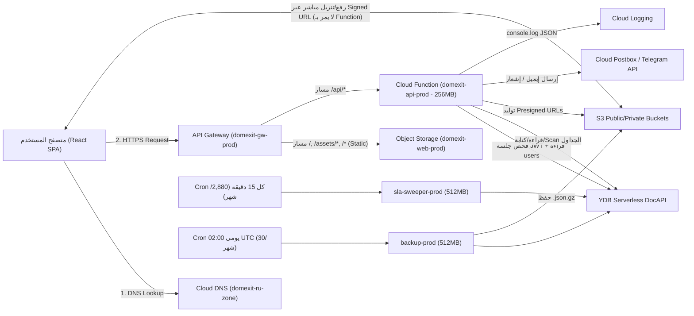

# التقرير الهندسي والمالي الشامل: احتساب فاتورة Yandex Cloud، رحلة الطلبات، توقعات التوسع، وخطة التحسين لمنصة DomExit

**تاريخ التقرير:** 26 نوفمبر 2026  
**المجلد السحابي (Folder ID):** `b1g46uad3gc3h34k5b0f` (المنطقة: `ru-central1`)  
**السحابة (Cloud ID):** `b1gbu0q3jqnheri2srsu`  
**البيئات المشمولة:** الإنتاج (`Production` — `https://domexit.ru`) والتجربة (`Staging`)

---

## 1. الملخص التنفيذي وقراءة لقطة لوحة Yandex Cloud الحالية

وفقاً للوحة تحكم Yandex Cloud المرفقة بتاريخ **26.11.2026**:
- **الرصيد الفعلي (Balance):** `0,00 ₽`
- **الاستهلاك خلال آخر 30 يوماً (Consumption for 30 days):** `6,33 ₽` (مغطى بالكامل من المنحة `6,33 ₽`)
- **المنحة المتاحة (Grants):** متبقٍ **`3 994 ₽` من أصل `4 000 ₽`** (متبقٍ **47 يوماً** — تنتهي في **`12.01.2027`**).

### لماذا الفاتورة الحالية `6,33 ₽` فقط رغم وجود 20+ مورداً؟
لأن منصة **DomExit** مبنية بالكامل على معمارية **Serverless** (بلا خوادم افتراضية VMs تعمل 24/7)، وتوفر Yandex Cloud **باقات مجانية شهرية (Free Tier)** سخية جداً لكل من:
- **Cloud Functions** (أول 1,000,000 استدعاء + 10 GB×hour شهرياً مجاناً)
- **YDB Serverless** (أول 1,000,000 RU + 1 GB تخزين شهرياً مجاناً)
- **API Gateway** (أول 100,000 طلب شهرياً مجاناً)
- **Object Storage** (أول 1 GB تخزين + 10,000 PUT + 100,000 GET + 10 GB ترافيك صادر شهرياً مجاناً)
- **Cloud Postbox** (أول 2,000 رسالة شهرياً مجاناً)

بالتالي، في مرحلة الإطلاق المبكر وعدد المستخدمين القليل، تستهلك المنصة **أقل من الحد المجاني** في أغلب الخدمات، بينما تأتي الـ `6,33 ₽` غالباً من الرسوم التي **لا تملك باقة مجانية** (مثل **Cloud DNS Zone** التي تُحتسب بالثانية/الساعة فور إنشائها، أو استعلامات DNS / جزء بسيط من العمليات/التخزين فوق الحد).

> [!IMPORTANT]
> **تنبيه حرج قبل 12.01.2027:**
> تنتهي المنحة الابتدائية (`4 000 ₽`) بعد 47 يوماً. وبما أن الرصيد الحالي `0,00 ₽`، يجب ربط وسيلة دفع وتفعيل تنبيهات الميزانية (Budgets) قبل `12.01.2027` حتى لا تتوقف خدمات Cloud DNS و API Gateway و YDB عند انتهاء المنحة.

---

## 2. جرد البنية التحتية الفعلية المبنية في المشروع

استناداً إلى لقطة لوحة التحكم وملف البنية المرجعي [`infrastructure/cloud-manifest.json`](../infrastructure/cloud-manifest.json)، تتوزع مواردك على بيئتين (`Production` و `Staging`) داخل نفس المجلد `b1g46uad3gc3h34k5b0f`:

| الخدمة في Yandex Cloud | العدد في اللوحة | الموارد الفعلية في `Production` | الموارد الفعلية في `Staging` |
| :--- | :--- | :--- | :--- |
| **API Gateway** | `2 API gateways` | `domexit-gw-prod` (`d5dsuuhvetioe2hp0q7i`) -> `https://domexit.ru` | `domexit-gw-staging` (`d5dpccovifu701p9lvga`) |
| **Cloud Functions** | `4 Functions`, `2 Triggers` | 1) `domexit-api-prod` (`256 MB`, timeout `30s`) 2) `domexit-sla-sweeper-prod` (`512 MB`, timeout `120s`, Cron: كل 15 دقيقة) 3) `domexit-backup-prod` (`512 MB`, timeout `180s`, Cron: يومياً 02:00 UTC) | 4) `domexit-api-staging` (`d4ep633b03be8trc7d28`) |
| **Managed Service for YDB** | `2 Databases` | `etnckg937628mnid7tnb` (Serverless DocAPI) | `etnkpeqnbmb1a6cocipk` (Serverless DocAPI) |
| **Object Storage (S3)** | `7 Buckets` (`128.65 MB`) | `domexit-web-prod` (واجهة React) `domexit-storage-vault` (صور عامة) `domexit-private-docs-prod` (مستندات خاصة + نسخ احتياطية) | `domexit-web-staging` `domexit-public-photos-staging` `domexit-private-docs-staging` (+ باكت سابع قديم/تشغيلي) |
| **Cloud DNS** | `1 Zone`, `10 Records` | `domexit-ru-zone` (`domexit.ru`) | — |
| **Certificate Manager** | `1 Certificate` | `domexit-ru-cert` (`ISSUED`) | — |
| **Cloud Postbox** | `1 Address` | `no-reply@domexit.ru` (`postbox.cloud.yandex.net:465`) | — |
| **IAM** | `3 Service accounts` | `domexit-runtime-sa`, `domexit-postbox-sa`, + حساب خدمة ثالث | مشترك |
| **Cloud Logging** | تلقائي | سجلات `stdout/stderr` لجميع دوال Cloud Functions | سجلات Staging |

---

## 3. كيف تحتسب Yandex Cloud الفاتورة؟ (آلية التسعير والـ Free Tier لكل خدمة)

تُحتسب الفاتورة في منطقة `ru-central1` بالروبل الروسي (شاملةً ضريبة القيمة المضافة VAT) بنظام **الدفع حسب الاستهلاك الفعلي (Pay-as-you-go)** بعد خصم الباقة المجانية الشهرية (التي تتجدد أول كل شهر ميلادي ولا تترحل للشهر التالي):

### 3.1. Yandex API Gateway
- **ما الذي يُحتسب؟** عدد طلبات HTTPS التي يعالجها البوابة (سواءً كانت `/api/*` أو ملفات واجهة `/` و `/assets/*`) + الترافيك الصادر.
- **الباقة المجانية (Free Tier):** أول **`100,000` طلب/شهر** مجاناً.
- **التسعير بعد Free Tier:** **`142,30 ₽`** لكل **1,000,000 طلب** (`0,0001423 ₽` للطلب الواحد).
- **المعادلة:**
  $$\text{Cost}_{\text{APIGW}} = \max\left(0,\ \frac{\text{Requests} - 100{,}000}{1{,}000{,}000}\right) \times 142.30$$

### 3.2. Yandex Cloud Functions
- **ما الذي يُحتسب؟** عاملان مستقلان:
  1. **عدد الاستدعاءات (Invocations):** أول **`1,000,000` استدعاء/شهر** مجاناً، ثم **`18,97 ₽` لكل 1,000,000 استدعاء**.
  2. **الموارد الحاسوبية (GB×hour):** أول **`10 GB×hour` شهرياً** مجاناً، ثم **`6,48 ₽` لكل `1 GB×hour`**.
     - *كيف تُحسب GB×hour؟* `الذاكرة المخصصة (GB) × زمن التنفيذ الفعلي (مقرّباً لأعلى 100ms) ÷ 3600`.
     - **في مشروعك:**
       - دالة API (`domexit-api-prod`) مخصصة بـ **`256 MB` (`0.25 GB`)** ([`backend/scripts/deploy-prod.mjs#L180`](../backend/scripts/deploy-prod.mjs#L180)). كل 100ms تنفيذ = `0.25 × 0.1 / 3600 = 0.00000694 GB×hour`.
       - دوال `sla-sweeper` و `backup` مخصصة بـ **`512 MB` (`0.50 GB`)** ([`deploy-sweeper-prod.mjs#L108`](../backend/scripts/deploy-sweeper-prod.mjs#L108), [`deploy-backup-prod.mjs#L106`](../backend/scripts/deploy-backup-prod.mjs#L106)).

### 3.3. Yandex Managed Service for YDB (Serverless / DocAPI)
- **ما الذي يُحتسب؟**
  1. **وحدات الطلبات (Request Units — RU):** أول **`1,000,000 RU` شهرياً** مجاناً، ثم نحو **`~24,64 ₽` لكل 1,000,000 RU**.
     - *ملاحظة حرجة حول RU:* قراءة سجل واحد بالمفتاح (`GetItem`) تستهلك عادةً ~1 RU لكل 4 KB. أما عملية **`Scan`** فتقرأ الجدول كاملاً (أو صفحة كاملة) وتُحاسَب على **كل البيانات المقروءة** حتى لو احتوت على فلتر (`FilterExpression`) استبعد 99% من الصفوف! كما أن الكتابة (`PutItem` / `UpdateItem`) تستهلك RU أعلى بعدة أضعاف، خاصة عند وجود فهارس ثانوية (Secondary Indexes) لأن كل فهرس يتطلب تحديثاً إضافياً.
  2. **التخزين (Storage):** أول **`1 GB/شهر`** مجاناً (بما يشمل البيانات + الفهارس)، ثم يُحسب بالساعة.
  3. **النسخ الاحتياطي التلقائي:** نسختان يوميتان مجاناً؛ النسخ الإضافية عبر S3 تُحسب ضمن فاتورة Object Storage.

### 3.4. Yandex Object Storage (S3)
- **الباقة المجانية (Standard STD):**
  - التخزين: أول **`1 GB/شهر`** مجاناً.
  - عمليات الكتابة (`PUT`, `POST`, `LIST`): أول **`10,000` عملية/شهر** مجاناً.
  - عمليات القراءة (`GET`, `HEAD`, `OPTIONS`): أول **`100,000` عملية/شهر** مجاناً.
  - الترافيك الصادر للإنترنت: أول **`10 GB/شهر`** مجاناً (الترافيك الوارد مجاني دائماً).
- **التسعير بعد Free Tier:**
  - التخزين القياسي (STD): **`~2,17 ₽` لكل 1 GB/شهر**.
  - عمليات `PUT / POST / LIST`: **`0,52 ₽` لكل 1,000 عملية**.
  - عمليات `GET / HEAD`: **`0,42 ₽` لكل 10,000 عملية**.
  - الترافيك الصادر للإنترنت: **`~0,96 – 1,68 ₽` لكل 1 GB** (من 10 GB حتى 1 TB).

### 3.5. Yandex Cloud DNS, Cloud Postbox, Certificate Manager
- **Cloud DNS:** ملكية الـ Public Zone (`domexit-ru-zone`) تُحتسب بالثانية/الساعة (**حوالي `43 ₽/شهر` للـ Zone الواحدة** — بدون Free Tier لامتلاك المنطقة العامة)، بالإضافة إلى **~`37,94 ₽` لكل 1,000,000 استعلام Authoritative**. *(هذا هو السبب الرئيسي لظهور رسوم صغيرة حتى لو كان الترافيك شبه معدوم).*
- **Cloud Postbox:** أول **`2,000` رسالة/شهر** مجاناً، ثم تسعير متدرج لكل 1,000 رسالة (مثلاً ~`10-15 ₽` لكل 1,000 رسالة إضافية).
- **Certificate Manager:** **مجاني (`0 ₽`)** لإصدار وتجديد شهادات SSL/TLS.

---

## 4. رحلة الطلبات الكاملة (End-to-End Request Lifecycle) وأين يُحسب الاستهلاك

تُظهر الخريطة التالية المسار الفعلي لكل طلب في تطبيق **DomExit** من متصفح المستخدم حتى قاعدة البيانات والعودة:

### تتبّع 5 سيناريوهات حقيقية في كود DomExit:

1. **السيناريو 1: زائر يفتح الصفحة الرئيسية `/` أو صفحة العقارات `/opportunities`**
   - **الخطوة أ (Static Delivery):** كما يظهر في [`infrastructure/apigw-prod.yaml#L28-L67`](../infrastructure/apigw-prod.yaml#L28-L67)، فإن مسار `/`, `/assets/{file+}`, و `/{file+}` جميعها مربوطة بـ `API Gateway` -> `Object Storage (domexit-web-prod)`. عند فتح الصفحة لأول مرة (بدون كاش متصفح)، يُحمّل المتصفح `index.html` + ملفات JS المقسمة (Vite chunks) + CSS + SVG = **قرابة 15 إلى 25 طلب HTTPS**.
     - *العدادات التي تتحرك:* `15–25` طلب **API Gateway** + `15–25` عملية **S3 GET** + ترافيك صادر من S3.
   - **الخطوة ب (Boot Initialization):** عند تشغيل `<App />` في [`src/App.tsx#L72`](../src/App.tsx#L72)، يستدعي المتصفح تلقائياً [`DatabaseInitializer.initLiveDatabase()`](../src/dal/initializer.ts#L10-L76) الذي يطلق:
     - `GET /api/data/developers`
     - `GET /api/data/developer_accreditation_requests`
     - بالإضافة لطلبات الصفحة نفسه مثل `GET /api/data/lots`.
   - **الخطوة ج (داخل Cloud Function + YDB):** تدخل الطلبات إلى [`backend/src/index.ts`](../backend/src/index.ts) ثم [`backend/src/routes/data.ts`](../backend/src/routes/data.ts).
     - إذا كانت الحاوية دافئة (`warm`) والبيانات في `memoryCache` (صلاحية **60 ثانية** فقط في [`backend/src/lib/cache.ts#L117`](../backend/src/lib/cache.ts#L117))، يُرد مباشرةً دون ضرب YDB.
     - إذا كانت الحاوية باردة (`cold start`) أو انتهت الـ 60 ثانية أو كان المستخدم موظفاً (`isStaff` يتجاوز الكاش في [`data.ts#L908`](../backend/src/routes/data.ts#L908))، ينفذ الخادم `ydb.scanAll(collection)` — أي **مسح كامل للجدول**!

2. **السيناريو 2: مستخدم مسجّل الدخول يتصفح `/portal` أو `/admin/*`**
   - مع **كل طلب API** (جلب صفقات، رسائل، طلبات شراء، إشعارات)، يستدعي الراوتر [`getAuthenticatedUser(event)`](../backend/src/lib/cryptoAuth.ts#L140-L188).
   - بعد التحقق من توقيع JWT محلياً، ينفذ الكود في السطر `158`:
     `const user = await ydb.getItem<UserProfile>('users', payload.userId);`
   - أي أن **كل طلب مصادق يستهلك عملية `GetItem` من YDB** حتى قبل تنفيذ منطق الطلب نفسه!

3. **السيناريو 3: رفع صورة أو مستند (أفاتار، إثبات ملاءة، مستندات إغلاق)**
   - المتصفح يطلب `POST /api/storage/presign-upload` ([`backend/src/routes/storage.ts#L41`](../backend/src/routes/storage.ts#L41)).
   - الخادم يتحقق من الحصة عبر `consumeQuota` ([`backend/src/lib/anomalyDetector.ts#L53-L88`](../backend/src/lib/anomalyDetector.ts#L53-L88)) -> **1 `GetItem` + 1 `PutItem`** في جدول `rate_limits`.
   - يُعيد الخادم رابط S3 موقّع (`Presigned URL`).
   - المتصفح يرفع الملف **مباشرةً إلى S3 Object Storage** — وهذه نقطة قوة ممتازة في بنيتك لأنها **لا تستهلك GB×hour من Cloud Function** ولا تتقيد بحد الـ 3.5 MB/payload في API Gateway.

4. **السيناريو 4: المجدول التلقائي `sla-sweeper-prod` (يعمل كل 15 دقيقة)**
   - يُستدعى **`96` مرة يومياً = `2,880` مرة شهرياً** بذاكرة **`512 MB`** ([`deploy-sweeper-prod.mjs#L108`](../backend/src/backend/scripts/deploy-sweeper-prod.mjs)).
   - في كل تشغيل ([`slaSweeperService.ts`](../backend/src/lib/slaSweeperService.ts)) ينفذ **6 عمليات `scanAll` متتالية**:
     - `scanAll('lots')` في السطر `120`
     - `scanAll('lots')` مرة ثانية في السطر `182`
     - `scanAll('buyer_applications')` في السطر `215`
     - `scanAll('seller_requests')` في السطر `251`
     - `scanAll('partner_preliminary_requests')` في السطر `293`
     - `scanAll('lots')` مرة ثالثة في السطر `334`
   - هذا يعني على الأقل **`17,280` عملية مسح جداول (Full Table Scans) شهرياً** في الخلفية حتى لو لم يكن هناك أي مستخدم نشط على الموقع!

5. **السيناريو 5: النسخ الاحتياطي اليومي `backup-prod` (02:00 UTC)**
   - يُستدعى **`30` مرة شهرياً** بذاكرة **`512 MB`**.
   - يسرد كل الجداول (`ListTables`) ويمسح كل جدول (`Scan`) بالكامل ثم يضغطه `.json.gz` ويرفعه إلى `domexit-private-docs-prod` مع الاحتفاظ بآخر 30 نسخة.

---

## 5. نقاط الاستنزاف الحرجة في الكود الحالي (Cost Hotspots)

تم رصد **7 نقاط استنزاف حقيقية** في الكود الحالي ستكون المسؤولة عن تضخم الفاتورة عند زيادة المستخدمين:

### Hotspot #1 (الأخطر على API Gateway): تمرير الملفات الثابتة عبر API Gateway
- **الموضع:** [`infrastructure/apigw-prod.yaml#L28-L67`](../infrastructure/apigw-prod.yaml#L28-L67)
- **المشكلة:** كل ملف JS/CSS/SVG/HTML في `domexit-web-prod` يمر عبر API Gateway. بدلاً من أن تستهلك زيارة المستخدم `1` إلى `3` طلبات API فقط، تستهلك **`20–30` طلب API Gateway** بسبب تحميل الحزم الثابتة.
- **الأثر المالي:** عند 50,000 زائر شهرياً (بمتوسط 3 زيارات/شهر × 20 طلب أصول)، يعني ذلك **3,000,000 طلب API Gateway** (~**`413 ₽`** إضافية فقط للوصول إلى ملفات ثابتة!).

### Hotspot #2 (الأخطر على YDB والزمن): الاعتماد شبه الكلي على `Scan` بدل `Query`
- **الموضع:** [`backend/src/lib/ydbClient.ts#L180-L295`](../backend/src/lib/ydbClient.ts#L180-L295) + **45 استدعاء `.scanAll(`** في المسارات (`data.ts`, `matching.ts`, `pep.ts`, `tools.ts`, `slaSweeperService.ts`).
- **المشكلة:**
  - `YdbClient` لا يحتوي على أي دالة تستدعي `DynamoDB_20120810.Query`!
  - حتى الدالة [`findByField()`](../backend/src/lib/ydbClient.ts#L257-L295) تستخدم `DynamoDB_20120810.Scan` مع `FilterExpression` (وفي حال الفشل تسحب 500 سجل بـ `scanAll`).
  - في الوقت نفسه، ملف [`infrastructure/scripts/ensure-ydb-indexes.mjs`](../infrastructure/scripts/ensure-ydb-indexes.mjs) ينشئ فهارس ثانوية (`email-index`, `yandexId-index`, إلخ)، ما يعني أنك **تدفع تكلفة كتابة وتخزين الفهارس دون الاستفادة منها في القراءة!**
- **الأثر المالي والأدائي:** عندما ينمو جدول `lots` أو `buyer_applications` أو `audit_logs` إلى 5,000–20,000 سجل، فإن كل `scanAll` سيقرأ عشرات الميجابايت من YDB في كل طلب، مما يقفز باستهلاك **RU** من آلاف إلى **عشرات الملايين**، ويرفع زمن تنفيذ Cloud Function من `80ms` إلى `1500ms+` (مضاعفة فاتورة `GB×hour`!).

### Hotspot #3 (استنزاف خلف الكواليس): `sla-sweeper-prod` يمسح `lots` 3 مرات كل 15 دقيقة
- **الموضع:** [`backend/src/lib/slaSweeperService.ts#L120,L182,L334`](../backend/src/lib/slaSweeperService.ts#L120)
- **المشكلة:** جدول `lots` نفسه يُقرأ بالكامل **3 مرات** في نفس الدورة، بينما يمكن جلبه **مرة واحدة** وتمريره للمهام الثلاث.

### Hotspot #4 (طلبات مهدرة من الواجهة): `DatabaseInitializer.initLiveDatabase()` عند كل تحميل للصفحة
- **الموضع:** [`src/App.tsx#L72`](../src/App.tsx#L72) -> [`src/dal/initializer.ts#L10-L76`](../src/dal/initializer.ts#L10-L76)
- **المشكلة:** كود تنظيف تاريخي مؤقت (للتخلص من مطور تجريبي قديم `dfdfv`) لا يزال يعمل **في كل مرة يفتح فيها أي مستخدم الموقع**، مطلقاً طلبين إضافيين إلى `/api/data/developers` و `/api/data/developer_accreditation_requests`!

### Hotspot #5: التحقق من المستخدم عبر YDB في كل طلب API مصادق
- **الموضع:** [`backend/src/lib/cryptoAuth.ts#L158`](../backend/src/lib/cryptoAuth.ts#L158)
- **المشكلة:** `ydb.getItem('users', payload.userId)` يُنفذ مع كل طلب محمي حتى لو كان المستخدم يفتح 5 طلبات متتالية خلال ثانية واحدة في `/portal` أو `/admin`.

### Hotspot #6: كاش `appCache` المحلي داخل حاويات Serverless غير متزامنة
- **الموضع:** [`backend/src/lib/cache.ts#L117`](../backend/src/lib/cache.ts#L117)
- **المشكلة:** `InMemoryLruCache(300, 60000)` يعيش داخل ذاكرة الحاوية الواحدة فقط. عند ارتفاع عدد المستخدمين المتزامنين، تفتح Yandex Cloud عدة حاويات متوازية، وتفقد كل حاوية الكاش أو تبنيه من الصفر بعمليات `scanAll` متكررة.

### Hotspot #7: تراكم سجلات `rate_limits` وغياب TTL + تكلفة Cloud Logging
- **الموضع:** [`backend/src/lib/anomalyDetector.ts#L53-L88`](../backend/src/lib/anomalyDetector.ts#L53-L88) و [`backend/src/lib/logger.ts`](../backend/src/lib/logger.ts)
- **المشكلة:** صفوف `rate_limits` تبقى في YDB إلى الأبد دون حذف تلقائي (TTL)، وسجلات JSON الكاملة على كل طلب ناجح قد تزيد حجم Cloud Logging عند ملايين الطلبات.

---

## 6. توقعات الفاتورة الشهرية مع نمو عدد المستخدمين (100 إلى 100,000 MAU)

### فرضيات الحساب الواقعية لمنصة DomExit (عقارات — متصفح + بوابة عملاء + لوحة إدارة):
- **المستخدم النشط شهرياً (MAU):** يزور المنصة بمعدل **4 جلسات/شهر**.
- **في الجلسة الواحدة (الوضع الحالي بدون تحسين):**
  - `20` طلب أصول ثابتة عبر API Gateway (HTML/JS/CSS/SVG) عند التحميل الأولي/انتهاء الكاش.
  - `12` طلب API (`/api/auth/me`, `/api/data/lots`, `/api/data/developers`, `/api/matching/*`, إلخ).
  - إجمالي **~32 طلب API Gateway / جلسة** = **128 طلب/مستخدم/شهر**.
  - متوسط حجم البيانات في جدول نشط: ينمو من `500` سجل (عند 1,000 MAU) إلى `15,000+` سجل (عند 50,000–100,000 MAU)، وبذلك ترتفع تكلفة `Scan` طردياً مع حجم الجداول!
  - الصور والملفات في S3: تنمو من `0.5 GB` (حالي ~129 MB) إلى `50–150 GB` مع الصور والفيديوهات والمستندات، ومتوسط ترافيك صور `~15 MB` لكل مستخدم نشط شهرياً.

### الجدول 1: الفاتورة الشهرية المتوقعة بالوضع الحالي (بدون تحسينات) — بالروبل (₽/شهر)

| مستوى النمو (MAU) | طلبات API GW / شهر | استدعاءات Functions | استهلاك YDB التقديري (RU) | API GW (₽) | Cloud Functions (₽) | YDB DocAPI (₽) | S3 + ترافيك (₽) | DNS + Postbox (₽) | **الإجمالي التقديري (₽/شهر)** |
| :--- | :---: | :---: | :---: | :---: | :---: | :---: | :---: | :---: | :---: |
| **الحالي (< 100 MAU)** | ~15 K | ~12 K | ~250 K | `0 ₽` | `0 ₽` | `0 ₽` | `0 ₽` | `~43 ₽` | **`~10 – 50 ₽`** *(تحت Free Tier)* |
| **1,000 MAU** | ~128 K | ~51 K | ~1.5 M | `4 ₽` | `0 ₽` | `~12 ₽` | `~15 ₽` | `~43 ₽` | **`~75 – 120 ₽`** |
| **5,000 MAU** | ~640 K | ~250 K | ~12 M *(تضخم Scan)* | `77 ₽` | `0 ₽` | `~270 ₽` | `~90 ₽` | `~43 ₽` | **`~480 – 650 ₽`** |
| **20,000 MAU** | ~2.56 M | ~990 K | ~95 M *(Scan جداول كبيرة)* | `350 ₽` | `~35 ₽` | `~2,315 ₽` | `~420 ₽` | `~55 ₽` | **`~3,175 – 4,200 ₽`** |
| **50,000 MAU** | ~6.40 M | ~2.43 M | ~380 M *(اختناق Scan)* | `897 ₽` | `~240 ₽` | `~9,340 ₽` | `~1,150 ₽` | `~85 ₽` | **`~11,700 – 15,500 ₽`** |
| **100,000 MAU** | ~12.8 M | ~4.83 M | ~1.1 B *(Scan + Cold Starts)* | `1,808 ₽` | `~720 ₽` | `~27,100 ₽` | `~2,450 ₽` | `~150 ₽` | **`~32,200 – 45,000 ₽`** |

> [!WARNING]
> **الخلاصة المالية الواضحة:**
> عند وصولك إلى **20,000–100,000 مستخدم**، لن تكون المشكلة في Cloud Functions ولا S3، بل إن **YDB `scanAll` سيلتهم ما بين 70% إلى 85% من فاتورتك الشهرية**، يليه تمرير الأصول الثابتة عبر **API Gateway**!

### الجدول 2: الفاتورة الشهرية المتوقعة بعد تطبيق خطة التحسين (توفير 65% – 85%)

بعد تحويل الاستعلامات من `Scan` إلى `Query` المفهرس، وفصل الأصول الثابتة بـ CDN/Caching، وإزالة الطلبات المهدرة، وكاش المصادقة:

| مستوى النمو (MAU) | الوضع الحالي (₽/شهر) | بعد التحسين (₽/شهر) | نسبة التوفير |
| :--- | :---: | :---: | :---: |
| **1,000 MAU** | `~75 – 120 ₽` | **`~45 – 60 ₽`** | ~45% |
| **5,000 MAU** | `~480 – 650 ₽` | **`~110 – 160 ₽`** | ~75% |
| **20,000 MAU** | `~3,175 – 4,200 ₽` | **`~520 – 750 ₽`** | **~82%** |
| **50,000 MAU** | `~11,700 – 15,500 ₽` | **`~1,650 – 2,300 ₽`** | **~85%** |
| **100,000 MAU** | `~32,200 – 45,000 ₽` | **`~4,100 – 5,800 ₽`** | **~87%** |

---

## 7. خطة التحسين الهندسية الموصى بها (على 3 مراحل)

### المرحلة الأولى: تحسينات سريعة عالية الأثر (Quick Wins — يومان)
1. **إزالة `DatabaseInitializer.initLiveDatabase()` من التشغيل العام:**
   - إيقاف استدعائه من [`src/App.tsx#L72`](../src/App.tsx#L72) (المشكلة التاريخية لـ `dfdfv` انتهت؛ إبقاء السكربت كأداة صيانة يدوية فقط).
   - *الأثر:* إلغاء طلبين API + قراءة YDB على كل زيارة للموقع فوراً.
2. **دمج مسح `lots` في `slaSweeperService.ts`:**
   - قراءة جدول `lots` **مرة واحدة** في بداية `runSlaSweep` وتمريره للمهام 1 و 2 و 6 بدلاً من مسحه 3 مرات، وتقليل تكرار المهام غير الحساسة زمنياً (أو جعل المهام الثقيلة كل 30-60 دقيقة).
   - *الأثر:* خفض استهلاك YDB RU في الخلفية بنسبة **50%–65%** فوراً.
3. **إضافة ترويسات `Cache-Control` طويلة للأصول والصور العامة:**
   - ضبط `Cache-Control: public, max-age=31536000, immutable` لملفات `/assets/*` ذات الـ hash في `domexit-web-prod`، و `max-age=86400` للصور العامة.

### المرحلة الثانية: تحسينات معمارية أساسية (1–2 أسبوع — قبل تجاوز 5,000 MAU)
1. **استبدال `Scan` بـ `DynamoDB_20120810.Query` في `ydbClient.ts`:**
   - إضافة دالة `queryByIndex()` في [`backend/src/lib/ydbClient.ts`](../backend/src/lib/ydbClient.ts) وتفعيل استخدام الفهارس المنشأة أصلاً في [`ensure-ydb-indexes.mjs`](../infrastructure/scripts/ensure-ydb-indexes.mjs) (`lotCode-index`, `status-index`, `userId-index`, `email-index`, إلخ).
   - تحويل نقاط `findByField` و `matching.ts` و `data.ts` (خاصة صفحة تفاصيل اللوت `/api/data/lots/:lotCode`) من `scanAll` إلى `Query`.
2. **فصل الأصول الثابتة عن API Gateway باستخدام Yandex Cloud CDN:**
   - ربط `domexit.ru` عبر Cloud CDN (أو تقديم الأصول الثابتة من CDN مباشر أمام Object Storage) وتوجيه `/api/*` فقط إلى API Gateway، أو تفعيل Static Website Hosting + CDN.
   - *الأثر:* خفض طلبات API Gateway بنسبة **80%–90%** وتسريع فتح الموقع للمستخدمين.
3. **كاش قصير الأمد لبيانات الجلسة في `cryptoAuth.ts`:**
   - تخزين نتيجة `ydb.getItem('users', payload.userId)` في `appCache` لمدة **30–60 ثانية** (مع إبطال الكاش عند تغيير كلمة المرور أو الدور أو تسجيل الخروج).

### المرحلة الثالثة: جاهزية التوسع الكبير (20,000+ MAU)
1. **تنظيف وتدوير جدول `rate_limits` و `audit_logs`:** تفعيل TTL أو أرشفة السجلات الأقدم من 90 يوماً إلى Cold/Ice Object Storage (`0,58 ₽/GB`).
2. **كاش موزع (Yandex Managed Service for Valkey/Redis)** إذا تجاوزت الطلبات المتزامنة قدرة `InMemoryLruCache` على توحيد الكاش بين حاويات Cloud Functions.
3. **ضبط تنبيهات الميزانية (Billing Budgets) في Yandex Cloud Console:**
   - إنشاء Budget alert عند `500 ₽`، `1,500 ₽`، و `5,000 ₽` قبل انتهاء المنحة في **`12.01.2027`**.
