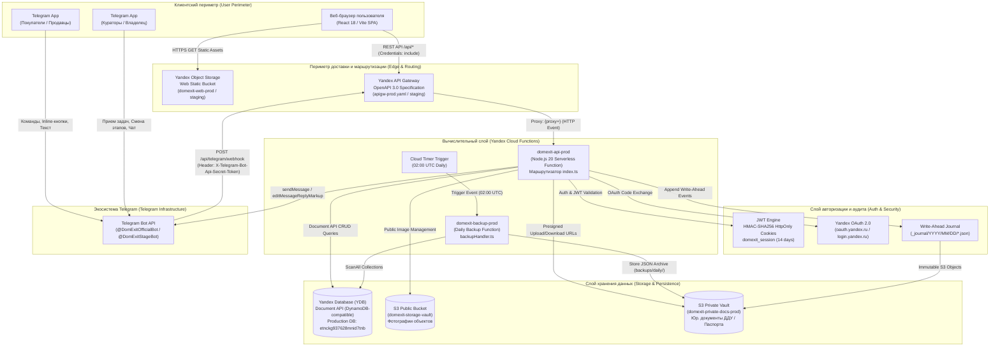

# Глава 1: Исполнительное резюме и облачная топология DomExit 2.0

## 1.1. Исполнительное резюме платформы (Executive Summary)

Платформа **DomExit** представляет собой специализированную финтех- и proptech-экосистему для безопасного, срочного выхода продавцов из договоров долевого участия (ДДУ / ФЗ-214) и инвестиционной переуступки прав требований в строящихся объектах недвижимости на первичном рынке Российской Федерации.

По состоянию на **ноябрь 2026 года** (после завершения этапов глубокой модернизации 1–4):
1. **Полная изоляция в российской юрисдикции (152-ФЗ / 149-ФЗ):** Полностью завершена де-инфраструктуризация зарубежных облачных провайдеров (Google Firebase / Firestore / Cloud Storage и Netlify). 100% данных, бизнес-логики, криптографических ключей, сессий и персональных данных граждан РФ локализованы в московском регионе Yandex Cloud (`ru-central1`).
2. **Бессерверная отказоустойчивая архитектура (Serverless Architecture):**
   - Вычислительный слой: бессерверные функции **Yandex Cloud Functions** на среде исполнения Node.js 20 (`domexit-api-prod`, `domexit-api-staging`, `domexit-backup-prod`).
   - Шлюз API: **Yandex API Gateway** с нативной поддержкой декларативных спецификаций OpenAPI 3.0 (`apigw-prod.yaml`, `apigw-staging.yaml`), гарантирующий обработку CORS preflight (`OPTIONS`) на периметре с минимальной задержкой.
   - База данных: распределенная бессерверная СУБД **Yandex Database (YDB)**, работающая через протокол Document API (совместимый с AWS DynamoDB v20120810) с поддержкой транзакций, бекапов и изоляции реплик.
   - Объектное хранилище: два изолированных бакета **Yandex Object Storage (S3)** — публичный CDN для сжатых фотографий каталога (`domexit-storage-vault`) и приватный шифрованный бакет для юридических документов с доступом по одноразовым Presigned URL со строгим контролем прав (`domexit-private-docs-prod`).
   - Статический фронтенд: Single Page Application на React 18 / TypeScript / Vite, размещенный в выделенном S3-бакете со статическим веб-хостингом (`domexit-web-prod`, `domexit-web-staging`).
3. **Операционная система в Telegram (Telegram Operating System):** Полноценная двусторонняя интеграция веб-платформы с Telegram через бессерверные вебхуки и REST-шлюз. Система обеспечивает привязку профилей через защищенные криптографические токены (`bind_<token>`), интерактивные карточки задач для кураторов, управление стадиями сделки inline-кнопками и сквозной чат-мост «Веб ↔ Telegram» между клиентами и сотрудниками платформы.
4. **Регламент непрерывности бизнеса и защиты от потери данных (Zero-Data-Loss):**
   - Автоматический ежедневный бекап всех коллекций YDB в S3 в 02:00 UTC по расписанию Yandex Cloud Triggers.
   - Неизменяемый транзакционный журнал операций (Write-Ahead Audit Journal) в префиксе `_journal/YYYY/MM/DD/` приватного бакета S3, фиксирующий каждое создание, обновление и удаление сущностей с указанием автора, роли, IP и временной метки.

---

## 1.2. Облачная топология инфраструктуры (Mermaid Architecture Diagram)



---

## 1.3. Сравнительная матрица сред: Staging vs. Production

Все идентификаторы, бакеты и сетевые эндпоинты зафиксированы в конфигурационном файле `infrastructure/cloud-manifest.json` и верифицированы:

| Параметр / Ресурс | Среда Staging (Тестовая) | Среда Production (Боевая) | Файл конфигурации / Ссылка на код |
| :--- | :--- | :--- | :--- |
| **Регион Yandex Cloud** | `ru-central1` (Москва) | `ru-central1` (Москва) | `infrastructure/cloud-manifest.json#L6` |
| **Cloud ID** | `b1gbu0q3jqnheri2srsu` | `b1gbu0q3jqnheri2srsu` | `infrastructure/cloud-manifest.json#L4` |
| **Folder ID** | `b1g46uad3gc3h34k5b0f` | `b1g46uad3gc3h34k5b0f` | `infrastructure/cloud-manifest.json#L5` |
| **Служебный аккаунт (SA)** | `aje70eogmpm04c84rsnl` (`domexit-runtime-sa`) | `aje70eogmpm04c84rsnl` (`domexit-runtime-sa`) | `infrastructure/cloud-manifest.json#L8-L9` |
| **Идентификатор YDB** | `etnkpeqnbmb1a6cocipk` | `etnckg937628mnid7tnb` | `infrastructure/cloud-manifest.json#L12,L25` |
| **Document API Endpoint** | `https://docapi.serverless.yandexcloud.net/ru-central1/b1gbu0q3jqnheri2srsu/etnkpeqnbmb1a6cocipk` | `https://docapi.serverless.yandexcloud.net/ru-central1/b1gbu0q3jqnheri2srsu/etnckg937628mnid7tnb` | `infrastructure/cloud-manifest.json#L13,L26` |
| **Публичный бакет S3 (Фото)**| `domexit-public-photos-staging` | `domexit-storage-vault` | `infrastructure/cloud-manifest.json#L14,L27` |
| **Приватный бакет S3 (Документы)**| `domexit-private-docs-staging` | `domexit-private-docs-prod` | `infrastructure/cloud-manifest.json#L15,L28` |
| **Бакет статического веб-хостинга**| `domexit-web-staging` | `domexit-web-prod` | `infrastructure/cloud-manifest.json#L16,L29` |
| **Function ID API** | `d4ep633b03be8trc7d28` (`domexit-api-staging`) | `d4eouspb2d0s8dfguf1h` (`domexit-api-prod`) | `infrastructure/cloud-manifest.json#L17,L30` |
| **API Gateway ID** | `d5dpccovifu701p9lvga` | `d5dsuuhvetioe2hp0q7i` | `infrastructure/cloud-manifest.json#L18,L31` |
| **API Gateway URL** | `https://d5dpccovifu701p9lvga.bu9mdbe1.apigw.yandexcloud.net` | `https://d5dsuuhvetioe2hp0q7i.6brbn2wz.apigw.yandexcloud.net` | `infrastructure/cloud-manifest.json#L19,L32` |
| **Function ID бекапа** | Н/Д (запуск вручную при тестировании) | `d4edb2l5n6gcpfbnl3b0` (`domexit-backup-prod`) | `infrastructure/cloud-manifest.json#L20` |
| **Cron Trigger ID бекапа** | Н/Д | `a1sqlo5a1el40u9tmqdn` | `infrastructure/cloud-manifest.json#L21` |
| **Расписание бекапа** | Н/Д | `0 2 * * ? *` (Ежедневно в 02:00 UTC) | `infrastructure/cloud-manifest.json#L22` |
| **Telegram Bot Username** | `@DomExitStageBot` | `@DomExitOfficialBot` | `backend/src/lib/config.ts#L44-L45` |
| **Режим окружения (`APP_ENV`)**| `staging` | `production` | `backend/src/lib/config.ts#L22` |

---

## 1.4. Инвентарь переменных окружения (Environment Variables Registry)

> **Правило безопасности:** В соответствии с политикой нулевого разглашения секретов реальные значения приватных ключей, паролей и токенов исключены. Таблица фиксирует имя переменной, ее функциональное назначение и статус наличия в локальной конфигурации (`.env.cloud.local` и `.env`).

| Переменная окружения | Назначение и функциональная роль | Область применения | Статус наличия |
| :--- | :--- | :--- | :--- |
| `APP_ENV` | Режим работы (`production` или `staging`) | Backend & Frontend | **SET** |
| `PUBLIC_BASE_URL` | Базовый публичный URL веб-приложения для редиректов OAuth | Backend (`lib/config.ts#L23`) | **SET** |
| `PROD_CUSTOM_DOMAIN` | Дополнительный доверенный домен для CORS | Backend (`lib/config.ts#L24`) | **SET** |
| `YDB_DOCAPI_ENDPOINT` | Эндпоинт Document API YDB | Backend (`lib/config.ts#L25`) | **SET** |
| `YDB_DATABASE_ID` | Идентификатор базы данных YDB в облаке | Backend (`lib/config.ts#L26`) | **SET** |
| `YDB_REGION` | Регион размещения базы данных (`ru-central1`) | Backend (`lib/config.ts#L27`) | **SET** |
| `YC_SA_KEY_ID` | Идентификатор статического ключа доступа сервисного аккаунта | Backend & Scripts | **SET** |
| `YC_SA_ACCESS_KEY_ID` | Идентификатор ключа доступа S3 / AWS SDK | Backend (`lib/config.ts#L29`) | **SET** |
| `YC_SA_SECRET_ACCESS_KEY` | Секретная часть ключа доступа S3 / AWS SDK | Backend (`lib/config.ts#L30`) | **SET** |
| `S3_ENDPOINT` | Эндпоинт объектного хранилища (`https://storage.yandexcloud.net`) | Backend (`lib/config.ts#L31`) | **SET** |
| `S3_PUBLIC_BUCKET` | Имя бакета публичных фотографий объектов | Backend (`lib/config.ts#L32`) | **SET** |
| `S3_PRIVATE_BUCKET` | Имя приватного бакета документов ДДУ и аудита | Backend (`lib/config.ts#L33`) | **SET** |
| `JWT_SIGNING_SECRET` | Криптографический ключ подписи сессионных JWT (HMAC-SHA256) | Backend (`lib/config.ts#L34`) | **SET** |
| `JWT_EXPIRES_IN_DAYS` | Срок жизни сессии пользователя в днях (по умолчанию 14) | Backend (`lib/config.ts#L35`) | **SET** |
| `YANDEX_OAUTH_CLIENT_ID` | Идентификатор приложения в Yandex OAuth | Backend (`lib/config.ts#L36`) | **SET** |
| `YANDEX_OAUTH_CLIENT_SECRET` | Секретный ключ приложения в Yandex OAuth | Backend (`lib/config.ts#L37`) | **SET** |
| `TELEGRAM_BOT_TOKEN_PROD` | Секретный токен бота @DomExitOfficialBot в боевой среде | Backend (`lib/config.ts#L42`) | **SET** |
| `TELEGRAM_BOT_USERNAME_PROD`| Имя пользователя боевого бота (`DomExitOfficialBot`) | Backend (`lib/config.ts#L44`) | **SET** |
| `TELEGRAM_BOT_TOKEN_STAGING` | Секретный токен бота @DomExitStageBot в тестовой среде | Backend (`lib/config.ts#L43`) | **SET** |
| `TELEGRAM_BOT_USERNAME_STAGING`| Имя пользователя тестового бота (`DomExitStageBot`) | Backend (`lib/config.ts#L45`) | **SET** |
| `TELEGRAM_WEBHOOK_SECRET` | Секретная строка заголовка `X-Telegram-Bot-Api-Secret-Token` | Backend (`lib/config.ts#L46`) | **SET** |
| `BOOTSTRAP_OWNER_EMAIL` | Системный email владельца платформы для авторизации | Scripts & Auth Handler | **SET** |
| `BOOTSTRAP_OWNER_PASSWORD` | Исходный системный пароль владельца платформы | Bootstrap Scripts | **SET** |
| `BOOTSTRAP_STAFF_PASSWORD` | Исходный системный пароль штатных кураторов | Bootstrap Scripts | **SET** |
| `VITE_API_BASE_URL` | Базовый URL API для фронтенда при локальной разработке | Frontend (`services/apiClient.ts#L28`)| **SET** |

---

## 1.5. Инвентарь скриптов развертывания и обслуживания (Operational Tools)

Все скрипты расположены в директориях `backend/scripts/`, `infrastructure/scripts/` и `scripts/`:

1. **Развертывание облачных функций (Deployment Scripts):**
   - `backend/scripts/deploy-prod.mjs` (8,381 байт) — полная сборка TypeScript бэкенда через `esbuild`, упаковка zip-архива, загрузка версии функции в `domexit-api-prod`, установка переменных окружения, переключение активной версии.
   - `backend/scripts/deploy-staging.mjs` (7,477 байт) — аналогичный цикл развертывания для тестовой функции `domexit-api-staging`.
   - `backend/scripts/deploy-backup-prod.mjs` (6,708 байт) — сборка и деплой автономной бессерверной функции создания ежедневных резервных копий `domexit-backup-prod`.
2. **Инициализация и миграция данных (Data Provisioning & Seeding):**
   - `backend/scripts/init-prod-tables-safe.mjs` (7,026 байт) — безопасная проверка существования 26 системных коллекций в боевой YDB без удаления или перезаписи существующих данных.
   - `backend/scripts/bootstrap-staff-prod.mjs` (12,738 байт) — создание и актуализация учетных записей владельца (`owner`) и штатных кураторов в боевой базе данных с безопасным хэшированием паролей (PBKDF2/SHA-512) и сохранением существующих паролей.
   - `backend/scripts/bootstrap-staff-staging.mjs` (10,466 байт) — аналогичная инициализация для среды Staging.
   - `backend/scripts/bootstrap-owner-staging.mjs` (5,603 байт) — начальная инициализация суперпользователя в тестовой среде.
   - `scripts/provision-staging-ydb.mjs` (7,004 байт) — первичное создание таблиц в Staging YDB.
   - `scripts/seed_26_legal_documents.py` (72,344 байт) — загрузка 26 эталонных юридических документов ФЗ-152, ФЗ-38, ФЗ-214 в коллекцию `legal_documents`.
   - `scripts/append_missing_raw_contents.py` (26,120 байт) — синхронизация полных текстов нормативных актов.
3. **Резервное копирование и восстановление (Backup & Recovery):**
   - `backend/scripts/backup-prod-ydb.mjs` (9,842 байт) — ручной или полуавтоматический запуск полного дампа всех коллекций боевой базы YDB в архив `backups/manual/` приватного бакета S3.
   - `backend/scripts/restore-prod-ydb.mjs` (10,398 байт) — процедура аварийного восстановления коллекций YDB из указанного снимка в S3 с режимами слияния (`merge`) или полной перезаписи (`overwrite`).
   - `backend/scripts/reconcile-journal.mjs` (9,158 байт) — утилита сопоставления транзакционного журнала S3 `_journal/` с актуальным состоянием базы данных для аудита целостности.
4. **Конфигурация инфраструктуры и Telegram (Infrastructure & Bots):**
   - `backend/scripts/activate-telegram.mjs` (6,062 байт) — установка вебхука Telegram (`setWebhook`) с секретным токеном `x-telegram-bot-api-secret-token`, регистрация команд бота (`setMyCommands`) для Staging и Production.
   - `backend/scripts/configure-bucket-cors.mjs` (2,410 байт) — настройка политик CORS на приватном и публичном бакетах S3 для обеспечения безопасной прямой загрузки файлов по Presigned URL.
   - `backend/scripts/test-staging-live.mjs` (7,721 байт) — сквозной тест жизнеспособности Staging API (проверка эндпоинтов здоровья, авторизации, каталога и прав доступа).

---

## 1.6. Политика безопасности, CORS и заголовки ответов (Security Headers)

Вся обработка HTTP-заголовков централизована в модуле `backend/src/lib/http.ts` (строки 14–68):

### Заголовки CORS и Preflight-контроль
```typescript
// backend/src/lib/http.ts#L14-L35
export function getCorsHeaders(
  event: YcHttpEvent,
  configuredBaseUrl: string,
  appEnv: string = 'production',
  prodCustomDomain?: string
): Record<string, string> {
  const incomingOrigin = event.headers?.['origin'] || event.headers?.['Origin'] || '';
  
  // Строгий белый список разрешенных Origin
  const allowedOrigins = new Set([
    configuredBaseUrl,
    'https://domexit.ru',
    'https://www.domexit.ru',
    'https://domexit-web-prod.website.yandexcloud.net',
    'https://domexit-web-staging.website.yandexcloud.net',
  ]);
  
  // В среде staging допускаются локальные origins для отладки
  if (appEnv === 'staging') {
    allowedOrigins.add('http://localhost:5173');
    allowedOrigins.add('http://localhost:3000');
    allowedOrigins.add('http://127.0.0.1:5173');
  }
  
  const isAllowed = allowedOrigins.has(incomingOrigin);
  const allowOrigin = isAllowed ? incomingOrigin : configuredBaseUrl;

  return {
    'Access-Control-Allow-Origin': allowOrigin,
    'Access-Control-Allow-Credentials': 'true',
    'Access-Control-Allow-Methods': 'GET, POST, PUT, PATCH, DELETE, OPTIONS',
    'Access-Control-Allow-Headers': 'Content-Type, Authorization, X-Requested-With, Accept, x-telegram-bot-api-secret-token',
    'Access-Control-Max-Age': '86400',
  };
}
```

### Заголовки защитного периметра (Security Headers Matrix)
При каждом JSON-ответе сервер инжектирует следующие заголовки безопасности (`backend/src/lib/http.ts#L48-L62`):
- `X-Content-Type-Options: nosniff` — предотвращает MIME-sniffing атак на браузер.
- `X-Frame-Options: DENY` — блокирует встраивание веб-интерфейса в iframe на сторонних сайтах (защита от Clickjacking).
- `X-XSS-Protection: 1; mode=block` — принудительно активирует фильтр отраженных XSS-атак в устаревших браузерах.
- `Referrer-Policy: strict-origin-when-cross-origin` — гарантирует неразглашение чувствительных параметров путей во внешних ссылках.
- `Cache-Control: no-store, no-cache, must-revalidate, proxy-revalidate` — категорический запрет кэширования ответов API, содержащих персональные данные или состояние сессии.
- `Strict-Transport-Security: max-age=31536000; includeSubDomains; preload` — форсированное требование протокола TLS (HTTPS).
