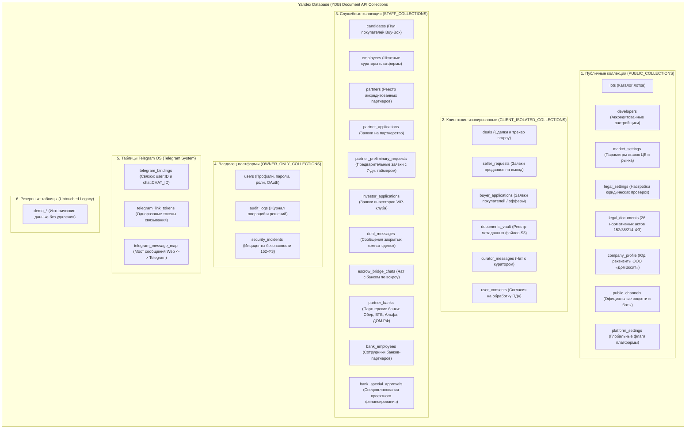
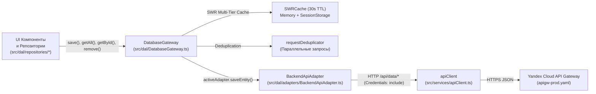

# Глава 2: Схема базы данных YDB, Data Access Layer (DAL) и архитектура сохранности

## 2.1. Реестр коллекций Yandex Database (YDB Document API)

База данных **YDB** платформы DomExit развернута в бессерверном режиме (`serverless`) в регионе `ru-central1` (Production ID: `etnckg937628mnid7tnb`, Staging ID: `etnkpeqnbmb1a6cocipk`). Взаимодействие с базой осуществляется через Document API (протокол Amazon DynamoDB v20120810), где каждая запись идентифицируется первичным строковым ключом `id` (Partition Key `S`).

Все коллекции распределены по 5 функциональным группам доступа и контроля целостности (`backend/src/routes/data.ts#L12-L51`):



### Детальная спецификация ключевых коллекций YDB

| Имя коллекции | Первичный ключ (PK) | Назначение и сущность | Ссылка на TypeScript контракт |
| :--- | :--- | :--- | :--- |
| `lots` | `id` (e.g. `lot-u10566` / `U-10566`) | Объекты переуступки, цены, статус модерации, паспорт 42 проверок | `src/types/index.ts#L18-L181` |
| `seller_requests` | `id` (e.g. `req-xxxx` / `doc-uuid`) | Первичные заявки продавцов из 4-шагового мастера выхода | `src/types/index.ts#L228-L280` |
| `buyer_applications`| `id` (e.g. `bid-xxxx`) | Офферы и заявки покупателей на конкретные лоты | `src/types/index.ts#L332-L372` |
| `deals` | `id` (e.g. `deal-2026-10566`)| Сделки в стадии закрытия, эскроу, Росреестр, выплаты | `src/types/index.ts#L374-L431` |
| `users` | `id` (e.g. `usr-xxxx`) | Аккаунты пользователей, passwordHash, роли, Yandex ID | `src/types/index.ts#L506-L535` |
| `documents_vault` | `id` (e.g. `doc-meta-xxxx`) | Метаданные юридических файлов в S3 (хэши, категории, права) | `src/types/index.ts#L196-L226` |
| `curator_messages` | `id` (e.g. `msg-xxxx`) | Сообщения сквозного чата «Клиент — Куратор» | `src/types/index.ts#L946-L960` |
| `partner_preliminary_requests`| `id` (e.g. `pre-xxxx`)| Заявки партнеров с 7-дневным таймером бронирования клиента | `src/types/index.ts#L650-L671` |
| `partners` | `id` (e.g. `part-xxxx`) | Реестр агентов, брокеров и юристов, реферальные коды | `src/types/index.ts#L459-L487` |
| `developers` | `id` (e.g. `dev-setl`) | Застройщики РФ, ИНН, статус генеральной аккредитации | `src/types/index.ts#L593-L606` |
| `market_settings` | `id` (`market_parameters`) | Ставка ЦБ РФ (23%), семейная ипотека (6%), комиссия 2.5% | `src/types/index.ts#L568-L577` |
| `user_consents` | `id` (e.g. `consent-xxxx`) | Юридические согласия 152-ФЗ, IP, User-Agent, версии оферт | `src/types/index.ts#L805-L820` |
| `audit_logs` | `id` (e.g. `aud-xxxx`) | Аудиторский след действий операторов и клиентов | `src/types/index.ts#L735-L782` |
| `security_incidents`| `id` (e.g. `inc-xxxx`) | Инциденты ИБ, учет утечек, отчетность перед РКН | `src/types/index.ts#L822-L835` |
| `telegram_bindings`| `id` (`user:UID` / `chat:ID`) | Двунаправленная привязка аккаунтов пользователей к Telegram | `backend/src/routes/telegram.ts#L183-L194` |
| `telegram_link_tokens`| `id` (`token` hex 32 chars) | Временные токены для deep-link (`bind_<token>`, 10 минут) | `backend/src/routes/telegram.ts#L129-L142` |
| `telegram_message_map`| `id` (`tg:MSG_ID` / `web:MSG_ID`)| Двусторонняя адресация для чат-моста Web <-> Telegram | `backend/src/lib/telegramWorkflow.ts#L340-L360` |

---

## 2.2. Архитектура Data Access Layer (DAL) во фронтенде

Фронтенд платформы DomExit полностью изолирован от прямого доступа к базе данных. Все страницы и контексты обращаются к единому контроллеру **`DatabaseGateway`** (`src/dal/DatabaseGateway.ts`):



### Ключевые механизмы DAL:
1. **Единый адаптер `BackendApiAdapter` (`src/dal/adapters/BackendApiAdapter.ts`):**
   - Преобразует вызовы DAL в строгие REST-запросы к `/api/data/:collection` и `/api/data/:collection/:id`.
   - Поддерживает автоматический фолбек на локальные сид-данные (`seedFallback`) при ошибках сети или пустых ответах для предотвращения «падения» интерфейса.
2. **Многоуровневый кэш `SWRCache` (`src/dal/cache/SWRCache.ts`):**
   - Уровень 1: быстрая оперативная память процесса (`memoryCache: Map`).
   - Уровень 2: хранилище вкладки браузера `sessionStorage` с префиксом `domexit_swr_`.
   - Семантика **Stale-While-Revalidate**: при наличии устаревшей записи данные возвращаются мгновенно (0 мс), а повторный фоновый запрос (`revalidateInBackground`) обновляет кэш без блокировки рендеринга.
   - Автоматическая инвалидация префиксов (`invalidatePrefix`) при любых операциях `save()` и `remove()`.
3. **Дедупликация параллельных запросов `requestDeduplicator` (`src/dal/cache/requestDeduplicator.ts`):**
   - Если несколько независимых компонентов одновременно запрашивают один и тот же ресурс (например, `getAll:lots`), выполняется ровно один физический HTTP-запрос по сети, а его `Promise` разделяется между всеми подписчиками.

---

## 2.3. Кэширование на стороне бэкенда (`memoryCache.ts`)

На уровне бессерверной функции бэкенда реализован теплый in-memory кэш (`backend/src/lib/memoryCache.ts`):
- **Разрешенные для кэширования коллекции (`CACHEABLE_COLLECTIONS`):** `lots`, `developers`, `market_settings`, `legal_settings`, `legal_documents`, `company_profile`, `public_channels`, `platform_settings`.
- **Время жизни (TTL):** 15 секунд (`DEFAULT_TTL_MS = 15000`), максимальная емкость — 32 записи с автоматическим вытеснением старых ключей (LRU eviction).
- **Правило обхода кэша:** Запросы сотрудников платформы (`owner`, `employee`) и запросы с параметром `?fresh=1` всегда обращаются напрямую в YDB, минуя кэш (`backend/src/routes/data.ts#L388-L390`).
- **Инвалидация при записи:** Любой вызов `POST`, `PUT` или `DELETE` в коллекцию немедленно сбрасывает кэш данной коллекции (`memoryCache.invalidate(collection)`).

---

## 2.4. Неизменяемый транзакционный журнал (Write-Ahead Audit Journal)

Для предотвращения риска потери данных и реализации концепции Zero-Data-Loss все модифицирующие операции над чувствительными коллекциями фиксируются в неизменяемом хранилище S3 (`backend/src/lib/journal.ts`):

- **Журналируемые коллекции (`JOURNALED_COLLECTIONS`):**
  `seller_requests`, `buyer_applications`, `deals`, `lots`, `partner_applications`, `investor_applications`, `user_consents`, `documents_vault`.
- **Структура ключа S3 (Иерархия по датам):**
  `_journal/YYYY/MM/DD/{timestamp}-{randomHex}-{collection}-{recordId}-{action}.json`
- **Содержимое записи журнала (`JournalEntry`):**
  ```json
  {
    "schemaVersion": 1,
    "env": "production",
    "timestamp": "2026-11-21T12:00:00.123Z",
    "action": "UPDATE",
    "collection": "lots",
    "recordId": "U-10566",
    "actor": {
      "userId": "usr-curator-01",
      "role": "employee"
    },
    "payload": {
      "status": "deal_closing",
      "curatorAssigned": "usr-curator-01"
    }
  }
  ```
- **Отказоустойчивость:** Запись журнала выполняется в приватный бакет `domexit-private-docs-prod` с жестким таймаутом в 3000 мс (`AbortSignal.timeout(3000)`). В случае сетевого сбоя S3 ошибка логируется как `warn`, не блокируя основную транзакцию клиента.

---

## 2.5. Архитектура автоматического ежедневного резервного копирования (Backup Engine)

Резервное копирование YDB функционирует в полностью изолированном бессерверном контуре (`backend/src/lib/backupService.ts` и `backend/src/backupHandler.ts`):

1. **Триггер по расписанию:** Сервис Yandex Cloud Triggers (`a1sqlo5a1el40u9tmqdn`) ежедневно в **02:00 UTC** вызывает функцию `domexit-backup-prod` (`d4edb2l5n6gcpfbnl3b0`).
2. **Прямой вызов Document API (`callDocApiDirect`):** Функция использует собственную низкоуровневую реализацию подписи AWS Signature Version 4 (HMAC-SHA256) без использования тяжелых внешних библиотек.
3. **Алгоритм резервного копирования:**
   - Получение списка всех таблиц через `DynamoDB_20120810.ListTables`.
   - Полное сканирование каждой таблицы пачками по 250 элементов через `DynamoDB_20120810.Scan` с обработкой `LastEvaluatedKey`.
   - Сжатие собранного массива JSON в поток GZIP с максимальной компрессией (`zlib.gzipSync(..., { level: 9 })`).
   - Расчет контрольной суммы SHA-256 сжатого архива.
   - Сохранение в приватный S3-бакет по ключу:
     `backups/daily/ydb-backup-production-{YYYY-MM-DD-HHmmss}.json.gz`
   - Сохранение метаданных снимка (список таблиц, количество записей по каждой таблице, размер исходных и сжатых данных).
4. **Политика ротации архивов (Retention Policy):**
   - В папке `backups/daily/` автоматически сохраняются последние **7 ежедневных архивов**.
   - Архивы старше 7 дней автоматически удаляются функцией (`DeleteObjectCommand`).
   - Архивы в специальной директории `backups/pre-cutover/` защищены от автоматической ротации и сохраняются бессрочно.
5. **Мониторинг свежести бекапов:** Эндпоинт `/api/admin/system-health` отслеживает возраст последнего ежедневного бекапа (`ageHours`). Если возраст превышает 26 часов, статус системы переходит в режим `degraded` (`backend/src/routes/admin.ts#L93`).
