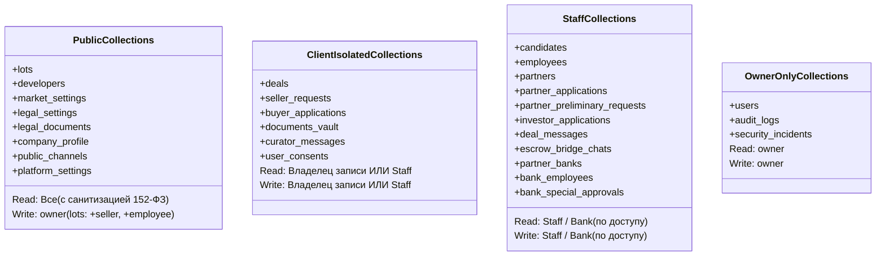

# Глава 3: Спецификация Backend API и ролевая матрица доступа (RBAC)

## 3.1. Полный реестр эндпоинтов Backend API

Маршрутизация всех сетевых запросов централизована в `backend/src/index.ts` (строки 40–80). Ниже приведена исчерпывающая спецификация всех активных эндпоинтов платформы:

| Метод | Маршрут | Исходный файл и строки | Требуемая роль | Назначение |
| :--- | :--- | :--- | :--- | :--- |
| `GET` | `/api/health` | `backend/src/routes/health.ts#L5-L13` | Публичный (Любой) | Проверка работоспособности функции и среды исполнения |
| `POST` | `/api/auth/register` | `backend/src/routes/auth.ts#L32-L125` | Гость (Анонимный) | Регистрация нового покупателя или продавца |
| `POST` | `/api/auth/login` | `backend/src/routes/auth.ts#L127-L181` | Гость (Анонимный) | Аутентификация по email и паролю с Rate-Limiting |
| `POST` | `/api/auth/logout` | `backend/src/routes/auth.ts#L183-L186` | Авторизованный | Очистка сессионной куки `domexit_session` |
| `GET` | `/api/auth/me` | `backend/src/routes/auth.ts#L188-L195` | Авторизованный | Получение текущего профиля авторизованного пользователя |
| `PATCH`| `/api/auth/profile` | `backend/src/routes/auth.ts#L198-L245` | Авторизованный | Обновление безопасных полей профиля (имя, телефон, ИНН) |
| `POST` | `/api/auth/switch-role` | `backend/src/routes/auth.ts#L248-L294` | Авторизованный | Переключение активной роли (`activeRole`) в рамках прав |
| `GET` | `/api/auth/yandex/start` | `backend/src/routes/auth.ts#L297-L305` | Гость / Пользователь | Инициация протокола авторизации Yandex OAuth 2.0 |
| `GET` | `/api/auth/yandex/callback` | `backend/src/routes/auth.ts#L308-L439` | Публичный редирект | Завершение OAuth 2.0, получение профиля Yandex, выдача JWT |
| `POST` | `/api/storage/presign-upload` | `backend/src/routes/storage.ts#L38-L117` | Авторизованный | Выпуск одноразового Presigned URL на загрузку в S3 |
| `GET` | `/api/storage/presign-download`| `backend/src/routes/storage.ts#L120-L170`| Авторизованный (RBAC) | Выпуск Presigned URL на скачивание приватного документа |
| `GET` | `/api/data/:collection` | `backend/src/routes/data.ts#L280-L438` | По матрице RBAC | Получение списка сущностей (с пагинацией и фильтрами) |
| `GET` | `/api/data/:collection/:id` | `backend/src/routes/data.ts#L280-L438` | По матрице RBAC | Получение отдельного документа по идентификатору |
| `POST` | `/api/data/:collection` | `backend/src/routes/data.ts#L441-L630` | По матрице RBAC | Создание нового документа в указанной коллекции |
| `PUT` | `/api/data/:collection/:id` | `backend/src/routes/data.ts#L441-L630` | По матрице RBAC | Обновление существующего документа в указанной коллекции |
| `DELETE`| `/api/data/:collection/:id` | `backend/src/routes/data.ts#L633-L676` | `owner` / `employee` | Удаление документа из коллекции с аудитом |
| `DELETE`| `/api/lots/:lotCode/cascade`| `backend/src/routes/data.ts#L178-L266` | `owner` (Владелец) | Каскадное удаление лота, связанных заявок и файлов S3 |
| `POST` | `/api/telegram/webhook` | `backend/src/routes/telegram.ts#L46-L97` | Telegram API (Секрет)| Вебхук обработки входящих обновлений от Telegram |
| `GET` | `/api/telegram/status` | `backend/src/routes/telegram.ts#L105-L120`| Авторизованный | Проверка статуса привязки аккаунта к Telegram |
| `POST` | `/api/telegram/link-token` | `backend/src/routes/telegram.ts#L123-L155`| Авторизованный | Генерация одноразового токена и ссылки `bind_<token>` |
| `POST` | `/api/telegram/unlink` | `backend/src/routes/telegram.ts#L158-L172`| Авторизованный | Отвязка Telegram-аккаунта от веб-профиля |
| `PATCH`| `/api/telegram/preferences` | `backend/src/routes/telegram.ts#L175-L197`| Авторизованный | Включение/выключение уведомлений в Telegram |
| `POST` | `/api/telegram/assign` | `backend/src/routes/telegram.ts#L200-L231`| `owner` / `employee` | Назначение куратора на лот с отправкой карточки в Telegram |
| `POST` | `/api/telegram/stage` | `backend/src/routes/telegram.ts#L234-L263`| `owner` / куратор лота| Перевод сделки/лота на следующий этап бизнес-процесса |
| `POST` | `/api/telegram/test` | `backend/src/routes/telegram.ts#L266-L294`| `owner` (Владелец) | Отправка тестового пуш-уведомления владельцу в Telegram |
| `GET` | `/api/admin/system-health` | `backend/src/routes/admin.ts#L32-L155` | `owner` (Владелец) | Мониторинг задержки YDB, доступности S3, свежести бекапов |
| `GET` | `/api/admin/backups` | `backend/src/routes/admin.ts#L158-L173` | `owner` (Владелец) | Получение списка доступных резервных копий в S3 |
| `POST` | `/api/admin/backups/run` | `backend/src/routes/admin.ts#L176-L197` | `owner` (Владелец) | Внеочередной запуск полного резервного копирования базы |

---

## 3.2. Матрица управления доступом на уровне коллекций (RBAC Matrix)

Контроль доступа на стороне бэкенда разделен на 4 категории коллекций (`backend/src/routes/data.ts#L12-L51`):



### Сводная ролевая матрица прав (Role-Based Permissions Matrix)

| Роль в системе (`role`) | `PUBLIC_COLLECTIONS` (Read / Write) | `CLIENT_ISOLATED` (Read / Write) | `STAFF_COLLECTIONS` (Read / Write) | `OWNER_ONLY` (Read / Write) | Особые операции |
| :--- | :--- | :--- | :--- | :--- | :--- |
| **Гость (Аноним)** | Чтение (152-ФЗ Redacted) / **НЕТ** | **НЕТ** / **НЕТ** | **НЕТ** / **НЕТ** | **НЕТ** / **НЕТ** | Регистрация, Вход, Yandex OAuth, Каталог |
| **Покупатель (`buyer`)** | Чтение (152-ФЗ Redacted) / **НЕТ** | Только свои записи (`userId`) / Создание своих заявок | **НЕТ** / **НЕТ** | **НЕТ** / **НЕТ** | Бронирование лота, чат с куратором, скачивание своих файлов |
| **Продавец (`seller`)** | Чтение (свои лоты полностью) / Создание лотов (`intake_moderation`)| Только свои заявки и сделки / Создание заявок продавца | **НЕТ** / **НЕТ** | **НЕТ** / **НЕТ** | 4-шаговый мастер, загрузка ДДУ и фото, чат с куратором |
| **Партнер (`partner`)** | Чтение / **НЕТ** | Свои сделки по реф-коду / **НЕТ** | Свой кабинет / Создание предв. заявок (7 дней)| **НЕТ** / **НЕТ** | Генерация реферальных ссылок, учет вознаграждений |
| **Инвестор (`investor`)**| Чтение (+ доступ к VIP 48ч) / **НЕТ** | Свои заявки / Создание инвестиционных заявок | **НЕТ** / **НЕТ** | **НЕТ** / **НЕТ** | VIP-каталог, выкуп пулов объектов со скидкой |
| **Сотрудник банка (`bank`)**| Чтение / **НЕТ** | **НЕТ** / **НЕТ** | Просмотр и одобрение аккредитаций и спецсогласований | **НЕТ** / **НЕТ** | Банковский портал, подтверждение эскроу-счетов |
| **Штатный куратор (`employee`)**| Чтение всех лотов / Модерация, упаковка | Чтение всех клиентских документов / Ответы в чат | Полный доступ к штатным коллекциям | **НЕТ** / **НЕТ** | Назначение куратора, сдвиг этапов сделки, юр. аудит |
| **Владелец (`owner`)** | Полный доступ (Read / Write) | Полный доступ (Read / Write) | Полный доступ (Read / Write) | Полный доступ (Read / Write) | Каскадное удаление лотов, бекапы, аудит-логи, инциденты ИБ |

---

## 3.3. Реализация защитного барьера персональных данных (152-ФЗ Privacy Barrier)

Вся выдача данных из публичной коллекции `lots` в обязательном порядке проходит через серверный фильтр маскирования `sanitizeLotForPublic` (`backend/src/routes/data.ts#L52-L72`):

```typescript
// backend/src/routes/data.ts#L52-L72
function sanitizeLotForPublic(lot: Record<string, any>, authUser: UserProfile | null): Record<string, any> {
  const isOwner = authUser?.role === 'owner';
  const isAssignedStaff =
    authUser?.role === 'employee' &&
    (lot.assignedEmployeeId === authUser.assignedEmployeeId || lot.assignedEmployeeId === authUser.id);
  const isSelfSeller = authUser?.id && lot.sellerId === authUser.id;

  // Полные данные видны только владельцу платформы, назначенному куратору или самому продавцу
  if (isOwner || isAssignedStaff || isSelfSeller) {
    return lot;
  }

  // 152-ФЗ Защитный барьер: безвозвратное удаление чувствительных полей для гостей и покупателей
  const sanitized = { ...lot };
  delete sanitized.sellerPhone;
  delete sanitized.sellerEmail;
  delete sanitized.sellerInn;
  delete sanitized.apartmentNumber;
  delete sanitized.sellerSubmittedImages;
  delete sanitized.sellerPhotos;
  return sanitized;
}
```

### Дополнительная изоляция лотов в каталоге:
Для неавторизованных пользователей и покупателей каталог возвращает **только утвержденные лоты** (`lot.isApproved === true`) со статусами `active`, `available`, `reserved`, `in_deal`, `deal_closing`, `sold`. Черновики, отклоненные лоты и объекты на первичной модерации скрыты от публичного доступа (`backend/src/routes/data.ts#L406-L420`).

---

## 3.4. Серверная пагинация, фильтрация и сортировка (`applyPaginationAndFilters`)

Функция `applyPaginationAndFilters` (`backend/src/routes/data.ts#L74-L167`) активируется флагом `?paginated=1` и обеспечивает:
1. **Безопасные границы пагинации:** `limit` ограничен диапазоном от 1 до 100 элементов (по умолчанию 24), номер страницы `page >= 1`.
2. **Серверная фильтрация:**
   - По статусу: `?status=active`.
   - По уникальному коду: `?lotCode=U-10566`.
   - По городу/региону: `?city=spb` (поиск по `city`, `region`, `address`).
   - Полнотекстовый поиск: `?search=чистое+небо` (поиск по названию ЖК, застройщику, адресу, описанию).
3. **Серверная сортировка (`?sort=`):**
   - `price_asc` — по возрастанию цены.
   - `price_desc` — по убыванию цены.
   - `discount_desc` — по максимальной сумме/проценту скидки.
   - `newest` — по дате публикации/обновления.
4. **Контракт ответа пагинации:**
   ```json
   {
     "items": [ /* массив объектов */ ],
     "total": 142,
     "page": 1,
     "limit": 24,
     "totalPages": 6,
     "hasMore": true
   }
   ```

---

## 3.5. Каскадное удаление лота (`DELETE /api/lots/:lotCode/cascade`)

Операция каскадного удаления доступна **исключительно роли `owner`** (`backend/src/routes/data.ts#L178-L266`) и гарантирует атомарную зачистку всех связанных сущностей:
1. **База данных YDB:** Очищаются все записи с указанным `lotCode` в 7 коллекциях:
   `lots`, `deals`, `seller_requests`, `buyer_applications`, `candidates`, `curator_messages`, `documents_vault`.
2. **Хранилище S3:** Рекурсивно удаляются все физические объекты по префиксам:
   - Публичные фотографии: `photos/{lotCode}/` в бакете `domexit-storage-vault`.
   - Приватные документы: `documents/{lotCode}/` в бакете `domexit-private-docs-prod`.
3. **Кэш и аудит:** Мгновенно инвалидируется кэш каталога, в `audit_logs` создается запись `CASCADE_DELETE_LOT`, а в S3 записывается событие `CASCADE_DELETE` транзакционного журнала.

---

## 3.6. Административный контур мониторинга (`/api/admin/*`)

Доступ ко всем эндпоинтам `/api/admin/*` защищен строгой проверкой роли `owner` (`backend/src/routes/admin.ts#L18-L25`):

1. **`GET /api/admin/system-health`:**
   - Измерение реальной задержки YDB в миллисекундах через `DynamoDB_20120810.ListTables`.
   - Проверка доступности публичного и приватного бакетов S3 через `HeadBucketCommand`.
   - Проверка статуса резервных копий (наличие ежедневного снимка, возраст в часах, общий объем, флаг `isHealthy`).
   - Подсчет количества событий в транзакционном журнале S3 за текущие сутки UTC.
   - Сбор системных метрик функции: потребление оперативной памяти RSS (`process.memoryUsage().rss`), аптайм процесса Node.js, версия среды.
2. **`GET /api/admin/backups`:**
   - Получение полного списка всех доступных снимков базы данных в папках `backups/daily/`, `backups/pre-cutover/` и `backups/manual/` с указанием размера в байтах и даты модификации.
3. **`POST /api/admin/backups/run`:**
   - Внеочередное создание снимка боевой базы данных с автоматической загрузкой архива `.json.gz` в S3 и записью в журнал аудита.
