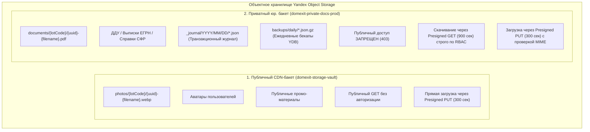

# Глава 4: Аутентификация, сессии и объектное хранилище S3

## 4.1. Жизненный цикл аутентификации пользователей

Аутентификация в DomExit реализована на полностью отечественном стеке без использования внешних провайдеров идентификации (Auth0, Firebase Auth). Все процессы управляются модулем `backend/src/routes/auth.ts` и криптографической библиотекой `backend/src/lib/cryptoAuth.ts`.

```mermaid
sequenceDiagram
    autonumber
    actor User as Клиент / Пользователь
    participant Web as Браузер (React SPA)
    participant ApiGw as Yandex API Gateway
    participant Auth as Auth Handler (auth.ts)
    participant YDB as YDB users Collection
    participant Yx as Yandex OAuth 2.0 API

    alt Регистрация (Email + Password)
        User->>Web: Ввод email, пароля (>=8 симв.), имени, роли
        Web->>ApiGw: POST /api/auth/register
        ApiGw->>Auth: normalize(email.trim().toLowerCase())
        Auth->>YDB: findByField('users', 'email', email)
        Note over Auth,YDB: Если пароль уже задан -> 409 Conflict.<br/>Если учетка от OAuth -> слияние без дубликата.
        Auth->>Auth: crypto.scrypt (Salt 16 bytes, N=16384, r=8, p=1)
        Auth->>YDB: putItem('users', userWithHash)
        Auth->>Web: Set-Cookie: domexit_session=JWT; HttpOnly; Secure; SameSite=Lax
    else Авторизация (Email + Password)
        User->>Web: Ввод email и пароля
        Web->>ApiGw: POST /api/auth/login
        ApiGw->>Auth: checkLoginRateLimit(IP:email)
        Note over Auth: >5 попыток за 5 мин -> 429 Too Many Requests
        Auth->>YDB: findByField('users', 'email', email)
        Auth->>Auth: verifyPassword (timingSafeEqual)
        Auth->>Web: 200 OK + Set-Cookie: domexit_session=JWT
    else Вход через Yandex ID (OAuth 2.0)
        User->>Web: Клик «Войти с Яндекс ID»
        Web->>Auth: GET /api/auth/yandex/start
        Auth-->>Web: 302 Redirect oauth.yandex.ru + Set-Cookie: domexit_oauth_state
        User->>Yx: Подтверждение доступа в Яндексе
        Yx-->>Web: 302 Redirect /api/auth/yandex/callback?code=...&state=...
        Web->>Auth: GET /api/auth/yandex/callback
        Auth->>Auth: Сверка state с кукой domexit_oauth_state
        Auth->>Yx: POST oauth.yandex.ru/token (code exchange)
        Auth->>Yx: GET login.yandex.ru/info
        Auth->>YDB: Поиск существующего аккаунта по yandexEmail
        Note over Auth,YDB: Сохранение passwordHash при слиянии.<br/>Выдача прав owner если email в BOOTSTRAP_OWNER_EMAIL.
        Auth-->>Web: 302 Redirect /portal (или /admin/dashboard) + domexit_session
    end
```

---

## 4.2. Механизм защиты и сохранения паролей (`passwordHash Preservation`)

Одной из критических уязвимостей ранних версий был риск затирания поля `passwordHash` при OAuth-входе, частичном обновлении профиля или редактировании записи администратором. В текущей версии (v2.0) реализована многослойная защита паролей:

1. **В процедуре регистрации (`/api/auth/register` — `backend/src/routes/auth.ts#L74-L85`):** Если пользователь ранее входил через Яндекс и у него есть запись без пароля, новый локальный пароль хэшируется и безопасно встраивается в существующий профиль без создания дубликата.
2. **В процедуре OAuth-обратного вызова (`/api/auth/yandex/callback` — `backend/src/routes/auth.ts#L376-L395`):** При повторном входе через Яндекс существующий `passwordHash` и массив ролей принудительно сохраняются (`user.passwordHash` не удаляется и не перетирается).
3. **В обновлении профиля (`PATCH /api/auth/profile` — `backend/src/routes/auth.ts#L209-L239`):** Клиенту разрешено передавать только безопасный белый список полей: `name`, `phone`, `inn`, `favorites`, `photoURL`. Поля `passwordHash`, `role`, `roles`, `activeRole`, `isPartnerApproved` явно копируются из исходной записи в YDB.
4. **В административном DAL-шлюзе (`PUT /api/data/users/:id` — `backend/src/routes/data.ts#L466-L484`):** Если администратор сохраняет документ пользователя, сервер проверяет наличие `existingUser.passwordHash` и гарантирует, что пароль не будет затерт пустым значением из формы.

---

## 4.3. Управление сессиями (JWT & Cookie Security Policy)

1. **Сессионный токен (`domexit_session`):**
   - Алгоритм подписи: HMAC-SHA256 (`crypto.createHmac('sha256', JWT_SIGNING_SECRET)`).
   - Полезная нагрузка (Payload): `userId`, `email`, `role`, `activeRole`, `roles`, `iat`, `exp`.
   - Срок жизни: 14 дней (`14 * 86400 = 1,209,600` секунд).
2. **Атрибуты защищенной Cookie (`backend/src/lib/http.ts#L70-L87`):**
   ```http
   Set-Cookie: domexit_session=eyJhbGciOi...; Max-Age=1209600; Path=/; HttpOnly; SameSite=Lax; Secure
   ```
   - `HttpOnly` — токен недоступен для чтения через JavaScript (`document.cookie`), что исключает кражу сессии через XSS.
   - `SameSite=Lax` — защита от CSRF-атак с сохранением авторизации при стандартных переходах по ссылкам.
   - `Secure` — передача исключительно по зашифрованному протоколу HTTPS.
3. **Защита OAuth State Cookie (`domexit_oauth_state`):** Одноразовая случайная строка (24 байта hex), сохраняемая на 10 минут с флагом `HttpOnly` для предотвращения атак перехвата авторизационного кода (OAuth State Tampering).

---

## 4.4. Анализ Rate-Limiting и защита от подбора паролей

Защита эндпоинта аутентификации реализована в памяти процесса функции (`backend/src/lib/cryptoAuth.ts#L108-L138`):
- **Ключ ограничения:** составной ключ `${clientIp}:${email}`.
- **Лимит:** максимум **5 неудачных попыток** в течение 5-минутного окна (`windowMs = 300,000` мс).
- **Сброс счетчика:** при успешном вводе пароля счетчик немедленно очищается (`resetFailedLogin`).

### Архитектурное замечание (Уязвимость изоляции бессерверных экземпляров):
> [!WARNING]
> Поскольку `loginAttempts` хранится в переменной оперативной памяти Node.js (`new Map<string, AttemptRecord>()`), лимит защищает только в рамках одной активной «теплой» виртуальной машины функции Yandex Cloud Functions. В случае горизонтального автомасштабирования (когда облако поднимает несколько параллельных инстансов функции для обработки нагрузки) злоумышленник может распределить попытки перебора между инстансами. Для полной защиты в Фазе 5 рекомендуется вынести счетчик попыток в распределенное хранилище (таблицу `login_attempts` в YDB с TTL или централизованный счетчик).

---

## 4.5. Архитектура объектного хранилища S3 (Dual-Bucket Model)

Для полного соответствия требованиям 152-ФЗ хранилище платформы строго разделено на два изолированных бакета (`infrastructure/cloud-manifest.json#L14-L15`):



### Сравнение бакетов хранилища

| Параметр | Публичный бакет (`domexit-storage-vault`) | Приватный бакет (`domexit-private-docs-prod`) |
| :--- | :--- | :--- |
| **Тип хранимых данных** | Сжатые фото квартир, планировки, фасады | Сканы паспортов, ДДУ, выписки со счетов, бекапы |
| **Публичный доступ по URL**| **Разрешен** (`https://storage.yandexcloud.net/...`) | **Запрещен** (`publicUrl: null` всегда) |
| **Разрешенные MIME-типы** | `image/webp`, `image/jpeg`, `image/png` | `application/pdf`, `.docx`, `image/jpeg`, `image/png` |
| **Максимальный размер файла**| **15 МБ** (`MAX_PHOTO_SIZE = 15*1024*1024`) | **25 МБ** (`MAX_DOC_SIZE = 25*1024*1024`) |
| **Время жизни ссылки на загрузку**| 300 секунд (5 минут) | 300 секунд (5 минут) |
| **Время жизни ссылки на чтение**| Бессрочно (прямой URL) | **900 секунд (15 минут)** по одноразовой подписи |
| **Проверка прав при скачивании**| Не требуется | Строгая проверка: `owner`, куратор или сторона сделки |

---

## 4.6. Протокол безопасной загрузки и скачивания (Presigned URL Protocol)

### 1. Загрузка документа (`POST /api/storage/presign-upload`):
- Клиент передает `{ scope: 'document', lotCode, fileName, contentType, fileSize }`.
- Сервер валидирует расширение, MIME-тип и лимит 25 МБ (`backend/src/routes/storage.ts#L93-L100`).
- Формируется безопасный ключ с санитизацией имени: `documents/${lotCode}/${uuid}-${safeName}`.
- AWS SDK генерирует подписанный URL с заголовком `PutObjectCommand`.
- Клиент отправляет бинарные данные напрямую в S3 методом `PUT`. Нагрузка на Cloud Functions не расходует память на проксирование тяжелых файлов.

### 2. Скачивание приватного документа (`GET /api/storage/presign-download`):
- Клиент запрашивает ссылку по параметрам `?key=documents/...&lotCode=U-10566`.
- **Серверная проверка прав (Access Gate — `backend/src/routes/storage.ts#L130-L155`):**
  - Если пользователь `owner` или `employee` — доступ разрешен.
  - Если пользователь клиент (`seller`/`buyer`) — проверяется принадлежность лота продавцу (`lot.sellerId === authUser.id`) либо наличие активной сделки в `deals` (`deal.buyerId === authUser.id || deal.sellerId === authUser.id`).
  - При отсутствии прав возвращается **`HTTP 403 Forbidden`**.
- При успешной проверке выпускается Presigned GET URL с ограничением срока действия в 15 минут (`expiresInSeconds: 900`).
