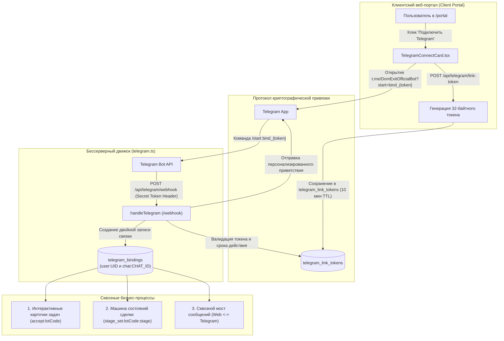
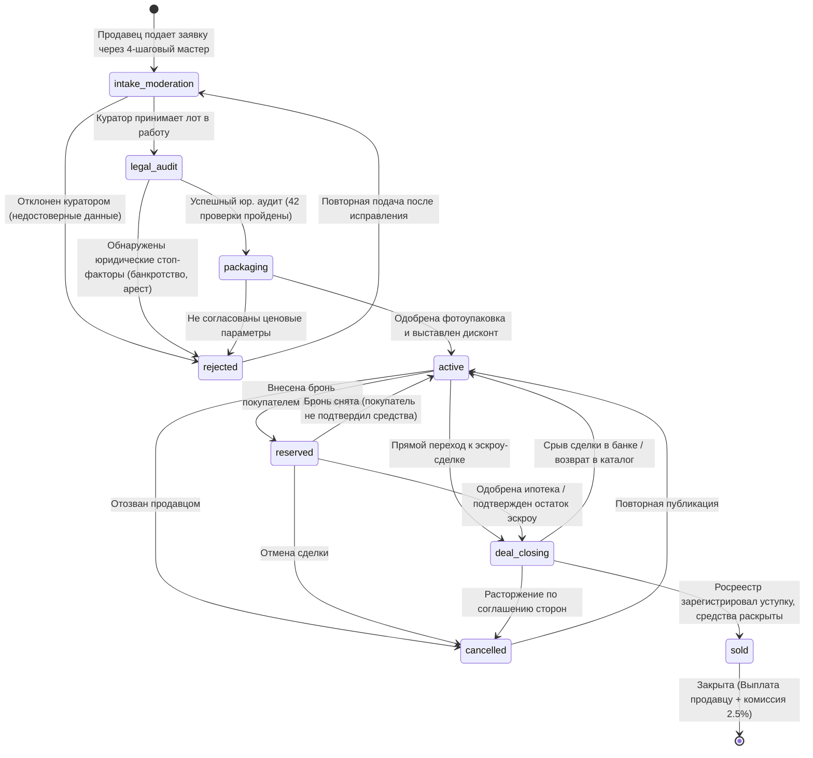

# Глава 5: Операционная система Telegram (Telegram OS)

## 5.1. Архитектура ботов и изоляция окружений

Интеграция с мессенджером Telegram в DomExit представляет собой не просто канал отправки уведомлений, а распределенную операционную систему (**Telegram Operating System**), позволяющую совершать транзакционные действия: принимать задачи, изменять стадии сделок, согласовывать этапы и обмениваться сквозными сообщениями с порталом.

В соответствии с принципом строгой изоляции сред в системе настроены два независимых бота (`infrastructure/cloud-manifest.json` и `backend/src/lib/config.ts#L42-L45`):
- **Боевой бот (Production):** `@DomExitOfficialBot` (связан с боевой базой `etnckg937628mnid7tnb` и доменом `domexit.ru`).
- **Тестовый бот (Staging):** `@DomExitStageBot` (связан со staging базой `etnkpeqnbmb1a6cocipk`).

---

## 5.2. Протокол безопасной привязки аккаунтов (37-символьный Deep-Link)

При разработке интеграции с Telegram соблюдено строгое ограничение протокола Telegram Bot API: параметр `start` в диплинках не должен превышать **64 символа** в наборе `[A-Za-z0-9_-]`.

1. **Генерация токена (`backend/src/routes/telegram.ts#L128-L146`):**
   - Сервер генерирует случайную 16-байтную последовательность в hex-формате (32 символа):
     `const token = crypto.randomBytes(16).toString('hex');`
   - Итоговый параметр `start`: `bind_${token}` занимает ровно **37 символов**, что полностью удовлетворяет лимиту Telegram (37 < 64).
   - Токен сохраняется в таблице `telegram_link_tokens` с атрибутами:
     `{ id: token, token, userId, userEmail, role, used: false, createdAt, expiresAt }`.
   - Время жизни токена составляет ровно **10 минут** (`10 * 60 * 1000` мс).
2. **Активация при переходе в бот (`backend/src/routes/telegram.ts#L777-L851`):**
   - Пользователь нажимает «Запустить» в боте (`/start bind_{token}`).
   - Сервер проверяет: существование токена, отсутствие флага `used === true`, не истек ли срок `expiresAt`.
   - При успешной проверке токен помечается использованным (`used: true`), а в таблицу `telegram_bindings` записываются две связанные записи с быстрым поиском по первичному ключу:
     - `id: "user:${userId}"` — для поиска Telegram chatId при отправке уведомлений из веб-интерфейса.
     - `id: "chat:${chatId}"` — для мгновенной идентификации пользователя и его роли при входящих сообщениях от Telegram.

---

## 5.3. Реестр команд бота, интерактивных меню и callback-запросов

Движок бота спроектирован по правилу **«Always-Respond Policy»** (`backend/src/routes/telegram.ts#L300-L1052`): бот никогда не оставляет действие пользователя без обратной связи и интерактивного ответа.

### Реестр текстовых команд:
| Команда | Доступность по ролям | Функциональное действие |
| :--- | :--- | :--- |
| `/start` | Все пользователи | Приветствие с кнопкой авторизации на сайте либо обработка `bind_<token>` |
| `/menu` | Все пользователи | Вызов главного меню в соответствии с назначенной ролью (`owner`, `employee`, `client`) |
| `/stats` | `owner`, `employee` | Вывод сводки: общее число объектов, лоты на модерации, в каталоге, закрытые сделки |
| `/tasks` | `owner` | Список 5 приоритетных лотов платформы с inline-кнопками смены этапа и ответа |
| `/mytasks` | `employee` | Список лотов, персонально закрепленных за данным куратором |
| `/team` | `owner` | Список кураторов, их рабочие телефоны, роли и текущая нагрузка по сделкам |
| `/mydeals` | `client` (`buyer`, `seller`)| Список активных сделок пользователя с текущими статусами и ссылкой на портал |
| `/unlink` | Все пользователи | Немедленное удаление связки `telegram_bindings` и отвязка аккаунта |
| `/cancel` | Все пользователи | Сброс текущего контекста ответа или прерывание диалоговой операции |

### Реестр Callback-запросов (Inline Buttons):
- `menu` — возврат в главное меню роли.
- `cmd_stats`, `cmd_tasks`, `cmd_mytasks`, `cmd_team`, `cmd_mydeals` — быстрые шорткаты команд из кнопок меню.
- `accept:{lotCode}` — закрепление лота за куратором (`assignCuratorToLot`) с мгновенным обновлением текста сообщения (`editMessageText`).
- `stage_menu:{lotCode}` — динамическое открытие меню допустимых переходов этапов лота.
- `stage_set:{lotCode}:{targetStage}` — перевод сделки на выбранный этап с валидацией прав и автоуведомлением продавца и покупателя.
- `reply:{lotCode}:{threadChannel}` — установка контекста ввода (`activeReplyContext`) для отправки текста напрямую в чат портала.
- `cancel` — отмена сброса контекста ввода.

---

## 5.4. Машина состояний сделки (`STAGE_TRANSITIONS`) и права переходов

Управление жизненным циклом лота регламентировано конечным автоматом (`backend/src/lib/telegramWorkflow.ts#L9-L38`):

### Контроль прав при смене этапа (`enforceStagePermission`):
- Перевод этапа разрешен **только владельцу платформы (`owner`)** либо **куратору, назначенному на данный конкретный лот** (`lot.assignedEmployeeId === actor.id` или `lot.curatorId === actor.id`). Попытка изменить статус чужого объекта отклоняется ошибкой `HTTP 403 / Error`.
- При переводе лота в статус `active` система автоматически устанавливает признак `isApproved = true` (`telegramWorkflow.ts#L240`).

---

## 5.5. Двусторонний чат-мост между веб-порталом и Telegram (Bridge Engine)

Сквозная коммуникация между веб-интерфейсом и мессенджером реализована без сторонних шлюзов:

1. **Отправка сообщения из Веба в Telegram (`POST /api/data/curator_messages`):**
   - Клиент пишет сообщение куратору в виджете `CuratorChatWidget.tsx` на сайте.
   - Сервер фиксирует сообщение в коллекции `curator_messages` и вызывает `telegramNotifier.handleWebCuratorMessage`.
   - Система находит привязку куратора в `telegram_bindings` и отправляет сообщение в личный чат куратора в Telegram.
   - В коллекции `telegram_message_map` создается запись соответствия:
     `id: "msg:${chatId}:${sentTgMessageId}" -> { lotCode, dealId, threadChannel }`.
2. **Ответ куратора из Telegram в Веб (Два режима):**
   - **Режим 1 (Native Telegram Swipe-to-Reply):** Куратор делает свайп вправо и отвечает цитатой на сообщение бота. Движок извлекает `msg.reply_to_message.message_id`, находит привязку в `telegram_message_map` и вызывает `relayBridgedMessage`, мгновенно доставляя текст в чат веб-портала.
   - **Режим 2 (Интерактивная кнопка «💬 Ответить»):** Куратор нажимает кнопку под карточкой. Бот переходит в режим ожидания (`activeReplyContext` с TTL 15 минут). Следующее текстовое сообщение автоматически транслируется клиенту в веб.

---

## 5.6. Анализ отказоустойчивости и краевых ситуаций Telegram OS

1. **Дедупликация входящих вебхуков (`isDuplicateUpdate` — `backend/src/routes/telegram.ts#L19-L33`):**
   При сбоях в каналах связи Telegram Bot API может повторно отправлять один и тот же `update_id`. В памяти функции поддерживается кольцевой буфер на 500 последних `update_id`. Повторные обновления игнорируются с кодом `200 OK skipped: duplicate_update`.
2. **Защита вебхука криптографическим секретом (`X-Telegram-Bot-Api-Secret-Token`):**
   Все входящие POST-запросы к `/api/telegram/webhook` проверяются функцией `crypto.timingSafeEqual` против `TELEGRAM_WEBHOOK_SECRET` для исключения атак подделки событий со стороны злоумышленников (`backend/src/routes/telegram.ts#L52-L75`).
3. **Краевой сценарий: Устаревание ссылок deep-link:**
   Если пользователь переходит по ссылке привязки старше 10 минут, бот не зависает, а вежливо объясняет причину и предлагает кнопку генерации новой ссылки в личном кабинете.
