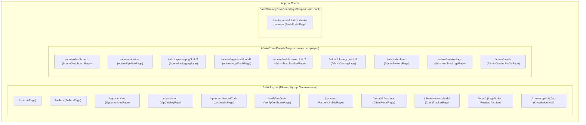
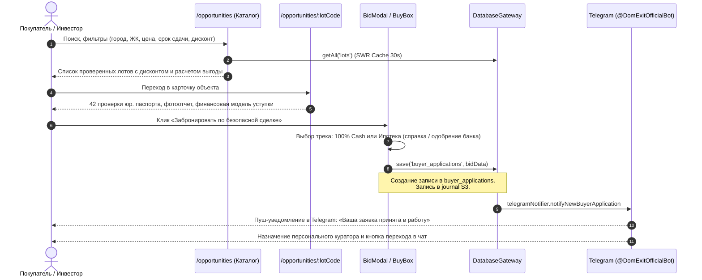
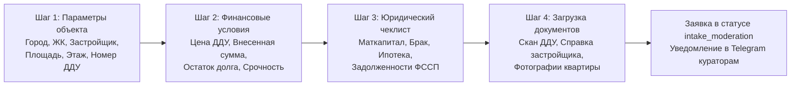

# Глава 6: Фронтенд-архитектура, страницы и пользовательские сценарии (User Journeys)

## 6.1. Полная карта маршрутов приложения (Routing & Layouts)

Маршрутизация фронтенда DomExit построена на базе `react-router-dom` v6 (`src/App.tsx#L8-L195`). Все страницы загружаются асинхронно через `React.lazy()` для минимизации начального размера бандла (`PageSkeletonLoader`).

---

## 6.2. Сценарий посетителя и покупателя (Visitor & Buyer Journey)

### Ключевые этапы сценария покупателя:
1. **Каталог (`OpportunitiesPage.tsx`):**
   - Серверная и клиентская фильтрация: город (`spb`, `msk`, `sochi`, `kazan`), застройщик, этажность, тип комнатности (`studio`, `1-room`, `euro`), готовность дома (%).
   - Сортировки: по сумме дисконта, по возрастанию цены, по дате добавления.
   - 48-часовое окно раннего доступа для участников VIP-клуба (`isEarlyAccessVIP`).
2. **Карточка объекта (`LotDetailsPage.tsx` — 1,349 строк):**
   - Интерактивная финансовая модель: цена ДДУ, сумма выплаты продавцу, остаток долга девелоперу по рассрочке, текущая цена застройщика и чистая экономия покупателя.
   - Развернутый юридический паспорт объекта (42 проверки: ЕФРСБ банкротство, ФССП аресты, суды общей юрисдикции, материнский капитал СФР, согласие супругов).
   - Интерактивная карта Yandex Maps с инфраструктурой и временем пешком до метро.
3. **Оформление бронирования и трекинг (`ClientPortalPage.tsx`, `ClientTrackerPage.tsx`):**
   - Доступ к чату с назначенным куратором в реальном времени.
   - Просмотр эскроу-реквизитов и статуса регистрации переуступки в Росреестре.

---

## 6.3. Сценарий продавца (Seller 4-Step Exit Wizard Journey)

Страница `/sellers` (`src/pages/SellersPage.tsx` — 38,918 байт) представляет собой конверсионный интерактивный мастер срочного выхода из ДДУ:

### Архитектурные элементы мастера продавца:
- **`SellerLiveAuditCard.tsx`:** Интерактивный калькулятор в правой колонке. В реальном времени рассчитывает сумму, которую продавец получает на руки наличными (100% внесенных средств, 0% комиссии с продавца), и сопоставляет ее со штрафом при расторжении договора застройщиком (15%).
- **`SellerStepProperty.tsx` & валидаторы (`src/utils/validators.ts`):** Проверка ИНН девелопера, формата номера ДДУ, корректности соотношения сумм (`paidAmount <= contractPrice`).
- **Защита персональных данных:** Документы продавца загружаются напрямую в приватный бакет S3 по Presigned URL без публикации в открытый доступ (`StorageService.ts`).

---

## 6.4. Исчерпывающий аудит партнерской и брокерской подсистемы

> [!IMPORTANT]
> **Критическое архитектурное уточнение для Фазы 5:**
> Партнерская и брокерская подсистема **УЖЕ ПОЛНОСТЬЮ РЕАЛИЗОВАНА В КОДЕ** на всех трех уровнях (публичный интерфейс, личный кабинет партнера, админ-панель управления брокерами). Ее **КАТЕГОРИЧЕСКИ НЕЛЬЗЯ ПЕРЕСОЗДАВАТЬ ЗАНОВО** в Фазе 5 — необходимо лишь интегрировать новые сервисы с уже работающей логикой.

### 1. Публичный лендинг партнеров (`src/pages/PartnersPublicPage.tsx`):
- Доступен по адресу `/partners`.
- Категории партнеров: `mortgage_broker` (ипотечные брокеры), `developer_cancellation` (отделы расторжений застройщиков), `lawyer` (юристы по банкротству и недвижимости), `trade_in_developer` (агентства trade-in).
- Форма регистрации: валидация ФИО, телефона РФ, ИНН организации (10 или 12 цифр). Автоматическая генерация уникального реферального кода партнера (`PART-XXXX`).
- Запись создается в репозитории `PartnersRepository` (`src/dal/repositories/PartnersRepository.ts`).

### 2. Личный кабинет партнера (`src/components/portal/PartnerPortalTab.tsx`):
- Интегрирован во вкладку «Партнерский кабинет» страницы `/portal`.
- **Реферальная ссылка:** Генерация ссылки с параметром `?ref=PART-XXXX`.
- **Механизм предварительного бронирования клиента (`PartnerPreliminaryRequest`):**
  - Партнер фиксирует клиента вводом его кода (`DEX-XXXXXX`), ФИО, телефона, ЖК и параметров ДДУ (`handlePartnerReferralSubmit` — строки 69–120).
  - Система запускает **обратный отсчет на 7 дней** (`expiresAt = now + 7 days`).
  - Если в течение 7 дней клиент заключает сделку, партнер получает фиксированное вознаграждение **30 000 ₽ за сделку** (`fixedRewardPerDealRub: 30000`).
  - Данные сохраняются в коллекции `partner_preliminary_requests` (`PartnerRequestsRepository.ts`).

### 3. Панель управления брокерами (`src/pages/AdminBrokersPage.tsx` — 818 строк):
- Доступна по адресу `/admin/brokers` (с редиректом из устаревшего `/admin/partners-bot`).
- **Функционал администратора:**
  - Поиск и фильтрация партнеров по категориям и статусам комиссий (`in_progress`, `payable`, `paid`).
  - Реестр выплат: модальное окно регистрации выплаты (`showPayoutModal`) с фиксацией суммы, номера банковской транзакции, банка плательщика и даты.
  - Генерация акта сверки взаиморасчетов (`showReconciliationModal`) для бухгалтерской отчетности с кнопкой печати.
  - Аудит всех действий через `AuditLogsRepository.addLog`.

---

## 6.5. Контур управления и CRM администратора (Staff & Owner Admin Operations)

Все административные страницы защищены гардом `AdminRouteGuard` (`src/components/auth/AdminRouteGuard.tsx`):

1. **Единый командный дашборд (`AdminDashboardPage.tsx`):**
   - Виджеты KPI: объем активных лотов по городам (СПб, Москва, регионы), средний дисконт каталога, сделки в эскроу Сбера и ВТБ, прогнозируемая комиссия платформы (2.5%).
   - Карточки оперативного управления: «Экстренный выход», «Юридический комплаенс», «Брокерская сеть», «Штатные кураторы».
   - Интеграция с карточкой статуса безопасности YDB и Cloud Functions.
2. **Пайплайн сделок (`AdminPipelinePage.tsx`):**
   - Канбан-доска стадий: `intake_moderation` ➔ `legal_audit` ➔ `packaging` ➔ `buyer_matching` ➔ `closing_escrow` ➔ `completed`.
   - Перетаскивание карточек с фиксацией в транзакционном журнале.
3. **Модуль юридического аудита (`AdminLegalAuditPage.tsx` — 1,501 строка):**
   - Формирование правового паспорта из **42 контрольных чекпоинтов**.
   - 5 юридических осей комплаенса:
     1. `title_encumbrances` — чистота титула и обременения;
     2. `bankruptcy_debts` — банкротство и долги ФССП;
     3. `developer_settlement` — взаиморасчеты с девелопером;
     4. `family_matkap` — маткапитал и права несовершеннолетних;
     5. `cession_escrow` — схема эскроу-расчетов по переуступке.
4. **Упаковка и маркетинг (`AdminPackagingPage.tsx` — 1,597 строк):**
   - Модерация фотографий продавца: одобрение для публичной галереи (`approvedGalleryImages`), отклонение некачественных фото.
   - Фиксация рыночной стоимости по оценке DomExit и генерация промо-тизеров.
5. **Банковский портал (`BankPortalPage.tsx` — 3,473 строки):**
   - Изолированный интерфейс для авторизованных сотрудников банков-партнеров (`Сбербанк`, `ВТБ`, `Альфа-Банк`, `ДОМ.РФ`).
   - Согласование аккредитации застройщиков и проектного финансирования.
