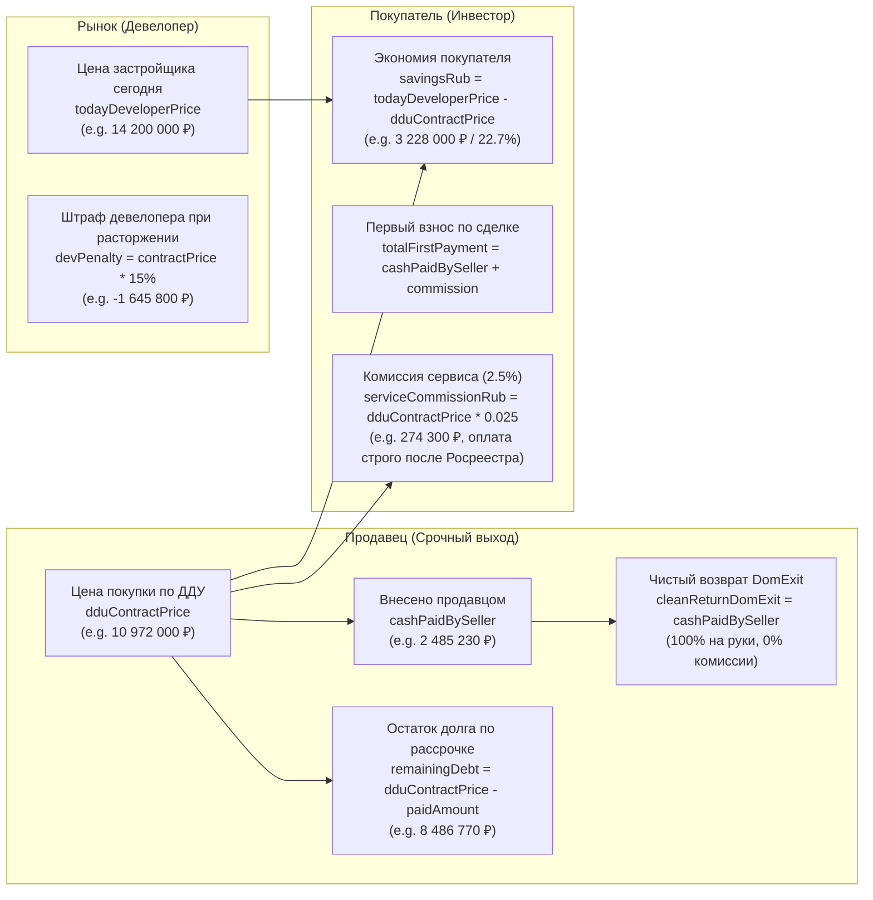

# Глава 7: Финансовый движок, математические модели и бизнес-правила

## 7.1. Математическая модель финансового движка (Financial Truth Engine)

Финансовая модель платформы DomExit решает ключевую дилемму первичного рынка: девелоперы продают квартиры по текущим пиковым ценам, а дольщики, купившие объект на котловане или в рассрочку, при расторжении договора сталкиваются с драконовскими штрафами. DomExit создает арбитражную выгоду как для продавца, так и для покупателя.

---

## 7.2. Формулы и математические расчеты платформы

### 1. Расчет продавца (Срочный выход без потерь — `SellersPage.tsx#L204-L206`):
- **Штраф девелопера при одностороннем расторжении:**
  $$\text{devPenalty} = \text{contractPriceRub} \times \frac{\text{developerPenaltyPercent}}{100}$$
  где `developerPenaltyPercent` по умолчанию равен **15.0%** (ст. 9 ФЗ-214 и условия типовых ДДУ крупных девелоперов).
- **Чистый возврат средств продавцу:**
  $$\text{cleanReturnDomExit} = \text{paidAmountRub}$$
  Продавец получает ровно 100% фактически внесенных средств. **Комиссия с продавца не удерживается (0%)**.
- **Чистая сохраненная выгода семьи продавца:**
  $$\text{netFamilyBenefit} = \text{devPenalty}$$
  Разница между суммой на руках через DomExit и потерей при расторжении с застройщиком.

### 2. Расчет покупателя (Экономия и инвестиционная доходность — `LotDetailsPage.tsx#L223-L279`):
- **Чистая скидка к текущему прайсу застройщика:**
  $$\text{savingsRub} = \text{todayDeveloperPrice} - \text{dduContractPrice}$$
  $$\text{savingsPercent} = \frac{\text{savingsRub}}{\text{todayDeveloperPrice}} \times 100\%$$
- **Сумма первого взноса при сделке:**
  $$\text{totalFirstPayment} = \text{cashPaidBySeller} + \text{serviceCommissionRub}$$
  Покупатель возмещает продавцу его первоначальный взнос (`cashPaidBySeller`), а оставшуюся часть (`remainingInstallmentDebt`) выплачивает застройщику по исходному графику рассрочки/ипотеки.
- **Сервисная комиссия платформы (2.5%):**
  $$\text{serviceCommissionRub} = \text{dduContractPrice} \times 0.025$$
  Оплачивается **строго покупателем** и только **после успешной регистрации перехода прав в Росреестре** и раскрытия аккредитива (`src/types/index.ts#L54-L55`).
- **Квартальный платеж по рассрочке девелоперу:**
  $$\text{quarterlyInstallment} = \max\left(95000, \text{round}\left(\frac{\text{remainingDebtRub}}{24}\right)\right)$$
  (`src/services/propertyLifecycleService.ts#L103`).

### 3. Инвестиционный потенциал и арендная доходность района (`LotDetailsPage.tsx#L259-L279`):
- **Прогнозируемая долгосрочная аренда в месяц:**
  $$\text{longTermMonthlyRub} = \text{round}\left(\text{todayDeveloperPrice} \times \frac{\text{monthlyRentPercent}}{100}\right)$$
  (по районам СПб/Мск: от 0.48% до 0.72% от текущей стоимости объекта).
- **Прогнозируемая посуточная аренда в день:**
  $$\text{shortTermDailyRub} = \text{round}\left(\text{todayDeveloperPrice} \times \frac{\text{dailyRentPercent}}{100}\right)$$
  (от 0.048% до 0.065% в день).
- **Годовая арендная доходность к цене покупки ДДУ (Rental Yield):**
  $$\text{annualRentalYieldPercent} = \frac{\text{longTermMonthlyRub} \times 12}{\text{dduContractPrice}} \times 100\%$$
- **Мгновенный прирост капитала (Instant Equity Growth):**
  $$\text{instantEquityGrowthPercent} = \frac{\text{todayDeveloperPrice} - \text{dduContractPrice}}{\text{dduContractPrice}} \times 100\%$$
- **3-летний и 5-летний прогноз роста капитализации:**
  $$\text{projectedPrice}_{3Y} = \text{todayDeveloperPrice} \times \left(1 + \frac{\text{annualGrowthPercent}}{100}\right)^3$$

---

## 7.3. Справочники и эталонные настройки (`market_settings`, `developers`)

Параметры финансового движка централизованы в коллекции `market_settings` базы YDB (`src/dal/repositories/MarketSettingsRepository.ts#L5-L13`):

| Параметр настройки | Ключ в объекте | Значение по умолчанию | Назначение |
| :--- | :--- | :--- | :--- |
| **Ключевая ставка ЦБ РФ** | `cbrKeyRatePercent` | **21.0%** (актуализировать до 23% в Phase 5) | Базовый ориентир рыночной ипотеки |
| **Ставка «Семейной ипотеки»** | `familyMortgageRatePercent`| **6.0%** | Льготная программа по ФЗ-214 |
| **Штраф девелопера** | `developerPenaltyPercent` | **15.0%** | Удержание застройщиком при расторжении |
| **Комиссия платформы DomExit**| `buyerCommissionPercent` | **2.5%** | Фиксированная комиссия с покупателя |

### Конфигурация районных коэффициентов аренды и роста цен (`DEFAULT_DISTRICT_YIELD_CONFIGS`):
- **СПб, Приморский район:** Аренда 0.65%/мес., рост цен 11.5%/год.
- **СПб, Московский район:** Аренда 0.68%/мес., рост цен 12.2%/год.
- **СПб, Петроградский район:** Аренда 0.72%/мес., рост цен 13.5%/год.
- **Москва, Пресненский район:** Аренда 0.70%/мес., рост цен 14.0%/год.
- **Москва, Хамовники:** Аренда 0.72%/мес., рост цен 14.5%/год.
- **Сочи, Центральный район:** Аренда 0.75%/мес., рост цен 15.0%/год.

---

## 7.4. Реестр захардкоженных констант и расхождений в кодовой базе

В ходе аудита выявлены следующие фиксированные значения, требующие выноса в динамические настройки `market_settings` в Фазе 5:

| Локация в коде | Захардкоженное значение | Описание и риск несоответствия |
| :--- | :--- | :--- |
| `src/services/propertyLifecycleService.ts#L101` | `payload.contractPriceRub * 1.24` | Фолбек цены застройщика (+24%). Должен браться из реального индекса цен района. |
| `src/services/propertyLifecycleService.ts#L102` | `payload.contractPriceRub * 0.025` | Жесткий коэффициент комиссии 0.025 вместо чтения `marketSettings.buyerCommissionPercent / 100`. |
| `src/services/propertyLifecycleService.ts#L103` | `remainingDebtRub / 24` и `95000` | Расчет квартального платежа делит остаток строго на 24 с минимумом 95 000 ₽. |
| `src/types/index.ts#L475` & `AdminBrokersPage.tsx#L58` | `30 000 ₽` | Фиксированная выплата партнеру за сделку (`fixedRewardPerDealRub: 30000`). |
| `src/dal/repositories/MarketSettingsRepository.ts#L7` | `cbrKeyRatePercent: 21.0%` | Значение в дефолтном сиде отстает от текущей ставки ЦБ РФ (21% vs 23%). |
| `backend/src/routes/data.ts#L80` | `limit: 24` (max: 100) | Фиксированные границы серверной пагинации. |
| `backend/src/routes/storage.ts#L18-L19` | `15MB` (фото), `25MB` (документы) | Захардкоженные лимиты размеров загружаемых файлов в байтах. |
