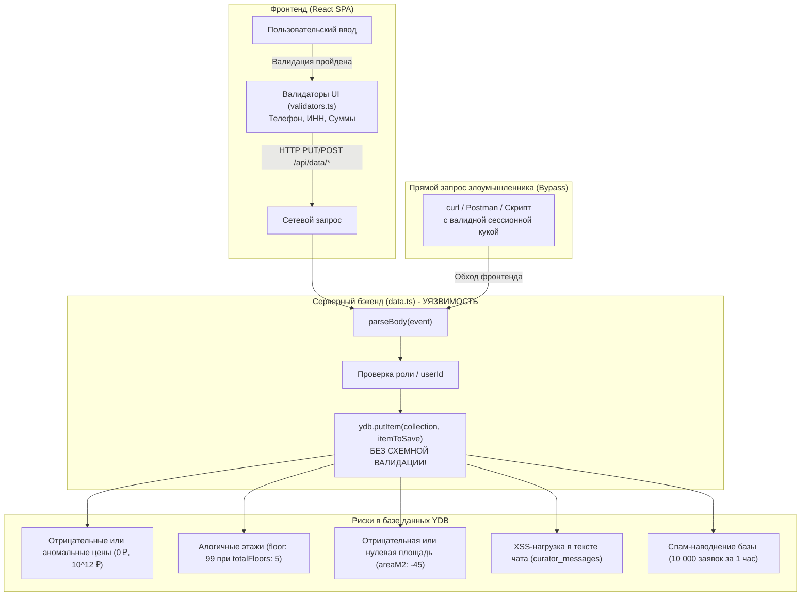
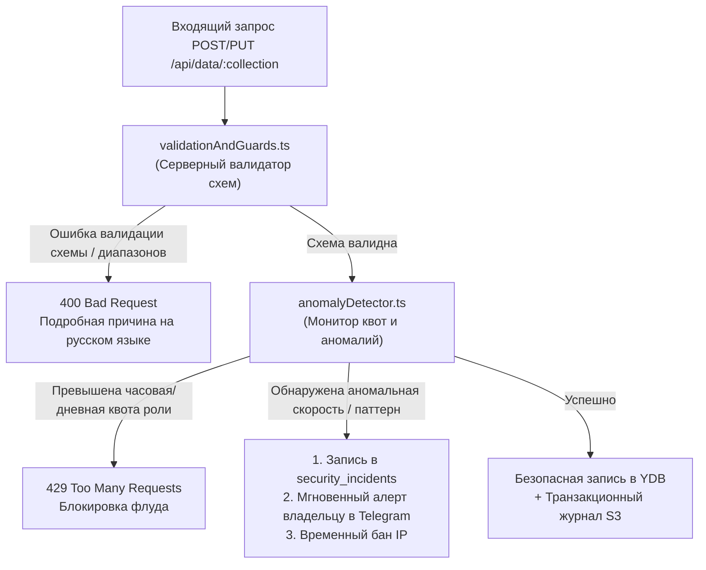

# Глава 8: Аудит валидации данных, ролевых квот и обнаружения аномалий

## 8.1. Комплексный аудит валидации входных данных (Client vs. Server Gap Analysis)

В ходе глубокого анализа исходного кода серверных обработчиков (`backend/src/routes/data.ts`) и клиентских форм (`src/pages/SellersPage.tsx`, `src/components/`, `src/utils/validators.ts`) выявлен **критический архитектурный разрыв (Validation Disparity)**:

1. **Клиентская сторона (Client-Side Validation):**
   Во фронтенде реализован развитый набор проверок (`src/utils/validators.ts`): валидация формата телефона РФ (`+7 (XXX) XXX-XX-XX`), алгоритмическая проверка контрольных сумм ИНН (10 и 12 знаков), проверка соотношения `paidAmount <= contractPrice`.
2. **Серверная сторона (Server-Side Absence):**
   При обработке сетевых вызовов `POST` и `PUT` в `/api/data/:collection` сервер выполняет лишь базовый парсинг тела запроса (`parseBody<Record<string, any>>(event)`) и инъекцию `userId`, после чего **сохраняет сырой JSON напрямую в YDB без валидации типов, диапазонов и допустимых границ полей** (`backend/src/routes/data.ts#L442-L449`).

---

## 8.2. Детальный реестр уязвимостей валидации по коллекциям

### 1. Коллекция `lots` (Каталог объектов):
- **Числовые границы цен:** Отсутствует серверный контроль минимальной и максимальной цены ДДУ (`dduContractPrice`) и внесенных средств (`cashPaidBySeller`). Возможно сохранение цен `0`, `-1000` или фиктивных триллионных значений.
- **Соотношение внесенных средств и стоимости:** Сервер не проверяет инвариант:
  $$\text{cashPaidBySeller} \le \text{dduContractPrice}$$
  Злоумышленник может отправить `cashPaidBySeller = 50 000 000 ₽` при `dduContractPrice = 10 000 000 ₽`.
- **Логическая корректность этажности (Floor Sanity Check):** Отсутствует проверка:
  $$1 \le \text{floor} \le \text{totalFloors}$$
  В базу может быть записан объект с `floor: 45` при `totalFloors: 9` или отрицательный этаж.
- **Площадь объекта (`areaM2`):** Отсутствуют санитарные границы (например, от 15 до 500 м²).

### 2. Коллекция `seller_requests` (Заявки продавцов на выход):
- Любой зарегистрированный пользователь с ролью `seller` может через прямой вызов API отправить неограниченное число заявок с мусорными строками в полях `complexName`, `developer`, `dduNumber`.
- Отсутствует серверная санитизация поля `notes` (риск внедрения сохраненного XSS при отображении в админ-панели куратора).

### 3. Коллекция `buyer_applications` (Заявки покупателей):
- Покупатель может подать заявку с любым значением `availableLiquidity` (например, отрицательным или фиктивным триллионом).
- Сервер не проверяет существование целевого `lotCode`, позволяя создавать заявки-призраки на несуществующие объекты.

### 4. Коллекция `curator_messages` (Чат с куратором):
- Отсутствует ограничение максимальной длины текста сообщения (злоумышленник может передать строку размером 10 МБ, забив память базы YDB и превысив лимиты сообщения в Telegram).
- Отсутствует серверная фильтрация HTML-тегов перед сохранением в базу.

---

## 8.3. Анализ отсутствия ролевых квот (Per-Role Quota Gaps)

На текущий момент в коде бэкенда (`backend/src/routes/data.ts`) **полностью отсутствуют какие-либо ограничения на частоту и количество создаваемых записей (Rate Limiting & Daily Quotas)**:

| Тип субъекта / Роль | Операция в API | Текущий лимит в коде | Риск злоупотребления (Abuse Risk) |
| :--- | :--- | :--- | :--- |
| **Анонимный гость** | `POST /api/auth/register` | Без лимита по IP | Массовая регистрация спам-аккаунтов, засорение таблицы `users` |
| **Покупатель (`buyer`)** | `POST /api/data/buyer_applications` | **Безлимитно** | Флуд офферами, спам фальшивыми бронями, блокировка лотов для реальных покупателей |
| **Продавец (`seller`)** | `POST /api/data/seller_requests` | **Безлимитно** | Создание сотен заявок-пустышек, перегрузка кураторов уведомлениями в Telegram |
| **Клиент / Куратор** | `POST /api/data/curator_messages` | **Безлимитно** | Флуд сообщениями в чат, исчерпание лимитов Telegram Bot API (30 сообщений/сек) |
| **Партнер (`partner`)** | `POST /api/data/partner_preliminary_requests` | **Безлимитно** | Массовая веерная фиксация сотен клиентов на 7 дней без их ведома |

---

## 8.4. Анализ учета инцидентов безопасности (`security_incidents`)

В ходе аудита выявлено серьезное расхождение в именовании коллекций между фронтендом и бэкендом:
- В бэкенде (`backend/src/routes/data.ts#L48`): коллекция зарегистрирована как **`security_incidents`** (входит в `OWNER_ONLY_COLLECTIONS`).
- В клиентском репозитории (`src/dal/repositories/SecurityIncidentsRepository.ts#L4`): указано имя **`security_incident_logs`**.
- В `collectionResolver.ts` отсутствует правило маппинга для этого имени.

**Следствие:** При попытке зарегистрировать инцидент безопасности из фронтенда сервер возвращает `404 Коллекция security_incident_logs не поддерживается`. Кроме того, в системе отсутствует фоновый сервис автоматического выявления аномалий, который самостоятельно создавал бы записи инцидентов при обнаружении подозрительной активности.

---

## 8.5. Архитектурная спецификация для Фазы 5: Модули защиты

Для устранения выявленных уязвимостей в Фазе 5 разработана спецификация двух новых серверных модулей:

### Спецификация 1: Серверный валидатор `backend/src/lib/validationAndGuards.ts`:
1. **Схемная валидация для каждой коллекции:**
   - `lots`:
     - `contractPriceRub` / `dduContractPrice`: число, $1\,000\,000 \le \text{price} \le 500\,000\,000$.
     - `paidAmountRub`: $0 < \text{paidAmount} \le \text{contractPriceRub}$.
     - `areaM2`: число, $15.0 \le \text{area} \le 600.0$.
     - `floor` и `totalFloors`: целые числа, $1 \le \text{floor} \le \text{totalFloors} \le 120$.
     - `inn`: 10 или 12 цифр с проверкой контрольных сумм РФ.
   - `curator_messages`:
     - `text`: непустая строка, длина от 1 до 2000 символов.
     - Санитизация HTML-сущностей (`escapeHtml`) для предотвращения Stored XSS.
   - `buyer_applications`:
     - Обязательное существование валидного `lotCode`.
     - `availableLiquidity`: $0 \le \text{liquidity} \le 500\,000\,000$.

### Спецификация 2: Детектор аномалий и движок квот `backend/src/lib/anomalyDetector.ts`:
1. **Регламент ролевых квот (Role Rate Limits):**
   - Роль `buyer`: максимум **5 заявок на покупку в сутки**, не более 2 заявок в час на один и тот же лот.
   - Роль `seller`: максимум **3 заявки на выход в сутки**.
   - Роль `partner`: максимум **10 предварительных заявок в сутки**.
   - Чат `curator_messages`: максимум **15 сообщений в минуту** от одного пользователя.
2. **Правила фиксации аномалий (Anomaly Triggers):**
   - Попытка отправить более 5 заявок за 2 минуты с одного IP/аккаунта ➔ присвоение инциденту уровня `high`.
   - Внедрение SQL/NoSQL injection паттернов или тэгов `<script>` ➔ немедленная блокировка запроса, автоматическая запись в `security_incidents` и отправка пуш-алерта владельцу в `@DomExitOfficialBot`:
     `🚨 ВНИМАНИЕ: Зафиксирована попытка атаки / аномальный всплеск активности!`.
