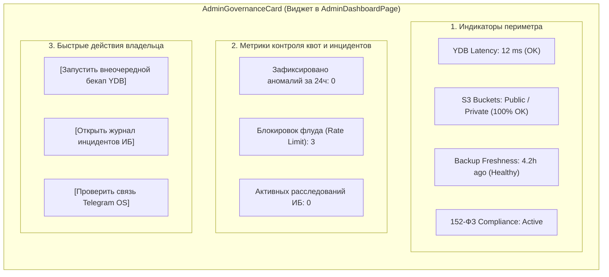
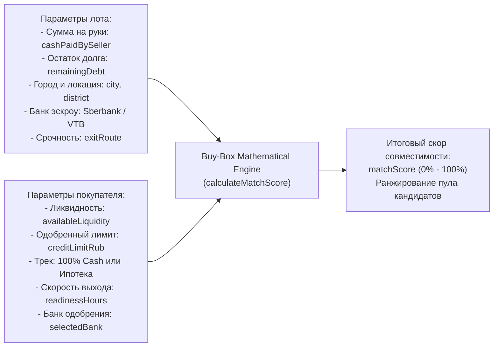
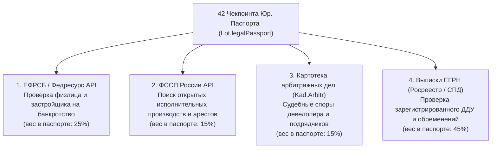

# Глава 9: Стратегический план интеграции Фазы 5 и развития платформы

## 9.1. Архитектурный фокус и границы Фазы 5 (Strategic Focus)

Настоящая глава представляет собой технический план развития платформы DomExit, основанный на результатах аудита предыдущих глав. 

### Стратегический приоритет Фазы 5:
1. **Ядро кибербезопасности и управления (Governance & Anti-Abuse Core):**
   Внедрение схемной валидации входных данных (`validationAndGuards.ts`), ролевых суточных квот и детектора аномалий (`anomalyDetector.ts`) с мгновенным оповещением владельца в Telegram.
2. **Математический движок ранжирования покупателей (Buy-Box Matching Engine):**
   Алгоритмический расчет совместимости (`matchScore: 0–100%`) между профилем продавца (сумма, срочность, застройщик) и пулом покупателей/инвесторов (ликвидность, одобренная ипотека, скорость выхода на сделку).
3. **Бесшовная интеграция с существующей брокерской сетью:**
   Подключение создаваемого движка к работающим коллекциям `partners` и `partner_preliminary_requests` без дублирования функционала.
4. **Гибридная очередь обработки задач (Hybrid Queue):**
   Автоматическая эскалация просроченных задач кураторам в Telegram и назначение ответственных.
5. **Отложенные задачи (Deferred Scope):**
   > [!NOTE]
   > Разработка специализированного модуля «Promo Studio» (автогенерация рекламных карточек в соцсети и видео-тизеров) официально отложена на последующие фазы, так как приоритетом является финансовая и юридическая надежность ядра сделок.

---

## 9.2. Карточка Governance & Security в `AdminDashboardPage`

В интерфейсе главного дашборда владельца (`src/pages/AdminDashboardPage.tsx`) в Фазе 5 интегрируется модульный компонент **`AdminGovernanceCard.tsx`**:

### Точки интеграции с бэкендом:
- Запрос данных: `GET /api/admin/system-health` (уже реализован в `backend/src/routes/admin.ts#L32`).
- Запрос журнала инцидентов: чтение коллекции `security_incidents` (после исправления имени коллекции с `security_incident_logs`).
- Экстренный запуск бекапа: `POST /api/admin/backups/run`.

---

## 9.3. Математический движок мэтчинга покупателей (Buy-Box Matching Engine)

В Фазе 5 страница `/admin/matchmaker/:lotId` (`src/pages/AdminMatchmakerPage.tsx`) переводится с ручной фильтрации на автоматический математический скоринг совместимости кандидатов (`BuyerCandidate.matchScore`):

### Математическая формула скоринга совместимости:
$$\text{matchScore} = w_1 \cdot S_{\text{liquidity}} + w_2 \cdot S_{\text{bank}} + w_3 \cdot S_{\text{speed}} + w_4 \cdot S_{\text{geo}}$$

Где весовые коэффициенты распределены следующим образом:
1. **$w_1 = 0.40$ (Финансовая достаточность — 40% веса):**
   - Если $\text{availableLiquidity} \ge \text{cashPaidBySeller}$ (покупатель полностью покрывает взнос продавца наличными) ➔ $S_{\text{liquidity}} = 1.0$.
   - При нехватке средств ➔ $S_{\text{liquidity}} = \max\left(0, \frac{\text{availableLiquidity}}{\text{cashPaidBySeller}}\right)$.
2. **$w_2 = 0.25$ (Совместимость банка эскроу — 25% веса):**
   - Если банк предварительного одобрения покупателя совпадает с банком эскроу объекта (например, оба Сбербанк) ➔ $S_{\text{bank}} = 1.0$ (бесшовный перевод внутри одного банка без риска отказа).
   - Если банки разные, но оба аккредитованы девелопером ➔ $S_{\text{bank}} = 0.70$.
   - Если застройщик не аккредитован в банке покупателя ➔ $S_{\text{bank}} = 0.10$.
3. **$w_3 = 0.20$ (Скорость выхода на сделку — 20% веса):**
   - Наличные на руках, готовность до 48 часов ➔ $S_{\text{speed}} = 1.0$.
   - Одобренная ипотека, выход до 5 дней ➔ $S_{\text{speed}} = 0.75$.
   - Ипотека на этапе рассмотрения (до 14 дней) ➔ $S_{\text{speed}} = 0.40$.
4. **$w_4 = 0.15$ (Географическое соответствие — 15% веса):**
   - Точное совпадение целевого города и района ➔ $S_{\text{geo}} = 1.0$.

---

## 9.4. План интеграции с внешними российскими сервисами проверок

В модуле `AdminLegalAuditPage.tsx` на текущий момент 42 проверки паспорта выставляются куратором вручную на основе загруженных документов. В Фазе 5 закладывается архитектура интеграции с официальными шлюзами:

### Схема отказоустойчивости внешних интеграций:
- Все обращения к внешним государственным API выносятся в асинхронные очереди (Job Queue) со сбором ответов в фоновом режиме.
- Никакой сбой или таймаут государственного портала не должен блокировать работу пользовательского интерфейса платформы (Circuit Breaker Pattern с ручным подтверждением куратором).

---

## 9.5. Гибридная архитектура очередей (Hybrid Queue & SLA Escalation)

Для обеспечения стандартов обслуживания клиентов внедряется сквозной контроль времени ответа (SLA Monitor):

1. **Норматив первичного контакта с продавцом (SLA: 15 минут):**
   - При подаче новой заявки на `/sellers` запускается таймер.
   - Если в течение 10 минут ни один куратор не нажал кнопку `accept:{lotCode}` в Telegram или веб-панели, бот эскалирует задачу старшему куратору.
   - Если через 15 минут заявка не принята, уведомление повышенного приоритета отправляется напрямую владельцу платформы.
2. **Таймер предварительной брони партнера (SLA: 7 суток):**
   - Заявки из `partner_preliminary_requests` автоматически проверяются cron-задачей.
   - При истечении 7 дней статус переводится в `expired`, освобождая клиента от брони.
