# الفصل الأول: الرؤية الاستراتيجية، نموذج العمل، الإطار القانوني الروسي وهيكل المعمارية الشاملة

> **النسخة المرجعية:** `v3.0.0-ai-ready` | **البيئة التشغيلية:** الإنتاج الرسمي `https://domexit.ru`  
> **المنطقة السحابية:** `ru-central1` (Yandex Cloud) | **التصنيف:** معمارية النظم وهندسة البرمجيات القانونية والعقارية (PropTech & LegalTech)

---

## 1. هوية منصة DomExit والمشكلة السوقية الحرجة في روسيا الاتحادية

### 1.1 طبيعة سوق التنازل عن عقود المشاركة في البناء (`Переуступка ДДУ`)
يمثل سوق بيع الشقق السكنية قيد الإنشاء في روسيا الاتحادية قطاعاً مالياً واستثمارياً ضخماً يخضع لتشريعات اتحادية صارمة، وعلى رأسها القانون الاتحادي رقم **`214-ФЗ`** («О долевом строительстве»). داخل هذا القطاع، تبرز فئة خاصة من المعاملات تُعرف بـ **«التنازل عن حقوق المطالبة» (`Уступка прав требований` أو ما يُعرف شعبياً وتجارياً بـ `Переуступка`)**.

في هذه المعاملة، لا يبيع المستثمر أو المالك الأولي شقة قائمة مبنية ومسجلة في السجل العقاري الحكومي (`ЕГРН`) كعقار منفصل؛ بل يبيع **حقه القانوني والتعاقدي في مطالبة المطور العقاري (`Застройщик`) بتسليمه الشقة فور اكتمال أعمال البناء وصدور إذن التشغيل الرسمي (`Разрешение на ввод в эксплуатацию`)**. 

تتركز هذه المعاملات بكثافة في المدن الكبرى (موسكو وضواحيها `МСК/МО`، سانت بطرسبرغ ولينينغراد `СПб/ЛО`، سوتشي، كازان، ويكاترينبورغ)، وتتميز بعدة خصائص تجارية:
1. **فارق الأسعار الاستثماري:** يدخل المشتري الأولي المشروع في بداياته بسعر منخفض للمتر المربع، ثم يرغب في التخارج السريع وتسييل أمواله (`Exit`) قبل تسليم المفاتيح أو عند ارتفاع أسعار الفائدة.
2. **سعر أقل من المطور:** نظراً لأن المطور يبيع الشقق المتبقية بأسعار الذروة، يضطر المتنازل إلى عرض شقته بخصم حقيقي يتراوح بين **`8%` إلى `25%`** أقل من السعر الحالي لنفس الشقة لدى مكتب مبيعات المطور (`Today Developer Price`)، مما يفتح فرصة استثمارية هائلة للمشترين الجدد.
3. **تعدد أطراف الصفقة والتعقيد البنكي:** تشمل الصفقة البائع (المتنازل `Цедент`)، المشتري (المتنازل له `Цессионарий`)، المطور العقاري المعني (`Девелопер`)، وبنك الإسكرو الضامن (`Эскроу-агент` مثل Sberbank, VTB, Alfa-Bank, Dom.RF)، وقد تتضمن بنك رهن عقاري مانح لقرض المشتري وبنك رهن قديم للبائع.

---

### 1.2 لماذا تفشل المنصات الإعلانية العامة (`Циан`, `Авито`, `Домклик`) في صفقات التنازل؟
تعتمد بوابات العقارات الروسية التقليدية مثل `Циан (CIAN)` و`Авито (Avito)` على نموذج "لوحة الإعلانات المبوبة" (`Classifieds Board`)، وهو نموذج أثبت فشله وعجزه الهيكلي في إدارة صفقات `Переуступка ДДУ` للأسباب الفنية والقانونية التالية:

| وجه القصور في المنصات الإعلانية التقليدية | الأثر الكارثي على أطراف الصفقة | الحل الهندسي المدمج في نواة منصة DomExit |
|:---|:---|:---|
| **إعلانات وهمية ومضاربة غير منضبطة (`Фейки и фонари`)** | ينشر سماسرة مجهولون شققاً بأسعار وهمية منخفضة لجذب الاتصالات، مما يفقد السوق شفافيته ويضيع وقت المشترين الجبديين. | **التحقق الصارم من وثائق الملكية وتطابق بيانات المطور:** لا يُدرج أي لوت إلا بعد مطابقة رقم عقد `ДДУ`، وتدقيق سند سداد كامل الثمن للمطور، وحساب الرمز البرمجي المعماري للوت. |
| **غياب تدقيق الحسابات والديون المتبقية** | شراء شقة تنازل لم يُسدد ثمنها بالكامل للمطور أو عليها أقساط متأخرة ينقل عبء الدين قانونياً إلى المشتري الجديد بموجب `214-ФЗ`. | **حساب آلي لصافي الدين (`Remaining Debt`) وصافي ما دُفع كاش (`Cash Paid by Seller`)**: التدقيق في كشوف سداد المطور البنكية وعزل الديون. |
| **إهمال شرط موافقة المطور وغرامات التنازل (`Штраф за уступку`)** | تضع معظم شركات التطوير الروسية بنداً في `ДДУ` يفرض رسماً أو غرامة للموافقة على التنازل (تصل أحياناً إلى `100,000–500,000 ₽` أو `1%–5%`). يفاجأ بها المشتري في اللحظة الأخيرة فتنهار الصفقة. | **استخراج آلي وقيد شرط موافقة المطور:** يلتقط محرك `dduLegalCopilotService` بند الموافقة ورسومها بدقة، ويُحدد مسبقاً من يتحملها (البائع أم المشتري أم مناصفة). |
| **مخاطر إفلاس البائع وإلغاء الصفقة (`ст. 61.2 127-ФЗ`)** | إذا باع الشخص بأقل من سعر السوق ثم أشهر إفلاسه خلال 3 سنوات، يحق لمدير التفليسة الطعن في البيع واسترداد الشقة لصالح الدائنين. | **مذكرة حماية المشتري حسن النية ومقارنة السعر بالسوق:** محرك `avmValuationEngine` يثبت أن السعر متطابق مع القيمة السوقية، ويولد وثيقة قانونية كاملة تدفع شبهة الإضرار بالدائنين. |
| **فوضى المعاينات والانسحابات غير المسؤولة** | يتقدم عشرات المشترين الوهميين، يعطلون البائع، ثم ينسحبون دون أي تبعات مالية أو مهنية. | **نظام الكوتة المقيدة (3 خانات نشطة) ونقاط الموثوقية (SLA 0–100):** يخصم 15 نقطة فورية عند تخلف المشتري أو انسحابه بعد الفوز. |

---

### 1.3 معادلة القيمة المضافة ونموذج العمل المالي (`Business Economics`)
بُنيت منصة DomExit كمنصة متكاملة ومغلقة للوساطة والتدقيق القانوني وإغلاق صفقات التنازل السريعة، وتعتمد معادلة اقتصادية متوازنة تضمن مصلحة كافة الأطراف:

```
[البائع (Seller)]                    [منصة DomExit]                    [المشتري (Buyer)]
   عمولة 0%                             عمولة نجاح 2.5%                    شراء بخصم 8% - 25%
   تقييم سوقي فوري (AVM)                تُخصم من عربون الصفقة               تدقيق قانوني شامل 5 محاور
   خروج سريع خلال 14-30 يوماً           صفر اشتراكات شهرية                 حماية المشتري حسن النية
   حماية من الطعون القانونية             صفر رسوم إدراج مقدماً               حسابات إسكرو وبنوك معتمدة
```

1. **بالنسبة للبائع (`Seller Value Proposition`):**
   - **عمولة المنصة `0%`:** لا يدفع البائع أي نسبة عمولة من سعر العقار، مما يشجعه على تمرير الخصم المالي مباشرة إلى المشتري لتسريع البيع.
   - **التقييم الآلي الفوري (`AVM v1 Corridor`):** تقديم ممر تسعيري واقعي للبيع السريع خلال 14 يوماً (`Quick Exit`) استناداً إلى بيانات عروض السوق المعتمدة وأسعار المطور الحية.
   - **إغلاق رقمي آمن:** إتمام مرحلة إبداء الرغبة وتوقيع عقد الحصرية وحفظ المستندات عبر التوقيع الإلكتروني البسيط (`ПЭП`) المتوافق مع `63-ФЗ`.
2. **بالنسبة للمشتري والمستثمر (`Buyer Value Proposition`):**
   - **توفير مالي مضمون:** شراء شقق في مشاريع سكنية مطلوبة بأقل من أسعار مكاتب المطورين لنفس المساحة والطابق.
   - **تدقيق قانوني كامل من 5 محاور (`5-Axis Legal Audit`):** التأكد من عدم استخدام رأس مال الأمومة (`Маткапитал`) دون تسوية حصص الأطفال، براءة ذمة البائع من قضايا الإفلاس والتنفيذ القضائي (`ФССП`)، خلو العقد من الرهون غير القابلة للنقل، وسلامة حساب الإسكرو.
   - **حسابات بنكية موثوقة:** تتم كافة المدفوعات عبر نظام التسويات البنكية الآمنة (`СБР - Сервис безопасных расчетов`) أو حسابات الإسكرو المعتمدة من البنك المركزي الروسي (`ЦБ РФ`).
3. **بالنسبة للمنصة (`DomExit Revenue Model`):**
   - **عمولة نجاح وحيدة قدرها `2.5%`:** تُحتسب وتُدفع من المشتري كجزء من إجراءات الحجز وإتمام الصفقة الناجحة.
   - **سياسة رسوم موافقة المطور (`Developer Consent Fee Handling`):** تُحدد مسبقاً وتُسجل في شروط اللوت إما كالتزام على البائع يدفعه للمطور مباشرة، أو تُدمج ضمن الحساب المالي الإجمالي للصفقة لمنع أي مفاجآت تعطل الإغلاق.

---

## 2. مصفوفة الأدوار والصلاحيات ونظام الرتب (`RBAC, Staff Scoping & Tiering`)

### 2.1 مصفوفة الأدوار الأربعة (`Role-Based Access Control - RBAC`)
تعتمد المنصة 4 أدوار مستخدمين محددة بدقة في قاعدة البيانات وتُفحص في كل استدعاء لدوال الخادم عبر الترويسة المشفرة `Authorization: Bearer <JWT>`:

```
                  ┌────────────────────────────────────────┐
                  │              Owner (المالك)             │
                  │   كامل الصلاحيات + إدارة AI Lab والمالية │
                  └───────────────────┬────────────────────┘
                                      │
                  ┌───────────────────▼────────────────────┐
                  │           Employee (الموظف)            │
                  │   إدارة اللوتات والصفقات المعيّنة فقط     │
                  └───────────────────┬────────────────────┘
                                      │
         ┌────────────────────────────┴────────────────────────────┐
         │                                                         │
┌────────▼────────┐                                       ┌────────▼────────┐
│  Buyer (مشتري)  │                                       │ Seller (بائع)   │
│  حساب الصفقات   │                                       │ إدارة عروضه     │
│  ونظام Buy-Box  │                                       │ والوثائق الخاصة │
└─────────────────┘                                       └─────────────────┘
```

#### جدول الصلاحيات والمصفوفة الأمنية التفصيلية:

| الدور (`Role`) | نطاق الرؤية والوصول المسموح به (`Permitted Scope`) | القيود والحظر البرمجي الصارم (`Strict Denials`) |
|:---|:---|:---|
| **الزائر (`guest`)** | - تصفح كتالوج الفرص المتاحة العامة (`GET /api/data/lots?status=published`).<br>- استعراض المطورين المعتمدين والمقالات المصرح بنشرها في المجلة.<br>- حاسبة الرهن العقاري وإحصائيات السوق العامة. | - يُمنع من رؤية أرقام الشقق، مستندات الملكية، أو أسماء الملاك.<br>- يُمنع من تقديم طلبات الشراء أو الدخول في غرف المحادثة.<br>- يُحظر عليه الوصول لميزات الذكاء الاصطناعي المقفلة. |
| **المستخدم العادي (`buyer / seller`)** | - إدارة ملفه الشخصي وإعدادات التنبيهات.<br>- البائع: رفع بيانات لوت جديد وتنزيل مسودة موافقة الفحص.<br>- المشتري: ضبط معايير البحث الاستثماري (`Buy-Box`)، وتقديم حتى 3 طلبات شراء متزامنة.<br>- المشاركة في غرفة الإغلاق الخاصة بصفقته فقط والتوقيع بـ `ПЭП`. | - يُمنع منعاً باتاً من الاطلاع على بيانات المزايدين المنافسين في قائمة الانتظار.<br>- يُمنع من رؤية بيانات اتصال الطرف الآخر المباشرة قبل توقيع عقود المرحلة 3.<br>- يُمنع من الوصول لأي مسار إداري (`/admin/*`) أو سجلات التدقيق العام. |
| **الموظف / المشرف (`employee`)** | - الوصول إلى لوحة إدارة العمليات (`/admin/pipeline`).<br>- فحص ومراجعة المستندات وتعديل مراحل اللوت (من 0 إلى 5).<br>- إدارة طابور المشترين واختيار الفائز وقوائم الاحتياط.<br>- إدارة مهام التدقيق وفتح غرف المعاينة والتنسيق عبر التليجرام. | - **عزل مهام الموظفين (`Staff Scoping`):** الموظف لا يرى إلا اللوتات والصفقات التي عُيّن لها رسمياً كـ `assignedCuratorId`.<br>- لا يحق للموظف حذف المستخدمين، أو تعديل إعدادات الرسوم ومختبر الذكاء الاصطناعي `AI Lab`، أو سحب نسخ قواعد البيانات. |
| **المالك العام (`owner`)** | - **صلاحيات سيادية مطلقة:** يرى كافة اللوتات والصفقات والمستخدمين دون قيود.<br>- التحكم الكامل في مفاتيح تشغيل الذكاء الاصطناعي (`/admin/ai-lab`).<br>- إدارة حسابات الموظفين وتعيينهم، وتعديل إعدادات السوق (`market_settings`).<br>- تصدير بيانات ذكاء الأعمال لـ DataLens ومراجعة سجلات التدقيق الكاملة `audit_logs`. | - لا قيود وظيفية داخل النظام، مع خضوع كافة عملياته للتدقيق غير القابل للحذف في `audit_logs` للامتثال الرقابي. |

---

### 2.2 كود العزل الوظيفي للموظفين (`Staff Scoping Code Contract`)
تمنع المنصة تسريب بيانات الصفقات بين الموظفين عبر دالة العزل البرمجي `isEmployeeAssignedToRecord` في الملف `backend/src/lib/rbac.ts`:

```typescript
export function isEmployeeAssignedToRecord(
  authUser: { id?: string; userId?: string; role?: string; assignedEmployeeId?: string } | null | undefined,
  record: { assignedEmployeeId?: string; assignedCuratorId?: string } | null | undefined
): boolean {
  if (!authUser) return false;
  if (authUser.role === 'owner') return true; // المالك يمر دائماً
  if (authUser.role !== 'employee') return false;

  const assignedEmp = String(record?.assignedEmployeeId || record?.assignedCuratorId || '').trim();
  if (!assignedEmp) return false;

  const staffIds = new Set(
    [authUser.id, authUser.userId, authUser.assignedEmployeeId]
      .filter(Boolean)
      .map((v) => String(v).trim())
  );
  return staffIds.has(assignedEmp);
}
```

---

### 2.3 نظام رتب المشترين والمستثمرين (`Verification Tiers: Bronze / Silver / Gold`)
لضمان تصفية المشترين الجادين وحماية البائعين من إضاعة الوقت، تطبق المنصة نظام رتب ثلاثي مستند إلى فحص الملاءة المالية وطريقة السداد (`buyBoxEngine.ts`):

```
       [ الرتبة البرونزية Bronze ]
            (سداد بديل أو غير مؤكد)
                     │
                     ▼ (تقديم إثبات ملاءة أو رهن معتمد)
       [ الرتبة الفضية Silver ]
            (سداد نقدي 100% أو موافقة رهن بنكي)
                     │
                     ▼ (تدقيق كامل لشهادة الملاءة البنكية من المشرف)
       [ الرتبة الذهبية Gold ]
   (أولوية حصرية في الطرح + نافذة 12-24 ساعة قبل الجميع)
```

1. **الرتبة البرونزية (`Bronze Tier`):**
   - **التعريف:** مستخدم مسجل حدد طريقة دفع بديلة (`alternative`) مثل "بيع شقة قديمة أولاً لشراء الجديدة" أو لم يقدم أي إثبات مصرفي.
   - **الصلاحيات:** تصفح الفرص العامة فقط؛ **يُمنع برمجياً من المشاركة في طروحات اللوتات الخاصة (`Eligible for Drop = false`)**.
2. **الرتبة الفضية (`Silver Tier`):**
   - **التعريف:** مستخدم صرح بتوفر كاش كامل (`cash_100`) أو موافقة رسمية على رهن عقاري (عائلي `family_mortgage_approved` أو تجاري `standard_mortgage_approved`).
   - **الصلاحيات:** مؤهل للمشاركة في كافة الطروحات، لكنه يدخل بعد انتهاء النافذة الزمنية الحصرية للرتبة الذهبية.
3. **الرتبة الذهبية (`Gold Tier`):**
   - **التعريف:** مستثمر أو مشترٍ معتمد قام برفع مستند إثبات الملاءة (كشف حساب بنكي يغطي الدفعة الأولى أو موافقة بنكية نهائية مختومة)، وتم تدقيق المستند واعتماده بشرياً من قبل المشرف عبر `/admin/matchmaker`.
   - **الميزة الحصرية (`goldExclusiveHours`):** عند إطلاق اللوت في موجة خاصة (`Drop Release`)، يتم تفعيل نافذة حصرية تتراوح بين **12 إلى 24 ساعة** لا يرى اللوت خلالها ولا يستطيع التقدم له إلا أصحاب الرتبة الذهبية، مما يمنحهم الأسبقية المطلقة لاقتناص أفضل الفرص الاستثمارية.

---

### 2.4 نظام سقف الـ 3 خانات ومؤشر الموثوقية (`3-Slot Cap & SLA 0–100 Engine`)

#### أ. سقف الخانات الثلاث (`Strict 3-Slot Cap`):
لحظر المضاربة الوهمية واحتكار الفرص، تفرض الدالة في `backend/src/routes/matching.ts` حداً أقصى لا يتجاوز **3 طلبات شراء نشطة متزامنة** لكل مستخدم:
```typescript
if (myActiveApps.length >= 3) {
  return json(event, 400, {
    code: 'MAX_ACTIVE_APPLICATIONS_REACHED',
    error: 'Достигнут лимит активных заявок (максимум 3). Вы можете отозвать одну из открытых заявок в личном кабинете, чтобы подать на новый объект.',
    currentActiveCount: myActiveApps.length,
    maxSlots: 3,
  });
}
```
يتحرر السلوت تلقائياً في 3 حالات فقط:
- قيام المشتري بسحب طلبه غير الفائز يدوياً من قائمة الانتظار.
- قيام المشرف برفض الطلب رسمياً لعدم ملائمة الشروط.
- إتمام الصفقة وإغلاقها بنجاح ودفع رسوم المنصة.

#### ب. محرك مؤشر الموثوقية التراكمي (`SLA Reliability Score 0–100`):
يبدأ كل مشترٍ برصيد موثوقية افتراضي قدره **`100%`** (أو `75%` كحد أدنى للمطابقة)، ويتغير هذا الرصيد وفق قواعد صارمة:
- **خصم فوري `-15 نقطة` (`Penalty -15`):** يُطبق تلقائياً في حالتين:
  1. اختيار المشتري كفائز باللوت (`Winner`) ثم قيامه بالانسحاب ورفض استكمال الصفقة.
  2. انقضاء مهلة الـ 24 ساعة المحددة لمعاينة الشقة أو مهلة الـ 48 ساعة لدفع العربون دون أي استجابة (`No-Show Deadline Expired`).
- **مكافأة نجاح `+5 نقاط` (`Reward +5`):** تُضاف إلى رصيد المشتري فور الإغلاق الرسمي والناجح للصفقة ونقل الملكية (بحد أقصى 100%).
- **الأثر على ترتيب الطابور (`Queue Ranking Impact`):** يدخل مؤشر الموثوقية مباشرة في حساب خوارزمية **`Closing Score (0–105)`**؛ فالمشتري الذي يمتلك SLA منخفضاً يهبط ترتيبه تلقائياً في قوائم الانتظار، حتى لو قدم عرض سعر أعلى، لصالح المشترين الأكثر انضباطاً وسرعة في التنفيذ.

---

## 3. الإطار القانوني الروسي المدمج داخل المنطق البرمجي (`Embedded Russian Legal Engine`)

لا تتعامل منصة DomExit مع القانون كنصوص استشارية تُقرأ لاحقاً، بل قامت ببرمجة بنود القوانين الروسية الاتحادية مباشرة في شكل دوال تحقق (`Validation Guards`) وخوارزميات فحص (`Rule Engines`):

```
┌────────────────────────────────────────────────────────────────────────┐
│                   النواة القانونية المدمجة في DomExit                  │
├──────────────────┬──────────────────┬─────────────────┬────────────────┤
│     214-ФЗ       │     127-ФЗ       │     152-ФЗ      │     63-ФЗ      │
│  عقود المشاركة   │  حماية المشتري   │  توطين وحماية   │التوقيع البسيط  │
│  والإسكرو والمطور│حسن النية والإفلاس│ البيانات وتشفيرها│   ПЭП عبر OTP  │
└──────────────────┴──────────────────┴─────────────────┴────────────────┘
```

### 3.1 الامتثال للقانون الاتحادي رقم `214-ФЗ` (تنظيم عقود ДДУ والإسكرو والتنازل)
1. **طبيعة الحق المتنازل عنه (`ст. 11 Федерального закона № 214-ФЗ`):**
   - يُشترط لصحة التنازل سداد كامل الثمن للمطور العقاري، أو إتمام التنازل مع نقل الدين المتبقي بموافقة كتابية من المطور (`Перевод долга`).
   - في الكود: يتحقق ملف `backend/src/modules/legal-core/russianRealEstateDocParser.ts` من وجود وثيقة المخالصة المالية للمطور (`Справка о полной оплате`) أو استخراج رقم حساب الإسكرو ومطابقته.
2. **فحص ومطابقة شروط المطور (`Developer Consent & Transfer Fees`):**
   - يفحص المساعد القانوني الذكي `dduLegalCopilotService.ts` البنود الخاصة بحظر أو تقييد التنازل، ويستخرج آلياً نسبة الغرامة أو الرسم المالي المفروض:
   ```typescript
   export interface KeyClauseItem {
     topic: 'developer_consent' | 'penalty' | 'matkap' | 'escrow' | 'encumbrance' | 'other';
     pageNumber: number;
     quote: string;
     riskLevel: 'high' | 'medium' | 'low' | 'info';
     explanationRu: string;
   }
   ```
   يتم تسجيل نتيجة الفحص كمسودة توصية استشارية لا تعتمد إلا بتوقيع المشرف البشري (`Human-in-the-Loop`).

---

### 3.2 الامتثال لقانون الإفلاس `127-ФЗ` (`ст. 61.2`) وحماية المشتري حسن النية (`ст. 302 ГК РФ`)
تتعرض صفقات التنازل المنفذة بأسعار مخفضة لمخاطر الطعن فيها أمام المحاكم الاقتصادية والتحكيمية الروسية في حال إفلاس البائع مستقبلاً بموجب المادة **`61.2`** من القانون الاتحادي رقم **`127-ФЗ` «О несостоятельности (банкротстве)»**، واستناداً إلى توجيهات المحكمة العليا وقرار هيئة محكمة التحكيم العليا رقم **`63` (`Пленум ВАС РФ № 63`)**.

لحماية المشتري وتثبيت صفته القانونية كـ **«مُشترٍ حسن النية» (`Добросовестный приобретатель` بموجب المادة `302` من القانون المدني الروسي `ГК РФ`)**، ينشئ النظام وثيقة دفاعية رقمية شاملة تُسمى:
**`draftProtectionMemo612Ru` (مذكرة الحماية الاستباقية من مخاطر المادة 61.2)**، وتتضمن:
1. **إثبات القيمة السوقية العادلة عبر محرك AVM:** تسجيل تقرير تقييم لحظي يثبت أن الخصم المعروض (`Discount %`) يقع ضمن الحدود الطبيعية والمبررة للتخارج السريع ولا يمثل تهريباً لأصول البائع أو بيعاً بغبن فاحش (`Неравноценное встречное исполнение`).
2. **بروتوكول الفحص المسبق لسجل الإفلاس والديون:** فحص سجلات محاكم التحكيم (`КАД Арбитраж`)، السجل الموحد لمعلومات الإفلاس (`ЕФРСБ`)، وقاعدة بيانات المحضرين القضائيين (`ФССП`) قبل توقيع العقد، وإرفاق التقرير بالساعة والتاريخ كدليل على بذل المشتري العناية والحرص الواجبين (`Должная осмотрительность`).
3. **التوثيق البنكي الصارم:** حظر التعامل بالكاش اليدوي، وإلزام السداد عبر الحسابات المصرفية المعتمدة (`СБР / Аккредитив / Эскроу`) لتوثيق مسار الأموال الفعلي وقطع الطريق على أي ادعاء بصورية الصفقة.

---

### 3.3 الامتثال الصارم لقانون حماية البيانات الشخصية رقم `152-ФЗ`
تفرض روسيا بموجب القانون الاتحادي رقم **`152-ФЗ` «О персональных данных»** توطين معالجة وتخزين كافة البيانات الشخصية للمواطنين الروس داخل الأراضي الروسية. تم بناء وتأمين منظومة DomExit بالكامل لتحقيق الامتثال بنسبة **`100%`**:

| الركيزة الهندسية للامتثال | آلية التنفيذ في الكود والبنية التحتية |
|:---|:---|
| **التوطين الجغرافي الكامل (`Geographical Localization`)** | جميع الخوادم وقواعد البيانات ودلاء التخزين ومحركات الذكاء الاصطناعي تعمل حصرياً داخل منطقة **`ru-central1`** التابعة لـ `Yandex Cloud`. لا يغادر أي مستند الأراضي الروسية. |
| **الدلو الخاص المشفر (`S3 Private Vault`)** | تحفظ مستندات `ДДУ`، جوازات السفر، كشوف الحسابات، وصور الشيكات في دلو مشفر غير متاح للعامة (`domexit-private-docs-prod`)، مع وصول مقيد بروابط موقعة مسبقاً (`Presigned URLs`) صالحة لدقائق محدودة للمشرفين المعتمدين فقط. |
| **التطهير الكامل للبيانات (`Zero-PII Sanitation`)** | عند تصدير البيانات إلى مستودعات التحليلات `Yandex DataLens` أو إرسال المهام إلى الوكلاء الخارجيين، يتم حجب وحذف الأسماء، أرقام الهواتف، العناوين التفصيلية، وأرقام الهويات الوطنية عبر محرك التطهير في `datalensExportService.ts`. |
| **قنوات الدردشة المعزولة (`152-FZ Scoped Comms`)** | لا تتصل أطراف الصفقة ببعضها مباشرة؛ بل يتم التخاطب عبر غرفتين معزولتين: غرفة «البائع والمشرف» وغرفة «المشتري والمشرف»، ويمنع النظام ظهور بيانات الاتصال الخاصة حتى توقيع عقود المرحلة 3. |

---

### 3.4 التوقيع الإلكتروني البسيط (`ПЭП`) بموجب القانون `63-ФЗ` والتعامل مع قيود `266-ФЗ` (`ЕГРН`)

#### أ. التوقيع الإلكتروني البسيط (`Простая электронная подпись - ПЭП` بموجب `63-ФЗ`):
بدلاً من اشتراط توقيع إلكتروني مؤهل ومعقد (`КЭП`) يستلزم مفاتيح `USB Token` خاصة، تعتمد المنصة نصوص المادتين 5 و9 من القانون الاتحادي رقم **`63-ФЗ` «Об электронной подписи»** لإنشاء توقيع إلكتروني بسيط ذي حجية قضائية ملزمة:
1. يولد النظام رمز تحقق رقمي سري أحادي الاستخدام (`One-Time Password - OTP`) صالحاً لمدة 5 دقائق ويُرسل عبر قناة موثقة (البريد الإلكتروني المعتمد أو بوت التليجرام الرسمي).
2. يُحسب التجزئة الرقمية المشفرة (`SHA-256`) لنص المستند القانوني المراد توقيعه.
3. عند إدخال المستخدم للرمز بنجاح، يُنشئ النظام سجلاً غير قابل للتعديل داخل جدول `pep_signatures` في YDB يتضمن: المعرف الرقمي، عنوان `IP` العميل، البصمة الزمنية الدقيقة (`ISO UTC`)، تجزئة المستند `SHA-256`، واسم ورقم هاتف المستخدم، وتُعد هذه البيانات قانوناً إقراراً رسمياً بالموافقة والالتزام.

#### ب. التعامل مع قيود القانون الاتحادي رقم `266-ФЗ` (سرية بيانات سجل `ЕГРН`):
منذ سريان التعديلات التشريعية على قانون التسجيل العقاري بموجب **`266-ФЗ`**، حجب السجل العقاري الروسي (`Росреестр`) أسماء الملاك الفعليين عن العامة في مستخرجات `ЕГРН` المفتوحة.
تتعامل المنصة مع هذا القيد من خلال:
- إلزام البائع بطلب واستخراج نسخة رسمية تتضمن بياناته من خلال بوابة الخدمات الحكومية الموحدة (`Госуслуги`) ورفعها مباشرة إلى المنصة مع التحقق من التوقيع الرقمي الحكومي المرفق (`XML + SIG`).
- الاعتماد على إفادة المطور العقاري الرسمية وكشوف الإسكرو البنكية التي لا تخضع لحجب `Росреестр` كونها مستندات مصرفية تعاقدية مباشرة بين المطور والمتنازل.

---

## 4. العمارة الشاملة للمنصة (`High-Level System Architecture`)

### 4.1 مخطط تدفق البيانات والبنية التحتية الشامل (`System Architecture Diagram`)

```mermaid
flowchart TD
    %% الطبقة الخارجية والعملاء
    subgraph ClientsLayer ["طبقة واجهات المستخدم وقنوات الوصول"]
        WebUser["المتصفح والمستخدم (SPA Web / React 19)"]
        TgUser["مستخدم تيليجرام (Telegram Bot / Mobile)"]
    end

    %% طبقة الدخول والشبكة
    subgraph IngressLayer ["بوابة الشبكة والتوزيع (Yandex Cloud)"]
        DNS["Cloud DNS (domexit.ru)"]
        CertMgr["Certificate Manager (Let's Encrypt SSL)"]
        APIGW["API Gateway (domexit-gw-prod)\n- / (SPA Root)\n- /assets/* (Static S3)\n- /sitemap.xml (SEO)\n- /api/* (Serverless)"]
    end

    %% طبقة الحوسبة والمنطق
    subgraph ComputeLayer ["طبقة الحوسبة الخادمة الموزعة (Serverless Functions)"]
        APIFunc["دالة الخادم الرئيسية (domexit-api-prod)\nNode.js 22 | 256MB | YDB v2"]
        WorkerFunc["دالة العامل الخلفي (domexit-ai-worker-prod)\nNode.js 22 | 512MB | 180s Timeout"]
        SweeperFunc["دالة فحص الجدولة (domexit-sla-sweeper-prod)\nNode.js 22 | 256MB | 15-min Cron"]
        BackupFunc["دالة النسخ الاحتياطي (domexit-backup-prod)\nNode.js 22 | 256MB | Daily Cron"]
    end

    %% طبقة الطوابير والتزامن
    subgraph QueueLayer ["طوابير الرسائل والمعالجة غير المتزامنة (YMQ)"]
        YMQ_Main["طابور مهام المستندات\n(domexit-ai-ocr-prod)"]
        YMQ_DLQ["طابور الرسائل المتعثرة\n(domexit-ai-ocr-prod-dlq)"]
        Trigger["YMQ Message Queue Trigger"]
    end

    %% طبقة قواعد البيانات
    subgraph StorageLayer ["قواعد البيانات والتخزين الدائم (Storage & DB)"]
        YDB["قاعدة بيانات YDB v2 (etnckg937628mnid7tnb)\n24 جدولاً مفهرساً بـ GSIs + 12 جدول v1"]
        S3_Web["S3 Web (domexit-web-prod)"]
        S3_Vault["S3 Photos (domexit-storage-vault)"]
        S3_Private["S3 Private 152-ФЗ (domexit-private-docs-prod)\n_backups/ | _ai_ocr/ | _ai_rag/"]
    end

    %% طبقة الذكاء الاصطناعي السيادي
    subgraph SovereignAiLayer ["الذكاء الاصطناعي السيادي (Yandex Cloud AI - ru-central1)"]
        VisionOCR["Yandex Vision OCR (تعرف المستندات)"]
        YandexGPT["YandexGPT Pro / Lite (التحليل وتوليد النصوص)"]
        Embeddings["YandexGPT Embeddings (256-dim Vectors)"]
    end

    %% طبقة الخدمات والتكاملات الخارجية
    subgraph ExternalLayer ["التكاملات الحكومية والخدمية المعتمدة"]
        Postbox["Cloud Postbox (SMTP 465)"]
        TelegramAPI["Telegram Bot API"]
        DaData["DaData.ru (عناوين وبنوك مجاناً)"]
        CBR["البنك المركزي cbr.ru (سعر الفائدة)"]
        EISZH["بوابة البناء Наш.Дом.РФ (ЕИСЖС)"]
        KYC["محولات الفحص (API-Cloud / Checko)"]
    end

    %% التوصيلات والمسارات
    WebUser --> DNS
    DNS --> APIGW
    CertMgr -.-> APIGW
    TgUser --> TelegramAPI
    TelegramAPI --> APIGW

    APIGW -->|SPA Files & Assets| S3_Web
    APIGW -->|Public Photos| S3_Vault
    APIGW -->|API Requests /api/*| APIFunc

    APIFunc --> YDB
    APIFunc --> S3_Private
    APIFunc --> S3_Vault
    APIFunc --> YMQ_Main
    APIFunc --> DaData
    APIFunc --> TelegramAPI
    APIFunc --> Postbox

    YMQ_Main --> Trigger
    YMQ_Main -.->|Failures x3| YMQ_DLQ
    Trigger --> WorkerFunc

    WorkerFunc --> VisionOCR
    WorkerFunc --> YandexGPT
    WorkerFunc --> S3_Private
    WorkerFunc --> YDB

    SweeperFunc --> YDB
    SweeperFunc --> TelegramAPI
    SweeperFunc --> CBR

    BackupFunc --> YDB
    BackupFunc --> S3_Private

    APIFunc -.-> KYC
    APIFunc -.-> EISZH
    APIFunc -.-> Embeddings
```



---

### 4.2 الفلسفة المعمارية للفصل المعياري (`Architectural Modular Decoupling`)
تتبنى شفرة DomExit نمط التصميم المعماري القائم على **«الفصل الصارم للاهتمامات» (`Strict Separation of Concerns`)** عبر وحدتين مستقلتين تماماً داخل المجلد `backend/src/modules/`:

```
backend/src/modules/
├── legal-core/        <-- النواة القانونية العامة (مستقلة 100% عن العقارات وقابلة لإعادة الاستخدام)
└── proptech-ai/       <-- منطق الأعمال العقاري والذكاء الاصطناعي الخاص بمنصة DomExit
```

#### 1. وحدة النواة القانونية المعزولة (`backend/src/modules/legal-core/`):
- **الهدف المستقبلي:** صُممت هذه النواة لتكون القلب البرمجي الجاهز لإطلاق **«منصة محاماة وتدقيق عقود مستقلة» (`Standalone LegalTech Platform`)** مستقبلاً لخدمة قطاعات أخرى خارج نطاق التنازلات دون إعادة كتابة حرف واحد.
- **الاستقلالية التامة:** لا تعتمد هذه الوحدة على مصطلحات DomExit الخاصة (مثل "لوتات" أو "مشترين" أو "رتب")، بل تتعامل مع كيانات قانونية مجردة: عقود، أطراف، بصمات رقمية، كشوف إفلاس، ونصوص `OCR`.
- **واجهة التصدير المستقلة (`legalCoreV1.ts`):** تُغلف هذه النواة بواجهة `OpenAPI` معيارية عبر المسار `/api/legal-core/v1/*`، مما يتيح استدعاء خدماتها كـ `Microservice` خارجي أو استهلاكها داخلياً.
- **المكونات الأساسية للنواة:**
  - `ocrQueueService.ts` & `yandexVisionOcrClient.ts`: التعرف الضوئي على المستندات الورقية واستخراج جداول المدفوعات.
  - `dduLegalCopilotService.ts` & `yandexGptClient.ts`: فحص المخاطر التعاقدية وصياغة مذكرات حماية المشتري حسن النية.
  - `buyerProofAiService.ts`: التدقيق الآلي لشهادات الملاءة المالية والموافقات الائتمانية.
  - `legislativeRadarService.ts`: الرادار الحكومي لمتابعة التحديثات التشريعية الرسمية.
  - `kyc/kycOrchestratorService.ts`: فحص السجلات الفيدرالية للأطراف (`ФССП, ЕФРСБ, ФНС`).

#### 2. وحدة الذكاء العقاري (`backend/src/modules/proptech-ai/`):
- **الهدف التشغيلي:** تطبيق ذكاء الأعمال المالي والعقاري الخاص بالسوق العقاري الروسي لخدمة أهداف DomExit الحصرية.
- **المكونات الأساسية للوحدة:**
  - `avmValuationEngine.ts`: محرك التقييم الآلي لحساب القيمة العادلة وكوريدور الخروج في 14 يوماً.
  - `nashDomSyncService.ts`: المزامنة الدورية مع البيانات المفتوحة للبوابة الحكومية `Наш.Дом.РФ (ЕИСЖС)`.
  - `photoQaService.ts` & `aiListingCopyService.ts`: فحص خصوصية الصور والعلامات المائية وصياغة بطاقات التسويق.
  - `ragConciergeService.ts` & `ragKnowledgeIndexer.ts`: الكونسيرج الذكي وفهرسة المعرفة الموثوقة بصفر تكلفة سحابية.
  - `datalensExportService.ts`: خط تصدير ذكاء الأعمال المنقى من البيانات الشخصية (`Zero-PII`) إلى لوحات `DataLens`.

#### 3. بوابة التحكم المركزي بميزات الذكاء الاصطناعي (`aiFeatureFlags.ts`):
تخضع جميع قدرات الذكاء الاصطناعي لنظام تحكم ديناميكي متعدد المستويات (`AI Lab`):
- **المفتاح العام (`masterLabEnabled`):** زر أمان مركزي يمكنه تعطيل كافة ميزات الذكاء الاصطناعي لحظياً في حال حدوث طارئ مالي أو تقني.
- **مصفوفة الرؤية الرباعية لكل ميزة (`FeatureVisibility`):**
  - `'off'`: الميزة معطلة بالكامل.
  - `'owner_only'`: متاحة للمالك فقط لغايات الاختبار والتجربة الآمنة (الوضع الافتراضي عند الإطلاق).
  - `'staff_only'`: متاحة للمالك وموظفي المنصة فقط لتسريع العمليات الإدارية.
  - `'public'`: متاحة لجميع زوار المنصة والعملاء.
- **التخزين المؤقت عالي السرعة (`In-Memory TTL Cache`):** تُخزن الإعدادات في الذاكرة لمدة 60 ثانية لتقليل استهلاك استعلامات `YDB`، مع آلية إبطال فوري (`Instant Invalidation`) عند حفظ أي تعديل من لوحة الإدارة.

---

## 5. شجرة المستودع الكاملة وحزم التبعيات (`Repository Topology & Dependencies`)

### 5.1 الهيكل الشجري للمشروع (`Physical Repository Layout`)
يحتوي مستودع `d:/DomExit1.2` على معمارية أحادية منضبطة (`Clean Monorepo`) تفصل كود الواجهة الأمامية عن الخادم والبنية التحتية والتوثيق:

```
d:/DomExit1.2/
├── package.json                          # ملف إعدادات وحزم الواجهة الأمامية وأدوات التطوير العامة
├── vite.config.ts                        # إعدادات مجمع Vite وتقسيم الحزم والأصول الثابتة
├── tsconfig.json                         # تكوين مفسر تايب سكريبت للواجهة
├── public/                               # الملفات الثابتة المستقلة (الأيقونات، robots.txt، ملف إثبات ملكية Yandex)
│   ├── favicon.svg
│   ├── icons.svg
│   ├── logo-mark.svg
│   └── yandex_863365d0efe2c1c8.html      # إثبات ملكية النطاق الرسمي لمحرك بحث Yandex Webmaster
├── src/                                  # شفرة الواجهة الأمامية المكتوبة بـ React 19 + TypeScript
│   ├── assets/                           # الأصول الرسومية والصور الثابتة
│   ├── components/                       # المكونات الرسومية القابلة لإعادة الاستخدام مقسمة وظيفياً
│   │   ├── admin/                        # مكونات لوحة الإدارة (المطابقة، التغليف، والتدقيق القانوني)
│   │   │   └── dashboard/                # تبويبات لوحة التحكم (نظرة عامة، AI Lab، الرادار، وإعدادات السوق)
│   │   ├── ai/                           # مكونات الذكاء الاصطناعي والكونسيرج التفاعلي
│   │   ├── auth/                         # نوافذ تسجيل الدخول عبر Yandex ID وOTP
│   │   ├── catalog/                      # بطاقات عرض الشقق وفلاتر البحث
│   │   ├── closing/                      # واجهات غرفة الإغلاق ذات المراحل الست
│   │   ├── common/                       # الأزرار، الحقول، النوافذ المنبثقة وحالات التحميل الهيكلية
│   │   ├── legal/                        # قوالب الوثائق القانونية وعارض مستندات ПЭП
│   │   └── seo/                          # مكونات توليد وسوم OpenGraph وSchema.org JSON-LD
│   ├── dal/                              # طبقة الوصول إلى البيانات (Data Access Layer) وعميل Gateway
│   │   ├── DatabaseGateway.ts            # بوابة التخاطب مع نقاط /api/data/*
│   │   └── initializer.ts                # تهيئة الكاش وتنظيف سجلات الاختبار
│   ├── pages/                            # صفحات ومسارات التطبيق الرئيسية
│   │   ├── HomePage.tsx                  # الصفحة الرئيسية للهبوط
│   │   ├── OpportunitiesPage.tsx         # كتالوج شقق التنازل المتاحة
│   │   ├── LotDetailsPage.tsx            # صفحة تفاصيل الشقة والتحليل القانوني
│   │   ├── ClientPortalPage.tsx          # البوابة الشخصية للعميل (أنا بائع / أنا مشتري)
│   │   ├── JournalListPage.tsx           # صفحة مقالات المجلة العامة
│   │   ├── JournalArticlePage.tsx        # صفحة قراءة المقال وتوليد الوسوم
│   │   ├── AdminDashboardPage.tsx        # لوحة الإدارة العامة
│   │   ├── AdminLegalAuditPage.tsx       # لوحة التدقيق القانوني من 3 تبويبات
│   │   ├── AdminPackagingPage.tsx        # استوديو التغليف وفحص الصور
│   │   ├── AdminMatchmakerPage.tsx       # محرك الطرح والمطابقة وإدارة الطوابير
│   │   ├── AdminPipelinePage.tsx         # خط سير العمليات العامة
│   │   └── legal/                        # الصفحات القانونية الثابتة (سياسة الخصوصية، شروط الخدمة، وإقرارات 152-ФЗ)
│   ├── services/                         # خدمات الاتصال بالخادم، كاش العميل (SWR)، وخرائط ياندكس
│   │   ├── apiClient.ts                  # عميل HTTP الموحد مع معالجة الأخطاء والتجديد التلقائي
│   │   ├── clientCache.ts                # كاش الذاكرة للعميل لمنع تكرار طلبات الشبكة
│   │   └── yandexMapsService.ts          # تكامل خرائط Yandex Maps API v3
│   ├── stores/                           # مخازن الحالة العامة عبر مكتبة Zustand
│   └── utils/                            # الدوال المساعدة، التحقق من التوقيعات، تقليم الأصول، والتحويلات
├── backend/                              # الشفرة المصدرية الكاملة للخادم السحابي
│   ├── package.json                      # حزم وتبعيات الخادم
│   ├── tsconfig.json                     # تكوين مفسر تايب سكريبت للخادم
│   ├── scripts/                          # سكربتات النشر والأتمتة السحابية
│   │   ├── deploy-prod.mjs               # سكربت بناء ونشر دالة domexit-api-prod وبوابة apigw-prod
│   │   ├── deploy-staging.mjs            # سكربت نشر بيئة الاختبار
│   │   ├── deploy-ai-worker-prod.mjs     # سكربت حزم ونشر دالة العامل domexit-ai-worker-prod
│   │   ├── deploy-sweeper-prod.mjs       # سكربت حزم ونشر دالة المراقبة domexit-sla-sweeper-prod
│   │   └── deploy-backup-prod.mjs        # سكربت نشر دالة النسخ الاحتياطي
│   └── src/                              # كود الخادم المكتوب بلغة TypeScript (Node.js 22)
│       ├── index.ts                      # نقطة الدخول الرئيسية وموجه الطلبات (Router) لدالة API
│       ├── aiWorker.ts                   # نقطة دخول دالة معالجة مهام YMQ وVision OCR
│       ├── slaSweeperHandler.ts          # نقطة دخول دالة المراقبة المجدولة كل 15 دقيقة
│       ├── backupHandler.ts              # نقطة دخول دالة النسخ الاحتياطي اليومي لقواعد YDB
│       ├── types.ts                      # التعريفات والأنماط المعيارية لكافة بيانات المنصة
│       ├── lib/                          # المكتبات الخدمية المساعدة
│       │   ├── config.ts                 # إدارة وفحص متغيرات البيئة بصرامة
│       │   ├── ydbClient.ts              # عميل YDB Document API v2 مع دعم الاستعلامات المتقدمة
│       │   ├── ydbV2Schema.ts            # مخططات وتعريفات الجداول الـ 24 وفهارس GSIs
│       │   ├── s3Client.ts               # عميل S3 المشترك والتوليد الآمن لروابط Presigned URLs
│       │   ├── rbac.ts                   # دوال التحقق الأمني وعزل بيانات الموظفين
│       │   ├── cryptoAuth.ts             # توثيق رموز JWT والتشفير
│       │   ├── buyBoxEngine.ts           # خوارزميات Match Score وClosing Score
│       │   ├── slaSweeperService.ts      # محرك إدارة ومراقبة المهل الزمنية والإسقاطات
│       │   ├── emailService.ts           # إرسال البريد عبر Cloud Postbox SMTP
│       │   ├── telegramClient.ts         # الاتصال المباشر بـ Telegram Bot API
│       │   ├── telegramWorkflow.ts       # منطق الأوامر التفاعلية والتنبيهات للبوت
│       │   ├── memoryCache.ts            # الكاش السريع للذاكرة (LRU Cache) مع دعم ETag
│       │   ├── anomalyDetector.ts        # كشف الهجمات ومعدلات الاستخدام المشبوهة
│       │   └── logger.ts                 # المسجل المهيكل المتوافق مع Yandex Cloud Logging
│       ├── modules/                      # الوحدات الوظيفية المتقدمة (الفصل المعياري)
│       │   ├── legal-core/               # النواة القانونية المعزولة (OCR, Legal Copilot, KYC, Radar)
│       │   └── proptech-ai/              # محركات الذكاء العقاري (AVM, RAG, Copywriting, DataLens)
│       └── routes/                       # معالجات المسارات الفرعية (14 مساراً معيارياً)
│           ├── admin.ts                  # إدارة العمليات والمراحل
│           ├── aiLab.ts                  # إدارة واختبار ميزات الذكاء الاصطناعي
│           ├── auth.ts                   # توثيق Yandex ID وOTP
│           ├── data.ts                   # بوابة البيانات الكبرى (Data Gateway)
│           ├── health.ts                 # فحص الصحة والبيئة
│           ├── legalCoreV1.ts            # واجهة النواة القانونية الخارجية المستقلة
│           ├── matching.ts               # محرك الطرح وقوائم المشترين
│           ├── messenger.ts              # موزع رسائل التطبيقات المتعددة
│           ├── pep.ts                    # التوقيع الإلكتروني البسيط 63-ФЗ
│           ├── publicJournal.ts          # مقالات المجلة وsitemap.xml وrss.xml
│           ├── storage.ts                # إدارة وتوليد روابط رفع الملفات لـ S3
│           ├── telegram.ts               # استقبال ومعالجة Webhooks التليجرام
│           ├── tierVerification.ts       # تدقيق وتحديث رتب الملاءة
│           └── tools.ts                  # أدوات DaData والبحث عن البنوك والشركات
├── infrastructure/                       # ملفات البنية التحتية، المواصفات والسكربتات
│   ├── cloud-manifest.json               # سجل الهوية السحابية ومعرفات موارد الإنتاج والاختبار
│   ├── apigw-prod.yaml                   # مواصفة OpenAPI لبوابة الإنتاج domexit-gw-prod
│   ├── apigw-staging.yaml                # مواصفة بوابة الاختبار domexit-gw-staging
│   └── scripts/                          # سكربتات الفحص والتشغيل والبنية السحابية
│       ├── migrate-ydb-v2.mjs            # سكربت ترحيل وتدقيق جداول YDB v2 وفهارس GSIs
│       ├── setup-ai-worker-prod.mjs      # سكربت تهيئة طوابير YMQ وتريغر العامل للإنتاج
│       ├── setup-ai-worker-staging.mjs   # تهيئة طوابير وتريغر بيئة الاختبار
│       ├── deploy-web-prod.cjs           # بناء ونشر وتقليم أصول الواجهة إلى S3 الإنتاج
│       ├── deploy-web-staging.cjs        # نشر الواجهة لبيئة الاختبار
│       ├── test-prod-smoke.mjs           # فحص الدخان الإنتاجي الإثني عشر (12 Smoke Tests)
│       └── master-e2e-verify.mjs         # فحص التكامل الشامل لبيئة الاختبار
└── docs/                                 # التوثيق المعماري الشامل وتقارير الحالة
    ├── DOMEXIT_MASTER_STATE_REPORT.md    # التقرير المرجعي لحالة الإنتاج الرسمية
    ├── SCALING_AND_MAINTENANCE_PLAYBOOK.md # دليل التوسع وهندسة التكاليف
    └── blueprint-book/                   # الكتاب المرجعي الشامل (10 فصول)
        ├── BOOK_MANIFEST.json            # الفهرس والمعيار الهيكلي للكتاب
        └── chapters/                     # ملفات الفصول التفصيلية
```

---

### 5.2 جدول حزم التبعيات المعمارية (`Dependencies & Versions Specification`)

#### أ. حزم الواجهة الأمامية (`Root package.json`):

| اسم الحزمة (`Package Name`) | الإصدار المثبت (`Version`) | الغرض المعماري والوظيفي في المنصة |
|:---|:---|:---|
| `react` | `^19.3.1` | مكتبة بناء واجهة المستخدم الحديثة (React 19) مع ميزات المعالجة غير المتزامنة والمكونات الخادمة. |
| `react-dom` | `^19.3.1` | جسر ربط React بشجرة DOM في المتصفح. |
| `react-router-dom` | `^7.18.4` | إدارة التوجيه الداخلي الأحادي (`SPA Client-Side Routing`) والتنقل السلس دون إعادة تحميل الصفحة. |
| `zustand` | `^5.0.16` | مخزن الحالة العامة خفيف الوزن وفائق السرعة لإدارة جلسة المستخدم، اللوتات، وإعدادات المنصة. |
| `lucide-react` | `^1.59.0` | حزمة الأيقونات المتجهية الحديثة والخفيفة المستخدمة في كافة الواجهات والأزرار. |
| `@aws-sdk/client-s3` | `^3.1173.0` | عميل تخزين كائنات S3 المعتمد للرفع المباشر للمستندات والتحقق من التخزين السحابي. |
| `@aws-sdk/s3-request-presigner`| `^3.1173.0` | توليد ومعالجة روابط الرفع والتنزيل المؤقتة والموقعة مسبقاً في جانب العميل عند الحاجة. |
| `vite` | `^8.3.4` *(Dev)* | مجمع الحزم فائق السرعة لبناء الواجهة وتهيئة بيئة التطوير المحلية بأقل زمن تجميع. |
| `tailwindcss` | `^4.3.3` *(Dev)* | إطار عمل التنسيق الحديث (Tailwind CSS v4) مع محرك التصميم فائق السرعة المبني بلغة Rust. |
| `@tailwindcss/vite` | `^4.3.3` *(Dev)* | مكون التكامل الرسمي لـ Tailwind v4 مباشرة داخل خط معالجة Vite. |
| `typescript` | `~7.0.2` *(Dev)* | مفسر اللغة الصارم لضمان سلامة الأنماط البرمجية وكشف الأخطاء قبل مرحلة البناء. |
| `oxlint` | `^1.88.0` *(Dev)* | أداة فحص الكود السريعة المبنية بـ Rust لضمان الالتزام بأفضل الممارسات البرمجية. |

#### ب. حزم الخادم السحابي (`backend/package.json`):

| اسم الحزمة (`Package Name`) | الإصدار المثبت (`Version`) | الغرض المعماري والوظيفي في دوال Cloud Functions |
|:---|:---|:---|
| `@aws-sdk/client-s3` | `^3.900.0` | العميل الرسمي للتخاطب مع خدمة `Yandex Object Storage` المتوافقة مع بروتوكول S3 API. |
| `@aws-sdk/s3-request-presigner`| `^3.900.0` | توقيع وتوليد روابط Presigned URLs المشفرة لمستندات 152-ФЗ بمدد صلاحية محدودة. |
| `nodemailer` | `^10.6.1` | مكتبة إرسال رسائل البريد الإلكتروني ورموز OTP المشفرة عبر خادم `Yandex Cloud Postbox SMTP`. |
| `esbuild` | `^0.25.0` *(Dev)* | أداة التجميع والحزم فائقة السرعة التي تحول كود TypeScript إلى ملف JS تنفيذي فردي (`Bundle`) خالٍ من المجلدات الخارجية لتشغيله في بيئة Serverless. |
| `@types/node` | `^22.13.0` *(Dev)* | تعريفات الأنماط المعيارية لبيئة تشغيل Node.js 22 الحديثة. |
| `typescript` | `^5.8.0` *(Dev)* | فحص الأنماط وتأكيد خلو الخادم من أي أخطاء نوعية عبر الأمر `npm run typecheck`. |

---

## 6. خلاصة الفصل وجاهزية النواة الهندسية
يؤكد هذا الفصل أن منصة **DomExit** ليست مجرد تطبيق وساطة تجارية، بل هي **منظومة برمجية قانونية متكاملة (`Sovereign PropTech & LegalTech Engine`)** بُنيت خصيصاً للتغلب على التعقيدات التشريعية والمالية لسوق التنازلات الروسي (`214-ФЗ`, `127-ФЗ`, `152-ФЗ`, `63-ФЗ`)، وتعتمد فصلاً معمارياً صارماً بين العمليات العقارية ونواة المحاماة المعزولة، مع بنية حزم خفيفة ومنضبطة تمهد للتوسع الرأسي والأفقي السلس.

في **الفصل الثاني**، سننتقل إلى التفريح الهندسي الدقيق للبنية التحتية السحابية في `Yandex Cloud (ru-central1)`، تشريح مسارات بوابات التطبيقات، هندسة الدلاء الستة وسياسات الحفظ والتقليم، هندسة طوابير `YMQ`، دليل متغيرات البيئة الشامل، واستراتيجيات التكلفة والتوسع (`FinOps`).
