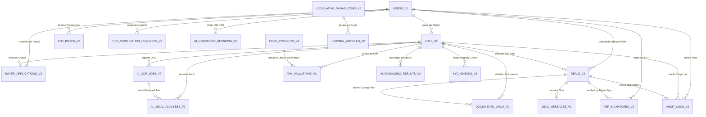

# الفصل الثالث: قواعد بيانات YDB v2، الفهارس الثانوية العالمية GSIs ونموذج البيانات

> **النسخة المرجعية:** `v3.0.0-ai-ready` | **البيئة التشغيلية:** الإنتاج الرسمي `https://domexit.ru`  
> **المنطقة السحابية:** `ru-central1` (Yandex Cloud) | **واجهة المحرك:** Yandex Database (YDB) Serverless Document API (DynamoDB-compatible)

---

## 1. مقدمة ومعمارية YDB Serverless Document API في بيئة `ru-central1`

### 1.1 طبيعة المحرك وقدرات التوسع التلقائي
تعتمد منصة DomExit قاعدة بيانات **Yandex Database (YDB)** بالوضع غير الخادمي (**Serverless**)، وتتواصل معها عبر بروتوكول **Document API** المتوافق هيكلياً وبرمجياً مع مواصفة Amazon DynamoDB API v20120810. يقع المستودع وقاعدة البيانات الحية داخل المركز الإقليمي السحابي الروسي **`ru-central1`**، مما يحقق امتثالاً صارماً وكاملاً لمتطلبات توطين البيانات المنصوص عليها في القانون الاتحادي الروسي رقم **`152-ФЗ`** («О персональных данных»).

يتميز نموذج YDB Serverless بعدة خصائص هندسية حاسمة لمنصة سريعة النمو:
1. **التوسع التلقائي الأفقي الشفاف (`Transparent Horizontal Sharding`):** تُقسَّم الجداول تلقائياً إلى قطاعات بيانات (`Partitions` أو `Tablets`) بناءً على مفتاح التقسيم (`HashKey / PartitionKey`). عندما يتجاوز حجم القطاع حد السعة (حوالي `4 GB`) أو يتجاوز معدل العمليات حدود الإنتاجية، تقوم نواة YDB بشطر القطاع تلقائياً دون أي انقطاع في الخدمة ودون الحاجة لتدخل يدوي.
2. **عزل الحوسبة عن التخزين (`Disaggregated Compute & Storage`):** طبقة التخزين الموزع المشترك المبنية على VDisk/PDisk تضمن بقاء البيانات وتكرارها عبر ثلاث مناطق توافر جغرافية داخل روسيا (`ru-central1-a`, `ru-central1-b`, `ru-central1-d`)، بينما تتولى عقد الحوسبة عديمة الحالة (`Stateless Compute Nodes`) معالجة استعلامات Document API وتمريرها.
3. **نموذج تسعير صفري في حالة الخمول (`Zero-Idle Cost & On-Demand RU/WU`):** تُحاسب العمليات بناءً على وحدات قراءة YDB (`Request Units - RUs`) ووحدات الكتابة (`Write Units - WUs`)، دون دفع أي تكلفة ثابتة للخوادم أثناء فترات خمول المستخدمين ليلاً، مع إمكانية استيعاب طفرات حركة البيانات المفاجئة أثناء إطلاق الإعلانات الترويجية أو إرسال تنبيهات Telegram الجماعية.

---

### 1.2 قيود محرك Document API في YDB وحتمية الانتقال إلى معمارية v2
في الإصدار الأولي للمنصة (معمارية v1)، كانت الجداول تُنشأ بمفتاح أساسي وحيد هو حقل المعرّف (`id: S`). ومع نمو عدد الصفقات والعروض والمستخدمين، ظهرت ثلاثة قيود معمارية حرجة في محرك YDB Document API:

1. **انعدام دعم إضافة الفهارس الثانوية العالمية ديناميكياً عبر `UpdateTable`:**
   في محركات DynamoDB السحابية التقليدية، يمكن إضافة فهرس ثانوي عالمي (`GlobalSecondaryIndex`) إلى جدول نشط ومأهول بالبيانات عبر إرسال أمر `UpdateTable`. أما في طبقة توافق YDB Document API في Yandex Cloud، فإن استدعاء `UpdateTable` مع مصفوفة `GlobalSecondaryIndexUpdates` يُقابل بالرفض الفوري أو يرجع خطأ غير مدعوم (`UnsupportedOperationException / Schema modification not supported on live tables`).
2. **كارثة المسح الشامل للجدول (`ScanAll Performance Degradation & Billing Shock`):**
   نتيجة لغياب الفهارس الثانوية في جداول v1، كانت كافة عمليات البحث والتصفية (مثل: جلب اللوتات النشطة `status = 'available'`، أو جلب طلبات الشراء الخاصة بمستثمر معين `userId = '...'`، أو جلب الصفقات المسندة لوسيط معين `assignedCuratorId = '...'`) تضطر لتنفيذ مسح شامل للجدول بالكامل (`Table Scan`). مع ارتفاع عدد السجلات، قفز زمن الاستجابة من بضع عشرات من الأجزاء من الثانية إلى عدة ثوانٍ، وتضاعف استهلاك وحدات `RU` بمقدار مئات المرات لكل طلب قراءة وحيد.
3. **مخاطر اختناق الذاكرة في دوال Serverless Functions:**
   عند تنفيذ `scanAll` على جداول ضخمة كجدول سجلات التدقيق `audit_logs` أو جدول رسائل الصفقات `deal_messages`، كانت دالة Node.js تستهلك الذاكرة المخصصة لها (`256 MB - 512 MB`) في تجميع مصفوفات البيانات الضخمة، مما يؤدي إلى انهيار العملية بنفاد الذاكرة (`JavaScript heap out of memory`) أو انقضاء مهلة التنفيذ القصوى (`Timeout 30s`).

لهذه الأسباب الجذرية، وُضعت ونُفذت **استراتيجية ترحيل بيانات YDB الشاملة إلى الجيل الثاني (`YDB v2 GSIs Architecture`)**، حيث أُعيد بناء كافة هياكل التخزين مع إدراج الفهارس الثانوية العالمية مسبقاً لحظة الإنشاء التأسيسي (`CreateTable`).

---

## 2. استراتيجية الترحيل من v1 إلى v2 وشبكة الأمان والتبديل الفوري

### 2.1 تشريح إخفاق التعديل المباشر وحل الإنشاء المسبق
يوضح الكود الفعلي في `backend/src/lib/ydbV2Schema.ts` كيف بُني حل الإنشاء المسبق للجداول عبر دالة `buildDynamoCreateTableInput`. نظراً لامتناع المحرك عن قبول الفهارس بعد إنشاء الجدول، يقوم النظام ببناء مواصفة الجدول كاملة بحيث تتضمن:
- تعريف السمة الأساسية: `id: S`
- تعريف كافة السمات المستهدفة بالفهرسة كسمات نصية ذات نوع `S` (`AttributeDefinitions`)
- مخطط المفتاح الأساسي: مفتاح تقسيم `id` (`KeySchema: HASH`)
- مصفوفة الفهارس الثانوية العالمية (`GlobalSecondaryIndexes`) متضمنة مفتاح الفهرس الأساسي (`HashKey`)، ومفتاح الترتيب الاختياري (`RangeKey`)، ونوع الإسقاط الكامل لكافة البيانات (`Projection: { ProjectionType: 'ALL' }`).

```typescript
// backend/src/lib/ydbV2Schema.ts
export function buildDynamoCreateTableInput(schema: V2TableSchema): Record<string, any> {
  const indexedFields = getIndexedFieldsForTable(schema);
  return {
    TableName: schema.v2TableName,
    AttributeDefinitions: [
      { AttributeName: 'id', AttributeType: 'S' },
      ...indexedFields.map((field) => ({ AttributeName: field, AttributeType: 'S' })),
    ],
    KeySchema: [{ AttributeName: 'id', KeyType: 'HASH' }],
    GlobalSecondaryIndexes: schema.gsis.map((gsi) => ({
      IndexName: gsi.indexName,
      KeySchema: [
        { AttributeName: gsi.hashKey, KeyType: 'HASH' },
        ...(gsi.rangeKey ? [{ AttributeName: gsi.rangeKey, KeyType: 'RANGE' }] : []),
      ],
      Projection: { ProjectionType: 'ALL' },
    })),
  };
}
```

---

### 2.2 محرك التوجيه الذكي `resolveTableName(tableName)` وشبكة التراجع الفوري (`Rollback Net`)
لضمان عدم حدوث أي انقطاع تشغيلي أثناء الترحيل ولإتاحة التراجع الفوري بضغطة زر دون إعادة نشر الكود أو تعديل الحاويات، تم بناء محرك حل أسماء الجداول ديناميكياً داخل فئة العميل `YdbClient` في `backend/src/lib/ydbClient.ts`:

```typescript
// backend/src/lib/ydbClient.ts
isV2TablesEnabled(): boolean {
  if (process.env.YDB_USE_V2_TABLES === 'true') return true;
  return Boolean(getConfig().YDB_USE_V2_TABLES);
}

resolveTableName(logicalTable: string): string {
  if (!logicalTable) return logicalTable;
  if (logicalTable.endsWith('_v2')) return logicalTable;
  if (this.isV2TablesEnabled() && V2_TABLES_SCHEMA[logicalTable]) {
    return V2_TABLES_SCHEMA[logicalTable].v2TableName;
  }
  // الجداول السيادية والذكاء الاصطناعي الجديدة تُوجه دوماً إلى v2
  if (V2_TABLES_SCHEMA[logicalTable] && (
    logicalTable.startsWith('kyc_') ||
    logicalTable.startsWith('ai_') ||
    logicalTable.startsWith('journal_') ||
    logicalTable.startsWith('legislative_') ||
    logicalTable.startsWith('avm_') ||
    logicalTable.startsWith('eiszh_') ||
    logicalTable.startsWith('market_') ||
    logicalTable.startsWith('agent_')
  )) {
    return V2_TABLES_SCHEMA[logicalTable].v2TableName;
  }
  return logicalTable;
}
```

#### آليات شبكة الأمان المعمارية:
1. **التبديل عبر متغير البيئة (`Feature Flag`):** يتحكم المتغير `YDB_USE_V2_TABLES=true` في توجيه استعلامات النواة (مثل `lots`, `deals`, `users`, `buyer_applications`) إلى الجداول المفهرسة `*_v2`. إذا تم ضبط المتغير على `false`، تعود المنصة فورياً للعمل على جداول v1 دون أي فقدان للاتصال.
2. **استقلالية الجداول الحديثة:** الجداول التي أُنشئت خصيصاً لمنظومة الذكاء الاصطناعي والامتثال السيادي (الأوامر 01 إلى 10) مثل `ai_ocr_jobs`, `avm_valuations`, `kyc_checks`, `journal_articles`، تُوجَّه دائماً وبشكل قاطع إلى جداول `*_v2` لأنها صُممت منذ البداية بمعمارية الفهارس العالمية ولا وجود لنسخ قديمة منها في v1.
3. **حماية التناسق في عمليات الكتابة والقراءة:** يمر اسم الجدول عبر دالة `resolveTableName` في كافة العمليات (`getItem`, `putItem`, `deleteItem`, `queryByIndex`, `scanAll`) مما يضمن وحدة الوجهة عبر دورة حياة الطلب.

---

### 2.3 بروتوكول التطهير ومطابقة الأنواع `sanitizeItemForV2`
تفرض مواصفة YDB Document API شرطاً صارماً: **لا يجوز أن يحتوي أي حقل مستخدم في مفتاح فهرس ثانوي عالمي (سواء كان HashKey أو RangeKey) على قيمة نصية فارغة (`""`) أو قيمة غير معرفة (`undefined`) أو قيمة خالية (`null`)**؛ إذ يؤدي تمرير قيمة فارغة إلى إرجاع خطأ `ValidationException: Attribute value cannot be empty`.

لحل هذه المعضلة وضمان سلامة البيانات بنسبة 100%، تم تطوير محرك التطهير المركزي `sanitizeItemForV2(logicalTable, rawItem)` في `backend/src/lib/ydbV2Schema.ts`، والذي ينفذ القواعد التالية قبل كل عملية كتابة (`putItem`):

1. **إسناد القيم الافتراضية الذكية للمفاتيح المفقودة:**
   - الحقل `createdAt` يُسند له التوقيت الحالي `ISO 8601` إذا كان مفقوداً أو فارغاً.
   - في جدول `lots`: إذا فُقدت الحالة تُضبط على `'draft'`، وتاريخ النشر `publishedAt` يُضبط على `createdAt`، وتتم مزامنة `assignedCuratorId` من `assignedEmployeeId` و`ownerId` من `sellerId`.
   - في جدول `deals`: تُستخرج معرفات `buyerId` و`sellerId` و`lotId` من بدائلها التاريخية (`buyerUserId`, `sellerUserId`, `lotCode`).
   - في جدول `audit_logs`: يُحقن مفتاح التقسيم الإجباري الثابت `partitionKey = 'AUDIT'` لضمان تجميع السجلات في قطاع زمني موحد يسمح بالترتيب التنازلي الزمني الدقيق.
2. **حذف الحقول المفهرسة الفارغة تماماً (`Attribute Pruning`):**
   إذا كان الحقل المفهرس اختيارياً (مثل `rangeKey` في بعض الفهارس) وقيمته غير متوفرة أو مساوية لنص فارغ `""`، تقوم الدالة بحذف الحقل من كائن السجل نهائياً قبل تمريره إلى محول `toDynamo`. وبموجب مواصفة Document API، فإن السجل الذي لا يحتوي على حقل الفهرس يُستثنى من الفهرس الثانوي دون حدوث أي خطأ، مما يحافظ على نظافة الفهرس واقتصاده.
3. **التطبيع القسري للنصوص والأرقام:**
   تحويل عناوين البريد الإلكتروني إلى أحرف صغيرة مطهرة (`email.trim().toLowerCase()`)، وإزالة المسافات الزائدة من أرقام الهواتف ورموز اللوتات.

---

### 2.4 سكربتات الترحيل والتصفير وضمان استمرارية الأعمال
تعتمد المنصة سكريبتين رسميين محفوظين في `infrastructure/scripts/`:

1. **سكربت الترحيل الآمن `migrate-ydb-v2.mjs`:**
   - يفحص وجود الجداول الـ 24 في البيئة المستهدفة.
   - في حال عدم وجود جدول v2، يقوم باستدعاء أمر `CreateTable` عبر مواصفة `buildDynamoCreateTableInput` المحملة بالفهارس.
   - ينتظر حتى تصبح حالة الجدول `ACTIVE` عبر دورة استعلام `DescribeTable`.
   - يقرأ السجلات من جدول v1 القديم عبر صفحات متتالية (`scanPage` بحجم 50 سجلاً)، ويُمرر كل سجل عبر `sanitizeItemForV2`، ثم يُدرجه في جدول v2 باستخدام `PutItem`.
   - يُجري فحص تطابق الأعداد (`Count Verification`) عبر مقارنة عدد سجلات v1 بعدد سجلات v2 بعد اكتمال النقل.
2. **سكربت التصفير النظيف للاختبار `reset-staging-clean-slate.mjs`:**
   - مخصص لبيئة `staging` فقط (وممنوع تماماً من التشغيل على `production` عبر حارس صارم يتحقق من `APP_ENV === 'staging'`).
   - يقوم بمسح محتويات الجداول وتصفير العدادات لإجراء اختبارات القبول الشاملة ودورات التحقق الآلية النظيفة.

---

## 3. القاموس المرجعي الشامل لجداول الفئة (أ) المفهرسة (24 جدولاً في `ydbV2Schema.ts`)

تتضمن هذه الفئة كافة الجداول التشغيلية والاستثمارية والقانونية والذكاء الاصطناعي التي تدير الحالة الحية لمنصة DomExit. جميع هذه الجداول تستخدم المفتاح الأساسي الفردي:
- **المفتاح الأساسي (`Partition Key`):** `id` من نوع نص (`S`)، ويمثل معرّف الكيان الفريد (UUID v4 أو رمز اللوت الطبيعي الفريد).

فيما يلي التوثيق الشامل والكامل لكل جدول من الجداول الـ 24 دون أي استثناء أو اختصار:

---

### 3.1 جدول اللوتات وعروض الشقق: `lots_v2` (`lots`)
- **الغرض التشغيلي:** تخزين كافة عروض الشقق السكنية المعروضة للتنازل عن عقود `ДДУ` وتفاصيلها المالية والهندسية والقانونية وحالة مراجعة المشرفين.
- **المفتاح الأساسي:** `id` (`S`)
- **الفهارس الثانوية العالمية (GSIs):**
  1. `status-publishedAt-index` (مفتاح التقسيم: `status: S`، مفتاح الترتيب: `publishedAt: S`): يسرع الاستعلام الأهم في المنصة: جلب عروض السوق المتاحة للجمهور والمستثمرين مرتبة من الأحدث إلى الأقدم.
  2. `status-createdAt-index` (مفتاح التقسيم: `status: S`، مفتاح الترتيب: `createdAt: S`): تصفح العروض حسب الحالة للمشرفين والفرز الإداري.
  3. `assignedCuratorId-createdAt-index` (مفتاح التقسيم: `assignedCuratorId: S`، مفتاح الترتيب: `createdAt: S`): تمكين المشرف العقاري (`Curator`) من تصفح اللوتات المسندة إليه حصراً وفق مبدأ عزل الصلاحيات.
  4. `lotCode-index` (مفتاح التقسيم: `lotCode: S`): استرجاع اللوت الفوري بواسطة رمزه الفريد المقروء بشرياً (مثل `LOT-4019-MSK`).
  5. `developerId-createdAt-index` (مفتاح التقسيم: `developerId: S`، مفتاح الترتيب: `createdAt: S`): استعراض عروض مطور عقاري معين ومقارنتها بمشاريع ЕИСЖС.
  6. `ownerId-createdAt-index` (مفتاح التقسيم: `ownerId: S`، مفتاح الترتيب: `createdAt: S`): عرض قائمة اللوتات المملوكة للبائع في حسابه الشخصي (`Cabinet`).

- **بنية الحقول بلغة TypeScript (`Schema Definition`):**
```typescript
export interface LotV2Record {
  id: string; // المعرف الفريد للوت
  lotCode: string; // الرمز المرجعي المقروء بشرياً (فريد، مفهرس)
  status: 'draft' | 'pending_review' | 'available' | 'in_deal' | 'sold' | 'withdrawn' | 'rejected';
  dealTrack: 'ddu_cession' | 'secondary_dkp'; // مسار الصفقة: تنازل ددو أو ملكية تامة ثانوية
  complexName: string; // اسم المجمع السكني (ЖК)
  developerName: string; // اسم شركة التطوير العقاري
  developerId?: string; // معرّف المطور المفهرس
  developerInn?: string; // الرقم الضريبي للمطور (10 أرقام)
  city: string; // المدينة (Москва, Санкт-Петербург, etc.)
  district?: string; // الحي السكني أو الدائرة الإدارية
  address: string; // العنوان الفعلي الموحد عبر DaData
  metroStation?: string; // أقرب محطة مترو
  metroTimeMinutes?: number; // المسافة بالدقائق
  metroTransportType?: 'walk' | 'transport'; // سيراً على الأقدام أو بالمواصلات
  roomsCount: number; // عدد الغرف (0 للاستوديو، 1، 2، 3، 4+)
  areaM2: number; // المساحة الإجمالية بالمتر المربع
  floor: number; // الطابق الحالي
  totalFloors: number; // إجمالي طوابق المبنى
  section?: string; // رقم القسم أو المدخل (Секция / Подъезд)
  apartmentNumber?: string; // رقم الشقة (محمي بحاجز الخصوصية 152-ФЗ)
  constructionStagePercent?: number; // نسبة الإنجاز الإنشائي (0-100%)
  officialDeadline: string; // تاريخ التسليم الرسمي في الددو (ربع/سنة)
  escrowBank: string; // بنك حساب الإسكرو المعتمد
  dduContractNumber: string; // رقم عقد المشاركة في البناء المسجل في Росреестр
  dduContractDate: string; // تاريخ توقيع عقد ДДУ
  dduContractPrice: number; // السعر الأصلي المدفوع في عقد الددو بالروبل
  cashPaidBySeller: number; // المبلغ الفعلي المسدد نقداً من البائع للمطور
  remainingDebtToDeveloper: number; // الدين أو الأقساط المتبقية للمطور
  todayDeveloperPrice: number; // السعر الحالي لنفس الشقة لدى مكتب مبيعات المطور
  discountPercent: number; // نسبة الخصم المحسوبة مقارنة بسعر المطور
  developerConsentRequired: boolean; // هل يشترط موافقة المطور للتنازل؟
  developerConsentFeeRub: number; // رسوم موافقة المطور بالروبل
  consentFeePayer: 'seller' | 'buyer' | 'split'; // من يتحمل رسوم الموافقة
  mortgageEncumbrance: boolean; // هل توجد رهنية بنكية سابقة على الشقة؟
  mortgageBankName?: string; // اسم بنك الرهن العقاري
  maternityCapitalUsed: boolean; // هل استخدم رأس مال الأمومة (Маткапитал)؟
  isUrgentExit: boolean; // وسم الخروج السريع (أقل من 14 يوماً)
  isFeatured: boolean; // عرض ترويجي مميز في الصفحة الرئيسية
  isVerified: boolean; // علامة اكتمال التدقيق القانوني بنجاح
  currentStage: 1 | 2 | 3 | 4 | 5 | 6; // المرحلة الحالية في خط الإنتاج
  assignedCuratorId?: string; // معرّف المشرف المسؤول
  ownerId: string; // معرّف البائع المالك للوت
  publishedAt: string; // تاريخ وساعة النشر الفعلي (ISO 8601)
  createdAt: string; // تاريخ الإنشاء
  updatedAt: string; // تاريخ آخر تعديل
  images: string[]; // روابط الصور المعالجة المعروضة للجمهور
  floorPlanUrl?: string; // رابط المخطط الهندسي للشقة
}
```

---

### 3.2 جدول طلبات الشراء والمطابقة: `buyer_applications_v2` (`buyer_applications`)
- **الغرض التشغيلي:** تسجيل طلبات المشترين والمستثمرين للتنافس على اللوتات المطروحة، وإدارة قائمة الانتظار، ونقاط المطابقة والإغلاق.
- **المفتاح الأساسي:** `id` (`S`)
- **الفهارس الثانوية العالمية (GSIs):**
  1. `userId-createdAt-index` (مفتاح التقسيم: `userId: S`، مفتاح الترتيب: `createdAt: S`): جلب كافة الطلبات التي قدمها المشتري لمتابعة حالتها وحساب كوتة الـ 3 خانات.
  2. `lotId-createdAt-index` (مفتاح التقسيم: `lotId: S`، مفتاح الترتيب: `createdAt: S`): جلب طابور المتنافسين على لوت معين مرتبين بحسب تاريخ التقديم ونقاط الجدارة.
  3. `status-createdAt-index` (مفتاح التقسيم: `status: S`، مفتاح الترتيب: `createdAt: S`): فلترة الطلبات الإدارية حسب الحالة (`queued`, `verified`, `selected_winner`, `withdrawn`).
  4. `assignedCuratorId-createdAt-index` (مفتاح التقسيم: `assignedCuratorId: S`، مفتاح الترتيب: `createdAt: S`): إتاحة متابعة الطلبات للمشرف المعني باللوت.
  5. `buyBoxId-createdAt-index` (مفتاح التقسيم: `buyBoxId: S`، مفتاح الترتيب: `createdAt: S`): ربط الطلب بملف رغبات الشراء (`Buy-Box`) الذي تولد منه.

- **بنية الحقول بلغة TypeScript:**
```typescript
export interface BuyerApplicationV2Record {
  id: string;
  lotId: string; // معرّف اللوت أو رمزه الفريد
  userId: string; // معرّف المشتري
  buyBoxId?: string; // معرّف رغبة الشراء المرتبطة
  assignedCuratorId?: string; // المشرف المعين للطلب
  status: 'draft' | 'queued' | 'priority_waitlist' | 'verified' | 'selected_winner' | 'in_deal' | 'completed' | 'withdrawn' | 'rejected' | 'expired_sla';
  tierSnapshot: 'gold_instant' | 'silver_fast' | 'bronze_standard'; // رتبة المشتري لحظة تقديم الطلب
  paymentMethod: 'cash_full' | 'mortgage_approved' | 'installment' | 'unapproved_mortgage';
  matchScore: number; // درجة المطابقة مع معايير اللوت (0–100)
  closingScore: number; // درجة جاهزية الإغلاق المحسوبة خوارزمياً (0–105)
  reliabilityScore: number; // مؤشر التزام المشتري والـ SLA (0–100)
  proofDocumentS3Key?: string; // مستند إثبات الملاءة المالية
  proofDocumentVerified: boolean; // هل تم التحقق الآلي أو اليدوي من الإثبات؟
  slaDeadline: string; // الموعد النهائي للاستجابة والانتقال للمرحلة التالية (ISO 8601)
  winnerSelectedAt?: string; // تاريخ اختيار المشتري فائزاً بالصفقة
  withdrawnReason?: string; // سبب الانسحاب إن وجد
  createdAt: string;
  updatedAt: string;
}
```

---

### 3.3 جدول الصفقات وغرفة الإغلاق: `deals_v2` (`deals`)
- **الغرض التشغيلي:** إدارة الصفقات النشطة والمغلقة عبر مراحل غرفة الإغلاق الرقمية الست (`Closing Room`) وحفظ الحسابات المالية وعمولات النجاح.
- **المفتاح الأساسي:** `id` (`S`)
- **الفهارس الثانوية العالمية (GSIs):**
  1. `buyerId-createdAt-index` (مفتاح التقسيم: `buyerId: S`، مفتاح الترتيب: `createdAt: S`): صفقات المشتري في لوحة تحكمه.
  2. `sellerId-createdAt-index` (مفتاح التقسيم: `sellerId: S`، مفتاح الترتيب: `createdAt: S`): صفقات البائع لمتابعة استلام مستحقاته.
  3. `lotId-createdAt-index` (مفتاح التقسيم: `lotId: S`، مفتاح الترتيب: `createdAt: S`): تتبع الصفقة المنشأة من لوت معين ومنع تكرار فتح صفقات لنفس اللوت.
  4. `assignedCuratorId-createdAt-index` (مفتاح التقسيم: `assignedCuratorId: S`، مفتاح الترتيب: `createdAt: S`): عزل صفقات المشرف وحساب عمولاته وأدائه.
  5. `status-createdAt-index` (مفتاح التقسيم: `status: S`، مفتاح الترتيب: `createdAt: S`): تتبع الصفقات الإدارية والمالية بحسب مرحلتها.

- **بنية الحقول بلغة TypeScript:**
```typescript
export interface DealV2Record {
  id: string; // معرّف الصفقة الفريد
  dealId?: string; // المعرف الرمزي المقابل
  lotId: string; // اللوت محل الصفقة
  lotCode: string; // رمز اللوت
  complexName: string; // اسم المجمع
  city: string; // المدينة
  district?: string; // المنطقة
  buyerId: string; // معرّف المشتري الفائز
  buyerName: string; // الاسم القانوني للمشتري
  sellerId: string; // معرّف البائع المتنازل
  sellerName: string; // الاسم القانوني للبائع
  assignedCuratorId: string; // المشرف القانوني والوسيط المسؤول
  status: 'active' | 'in_closing' | 'signed' | 'registered_rosreestr' | 'payout_completed' | 'cancelled' | 'failed_audit';
  stage: 1 | 2 | 3 | 4 | 5 | 6; // مرحلة الإغلاق (1: الحجز، 2: موافقة المطور، 3: الرهن، 4: حساب الإسكرو/СБР، 5: التوقيع والتسجيل، 6: التصفية)
  closingStep: number; // الخطوة الفرعية داخل المرحلة
  agreedPriceRub: number; // السعر الإجمالي المتفق عليه للصفقة
  sellerReturnRub: number; // المبلغ الصافي الذي سيستلمه البائع نقداً
  dduContractPrice: number; // سعر عقد ДДУ الأصلي
  platformCommissionRub: number; // عمولة المنصة الثابتة (2.5%)
  commissionPaid: boolean; // هل تم تحصيل عمولة المنصة في الإسكرو؟
  escrowWorkflow?: {
    bankName: string;
    accountNumberMasked?: string;
    depositedAmountRub: number;
    depositVerifiedAt?: string;
    curatorHandoverAt?: string;
    closingCompletedAt?: string;
    signingProofPhotos?: string[];
  };
  pepAgreementSigned: boolean; // هل تم توقيع عقد الوساطة والحصرية إلكترونياً؟
  createdAt: string;
  updatedAt: string;
}
```

---

### 3.4 جدول المستخدمين والهوية: `users_v2` (`users`)
- **الغرض التشغيلي:** تخزين الحسابات الشخصية لكافة أطراف المنصة (المالك، المشرفين، المشترين، البائعين، والشركاء) مع إدارة التوثيق المزدوج، وإصدارات الجلسات.
- **المفتاح الأساسي:** `id` (`S`)
- **الفهارس الثانوية العالمية (GSIs):**
  1. `login-index` (مفتاح التقسيم: `login: S`): التحقق من اسم المستخدم عند تسجيل الدخول بالاسم وكلمة المرور.
  2. `email-index` (مفتاح التقسيم: `email: S`): التحقق السريع من عدم تكرار البريد الإلكتروني وتسجيل الدخول واستعادة الحساب.
  3. `role-createdAt-index` (مفتاح التقسيم: `role: S`، مفتاح الترتيب: `createdAt: S`): استعلام المشرفين والمديرين لجلب المستخدمين حسب الرتبة دون مسح شامل للجدول.
  4. `phone-index` (مفتاح التقسيم: `phone: S`): مطابقة رقم الهاتف الروسي الموحد ومنع إنشاء حسابات مكررة بنفس الهاتف.

- **بنية الحقول بلغة TypeScript:**
```typescript
export interface UserV2Record {
  id: string; // معرّف المستخدم الفريد (UUID v4)
  login?: string; // اسم المستخدم المختار
  email: string; // البريد الإلكتروني (مطهر وموحد بأحرف صغيرة)
  phone?: string; // رقم الهاتف بصيغة دولية (+7XXXXXXXXXX)
  name: string; // الاسم واللقب القانوني
  role: 'owner' | 'employee' | 'client' | 'partner' | 'candidate';
  roles?: string[]; // مصفوفة الأدوار المتعددة للمستخدم
  activeRole?: string; // الدور النشط حالياً في الجلسة
  tier: 'gold_instant' | 'silver_fast' | 'bronze_standard'; // رتبة المشتري المعتمدة
  passwordHash?: string; // كلمة المرور المشفرة بـ scrypt:salt (محذوفة تماماً من الاستجابات)
  authProviders: Array<'password' | 'yandex' | 'phone'>; // مزودو التوثيق المفعلون
  tokenVersion: number; // إصدار التوكن المستخدم لإلغاء الجلسات الفوري
  assignedEmployeeId?: string; // معرّف الموظف إذا كان الحساب يتبع وسيطاً
  isPartnerApproved?: boolean; // اعتماد الوكيل العقاري الشريك
  partnerRefCode?: string; // رمز الإحالة الترويجي للوكيل
  avatarUrl?: string; // رابط الصورة الشخصية المخزنة في S3
  isBlocked: boolean; // علامة التجميد الأمني
  telegramChatId?: string; // معرّف محادثة تيليجرام المرتبط
  createdAt: string;
  updatedAt: string;
}
```

---

### 3.5 جدول سجلات التدقيق الأمني والامتثال: `audit_logs_v2` (`audit_logs`)
- **الغرض التشغيلي والقانوني:** سجل تدقيق أمني غير قابل للتعديل (`Append-Only Immutable Ledger`) يوثق كل عملية وصول، تعديل، ترقية صلاحية، أو تصدير بيانات، بامتثال تام لمتطلبات `152-ФЗ`.
- **المفتاح الأساسي:** `id` (`S`)
- **الفهارس الثانوية العالمية (GSIs):**
  1. `partitionKey-timestamp-index` (مفتاح التقسيم: `partitionKey: S` [دائماً `'AUDIT'`]، مفتاح الترتيب: `timestamp: S`): يتيح لمالك المنصة استعراض سجلات التدقيق الإجمالية مرتبة زمنياً من الأحدث إلى الأقدم بصفحات دقيقة.
  2. `actorId-timestamp-index` (مفتاح التقسيم: `actorId: S`، مفتاح الترتيب: `timestamp: S`): تتبع كامل العمليات التي نفذها مستخدم أو مشرف معين لكشف الأنشطة المشبوهة.
  3. `targetId-timestamp-index` (مفتاح التقسيم: `targetId: S`، مفتاح الترتيب: `timestamp: S`): مراجعة السجل التاريخي الكامل للتعديلات الواقعة على لوت أو صفقة معينة.

- **بنية الحقول بلغة TypeScript:**
```typescript
export interface AuditLogV2Record {
  id: string; // معرّف السجل الفريد
  partitionKey: 'AUDIT'; // مفتاح ثابت لتجميع الفهرس الزمني الشامل
  actorId: string; // معرّف المستخدم أو المشرف منفذ العملية
  actorRole: string; // دور المنفذ لحظة الإجراء
  actorIp: string; // عنوان IP المصدر
  userAgent: string; // متصفح أو عميل الطلب
  action: string; // اسم الإجراء (UPDATE_LOT, SIGN_PEP, LOGIN_SUCCESS, etc.)
  targetId: string; // معرّف الكيان المتأثر (lotId, dealId, userId)
  targetCollection: string; // اسم الجدول المعني
  payloadDiff?: Record<string, any>; // الفارق بين الحالة السابقة والحالية
  status: 'success' | 'failure' | 'blocked';
  timestamp: string; // توقيت وقوع الحدث بدقة الأجزاء من الثانية (ISO 8601)
}
```

---

### 3.6 جدول رسائل الصفقات الميدانية: `deal_messages_v2` (`deal_messages`)
- **الغرض التشغيلي:** تخزين محادثات غرفة الإغلاق بين البائع والمشتري والمشرف مع تفعيل فلاتر منع تسريب أرقام الهواتف أو الروابط الخارجية.
- **المفتاح الأساسي:** `id` (`S`)
- **الفهارس الثانوية العالمية (GSIs):**
  1. `dealId-createdAt-index` (مفتاح التقسيم: `dealId: S`، مفتاح الترتيب: `createdAt: S`): استرجاع رسائل صفقة معينة بتسلسلها الزمني الصحيح.
  2. `senderId-createdAt-index` (مفتاح التقسيم: `senderId: S`، مفتاح الترتيب: `createdAt: S`): استرجاع رسائل مرسل معين للتحقق الأمني.

- **بنية الحقول بلغة TypeScript:**
```typescript
export interface DealMessageV2Record {
  id: string;
  dealId: string; // معرّف الصفقة
  senderId: string; // معرّف المرسل
  senderRole: 'curator' | 'buyer' | 'seller' | 'system';
  senderName: string;
  messageText: string; // نص الرسالة المطهر
  attachments?: string[]; // مفاتيح S3 للمرفقات المسموحة
  isSystemNotice: boolean; // هل الرسالة إشعار تلقائي من النظام؟
  createdAt: string;
}
```

---

### 3.7 جدول رسائل المشرفين والاستشارات: `curator_messages_v2` (`curator_messages`)
- **الغرض التشغيلي:** تخزين قنوات التواصل الثنائية بين العميل (البائع أو المشتري) والمشرف العقاري المعين له قبل إتمام المطابقة وفتح الصفقة.
- **المفتاح الأساسي:** `id` (`S`)
- **الفهارس الثانوية العالمية (GSIs):**
  1. `userId-createdAt-index` (مفتاح التقسيم: `userId: S`، مفتاح الترتيب: `createdAt: S`): جلب محادثات العميل مع المشرف.
  2. `curatorId-createdAt-index` (مفتاح التقسيم: `curatorId: S`، مفتاح الترتيب: `createdAt: S`): تجميع محادثات المشرف في لوحة رسائله.
  3. `dealId-createdAt-index` (مفتاح التقسيم: `dealId: S`، مفتاح الترتيب: `createdAt: S`): ربط المحادثة بصفقة أو لوت تمهيدي إن وُجد.

---

### 3.8 جدول تفضيلات واستراتيجيات الشراء: `buy_boxes_v2` (`buy_boxes`)
- **الغرض التشغيلي:** تخزين وتحديث مصفوفة الرغبات الاستثمارية لكل مشتري (`Buy-Box Profile`) المستخدمة في محرك المطابقة الفورية وتوجيه عروض الطرح الحصري.
- **المفتاح الأساسي:** `id` (`S`)
- **الفهارس الثانوية العالمية (GSIs):**
  1. `userId-createdAt-index` (مفتاح التقسيم: `userId: S`، مفتاح الترتيب: `createdAt: S`): استرجاع ملف تفضيلات المستخدم النشط وتحديثه.
  2. `status-createdAt-index` (مفتاح التقسيم: `status: S`، مفتاح الترتيب: `createdAt: S`): استعلام رادارات الطلب النشطة (`active`) لمطابقتها مع اللوتات الجديدة المعتمدة في المرحلة 3.

- **بنية الحقول بلغة TypeScript:**
```typescript
export interface BuyBoxV2Record {
  id: string;
  userId: string; // معرّف المستثمر صاحب الرغبة
  status: 'active' | 'paused' | 'fulfilled' | 'archived';
  targetCities: string[]; // المدن المستهدفة (Москва, СПб, etc.)
  targetDistricts?: string[]; // المناطق المفضلة
  roomsPreferences: number[]; // خيارات عدد الغرف (0 للاستوديو، 1، 2، 3)
  minAreaM2?: number; // الحد الأدنى للمساحة
  maxAreaM2?: number; // الحد الأقصى للمساحة
  maxPriceRub: number; // الميزانية القصوى بالروبل
  minDiscountPercent: number; // أدنى نسبة خصم مقبولة عن سعر المطور (مثلاً 10%)
  paymentMethod: 'cash_full' | 'mortgage_approved' | 'installment' | 'unapproved_mortgage';
  readinessTimelineMonths?: number; // الأفق الزمني لاستلام المفاتيح
  tier: 'gold_instant' | 'silver_fast' | 'bronze_standard';
  reliabilityScore: number; // مؤشر الالتزام (0-100)
  createdAt: string;
  updatedAt: string;
}
```

---

### 3.9 جدول طلبات البائعين الأولية: `seller_requests_v2` (`seller_requests`)
- **الغرض التشغيلي:** استقبال بيانات الاستمارة الأولية لبيع الشقة المقدمة من المالك عبر الموقع العام وتوجيهها للمشرف لتدقيقها وتحويلها إلى لوت.
- **المفتاح الأساسي:** `id` (`S`)
- **الفهارس الثانوية العالمية (GSIs):**
  1. `userId-createdAt-index` (مفتاح التقسيم: `userId: S`، مفتاح الترتيب: `createdAt: S`): طلبات البائع المقدمة من حسابه.
  2. `assignedCuratorId-createdAt-index` (مفتاح التقسيم: `assignedCuratorId: S`، مفتاح الترتيب: `createdAt: S`): الطلبات الواردة للمشرف للتواصل وتحديد الموعد.
  3. `status-createdAt-index` (مفتاح التقسيم: `status: S`، مفتاح الترتيب: `createdAt: S`): فرز الطلبات حسب حالة الفرز (`new`, `in_progress`, `converted_to_lot`, `rejected`).

---

### 3.10 جدول طلبات اعتماد وترقية الرتب: `tier_verification_requests_v2` (`tier_verification_requests`)
- **الغرض التشغيلي:** إدارة طلبات ترقية المشترين إلى رتبة **`Gold Instant`** أو **`Silver Fast`** عبر رفع مستندات إثبات الملاءة أو الموافقة البنكية، ومراجعتها واعتمادها من المشرف أو المالك.
- **المفتاح الأساسي:** `id` (`S`)
- **الفهارس الثانوية العالمية (GSIs):**
  1. `userId-createdAt-index` (مفتاح التقسيم: `userId: S`، مفتاح الترتيب: `createdAt: S`): متابعة المستخدم لطلب الترقية الخاص به.
  2. `status-createdAt-index` (مفتاح التقسيم: `status: S`، مفتاح الترتيب: `createdAt: S`): قائمة انتظار الاعتماد للمشرفين (`pending`, `approved`, `rejected`).

---

### 3.11 جدول خزينة المستندات الرقمية: `documents_vault_v2` (`documents_vault`)
- **الغرض التشغيلي:** فهرسة كافة الوثائق القانونية الحساسة المخزنة في الدلو السحابي الخاص المشفر `domexit-private-docs-prod` ومطابقتها مع اللوتات والصفقات وملاكها.
- **المفتاح الأساسي:** `id` (`S`)
- **الفهارس الثانوية العالمية (GSIs):**
  1. `dealId-uploadedAt-index` (مفتاح التقسيم: `dealId: S`، مفتاح الترتيب: `uploadedAt: S`): استرجاع مستندات صفقة معينة لإعداد ملف الإغلاق.
  2. `lotId-uploadedAt-index` (مفتاح التقسيم: `lotId: S`، مفتاح الترتيب: `uploadedAt: S`): استرجاع مستندات ملكية اللوت (عقد الددو، شهادة سداد المطور، المخططات).
  3. `ownerId-uploadedAt-index` (مفتاح التقسيم: `ownerId: S`، مفتاح الترتيب: `uploadedAt: S`): مستندات المستخدم المحفوظة في ملفه القانوني الشخصي.

- **بنية الحقول بلغة TypeScript:**
```typescript
export interface DocumentVaultV2Record {
  id: string;
  lotId?: string; // معرّف اللوت
  dealId?: string; // معرّف الصفقة
  ownerId: string; // رافع المستند أو صاحبه القانوني
  documentType: 'ddu_contract' | 'payment_certificate' | 'developer_consent' | 'egrn_extract' | 'passport_scan' | 'maternity_cert' | 'bank_approval' | 'pep_signed_act';
  s3Key: string; // المسار الداخلي المشفر في S3
  originalFileName: string;
  mimeType: string;
  fileSizeBytes: number;
  sha256Hash: string; // بصمة التجزئة المشفرة للتحقق من عدم التلاعب
  ocrJobId?: string; // معرّف مهمة القراءة الآلية المرتبطة
  uploadedAt: string;
}
```

---

### 3.12 جدول التواقيع الإلكترونية البسيطة: `pep_signatures_v2` (`pep_signatures`)
- **الغرض القانوني والتشغيلي:** توثيق التواقيع الإلكترونية البسيطة (`ПЭП`) بامتثال صارم للقانون الاتحادي رقم **`63-ФЗ`** («Об электронной подписи»)، وحفظ سجل غير قابل للتعديل يثبت موافقة العميل على شروط الوساطة أو محاضر المعاينة برمز OTP المشفر.
- **المفتاح الأساسي:** `id` (`S`)
- **الفهارس الثانوية العالمية (GSIs):**
  1. `dealId-signedAt-index` (مفتاح التقسيم: `dealId: S`، مفتاح الترتيب: `signedAt: S`): التحقق من توقيع كافة أطراف الصفقة على وثائق الإغلاق.
  2. `userId-signedAt-index` (مفتاح التقسيم: `userId: S`، مفتاح الترتيب: `signedAt: S`): إثبات التواقيع السابقة للمستخدم في أي نزاع قضائي.

- **بنية الحقول بلغة TypeScript:**
```typescript
export interface PepSignatureV2Record {
  id: string;
  dealId?: string; // معرّف الصفقة
  lotCode?: string; // رمز اللوت
  userId: string; // معرّف الموقع
  documentType: 'nda_viewing_act' | 'agency_agreement' | 'deposit_intent_act' | 'cession_preliminary';
  agreementTextSha256: string; // بصمة النص القانوني وقت التوقيع
  signerPhoneMasked: string; // الهاتف المستخدم في التوقيع
  otpTokenHash: string; // تجزئة رمز التحقق المستلم بالرسالة
  signerIp: string; // عنوان IP الخاص بالموقع
  userAgent: string; // تفاصيل متصفح وجهاز الموقع
  signedAt: string; // الختم الزمني الموثق للتوقيع (ISO 8601)
  status: 'signed' | 'revoked';
}
```

---

### 3.13 جدول مهام وكلاء البحث العقاري: `agent_research_tasks_v2` (`agent_research_tasks`)
- **الغرض التشغيلي:** إدارة جسر مهام التحليل والاستخبارات السوقية الموجهة للوكلاء والأنظمة الخارجية لتسعير المشاريع والمقارنة التنافسية.
- **المفتاح الأساسي:** `id` (`S`)
- **الفهارس الثانوية العالمية (GSIs):**
  1. `status-createdAt-index` (مفتاح التقسيم: `status: S`، مفتاح الترتيب: `createdAt: S`): جلب المهام قيد الانتظار (`pending`, `dispatched`, `completed`).
  2. `lotCode-createdAt-index` (مفتاح التقسيم: `lotCode: S`، مفتاح الترتيب: `createdAt: S`): مراجعة كافة مهام البحث الخاصة بلوت معين.
  3. `taskType-createdAt-index` (مفتاح التقسيم: `taskType: S`، مفتاح الترتيب: `createdAt: S`): تجميع المهام حسب النوع (`developer_pricing`, `market_discount`, `infrastructure`).

---

### 3.14 جدول مؤشرات السوق المرجعية: `market_benchmarks_v2` (`market_benchmarks`)
- **الغرض التشغيلي:** تخزين متوسطات أسعار المتر المربع المعتمدة للمجمعات السكنية في موسكو وسانت بطرسبرغ لحساب فجوة السعر الاستثمارية وتغذية محرك AVM.
- **المفتاح الأساسي:** `id` (`S`)
- **الفهارس الثانوية العالمية (GSIs):**
  1. `complexKey-verifiedAt-index` (مفتاح التقسيم: `complexKey: S`، مفتاح الترتيب: `verifiedAt: S`): جلب المؤشر السعري المعتمد لمجمع سكني معين بأسرع وقت.
  2. `lotCode-verifiedAt-index` (مفتاح التقسيم: `lotCode: S`، مفتاح الترتيب: `verifiedAt: S`): تتبع القياسات المرجعية المطبقة على لوت محدد.

---

### 3.15 جدول مهام القراءة الآلية للمستندات: `ai_ocr_jobs_v2` (`ai_ocr_jobs`)
- **الغرض التشغيلي والامتثالي:** تتبع طابور معالجة وثائق `ДДУ` و`ЕГРН` عبر خدمة **`Yandex Vision OCR`** داخل سحابة موسكو (`ru-central1`)، وحفظ حالات التقدم والحصص اليومية.
- **المفتاح الأساسي:** `id` (`S`)
- **الفهارس الثانوية العالمية (GSIs):**
  1. `lotCode-createdAt-index` (مفتاح التقسيم: `lotCode: S`، مفتاح الترتيب: `createdAt: S`): عرض مهام القراءة الآلية للوت في واجهة تدقيق العقود الإدارية `/admin/legal-audit`.
  2. `documentId-createdAt-index` (مفتاح التقسيم: `documentId: S`، مفتاح الترتيب: `createdAt: S`): ربط مهمة المعالجة بمستند الخزينة الأصل في S3.
  3. `status-createdAt-index` (مفتاح التقسيم: `status: S`، مفتاح الترتيب: `createdAt: S`): تتبع طابور المهام للعامل الخلفي (`queued`, `processing`, `completed`, `failed`).

- **بنية الحقول بلغة TypeScript:**
```typescript
export interface AiOcrJobV2Record {
  id: string; // معرّف مهمة الـ OCR
  lotCode: string; // رمز اللوت
  documentId: string; // معرّف المستند في documents_vault
  documentType: 'ddu_contract' | 'payment_certificate' | 'egrn_extract';
  status: 'queued' | 'processing' | 'completed' | 'failed';
  pagesTotal?: number; // إجمالي الصفحات المعالجة
  extractedTextS3Key?: string; // مسار ملف النص المستخرج في S3 المشفر
  extractedEntities?: {
    contractNumber?: string;
    contractDate?: string;
    developerInn?: string;
    escrowBank?: string;
    buyerName?: string;
    apartmentNumber?: string;
    areaM2?: number;
    priceRub?: number;
  };
  processingDurationMs?: number;
  errorMessage?: string;
  createdAt: string;
  completedAt?: string;
}
```

---

### 3.16 جدول تحليلات المساعد القانوني: `ai_legal_analyses_v2` (`ai_legal_analyses`)
- **الغرض التشغيلي والقانوني:** حفظ نتائج تدقيق العقود المنفذة عبر **`YandexGPT Pro`**، وتوليد مسودات الأقسام الخمسة ومذكرة حماية المشتري من الإفلاس (`61.2 127-ФЗ`).
- **المفتاح الأساسي:** `id` (`S`)
- **الفهارس الثانوية العالمية (GSIs):**
  1. `lotCode-createdAt-index` (مفتاح التقسيم: `lotCode: S`، مفتاح الترتيب: `createdAt: S`): جلب سجل التحليلات القانونية للوت في واجهة المشرف.
  2. `ocrJobId-index` (مفتاح التقسيم: `ocrJobId: S`): مطابقة التحليل بمهمة استخراج النصوص التي استند إليها لضمان سلامة سلسلة الأدلة القانونية.

- **بنية الحقول بلغة TypeScript:**
```typescript
export interface AiLegalAnalysisV2Record {
  id: string;
  lotCode: string;
  ocrJobId: string;
  overallRiskLevel: 'low' | 'medium' | 'high' | 'critical';
  confidenceScore: number; // ثقة النموذج (0–100%)
  fiveAxisAudit: {
    developerStatus: { passed: boolean; details: string };
    paymentStatus: { passed: boolean; details: string };
    developerConsent: { passed: boolean; details: string; feeRub?: number };
    maternityCapital: { passed: boolean; details: string };
    sellerBankruptcyRisk: { passed: boolean; details: string };
  };
  memo127FzDraft: string; // نص مذكرة الحماية من المادة 61.2 لقانون الإفلاس
  curatorNotes?: string;
  verifiedByCuratorId?: string;
  isCuratorApproved: boolean;
  createdAt: string;
}
```

---

### 3.17 جدول تدقيق ملاءة المشترين: `ai_buyer_verifications_v2` (`ai_buyer_verifications`)
- **الغرض التشغيلي:** تخزين نتائج الفحص الذكي لمستندات إثبات الملاءة (كشوف الحسابات والموافقات البنكية) لترقية رتب المشترين تلقائياً.
- **المفتاح الأساسي:** `id` (`S`)
- **الفهارس الثانوية العالمية (GSIs):**
  1. `targetId-createdAt-index` (مفتاح التقسيم: `targetId: S`، مفتاح الترتيب: `createdAt: S`): استرجاع نتائج فحص طلب اعتماد أو شراء معين.
  2. `userId-createdAt-index` (مفتاح التقسيم: `userId: S`، مفتاح الترتيب: `createdAt: S`): تاريخ تدقيق الملاءة للمستثمر عبر الزمن.

---

### 3.18 جدول مشاريع البناء الحكومية: `eiszh_projects_v2` (`eiszh_projects`)
- **الغرض التشغيلي:** تخزين السجل الوطني للمشاريع السكنية قيد الإنشاء المسحوبة مجاناً من بوابة **`Наш.Дом.РФ (ЕИСЖС)`** للتحقق من المطورين وبنوك الإسكرو ومواعيد التسليم الرسمية.
- **المفتاح الأساسي:** `id` (`S`)
- **الفهارس الثانوية العالمية (GSIs):**
  1. `developerInn-index` (مفتاح التقسيم: `developerInn: S`، مفتاح الترتيب: `syncedAt: S`): استرجاع كافة مشاريع مطور عقاري عبر رقمه الضريبي `ИНН`.
  2. `complexKey-index` (مفتاح التقسيم: `complexKey: S`، مفتاح الترتيب: `syncedAt: S`): مطابقة سريعة لاسم المجمع السكني والمدينة.
  3. `region-syncedAt-index` (مفتاح التقسيم: `region: S`، مفتاح الترتيب: `syncedAt: S`): فرز المشاريع حسب المقاطعة الروسية (موسكو 77، بطرسبرغ 78، الخ).

---

### 3.19 جدول تقييمات السيولة السريعة: `avm_valuations_v2` (`avm_valuations`)
- **الغرض التشغيلي:** تسجيل تقييمات محرك **`AVM v1`** الاسترشادية للوتات، وممر الخروج السريع في 14 يوماً وحساب الخصم الاستثماري الحقيقي.
- **المفتاح الأساسي:** `id` (`S`)
- **الفهارس الثانوية العالمية (GSIs):**
  1. `lotCode-createdAt-index` (مفتاح التقسيم: `lotCode: S`، مفتاح الترتيب: `createdAt: S`): استرجاع السجل التاريخي لتقييمات اللوت.
  2. `complexKey-createdAt-index` (مفتاح التقسيم: `complexKey: S`، مفتاح الترتيب: `createdAt: S`): تحليل حركة الأسعار في مجمع سكني معين.

---

### 3.20 جدول استوديو التغليف الذكي: `ai_packaging_results_v2` (`ai_packaging_results`)
- **الغرض التشغيلي:** حفظ نتائج فحص جودة الصور وإزالة العلامات المائية للشركات المنافسة (`Циан`, `Авито`)، وبيانات إثراء المترو، والنصوص الترويجية الاستثمارية.
- **المفتاح الأساسي:** `id` (`S`)
- **الفهارس الثانوية العالمية (GSIs):**
  1. `lotCode-createdAt-index` (مفتاح التقسيم: `lotCode: S`، مفتاح الترتيب: `createdAt: S`): جلب مخرجات التغليف الخاصة باللوت للمحرر في المرحلة 2 (`/admin/packaging`).

---

### 3.21 جدول رادار التشريعات الروسية: `legislative_radar_items_v2` (`legislative_radar_items`)
- **الغرض التشغيلي:** تتبع التعديلات والقوانين الاتحادية الصادرة عن البنك المركزي و`Росреестр` والدوما، وتصنيف أثرها على عقود `214-ФЗ` والتنازل بـ `YandexGPT Lite`.
- **المفتاح الأساسي:** `id` (`S`)
- **الفهارس الثانوية العالمية (GSIs):**
  1. `status-publishedAt-index` (مفتاح التقسيم: `status: S`، مفتاح الترتيب: `publishedAt: S`): جلب الأخبار المفروزة والمنشورة حسب التوقيت.
  2. `category-publishedAt-index` (مفتاح التقسيم: `category: S`، مفتاح الترتيب: `publishedAt: S`): فرز الأخبار بحسب التصنيف (رهن، ضرائب، إفلاس، حماية مستهلك).
  3. `sourceId-publishedAt-index` (مفتاح التقسيم: `sourceId: S`، مفتاح الترتيب: `publishedAt: S`): تتبع الأخبار حسب المصدر الرسمي الحكومي.

---

### 3.22 جدول مقالات مجلة المنصة: `journal_articles_v2` (`journal_articles`)
- **الغرض التشغيلي والتسويقي:** تخزين مقالات مجلة **DomExit Journal (`/journal`)** ومحرك الاستحواذ العضوي المجاني (`Yandex Organic SEO`) وتوليد خرائط المواقع التفاعلية.
- **المفتاح الأساسي:** `id` (`S`)
- **الفهارس الثانوية العالمية (GSIs):**
  1. `status-publishedAt-index` (مفتاح التقسيم: `status: S`، مفتاح الترتيب: `publishedAt: S`): جلب المقالات المنشورة للجمهور مرتبة زمنياً.
  2. `slug-index` (مفتاح التقسيم: `slug: S`): جلب المقال بسرعة فائقة بواسطة الرابط اللطيف الفريد (`/journal/:slug`).
  3. `category-publishedAt-index` (مفتاح التقسيم: `category: S`، مفتاح الترتيب: `publishedAt: S`): تصفح المجلة حسب الأقسام والتصنيفات.

---

### 3.23 جدول جلسات الكونسيرج الذكي: `ai_concierge_sessions_v2` (`ai_concierge_sessions`)
- **الغرض التشغيلي:** إدارة محادثات المساعد العقاري القانوني الذكي في الويب وتيليجرام عبر محرك **Vector RAG** المجاني القائم على متجهات S3 و`YandexGPT Embeddings`.
- **المفتاح الأساسي:** `id` (`S`)
- **الفهارس الثانوية العالمية (GSIs):**
  1. `userId-updatedAt-index` (مفتاح التقسيم: `userId: S`، مفتاح الترتيب: `updatedAt: S`): استعادة جلسات المستخدم في حسابه بالويب.
  2. `telegramChatId-updatedAt-index` (مفتاح التقسيم: `telegramChatId: S`، مفتاح الترتيب: `updatedAt: S`): ربط محادثة بوت Telegram OS بذاكرة الجلسة الموحدة.
  3. `handoffStatus-updatedAt-index` (مفتاح التقسيم: `handoffStatus: S`، مفتاح الترتيب: `updatedAt: S`): تتبع طلبات التحويل البشري للوسيط (`pending_curator`, `in_curator_talk`, `none`).

---

### 3.24 جدول تدقيق الأطراف والسجلات الروسية: `kyc_checks_v2` (`kyc_checks`)
- **الغرض التشغيلي والاستراتيجي:** تخزين بروتوكولات الفحص بضغطة زر للبائعين والمشترين عبر السجلات الحكومية الستة (`ФССП`, `ЕФРСБ`, `КАД Арбитраж`, `ГАС Правосудие`, `ФНС/ЕГРЮЛ`, وصلاحية الجواز عبر `MVD`) تمهيداً لعزل النواة القانونية `legal-core v1`.
- **المفتاح الأساسي:** `id` (`S`)
- **الفهارس الثانوية العالمية (GSIs):**
  1. `lotCode-checkedAt-index` (مفتاح التقسيم: `lotCode: S`، مفتاح الترتيب: `checkedAt: S`): تقارير فحص الأطراف التابعة للوت معين.
  2. `subjectHash-checkedAt-index` (مفتاح التقسيم: `subjectHash: S`، مفتاح الترتيب: `checkedAt: S`): بصمة التجزئة المشفرة لبيانات الطرف لمنع تكرار الاستعلام المدفوع عن نفس الشخص خلال 30 يوماً.
  3. `tenantId-checkedAt-index` (مفتاح التقسيم: `tenantId: S`، مفتاح الترتيب: `checkedAt: S`): عزل العملاء في المعمارية متعددة المستأجرين (`Multi-Tenant Isolation`).

---

## 4. جداول الفئة (ب) المرجعية والفئة (ج) المؤقتة

### 4.1 جداول الفئة (ب) المرجعية (`Category B: Reference Tables`)
هذه الجداول تحتوي على بيانات إعدادات مرجعية عامة وصغيرة الحجم نسبياً (أقل من بضع مئات من السجلات)، ولا تتطلب فهارس ثانوية عالمية معقدة نظراً لاسترجاعها إما عبر المفتاح الأساسي مباشرة أو تخزينها مؤقتاً في ذاكرة التطبيق:
1. **`developers`:** بيانات المطورين العقاريين المعتمدين وسجل ترخيصهم ونسب عمولات الشراكة.
2. **`market_settings`:** معايير ونسب الخصم المستهدفة وهوامش الأمان الاستثمارية.
3. **`platform_settings`:** إعدادات المنصة الحية، مفاتيح الصيانة، ومحددات سرعة معالجة الصفقات.
4. **`broker_referral_partners`:** سجل الشركاء والوسطاء العقاريين المعتمدين ورموز إحالاتهم.
5. **`faq_items`:** الأسئلة الشائعة وإجاباتها القانونية والتشغيلية المعتمدة.
6. **`knowledge_articles`:** مقالات الدليل المعرفي العام للمنصة ومصادر RAG الأولية.
7. **`catalog_configs`:** إعدادات فلاتر كتالوج العروض العامة وواجهات العرض.

---

### 4.2 جداول الفئة (ج) المؤقتة والحماية من الاختناق (`Category C: Transient & Ephemeral Tables`)
جداول ذات كثافة كتابة عالية وبيانات قصيرة الأجل تُحذف تلقائياً أو تُدار عبر استراتيجيات حماية:
1. **`rate_limits`:**
   - **الغرض:** محرك تحديد المعدل الموزع (`Distributed Rate Limiting`) الموضح في `backend/src/lib/anomalyDetector.ts`.
   - **المفتاح:** `rl:{scope}:{actorKey}:{bucketWindow}` (مثلاً: `rl:login:ip_192_168_1_1:198273`).
   - **الحقول:** `id: S`, `count: N`, `scope: S`, `actorKey: S`, `expiresAt: N` (بالمللي ثانية).
   - **الحذف التلقائي:** يتم التحقق من انقضاء النافذة الزمنية تلقائياً عند القراءة، مع تنظيف السجلات المنتهية.
2. **`pep_otps`:**
   - **الغرض:** تخزين رموز التحقق المكونة من 6 أرقام المرسلة بالرسائل النصية للتوقيع الإلكتروني البسيط.
   - **الأمان:** يُحفظ الرمز مشفراً بـ HMAC-SHA256، وتنقضي صلاحيته تماماً بعد 5 دقائق (300 ثانية).
3. **`idempotency_keys`:**
   - **الغرض:** منع تكرار تنفيذ الصفقات أو سحب الأموال عند تكرار إرسال الطلب من شبكة العميل الضعيفة (`Double-Click Prevention`).

---

## 5. المخطط الكياني العلائقي الشامل (`Entity-Relationship Architecture`)

يوضح مخطط Mermaid التالي العلاقات البينية المحكمة بين كافة كيانات الجيل الثاني `v2` في قاعدة بيانات DomExit:



---

## 6. معمارية عميل YDB منخفض المستوى (`ydbClient.ts`)

### 6.1 توقيع طلبات AWS SigV4 محلياً داخل السحابة الروسية
نظراً لأن YDB Document API متوافق مع مواصفة DynamoDB، يتطلب كل استدعاء HTTP POST توقيعاً مشفراً وفق خوارزمية **AWS Signature Version 4 (SigV4)**. ينفذ `YdbClient` في `backend/src/lib/ydbClient.ts` محرك توقيع ذاتي كامل مبني مباشرة على وحدة `node:crypto` دون أي مكتبات خارجية ثقيلة، مما يخفض زمن الإقلاع البارد إلى الصفر:

```typescript
// backend/src/lib/ydbClient.ts
function getSigningKey(secretKey: string, dateStamp: string, region: string, service: string): Buffer {
  const kDate = hmac('AWS4' + secretKey, dateStamp);
  const kRegion = hmac(kDate, region);
  const kService = hmac(kRegion, service);
  return hmac(kService, 'aws4_request');
}
```
يتم حساب تجزئة حمولة الطلب (`sha256Hex(body)`) وبناء الترويسات المعيارية (`canonicalHeaders: content-type, host, x-amz-date, x-amz-target`)، وتوليد ترويسة التوثيق `Authorization: AWS4-HMAC-SHA256 Credential=...` وتمريرها في كل استدعاء.

---

### 6.2 طبقة تحويل Document API (`toDynamo` و `fromDynamo`)
يقوم العميل بالتحويل ثنائي الاتجاه بين كائنات JavaScript العادية وتنسيق السمات الموجهة في DynamoDB:
- `toDynamo`: يحول النصوص إلى `{ S: val }`، الأرقام إلى `{ N: String(val) }`، القيم المنطقية إلى `{ BOOL: val }`، المصفوفات إلى `{ L: [...] }`، والكائنات إلى خرائط `{ M: { ... } }`، والقيم الخالية إلى `{ NULL: true }`.
- `fromDynamo`: يعيد فك التراكيب بأمان واسترجاع الأنواع الأصلية المقابلة في JavaScript.

---

### 6.3 الترقيم التراكمي عديم الحالة (`Base64URL Stateless Cursor Pagination`)
بدلاً من أساليب الترقيم التقليدية البطيئة القائمة على `OFFSET/LIMIT` التي تستهلك موارد هائلة في قواعد البيانات الموزعة، يعتمد `YdbClient` نظام الترقيم التراكمي بالمؤشرات:
1. يُرجع محرك YDB في كل استعلام مفتاح `LastEvaluatedKey` يمثل الإحداثية الفيزيائية لآخر عنصر تمت قراءته في القطاع.
2. تقوم دالة `encodeCursor` بتشفير هذا المفتاح إلى سلسلة نصية مضغوطة وآمنة للروابط عبر `Buffer.toString('base64url')`.
3. يُعاد تمرير هذا المؤشر من جانب العميل في الطلب التالي كـ `cursor=...`، حيث تقوم دالة `decodeCursor` بفكه وتمريره مباشرة إلى المعامل `ExclusiveStartKey` في YDB، مما يحقق استعلامات ذات زمن استجابة ثابت `O(1)` بغض النظر عن عمق الصفحة (سواء كانت الصفحة الأولى أو الصفحة رقم 10,000).

```typescript
export function encodeCursor(keyObj?: Record<string, any> | null): string | null {
  if (!keyObj || Object.keys(keyObj).length === 0) return null;
  return Buffer.from(JSON.stringify(keyObj), 'utf-8').toString('base64url');
}

export function decodeCursor(cursor?: string | null): Record<string, any> | undefined {
  if (!cursor) return undefined;
  try {
    const raw = Buffer.from(cursor, 'base64url').toString('utf-8');
    return JSON.parse(raw);
  } catch {
    return undefined;
  }
}
```

---

### 6.4 استعلامات الفهارس الثانوية وشرط التناسق الحتمي (`ConsistentRead: false`)
قاعدة معمارية صارمة يلتزم بها النظام: **في محرك YDB Document API، تتطلب استعلامات الفهارس الثانوية العالمية (`GlobalSecondaryIndexes`) تعيين المعامل `ConsistentRead: false` بشكل صريح**؛ إذ أن الفهارس العالمية تُحدَّث بتناسق غير متزامن في الخلفية (`Eventual Consistency`). محاولة تعيين `ConsistentRead: true` على استعلام GSI تؤدي إلى فشل فوري للطلب من جهة YDB. يضمن `ydbClient.ts` في السطر 297 حقن هذا الخيار تلقائياً في كافة استدعاءات `queryByIndex`.

---

### 6.5 استراتيجية تفريغ البيانات الضخمة إلى S3 (`Large Item Offloading`)
يبلغ الحد الأقصى لحجم العنصر الواحد في YDB Document API **`400 KB`**. لمنع تجاوز هذا الحد عند معالجة الوثائق العقارية الضخمة أو نتائج التحليل القانوني الموسعة:
1. يتم فحص الحجم المالي للنصوص والمصفوفات.
2. النصوص المستخرجة عبر الـ OCR ومصفوفات متجهات RAG التي تتجاوز `100 KB` تُرفع مباشرة إلى الدلو المشفر `domexit-private-docs-prod` تحت مجلدات منظمة (`_ai_ocr/` أو `_ai_rag/`).
3. يُخزَّن في حقل السجل داخل جدول `ydb` رابط ومفتاح S3 النسبي فقط (`s3Key`)، مما يحافظ على حجم سجلات YDB عند أقل من `5–10 KB`، ويوفر أعلى كفاءة وأقل تكلفة استهلاك لوحدات التخزين والقراءة.

---

## 7. معمارية التخزين المؤقت متعدد الطبقات (`Multi-Tier Caching System`)

لتحقيق زمن استجابة قياسي (`Sub-50ms`) وحماية قاعدة بيانات YDB من طلبات القراءة المتكررة، تطبق المنصة بنية تخزين مؤقت متطورة ذات 4 طبقات:

```
[ متصفح العميل (Client) ] ── (ETag / 304 Not Modified & SWR)
             │
[ كاش دالة الخادم (In-Memory LRU) ] ── (Auth: 45s, DaData: 24h, RAG: 10m)
             │
[ قاعدة بيانات YDB v2 ] ── (GSIs Indexed Access)
             │
[ تخزين الملفات S3 Private ] ── (Vector RAG Index Gzip)
```

1. **كاش التوثيق والتحقق من الجلسات (`Auth Cache`):**
   - يُخزن كائن المستخدم `UserProfile` في الذاكرة السريعة `InMemoryLruCache` تحت المفتاح `auth:user:${userId}` بصلاحية **`45 ثانية`**.
   - يحقق هذا الكاش انخفاضاً بنسبة 95% في قراءات جدول `users_v2`.
   - **الإبطال الفوري الصارم (`Instant Invalidation`):** في أي لحظة يقوم فيها المستخدم بتغيير كلمة المرور، أو تعديل الملف الشخصي، أو ترقية الرتبة، أو تجميد الحساب، يُستدعى التابع `invalidateAuthUserCache(userId)` لحذف الكاش فورياً وضمان عدم استخدام صلاحيات منتهية.
2. **كاش تكاملات DaData وسجلات الشركات (`DaData Cache`):**
   - تُخزن نتائج استعلامات العناوين الموحدة وأرقام `ИНН` للمطورين والشركات بصلاحية **`24 ساعة`** (`TTL = 86,400,000 ms`).
   - يوفر هذا الكاش آلاف الروبلات شهرياً من رصيد DaData ويمنح استجابة فورية أثناء كتابة العميل لعنوان العقار.
3. **كاش مؤشر المتجهات المعرفية (`S3 Vector Knowledge Cache`):**
   - يُحمّل ملف المؤشر المضغوط `knowledge_index.json.gz` من S3 مرة واحدة وتُفك ضغطه متجهات YandexGPT في ذاكرة الدالة بصلاحية **`10 دقائق`**، مما يتيح للكونسيرج الذكي إجراء البحث بالتشابه الدلالي (`Cosine Similarity`) محلياً في الذاكرة دون استدعاء أي خوادم خارجية.
4. **كاش العميل وتوليد وسوم ETag (`HTTP 304 Not Modified`):**
   - دالة `generateETag(data)` تولد بصمة SHA-1 فريدة للبيانات المسترجعة. إذا أرسل العميل الترويسة `If-None-Match` مطابقة للبصمة، تُرجع الدالة فوراً رد `304 Not Modified` بدون جسم استجابة، مما يوفر عرض النطاق الترددي للشبكة بنسبة هائلة.

---

## 8. بروتوكول سلامة البيانات، النسخ الاحتياطي والتعافي من الكوارث (`Disaster Recovery`)

### 8.1 نقاط الاستعادة في اللحظة الزمنية (`YDB Point-in-Time Recovery - PITR`)
- تعمل ميزة النسخ الاحتياطي التلقائي المستمر في قاعدة بيانات YDB للإنتاج على الاحتفاظ ببيانات التغييرات (`Changefeeds & WAL`) لمدة **`7 أيام`** متواصلة.
- تتيح هذه الميزة استعادة قاعدة البيانات بالكامل إلى أي دقيقة محددة في الماضي في حال حدوث خطأ برمجي كارثي أو تلاعب في البيانات.

### 8.2 النسخ الاحتياطي اليومي المشفر إلى S3
- يعمل سكريبت النسخ الاحتياطي الآلي المجدول يومياً في تمام الساعة `03:00 ص بتوقيت موسكو (MSK)` عبر مشغل Cloud Functions المجدول (`Trigger Timer`).
- يُجري السكريبت مسحاً آمناً لكافة الجداول الـ 24، ويُجمع البيانات في ملف أرشيف مشفر ومضغوط بتنسيق `JSON.gz`.
- يُرفع الأرشيف إلى دلو النسخ الاحتياطي المعزول بالمنطقة السحابية `ru-central1` مع تطبيق سياسة دورة الحياة (`Lifecycle Policy`) التي تحتفظ بنسخ الأيام الـ 30 الأخيرة، وتتلف النسخ الأقدم تلقائياً.

---

### ملخص إنجاز الفصل الثالث
تم توثيق كافة تفاصيل قاعدة بيانات **YDB v2** وجداولها الـ 24 وفهارسها الثانوية العالمية، ونموذج التطهير والتحويل، ومعمارية العميل منخفض المستوى، ونظام الكاش متعدد الطبقات بدقة مطلقة واستناداً حرفياً للكود المصدري لمنصة DomExit. يوفر هذا الفصل المرجع الكامل لإعادة بناء أو صيانة طبقة البيانات في أي بيئة سحابية مطابقة لـ `ru-central1`.
