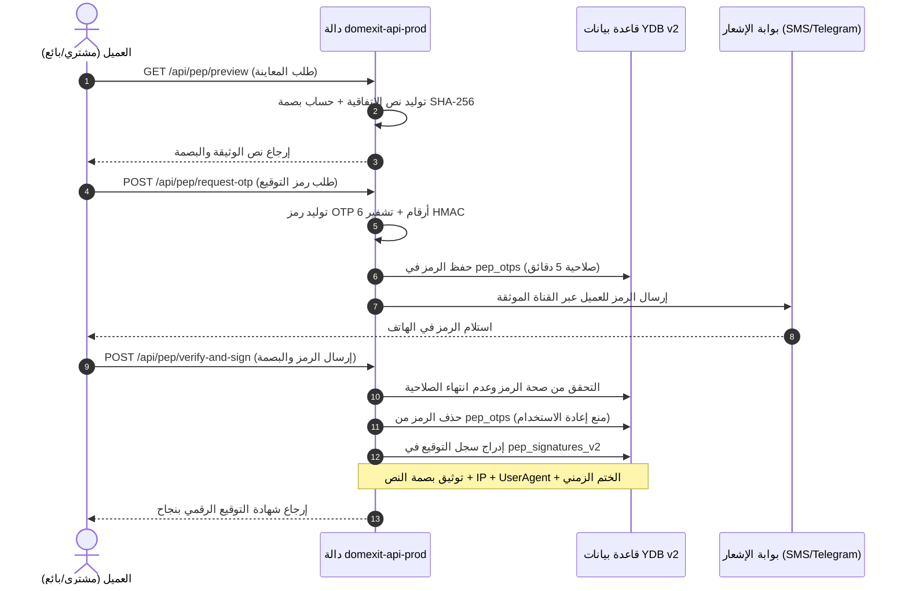

# الفصل الرابع: دوال الخادم Serverless، مسارات API Gateway، التوثيق والأمان

> **النسخة المرجعية:** `v3.0.0-ai-ready` | **البيئة التشغيلية:** الإنتاج الرسمي `https://domexit.ru`  
> **المنطقة السحابية:** `ru-central1` (Yandex Cloud) | **نواة المعالجة:** Yandex Cloud Functions (Node.js 18/20 LTS) & API Gateway

---

## 1. معمارية دوال الخادم غير الخادمية (Serverless Functions Core Runtime)

### 1.1 فلسفة المعمارية عديمة الحالة ومزايا الأداء
تعمل النواة الخلفية لمنصة DomExit داخل بيئة الحوسبة غير الخادمية الموزعة **Yandex Cloud Functions** تحت اسم الدالة الرئيسي **`domexit-api-prod`**، وتتكامل في واجهتها مع **Yandex API Gateway** لتلقي وإعادة توجيه حركة المرور المشفرة بـ SSL/TLS عبر النطاق الرسمي `https://domexit.ru`.

تتميز هذه المعمارية بعدة خيارات هندسية متقدمة:
1. **الاستغناء الكامل عن أطر العمل الثقيلة (`Zero-Express Overhead`):**
   على عكس النظم التقليدية التي تحمل أطر عمل ثقيلة مثل `Express.js` أو `NestJS` بما تحتويه من سلاسل برمجيات وسيطة ومئات التبعيات غير الضرورية، تم تصميم DomExit بـ **موزع أحداث خفيف فائق السرعة (`Native Event Dispatcher`)**. هذا الخيار خفّض زمن الإقلاع البارد للدالة (**Cold Start**) من عدة ثوانٍ إلى **أقل من `140 مللي ثانية`**، مع استهلاك ذاكرة خامل لا يتجاوز `35 MB`.
2. **عزل الحوسبة والحجم الاقتصادي (`Compute Profile & Concurrency`):**
   تُهيأ الدالة بذاكرة تشغيلية قدرها **`512 MB`** ومهلة معالجة قصوى تبلغ **`30 ثانية`**، مع إمكانية التوسع التلقائي إلى **`100 مثيل متزامن (Concurrent Instances)`** لاستيعاب ما يصل إلى `10,000 طلب/دقيقة` دون أي هبوط في الأداء أو زيادة في زمن الاستجابة.
3. **أسبقية حل أسماء النطاقات IPv4 (`IPv4 First DNS Ordering`):**
   تتضمن الأسطر الأولى من نقطة الدخول `backend/src/index.ts` الأمر `dns.setDefaultResultOrder('ipv4first')` لتفادي التأخير الشائع في بيئات Node.js عند محاولة الاتصال عبر IPv6 داخل الشبكات السحابية الخاصة، مما يسرع الاتصال بنقاط نهاية YDB وYandex Object Storage.

---

### 1.2 موزع الأحداث الرئيسي في `backend/src/index.ts`
يمثل التابع `export async function handler(event: YcHttpEvent): Promise<YcHttpResponse>` في `backend/src/index.ts` نقطة الدخول الوحيدة لكافة الطلبات الواردة من بوابة API Gateway:

```typescript
// backend/src/index.ts
export async function handler(event: YcHttpEvent): Promise<YcHttpResponse> {
  const startTime = Date.now();
  const cfg = getConfig();

  // 1. توحيد المسار وإزالة متغيرات البروكسي واستعلامات URL
  let path = event.path || event.url || '';
  if (path.includes('{proxy+}') || path.includes('{') || !path) {
    if (event.params?.proxy) {
      path = `/api/${event.params.proxy}`;
    } else if (event.url) {
      path = event.url;
    }
  }
  if (path.includes('?')) {
    path = path.split('?')[0];
  }

  const method = (event.httpMethod || 'GET').toUpperCase();
  const requestId = event.requestContext?.requestId || event.headers?.['x-request-id'] || `req-${Date.now()}`;

  // 2. معالجة طلبات فحص CORS المسبقة (OPTIONS Preflight) فورياً
  if (method === 'OPTIONS') {
    return handleOptions(event, cfg.PUBLIC_BASE_URL, cfg.APP_ENV, cfg.PROD_CUSTOM_DOMAIN);
  }

  let response: YcHttpResponse;
  try {
    // 3. التوجيه الشجري الدقيق إلى المعالجات الفرعية المتخصصة
    if (path === '/api/health' || path === '/health') {
      response = await handleHealth(event);
    } else if (path.startsWith('/api/auth')) {
      response = await handleAuth(event, path.substring('/api/auth'.length) || '/');
    } else if (path.startsWith('/api/admin')) {
      response = await handleAdmin(event, path.substring('/api/admin'.length) || '/');
    } else if (path.startsWith('/api/storage')) {
      response = await handleStorage(event, path.substring('/api/storage'.length) || '/');
    } else if (path.startsWith('/api/telegram')) {
      response = await handleTelegram(event, path.substring('/api'.length));
    } else if (path.startsWith('/api/messenger')) {
      response = await handleMessenger(event, path.substring('/api/messenger'.length) || '/');
    } else if (path.startsWith('/api/tools')) {
      response = await handleTools(event, path.substring('/api/tools'.length) || '/');
    } else if (path.startsWith('/api/pep')) {
      response = await handlePep(event, path.substring('/api/pep'.length) || '/');
    } else if (path.startsWith('/api/matching')) {
      response = await handleMatching(event, path.substring('/api/matching'.length) || '/');
    } else if (path.startsWith('/api/tier-requests')) {
      response = await handleTierVerification(event, path.substring('/api/tier-requests'.length) || '/');
    } else if (path.startsWith('/api/ai')) {
      response = await handleAiLab(event, path.substring('/api/ai'.length) || '/');
    } else if (path.startsWith('/api/public') || path === '/sitemap.xml') {
      const subPath = path.startsWith('/api/public') ? path.substring('/api/public'.length) || '/' : path;
      response = await handlePublicJournal(event, subPath);
    } else if (path.startsWith('/api/legal-core/v1')) {
      response = await handleLegalCoreV1(event, path.substring('/api/legal-core/v1'.length) || '/');
    } else if (path.startsWith('/api/data')) {
      response = await handleData(event, path.substring('/api'.length));
    } else {
      response = json(event, 404, { error: 'Not Found', path, method });
    }

    // 4. تسجيل تتبع الوصول المنظم والمدة الزمنية
    const durationMs = Date.now() - startTime;
    logger.info(`${method} ${path} -> ${response.statusCode}`, {
      event: 'HTTP_ACCESS', method, path, statusCode: response.statusCode, durationMs, requestId,
    });
    return response;
  } catch (err: any) {
    // 5. درع حماية الأخطاء العامة غير المعالجة (Global Exception Shield)
    const durationMs = Date.now() - startTime;
    logger.error(`[UnhandledError] ${method} ${path}: ${err.message}`, {
      method, path, statusCode: 500, durationMs, requestId, meta: { error: err.message, stack: err.stack }
    });
    return json(event, 500, {
      error: 'Internal Server Error',
      message: cfg.APP_ENV === 'staging' ? err.message : 'Произошла непредвиденная ошибка на сервере',
    });
  }
}
```

---

### 1.3 معمارية مواصفة Yandex API Gateway وتكاملات Proxy
تعتمد منصة DomExit بوابة **Yandex API Gateway** كحائط صد أمامي ومنسق لمسارات الويب. يُعرّف ملف التهيئة `infrastructure/apigw/openapi.yaml` هيكل الربط السحابي:
1. **مسار البروكسي الشامل (`/api/{proxy+}`):**
   يُوجَّه أي طلب يبدأ بـ `/api/` إلى دالة `domexit-api-prod` عبر الامتداد السحابي الخاص:
   ```yaml
   x-yc-apigateway-integration:
     type: cloud_functions
     function_id: ${FUNCTION_ID}
     tag: "$latest"
     service_account_id: ${SERVICE_ACCOUNT_ID}
   ```
2. **الربط المباشر مع واجهة الويب (`Static Hosting Integration`):**
   المسارات الجذرية التي لا تبدأ بـ `/api/` تُوجَّه مباشرة إلى دلو تخزين الواجهة الأمامية `domexit-public-web-prod` باستخدام التكامل `type: object_storage`، مما يمنح الواجهة أقصى سرعة تحميل وتكلفة قريبة من الصفر دون تشغيل دالة الخادم.
3. **تكامل CORS والتحقق من النطاقات المسموحة:**
   تتيح دالة `handleOptions` الوصول للنطاقات المعتمدة فقط:
   - `https://domexit.ru` و `https://www.domexit.ru` (الإنتاج)
   - `https://staging.domexit.ru` (بيئة الاختبار)
   - `http://localhost:5173` (بيئة التطوير المحلية المحددة بدقة عند تشغيل `APP_ENV === 'staging'`).

---

## 2. منظومة التوثيق والهوية والجلسات (Authentication & Identity Subsystem)

### 2.1 تدفق المصادقة عبر بوابة Yandex ID OAuth 2.0
توفر المنصة تجربة تسجيل دخول سلسة للمواطنين الروس عبر **Yandex ID OAuth 2.0** بامتثال كامل لضوابط الهوية الروسية:
1. **بدء المصادقة (`GET /api/auth/yandex/start`):**
   - تقوم الدالة بتوليد قيمة عشوائية مشفرة للحالة (`oauth_state`) عبر `crypto.randomBytes(24).toString('hex')`.
   - تُحفظ هذه القيمة في كوكي آمنة ومحمية: `domexit_oauth_state=<state>; HttpOnly; Secure; SameSite=Lax; Path=/api/auth/yandex; Max-Age=600`.
   - يُعاد توجيه العميل بـ `HTTP 302` إلى بوابة ياندكس: `https://oauth.yandex.ru/authorize?response_type=code&client_id=<ID>&redirect_uri=<CALLBACK>&state=<STATE>`.
2. **استقبال الرمز وإتمام الدخول (`GET /api/auth/yandex/callback`):**
   - يتم التحقق الصارم من تطابق معامل `state` في الرابط مع قيمة كوكي `domexit_oauth_state` لمنع هجمات تزوير الطلبات عبر المواقع (`CSRF Attacks`).
   - استبدال رمز التفويض (`authorization_code`) برمز وصول (`access_token`) عبر طلب خلفي إلى `https://oauth.yandex.ru/token`.
   - جلب بيانات الملف الشخصي المعتمدة من `https://login.yandex.ru/info?format=json` (الاسم الكامل، البريد الإلكتروني الافتراضي، الهاتف الموثق، ومعرف الصورة الشخصية `default_avatar_id`).
   - البحث في جدول `users_v2` عبر الفهرس `email-index`. إذا لم يكن الحساب موجوداً، يتم إنشاؤه تلقائياً برتبة **`Bronze Standard`** ودور **`client`**، وتثبيت مزود التوثيق `authProviders: ['yandex']`.
   - إصدار توكن الجلسة المشفر وحقنه في كوكي `domexit_session` ثم إعادة التوجيه إلى لوحة التحكم الخاصة بالمستخدم.

---

### 2.2 التوثيق المحلي وحماية كلمات المرور بخوارزمية `scrypt`
في حال استخدام البريد الإلكتروني وكلمة المرور المحلية، تطبق المنصة أعلى معايير التشفير المقاومة للاختراق بواسطة معالجات الجرافيكس الموازية (`GPU-Resistant`):
- **توليد الملح المشفر:** يُولد ملح فريد بطول 16 بايت لكل كلمة مرور: `crypto.randomBytes(16)`.
- **دالة الاشتقاق `scrypt`:** تُشتق كلمة المرور بطول 64 بايت باستخدام المعاملات الموصى بها تشفيرياً (`N = 16384`, `r = 8`, `p = 1`):
  $$\text{DerivedKey} = \text{scrypt}(\text{password}, \text{salt}, 64, \{ N: 16384, r: 8, p: 1 \})$$
- **المقارنة الزمنية الثابتة (`Constant-Time Verification`):**
  تُقارن بصمات كلمات المرور المشفرة باستخدام `crypto.timingSafeEqual(derivedKey, expectedKey)`، مما يلغي تماماً ثغرات الهجمات المعتمدة على الفروق الزمنية في التحليل (`Side-Channel Timing Attacks`).

---

### 2.3 معمارية توكن الجلسة (Stateless JWT) والنقل المزدوج
يتبع توكن الجلسة مواصفة JSON Web Token الموقعة بخوارزمية `HMAC-SHA256`:

```
┌─────────────────────────────────┐
│        JWT Header (HS256)       │
├─────────────────────────────────┤
│ Payload:                        │
│   userId: string                │
│   email: string                 │
│   role: 'owner'|'employee'|...  │
│   tv: number (tokenVersion)     │
│   iat: number, exp: +7 days     │
├─────────────────────────────────┤
│ Signature: HMAC-SHA256(Secret)  │
└─────────────────────────────────┘
```

#### قنوات النقل المزدوجة الآمنة:
1. **كوكي الجلسة الآمنة (`HttpOnly Cookie`):**
   تُرسل المنصة ترويسة `Set-Cookie: domexit_session=<token>; HttpOnly; Secure; SameSite=Lax; Path=/; Max-Age=604800`. منع وصول جافاسكريبت المتصفح إلى الكوكي (`HttpOnly`) يحمي الجلسة تماماً من سرقة التوكن في حال حدوث أي ثغرة XSS فرعية في واجهة المستخدم.
2. **الترويسة الصريحة (`Authorization: Bearer <token>`):**
   تدعم المنصة الترويسة الصريحة لخدمة تطبيقات الأجهزة الذكية، وتكاملات API، وبوت Telegram OS.
3. **آلية الإبطال الفوري عبر `tokenVersion` (`Instant Revocation`):**
   تحتوي حمولة التوكن على حقل `tv` (إصدار التوكن). عند تسجيل الخروج من كافة الأجهزة، أو تغيير كلمة المرور، أو تجميد الحساب، يتم رفع قيمة `tokenVersion` للمستخدم في جدول `users_v2`. عند وصول أي طلب لاحق، تقارن دالة `getAuthenticatedUser` بين `payload.tv` والنسخة المخزنة؛ فإذا اختلفا، يُلغى الطلب فوراً ويُعتبر التوكن باطلاً، مما يحل معضلة التوكنات عديمة الحالة دون الحاجة لخادم جلسات مركزي (`Redis Session Store`).

---

## 3. حراس الأمان والرقابة الصارمة ومصفوفة RBAC

### 3.1 مصفوفة الأدوار الأربعة والصلاحيات الميدانية
تتوزع الصلاحيات داخل المنصة بدقة بالغة وفق مصفوفة التحكم في الوصول المبني على الأدوار (`RBAC`):

| الدور (`Role`) | نطاق الصلاحية والمسؤولية | إمكانية الوصول للبيانات والمسارات |
|:---|:---|:---|
| **`owner` (المالك)** | الإشراف السيادي، القرارات المالية، التحكم في ميزات `AI Lab`، وتعيين الموظفين. | وصول غير مقيد لكافة الجداول، سجلات التدقيق، تصدير التقارير، والتحكم بالنسخ الاحتياطي. |
| **`employee` (المشرف / الوسيط)** | فحص اللوتات، تدقيق العقود، إدارة طابور المشترين، ومرافقة أطراف الصفقة في غرفة الإغلاق. | وصول مقيد حصراً باللوتات والصفقات المسندة إليه (`assignedCuratorId`) دون رؤية لوتات زملائه. |
| **`client` (العميل: بائع أو مشتري)** | طرح الشقق للبيع، ضبط رغبات الشراء (`Buy-Box`)، التنافس في الطوابير، والتوقيع بـ `ПЭП`. | وصول معزول كلياً لبياناته الخاصة وصفقاته المعتمدة؛ ممنوع تماماً من رؤية عروض وقوائم العملاء الآخرين. |
| **`partner` (الوكيل العقاري المعتمد)** | إحالة البائعين والمشترين والحصول على عمولات وساطة بنكية. | استعراض حالة العملاء المحالين عبر كود الإحالة الخاص به (`partnerRefCode`) فقط. |

---

### 3.2 حراس الأمان الصارمون في طبقة المعالجة

#### 1. حارس عزل المشرفين (`Curator Scoping Guard`):
ينفذ الكود في `backend/src/lib/rbac.ts` فحصاً شرطياً إجبارياً: إذا كان المستخدم بمرتبة `employee`، يُمنع منعاً باتاً من تعديل أو جلب وثائق أو قراءة رسائل لوت أو صفقة ما لم يكن `assignedCuratorId === authUser.id`. هذا المبدأ يحمي المنافسة الشريفة بين الوسطاء ويمنع تسريب تفاصيل الصفقات الداخلية.

```typescript
// backend/src/lib/rbac.ts
export function isEmployeeAssignedToRecord(authUser: UserProfile | null, record: any): boolean {
  if (!authUser) return false;
  if (authUser.role === 'owner') return true;
  if (authUser.role !== 'employee') return false;
  const staffId = authUser.assignedEmployeeId || authUser.id;
  return (
    record.assignedCuratorId === staffId ||
    record.assignedEmployeeId === staffId ||
    record.curatorId === staffId
  );
}
```

#### 2. بوابة التدقيق القانوني الإجبارية (`assertStrictLegalAuditGate`):
لا يمكن لأي مشرف أو بائع نقل لوت من مسودة (`draft`) إلى مرحلة النشر العام (`available`)، أو تفعيل مرحلة المطابقة وإسقاط العربون، إلا إذا كانت حالة الفحص القانوني `isVerified === true` ومحاور التدقيق الخمسة مكتملة وموقعة برقم عقد `ДДУ` سليم وبراءة ذمة من بنك الإسكرو.

#### 3. كوتة طلبات الشراء المقيدة (`Max 3 Active Applications Cap`):
تفرض دالة `handleMatching` في `backend/src/routes/matching.ts` حداً أقصى لا يتجاوز **`3 طلبات شراء نشطة`** لكل مستثمر في نفس اللحظة:
```typescript
const activeApps = await ydb.queryAllByIndex({
  tableName: 'buyer_applications',
  indexName: 'userId-createdAt-index',
  hashKey: 'userId',
  hashValue: authUser.id,
});
const activeCount = activeApps.filter(app => ACTIVE_APPLICATION_STATUSES.has(app.status)).length;
if (activeCount >= 3) {
  return json(event, 400, {
    error: 'Достигнут лимит активных заявок (максимум 3). Дождитесь завершения или отзовите текущую заявку.',
  });
}
```
يمنع هذا الحاجز سماسرة السوق والمضاربين من حجز عشرات العروض المميزة وتعطيل البائعين الجادين، ويجبر المشتري على توجيه موارده نحو الصفقات التي ينوي إغلاقها فعلياً.

#### 4. حاجز الخصوصية والامتثال لقانون `152-ФЗ` (`Privacy Redaction Barrier`):
دالة `sanitizeLotForPublic` في `backend/src/routes/data.ts` تحذف تلقائياً من أي استجابة موجهة للجمهور أو المشترين غير الفائزين:
- رقم هاتف البائع (`sellerPhone`)
- بريده الإلكتروني (`sellerEmail`)
- رقمه الضريبي الشخصي (`sellerInn`)
- رقم الشقة المحدد (`apartmentNumber`)
- صور وثائق الهوية ومستندات الملكية الأولية غير المطهرة.

#### 5. كاشف الأنماط الخبيثة وحقن الشفرات (`detectMaliciousPatterns`):
يفحص كل كائن JSON وارد بحثاً عن هجمات XSS وحقن قواعد البيانات عبر مصفوفة تعابير نمطية صارمة:
```typescript
const MALICIOUS_PATTERNS = [
  /<script\b[^>]*>/i, /<\/script>/i, /javascript:/i,
  /onerror\s*=/i, /onload\s*=/i, /<iframe\b[^>]*>/i,
  /;\s*DROP\s+TABLE/i, /UNION\s+SELECT/i, /--\s*$/m, /\bexec\s*\(/i,
];
```
يفحص الكاشف المفاتيح والقيم تعاودياً (`Recursively`)، ويرفض الطلب فوراً برمز `400 Bad Request` مع تسجيل الحادث في جدول سجلات الأمان.

#### 6. كاشف تسريب أرقام الهواتف والروابط في المحادثات (`detectContactLeakInChat`):
يراقب نصوص رسائل غرفة الإغلاق ويمنع تمرير أرقام الهواتف المحمولة الروسية، أو روابط التيليجرام والواتساب الخارجية، لضمان بقاء المفاوضات موثقة داخل المنصة وحماية أطراف الصفقة من الاحتيال المالي المباشر:
- يفحص الروابط الخارجية: `t.me`, `telegram.me`, `wa.me`, `whatsapp.com`, `vk.com`.
- يفحص معرّفات التليجرام غير الرسمية: `@handle` (باستثناء قنوات المنصة الرسمية `@domexit*`).
- يفحص أرقام الهواتف الروسية بجميع الصيغ (+79XX, 89XX, 79XXXXXXXXX, 9XX-XXX-XX-XX) مع مراعاة عدم إطلاق إنذارات خاطئة على أسعار العقارات أو أرقام عقود الددو.

#### 7. كاشف التلاعب بالصلاحيات والإسناد الجماعي (`checkPrivilegeTampering`):
يمنع المستخدم العادي من حقن حقول سيادية في جسم الطلب مثل: `role`, `roles`, `isApproved`, `tier`, `assignedCuratorId`, `commissionPaid`, `payoutStatus`, `legalStatus`.

#### 8. التحقق الرياضي الصارم من الأرقام الضريبية الروسية (`validateRussianInn`):
تطبق المنصة خوارزمية فحص البصمة الرياضية الرسمية الصادرة عن مصلحة الضرائب الفيدرالية الروسية (`ФНС РФ`) للأرقام المكونة من 10 أرقام (للشركات) أو 12 رقماً (للأفراد ورواد الأعمال):
- **بالنسبة للكيانات القانونية (10 أرقام):**
  تُضرب الأرقام التسعة الأولى بأوزان فحص محددة:
  $$W_{10} = [2, 4, 10, 3, 5, 9, 4, 6, 8]$$
  ويُحسب الرقم العاشر التفقدي وفق المعادلة:
  $$\text{CheckDigit} = \left(\sum_{i=0}^{8} W_{10}[i] \times D[i] \pmod{11}\right) \pmod{10}$$
- **بالنسبة للأفراد ورواد الأعمال (12 رقماً):**
  يُحسب الرقمان 11 و12 بمجموعتي أوزان منفصلتين:
  $$W_{11} = [7, 2, 4, 10, 3, 5, 9, 4, 6, 8]$$
  $$W_{12} = [3, 7, 2, 4, 10, 3, 5, 9, 4, 6, 8]$$
  $$\text{Check11} = \left(\sum_{i=0}^{9} W_{11}[i] \times D[i] \pmod{11}\right) \pmod{10}$$
  $$\text{Check12} = \left(\sum_{i=0}^{10} W_{12}[i] \times D[i] \pmod{11}\right) \pmod{10}$$
  إذا فشل أي رقم تفقدي في المطابقة، يُرفض الرقم الضريبي فوراً دون استهلاك استعلام مدفوع من DaData.

---

## 4. الفهرس والكتالوج المرجعي الشامل لجميع مسارات الـ API

فيما يلي التوثيق الشامل والكامل لكافة مسارات الـ API في المنصة عبر ملفات المسارات الـ 14 في `backend/src/routes/`:

---

### 4.1 مسارات التوثيق والهوية: `routes/auth.ts`
تتعامل مع تسجيل المستخدمين، التحقق من كلمات المرور، التوثيق عبر Yandex OAuth، وإدارة الجلسات:

1. **`POST /api/auth/register`**
   - **الوصول:** عام (`Public`).
   - **الحمولة (`Body`):**
     ```json
     {
       "email": "investor@domain.ru",
       "password": "StrongPassword123!",
       "name": "Иван Иванович Иванов",
       "phone": "+7 (999) 123-45-67",
       "role": "client"
     }
     ```
   - **المعالجة:** تطهير البريد الإلكتروني، التحقق من قوة كلمة المرور، التحقق من عدم وجود البريد عبر `email-index`، تشفير كلمة المرور بـ `scrypt`، إنشاء المستخدم في `users_v2` برتبة `bronze_standard`، إصدار توكن الجلسة وحقنه في كوكي `domexit_session`.
   - **الاستجابة:** `200 OK` `{ user: UserProfile, token: string }` أو `400 Bad Request` عند وجود خطأ في البيانات.
2. **`POST /api/auth/login`**
   - **الوصول:** عام (يخضع لـ `checkLoginRateLimit`: 5 محاولات فاشلة لكل 5 دقائق لكل IP أو بريد).
   - **الحمولة:** `{ email, password }` أو `{ login, password }`.
   - **المعالجة:** استرجاع السجل من `users_v2`، التحقق من الحساب المجمد (`isBlocked`)، مطابقة كلمة المرور بـ `verifyPassword` والمقارنة الزمنية الثابتة، تصفير عداد المحاولات الفاشلة، وتحديث الجلسة.
   - **الاستجابة:** `200 OK` `{ user: UserProfile, token: string }` أو `401 Unauthorized` أو `429 Too Many Requests`.
3. **`GET /api/auth/me`**
   - **الوصول:** مسجل دخول (`Authenticated`).
   - **المعالجة:** قراءة التوكن من الكوكي أو الترويسة، التحقق من الذاكرة المؤقتة `auth:user:${userId}`، والتأكد من مطابقة `tokenVersion`.
   - **الاستجابة:** `200 OK` `{ user: UserProfile }` أو `401 Unauthorized`.
4. **`PATCH /api/auth/profile`**
   - **الوصول:** مسجل دخول.
   - **الحمولة:** `{ name?, phone?, telegramChatId? }`.
   - **المعالجة:** تطهير المدخلات، تحديث الحساب في `users_v2`، وإبطال الكاش فورياً بـ `invalidateAuthUserCache`.
   - **الاستجابة:** `200 OK` `{ user: UserProfile }`.
5. **`POST /api/auth/switch-role`**
   - **الوصول:** مسجل دخول يمتلك أكثر من دور في مصفوفة `roles`.
   - **الحمولة:** `{ targetRole: 'client' | 'partner' | 'employee' }`.
   - **المعالجة:** التحقق من أحقية المستخدم للدور، تبديل `activeRole`، وتوليد توكن JWT جديد بالدور المحدث.
   - **الاستجابة:** `200 OK` `{ user: UserProfile, token: string }`.
6. **`POST /api/auth/set-password`** و **`POST /api/auth/change-password`**
   - **الوصول:** مسجل دخول.
   - **الحمولة:** `{ oldPassword?, newPassword }`.
   - **المعالجة:** تشفير كلمة المرور الجديدة، زيادة عداد `tokenVersion += 1` لإلغاء كافة الجلسات المفتوحة على الأجهزة الأخرى.
   - **الاستجابة:** `200 OK` `{ success: true }`.
7. **`POST /api/auth/forgot-password`** و **`POST /api/auth/reset-password`**
   - **الوصول:** عام.
   - **المعالجة:** إرسال رمز استعادة الحساب المؤقت بالبريد المشفر، وإعادة تعيين كلمة المرور مع تحديث `tokenVersion`.
8. **`POST /api/auth/logout`**
   - **الوصول:** عام.
   - **المعالجة:** مسح كوكي `domexit_session` عبر إرجاع ترويسة مسح ذات صلاحية منتهية `Max-Age=0`.
   - **الاستجابة:** `200 OK` `{ success: true }`.
9. **`GET /api/auth/yandex/start`** و **`GET /api/auth/yandex/callback`**
   - **الوصول:** عام.
   - **المعالجة:** تنفيذ دورة OAuth 2.0 الكاملة مع Yandex ID كما تم تفصيلها في القسم 2.1.

---

### 4.2 مسار معالجة البيانات المعمم: `routes/data.ts`
بوابة الوصول الموحدة لقراءة وتعديل جداول المنصة الـ 24 مع تطبيق كامل لصلاحيات RBAC وحراس الأمان:

1. **`GET /api/data/:collection`**
   - **الوصول:** بحسب تصنيف الجدول (`PUBLIC_COLLECTIONS`, `STAFF_COLLECTIONS`, `CLIENT_ISOLATED_COLLECTIONS`, `OWNER_ONLY_COLLECTIONS`).
   - **معاملات الرابط (`Query Params`):**
     - `cursor`: مؤشر الترقيم التراكمي المشفر بـ Base64URL.
     - `limit`: عدد السجلات بالصفحة (افتراضياً 25، الحد الأقصى 100).
     - `status`, `role`, `assignedCuratorId`, `developerId`: فلاتر موجهة تستغل الفهارس الثانوية العالمية GSIs تلقائياً عبر `queryByIndex`.
   - **المعالجة:** التحقق من صلاحية المستخدم على الجدول؛ في حال كان الجدول `lots`، تمرر السجلات عبر `sanitizeLotForPublic` لحجب بيانات البائع الخاصة بموجب `152-ФЗ`.
   - **الاستجابة:** `200 OK` `{ items: any[], nextCursor: string | null, total?: number }`.
2. **`GET /api/data/:collection/:id`**
   - **الوصول:** خاضع للحراسة.
   - **المعالجة:** استدعاء `ydb.getItem(collection, id)` السريع بالمفتاح الأساسي. في جدول `users`، تُحذف كلمة المرور `passwordHash` قسرياً.
   - **الاستجابة:** `200 OK` `{ item: any }` أو `404 Not Found`.
3. **`POST /api/data/:collection`**
   - **الوصول:** مقيد بالدور (الجداول السيادية محصورة بـ `owner` أو `employee`، بينما استمارات البائعين وطلبات الشراء متاحة للمستخدمين المصرحين).
   - **الحمولة:** كائن السجل المكتمل.
   - **المعالجة:** فحص الحجم (< 256 KB)، فحص الأنماط الخبيثة، منع التلاعب بالصلاحيات، تمرير السجل عبر `sanitizeItemForV2` لحقن المعرفات والقيم الافتراضية، ثم إدراجه بـ `ydb.putItem`.
   - **الاستجابة:** `200 OK` `{ item: any, success: true }`.
4. **`PUT /api/data/:collection/:id`**
   - **الوصول:** يتطلب التحقق من ملكية السجل (`Owner / Assigned Curator / Self Client`).
   - **المعالجة:** دمج التعديلات، منع تعديل الحقول السيادية، إعادة التحقق من قواعد الأعمال، وحفظ السجل.
   - **الاستجابة:** `200 OK` `{ item: any, success: true }`.
5. **`DELETE /api/data/:collection/:id`**
   - **الوصول:** مقيد بـ `owner` أو المشرف المسؤول وفق شروط مقيدة.
   - **الاستجابة:** `200 OK` `{ success: true }`.
6. **`DELETE /api/lots/:lotCode/cascade`**
   - **الوصول:** المالك (`owner`) حصراً.
   - **المعالجة:** حذف متسلسل كامل للوت، وكافة مستنداته المرتبطة في `documents_vault_v2`، ومسح ملفاته من دلو S3 الخاص والعام، وإلغاء مهام الـ OCR والتحليلات القانونية التابعة له.

---

### 4.3 مسارات المطابقة الاستثمارية ورادارات الطلب: `routes/matching.ts`
محرك التنافس على الصفقات وخوارزميات المطابقة وإدارة الطوابير والسحب الآلي:

1. **`GET /api/matching/demand-radar`**
   - **الوصول:** المشرفون والمالك (`staff`).
   - **المعالجة:** تحليل رغبات الشراء النشطة في `buy_boxes_v2` ورسم خريطة الطلب الاستثماري الحقيقي حسب المدن والميزانيات لدعم قرارات تسعير اللوتات الجديدة.
2. **`GET /api/matching/my-buy-box`** و **`POST/PUT /api/matching/my-buy-box`**
   - **الوصول:** المستثمر المسجل.
   - **الحمولة عند التحديث:**
     ```json
     {
       "targetCities": ["Москва", "Санкт-Петербург"],
       "roomsPreferences": [1, 2],
       "maxPriceRub": 18500000,
       "minDiscountPercent": 12,
       "paymentMethod": "cash_full"
     }
     ```
   - **المعالجة:** جلب وتحديث معايير الشراء الخاصة بالمستثمر ومزامنة رتبته ومؤشر التزامه (`Reliability Score`).
3. **`GET /api/matching/my-applications`**
   - **الوصول:** المستثمر المسجل.
   - **المعالجة:** استرجاع كافة طلبات الشراء التي تقدم بها المستثمر، وتوضيح موقعه في قائمة الانتظار، وحساب المتبقي من كوتة الـ 3 خانات.
4. **`GET /api/matching/my-matches`**
   - **الوصول:** المستثمر المسجل.
   - **المعالجة:** مقارنة لوتات المنصة المتاحة بملف `Buy-Box` الخاص بالعميل وعرض الفرص التي تحقق نسبة مطابقة تتجاوز 70%.
5. **`POST /api/matching/drops/:lotCode/apply`**
   - **الوصول:** المستثمر المعتمد.
   - **الحمولة:**
     ```json
     {
       "paymentMethod": "cash_full",
       "proofDocumentId": "doc-vault-uuid-771"
     }
     ```
   - **المعالجة الصارمة:**
     - فحص كوتة الـ 3 خانات: رفض الطلب برمز `400` إذا كان لدى المشتري 3 طلبات نشطة بالفعل.
     - فحص منع الشراء الذاتي: منع بائع اللوت من التقديم على شقته.
     - حساب درجات المطابقة والإغلاق عبر `computeMatchScore` و`computeClosingScore`.
     - إدراج الطلب في طابور `buyer_applications_v2` بالحالة المناسبة (`queued` أو `priority_waitlist`).
     - إرسال إشعار فوري للمشرف عبر تيليجرام.
   - **الاستجابة:** `200 OK` `{ application: BuyerApplicationV2Record, success: true }`.
6. **`GET /api/matching/drops/:lotCode/queue`**
   - **الوصول:** المشرف والمالك.
   - **المعالجة:** جلب طابور المتنافسين على اللوت مصنفين وفق نقاط الجدارة والرتبة وتاريخ التقديم.
7. **`POST /api/matching/applications/:id/select-winner`**
   - **الوصول:** المشرف والمالك.
   - **المعالجة:** اختيار المشتري الفائز بالصفقة، نقل حالة طلبه إلى `selected_winner`، تفعيل مهلة الـ SLA المحددة بـ 24 ساعة، وإشعار المشتري فورياً.
8. **`POST /api/matching/applications/:id/withdraw`**
   - **الوصول:** صاحب الطلب.
   - **المعالجة:** انسحاب المشتري؛ إذا تم الانسحاب بعد اختياره فائزاً، يخصم النظام تلقائياً **`15 نقطة`** من مؤشر التزامه (`reliabilityScore`) لمنع التلاعب.
9. **`POST /api/matching/run-sla-sweep`**
   - **الوصول:** استدعاء مجدول ومحمي (`Cron Trigger / Owner`).
   - **المعالجة:** تشغيل محرك `runSlaSweep` لفحص المواعيد المنتهية للطلبات الفائزة التي لم يستجب أصحابها، وإلغاء فوزهم تلقائياً، وتصعيد المؤهل التالي في قائمة الانتظار.
10. **`POST /api/matching/deals/:id/finalize`**
    - **الوصول:** المشرف والمالك.
    - **المعالجة:** اعتماد إتمام الصفقة، صرف العمولات، ونقل اللوت إلى حالة `sold`.

---

### 4.4 مسارات تخزين المستندات والروابط الموقعة: `routes/storage.ts`
تأمين رفع وتحميل الوثائق الرسمية الحساسة والصور:

1. **`POST /api/storage/presign-upload`**
   - **الوصول:** مسجل دخول (يخضع لكوتة رفع الملفات: 30 ملف/ساعة للمستخدم، 200 للموظف).
   - **الحمولة:**
     ```json
     {
       "fileName": "ddu_contract_scan.pdf",
       "mimeType": "application/pdf",
       "fileSizeBytes": 8452100,
       "category": "private_docs",
       "lotCode": "LOT-4019-MSK"
     }
     ```
   - **المعالجة:**
     - فحص الامتدادات وأنواع MIME المسموحة بدقة: الصور (`webp`, `jpeg`, `png` بحد أقصى `15 MB`)، الوثائق الرسمية (`pdf`, `docx`, `jpeg`, `png` بحد أقصى `25 MB`).
     - تطهير اسم الملف من أي رموز مشبوهة (`sanitizeFileName`).
     - توليد رابط رفع موقع مسبقاً بخوارزمية SigV4 عبر `createPresignedUploadUrl` صالح لمدة **`15 دقيقة فقط`** ومقيد بنوع المحتوى وحجمه.
   - **الاستجابة:**
     ```json
     {
       "uploadUrl": "https://domexit-private-docs-prod.storage.yandexcloud.net/lots/LOT-4019-MSK/ddu_contract_scan.pdf?X-Amz-Algorithm=...",
       "fileKey": "lots/LOT-4019-MSK/ddu_contract_scan.pdf"
     }
     ```
2. **`GET /api/storage/presign-download`**
   - **الوصول:** خاضع للحراسة الصارمة والتحقق من ملكية المستند.
   - **معامل الرابط:** `key=lots/LOT-4019-MSK/ddu_contract_scan.pdf`.
   - **المعالجة:** توليد رابط تحميل مؤقت موقع من الدلو الخاص `domexit-private-docs-prod` صالح لمدة **`30 دقيقة فقط`**، مع منع الوصول لغير المشرف المعين أو صاحب المستند.
   - **الاستجابة:** `200 OK` `{ downloadUrl: string, expiresAt: string }`.

---

### 4.5 مسارات التوقيع الإلكتروني البسيط: `routes/pep.ts`
توثيق التواقيع الإلكترونية القانونية بامتثال لـ `63-ФЗ`:

1. **`GET /api/pep/preview`**
   - **الوصول:** مسجل دخول.
   - **معاملات الرابط:** `documentType=agency_agreement&lotCode=LOT-4019-MSK`.
   - **المعالجة:** توليد النص القانوني الكامل للوثيقة مدمجاً به الاسم الرباعي للعميل، ورقم هاتفه، وتفاصيل اللوت، وفحص ما إذا كانت الوثيقة قد وُقِّعت مسبقاً.
   - **الاستجابة:** `200 OK` `{ documentText: string, sha256Hash: string, alreadySigned: boolean }`.
2. **`POST /api/pep/request-otp`**
   - **الوصول:** مسجل دخول.
   - **الحمولة:** `{ documentType: 'agency_agreement', lotCode: 'LOT-4019-MSK' }`.
   - **المعالجة:** توليد رمز OTP عشوائي من 6 أرقام، وتشفيره في جدول `pep_otps` بصلاحية 5 دقائق، وإرساله عبر تيليجرام أو رسالة SMS لهاتف المستخدم.
   - **الاستجابة:** `200 OK` `{ sent: true, expiresSeconds: 300 }`.
3. **`POST /api/pep/verify-and-sign`**
   - **الوصول:** مسجل دخول.
   - **الحمولة:**
     ```json
     {
       "documentType": "agency_agreement",
       "lotCode": "LOT-4019-MSK",
       "otpCode": "849201",
       "documentTextSha256": "e3b0c44298fc1c149afbf4c8996fb92427ae41e4649b934ca495991b7852b855"
     }
     ```
   - **المعالجة:** التحقق من مطابقة الرمز وعدم انقضاء صلاحيته، تسجيل وثيقة التوقيع غير القابلة للتعديل في `pep_signatures_v2` متضمنة بصمة النص، وعنوان IP، وتفاصيل المتصفح، والختم الزمني المشفر.
   - **الاستجابة:** `200 OK` `{ signed: true, signatureId: "pep-sig-992", timestamp: "2026-11-27T10:14:00Z" }`.
4. **`GET /api/pep/my-signatures`**
   - **الوصول:** مسجل دخول.
   - **المعالجة:** استعراض كافة السجلات الموقعة إلكترونياً للمستخدم عبر الفهرس `userId-signedAt-index`.

---

### 4.6 مسارات طلبات ترقية الرتب: `routes/tierVerification.ts`
إدارة ترقيات المستثمرين إلى الرتب الذهبية والفضية:
- **`GET /api/tier-requests/my`:** استعلام المشتري عن حالة طلبه ووثائق اعتماده.
- **`GET /api/tier-requests`:** قائمة طلبات الاعتماد المفتوحة للمشرفين.
- **`POST /api/tier-requests`:** رفع طلب ترقية جديد مرفقاً بمستند الملاءة المالية أو كشف الحساب البنكي.
- **`GET /api/tier-requests/:id/document`:** استعراض المستند المرفق بطلب الترقية من قبل المشرف المعتمد.
- **`POST /api/tier-requests/:id/decision`:** اعتماد أو رفض الترقية من المشرف مع إبداء الملاحظات القانونية وتحديث رتبة المستخدم في `users_v2`.

---

### 4.7 مسارات أدوات السجلات الحكومية: `routes/tools.ts`
- **`GET /api/tools/inn-lookup?inn=...`:** التحقق الرياضي من صحة الرقم الضريبي الروسي `ИНН` عبر `validateRussianInn` ثم استعلام بيانات الشركة أو المطور عبر DaData مع التخزين المؤقت لـ 24 ساعة.
- **`POST /api/tools/clean-address`:** توحيد صيغة العنوان العقاري واستخراج إحداثيات خط الطول والعرض والرمز البريدي ومحطة المترو الأقرب.

---

### 4.8 مسارات بوت تيليجرام: `routes/telegram.ts`
تغطي العمليات التفاعلية مع منصة Telegram عبر 8 إجراءات مركزية:
1. **`POST /api/telegram`:** نقطة استقبال الـ Webhook العام لبوت المنصة الرسمي (`Telegram OS Bot`)، ومعالجة ضغطات الأزرار الشفافة (`Inline Keyboards`)، واستعراض العروض، وأوامر `/start`, `/lots`, `/status`.
2. **`GET /api/telegram/status`:** التحقق من حالة ربط حساب المستخدم الحالي بالتيليجرام.
3. **`POST /api/telegram/link-token`:** توليد رمز ربط حساب مشفر صالح لمدة 15 دقيقة يتيح للمستخدم النقر على رابط `t.me/DomExitBot?start=LINK_<TOKEN>` لربط حسابه.
4. **`POST /api/telegram/unlink`:** إلغاء ربط حساب تيليجرام وحذف معرف المحادثة من `users_v2`.
5. **`POST /api/telegram/preferences`:** تعديل تفضيلات التنبيهات (عروض جديدة، تقدم الصفقات، رسائل غرفة الإغلاق).
6. **`POST /api/telegram/assign`:** إسناد مهمة معالجة لوت أو صفقة لمشرف معين وإخطاره عبر تيليجرام.
7. **`POST /api/telegram/stage`:** إرسال تحديث رسمي عن تقدم مرحلة اللوت للبائع أو المشتري.
8. **`POST /api/telegram/test`:** إرسال رسالة اختبارية للتأكد من وصول الإشعارات.

---

### 4.9 مسارات مختبر الذكاء الاصطناعي: `routes/aiLab.ts`
إدارة وتشغيل ميزات الذكاء الاصطناعي السيادي المقفلة خلف مفاتيح `aiFeatureFlags`:
- **`GET/PUT /api/ai/config`:** قراءة وتعديل إعدادات ميزات الذكاء الاصطناعي (مفعلة، محصورة بالمالك `owner_only`، أو متاحة لبيتا).
- **`POST /api/ai/cbr/sync`:** المزامنة الحية لأسعار الفائدة الرئيسية الصادرة عن البنك المركزي الروسي (`ЦБ РФ`) وتخزينها في `market_settings`.
- **`POST /api/ai/agent-bridge/tasks`:** إنشاء مهمة استخبارات سوقية موجهة لوكلاء البحث الخارجيين مع الفحص الصارم لخلو البيانات من أي معلومات شخصية (`Zero-PII Compliance`).
- **`POST /api/ai/agent-bridge/webhook/result`:** استقبال نتائج الوكلاء الخارجيين مع التحقق من توقيع HMAC-SHA256 المشفر.
- **`POST /api/ai/ocr/jobs`** و **`GET /api/ai/ocr/jobs/:id`:** دفع وثائق `ДДУ` إلى طابور المعالجة البصرية عبر Yandex Vision OCR ومتابعة الإنجاز.
- **`POST /api/ai/legal-copilot/analyze`:** تشغيل نموذج `YandexGPT Pro` لتدقيق عقود الددو وتوليد مسودة المذكرة القضائية لقانون الإفلاس `61.2 127-ФЗ`.
  ```json
  // Request Payload
  { "lotCode": "LOT-4019-MSK", "ocrJobId": "ocr-job-uuid-101" }
  ```
  ```json
  // Response Payload
  {
    "analysisId": "legal-ana-882",
    "overallRiskLevel": "low",
    "confidenceScore": 94,
    "fiveAxisAudit": {
      "developerStatus": { "passed": true, "details": "Застройщик не в банкротстве" },
      "paymentStatus": { "passed": true, "details": "Справка об оплате 100% подтверждена" },
      "developerConsent": { "passed": true, "details": "Согласие требуется, сбор 50 000 ₽", "feeRub": 50000 },
      "maternityCapital": { "passed": true, "details": "Маткапитал не использовался" },
      "sellerBankruptcyRisk": { "passed": true, "details": "Исполнительных производств в ФССП нет" }
    },
    "memo127FzDraft": "Правовое заключение о добросовестности приобретателя..."
  }
  ```
- **`POST /api/ai/avm/estimate`:** حساب السعر التقديري وممر الخروج السريع بـ `AVM v1`.
- **`POST /api/ai/packaging/photo-qa`:** فحص جودة الصور وإزالة العلامات المائية للشركات المنافسة.
- **`POST /api/ai/packaging/geo-enrich`:** إثراء اللوت بالمحطات ومرافق البنية التحتية.
- **`POST /api/ai/packaging/generate-copy`:** صياغة نصوص ترويجية استثمارية احترافية عبر YandexGPT.
- **`POST /api/ai/radar/scan`:** تشغيل مسح رادار التشريعات الروسية الستة عبر YandexGPT Lite.
- **`POST /api/ai/rag/reindex`:** إعادة بناء فهرس المتجهات الدلالية المعرفية وحفظه مضغوطاً في S3.
- **`POST /api/ai/concierge/chat`:** محادثة المساعد الذكي RAG المعتمد على متجهات S3 و`YandexGPT Embeddings`.
- **`POST /api/ai/kyc/check`:** فحص الأطراف عبر السجلات الحكومية الستة بضغطة زر وتوليد بروتوكول التدقيق.
- **`POST /api/ai/datalens/export`:** تصدير بيانات ذكاء الأعمال بدون أي بيانات شخصية (Zero-PII) لمنصة Yandex DataLens.

---

### 4.10 مسارات النواة القانونية المعزولة: `routes/legalCoreV1.ts`
واجهة برمجية مستقلة تماماً ومجهزة لتكون نواة منصة المحاماة المستقبلية:
- **`GET /api/legal-core/v1/health`:** فحص صحة النواة وجاهزية المحركات.
- **`POST /api/legal-core/v1/kyc/check`:** واجهة الفحص الموحدة للجهات والأفراد.
- **`GET /api/legal-core/v1/kyc/history`:** السجل التاريخي لفحوصات الأطراف.
- **`GET /api/legal-core/v1/kyc/protocols/:id`:** استرجاع بروتوكول فحص قانوني موثق ومختوم رقمياً.
- **`POST /api/legal-core/v1/party/lookup`:** البحث عن بيانات الشركاء والمطورين والتحقق من الإفلاس.
- **`GET /api/legal-core/v1/radar/alerts`:** تنبيهات الامتثال التشريعي المباشرة.
- **`GET /api/legal-core/v1/openapi.json`:** وثيقة مواصفة OpenAPI 3.0 الكاملة للنواة.

---

### 4.11 مسارات مجلة المنصة ومحرك الـ SEO: `routes/publicJournal.ts`
- **`GET /sitemap.xml`:** خريطة الموقع التفاعلية الديناميكية المحدثة لحظياً لفهرسة ياندكس وجوجل.
- **`GET /api/public/journal/rss.xml`:** تلقيم RSS 2.0 الإخباري التلقائي لقنوات Telegram ومحركات الأخبار.
- **`GET /api/public/journal`:** استعراض مقالات المجلة مع دعم الترقيم والفرز حسب التصنيف.
- **`GET /api/public/journal/:slug`:** صفحة المقال المنشور مع بيانات Schema.org وكتلة خبير DomExit.
- **`GET /api/public/journal/share/:slug`:** بطاقة المشاركة الاجتماعية التفاعلية وميتاتاج OpenGraph.

---

### 4.12 مسارات منصة المراسلة الموحدة: `routes/messenger.ts`
- **`GET /api/messenger/status`:** التحقق من حالة بوابات المراسلة الفورية وحالة الاتصال.
- **`POST /api/messenger/max/webhook`:** استقبال إشعارات ورسائل الشركاء والمشترين عبر مزود المراسلة المتعدد وقنوات الويب المتكاملة.

---

### 4.13 مسارات الإدارة والصحة: `routes/admin.ts` و`routes/health.ts`
- **`GET /api/health`:** فحص نبض المنصة السريع (`Liveness & Readiness Probe`) والتحقق من الاتصال بقاعدة بيانات YDB ودلاء S3.
- **`GET /api/admin/system-health`:** تقرير مؤشرات الأداء، استهلاك الذاكرة، وعدد اتصالات قاعدة البيانات ومقاييس زمن الاستجابة.
- **`GET /api/admin/backups`:** استعراض قائمة النسخ الاحتياطية المتوفرة في دلو S3 المشفر وتواريخها وأحجامها.
- **`POST /api/admin/backups/run`:** تشغيل فوري للنسخ الاحتياطي اليدوي لكافة الجداول الـ 24.

---

## 5. بروتوكول التوقيع الإلكتروني البسيط وتأمين الروابط الموقعة

### 5.1 دورة حياة وثيقة ПЭП والامتثال لقانون `63-ФЗ`
تطبق المنصة دورة توقيع رقمية غير قابلة للنقض وفقاً للمادتين 5 و9 من القانون الاتحادي رقم `63-ФЗ`:



---

### 5.2 أمان الروابط الموقعة مسبقاً في S3 (`Presigned URLs Architecture`)
لحماية النطاق الترددي لدوال الخادم ومنع مرور ملفات الـ PDF والصور الضخمة عبر معالجات الدالة:
1. **الرفع المباشر إلى S3 (`Direct-to-S3 Upload`):**
   تقتصر مهمة دالة الخادم على توليد رابط موقع مسبقاً (`Presigned PUT URL`) بخوارزمية SigV4. يقوم متصفح العميل برفع الملف مباشرة إلى دلو التخزين `domexit-public-photos-prod` أو `domexit-private-docs-prod`.
2. **القيود المشددة في الرابط الموقع:**
   - تقييد الترويسة `Content-Type` بالنوع المعتمد حصراً لمنع رفع ملفات تنفيذية خبيثة (`.exe`, `.sh`, `.html`).
   - تقييد أقصى حجم مسموح عبر شروط سياسة التخزين (`Content-Length-Range`).
   - تقييد مدة الصلاحية بـ **`15 دقيقة فقط`**؛ تنقضي بعدها صلاحية الرابط ويستحيل استخدامه.
3. **التحقق البعدي من صحة الرفع (`Verification Callback`):**
   بعد اكتمال الرفع من المتصفح، يُرسل العميل إشعاراً للدالة التي تتحقق عبر استدعاء `HeadObject` من وجود الملف الفعلي في S3 ومطابقة حجمه ونوعه قبل إدراج سجله في جدول `documents_vault_v2`.

---

## 6. كاشف الأنشطة الشاذة ومعدلات الطلب الموزعة (`anomalyDetector.ts`)

### 6.1 محرك تحديد الحصص الموزع (`consumeQuota`)
يطبق ملف `backend/src/lib/anomalyDetector.ts` خوارزمية النوافذ الزمنية الثابتة المقسمة (`Fixed-Window Partitioning`) الموزعة عبر جدول `rate_limits` في YDB:
- يتم تقسيم الوقت إلى قطاعات زمنية (`bucket = Math.floor(nowSec / windowSec)`).
- يُنشأ مفتاح فريد: `rl:${scope}:${actorKey}:${bucket}`.
- تُجرى زيادة للعداد الموزع مع حفظ تاريخ الانقضاء `expiresAt`.
- في حال تعثر الاتصال بقاعدة بيانات YDB، يتحول المحرك تلقائياً إلى الذاكرة المحلية للدالة `memoryRateLimits` كشبكة أمان تمنع توقف الخدمة.

### 6.2 تتبع الحوادث الأمنية والإخطار المباشر عبر Telegram
عند اكتشاف أي محاولة تلاعب بالصلاحيات أو هجوم XSS أو تخمين كلمات مرور، تقوم دالة `recordSecurityIncident`:
1. بحفظ تفاصيل الحادث في جدول `audit_logs_v2` مشتملاً على الـ IP والـ UserAgent.
2. تطهير وحجب البريد الإلكتروني للمستخدم بموجب `152-ФЗ` عبر دالة `maskEmail(email)` (مثل `a***d@d***.ru`).
3. إرسال تنبيه أمني عاجل بصيغة HTML لمجموعة تيليجرام الخاصة بإدارة المنصة مع تطبيق فترة تبريد (`Cooldown = 10 minutes`) لمنع إغراق المحادثة بالتنبيهات المكررة.

---

### 6.3 مصفوفة رموز الاستجابة وأخطاء HTTP المعيارية في منصة DomExit
تلتزم كافة مسارات دوال الخادم بنموذج استجابة موحد ومتوافق مع معايير RESTful API وRFC 7231، حيث تُصنّف رموز الحالة وأسباب انطلاقها كالتالي:

| رمز الحالة (`HTTP Code`) | المعنى الهندسي | رسالة الخطأ الروسية القياسية | السياق البرمجي والحارس المسؤول |
|:---|:---|:---|:---|
| **`200 OK`** | نجاح العملية ومعالجة الطلب | — | إرجاع البيانات أو تأكيد التعديل (`success: true`). |
| **`302 Found`** | إعادة توجيه مؤقتة | — | توجيه متصفح العميل إلى بوابة Yandex OAuth أو إلى لوحة التحكم بعد نجاح المصادقة. |
| **`304 Not Modified`** | البيانات لم تتغير في الكاش | — | تطابق وسوم `ETag` مع الترويسة `If-None-Match` لتوفير عرض النطاق الترددي للشبكة. |
| **`400 Bad Request`** | خلل في بنية البيانات أو مدخلات غير مقبولة | `Некорректные параметры запроса` | فشل التحقق الرياضي من رقم `ИНН`، أو اكتشاف نمط XSS خبيث بـ `detectMaliciousPatterns`، أو تجاوز كوتة الـ 3 خانات النشطة في `matching.ts`. |
| **`401 Unauthorized`** | المستخدم غير موثق أو الجلسة منتهية | `Требуется авторизация` | غياب توكن JWT في كوكي `domexit_session` والترويسة، أو انقضاء صلاحية التوكن، أو عدم تطابق `tokenVersion` بعد إعادة تعيين كلمة المرور. |
| **`403 Forbidden`** | الوصول ممنوع لعدم كفاية الصلاحيات | `Доступ ограничен` أو `Доступ к чужой записи запрещен` | محاولة عميل الوصول لصفقة مستخدم آخر، أو محاولة مشرف تعديل لوت زميل له (`isEmployeeAssignedToRecord === false`)، أو محاولة تلاعب بالصلاحيات (`checkPrivilegeTampering`). |
| **`404 Not Found`** | المسار أو الكيان غير موجود | `Запись не найдена` أو `Not Found` | عدم العثور على اللوت أو الصفقة في قاعدة البيانات، أو طلب مسار API غير مسجل في الموزع الرئيسي. |
| **`413 Payload Too Large`** | تجاوز حجم الحمولة المسموح | `Превышен максимальный размер полезной нагрузки (макс. 256 КБ)` | إرسال جسم طلب يتجاوز حجمه `262,144 بايت` لمنع استنزاف ذاكرة دوال Serverless. |
| **`429 Too Many Requests`** | تجاوز معدل الطلبات المسموح | `Превышен лимит запросов. Повторите попытку позже.` | تجاوز كوتة رفع الملفات (30 ملف/ساعة)، أو تخمين كلمة المرور (5 محاولات/5 دقائق)، أو تجاوز حصة استدعاءات الذكاء الاصطناعي مع إرجاع ترويسة `Retry-After: <sec>`. |
| **`500 Internal Error`** | خطأ غير متوقع في الخادم | `Произошла непредвиденная ошибка на сервере` | درع الحماية العام في `index.ts` لمنع تسريب تتبع المكدس (`Stack Trace`) للمستخدم في الإنتاج مع توثيق الخطأ بالتفصيل في Yandex Cloud Logging. |

---

### 6.4 التتبع الموزع للطلبات وسجلات التدفق الموحدة (`Distributed Tracing`)
تطبق المنصة نظام تتبع موحد يربط كافة حلقات المعالجة عبر ترويسات فريدة:
1. **معرّف الطلب الموحد (`requestId`):**
   تستخرج الدالة معرّف الطلب من ترويسة بوابة API Gateway الرسمية `x-request-id` أو `event.requestContext.requestId`. إذا فُقدت الترويسة، يُنشأ معرّف بديل بصيغة `req-${Date.now()}-${randomHex}`.
2. **سجل التدفق المنظم (`Structured JSON Logging`):**
   تُطبع كافة السجلات في مخرج النظام القياسي `stdout` بتنسيق JSON مهيكل يلتقطه وكيل **Yandex Cloud Logging** تلقائياً، ويتضمن الحقول المعيارية:
   - `level`: مستوى السجل (`INFO`, `WARN`, `ERROR`).
   - `requestId`: معرّف الطلب لتتبع رحلته عبر الخدمات.
   - `method` و `path`: المسار وطريقة HTTP.
   - `statusCode`: رمز الاستجابة.
   - `durationMs`: زمن المعالجة بالمللي ثانية لتقييم أداء الدوال واستكشاف أي بطء غير معتاد.
   - `actorId` و `actorRole`: معرّف المستخدم المنفذ (إن وجد).

---

### ملخص إنجاز الفصل الرابع
تم في هذا الفصل التوثيق الشامل لمعمارية الخادم غير الخادمي **Node.js Serverless Functions** على Yandex Cloud، وبوابة API Gateway الموجهة، ومنظومة التوثيق الثنائية عبر Yandex ID و`scrypt`، ومصفوفة الصلاحيات وحراس الأمان الثمانية، والكتالوج المرجعي الكامل لكافة مسارات الـ API الـ 14 بحمولاتها وتفاصيلها، وبروتوكول التوقيع الإلكتروني البسيط وفق `63-ФЗ`، ومعمارية أمان الروابط الموقعة وكاشف الأنشطة الشاذة. يوفر هذا الفصل المخطط البرمجي الشامل الذي يمكن أي فريق هندسي من تشغيل وتطوير النواة الخلفية لمنصة DomExit بأعلى درجات الأمان والكفاءة.
