# الفصل الخامس: هندسة الواجهة الأمامية، تجربة المستخدم ودورة حياة الصفقة الميدانية

> **النسخة المرجعية:** `v3.0.0-ai-ready` | **البيئة التشغيلية:** الإنتاج الرسمي `https://domexit.ru`  
> **مكدس الواجهة:** React 18, TypeScript 5, Vite, Tailwind CSS | **محرك الحالة والكاش:** In-Memory SWR, Request Deduplication & Context API

---

## 1. هندسة الواجهة الأمامية ونظام التصميم (`Frontend Architecture & Design System`)

### 1.1 فلسفة المعمارية وخيارات الأداء المتقدمة
صُممت الواجهة الأمامية لمنصة DomExit لتعمل كتطبيق صفحة واحدة فائقة السرعة (**Single Page Application - SPA**) موجه لسوق الاستثمار العقاري والوساطة القانونية في روسيا الاتحادية. تجمع المنصة بين سهولة التصفح للعملاء (المشترين والبائعين) وقوة وكثافة أدوات التشغيل للمشرفين العقاريين ومديري المنصة.

تستند معمارية الواجهة إلى المبادئ الهندسية التالية:
1. **التقسيم المعياري الدقيق للحزم (`Code Splitting & Lazy Loading`):**
   تُحمّل كافة صفحات المنصة ومكوناتها الثقيلة باستخدام `React.lazy` بالاقتران مع مواصفة الاستيراد الديناميكي `import()`. يتم تجميع كل مسار رئيسي في حزمة مستقلة (`Chunk`)، مما قلّص حجم حزمة الإقلاع الأولية (`Initial JS Bundle`) إلى **أقل من `110 KB` مضغوطة بـ Gzip/Brotli**. يتيح ذلك تحميل الصفحة الرئيسية ومحرك العروض العامة في زمن قياسي يقل عن **`300 مللي ثانية`** على شبكات الجيل الرابع `4G` في موسكو وضواحيها.
2. **استراتيجية التحميل المسبق عند التحويم (`Hover Prefetching`):**
   تطبق المنصة نمط التحميل المسبق الاستباقي للبيانات؛ فعند تحويم مؤشر الفأرة (`onMouseEnter`) على بطاقة عقار في الكتالوج العام (`LotCard`)، يُرسل العميل استدعاءً غير متزامن مسبق لجلب بيانات اللوت الكاملة والمخطط الهندسي إلى ذاكرة المتصفح المؤقتة عبر `clientCache.prefetch`. وبمجرد نقر المستخدم على البطاقة، تُفتح صفحة التفاصيل `/opportunities/:lotCode` في **`0 مللي ثانية`** دون انتظار استجابة الشبكة.
3. **طبقة حماية واجهة المستخدم والتعافي من الأخطاء (`AppErrorBoundary`):**
   يُغلَّف التطبيق بالكامل بمكوّن رصد الأخطاء المركزي `src/components/common/AppErrorBoundary.tsx`. يقوم المكوّن باعتراض أي استثناءات غير متوقعة أثناء تصيير مكونات React (`Component Rendering Errors`)، وعرض شاشة تعافٍ احترافية موثقة برقم الخطأ والمسار، مع توفير زر استعادة الجلسة وإعادة المحاولة دون الحاجة لتحديث الصفحة كاملاً أو فقدان بيانات الاستمارات المدخلة.
4. **هياكل التحميل التكيفية ومنع قفزات التنسيق (`Adaptive Skeletons & CLS Elimination`):**
   تعتمد كافة الشاشات على مكونات الهياكل العظمية المتقدمة في `src/components/common/Skeletons.tsx` (مثل `PageSkeletonLoader`, `LotCardSkeleton`, `TableSkeleton`, `DossierSkeleton`). تماثل هذه الهياكل الأبعاد والارتفاعات الدقيقة للبطاقات والجداول قبل وصول البيانات، مما يلغي تماماً ظاهرة قفز عناصر الشاشة التراكمية (**Cumulative Layout Shift - CLS = 0**)، ويحقق درجات أداء ممتازة في مقاييس Google Core Web Vitals.
5. **محول الروابط الموزعة السحابية `cdnUrl.ts`:**
   تُمرر مسارات الصور والملفات عبر دالة مساعدة تحول المفاتيح النسبية إلى روابط كاملة موجهة إلى شبكة توزيع المحتوى في Yandex Object Storage (`domexit-public-photos-prod.storage.yandexcloud.net`)، مع دعم معالجة الصور بالصيغ الحديثة WebP وتوليد الصور المصغرة خفيفة الحجم (`Thumbnails`).

---

### 1.2 الهوية البصرية ونظام التصميم (`Design System & Palette`)
يتبع التصميم هوية بصرية صارمة تجمع بين موثوقية المؤسسات المصرفية الاستثمارية والوضوح القانوني، وتعتمد لوحة ألوان دقيقة مطبقة عبر Tailwind CSS:

| اللون البرمجي | الكود السداسي (`HEX`) | المعنى والاستخدام الوظيفي في المنصة |
|:---|:---|:---|
| **`Primary Navy`** | `#0A192F` / `#0F172A` | لون الخلفيات القيادية، القوائم العلوية، وترويسات العقود الرسمية. يرمز للموثوقية والعمق المؤسسي. |
| **`Emerald Green`** | `#10B981` / `#059669` | الصفقات المعتمدة، مؤشرات الخصم الاستثماري، التواقيع المكتملة، وبطاقات الدفع النقدي الكامل. |
| **`Amber Gold`** | `#F59E0B` / `#D97706` | رتبة المستثمر المعتمد **`Gold Instant`**، وسم الخروج السريع `Urgent Exit`، وتنبيهات مواعيد الـ SLA الحرجة. |
| **`Corporate Slate`** | `#64748B` / `#334155` | النصوص الثانوية، حدود البطاقات، ومعاينات الوثائق المؤرشفة. |
| **`Crimson Red`** | `#EF4444` / `#DC2626` | التنبيهات القانونية الخطرة، قضايا التنفيذ القضائي `ФССП`، البطاقة الحمراء للمنسحبين، وإلغاء الصفقات. |

- **الخطوط الطباعية (`Typography`):**
  - **`Inter`:** الخط الأساسي للواجهة وقراءة البيانات اللاتينية والسيريلية بسلاسة تامة.
  - **`JetBrains Mono`:** خط الأرقام المالية، الإحداثيات المساحية، الرموز البرمجية للوتات (`LOT-XXXX-MSK`)، وبصمات التوقيع المشفرة بـ SHA-256.

---

### 1.3 إدارة الحالة العامة ومزودات السياق (`State Management & Context Providers`)
يعتمد التطبيق على بنية معيارية تتفادى التعقيد غير المبرر لمكتبات Redux عبر استخدام موفري السياق الأصليين في React:
1. **مزود الهوية والجلسات (`AuthProvider`):**
   - يدير حالة المستخدم الحالية (`user: UserProfile | null`).
   - ينفذ ترطيب الجلسة التلقائي (`Session Hydration`) فور تحميل التطبيق عبر استدعاء `GET /api/auth/me`.
   - يوفر دوال تسجيل الدخول، تسجيل الخروج الفوري، وتبديل الدور (`switchRole`).
   - يتتبع تغيرات الجلسة لإطلاق إبطال كاش المتصفح الفوري لمنع تسرب بيانات مستخدم لآخر على نفس الجهاز.
2. **مزود اللغات والترجمة (`LanguageProvider`):**
   - يدير لغة الواجهة الحالية (الروسية كلغة أساسية للعمليات القانونية والامتثالية، مع دعم الإنجليزية للمستثمرين الدوليين).
   - يوفر قواميس ترجمة خفيفة ومحملة في الذاكرة تتيح التبديل الفوري دون إعادة تحميل الصفحة.

---

## 2. خريطة المسارات الكاملة لمنصة DomExit (`Complete Route Map`)

تُدار الملاحة في المنصة بواسطة `react-router-dom v6` عبر ملف التوجيه المركزي `src/App.tsx`. يوضح الجدول التالي الجرد الكامل لكافة مسارات النظام، المكونات المسؤولة عنها، الحراس الأمنيين، ونقاط النهاية المستدعاة:

### 2.1 المسارات العامة وكتالوج الفرص الاستثمارية (`Public Routes`)

| المسار (`Route Path`) | المكوّن الفعلي (`Component`) | حارس الوصول (`Guard`) | نقاط الـ API المستدعاة | سلوك الصفحة والوظيفة الميدانية |
|:---|:---|:---|:---|:---|
| **`/`** | `HomePage.tsx` | `PublicLayout` | `GET /api/data/lots?limit=6`, `GET /api/public/journal` | الصفحة الرئيسية للمنصة؛ تعرض أحدث لوتات التنازل المعتمدة، ممر التخارج السريع، وحاسبة التوفير الاستثماري. |
| **`/sellers`** | `SellersPage.tsx` | `PublicLayout` | `POST /api/tools/clean-address`, `POST /api/data/seller_requests`, `POST /api/storage/presign-upload` | استمارة أصحاب الشقق الراغبين في البيع السريع؛ تتضمن الإكمال التلقائي لعنوان العقار برقم الشقة ورفع عقد الددو الأولي. |
| **`/opportunities`** | `OpportunitiesPage.tsx` | `PublicLayout` | `GET /api/data/lots?status=available`, `GET /api/data/developers` | كتالوج عروض الاستثمار المفتوحة؛ يدعم الفلترة متعددة المعايير (المدينة، الغرف، الميزانية، نسبة الخصم)، والفرز المسرّع بـ GSIs. |
| **`/opportunities/:lotCode`** | `LotDetailsPage.tsx` | `PublicLayout` | `GET /api/data/lots/:id`, `GET /api/matching/drops/:code/queue`, `POST /api/matching/drops/:code/apply` | صفحة اللوت الكاملة؛ تعرض معرض الصور المفحوص، ممر الخصم مقارنة بالمطور، محاور التدقيق القانوني، وزر حجز الصفقة. |
| **`/how-it-works`** | `HowItWorksPage.tsx` | `PublicLayout` | — | شرح تفاعلي لخطوات التنازل عن `ДДУ` بموجب `214-ФЗ` وضمانات حسابات الإسكرو وشهادات براءة الذمة. |
| **`/story`** | `StoryPage.tsx` | `PublicLayout` | — | الرؤية المؤسسية للمنصة، قصة التأسيس، والامتثال الصارم للتشريعات الروسية وحماية المستثمر حسن النية. |
| **`/partners`** | `PartnersPublicPage.tsx` | `PublicLayout` | `POST /api/data/partner_applications` | بوابة الوكلاء العقاريين والوسطاء الشركاء لتقديم طلبات الاعتماد والانضمام لبرنامج العمولات. |
| **`/verify/:lotCode`** | `VerifyCertificatePage.tsx` | `PublicLayout` | `GET /api/data/lots/:id`, `GET /api/pep/preview` | بوابة التحقق الرقمي العام؛ تمكن البنوك والمشترين من فحص شهادة التدقيق القانوني للوت عبر مسح رمز QR. |

---

### 2.2 مسارات المعرفة القانونية ومجلة الـ SEO (`Knowledge & Journal Routes`)

| المسار (`Route Path`) | المكوّن الفعلي (`Component`) | حارس الوصول (`Guard`) | نقاط الـ API المستدعاة | سلوك الصفحة والوظيفة الميدانية |
|:---|:---|:---|:---|:---|
| **`/journal`** | `JournalListPage.tsx` | `PublicLayout` | `GET /api/public/journal?limit=12` | مجلة DomExit العامة؛ مقالات التحليل العقاري والقانوني الموجهة للاستحواذ العضوي عبر محرك بحث Yandex. |
| **`/journal/:slug`** | `JournalArticlePage.tsx` | `PublicLayout` | `GET /api/public/journal/:slug` | صفحة المقال الكامل؛ تتضمن وسم Schema.org Article، جدول المحتويات، بطاقات العقارات الحية ذات الصلة، وكتلة رأي الخبير. |
| **`/knowledge`** | `KnowledgeHubPage.tsx` | `PublicLayout` | `GET /api/data/knowledge_articles` | مركز المعرفة القانونية المتخصصة في عقود البناء التشاركي وأنظمة التمويل العقاري الروسي. |
| **`/knowledge/:slug`** | `ArticleDetailPage.tsx` | `PublicLayout` | `GET /api/data/knowledge_articles/:id` | قراءة المقال الإرشادي المفصل مع إمكانية تحميل نماذج العقود الاسترشادية. |
| **`/faq`** | `FAQPage.tsx` | `PublicLayout` | `GET /api/data/faq_items` | بنك الأسئلة الشائعة وإجاباتها القانونية والمالية المعتمدة من مستشاري المنصة. |

---

### 2.3 مسارات الامتثال والوثائق القانونية 152-ФЗ و 38-ФЗ (`Legal Engine Routes`)

| المسار (`Route Path`) | المكوّن الفعلي (`Component`) | حارس الوصول (`Guard`) | نقاط الـ API المستدعاة | سلوك الصفحة والوظيفة الميدانية |
|:---|:---|:---|:---|:---|
| **`/legal`** | `LegalIndexPage.tsx` | `PublicLayout` | `GET /api/data/legal_documents` | الفهرس الشامل للوثائق والسياسات المعتمدة (سياسة الخصوصية، الشروط والأحكام، موافقة معالجة البيانات الشخصية). |
| **`/legal/:slug`** | `LegalDocumentReaderPage.tsx` | `PublicLayout` | `GET /api/data/legal_documents/:id` | قارئ الوثيقة القانونية المتكامل؛ يتيح استعراض بنود الوثيقة وتاريخ اعتمادها ورقم الإصدار المعتمد لدى الهيئات الروسية. |
| **`/legal-archive`** | `LegalArchivePage.tsx` | `PublicLayout` | `GET /api/data/legal_documents?archived=true` | الأرشيف القانوني؛ يوثق الإصدارات السابقة للسياسات لضمان عدم التلاعب وإثبات الشروط السارية وقت توقيع الصفقات السابقة. |
| **`/legal-archive/:id`** | `LegalArchiveSnapshotPage.tsx` | `PublicLayout` | `GET /api/data/legal_documents/:id` | اللقطة الزمنية المؤرشفة لوثيقة سابقة مع بصمتها الرقمية SHA-256. |

---

### 2.4 مسارات بورتال العميل ومتابعة الصفقات (`Client Portal & Tracker`)

| المسار (`Route Path`) | المكوّن الفعلي (`Component`) | حارس الوصول (`Guard`) | نقاط الـ API المستدعاة | سلوك الصفحة والوظيفة الميدانية |
|:---|:---|:---|:---|:---|
| **`/portal`** و **`/portal/:tab`** | `ClientPortalPage.tsx` | مسجل دخول (`AuthContext`) | `GET /api/matching/my-buy-box`, `GET /api/matching/my-applications`, `GET /api/data/deals`, `GET /api/tier-requests/my` | البورتال الموحد للمستخدم (بائع أو مشتري)؛ يشتمل على إدارة رغبات الشراء، متابعة الطابور، غرفة الإغلاق، وتوثيق الرتبة الذهبية. |
| **`/track/:token`** | `ClientTrackerPage.tsx` | مسجل دخول أو برمز آمن | `GET /api/data/deals/:id` | صفحة التتبع الحي لصفقة معينة بموجب رمز مشفر، توضح الخطوة التنفيذية الحالية للمشتري والبائع. |

---

### 2.5 مسارات إدارة العمليات والرقابة المشددة (`Guarded Admin Routes`)

جميع هذه المسارات محمية بحارس الصلاحيات الإجباري **`AdminRouteGuard`**، الذي يتحقق من أن `authUser.role === 'owner'` أو `authUser.role === 'employee'`:

| المسار الإداري (`Admin Route`) | المكوّن الفعلي (`Component`) | الدور المصرح به | نقاط الـ API المستدعاة | الوظيفة الميدانية والتشغيلية |
|:---|:---|:---|:---|:---|
| **`/admin/dashboard`** | `AdminDashboardPage.tsx` | `owner`, `employee` | `GET /api/data/lots`, `GET /api/ai/config`, `GET /api/admin/system-health` | لوحة التحكم العامة؛ قياسات الأداء اللحظية، وتوزيع اللوتات على المشرفين، وإدارة مفاتيح `AI Lab`. |
| **`/admin/pipeline`** | `AdminPipelinePage.tsx` | `owner`, `employee` | `GET /api/data/lots`, `GET /api/data/deals` | خط الإنتاج الشامل (Kanban)؛ تتبع حركة كافة اللوتات عبر المراحل من 0 إلى 5. |
| **`/admin/legal-audit`** و **`/:lotId`** | `AdminLegalAuditPage.tsx` | `owner`, المشرف المعين | `GET /api/data/lots/:id`, `POST /api/ai/ocr/jobs`, `POST /api/ai/legal-copilot/analyze` | المحطة 1: فحص وثائق الملكية، تشغيل الـ OCR والمساعد القانوني YandexGPT، واعتماد مذكرة `61.2 127-ФЗ`. |
| **`/admin/packaging`** و **`/:lotId`** | `AdminPackagingPage.tsx` | `owner`, المشرف المعين | `POST /api/ai/packaging/photo-qa`, `POST /api/ai/packaging/geo-enrich`, `POST /api/ai/avm/estimate` | المحطة 2: فحص وتنقية الصور، إثراء المترو، توليد نصوص العرض الترويجي، وحساب ممر التسعير الاسترشادي. |
| **`/admin/matchmaker`** و **`/:lotId`** | `AdminMatchmakerPage.tsx` | `owner`, المشرف المعين | `GET /api/matching/drops/:code/queue`, `POST /api/matching/applications/:id/select-winner` | المحطة 3: إدارة طابور المشترين، فحص درجات الملاءة، واختيار الفائز بالصفقة وتفعيل مهلة الـ SLA. |
| **`/admin/closing`** و **`/:dealId`** | `AdminClosingPage.tsx` | `owner`, المشرف المعين | `GET /api/data/deals/:id`, `POST /api/pep/verify-and-sign`, `POST /api/matching/deals/:id/finalize` | المحطة 4: مرافقة الخطوات البنكية الست، التوقيع الرقمي بـ `ПЭП`، والدردشة المعزولة بموجب `152-ФЗ`. |
| **`/admin/brokers`** | `AdminBrokersPage.tsx` | `owner`, `employee` | `GET /api/data/partners`, `GET /api/data/broker_referral_partners` | إدارة شبكة الشركاء والوسطاء العقاريين واعتماد نسب العمولات ومتابعة إحالاتهم. |
| **`/admin/archive-logs`** | `AdminArchiveLogsPage.tsx` | `owner` حصراً | `GET /api/data/audit_logs` | سجل التدقيق الأمني الشامل؛ مراجعة وتصفح كافة الإجراءات والقرارات التاريخية بالمنصة. |
| **`/admin/profile`** | `AdminCuratorProfilePage.tsx` | المشرف الحالي | `GET /api/auth/me`, `PATCH /api/auth/profile` | الملف المهني للمشرف؛ إدارة بيانات الاتصال ورابط التيليجرام وإحصائيات الصفقات المنجزة. |

---

## 3. طبقة التواصل والكاش في المتصفح (`apiClient`, `clientCache`, `useAiFeatureFlags`)

### 3.1 فئة العميل الموحدة `apiClient.ts`
توفر فئة `apiClient` واجهة موحدة وقوية للاتصال بكافة مسارات الواجهة الخلفية، مع تطبيق معايير الأمان المؤسسية التالية:
1. **الاعتماد الإجباري للكوكي المشفرة (`credentials: 'include'`):**
   يُمرر هذا الخيار تلقائياً في كل استدعاء `fetch`، مما يضمن إرسال كوكي الجلسة الآمنة `domexit_session` في كل طلب دون تدخل يدوي من المطور، ويحمي الجلسة من التلاعب.
2. **التحكم الصارم بمهلة الإلغاء (`AbortController Timeout Handling`):**
   تُربط كافة الطلبات بمؤقت زمني افتراضي قدره **`25,000 مللي ثانية (25s)`**. في حال تعثر الشبكة أو تأخر الاستجابة، يُلغى الطلب تلقائياً وتُحرر موارد الذاكرة لمنع تجميد واجهة المستخدم.
3. **كائن الأخطاء المهيكل `ApiError`:**
   تستخرج الفئة رسالة الخطأ الروسية الدقيقة الواردة من السيرفر وترفق بها رمز حالة HTTP، مما يتيح لواجهة المستخدم عرض تنبيهات دقيقة ومفهومة للمستخدم (مثل: "تم بلوغ الحد الأقصى للطلبات النشطة" بدلاً من رسالة خطأ عامة).

---

### 3.2 محرك الكاش السريع وتفادي تكرار الطلبات (`clientCache.ts`)
يمثل `clientCache` أحد أهم المنجزات الهندسية في توفير تكاليف الحوسبة السحابية (**FinOps UX Layer**)، ويتولى ثلاث مهام حاسمة:

```
[ طلب GET الوارد ] ──> هل يوجد طلب مطابق قيد التنفيذ؟ ──(نعم)──> مشاركة نفس الـ Promise (Deduplication)
       │ (لا)
       ▼
هل البيانات مخزنة في الكاش؟ ──(نعم)──> إرجاع فوري 0ms
       │                                  │
       │                                  ▼
       │                    هل تجاوز العمر 50% من الـ TTL؟ ──(نعم)──> إعادة طلب خلفي صامت (SWR)
       ▼
تنفيذ طلب الشبكة الحقيقي ──> حفظ النتيجة في الكاش مع الختم الزمني
```

1. **دمج الطلبات المتزامنة المتطابقة (`Request Deduplication`):**
   إذا طلبت ثلاثة مكونات مختلفة في الصفحة نفس مسار العروض (`GET /api/data/lots?status=available`) في نفس اللحظة (أثناء التصيير المتزامن)، يقوم المحرك بدمجها تلقائياً عبر مصفوفة `inFlight Promise Sharing`؛ فيُرسل طلباً واحداً فقط عبر الشبكة وتتشارك المكونات الثلاثة نفس النتيجة فور وصولها.
2. **الخدمة الفورية وإعادة التحقق الخلفي الصامت (`Stale-While-Revalidate - SWR`):**
   عند طلب بيانات مخزنة، يُرجع المحرك البيانات فوراً في **`0 مللي ثانية`**. إذا تجاوز عمر البيانات نصف فترة الصلاحية المحددة (`Age > 50% of TTL`)، يُطلق المحرك طلباً صامتاً في الخلفية لتحديث الكاش، مما يمنح المستخدم سرعة تصفح فائقة وبيانات حديثة دائماً.
3. **الإبطال الفوري الصارم عند التعديل (`Immediate Invalidation on Mutation`):**
   فور قيام المستخدم بأي عملية تعديل أو كتابة (`POST`, `PUT`, `PATCH`, `DELETE`)، تستدعي دوال الحفظ دالة `clientCache.invalidatePrefix(collection)`، مما يحذف الكاش المتعلق فوراً ويجبر الشاشات على جلب أحدث نسخة حية دون أي تأخير.
4. **تدرج فترات الصلاحية (`Tiered TTL Policy`):**
   - **`120 ثانية` (Reference TTL):** للجداول بطيئة التغير مثل المطورين، المشرفين، والوثائق والسياسات المعتمدة.
   - **`30 ثانية` (Short TTL):** للكتالوج الحي وقائمة رغبات الشراء وطلبات المتنافسين.
   - **`0 ثانية` (Bypass Cache):** لمسارات التوثيق، جلسات التيليجرام، وتوليد روابط رفع الملفات والتواقيع الرقمية.

---

### 3.3 خطاف ميزات الذكاء الاصطناعي `useAiFeatureFlags.ts`
يرتبط هذا الخطاف بمركز التحكم `AI Lab`؛ ويقوم بجلب مصفوفة الميزات الفعالة للمستخدم ودوره الحالي مع التخزين المؤقت لـ **`60 ثانية`**. يوفر الخطاف الدالة `isFeatureEnabled(key: AiFeatureKey)` التي تستخدمها المكونات لتقييد ظهور الميزات التجريبية (مثل: بطاقة المساعد القانوني، التقييم الآلي AVM، أو رادار القوانين) بحيث لا تظهر للجمهور ما لم يُفعلها المالك صراحة.

---

## 4. التشريح الكامل لدورة حياة الصفقة من البداية إلى النهاية (`Deal State Machine`)

تمثل دورة حياة الصفقة القلب النابض لمنصة DomExit؛ إذ تنقل الشقة عبر 6 مراحل محكمة هندسياً وقانونياً لضمان سلامة التعاملات المالية وتوافقها مع القوانين الاتحادية الروسية `214-ФЗ` و`127-ФЗ` و`152-ФЗ` و`63-ФЗ`.

### 4.1 مخطط تدفق الحالات والمراحل (`Deal State Machine Diagram`)

```mermaid
stateDiagram-v2
    [*] --> Stage0_Intake: تقديم الاستمارة على /sellers

    state Stage0_Intake {
        AwaitingCurator: في انتظار تعيين المشرف
        CuratorAssigned: تم إسناد اللوت للمشرف
        AwaitingCurator --> CuratorAssigned: إسناد من لوحة المالك
    }

    Stage0_Intake --> Stage1_LegalAudit: تحويل الاستمارة إلى لوت تمهيدي (Stage 1)

    state Stage1_LegalAudit {
        DocsUploaded: مستندات ДДУ وسداد المطور
        OcrProcessing: قراءة آلية عبر Yandex Vision
        GptAudit: تدقيق 5 محاور + مسودة 61.2 127-ФЗ
        StrictGate: بوابة التحقق الصارمة (isVerified)
        DocsUploaded --> OcrProcessing
        OcrProcessing --> GptAudit
        GptAudit --> StrictGate
    }

    Stage1_LegalAudit --> Stage2_Packaging: اكتمال التدقيق القانوني (isVerified = true)

    state Stage2_Packaging {
        PhotoQa: فحص الصور وتطهير العلامات المائية
        AvmEstimate: حساب ممر السعر والخروج السريع
        MarketingCopy: صياغة النصوص الترويجية YandexGPT
        PublishReady: جاهز للنشر في الكتالوج
        PhotoQa --> AvmEstimate
        AvmEstimate --> MarketingCopy
        MarketingCopy --> PublishReady
    }

    Stage2_Packaging --> Stage3_Matchmaker: نشر اللوت في الكتالوج (status = available)

    state Stage3_Matchmaker {
        GoldWindow: نافذة العرض الحصري لرتبة Gold (ساعتان)
        OpenCatalog: العرض العام لكافة المستثمرين
        QueueBuilding: استقبال الطلبات (كوتة 3 خانات)
        WinnerSelected: اختيار المشتري الفائز (مهلة SLA 24h)
        GoldWindow --> OpenCatalog
        OpenCatalog --> QueueBuilding
        QueueBuilding --> WinnerSelected
    }

    Stage3_Matchmaker --> Stage4_ClosingRoom: قبول الفائز وبدء الصفقة (status = in_deal)

    state Stage4_ClosingRoom {
        PepSigning: توقيع NDA وعقد المنصة بـ ПЭП 63-ФЗ
        Step1_EscrowSetup: تهيئة حساب الإسكرو / СБР البنكي
        Step2_DevConsent: سداد رسوم وموافقة المطور
        Step3_MortgageCheck: موافقة بنك الرهن العقاري
        Step4_BuyerDeposit: إيداع أموال المشتري وتأكيد البنك
        Step5_RosreestrReg: التوقيع النهائي والتسجيل الحكومي
        Step6_PayoutRelease: صدور ЕГРН والإفراج عن الأموال
        PepSigning --> Step1_EscrowSetup
        Step1_EscrowSetup --> Step2_DevConsent
        Step2_DevConsent --> Step3_MortgageCheck
        Step3_MortgageCheck --> Step4_BuyerDeposit
        Step4_BuyerDeposit --> Step5_RosreestrReg
        Step5_RosreestrReg --> Step6_PayoutRelease
    }

    Stage4_ClosingRoom --> Stage5_Completion: اكتمال التسجيل وتحصيل عمولة 2.5%

    state Stage5_Completion {
        DealClosed: تحويل الحالة إلى sold
        SlaUpdated: ترقية نقاط التزام المشتري (+5)
        SlotReleased: تحرير الخانة النشطة للمستثمر
        Archived: نقل الصفقة للأرشيف الدائم
        DealClosed --> SlaUpdated
        SlaUpdated --> SlotReleased
        SlotReleased --> Archived
    }

    Stage5_Completion --> [*]
```



---

### 4.2 التفصيل المعماري والميداني لكل مرحلة من المراحل الست

#### المرحلة 0: الاستقبال والإسناد الأولي (`Stage 0 — Intake & Assignment`)
- **المدخل التشغيلي:** يدخل المالك الراغب في التخارج السريع إلى صفحة `/sellers`، ويُدخل عنوان الشقة ورقمها وبيانات التواصل، ويرفع نسخة أولية من عقد `ДДУ` وشهادة سداد المطور البنكية.
- **التسجيل في قاعدة البيانات:** يُنشأ سجل جديد في جدول `seller_requests_v2` بالحالة `new`.
- **دور المشرف والمالك:** تظهر الاستمارة في لوحة المالك `/admin/dashboard`. يقوم المالك أو مدير العمليات بإسناد الطلب إلى وسيط ومشرف محدد (`assignedCuratorId`).
- **حاجز العزل البرمجي:** فور إسناد الطلب، يُحظر على أي وسيط آخر رؤية بيانات التواصل أو تعديل الاستمارة، وتتحول الاستمارة إلى لوت تمهيدي في جدول `lots_v2` في المرحلة 1 (`currentStage = 1`).

---

#### المرحلة 1: التدقيق القانوني وفحص المخاطر (`Stage 1 — Legal Audit`)
تُدار هذه المرحلة حصراً عبر شاشة `/admin/legal-audit/:lotId`، وتتضمن 3 تبويبات تخصصية:
1. **تبويب مستندات البائع (`Documents Vault`):**
   - فحص وثائق الملكية المرفوعة في الدلو الخاص المشفر `domexit-private-docs-prod`.
   - استعراض عقد المشاركة في البناء الأصلي، وإيصالات التحويل البنكي لحساب الإسكرو، ومستخرج السجل العقاري الحكومي `ЕГРН`.
2. **تبويب التدقيق القانوني والرادار ومحاور الفحص الخمسة (`5-Axis Legal Audit`):**
   - **المحور 1 (سلامة المطور):** التحقق من عدم خضوع شركة التطوير لإجراءات الإفلاس أو التصفية القضائية ومطابقة البيانات مع بوابة `ЕИСЖС`.
   - **المحور 2 (سداد الثمن):** التأكد من سداد كامل ثمن الشقة للمطور بنسبة 100%، أو حصر الدين المتبقي بدقة لخصمه من سعر التنازل.
   - **المحور 3 (موافقة المطور ورسوم التنازل):** قراءة البند الخاص بالتنازل في الددو، وتحديد ما إذا كان المطور يشترط موافقة مسبقة، وحصر مبلغ الغرامة أو الرسم ومن يلتزم بدفعه.
   - **المحور 4 (رأس مال الأمومة `Маткапитал`):** التأكد من عدم استخدام أموال الدعم الحكومي للأمومة دون استخراج براءة ذمة وتجنيب حصص الأطفال، لتفادي إبطال الصفقة مستقبلاً من النيابة العامة.
   - **المحور 5 (ملاءة البائع وتنفيذ الأحكام القضائية):** فحص السجل القضائي للبائع في `ФССП` و`КАД Арбитраж` للتأكد من خلوه من ديون تتجاوز 500,000 روبيل قد تدفعه للإفلاس.
3. **تبويب مذكرة حماية المشتري حسن النية (`ст. 61.2 127-ФЗ Memo`):**
   - توليد وثيقة استدلال قضائي معتمدة تثبت أن سعر بيع الشقة متطابق تماماً مع القيمة السوقية العادلة لخروج المستثمر السريع، مما يدفع تهمة "الإضرار بمصالح دائني البائع" في حال إفلاسه لاحقاً.
- **بوابة التحقق الصارمة (`Strict Verification Gate`):**
   يمنع الكود البرمجي في `backend/src/routes/data.ts` انتقال اللوت إلى المرحلة 2 ما لم يُسجل المشرف ختم الاعتماد `isVerified = true` ويوقع على اكتمال المحاور الخمسة.

---

#### المرحلة 2: استوديو التغليف الذكي والتسعير (`Stage 2 — Packaging Studio`)
تُدار عبر واجهة `/admin/packaging/:lotId` لإعداد اللوت تمهيداً لطرحه للمستثمرين:
1. **فحص جودة الصور والخصوصية (`Photo QA & Privacy Shield`):**
   - فحص الصور عبر خدمة Yandex Vision لكشف وحجب أرقام الهواتف، والوجوه، والعلامات المائية للمنصات المنافسة (`Циан`, `Авито`).
   - اعتماد 3 إلى 5 صور معمارية نقية للواجهة والمخطط الهندسي للشقة.
2. **إثراء المترو والإحداثيات (`Geo Infrastructure Enrichment`):**
   - الحساب الآلي للمسافة بين المجمع السكني وأقرب 3 محطات مترو بالدقائق (سيراً أو بالمواصلات).
3. **التسعير الاسترشادي وممر الخروج السريع (`AVM v1 Corridor`):**
   - استدعاء محرك التقييم الآلي لحساب متوسط سعر المتر في نفس المجمع السكني لدى المطور وفي السوق الثانوي.
   - تثبيت سعر العرض بخصم حقيقي يتراوح بين **`8%` إلى `20%`** أقل من سعر المطور لنفس المساحة لضمان البيع خلال 14 يوماً.
4. **النصوص التسويقية الاستثمارية:**
   - توليد بطاقة Telegram الترويجية والوصف الاستثماري المركز بواسطة `YandexGPT Pro`.
   - تحديد الطرف المتحمل لرسوم المطور (`consentFeePayer`: البائع أم المشتري أم مناصفة).

---

#### المرحلة 3: محرك المطابقة وإدارة طابور المتنافسين (`Stage 3 — Matchmaker`)
- **الطرح الحصري لرتبة الذهب (`Gold Instant Window`):**
   يُطرح اللوت فور اعتماده في الكتالوج العام `/opportunities`، ولكن يُتاح زر الحجز لمدة **ساعتين كاملتين** حصرياً للمستثمرين الحاصلين على اعتماد **`Gold Instant`** الموثقين مسبقاً بملاءتهم المالية.
- **الطرح العام وقيد الكوتة (`Max 3 Slots Cap`):**
   بعد انتهاء النافذة، يُفتح اللوت لكافة المستثمرين برتب `Silver` و`Bronze`. يتحقق النظام من امتلاك المتقدم خانة شاغرة (أقل من 3 طلبات نشطة).
- **إدارة الطابور واختيار الفائز (`/admin/matchmaker/:lotId`):**
   يستعرض المشرف المتنافسين في جدول مرتب حسب نقاط المطابقة (`Match Score 0-100`) ونقاط الإغلاق (`Closing Score 0-105`).
   - زر **`Досье` (الملف الشخصي):** استعراض بطاقة المشتري، رتبته، وطريقة دفعه (كاش كامل أم تمويل بنكي معتمد).
   - زر **`Победитель №1` (اعتماد الفائز):** ينقل المشتري لحالة `selected_winner` ويُطلق مؤقت استجابة صارم مدته **`24 ساعة`** بموجب الـ SLA.
   - زر **`Резерв` (قائمة الانتظار):** حجز المتنافس الثاني كاحتياطي أول يُصعّد تلقائياً في حال تخلف الفائز الأول.
   - زر **`Отклонить` (الرفض والجزاءات):** في حال انسحب الفائز دون مبرر قانوني، يرفض المشرف طلبه ويحرر خانته النشطة، مع خصم تلقائي لـ **`15 نقطة`** من رصيد التزامه لمنع العبث بالسوق.

---

#### المرحلة 4: غرفة الإغلاق الرقمية والمسار البنكي (`Stage 4 — Closing Room`)
تُدار الصفقة عبر واجهة `/admin/closing/:dealId`؛ وتتضمن خطوات تنفيذية متسلسلة غير قابلة للتجاوز:
1. **التوقيع الإلكتروني البسيط على عقد الوساطة والسرية (`NDA & 2.5% Agency Fee`):**
   - يوقع المشتري والبائع إلكترونياً برمز OTP مرسل للهاتف وفقاً لـ `63-ФЗ`.
2. **الخطوات الست لإتمام الصفقة الميدانية (`6-Stage Closing Workflow`):**
   - **الخطوة 1:** فتح حساب تسوية آمن (`СБР`) في بنك Sberbank أو VTB أو حساب إسكرو معتمد.
   - **الخطوة 2:** تقديم طلب التنازل للمطور وسداد رسوم الموافقة واستلام الموافقة الخطية المعتمدة.
   - **الخطوة 3:** الحصول على موافقة بنك الرهن العقاري (في حال وجود تمويل بنكي للشقة).
   - **الخطوة 4:** إيداع المشتري لكامل المبلغ المتفق عليه في الحساب البنكي المشترك وتأكيد الإيداع بإشعار بنكي رسمي يفحصه المشرف.
   - **الخطوة 5:** توقيع عقد التنازل النهائي (`Договор уступки прав требований`) لدى كاتب العدل أو إرساله للتسجيل الإلكتروني في مصلحة السجل العقاري الفيدرالية `Росреестр`.
   - **الخطوة 6:** صدور مستخرج `ЕГРН` الرسمي متضمناً قيد الشقة باسم المشتري الجديد، وتقديم المستخرج للبنك للإفراج عن أموال الشراء للبائع.
3. **حماية المراسلات وعزل الخصوصية (`152-FZ Encrypted Chat`):**
   - محادثة غرفة الإغلاق بين المشرف والطرفين مشفرة وتخضع لفلترة كاشف تسريب أرقام الهواتف أو الحسابات الخارجية.
4. **مركز المهام التفاعلية (`DealActionItemsCard`):**
   - قائمة مهام ديناميكية توضح لكل طرف ما يجب فعله في الساعات القادمة مع توضيح الوقت المتبقي.

---

#### المرحلة 5: الإغلاق الذري والأرشفة الدائمة (`Stage 5 — Atomic Completion`)
- فور تأكيد الإفراج البنكي، يضغط المشرف زر **`Завершить сделку` (إنهاء الصفقة)**.
- **التنفيذ الذري في قاعدة البيانات (`Atomic DB Update`):**
  1. تحويل حالة اللوت في `lots_v2` إلى `sold`.
  2. تحويل حالة الصفقة في `deals_v2` إلى `payout_completed`.
  3. قيد عمولة المنصة البالغة **`2.5%`** وتأكيد استلامها.
  4. تحرير خانة المشتري النشطة (يصبح عدد طلباته النشطة مفرغاً).
  5. مكافأة المشتري بزيادة مؤشر التزامه (`reliabilityScore += 5`).
  6. نقل كافة الوثائق والتواقيع والسجلات إلى الأرشيف التاريخي في حسابات البائع والمشتري في `/portal`.

---

## 5. جرد صفحات البورتال ومكونات الملف الشخصي ولوحات الإدارة

### 5.1 صفحات ومكونات بورتال العميل (`/portal`)
1. **تبويب طلباتي الاستثمارية (`Мои заявки`):**
   - استعراض كافة طلبات الشراء الحالية والمؤرشفة، وتوضيح موقع المشتري في الطابور، والوقت المتبقي لانتهاء مهلة الـ SLA للطلبات الفائزة.
   - مؤشر السعة النشطة: يعرض عدد الخانات المستهلكة من أصل 3 (مثال: `Активных заявок: 2/3`) مع شريط تقدم ملون يحذر العميل عند استهلاك الخانات الثلاثة بالكامل.
2. **تبويب رغبات الشراء (`Мой Buy-Box`):**
   - واجهة سهلة تمكن المشتري من تحديد ميزانيته، المدن المستهدفة، المساحات المفضلة، ونسبة الخصم التي ينتظرها، ليقوم النظام بإخطاره فور توفر لوت مطابق.
3. **تبويب الصفقات النشطة (`Мои сделки`):**
   - الوصول المباشر لغرفة الإغلاق الحالية ومتابعة مراحل التحويل البنكي والتوقيع مع المشرف.
4. **تبويب الخزينة الرقمية (`Документы`):**
   - حفظ الوثائق القانونية للعميل، العقود الموقعة بـ `ПЭП`، والمستخرجات الرسمية مع إمكانية تحميلها في أي وقت عبر روابط موقعة مشفرة ذات مدة صلاحية محددة.
5. **شاشة الترقية للرتبة الذهبية (`GoldUpgradeModal.tsx`):**
   - نافذة تفاعلية تتيح للمشتري رفع إثبات الملاءة المالية (كشف حساب بنكي أو موافقة رهن عقاري) لطلب الترقية الفورية إلى رتبة **`Gold Instant`** للحصول على أسبقية الحجز في الساعتين الأوليين من طرح أي لوت.

---

### 5.2 مكونات الملف الشخصي والربط بالتيليجرام
1. **نافذة الملف الشخصي الموحدة (`UserProfileModal.tsx`):**
   - تتيح للمستخدم تعديل بياناته، تغيير كلمة المرور المشفرة بـ `scrypt`، واختيار الدور النشط (مستثمر / وسيط).
2. **مكوّن الصورة الرمزية الذكية (`UserAvatar.tsx`):**
   - يعرض الصورة الشخصية للمستخدم المحملة من S3 أو المعرفة عبر Yandex ID، مع إظهار شارة الرتبة (تاج ذهبي لرتبة Gold، درع فضي لرتبة Silver).
3. **بطاقة الربط بتيليجرام (`TelegramConnectCard.tsx`):**
   - توليد رابط توثيق آمن لربط حساب المنصة ببوت **`Telegram OS Bot`** لتلقي الإشعارات اللحظية برتب ومراحل الصفقات وتنبيهات مواعيد الـ SLA.

---

### 5.3 جرد لوحات الإدارة والتشغيل الست (`Admin Operations Suites`)

#### 1. لوحة المراقبة العامة والتحكم بالذكاء الاصطناعي (`/admin/dashboard` — `AdminDashboardPage.tsx`):
- **المكونات الفرعية:** `AiLabControlTab.tsx`, `UsersRbacTab.tsx`, `AdminGovernanceCard.tsx`, `AiConciergeAdminPanel.tsx`.
- **الوظيفة الميدانية:** شاشة القيادة المركزية لمالك المنصة؛ تعرض مؤشرات الأداء الحية، عدد اللوتات في كل مرحلة، استهلاك حصص DaData، ومفتاح الإيقاف العام لميزات الذكاء الاصطناعي (`Master Kill Switch`).

#### 2. خط الإنتاج الكلي وكانبان الصفقات (`/admin/pipeline` — `AdminPipelinePage.tsx`):
- **الوظيفة الميدانية:** لوحة كانبان متقدمة تعرض كافة اللوتات موزعة على الأعمدة من المرحلة 0 إلى المرحلة 5 مع إمكانية فرز اللوتات حسب المشرف المعين، ونسبة الخصم، وسرعة دوران العقار.

#### 3. محطة التدقيق القانوني (`/admin/legal-audit/:lotId` — `AdminLegalAuditPage.tsx`):
- **المكونات الفرعية:** `LegalAuditHeaderCard.tsx`, `AiOcrPreAuditCard.tsx`, `AiLegalCopilotCard.tsx`, `LegalAuditModals.tsx`.
- **الوظيفة الميدانية:** المحطة التي تحسم القرار القانوني في اللوت؛ تعرض النص المستخرج عبر Yandex Vision OCR جنباً إلى جنب مع مسودة التحليل الذكي من YandexGPT ومذكرة حماية المشتري من الإفلاس (`61.2 127-ФЗ`).

#### 4. محطة استوديو التغليف (`/admin/packaging/:lotId` — `AdminPackagingPage.tsx`):
- **المكونات الفرعية:** `AiPackagingStudioPanel.tsx`, `AvmValuationCard.tsx`.
- **الوظيفة الميدانية:** تنقية الصور وإزالة العلامات المائية للشركات المنافسة، إثراء المترو، توليد نصوص بطاقات التيليجرام التسويقية، وتثبيت سعر العرض النهائي.

#### 5. محطة صانع الصفقات وتوزيع الطوابير (`/admin/matchmaker/:lotId` — `AdminMatchmakerPage.tsx`):
- **المكونات الفرعية:** `BuyerApplicationDossierModal.tsx`.
- **الوظيفة الميدانية:** استعراض طابور المشترين، فرز المتقدمين حسب الرتب ودرجات الجدارة، اختيار الفائز وتفعيل مهلة الـ SLA، وتصعيد الاحتياطي.

#### 6. محطة غرفة الإغلاق والتنفيذ البنكي (`/admin/closing/:dealId` — `AdminClosingPage.tsx`):
- **المكونات الفرعية:** `DealActionItemsCard.tsx`, `PepSignatureModal.tsx`.
- **الوظيفة الميدانية:** مرافقة الأطراف في فتح حساب الإسكرو، فحص إشعارات الإيداع البنكية، رفع صور التوقيع الرسمي (`signingProofPhotos`)، واعتماد تسجيل `ЕГРН` وإتمام الصفقة ذرياً.

---

### 5.4 معمارية بورتال العميل الميدانية بالتفصيل (`ClientPortalPage.tsx Deep Dive`)
تُدار شاشة بورتال العميل المركزية عبر ملف `src/pages/ClientPortalPage.tsx`؛ وتعمل كغرفة تحكم موحدة للمستثمر والبائع. تعتمد الشاشة على مزامنة ثنائية الاتجاه بين حالة التبويب النشط ومعاملات الرابط (`URL Sync via /portal/:tab`):

#### 1. تبويب طلباتي الاستثمارية (`Tab: applications — Мои заявки`):
- **بنية البيانات:** يستدعي التبويب المسار `GET /api/matching/my-applications` عبر كاش `clientCache` (بصلاحية 30 ثانية مع SWR).
- **مؤشر السعة النشطة (Active 3-Slot Indicator):**
  يُحسب عدد الطلبات النشطة التي تقع حالاتها ضمن مجموعة `ACTIVE_APPLICATION_STATUSES` (`queued`, `priority_waitlist`, `verified`, `selected_winner`, `in_deal`).
  يُعرض المؤشر في أعلى الشاشة كبطاقة قياس بارزة:
  ```
  [ ▓▓▓▓▓▓▓▓▓▓░░░░░░░░ ] 2 / 3 خانات نشطة مستهلكة
  ```
  عند بلوغ 3 من 3، يتحول لون المؤشر إلى الكهرماني التحذيري وتُعطل أزرار التقديم في الكتالوج العام مع إظهار رسالة توجيهية: *"تم استهلاك كوتة الطلبات النشطة (3/3). للاشتراك في فرصة جديدة، انتظر إتمام صفقة قائمة أو اسحب أحد طلباتك الحالية"*.
- **جدول الطلبات الديناميكي:**
  يعرض لكل طلب: رمز اللوت، المجمع السكني، المدينة، تاريخ التقديم، رتبة التقديم، والحالة الملونة:
  - `selected_winner`: يظهر بجانبها مؤقت عد تنازلي حي باللون الكهرماني يوضح الساعات المتبقية من مهلة الـ SLA المحددة بـ 24 ساعة، مع زر أخضر بارز: *"الانتقال لغرفة الإغلاق والتوقيع"*.
  - `priority_waitlist`: تظهر شارة زرقاء توضح الترتيب في قائمة الاحتياط (مثال: *"احتياطي أول — في انتظار قرار المشتري الأول"*).
  - `queued`: تظهر شارة رمادية توضح أن الطلب قيد الفرز من المشرف.
- **إجراء الانسحاب (`Withdraw Flow`):**
  يشتمل كل طلب على زر انسحاب؛ عند النقر عليه، تظهر نافذة تأكيد تحذر المشتري: إذا كان طلبه فائزاً بالفعل، سيؤدي الانسحاب إلى خصم 15 نقطة فورية من مؤشر التزامه التجاري.

#### 2. تبويب رغبات الشراء الاستثمارية (`Tab: buybox — Мой Buy-Box`):
- **بنية النموذج التفاعلي:** يقرأ ملف رغبات الشراء عبر `GET /api/matching/my-buy-box`.
- **حقول التخصيص الاستثماري:**
  - قائمة المدن المستهدفة (مربعات اختيار متعددة لموسكو، وضواحي موسكو، وسانت بطرسبرغ، ولينينغراد).
  - مصفوفة أنماط الشقق (استوديو، غرفة واحدة، غرفتان، 3 غرف+).
  - شريط تمرير الميزانية القصوى بالروبل (`Range Slider` من 5 ملايين إلى 50 مليون روبيل).
  - أدنى نسبة خصم مقبولة عن سعر المطور (شريط تمرير من 5% إلى 30%).
  - طريقة الدفع المفضلة (دفع نقدي كاش بنسبة 100%، تمويل رهن عقاري معتمد، أو تقسيط متبقي).
- **المطابقة اللحظية (`Real-Time Match Preview`):**
  يعرض التبويب في جانبه الأيمن عداداً حياً: *"يوجد حالياً 4 لوتات مطابقة تماماً لمعاييرك في الكتالوج"* مع زر استعراض مباشر.

#### 3. تبويب الصفقات النشطة والمغلقة (`Tab: deals — Мои сделки`):
- يقرأ الصفقات عبر `GET /api/data/deals`.
- يعرض مساراً بصرياً خطياً للمراحل الست للصفقة (`Stepper UI`):
  1. الحجز المبدئي ── 2. موافقة المطور ── 3. الرهن العقاري ── 4. حساب الإسكرو ── 5. تسجيل السجل العقاري ── 6. استلام المفاتيح والإفراج المالي.
- يتضمن بطاقة التواصل المباشر مع المشرف العقاري المعين (`Curator Contact Pill`) تتضمن اسمه، هاتفه، وزر محادثة تيليجرام الموثقة.

#### 4. تبويب الخزينة الرقمية للمستندات (`Tab: documents — Документы`):
- يستعرض كافة العقود والشهادات المعتمدة المحفوظة في S3.
- يتم تحميل أي مستند بضغطة زر واحدة عبر استدعاء المسار `GET /api/storage/presign-download` لتوليد رابط تحميل آمن بصلاحية 30 دقيقة.
- يعرض شهادات التوقيع الإلكتروني البسيط المعتمدة مع بصمتها الرقمية SHA-256 ورمز التحقق الحكومي.

#### 5. تبويب ترقية الرتبة الذهبية (`Tab: gold — Статус Gold`):
- يعرض جدول مقارنة شامل بين الرتب الثلاث للمنصة:
  - **`Bronze Standard`:** تقديم عادي في الكتالوج العام، أولوية قياسية في الطابور.
  - **`Silver Fast`:** أسبقية في الطابور الاحتياطي، اعتماد مسبق لملف المشتري.
  - **`Gold Instant`:** حجز حصري لمدة ساعتين في نافذة الطرح الأولى لأي لوت جديد، أعلى أولوية مطلقة في الطابور، ومرافقة مباشرة من مدير العمليات.
- يتيح رفع كشف الحساب البنكي أو خطاب الموافقة الائتمانية عبر منطقة سحب وإفلات تفاعلية (`Drag & Drop Zone`) تُرسل للمشرف للمراجعة الفورية.

---

### 5.5 تفصيل مكون بطاقة التقديم على اللوت (`LotDropApplicationCard.tsx`)
المكون التفاعلي الأهم في صفحة تفاصيل اللوت `/opportunities/:lotCode`، ويحتوي على منطق حجز محكم برمجياً:
1. **التحقق الاستباقي من صلاحية الجلسة:**
   - إذا كان الزائر غير مسجل للدخول، يتحول زر التقديم تلقائياً إلى: *"تسجيل الدخول لحجز اللوت"* ويفتح نافذة `AuthModal`.
2. **التحقق من الرتبة والحظر الزمني:**
   - في حال كان اللوت في أول ساعتين من نشره وكان المشتري برتبة `Silver` أو `Bronze`، يُعطل الزر ويظهر شريط عداد تنازلي كهرماني: *"طرح حصري لرتبة Gold. يتاح الحجز العام للجميع بعد: 01:24:32"*.
3. **التحقق من كوتة الخانات الثلاث:**
   - إذا كان لدى المشتري 3 طلبات نشطة، يُقفل الزر وتظهر شارة حمراء تحذيرية: *"لقد بلغت الحد الأقصى للطلبات النشطة (3/3)"*.
4. **تأكيد طريقة الدفع:**
   - يختار المشتري طريقة الدفع (كاش / تمويل معتمد)، ويضغط *"تأكيد حجز مكانك في الطابور"*، ليُدرج طلبه فوراً في جدول `buyer_applications_v2` ويُرسل إشعار للمشرف عبر تيليجرام.

---

### 5.6 تفصيل نافذة فحص اضبارة المشتري للمشرف (`BuyerApplicationDossierModal.tsx`)
الأداة الميدانية للمشرف العقاري في شاشة صانع الصفقات `/admin/matchmaker/:lotId` لتقييم المتقدمين:
- **الملف المالي والقانوني:** يعرض اسم المشتري، هاتفه الموثق، تاريخ انضمامه للمنصة، رتبته الحالية، وطريقة دفعه المختارة.
- **مؤشر التزام المشتري (`Reliability Score 0-100`):**
  - شريط ملون بالكامل (أخضر > 85، كهرماني 60–84، أحمر < 60).
  - سجل الصفقات الناجحة المكتملة في حسابه.
  - سجل حالات الانسحاب غير المبرر أو انتهاء مهلة الـ SLA السابقة (إن وُجدت).
- **أزرار القرار التنفيذي:**
  1. زر أخضر عريض: **`Выбрать победителем` (اختيار فائزاً)** — ينقل الطلب لحالة الفوز ويُفعل مهلة الـ SLA للعميل لمدة 24 ساعة.
  2. زر أزرق: **`В резерв` (تعيين كاحتياطي أول)** — يثبته في قائمة الانتظار ذات الأولوية.
  3. زر أحمر: **`Отклонить заявку` (رفض الطلب)** — يحرر خانة العميل فورياً ويتيح له التقديم على عقار آخر.

---

### 5.7 إعدادات حزم البناء والتحسين في Vite (`vite.config.ts Optimization`)
تعتمد بيئة الإنتاج على إعدادات متطورة في ملف `vite.config.ts` تضمن أقصى درجات الضغط والسرعة:
1. **تجزئة المكتبات الخارجية (`Rollup Manual Chunks`):**
   تُقسّم التبعيات الكبرى إلى حزم كاش معزولة لا يُعاد تحميلها عند تحديث كود التطبيق:
   - `vendor-react`: تجمع `react`, `react-dom`, `react-router-dom`.
   - `vendor-icons`: تجمع أيقونات `lucide-react`.
   - `vendor-ui`: مكونات التصميم والمحركات الرسومية.
2. **ضغط الأصول (`Asset Compression & Hashing`):**
   - تُسمى كافة ملفات الجافاسكريبت وCSS بأسماء تتضمن تجزئة المحتوى المشفرة (`Content Hash` مثل `index-B2x8sK9.js`) لفرض كاش أبدي في المتصفح (`Cache-Control: max-age=31536000, immutable`).
   - إزالة كافة تعليقات المطورين واستدعاءات `console.log` في بيئة الإنتاج الرسمية لتقليص حجم الشفرة وحماية الأسرار الداخلية.

---

### ملخص إنجاز الفصل الخامس
وثّق هذا الفصل المعمارية الكاملة للواجهة الأمامية لمنصة DomExit، وخريطة المسارات الـ 20 من `src/App.tsx`، ومحرك الكاش المتقدم `clientCache` مع تفادي الطلبات المكررة وتطبيق `SWR`، والتشريح الكامل لدورة حياة الصفقة عبر المراحل الست من التقديم الأولي وحتى الإغلاق الذري، وجرد مكونات البورتال واللوحات الإدارية الست. يوفر هذا الفصل الدليل الشامل لفريق هندسة الواجهات لضمان تطابق تجربة المستخدم مع المعايير القانونية الصارمة للمنصة.
