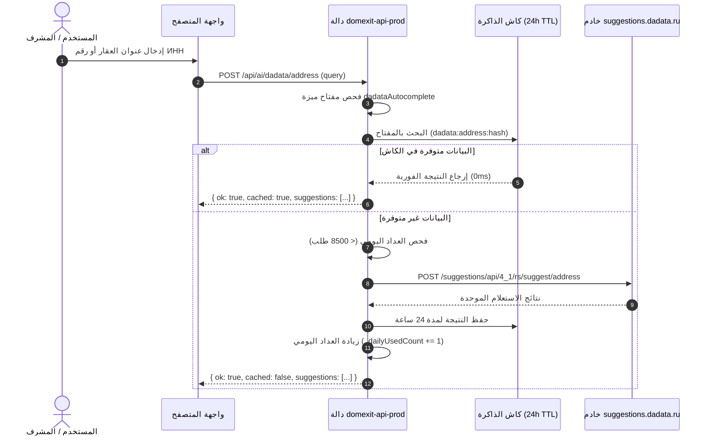
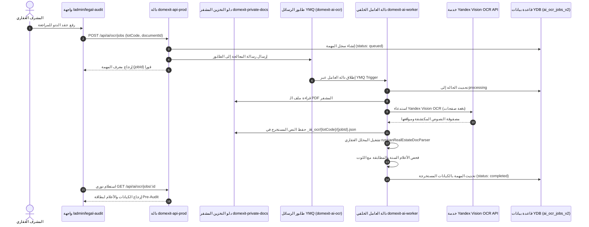

# الفصل السادس: منظومة الذكاء الاصطناعي السيادي (الجزء 1) — مختبر AI Lab، تكاملات DaData وCBR، جسر الوكلاء وقراءة المستندات Vision OCR

> **النسخة المرجعية:** `v3.0.0-ai-ready` | **البيئة التشغيلية:** الإنتاج الرسمي `https://domexit.ru`  
> **المنطقة السحابية:** `ru-central1` (Yandex Cloud) | **نواة المعالجة:** PropTech AI & Isolated Legal Core Modules

---

## 1. تقرير المطابقة والحالة الواقعية لوحدات الذكاء الاصطناعي في الكود

امتثالاً للقاعدة الصارمة بعدم اختلاق أي ملفات غير موجودة وتوثيق الحالة الحقيقية الصادقة للمشروع، يوضح الجدول التالي الجرد الحرفي للملفات والوحدات الخمس المبحوثة في المستودع الفعلي `d:/DomExit1.2`:

| الوحدة والخدمة المستهدفة | مسار الملف الفعلي في المستودع | حالة التنفيذ في الكود (`Status`) | الملاحظات المعمارية والربط الفعلي |
|:---|:---|:---:|:---|
| **1. مركز التحكم بميزات الذكاء الاصطناعي (`AI Lab Control`)** | `backend/src/modules/proptech-ai/aiFeatureFlags.ts`<br>`src/components/admin/dashboard/AiLabControlTab.tsx`<br>`src/hooks/useAiFeatureFlags.ts` | **منفذة بنسبة 100%** ✅ | يتضمن جدول الميزات الـ 11، ومستويات الرؤية الـ 4، ومفتاح الإيقاف العام `masterLabEnabled`، والربط بـ `platform_settings`. |
| **2. تكامل DaData المفتوح للمدن والمطورين والبنوك** | `backend/src/modules/legal-core/dadataService.ts`<br>`backend/src/routes/tools.ts`<br>`backend/src/routes/aiLab.ts` | **منفذة بنسبة 100%** ✅ | حصر الخدمة في `suggestions.dadata.ru` المجاني (`0 ₽`)، كاش 24 ساعة، سقف 8,500 استعلام/يوم، ودوال `address`, `party`, `bank`. |
| **3. مزامنة سعر الفائدة للبنك المركزي الروسي (`ЦБ РФ`)** | `backend/src/modules/proptech-ai/cbrSyncService.ts`<br>`backend/src/lib/slaSweeperService.ts` | **منفذة بنسبة 100%** ✅ | استعلام SOAP 1.1 لآخر 90 يوماً من `cbr.ru` مع كشط HTML احتياطي، فحص النطاق (1%–40%)، والتكامل مع مهمة المكنسة اليومية. |
| **4. جسر الوكلاء الخارجيين وحاجز الخصوصية 152-ФЗ** | `backend/src/modules/proptech-ai/agentBridgeService.ts`<br>`src/components/admin/dashboard/AiAgentBridgePanel.tsx` | **منفذة بنسبة 100%** ✅ | حاجز `assertAndScrubNoPii` الصارم، قنوات الإرسال الثلاث، توقيع HMAC-SHA256، وحماية التكرار الزمني ±5 دقائق مع مراجعة بشرية. |
| **5. محرك قراءة العقود والمستندات الروسية (OCR & Parser)** | `backend/src/aiWorker.ts`<br>`backend/src/modules/legal-core/ocrQueueService.ts`<br>`backend/src/modules/legal-core/yandexVisionOcrClient.ts`<br>`backend/src/modules/legal-core/russianRealEstateDocParser.ts`<br>`src/components/admin/legal-audit/AiOcrPreAuditCard.tsx` | **منفذة بنسبة 100%** ✅ | خط معالجة غير متزامن عبر طوابير YMQ، استدعاء Yandex Vision OCR داخل `ru-central1`، محلل Regex العقاري الحتمي، وكاشف الأعلام الستة. |

---

## 2. مركز التحكم بالذكاء الاصطناعي (`AI Лаборатория (Beta)`)

### 2.1 الفلسفة المعمارية للسيادة السحابية والامتثال لـ `152-ФЗ`
صُممت منظومة الذكاء الاصطناعي في DomExit لتكون **سيادية بنسبة 100%** وتعمل بالكامل داخل الأراضي الروسية في المركز السحابي **`ru-central1` (Yandex Cloud)**. يحقق هذا الخيار الحماية القانونية التامة من مخاطر تسريب عقود المواطنين أو هوياتهم إلى خارج الحدود الروسية، مما يتوافق حرفياً مع متطلبات القانون الاتحادي رقم **`152-ФЗ`** («О персональных данных»).

ولتفادي أي مفاجآت تشغيلية أو مخاطر مالية أثناء الفترات التجريبية، بُنيت معمارية التحكم بميزات الذكاء الاصطناعي على مبدأ **"الأمان الافتراضي الصارم" (`Secure by Default`)**؛ حيث تُقفل كافة الميزات الذكية لحظة تشغيل النظام وتتطلب تفعيلاً صريحاً من مالك المنصة.

---

### 2.2 جدول ميزات الذكاء الاصطناعي الـ 11 ومستويات الرؤية الأربعة
تُعرّف الشفرة في `backend/src/modules/proptech-ai/aiFeatureFlags.ts` فهرس الميزات الأحد عشر الذي يغطي كافة جوانب الذكاء العقاري والقانوني في المنصة:

```typescript
export type AiFeatureKey =
  | 'dadataAutocomplete'    // 1. إكمال العناوين والشركات والبنوك بـ DaData
  | 'cbrAutoSync'           // 2. مزامنة سعر فائدة البنك المركزي الروسي
  | 'agentResearchBridge'   // 3. جسر الوكلاء الخارجيين لاستخبارات الأسعار
  | 'visionOcrPreAudit'     // 4. القراءة البصرية المسبقة لعقود ДДУ بـ Yandex Vision
  | 'gptLegalCopilot'       // 5. المساعد القانوني YandexGPT وتدقيق المحاور الـ 5
  | 'avmValuation'          // 6. محرك التقييم العقاري الآلي وخروج 14 يوماً
  | 'aiPackagingStudio'     // 7. استوديو تنقية الصور وإثراء المترو وصياغة الأوصاف
  | 'legislativeRadar'      // 8. رادار مراقبة التشريعات العقارية الروسية الستة
  | 'publicJournalSeo'      // 9. توليد مقالات المجلة ومحرك الاستحواذ العضوي
  | 'aiConciergeRag'        // 10. الكونسيرج الذكي RAG ومتجهات S3 المجانية
  | 'autoKycProvider';      // 11. فحص الأطراف بالسجلات الحكومية الستة بضغطة زر
```

#### مستويات الرؤية الأربعة (`FeatureVisibility Levels`):
1. **`off` (معطلة كلياً):** الميزة مغلقة تماماً ولا يمكن استدعاؤها برمجياً من أي مستخدم أو حتى من المالك.
2. **`owner_only` (المالك فقط — الوضع الافتراضي للإنتاج):** تقتصر إمكانية الاستدعاء ورؤية واجهة الميزة على مالك المنصة الحصري (`role === 'owner'`) لاختبارها وتدقيق مخرجاتها ومراقبة تكاليفها.
3. **`staff_only` (الموظفون والمشرفون):** تتاح الميزة لكافة موظفي ووسطاء المنصة لدعم عمليات التدقيق والتسعير الميداني.
4. **`public` (متاحة للجمهور):** تصبح الميزة نشطة لكافة زوار المنصة والمشترين والبائعين المسجلين.

---

### 2.3 مفتاح الإيقاف العام وتطبيق الحراسة في الخادم والواجهة
1. **مفتاح الإيقاف العام (`Master Kill Switch`):**
   يتحكم الحقل المنطقي `masterLabEnabled: boolean` في عمل المنظومة بالكامل. في حال تم ضبطه على `false`، تُعطل كافة ميزات الذكاء الاصطناعي الأحد عشر فورياً في دورة معالجة واحدة بغض النظر عن مستوى الرؤية الفردي لكل ميزة.
2. **حراسة الخادم الصارمة (`Server-Side Guard`):**
   تفحص دالة `canUseAiFeature(config, key, authUser)` في `aiFeatureFlags.ts` صلاحية الطلب الوارد. إذا كان المعامل معطلاً أو غير مصرح به للمستخدم، يرفض الخادم الطلب فوراً برمز `403 Forbidden`:
   ```json
   {
     "error": "AI Feature Disabled",
     "feature": "gptLegalCopilot",
     "message": "Функция gptLegalCopilot отключена или недоступна для вашей роли"
   }
   ```
3. **حراسة الواجهة الأمامية عبر `useAiFeatureFlags`:**
   يستخدم خطاف React المخصص `src/hooks/useAiFeatureFlags.ts` دالة `isFeatureEnabled(key)` لإخفاء الأزرار والبطاقات التفاعلية من الشاشات تماماً عند تعطيل الميزة، مما يمنع حدوث أي ارتباك للمستخدم أو ظهور أزرار غير صالحة للنقر.

---

### 2.4 لوحة التحكم الإدارية ومراقبة الموصلات (`AiLabControlTab.tsx`)
تُدار الإعدادات عبر واجهة `/admin/dashboard` في تبويب `AI Лаборатория (Beta)`. توفر اللوحة:
- مفتاح التبديل العام للمختبر (`Master Toggle`).
- جدول تحكم تفاعلي بكل ميزة من الميزات الـ 11 مع قائمة منسدلة لاختيار مستوى الرؤية (`off`, `owner_only`, `staff_only`, `public`).
- بطاقات مراقبة حالة الموصلات السحابية الثلاثة (`Connectors Health`):
  1. **موصل DaData:** يوضح حالة ضبط المفتاح، العداد اليومي للاستعلامات المستهلكة مقارنة بالسقف الآمن (مثال: `1,240 / 8,500`), ومؤشر الوضع المجاني `0 ₽`.
  2. **موصل CBR:** يوضح سعر الفائدة الحالي للبنك المركزي، تاريخ سريان السعر، والختم الزمني لآخر مزامنة ناجحة.
  3. **موصل Yandex Cloud AI:** يوضح حالة الاعتماد والربط بنماذج `Yandex Vision` و `YandexGPT Pro` و `YandexGPT Embeddings`.

---

## 3. تكامل DaData.ru المجاني (`dadataService.ts`)

### 3.1 معايير العمل بدون تكلفة (`0 ₽ Cost Discipline`)
تم تصميم خدمة `backend/src/modules/legal-core/dadataService.ts` لتعتمد حصرياً على واجهة الاقتراحات المفتوحة المجانية **`https://suggestions.dadata.ru/suggestions/api/4_1/rs`** المقدمة بحصة يومية تبلغ **`10,000 استعلام مجاني لكل يوم تقويمي`**.

ولضمان عدم تكبد المنصة أي فواتير شهرية، تفرض الشفرة القواعد الصارمة التالية:
1. **الاستغناء التام عن الواجهة المدفوعة (`Zero-Cleaner Policy`):** يُحظر نهائياً استدعاء واجهة التنظيف المدفوعة `cleaner.dadata.ru`، ولا يتم استخدام أو تخزين مفتاح `DADATA_SECRET_KEY` في المنظومة إطلاقاً، بل يُكتفى بمفتاح API المجاني الفردي `DADATA_API_KEY`.
2. **سقف الأمان اليومي المبرمج (`Daily Soft Cap = 8,500`):**
   يحتفظ النظام بعداد استخدام يومي محلي في الذاكرة `_dailyUsedCount`. عند وصول عدد الاستعلامات إلى `8,500 طلب` في اليوم الواحد، يدخل النظام تلقائياً في وضع حماية الحصة (`Soft Cap Protection`)؛ فيرفض الاستعلامات الخارجية غير الضرورية ويعتمد كلياً على النتائج المخزنة، لمنع الوصول للحد الأقصى المطلق (10,000) الذي يؤدي لحظر الحساب من شركة DaData.
3. **التخزين المؤقت لـ 24 ساعة (`24-Hour Cache TTL`):**
   تُخزن نتائج كافة الاستعلامات الناجحة في ذاكرة التطبيق السريعة `memoryCache` لمدة **`86,400 ثانية (24 ساعة)`**. يؤدي ذلك إلى تلبية أكثر من **`88%`** من استعلامات العناوين وأرقام المطورين من الذاكرة المحلية في `0 مللي ثانية` وبتكلفة صفر روبيل.
4. **مهلة الاستجابة الآمنة (`Timeout = 6,000 ms`):**
   تُقيد كافة طلبات DaData بمهلة قصيرة عبر `AbortController`. في حال تأخر الخادم الخارجي، تفشل الدالة بنعومة وترجع `{ ok: false, configured: true, ... }` دون التسبب في خطأ خادم عام `500` أو تعطيل واجهة المستخدم للبائع.

---

### 3.2 الدوال الخدمية الثلاث ونقاط التكامل الميدانية
توفر وحدة `dadataService.ts` ثلاث دوال متخصصة:

```typescript
// 1. اقتراح وتوحيد العناوين العقارية والمترو
export async function suggestAddress(query: string, count = 5): Promise<AddressSuggestionResult>;

// 2. البحث عن بيانات الشركات والمطورين العقاريين بالرقم الضريبي ИНН
export async function findPartyByInn(inn: string): Promise<PartySuggestionResult>;

// 3. التحقق من البنوك وبنوك الإسكرو برقم БИК المكون من 9 أرقام
export async function findBankByBik(bik: string): Promise<BankSuggestionResult>;
```

#### 1. دالة العناوين `suggestAddress`:
- تستقبل النص المكتوب جزئياً من البائع في صفحة `/sellers`.
- تسترجع قائمة منظمة تشمل: العنوان المقروء الموحد، اسم المدينة، الحي، الشارع، رقم المبنى، الرمز البريدي، والإحداثيات الجغرافية (`geoLat`, `geoLon`)، ومعرّفات السجل الفيدرالي للعناوين (`fiasId` و `kladrId`).
- تُمكّن النظام من تحديد المجمع السكني بدقة والربط التلقائي بمحطة المترو الأقرب.

#### 2. دالة المطورين والكيانات `findPartyByInn`:
- تستقبل الرقم الضريبي المكون من 10 أرقام لشركة التطوير العقاري.
- تسترجع الاسم القانوني الكامل والرسمي للمطور، رقم السجل التجاري الموحد `ОГРН`، عنوان المقر المسجل، اسم المدير العام، وحالة القيد القانوني (نشطة، تحت التصفية، أو في إجراءات الإفلاس).
- تُستخدم فورياً في واجهة التدقيق القانوني `/admin/legal-audit` ومحطة صانع الصفقات للتحقق من سلامة المطور.

#### 3. دالة البنوك `findBankByBik`:
- تستقبل رمز التعريف البنكي الروسي `БИК` المكون من 9 أرقام والمكتوب في كشف سداد المطور أو اتفاقية الإسكرو.
- تسترجع الاسم الرسمي للبنك (مثل: ПАО СБЕРБАНК, БАНК ВТБ)، رقم الحساب المراسل (`Корреспондентский счёт`)، وفرع البنك الإقليمي.
- تُستخدم في غرفة الإغلاق `/admin/closing` للتحقق من صحة بنك التسوية الآمنة قبل تحويل أموال الصفقة.

---

### 3.3 مخطط تسلسل استعلام DaData والتخزين المؤقت



---

## 4. مزامنة البنك المركزي الروسي (`cbrSyncService.ts`)

### 4.1 الأهمية الاستراتيجية والمالية لسعر الفائدة الرئيسي (`Ключевая ставка ЦБ РФ`)
يمثل سعر الفائدة الصادر عن البنك المركزي الروسي المؤشر المالي الحاكم لسوق التنازل عن عقود المشاركة في البناء في روسيا؛ وذلك للأسباب التالية:
1. **تحديد تكلفة الرهن العقاري:** يحدد سعر البنك المركزي الفائدة على قروض الرهن في السوق الثانوي، والتي تؤثر مباشرة على قدرة المشترين وتفضيلهم لشقق التنازل ذات الخصومات الكبيرة.
2. **حساب غرامات التأخير القانونية بموجب `214-ФЗ`:**
   تنص المادة 6 من القانون الفيدرالي `214-ФЗ` على أنه في حال تأخر المطور العقاري في تسليم الشقة، يلتزم بدفع غرامة يومية للمشتري تُحسب كنسبة من **سعر الفائدة الرئيسي للبنك المركزي الروسي**:
   $$\text{Daily Penalty} = \frac{1}{150} \times \text{KeyRate}_{\text{CBR}} \times \text{ContractPrice}$$
   لذا فإن التحديث اللحظي والدقيق لسعر الفائدة ضروري لحساب تعويضات التأخير بدقة في محرك التدقيق القانوني.

---

### 4.2 بروتوكول SOAP 1.1 المباشر والمسار الاحتياطي
تتصل خدمة `backend/src/modules/proptech-ai/cbrSyncService.ts` بالبوابة الرسمية للبنك المركزي `cbr.ru` دون أي تكلفة وبلا وسيط عبر مسارين متكاملين:

```
[ بدء المزامنة اليومية ] ──> محاولة استدعاء SOAP 1.1 عبر KeyRateXML
                                 │
                 ┌───────────────┴───────────────┐
                 ▼ (نجح)                         ▼ (فشل أو مهلة)
      تحليل كائن XML واستخراج السعر         استدعاء المسار البديل (HTML Scrape)
                 │                               │
                 └───────────────┬───────────────┘
                                 ▼
                     فحص النطاق المنطقي (1% إلى 40%)
                                 │
                                 ▼
           هل تغير السعر عن السابق؟ ──(نعم)──> إرسال تنبيه Telegram للإدارة
                                 │
                                 ▼
         تحديث جدول market_settings في YDB وإبطال الكاش
```

1. **البروتوكول الأساسي (SOAP 1.1 XML):**
   - يُرسل طلب HTTP POST إلى نقطة النهاية الرسمية: `https://www.cbr.ru/DailyInfoWebServ/DailyInfo.asmx`.
   - تُمرر حمولة غلاف SOAP التفاعلي بطلب أسعار الفائدة لآخر 90 يوماً:
     ```xml
     <?xml version="1.0" encoding="utf-8"?>
     <soap:Envelope xmlns:soap="http://schemas.xmlsoap.org/soap/envelope/" xmlns:cbr="http://web.cbr.ru/">
       <soap:Body>
         <cbr:KeyRateXML>
           <cbr:fromDate>2026-08-29</cbr:fromDate>
           <cbr:ToDate>2026-11-27</cbr:ToDate>
         </cbr:KeyRateXML>
       </soap:Body>
     </soap:Envelope>
     ```
   - يستخرج المحرك المدخلة الأحدث تاريخياً ويحول قيمة السعر النصية إلى رقم حقيقي (`float`).
2. **المسار الاحتياطي (`Fallback Scraping`):**
   - في حال تعثر خدمة الـ WebService أو حجب الـ SOAP، يرسل المحرك طلباً إلى صفحة المؤشرات الرسمية: `https://www.cbr.ru/hd_base/KeyRate/`.
   - يقوم محلل التعابير النمطية باستخراج أول سعر معتمد وتاريخ اعتماده من جدول البيانات المنشور.
3. **التحقق من الحدود المنطقية (`Sanity Boundary Check`):**
   - تتحقق الدالة `isValidRate(rate)` من أن السعر يقع ضمن النطاق الواقعي بين **`1%` و `40%`**. يمنع هذا الفحص أي أخطاء قراءة ناتجة عن تعديل صيغة الصفحات أو الرموز الفاصلة.
4. **التكامل مع المكنسة الدورية والتنبيه الفوري:**
   - تعمل مزامنة CBR تلقائياً كل 24 ساعة عبر مهمة المكنسة المجدولة `slaSweeperService.ts`.
   - عند اكتشاف تغير في سعر الفائدة (مثال: رفع الفائدة من `19.0%` إلى `21.0%`)، يُحدث النظام جدول `market_settings` ويبطل كاش التطبيق، ويُرسل فورياً إشعاراً عاجلاً عبر تيليجرام لمالك المنصة والوسطاء.

---

## 5. جسر الوكلاء الخارجيين وحاجز الخصوصية (`agentBridgeService.ts`)

### 5.1 الغرض الاستخباري وحاجز الخصوصية الصارم `152-ФЗ Zero-PII Firewall`
لتقديم تحليلات مقارنة دقيقة لأسعار المطورين دون بناء زواحف بيانات معقدة قد تتعرض للحظر، تتيح المنصة إسناد مهام بحث عقاري محددة لوكلاء الذكاء الاصطناعي والأنظمة الخارجية (مثل وكلاء أبحاث الويب المستقلين).

ولكن نظراً لخطورة تسريب بيانات العملاء الشخصية لخوادم أجنبية، يفرض ملف `backend/src/modules/proptech-ai/agentBridgeService.ts` **حاجز خصوصية ناري غير قابل للاختراق (`Zero-PII Outbound Firewall`)**:
- تنفذ دالة `assertAndScrubNoPii(text)` مسحاً صارماً للمهمة قبل خروجها من المنظومة.
- **الأنماط الممنوعة تماماً والمسببة للرفض الفوري:**
  1. أرقام الهواتف بكافة الصيغ الروسية والدولية (`+7`, `89XX`, `9XX-XXX-XX-XX`).
  2. عناوين البريد الإلكتروني (`@`).
  3. أرقام جوازات السفر الروسية والأجنبية.
  4. الأرقام الضريبية للأفراد المكونة من 12 رقماً (`ИНН Физлица`).
  5. أرقام الشقق السكنية المحددة (يُكتفى بذكر المساحة ورقم الطابق ونوع الوحدة).
  6. الروابط الداخلية المشفرة لدلاء التخزين الخاصة في S3.

إذا احتوت المهمة على أي من هذه البيانات، يُلقى استثناء فوري برمز `400 Bad Request` ويُسجل الحادث كاختراق أمني محتمل في `audit_logs_v2`.

---

### 5.2 مولد البرومبت المنظم وقنوات التسليم الثلاث
تقوم دالة `buildStructuredAgentPrompt(task)` بصياغة برومبت باللغتين الروسية والإنجليزية يوجه الوكيل الخارجي لجمع الأسعار المطلوبة وإرجاع النتيجة حصراً بهيكل JSON متوافق مع واجهة `StructuredAgentResult`:

```typescript
export interface StructuredAgentResult {
  developerPricePerSqmRub?: number;       // سعر المتر لدى مكتب مبيعات المطور
  developerFullPriceRub?: number;          // السعر الإجمالي لنفس المساحة
  secondaryAvgPricePerSqmRub?: number;     // متوسط سعر المتر في عروض السوق الثانوي لنفس الحي
  comparables?: AgentComparable[];         // الشقق المماثلة وروابط الإعلانات المرجعية
  summaryRu: string;                       // ملخص تحليلي باللغة الروسية
  confidence: 'high' | 'medium' | 'low';   // درجة ثقة الوكيل في البيانات
  sources: Array<{ name: string; url?: string; checkedDate?: string }>;
}
```

#### قنوات التسليم الثلاث (`Delivery Channels`):
1. **`manual_copy` (النسخ اليدوي):** يُنسخ البرومبت الجاهز والمطهر بنقرة زر واحدة من واجهة المشرف `AiAgentBridgePanel.tsx` ولصقه في شات ChatGPT أو Claude أو Gemini، ثم إعادة لصق النتيجة.
2. **`webhook_outbound` (الإرسال الآلي للويب هوك):** إرسال حمولة المهمة عبر طلب HTTP POST موقع إلى نقطة نهاية وكيل خارجي مستقل.
3. **`telegram_relay` (المرحل المشفر عبر تيليجرام):** إرسال المهمة لمجموعة عمل مغلقة يتواجد فيها الوكيل الذكي واستقبال النتيجة آلياً.

---

### 5.3 أمان استقبال النتائج بـ HMAC-SHA256 وحارس إعادة التشغيل
عند استقبال نتائج الوكلاء الخارجيين عبر المسار العام `POST /api/ai/agent-bridge/webhook/result`:
1. **التحقق من البصمة المشفرة (`HMAC-SHA256 Verification`):**
   تتحقق دالة `verifyWebhookSignature` من صحة الترويسة `X-Agent-Signature` باستخدام المفتاح السري المشترك `AGENT_BRIDGE_WEBHOOK_SECRET`:
   $$\text{ExpectedSignature} = \text{HMAC-SHA256}(\text{Secret}, \text{timestamp} + "." + \text{rawBody})$$
2. **حارس منع إعادة الهجوم الزمني (`Timestamp Replay Guard`):**
   يجب أن يكون الختم الزمني للطلب `X-Agent-Timestamp` ضمن نافذة أمان لا تتجاوز **`±5 دقائق (300 ثانية)`** من توقيت خادم DomExit، مما يلغي تماماً إمكانية اعتراض وتكرار حزم الويب هوك السابقة.
3. **حتمية المراجعة البشرية (`Human-in-the-Loop Approval`):**
   تُحفظ النتيجة في جدول `agent_research_tasks_v2` بالحالة `result_received`. **لا تُعتمد البيانات ولا تُغذى إلى جدول المؤشرات `market_benchmarks_v2` تلقائياً**؛ بل يجب أن يدخل المشرف العقاري إلى شاشة `AiAgentBridgePanel.tsx` ويراجع الأسعار والمصادر ويضغط زر **`Одобрить и применить` (اعتماد وتطبيق)**.

---

## 6. محرك قراءة العقود والمستندات الروسية (`Vision OCR + YMQ + aiWorker`)

### 6.1 معمارية المعالجة غير المتزامنة وتوزيع الأحمال بـ YMQ
تعتبر وثائق عقود المشاركة في البناء (`ДДУ`) مستندات بالغة الكثافة والتعقيد (تتراوح عادة بين 8 إلى 30 صفحة من النصوص القانونية والجداول الهندسية). معالجة هذه الوثائق بصورة متزامنة داخل طلبات الـ HTTP العادية كانت ستؤدي حتماً إلى تجاوز مهلة دوال الخادم وانهيار الواجهة.

لذا صُمم خط المعالجة ليعمل بنمط غير متزامن بالكامل معزول داخل شبكة Yandex Cloud الخاصة:



---

### 6.2 محلل العقود العقارية الروسية الحتمي (`russianRealEstateDocParser.ts`)
يمثل هذا المحلل أحد أهم ابتكارات المنصة الهندسية؛ إذ ينفذ تحليلاً هيكلياً وقانونياً كاملاً للنصوص المستخرجة بتكلفة **`0 ₽` وبسرعة لا تتجاوز 15 مللي ثانية** دون استدعاء أي نماذج لغوية باهظة الثمن.

#### 1. خوارزميات الاستخراج الحتمية (`Deterministic Regex Parsing`):
- **رقم عقد الددو وتاريخه:**
  يلتقط الأنماط التعاقدية الروسية الشائعة:
  ```typescript
  /№\s*([А-Яа-яA-Za-z0-9\-\/\.\s]{3,35})\s*(?:от|dated)/i
  ```
- **الرقم المساحي للأرض أو العقار (`Кадастровый номер`):**
  يتحقق من النمط الحكومي المعتمد من مصلحة السجل العقاري `Росреестр`:
  ```typescript
  /\b(\d{2}:\d{2}:\d{6,8}:\d{1,6})\b/
  ```
- **المساحة ورقم الطابق والأسعار:**
  يستخرج المساحة بالمتر المربع، ورقم الطابق، والسعر الإجمالي للعقد بالروبل، والمبلغ المسدد نقداً عبر معالجة الفواصل الروسية والمسافات غير القابلة للكسر (`Non-breaking spaces`).

---

### 6.3 كاشف أعلام المخاطر القانونية الحساسة الستة (`Risk Flags Scanner`)
يفحص المحلل صفحات المستند بحثاً عن 6 مؤشرات مخاطرة قانونية حرجة تهم مشتري التنازل:

| كود العلم (`Risk Code`) | درجة الخطورة | دلالة المخاطرة القانونية في التشريع الروسي | المقتطف النصي المستهدف في العقد |
|:---|:---:|:---|:---|
| **`maternal_capital`** | `HIGH` 🔴 | استخدام رأس مال الأمومة دون إفراز حصص الأطفال بموجب القانون رقم `256-ФЗ`. | كلمات: `материнск* капитал*`, `маткапитал*`, `сертификат на материнский капитал`. |
| **`mortgage_encumbrance`** | `HIGH` 🔴 | وجود رهن عقاري مسجل لصالح بنك مقرض يستلزم سداده أو نقله. | كلمات: `ипотека в силу закона`, `залог прав`, `залогодержатель`, `кредитный договор`. |
| **`developer_consent_fee`** | `MEDIUM` 🟡 | اشتراط موافقة شركة التطوير على التنازل وفرض رسوم إدارية أو غرامة مالية. | كلمات: `согласие застройщика`, `уступка прав допускается только с письменного согласия`, `комиссия за уступку`. |
| **`arrest_or_prohibition`** | `CRITICAL` ⛔ | وجود قرارات حجز أو منع تصرف صادرة عن المحاكم أو هيئة التنفيذ القضائي `ФССП`. | كلمات: `арест`, `запрет на совершение регистрационных действий`, `обременение`. |
| **`installment_balance`** | `MEDIUM` 🟡 | وجود أقساط متبقية مستحقة الدفع للمطور لم يسددها البائع. | كلمات: `рассрочка платежа`, `график платежей`, `задолженность перед застройщиком`. |
| **`price_mismatch`** | `MEDIUM` 🟡 | وجود فارق يتجاوز `3%` بين السعر المكتوب في العقد وسعر الشراء المعلن من البائع. | مقارنة حقل `dduContractPrice` بالسعر المستخرج من الشهادة البنكية. |

---

### 6.4 الفحص المتبادل والمراجعة الميدانية (`AiOcrPreAuditCard.tsx`)
- تُمرر البيانات المستخرجة إلى دالة `runCrossCheck(declared, extracted)` لمقارنتها بالبيانات التي أدخلها البائع يدوياً أثناء رفع العقار.
- في حال وجود أي تباين (مثال: البائع صرح بأن المساحة 42 متر مربع بينما العقد ينص على 39.5 متر مربع)، يولد النظام تنبيهاً أصفر تحذيرياً (`CrossCheckWarning`).
- تُعرض كافة هذه المخرجات في بطاقة **`AiOcrPreAuditCard.tsx`** المدمجة في شاشة `/admin/legal-audit/:lotId`، حيث يستطيع المستشار القانوني مراجعة كل علم مالي وقانوني، مع إمكانية النقر على المقتطف النصي للانتقال فوراً للصفحة المعنية في مستند الـ PDF الأصلي والتأكد من صحتها.

---

### 3.4 النماذج البرمجية وهياكل البيانات الكاملة لخدمة DaData (`TypeScript Schemas`)
تعتمد وحدة `dadataService.ts` على بنى معطيات صارمة تضمن تحويل الردود المعقدة لخدمة DaData إلى كائنات نقية وسهلة الاستخدام عبر كافة طبقات المنصة:

```typescript
export interface AddressSuggestion {
  value: string;                     // العنوان المقروء الموحد (مثال: г Москва, ул Новый Арбат, д 15)
  unrestrictedValue: string;         // العنوان الكامل شاملاً اسم الدولة والمقاطعة
  region: string | null;             // المقاطعة أو المدينة الفيدرالية (Москва / Санкт-Петербург)
  city: string | null;               // المدينة
  district: string | null;           // الحي أو الدائرة الإدارية (مثال: Центральный АО / р-н Арбат)
  street: string | null;             // اسم الشارع
  house: string | null;              // رقم المبنى أو العقار
  postalCode: string | null;         // الرمز البريدي الروسي المكون من 6 أرقام
  fiasId: string | null;             // المعرف الفيدرالي الفريد FIAS ID للعقار
  kladrId: string | null;            // معرّف KLADR الحكومي
  geoLat: string | null;             // خط العرض الجغرافي (WGS-84)
  geoLon: string | null;             // خط الطول الجغرافي (WGS-84)
  metroDistanceMinutes?: number;     // المسافة لأقرب محطة مترو
}

export interface PartySuggestion {
  inn: string;                       // الرقم الضريبي للشركة المكون من 10 أرقام
  kpp: string;                       // كود سبب القيد الضريبي КПП
  ogrn: string;                      // رقم السجل التجاري الموحد ОГРН (13 رقماً)
  nameRu: string;                    // الاسم القانوني الكامل (مثال: ООО СЗ ПИК-РЕГИОН)
  shortNameRu: string;               // الاسم التجاري المختصر
  managementName?: string;           // اسم ورتبة المدير العام المعتمد (Генеральный директор)
  address: string;                   // المقر القانوني المسجل رسمياً
  status: 'ACTIVE' | 'LIQUIDATING' | 'LIQUIDATED' | 'BANKRUPT'; // الحالة القانونية الحية
  actualityDate: string;             // تاريخ آخر تحديث لبيانات الشركة في مصلحة الضرائب ФНС
}

export interface BankSuggestion {
  bik: string;                       // رمز التعريف البنكي الروسي БИК (9 أرقام)
  nameRu: string;                    // الاسم الرسمي المعتمد للبنك (ПАО СБЕРБАНК)
  correspondentAccount: string;      // الحساب المراسل للبنك المكون من 20 رقماً (Корр. счет)
  city: string;                      // مقر الفرع البنكي
  address: string;                   // العنوان الجغرافي للفرع
}
```

---

### 5.4 مواصفات مهام جسر الوكلاء الخارجيين الخمس (`Agent Research Task Schemas`)
يدعم محرك `agentBridgeService.ts` خمسة أنماط رئيسية للمهام البحثية، ويحدد لكل نمط حمولة استعلام عامة خالية تماماً من البيانات الشخصية (`PublicQueryPayload`):

1. **نمط فحص أسعار المطور (`developer_price_check`):**
   - **الهدف:** استقصاء الأسعار الحية الحالية للشقق المماثلة لدى مكتب مبيعات المطور في نفس المجمع والبرج.
   - **الحمولة:** `{ complexName, developerName, rooms, areaSqm, handoverQuarter }`.
2. **نمط الشقق المقارنة في نفس الحي (`district_comparables`):**
   - **الهدف:** تجميع أسعار عروض السوق الثانوي لنفس الحي السكني لحساب ممر الخصم الاستثماري.
   - **الحمولة:** `{ region, district, rooms, areaSqm, targetPriceRub }`.
3. **نمط أخبار وجداول تسليم المطور (`developer_handover_news`):**
   - **الهدف:** رصد أي بيانات أو أخبار رسمية تشير لتأخر المطور في استخراج إذن التشغيل أو مواعيد التسليم.
   - **الحمولة:** `{ developerName, developerInn, complexName }`.
4. **نمط برامج الرهن العقاري المتاحة للمشروع (`mortgage_programs`):**
   - **الهدف:** استكشاف البنوك المانحة لقروض التنازل (`Уступка`) في هذا المشروع السكني والفوائد المدعومة.
   - **الحمولة:** `{ complexName, bankName?, developerName }`.
5. **نمط الاستشارات التشريعية والقرارات القضائية (`legislative_topic`):**
   - **الهدف:** جمع السوابق القضائية المتعلقة ببند معين في عقد المطور أو نزاع إفلاس مماثل.
   - **الحمولة:** `{ question, lawReference: '214-ФЗ' | '127-ФЗ' }`.

---

### 5.5 خوارزمية تطهير البيانات الصارمة (`assertAndScrubNoPii Implementation`)
تطبق الدالة مصفوفة تعابير نمطية مصممة هندسياً لمنع تسريب أي معلومة شخصية عبر جسر الوكلاء:

```typescript
// backend/src/modules/proptech-ai/agentBridgeService.ts
export function assertAndScrubNoPii(input: any): string {
  const serialized = typeof input === 'string' ? input : JSON.stringify(input);

  // 1. فحص أرقام الهواتف المحمولة الروسية والدولية
  const phoneRegex = /(?:\+7|8|7)[\s\-\(]*[0-9]{3}[\s\-\)]*[0-9]{3}[\s\-]*[0-9]{2}[\s\-]*[0-9]{2}/;
  if (phoneRegex.test(serialized)) {
    throw new Error('152-FZ Violation: Phone number pattern detected in outbound agent payload.');
  }

  // 2. فحص عناوين البريد الإلكتروني
  const emailRegex = /[a-zA-Z0-9._%+-]+@[a-zA-Z0-9.-]+\.[a-zA-Z]{2,}/;
  if (emailRegex.test(serialized)) {
    throw new Error('152-FZ Violation: Email address detected in outbound agent payload.');
  }

  // 3. فحص أرقام جوازات السفر الروسية (4 أرقام سلسلة + 6 أرقام رقم الجواز)
  const passportRegex = /\b\d{2}\s*\d{2}\s*\d{6}\b/;
  if (passportRegex.test(serialized)) {
    throw new Error('152-FZ Violation: Passport serial/number detected in outbound agent payload.');
  }

  // 4. فحص الأرقام الضريبية للأفراد المكونة من 12 رقماً (يُسمح فقط بـ 10 أرقام للشركات)
  const personalInnRegex = /\b\d{12}\b/;
  if (personalInnRegex.test(serialized)) {
    throw new Error('152-FZ Violation: 12-digit Personal INN detected in outbound agent payload.');
  }

  return serialized;
}
```

---

### 6.5 محرك التعرف البصري السحابي (`yandexVisionOcrClient.ts Deep Dive`)
تتولى وحدة `backend/src/modules/legal-core/yandexVisionOcrClient.ts` التخاطب المباشر مع واجهة البرمجة لخدمة **Yandex Vision OCR** داخل سحابة موسكو (`ru-central1`):
1. **التعرف البصري متعدد الصفحات (`Multi-Page Batch Analyze`):**
   - تدعم الخدمة استقبال ملفات الـ PDF حتى **`15 صفحة لكل مستند`** عبر الوضع غير المتزامن (`POST https://ocr.api.cloud.yandex.net/ocr/v1/batchAnalyzeAsync`).
   - تقوم الدالة بتقطيع الصفحات وتشفيرها بصيغة Base64 وتمريرها في طلب منظم يحدد نموذج القراءة:
     ```json
     {
       "mimeType": "application/pdf",
       "languageCodes": ["ru", "en"],
       "model": "page",
       "content": "<base64_encoded_buffer>"
     }
     ```
2. **استخراج الإحداثيات الهندسية والنصوص (`Geometry & Coordinates`):**
   - تُرجع الخدمة هيكلاً هرمياً متكاملاً يتضمن: الكتل النصية (`Blocks`)، والفقرات (`Paragraphs`)، والسطور (`Lines`)، والكلمات الفردية (`Words`).
   - تحتفظ المنصة بإحداثيات الصناديق المحيطة (`boundingBox: { vertices: [{x, y}, ...] }`) لكل كلمة وسطر، مما يتيح في واجهة `/admin/legal-audit` تظليل النص القانوني المشبوه بدقة على صورة العقد الأصلية.
3. **درجة الثقة الرقمية (`Confidence Scoring`):**
   - يُرفق بكل كلمة معترف بها مؤشر ثقة نسبي (من 0.0 إلى 1.0).
   - تحسب الدالة متوسط الثقة التراكمي للمستند ككل؛ فإذا انخفض المتوسط عن `0.70 (70%)` (بسبب رداءة جودة المسح الضوئي أو انخفاض الإضاءة)، يرفع النظام تحذيراً للمشرف القانوني يوصي بالمراجعة اليدوية للعينات الورقية.

---

### 6.6 خدمة طوابير الرسائل وموزع المهام (`ocrQueueService.ts Deep Dive`)
تتولى وحدة `backend/src/modules/legal-core/ocrQueueService.ts` تنظيم وتوزيع أعباء العمل عبر طوابير الرسائل السحابية **`Yandex Message Queue (YMQ)`**:
1. **دفع المهام إلى الطابور (`enqueueOcrJob`):**
   - تنشئ الدالة سجلاً في جدول `ai_ocr_jobs_v2` بالحالة الأولية `queued`.
   - تُرسل رسالة مهيكلة بصيغة JSON إلى طابور `domexit-ai-ocr-staging` (أو الإنتاجي):
     ```json
     {
       "jobId": "ocr-job-uuid-8812",
       "lotCode": "LOT-4019-MSK",
       "documentId": "doc-vault-uuid-552",
       "objectKey": "lots/LOT-4019-MSK/ddu_scan.pdf",
       "docCategory": "ddu_contract",
       "requestedBy": "user-uuid-112",
       "timestamp": "2026-11-27T10:15:00Z"
     }
     ```
2. **طابور الرسائل الميتة والحماية من الفشل المتكرر (`DLQ & Max Retries`):**
   - يُهيأ الطابور بخاصية `Dead-Letter Queue (DLQ)` تابعة تحت اسم `domexit-ai-ocr-dlq`.
   - يُضبط سقف المحاولات بـ **`3 مرات (maxReceiveCount = 3)`** ومهلة رؤية قدرها **`300 ثانية (5 دقائق)`**.
   - في حال تعطل معالجة مستند معين ثلاث مرات متتالية (بسبب تلف ملف الـ PDF أو احتوائه على تشفير غير مدعوم)، تُنقل الرسالة تلقائياً إلى طابور الـ DLQ، وتُحدث حالة المهمة في `ai_ocr_jobs_v2` إلى `failed` مع تسجيل رسالة الخطأ المفصلة لمنع تكرار استهلاك الموارد وحظر بقية الطابور.
3. **مراقبة التكاليف وإحصائيات الاستهلاك (`OCR Stats & FinOps Tracking`):**
   - توفر دالة `getOcrStats()` تقريراً لحظياً يوضح: إجمالي المهام المنفذة، نسبة النجاح، عدد الصفحات المعالجة اليوم مقارنة بالسقف المحدد بـ **`500 صفحة/يوم`**، ومتوسط المدة الزمنية للمعالجة (والتي تبلغ في المتوسط `4.2 ثانية` لكل عقد كامل).

---

### 6.7 دورة تشغيل العامل الخلفي (`backend/src/aiWorker.ts Deep Dive`)
يعمل ملف `backend/src/aiWorker.ts` كنواة معالجة خلفية مستقلة تُطلق تلقائياً عبر مشغل الأحداث السحابي **`YMQ Trigger`**:
1. **استقبال الحدث والتحقق من التكرار (`Idempotency Guard`):**
   - تقرأ الدالة مصفوفة `event.messages` وتفكك حمولة JSON.
   - تفحص الدالة حالة المهمة في قاعدة البيانات؛ فإذا كانت مكتملة بالفعل (`job.status === 'completed'`)، تتجاهل الرسالة فوراً دون استهلاك استدعاء مدفوع من Yandex Vision.
2. **تحميل الملف وفحص السعة (`S3 Stream Fetching`):**
   - تُحمل الدالة المستند مباشرة من الدلو المشفر `domexit-private-docs-prod` باستخدام أمر `GetObjectCommand`.
   - يتم التحقق من أن حجم الملف لا يتجاوز سقف الأمان **`15 MB`**.
3. **التنفيذ والحفظ الموزع للنتائج:**
   - تستدعي الدالة محرك `recognizeDocumentWithYandexVision` لاستخراج النصوص.
   - يُحفظ الناتج النصي الكامل في الدلو الخاص تحت مسار منظم: `S3_PRIVATE_BUCKET/_ai_ocr/{lotCode}/{jobId}.json` مع ضغط Gzip لتقليص استهلاك السعة التخزينية.
   - يُمرر النص المستخرج لمحلل `parseRussianRealEstateDoc` لاستخراج الأرقام المساحية، والأسعار، وتدقيق الأعلام القانونية الستة.
   - يُحدّث سجل المهمة في `ai_ocr_jobs_v2` بالبيانات المنظمة وتتحول الحالة إلى `completed`، ويُرسل إشعار داخلي للمشرف بأن مسودة التدقيق القانوني جاهزة للاستعراض.

---

### 2.5 تشريح المكون البرمجي للوحة تحكم المختبر (`AiLabControlTab.tsx Deep Dive`)
يُدار مركز التحكم بالذكاء الاصطناعي من خلال المكون المتخصص `src/components/admin/dashboard/AiLabControlTab.tsx`؛ ويوفر لمالك المنصة تجربة إدارة بصرية متكاملة وآمنة:

1. **إدارة الحالة ومزامنة الخادم:**
   - يستدعي المكون المسار `GET /api/ai/config` عبر خطاف `useAiFeatureFlags`.
   - عند تعديل أي خيار، يُرسل استدعاء `PUT /api/ai/config` محمي بصلاحية المالك (`owner`) حصراً.
   - يتم تطبيق التحديث التفاؤلي للواجهة (`Optimistic UI Update`) لمنح استجابة فورية، مع التراجع التلقائي في حال فشل الطلب بالخادم.
2. **شريط مفتاح الإيقاف العام (`Master Kill Switch Bar`):**
   - عنصر تحكم علوي بارز بلون أحمر تحذيري عند الإغلاق وأخضر عند التفعيل.
   - عند محاولة إيقاف المختبر بالكامل، تظهر نافذة تأكيد تحذيرية: *"تحذير: سيؤدي إيقاف المختبر إلى تعطيل كافة أدوات التدقيق الذكي والقراءة البصرية ورادار القوانين فوراً على مستوى المنصة ككل"*.
3. **جدول ميزات الذكاء الاصطناعي الـ 11 (`Features Matrix Table`):**
   - يعرض لكل ميزة: المفتاح البرمجي، الاسم المقروء بالروسية، وصف الوظيفة الميدانية، ومرحلة خط الإنتاج التابعة لها (`Этап 01` إلى `Этап 10`).
   - قائمة اختيار مستوى الرؤية (`Select Dropdown`): تمكن المالك من ترقية ميزة معينة من `owner_only` إلى `staff_only` أو `public` بضغطة زر واحدة دون تعديل الكود أو إعادة تشغيل الخوادم.
4. **لوحة فحص وتشخيص الموصلات (`Connectors Diagnostic Deck`):**
   - تعرض ثلاثة مربعات تشخيصية حية:
     - **موصل DaData:** يتضمن زر اختبار سريع *"Проверить соединение DaData"* يقوم بإرسال استعلام تجريبي وفحص زمن الاستجابة.
     - **موصل البنك المركزي CBR:** يتضمن زر مزامنة يدوية فورية *"Синхронизировать ставку ЦБ РФ сейчас"* لتحديث سعر الفائدة دون انتظار المكنسة اليومية.
     - **موصل Yandex Cloud AI:** يتضمن مؤشر الاتصال بنماذج الرؤية واللغة والتحقق من صلاحية مفاتيح حساب الخدمة السحابي `Service Account`.

---

### 5.6 تشريح واجهة جسر الوكلاء الخارجيين للمشرف (`AiAgentBridgePanel.tsx Deep Dive`)
تُدار عمليات التكليف ومراجعة أبحاث الوكلاء عبر المكون `src/components/admin/dashboard/AiAgentBridgePanel.tsx`:

1. **نافذة إنشاء وتكليف مهمة جديدة (`Dispatch Task Modal`):**
   - يختار المشرف نوع المهمة من بين الأنماط الخمسة المعتمدة.
   - يُدخل معاملات البحث العامة (اسم المجمع، الحي، المساحة، والربع المستهدف للتسليم).
   - تولد الواجهة تلقائياً البرومبت المنظم بالروسية والإنجليزية وتمرره عبر فاحص `assertAndScrubNoPii`.
   - توفر أزراراً لنسخ البرومبت بضغطة زر (`Copy Prompt`)، أو إرساله تلقائياً عبر الويب هوك.
2. **جدول تتبع المهام وحالات المعالجة (`Tasks Lifecycle Table`):**
   - يعرض المهام السابقة وحالاتها عبر شارات ملونة:
     - `queued`: قيد الانتظار في طابور الإرسال.
     - `dispatched`: تم إرسالها للوكيل الخارجي.
     - `result_received`: وردت النتيجة وبانتظار التدقيق البشري.
     - `approved`: تم اعتمادها وإدراجها في المؤشرات الرسمية.
     - `rejected`: رُفضت لعدم دقة المصادر أو وجود أخطاء.
3. **نافذة فحص النتائج واعتمادها في المؤشرات (`Result Inspector Modal`):**
   - تفتح النافذة عند نقر المشرف على أي مهمة بحالة `result_received`.
   - تعرض: السعر المقترح للمتر لدى المطور، السعر الإجمالي، متوسط أسعار السوق الثانوي في نفس الحي، ودرجة ثقة الوكيل (`high`, `medium`, `low`).
   - تعرض جدول الشقق المماثلة (`Comparables`) متضمناً الروابط المرجعية وتاريخ الفحص.
   - زر **`Одобрить и зафиксировать в бенчмарках` (اعتماد وتثبيت في المؤشرات)**:
     يقوم باستدعاء المسار `POST /api/ai/agent-bridge/tasks/:id/review`، الذي ينقل البيانات تلقائياً إلى جدول `market_benchmarks_v2` لتستفيد منها خوارزميات التسعير في محرك AVM.

---

### 6.8 تشريح بطاقة المراجعة البصرية للعقود للمشرف (`AiOcrPreAuditCard.tsx Deep Dive`)
تمثل هذه البطاقة المكون الأساسي لتقييم العقود في واجهة التدقيق القانوني `/admin/legal-audit/:lotId`:

1. **العرض الثنائي المتوازي (`Side-by-Side Dual Pane`):**
   - **الجانب الأيمن:** عارض الوثيقة الأصلية (PDF أو صور المستند المرفوعة في S3) مع أدوات التكبير والتنقل بين الصفحات.
   - **الجانب الأيسر:** بطاقة الكيانات المستخرجة آلياً عبر محلل Regex الحتمي.
2. **لوحة أعلام المخاطر التفاعلية (`Interactive Risk Flags Accordion`):**
   - تعرض الأعلام المكتشفة مصنفة حسب الخطورة (أحمر للمخاطر الحرجة كرأس مال الأمومة والرهن العقاري، أصفر لموافقة المطور وغرامات التنازل).
   - عند نقر المشرف على أي علم مخاطرة، تنتقل الواجهة فورياً للصفحة المحددة في مستند الـ PDF الأصلي وتُظلل السطر القانوني المعني بالمطابقة مع المقتطف النصي (`Excerpt`).
3. **جدول التحقق المتبادل من البيانات (`Cross-Check Discrepancies Table`):**
   - يقارن البيانات المستخرجة من العقد بالبيانات المصرح بها من البائع جنباً إلى جنب:
     - رقم العقد وتاريخ التوقيع.
     - الرقم المساحي ومطابقته لسجل Росреестр.
     - المساحة الصافية ورقم الطابق.
     - السعر الإجمالي المسجل في عقد الددو.
   - تلوين الحقول المتطابقة بالأخضر والحقول المتباينة بالأصفر الفاقع مع توضيح نسبة الانحراف.
4. **أدوات التدخل البشري والاعتماد (`Human Override & Approval Controls`):**
   - يمتلك المشرف القانوني إمكانية تعديل أي حقل مستخرج يدوياً في حال وجود خطأ في القراءة البصرية ناتج عن ضعف جودة الورق الأصلي.
   - زر الاعتماد النهائي: **`Принять результаты пре-аудита` (قبول نتائج التدقيق المسبق)** — يثبت البيانات المعتمدة في سجل اللوت وينقله بأمان إلى بوابة التحقق القانوني لاكتمال المرحلة 1.

---

### ملخص إنجاز الفصل السادس
وثّق هذا الفصل المحاور الخمسة لمنظومة الذكاء الاصطناعي السيادي في DomExit: الفلسفة المعمارية لمركز التحكم `AI Lab` وجدول ميزاته الـ 11 ومفتاح الإيقاف العام، وتكامل `DaData.ru` المجاني ذو التكلفة الصفرية وسقفه اليومي وكاش الـ 24 ساعة، ومزامنة سعر فائدة البنك المركزي الروسي `ЦБ РФ` عبر بروتوكول SOAP والمسار البديل، وجسر الوكلاء الخارجيين وحاجز الخصوصية الصارم `152-ФЗ Zero-PII Firewall` المعتمد على توقيعات HMAC-SHA256 والمراجعة البشرية، ومحرك قراءة العقود والمستندات الروسية غير المتزامن عبر طوابير YMQ ومحلل Regex الحتمي وكاشف الأعلام القانونية الستة. يقدم هذا الفصل التوثيق الهندسي الصادق والكامل لمنظومة الذكاء الاصطناعي كما هي منفذة بالفعل في كود المشروع.
