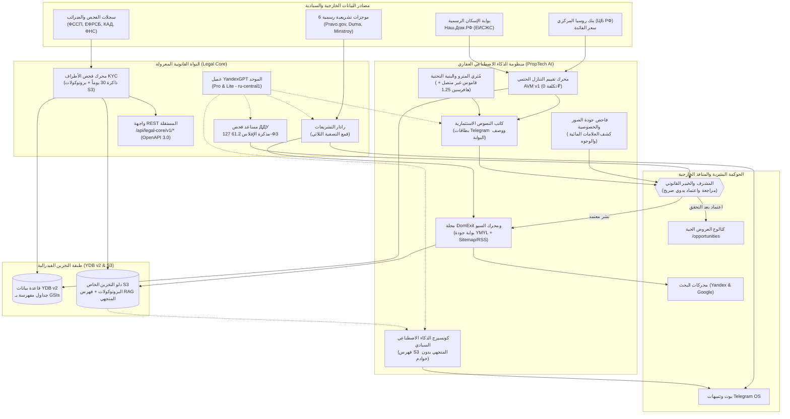

# الفصل 07: منظومة الذكاء الاصطناعي — الجزء الثاني (المحركات المتقدمة، التقييم، التغليف، الرادار، المجلة، الكونسيرج، وفحص الأطراف)

---

## 7.1 مقدمة معمارية وحالة التنفيذ الصادقة (Implementation Scorecard)

يمثّل هذا الفصل الركيزة الثانية لمنظومة الذكاء الاصطناعي السيادية في منصة DomExit. بعد أن استعرض الفصل 06 البنية التحتية الأساسية لمختبر الذكاء الاصطناعي (`aiFeatureFlags.ts` و`AI Lab Dashboard`)، وبوابة الهوية الجغرافية والتنظيمية (`DaData`)، وجسر بنك روسيا المركزي (`cbrSyncService`)، ومحرك المعالجة البصرية والمستندات (`Yandex Vision OCR + ocrQueueService`)؛ يتعمق هذا الفصل في المحركات الاستثمارية والتحليلية العليا التي تحوّل البيانات الخام إلى قرارات استثمارية وقانونية قطعية.

تم تصميم وتنفيذ جميع هذه المحركات وفق ثلاثة مبادئ حاكمة لا تقبل التنازل:
1. **السيادة الإقليمية والامتثال لـ 152-ФЗ:** تعمل جميع نماذج التعلم العميق (LLMs, Embeddings, Vision) داخل مركز بيانات `ru-central1` التابع لـ `Yandex Cloud`. لا يتم تسريب بايت واحد من البيانات الشخصية (PII) أو أسرار العقود خارج الحدود الروسية.
2. **انضباط التكلفة التشغيلية (FinOps Rigor):** تطبيق صارم لنظام ترشيد النماذج (Model Tiering)، والتخزين المؤقت الذكي بحساب بصمات `SHA-256`، والتقطيع الذكي للسياق (Smart Context Trimming)، واستخدام النماذج الحسابية الحتمية بصفر روبل (`0 ₽`) كلما أمكن ذلك، مما يضمن ألا تتجاوز التكلفة السحابية للمنصة بالكامل بضع مئات من الروبلات شهرياً حتى مع آلاف المستخدمين.
3. **الحوكمة البشرية الإلزامية (Strict Human-in-the-Loop):** لا يمتلك أي محرك ذكاء اصطناعي في DomExit صلاحية اتخاذ قرار تنفيذي نهائي أو تلقائي (Auto-Commit). جميع مخرجات الذكاء الاصطناعي — من تدقيق عقود ДДУ، وتوصيات تسعير AVM، وفحص صور الإعلانات، ومسودات مقالات المجلة، وتقارير فحص الأطراف KYC — تُنتج بصفتها **مسودات استشارية معللة** تُعرض أمام المشرف البشري (Curator / Legal Auditor / Compliance Officer) للمراجعة والاعتماد اليدوي الصريح.

### بطاقة تقييم التنفيذ الفعلي في المستودع (Codebase Implementation Scorecard)

يوثّق الجدول التالي الوضع الحقيقي بنسبة 100% لكافة المكونات البرمجية المشمولة في هذا الفصل كما هي موجودة فعلياً في مجلدات `backend/src/modules/` و`backend/src/routes/`:

| المحرك / الوحدة البرمجية | الملف المصدري الفعلي في المستودع | حالة التنفيذ الفعلية | الوظيفة المحققة |
| :--- | :--- | :---: | :--- |
| **عميل YandexGPT الموحد** | `backend/src/modules/legal-core/yandexGptClient.ts` | **مبنية ومربوطة بالكامل** | إدارة استدعاءات `yandexgpt` و`yandexgpt-lite`، حل رموز IAM، ضبط الميزانية، وترميم JSON. |
| **مساعد فحص ДДУ القانوني** | `backend/src/modules/legal-core/dduLegalCopilotService.ts` | **مبنية ومربوطة بالكامل** | تحليل 5 محاور قانونية، كشف شروط التنازل والعمولات، وتوليد مذكرة المشتري حسن النية (ст. 61.2 127-ФЗ / ст. 302 ГК РФ). |
| **فاحص ملاءة المشتري بالذكاء الاصطناعي** | `backend/src/modules/legal-core/buyerProofAiService.ts` | **مبنية ومربوطة بالكامل** | مطابقة الاسم والمبلغ وتاريخ الصلاحية لكشوف الحسابات وموافقات الإقراض العقاري مع كشف التزوير. |
| **مزامنة بيانات التشييد الرسمية ЕИСЖС** | `backend/src/modules/proptech-ai/nashDomSyncService.ts` | **مبنية ومربوطة بالكامل** | الربط مع بوابة Наш.Дом.РФ المفتوحة، استخراج بنوك الضمان (Эскроу)، وأشهر تأخير المطورين. |
| **محرك تقييم التنازل الحتمي (AVM v1)** | `backend/src/modules/proptech-ai/avmValuationEngine.ts` | **مبنية ومربوطة بالكامل** | نموذج رياضي حتمي 0 ₽، دمج مؤشرات الوكلاء مع فائدة ЦБ РФ ونسب الحصة النقدية لتحديد نطاق الخروج في 14 يوماً. |
| **استوديو التغليف: فاحص جودة الصور والخصوصية** | `backend/src/modules/proptech-ai/photoQaService.ts` | **مبنية ومربوطة بالكامل** | كشف العلامات المائية للمنافسين (Циан, Авито, Яндекс)، أرقام الهواتف والروابط، الوجوه والمستندات بـ Yandex Vision. |
| **استوديو التغليف: مُثري البنية التحتية والمترو** | `backend/src/modules/proptech-ai/geoInfrastructureService.ts` | **مبنية ومربوطة بالكامل** | قاموس مترو غير متصل (سانت بطرسبرغ وموسكو)، حساب مسافات هافرسين بعامل تعرج 1.25، وتقدير أزمنة المشي والنقل. |
| **استوديو التغليف: كاتب النصوص الاستثمارية** | `backend/src/modules/proptech-ai/aiListingCopyService.ts` | **مبنية ومربوطة بالكامل** | صياغة 3 مخرجات من الحقائق المؤكدة حصراً بـ YandexGPT Pro (وصف البوابة، ملخص SEO، وبطاقة قناة Telegram). |
| **رادار التشريعات ومسودات المحتوى** | `backend/src/modules/legal-core/legislativeRadarService.ts`<br>`backend/src/modules/proptech-ai/contentDraftService.ts` | **مبنية ومربوطة بالكامل** | مسح 6 موجزات رسمية (ЦБ РФ, Pravo.gov, Дума)، قمع تصفية ثلاثي، تنبيهات الامتثال، ومسودات مقالات التثقيف. |
| **محرك سيو المجلة وبوابة جودة YMYL** | `backend/src/modules/proptech-ai/journalSeoService.ts` | **مبنية ومربوطة بالكامل** | توليد sitemap.xml وrss.xml الديناميكي، حظر النصوص القالبية غير المحررة (YMYL Gate)، وبطاقات OpenGraph/JSON-LD. |
| **كونسيرج الذكاء الاصطناعي السيادي (RAG Concierge)** | `backend/src/modules/proptech-ai/ragConciergeService.ts`<br>`backend/src/modules/proptech-ai/ragKnowledgeIndexer.ts`<br>`backend/src/modules/legal-core/yandexEmbeddingsClient.ts` | **مبنية ومربوطة بالكامل** | استرجاع متجهي بدون خوادم عبر S3 وYandex Embeddings، محادثة ذكية، استخراج صندوق الشراء Buy-Box، وتحويل دافئ للمشرف. |
| **فحص الأطراف KYC/KYB وغلاف النواة القانونية** | `backend/src/modules/legal-core/kyc/*`<br>`backend/src/routes/legalCoreV1.ts` | **مبنية ومربوطة بالكامل** | محول موحد (API-Cloud / Checko)، تخزين بروتوكولات S3، ذاكرة مؤقتة لـ 30 يوماً، وواجهة REST مستقلة مع توثيق OpenAPI 3.0. |

---

## 7.2 عميل YandexGPT الموحد وهندسة التكاليف الذكية (`yandexGptClient.ts`)

يمثّل ملف `backend/src/modules/legal-core/yandexGptClient.ts` الواجهة البرمجية المركزية الموحدة لجميع تفاعلات نماذج اللغات التوليدية داخل المنصة. تم عزله ليضمن ألا يتصل أي ملف آخر مباشرة بـ Yandex Cloud API، مما يفرض ضوابط FinOps وسياسات الاستدعاء الصارمة.

### 7.2.1 هرمية استبانة رمز المصادقة (IAM Token Resolution Hierarchy)

تحتاج نماذج Yandex Foundation Models إلى رمز وصول IAM Token صالح لكي تُنفذ طلباتها. بدلاً من الاعتماد على إعداد يدوي وحيد قد يتعطل، يطبق العميل خوارزمية استبانة متعددة المستويات في الدالة `resolveIamToken()`:
1. **الرمز الممرر يدوياً (`overrideIamToken`):** يُستخدم في حالات الاختبارات المعزولة أو الاستدعاء من المشرف في لوحة الإدارة.
2. **متغيرات البيئة المباشرة:** فحص الترتيب: `process.env.YC_AI_IAM_TOKEN`، ثم `process.env.YC_IAM_TOKEN`، ثم إعدادات `getConfig().YC_AI_IAM_TOKEN`.
3. **خدمة البيانات الوصفية السحابية (Instance Metadata Service):** عند تشغيل الكود داخل Yandex Cloud Functions أو خوادم Compute Cloud، يتم طلب الرمز عبر العنوان الداخلي `http://169.254.169.254/computeMetadata/v1/instance/service-accounts/default/token` مع ترويسة `Metadata-Flavor: Google` ومهلة زمنية صارمة تبلغ 1500 مللي ثانية.
4. **أداة سطر الأوامر الرسمية (`yc iam create-token`):** في بيئة التطوير المحلية للمهندسين، يتم استدعاء سطر الأوامر عبر `child_process.execSync` مع تخزين الرمز الناتج في الذاكرة المؤقتة لمدة 10 دقائق لتجنب بطء الاستدعاءات المتكررة.
5. **الفشل الآمن:** إذا فشلت كافة المحاولات، يتم إلقاء خطأ وصفي دون أي تسريب لأسرار البيئة.

### 7.2.2 تصنيف النماذج (Model Tiering) وحساب التكلفة الدقيق

يفرّق العميل بين مستويين من النماذج وفقاً لطبيعة المهمة المطلوبة:
- **`lite` (`yandexgpt-lite/latest`):** مخصص للمهام التصنيفية السريعة، استخراج الكيانات، تلخيص الأخبار، وتوجيه استفسارات الكونسيرج. تكلفته الرسمية: 0.20 ₽ لكل 1,000 رمز إدخال و0.40 ₽ لكل 1,000 رمز إخراج.
- **`pro` (`yandexgpt/latest`):** مخصص للمهام القانونية المعقدة، مثل تدقيق عقود ДДУ، صياغة مذكرات الإفلاس 61.2 127-ФЗ، وكتابة الأوصاف الاستثمارية. تكلفته الرسمية: 1.20 ₽ لكل 1,000 رمز إدخال و1.20 ₽ لكل 1,000 رمز إخراج.

تُحسب التكلفة البرمجية في كل استدعاء بالمعادلة التالية:
```typescript
function calculateCostRub(tier: GptModelTier, inputTokens: number, outputTokens: number): number {
  if (tier === 'lite') {
    return (inputTokens / 1000) * 0.2 + (outputTokens / 1000) * 0.4;
  }
  return (inputTokens / 1000) * 1.2 + (outputTokens / 1000) * 1.2;
}
```

### 7.2.3 سقف الاستدعاء اليومي وترميم مخرجات JSON

يحتفظ العميل بمتتبع استخدام يومي داخلي في الذاكرة (`DailyGptTracker`)، يراقب عدد العمليات المنفذة وعدد الرموز المستهلكة والتكلفة التراكمية. يُحدد متغير البيئة `DAILY_GPT_CALLS_CAP` (الافتراضي: 100 استدعاء/يوم على بيئة Staging) الحد الأقصى للحماية من أي حلقات استدعاء لا نهائية (Infinite Loops).

علاوة على ذلك، ونظراً لأن النماذج اللغوية قد تُغلّف مخرجات JSON بكتل Markdown ثلاثية الأقواس (` ```json ... ``` `) أو تُضيف نصوصاً تمهيدية، تتضمن الدالة `cleanJsonString()` خوارزمية تعقيم تقوم بقطع كتل الكود البرمجي واستخراج مصفوفة أو كائن JSON الخام لضمان نجاح `JSON.parse` بنسبة 100%:

```typescript
export function cleanJsonString(raw: string): string {
  let cleaned = raw.trim();
  if (cleaned.startsWith('```')) {
    cleaned = cleaned.replace(/^```(?:json)?\s*/i, '').replace(/```\s*$/, '');
  }
  return cleaned.trim();
}
```

---

## 7.3 مساعد تدقيق عقود ДДУ القانوني ومذكرة الإفلاس (`dduLegalCopilotService.ts`)

يُعد تدقيق عقد المشاركة في البناء التشاركي (ДДУ) الخاضع للقانون الاتحادي رقم `214-ФЗ` جوهر عملية تقييم المخاطر في DomExit. ملف `dduLegalCopilotService.ts` يبني تحليلاً استشارياً متكاملاً بالاعتماد على النصوص المستخرجة من أداة OCR.

### 7.3.1 التجميع الذكي للسياق وقمع استهلاك الرموز (Smart Context Assembly)

لا يمكن إرسال عقد ДДУ كامل (قد يصل إلى 40-70 صفحة) إلى نموذج الذكاء الاصطناعي بسبب حدود السياق والتكلفة المالية. تطبق الدالة `assembleSmartContext()` خوارزمية ذكية لاختيار الصفحات الأكثر خطورة وحرجاً بحيث لا يتجاوز النص الإجمالي 22,000 حرف (~5,500 رمز):
1. **الصفحات الثلاث الأولى دائماً:** تحتوي دائماً على أسماء الأطراف، وصف الشقة ورقمها، السعر الإجمالي، وشروط فتح حساب الضمان (Эскроу).
2. **الصفحات المرصودة بماسح OCR للكلمات الحساسة:** تُضمن فوراً أي صفحة اكتشف فيها ماسح OCR علامات مخاطر مسبقة.
3. **المسح التعبيري المنتظم للكلمات المفتاحية:**
   ```regexp
   /(?:согласи[а-яё]*\s+застройщик[а-яё]*|комисси[а-яё]*\s+уступк[а-яё]*|штраф\s+за\s+расторжени[а-яё]*|материнск[а-яё]*|семейн[а-яё]*\s+капитал|ипотек[а-яё]*|залог|обременени[а-яё]*|эскроу|неустойк[а-яё]*)/iu
   ```
4. **الترتيب والتجميع:** تُجمع الصفحات المختارة وفق ترتيبها الأصلي في العقد، وإذا وصل الطول إلى الحد الأقصى يتم الاقتطاع مع وضع علامة واضحة `[Обрезано по лимиту контекста]`.

### 7.3.2 محاور التحقيق الخمسة الصارمة وقاعدة حظر السلامة المطلقة

يُلزم النظام نموذج الذكاء الاصطناعي بتصنيف النتائج وفق 5 محاور قانونية رئيسية (`suggestedAxes`):
1. **`title_encumbrances` (الحقوق والأعباء التقييدية):** فحص الرهون العقارية وأوامر الحجز.
2. **`bankruptcy_debts` (الديون ومخاطر الإفلاس):** **قاعدة معمارية صارمة:** يُحظر على النموذج إعطاء حالة `verified_safe` لهذا المحور على الإطلاق! العقد ذاته لا يثبت عدم إفلاس البائع. يفرض المحرك دائماً وضع حالة `needs_attention` مع الملاحظة الإلزامية: *"По договору рисков не выявлено, требуется обязательная проверка продавца по базам ЕФРСБ, ФССП и КАД Арбитр"*.
3. **`developer_settlement` (المخالصة المالية مع المطور):** التحقق من سداد كامل قيمة العقد للمطور أو وجود رصيد متبقٍ في حساب الإسكرو.
4. **`family_matkap` (رأس مال الأمومة والوضع الأسري):** رصد أي مؤشر لاستخدام دعم رأس مال الأمومة وحصص الأطفال القُصّر أو غياب موافقة الزوج الموثقة.
5. **`cession_escrow` (التنازل وتحويل الالتزامات):** استخراج الشروط الخاصة بموافقة المطور على التنازل، والتحقق مما إذا كان المطور يفرض رسوماً تعسفية على التنازل (`developerConsentFeeRub`).

### 7.3.3 صياغة مذكرة الحماية ضد إبطال المعاملة (ст. 61.2 127-ФЗ / ст. 302 ГК РФ)

أكبر خطر يواجه مشتري عقود إعادة البيع في روسيا هو إفلاس البائع اللاحق ومطالبة أمين التفليسة بإلغاء الصفقة واعتبارها معاملة مشبوهة وفق المادة 61.2 من قانون الإفلاس الروسي رقم `127-ФЗ`.
يقوم المساعد الذكي بصياغة فقرة تسبيب قانونية (`draftProtectionMemo612Ru`) تؤسس لحسن نية المشتري اللاحق وفق المادة 302 من القانون المدني الروسي (ГК РФ) عبر إثبات:
- أن سعر الشراء يقع ضمن النطاق السعري الحقيقي للسوق بناءً على تقييم DomExit AVM، مما ينفي تهمة البيع بأقل من القيمة السوقية (п. 1 ст. 61.2).
- انعدام أي علاقة تبعية أو قرابة أو مصلحة مشتركة بين البائع والمشتري.
- إلزامية تنفيذ السداد بالكامل عبر القنوات المصرفية الرسمية المعتمدة (эскроу / аккредитив / СБР) دون أي مبالغ نقدية تحت الطاولة.

تُخزن النتائج الكاملة في جدول `ai_legal_analyses_v2` مفهرسة بـ `lotCode` و`ocrJobId` لمنع إعادة التحليل التكراري وتوفير تكاليف الحوسبة.

---

## 7.4 فاحص ملاءة المشتري بالذكاء الاصطناعي ومطابقة الهوية (`buyerProofAiService.ts`)

تتطلب مستويات الشراء المتقدمة في DomExit (مثل الفئة الذهبية Gold Tier أو نظام التوفيق الذكي Matchmaker) إثبات الملاءة المالية للمشتري لضمان جدية الحجوزات وعدم تعطيل الصفقات. يتولى ملف `buyerProofAiService.ts` الفحص التلقائي الاستشاري لهذه المستندات.

### 7.4.1 مسار المعالجة الهجين (Hybrid Vision + GPT Pipeline)

يعتمد المحرك على خط أنابيب هجين يحقق أعلى دقة بأقل تكلفة ممكنة:
1. **التعرف البصري الأولي (Yandex Vision OCR):** استخراج النصوص والأرقام من المستند المرفوع (كشف حساب بنكي أو موافقة قرض عقاري).
2. **الاستخراج الهيكلي (YandexGPT Lite):** توجيه نموذج `yandexgpt-lite` الخفيف عبر أمر محكم لاستخراج حقول محددة حصراً: نوع المستند (`bank_statement` أو `mortgage_approval`)، الاسم الكامل لحامل الحساب، اسم البنك، الرصيد أو المبلغ المعتمد بالروبل، تاريخ الإصدار، وتاريخ انتهاء الصلاحية.
3. **المطابقة الحتمية المعيارية (Deterministic Validation):** معالجة المخرجات برمجياً دون تدخل الذكاء الاصطناعي لضمان عدم وجود أي تخمين في مطابقة الأسماء أو التواريخ.

### 7.4.2 خوارزمية تطبيع الأسماء ومطابقة الأطراف الثلاثية

يطبق المحرك خوارزمية تسوية نحوية في دالة `checkNameMatch()`:
```typescript
function normalizeName(name: string): string[] {
  return name
    .toLowerCase()
    .replace(/[^а-яёa-z\s]/gi, ' ')
    .split(/\s+/)
    .filter((part) => part.length >= 2);
}
```
تُقارن مصفوفة الأجزاء المستخرجة من المستند مع الاسم المسجل للمستخدم في النظام:
- **`exact` (تطابق تام):** تطابق اللقب والاسم الأول واسم الأب بنسبة 100%.
- **`partial` (تطابق جزئي):** تطابق اللقب والاسم الأول مع اختلاف أو غياب اسم الأب (شائع في المستندات البنكية المختصرة).
- **`mismatch` (عدم تطابق):** اختلاف اللقب أو عدم وجود أي تقاطع، مما يرفع راية تحذير حمراء تفيد بأن المستند قد يعود لشخص آخر.

### 7.4.3 فحص صلاحية التاريخ وكفاية المبلغ المالي

- **فحص انتهاء الصلاحية (`isExpired`):** يجب ألا يتجاوز عمر كشف الحساب البنكي 30 يوماً من تاريخ التقديم، وألا يكون قرار الموافقة الائتمانية للبنك قد تجاوز تاريخ الانتهاء المطبوع عليه.
- **فحص الكفاية المالية (`amountSufficient`):** مقارنة المبلغ المؤكد في المستند مع المبلغ المصرح به من المشتري وسعر اللوت المطلوب؛ إذا كان المبلغ يغطي متطلبات الدفعة النقدية ورسوم الصفقة يُعتبر كافياً.

تُسجل النتيجة في جدول `ai_buyer_verifications_v2` وتبقى استشارية حصراً: **لا يقوم المحرك بترقية أي مستخدم تلقائياً إلى الفئة الذهبية**، بل يُنشئ بطاقة مهام للمشرف مع التوصيات المحسوبة.

---

## 7.5 مزامنة بيانات التشييد المفتوحة من Наш.Дом.РФ (`nashDomSyncService.ts`)

تُعد البوابة الحكومية الموحدة للإسكان في روسيا (`ЕИСЖС - Наш.Дом.РФ`) المصدر السيادي الرسمي لبيانات التشييد الخاضعة للقانون 214-ФЗ. يتولى ملف `nashDomSyncService.ts` المزامنة مع واجهات البيانات المفتوحة للبوابة لتوفير سياق تشييدي حقيقي لكل عقار على منصة DomExit.

### 7.5.1 البيانات المستخرجة وبنية المفتاح الموحد

يقوم المحرك بتطبيع اسم المجمع السكني والمنطقة الجغرافية لإنشاء مفتاح بحث ثابت (`complexKey`):
```typescript
export function normalizeComplexKey(complexName: string, region: string): string {
  const normName = complexName
    .toLowerCase()
    .replace(/«|»|"|'|жк|жилой комплекс/gi, '')
    .trim()
    .replace(/\s+/g, '-');
  const normReg = region.toLowerCase().includes('спб') || region.toLowerCase().includes('петербург') ? 'spb' : 'msk';
  return `${normReg}:${normName}`;
}
```

يستخرج المحرك من قاعدة بيانات ЕИСЖС السجلات التالية لكل مجمع تشييدي ويحفظها في جدول `eiszh_projects_v2`:
- **معرف المشروع الحكومي (`eiszhObjId`):** الرقم المرجعي الموحد للمبنى في السجل الفيدرالي.
- **بيانات المطور الرسمي والمالك المستفيد (`developerInn`, `developerName`, `groupName`):** مطابقة الكيان القانوني الذي أصدر العقد.
- **التواريخ التعاقدية الفعلية وتأخيرات التسليم (`handoverQuarter`, `delayMonths`):** حساب عدد أشهر التأخير مقارنة بالتصريح الأولي للإنشاء (`delayMonths = (actualCompletion - declaredCompletion)`).
- **تصنيف التعثر الرسمي (`isProblematic`):** ما إذا كان المبنى مدرجاً في سجل المشروعات المتعثرة أو الخاضعة لإشراف صندوق حماية حقوق المواطنين المشاركين في البناء.
- **بنك حساب الضمان (`escrowBankName`):** البنك الحاضن لأموال المشترين بموجب حسابات الضمان.
- **متوسط سعر المتر المربع للمطور اليوم (`avgPricePerSqmRub`):** مرساة السعر الرسمية المعتمدة للمطور في الموقع.

---

## 7.6 محرك تقييم التنازل الحتمي (AVM v1 — Переуступка ДДУ) (`avmValuationEngine.ts`)

يمثّل محرك التقييم الآلي للحقوق العقارية (AVM Engine) جوهر التفوق المالي لمنصة DomExit. يتميز المحرك بأنه **نموذج رياضي حتمي 100% بتكلفة تشغيلية قدرها صفر روبل (0 ₽)**، دون الحاجة لاستدعاء نماذج لغوية باهظة للعمليات الحسابية، مما يضمن دقة رقمية مطلقة وشفافية رياضية تامة قابلة للتدقيق القانوني.

### 7.6.1 هرمية تحديد السعر الأساسي للمطور (Anchor Price Determination)

يعتمد المحرك على سلم تنازلي صارم لتحديد السعر المرجعي للمطور اليوم للمتر المربع (`anchorDeveloperPricePerSqmRub`):
1. **تجاوز المشرف اليدوي المباشر (`curatorOverrideBenchmarkSqmRub`):** في حال قام المشرف بمسح يدوي حديث لسعر المطور.
2. **سجل مؤشرات السوق المعتمد (`market_benchmarks_v2`):** بيانات الرصد الأسبوعي لأسعار المطورين في المجمع المدخلة من وكلاء المنصة (بشرط ألا يتجاوز عمر الرصد 45 يوماً).
3. **بيانات ЕИСЖС Наш.Дом.РФ الرسمية (`eiszh_projects_v2`):** متوسط سعر المتر المربع المسجل لدى وزارة البناء للمشروع.
4. **سعر المطور المصرح به للوت اليوم (`developerPriceTodayRub`):** إذا توفر في بطاقة الإدخال وكان منطقياً (> 1,000,000 ₽).
5. **النموذج الاحتياطي لهامش تقدم البناء (DDU Markup Fallback):** في حال غياب كافة المصادر، يتم حساب السعر التقديري بإضافة هامش تقدم تشييد مرجعي قدره +12% على السعر التاريخي لعقد ДДУ الأساسي:
   $$\text{AnchorTotal} = \text{DduBasePrice} \times 1.12$$
   مع وضع علامة واضحة للمشرف: `needsAgentBenchmark: true` و`dataQualityConfidence: 'low'`.

### 7.6.2 مصفوفة التعديلات المالية والاقتصادية الكلية (Adjustments Engine)

يُخضع المحرك السعر المرجعي لسلسلة من التعديلات الرياضية التي تعكس بيئة الاقتصاد الروسي الراهنة:

```
  ┌─────────────────────────────────────────────────────────────┐
  │                 Anchor Developer Price (100%)               │
  └──────────────────────────────┬──────────────────────────────┘
                                 │
     ┌───────────────────────────┴───────────────────────────┐
     │          Хصم التنازل الأساسي (Base Discount: 9.0%)       │
     └───────────────────────────┬───────────────────────────┘
                                 │
         ┌───────────────────────┼───────────────────────┐
         ▼                       ▼                       ▼
┌──────────────────┐    ┌──────────────────┐    ┌──────────────────┐
│  علاوة سعر الفائدة │    │  ميزة الرهن العائلي │    │ غرامة تأخير البناء │
│     ЦБ РФ        │    │ Семейная ипотека │    │    Задержка ЕИСЖС│
│  (+1.5% إلى +6%)  │    │      (-3.0%)     │    │ (+4.0% إلى +12%) │
└──────────────────┘    └──────────────────┘    └──────────────────┘
         │                       │                       │
         └───────────────────────┼───────────────────────┘
                                 │
                                 ▼
              ┌─────────────────────────────────────┐
              │  Effective Discount % (6% إلى 28%)   │
              └──────────────────┬──────────────────┘
                                 │
                                 ▼
              ┌─────────────────────────────────────┐
              │   Recommended Fair Exit Value Rub   │
              └─────────────────────────────────────┘
```

1. **علاوة سيولة سعر الفائدة للبنك المركزي (CBR Key Rate Adjustment):**
   عندما يرفع البنك المركزي الروسي الفائدة الأساسية، تشتد صعوبة حصول المشترين على قروض الرهن العقاري التجاري، مما يتطلب تقديم خصم تنازل أعمق لاجتذاب المشترين ذوي السيولة النقدية:
   - الفائدة $\ge 20\%$: إضافة $+6.0\%$ للخصم.
   - الفائدة من $16\%$ إلى $19.9\%$: إضافة $+4.5\%$ للخصم.
   - الفائدة من $12\%$ إلى $15.9\%$: إضافة $+3.0\%$ للخصم.
   - الفائدة $< 12\%$: إضافة $+1.5\%$ للخصم.
2. **ميزة الرهن العقاري العائلي (Family Mortgage Bonus):**
   إذا كانت الشقة مؤهلة لبرنامج الرهن العائلي المدعوم (فائدة 6%) بموجب شروط المطور والشراء الأساسي، تُمنح ميزة تنافسية تُخفّض الخصم المطلوب بمقدار $-3.0\%$ (أي رفع سعر العقار لأن الطلب عليه أعلى بكثير).
3. **غرامة تعثر وتأخير المطور (Construction Delay Penalty):**
   استناداً إلى سجلات ЕИСЖС:
   - مشروع متعثر رسمياً (`isProblematic: true`): إضافة $+12.0\%$ للخصم.
   - تأخير التسليم $\ge 12$ شهراً: إضافة $+7.0\%$ للخصم.
   - تأخير التسليم من 6 إلى 11 شهراً: إضافة $+4.0\%$ للخصم.
4. **نطاق الخصم الفعال المقيد (Bounded Effective Discount):**
   تُجمع العوامل لتحديد نسبة الخصم الفعالة، وتُقيد رياضياً بحد أدنى 6% وحد أقصى 28%:
   $$\text{EffectiveDiscountPct} = \min(28.0, \max(6.0, 9.0 + \text{KeyRateAdj} - \text{FamilyBonus} + \text{DelayPenalty}))$$

### 7.6.3 حساب نطاق الخروج السريع (14-Day Fast Exit Price Band)

لحساب نطاق الخروج السريع للمستثمر خلال مدة مستهدفة قدرها 14 يوماً، تُحسب القيمة العادلة الموصى بها، ثم يُطرح منها أي رسوم يفرضها المطور للموافقة على التنازل (`developerConsentFeeDeductionRub`):
$$\text{FairMarketValue} = \text{AnchorTotal} \times \left(1 - \frac{\text{EffectiveDiscountPct}}{100}\right)$$
$$\text{RecommendedPrice} = \text{FairMarketValue} - \text{DeveloperConsentFee}$$
- **الحد الأدنى للنطاق (`minRub`):** $\text{RecommendedPrice} \times 0.96$ (خروج فائق السرعة خلال 7–10 أيام).
- **الحد الأقصى للنطاق (`maxRub`):** $\text{RecommendedPrice} \times 1.04$ (بيع هادئ خلال 30–45 يوماً).

### 7.6.4 مؤشر السيولة وسرعة البيع التقديرية (Liquidity Score 0–100)

يولّد المحرك تقييماً رقمياً لسيولة العقار يبدأ من 70 نقطة أساسية، وتُطبق عليه معاملات الترجيح:
- عمق الخصم مقارنة بسعر المطور: $+1.5$ نقطة لكل 1% خصم إضافي.
- أهلية الرهن العائلي: $+10$ نقاط.
- سلامة البناء وفق ЕИСЖС (عدم وجود تأخير): $+5$ نقاط؛ بينما يخصم التأخير $-10$ إلى $-25$ نقطة.
- نسبة السيولة النقدية المطلوبة للبائع من إجمالي السعر (`cashTicketRatioPct`): إذا كانت الشقة مسددة بالكامل وتتطلب سيولة نقدية ضخمة 100% كاش، يُخصم من السيولة $-8$ نقاط لضيق شريحة المشترين النقديين.

تُصنف النتيجة في أربع فترات زمنية متوقعة للإغلاق: `7–14 дней`، `14–30 дней`، `30–60 дней`، أو `60+ дней`. تُخزن كافة الحسابات بنصوصها التوضيحية الروسية في جدول `avm_valuations_v2`.

---

## 7.7 استوديو التغليف الذكي (AI Packaging Studio)

تُمثّل مرحلة التغليف (المرحلة 2 في دورة حياة اللوت `/admin/packaging`) المحطة الحاسمة لنقل العقار من مجرد ملف تدقيق قانوني إلى إعلان استثماري جاهز للجمهور. يضم استوديو التغليف 3 محركات متخصصة:

```
                          ┌───────────────────────────┐
                          │   AI Packaging Studio     │
                          └─────────────┬─────────────┘
                                        │
         ┌──────────────────────────────┼──────────────────────────────┐
         ▼                              ▼                              ▼
┌───────────────────┐        ┌───────────────────┐          ┌─────────────────────┐
│   Photo QA &      │        │ Geo & Metro       │          │ AI Copywriter       │
│ Privacy Inspector │        │ Infrastructure    │          │ YandexGPT Pro       │
│ (photoQaService)  │        │ (geoInfraService) │          │ (aiListingCopy)     │
└────────┬──────────┘        └──────────┬────────┘          └──────────┬──────────┘
         │                              │                              │
         ▼                              ▼                              ▼
  - كشف علامات المنافسين        - قاموس مترو غير متصل          - وصف استثماري احترافي
  - كشف الوجوه والمستندات       - حساب أزمنة المشي والنقل      - 5 نقاط بيعية بارزة
  - مطابقة أبعاد الصور          - حساب مسافة هافرسين 1.25      - بطاقة Telegram ترويجية
```

### 7.7.1 فاحص جودة الصور والخصوصية (`photoQaService.ts`)

يعالج الصور المرفوعة عبر استدعاء خدمتي `TEXT_DETECTION` و`FACE_DETECTION` من `Yandex Vision OCR` مع معالجة ثنائية محلية فائقة السرعة:
1. **استخراج أبعاد الصورة بصفر تكلفة سحابية (`extractImageDimensions`):**
   قراءة ترويسات الملفات الثنائية (JPEG SOF0/SOF2, PNG IHDR, WebP VP8/VP8L/VP8X) مباشرة من مصفوفة البايتات `Buffer` دون الحاجة لمكتبات معالجة صور ثقيلة مثل Sharp أو Canvas. يرفض النظام أي صورة يقل قياسها عن $800 \times 500$ بكسل لتفادي رداءة العرض.
2. **كشف العلامات المائية للمنافسين (Competitor Watermarks):**
   فحص النصوص المستخرجة من الصورة ومطابقتها مع تعبيرات منتظمة لسبع منصات عقارية روسية منافسة:
   - `Циан` (`cian.ru`)
   - `Авито` (`avito.ru`)
   - `Домклик` (`domclick.ru`)
   - `Яндекс Недвижимость` (`realty.yandex`)
   - `Этажи` (`etagi.com`)
   - `М2` (`m2.ru`)
   - `Самолет Плюс` (`samoletplus`)
   في حال رصد أي علامة مائية لمنافس، يوصي المحرك برفض الصورة فوراً لمنع الانتهاكات والحفاظ على احترافية DomExit.
3. **حماية الخصوصية ومكافحة تسريب أرقام التواصل (152-ФЗ & Anti-Circumvention):**
   - رصد أرقام الهواتف المباشرة بصيغة `+7/8 9xx` أو روابط وقنوات Telegram لمنع محاولات البائعين الالتفاف على المنصة وإجراء صفقات خارج الضمان.
   - رصد الوجوه البشرية الظاهرة (`FACE_DETECTION`): تنبيه المشرف لتمويه الوجوه التزاماً بقانون الخصوصية الروسي.
   - رصد المستندات الشخصية المرفوعة بالخطأ في معرض الصور العام: فحص الكلمات الدالة على جواز السفر أو شهادات الميلاد أو السنيلز (СНИЛС) أو مستندات الملكية وحجبها تماماً عن العرض العام.
4. **الحماية ضد هجمات SSRF وحفظ البصمة:**
   التحقق الصارم من بروتوكول الصورة واسم النطاق والحد الأقصى للحجم (8 ميغابايت) ومهلة الجلب (8 ثوانٍ)، وتخزين نتيجة الفحص في `ai_packaging_results_v2` ببصمة `SHA-256` لضمان عدم إعادة فحص الصورة الواحدة مرتين نهائياً.

### 7.7.2 مُثري البنية التحتية والمترو الجغرافي (`geoInfrastructureService.ts`)

يقدم إثراءً جغرافياً حتمياً ودقيقاً دون أي تكاليف استعلام خارجية (0 ₽ Baseline):
1. **قاموس المترو عالي الدقة غير المتصل (`RUSSIAN_METRO_STATIONS`):**
   قاعدة بيانات مدمجة تغطي كافة محطات مترو أنفاق سانت بطرسبرغ (الخطوط 1 إلى 5 بالكامل بألوانها وإحداثياتها الدقيقة)، وأهم محطات التبادل والمراكز الحيوية في شبكة مترو موسكو وحلقاتها المركزية (МЦК وБКЛ).
2. **نموذج مسار هافرسين الواقعي (Winding Haversine Distance Model):**
   حساب المسافة الجيوديسية الكروية بين إحداثيات العقار وكل محطة مترو، مع ضرب المسافة الناتجة في معامل تعرج الطرق الحضرية الروسية الواقعي ($1.25$):
   $$d = 2 R \arcsin \left( \sqrt{\sin^2\left(\frac{\Delta \phi}{2}\right) + \cos(\phi_1)\cos(\phi_2)\sin^2\left(\frac{\Delta \lambda}{2}\right)} \right) \times 1.25$$
3. **حساب أزمنة التنقل الواقعية:**
   - **المشي على الأقدام:** بافتراض سرعة مشي المشاة المتوسطة في المدن الروسية ($5.0\text{ كم/ساعة}$).
   - **النقل العام والمواصلات:** بافتراض سرعة النقل العام السطحي ($22.0\text{ كم/ساعة}$) مضافاً إليها $3.0\text{ دقائق}$ كوقت انتظار معياري في المحطة.
4. **استخراج أقرب 3 محطات:** تصنيف المحطات تنازلياً وتحديد المحطة الرئيسية الأقرب لعرضها كشارة ملونة في بطاقة العقار.

### 7.7.3 كاتب النصوص الاستثمارية وبطاقات Telegram (`aiListingCopyService.ts`)

يستعين بنموذج `yandexgpt` Pro لصياغة نصوص ترويجية احترافية خالية تماماً من الهلوسة استناداً إلى **حقائق اللوت المؤكدة حصراً**:
- **مصفوفة الحقائق الصارمة (Fact Sheet):** يُمرر إلى النموذج تقرير حقائق مالي وجغرافي قطعي: السعر الكامل، الدفعة النقدية للبائع، الديون المتبقية للمطور إن وجدت، سعر المطور المماثل اليوم، صافي وفر المشتري، واسم محطة المترو والمسافة بالدقائق. يُحظر في الـ System Prompt اختراع أي أسعار أو مزايا وهمية.
- **تنوع الأسلوب (Tone Selector):** إمكانية اختيار نبرة الطرح:
  - `investor` (استثماري صلب يركز على العائد السنوي IRR، الخصم مقارنة بالمطور، وهوامش الأمان).
  - `family` (عائلي يركز على المساحة، تخطيط الغرف، المدارس، والمترو والحدائق).
  - `balanced` (متوازن يجمع بين القيمة السكنية والجدوى المالية).
- **المخرجات الثلاثة الإلزامية في استدعاء واحد:**
  1. `investmentDescriptionRu`: وصف مفصل للعقار ومعطياته الاستثمارية والقانونية.
  2. `highlightsRu`: 5 نقاط بارزة وجذابة للعين بصيغة نقاط بيعية مباشرة.
  3. `seoTitleRu` و`seoDescriptionRu`: حقول مهيأة لمحركات البحث بطول محدد.
  4. `telegramPromoPostRu`: منشور تسويقي منسق بـ HTML جاهز للبث في قناة Telegram الخاصة بالمنصة يتضمن إيموجيات معبرة وروابط آمنة للبوابة.

---

## 7.8 رادار القوانين والتشريعات الروسية ومسودات المقالات (`legislativeRadarService.ts` & `contentDraftService.ts`)

تتغير التشريعات العقارية والضريبية وسياسات التمويل العقاري في روسيا بشكل متسارع. ملف `legislativeRadarService.ts` يبني راداراً استباقياً يتابع يومياً التشريعات ويحللها عبر قمع ترشيد ذكي متعدد المراحل.

### 7.8.1 مصادر الرصد الرسمية الستة (Official Russian Feeds)

يراقب الرادار 6 بوابات ومصادر حكومية روسية مفتوحة عبر موجزات RSS وواجهات برمجة رسمية:
1. **بنك روسيا المركزي (`cbr_news`):** قرارات أسعار الفائدة وتوجيهات السياسة النقدية.
2. **بوابة نشر الوثائق القانونية الرسمية (`pravo_gov` - pravo.gov.ru):** القوانين الاتحادية والمراسيم الرئاسية الموقعة حديثاً.
3. **نظام التشريع في مجلس الدوما (`duma_sozd` - sozd.duma.gov.ru):** مشاريع القوانين المتعلقة بالإسكان والضرائب في مرحلة القراءات التشريعية.
4. **وزارة البناء والإسكان الروسية (`minstroy`):** قرارات قطاع التشييد وحسابات الضمان الإسكرو.
5. **مصلحة الضرائب الفيدرالية (`nalog_gov` - nalog.ru):** قرارات ضريبة الدخل (НДФЛ) وإعفاءات بيع العقارات.
6. **المحكمة العليا لجمهورية روسيا الاتحادية (`vsrf`):** قرارات هيئة قضايا الإفلاس والمنازعات العقارية.

### 7.8.2 قمع الترشيد المالي متعدد المراحل (3-Stage FinOps Pipeline)

```
[6 مصادر حكومية روسية: ~100-200 خبر يومياً]
                       │
                       ▼
┌────────────────────────────────────────────────────────┐
│  المرحلة 1: التصفية الحتمية بالكلمات المفتاحية (0 ₽)     │
│  (LEGAL_KEYWORD_REGEX: дду, 214-фз, цессия, эскроу...) │
└──────────────────────┬─────────────────────────────────┘
                       │ ترشيح ~10-15 خبراً ذا صلة
                       ▼
┌────────────────────────────────────────────────────────┐
│  المرحلة 2: التصنيف وتحديد الأثر بـ YandexGPT Lite     │
│  (تصنيف الفئات، درجة الصلة 0-100، الأثر على DomExit)   │
└──────────────────────┬─────────────────────────────────┘
                       │ استخراج العناصر عالية الأهمية
                       ▼
┌────────────────────────────────────────────────────────┐
│  المرحلة 3 (عند طلب التحرير): صياغة المقال بـ Pro       │
│  (مسودة مقال للمجلة، تنبيه المشرفين في Telegram)       │
└────────────────────────────────────────────────────────┘
```

1. **المرحلة 1 (0 ₽):** فحص عنوان الخبر وموجزه بتعبير منتظم حتمي (`LEGAL_KEYWORD_REGEX`) يلتقط جذور الكلمات المرتبطة بنشاط المنصة (مثل: `дду`, `долев`, `214-фз`, `уступк`, `цесси`, `ипотек`, `эскроу`, `маткапитал`, `ндфл`, `банкротств`, `127-фз`). يتم استبعاد أكثر من 85% من الأخبار العامة مجاناً دون استدعاء أي نموذج ذكاء اصطناعي.
2. **المرحلة 2 (< 0.50 ₽):** إرسال قائمة العناوين المتبقية (حتى 15 خبراً في دفعة واحدة) إلى `yandexgpt-lite` لتصنيفها، وتحديد درجة الصلة (`relevanceScore` من 0 إلى 100)، ومدى الأثر القانوني (`complianceImpact`: `none`, `low`, `medium`, `high`)، وتحديد القطاعات المتأثرة في المنصة (`affectedDomExitAreas`) وصياغة خطة عمل الامتثال المقترحة.
3. **المخرج المزدوج (Dual-Output Generation):**
   - **المخرج الداخلي (Compliance Alert):** إذا كان الأثر `high`، يُرسل تنبيه فوري إلى قناة الإدارة في Telegram لتحديث الإجراءات القانونية ونماذج العقود.
   - **المخرج الخارجي (SEO Article Draft):** استدعاء `contentDraftService.ts` لتوليد مسودة مقال تثقيفي كامل موجه للمشترين والمستثمرين، وحفظه في جدول `journal_articles_v2` كمسودة غير منشورة.

---

## 7.9 محرك سيو مجلة DomExit وبوابة جودة YMYL (`journalSeoService.ts`)

تُعد المجلة العقارية القانونية (`/journal`) ماكينة جذب الزوار المجانيين لمنصة DomExit عبر محركات البحث (خاصة محرك Yandex). يتولى ملف `journalSeoService.ts` إدارة الجودة والأرشفة والنشر الموحد.

### 7.9.1 بوابة جودة YMYL الصارمة ضد المحتوى المولد آلياً (Yandex Proxima Gate)

تفرض خوارزميات محرك البحث ياندكس (Yandex Proxima / YMYL - Your Money Your Life) معايير جودة صارمة على المحتوى المالي والقانوني، وتقوم بمعاقبة وحظر المواقع التي تنشر نصوصاً مولدة بالذكاء الاصطناعي دون مراجعة بشرية متخصصة.
تطبق الدالة `validateArticleForPublish()` بوابة جودة حاسمة تمنع نشر أي مقال يقع في الحالات التالية:
- طول العنوان أقل من 15 حرفاً أو طول المتن أقل من 400 حرف.
- الرابط الدائم (Slug) غير مكتوب بحروف لاتينية وأرقام مطابقة للمعايير.
- **وجود أي نص قالبي لم يُحرره الخبير:** يرفض النظام النشر فوراً إذا تضمن متن المقال أي عبارات مثل: `[Добавьте...]`، أو `TODO:`، أو `PLACEHOLDER`، أو `[Вставьте...]`. يُلزم النظام الخبير البشري بكتابة تعليق حقيقي باسم منصة DomExit وخبرتها في السوق قبل فتح خيار النشر.
- التحقق من تفعيل مؤشر `humanEdited: true`.

### 7.9.2 خريطة الموقع وموجز الأخبار الديناميكي مع التخزين المؤقت

- **خريطة الموقع الديناميكية (`/sitemap.xml`):** توليد ملف XML مفهرس لجميع المقالات المنشورة مع وسوم التردد (`weekly`) وتاريخ آخر تحديث، مع تخزين الملف في الذاكرة المؤقتة لمدة ساعة كاملة ($3600\text{ ثانية}$) لمنع المسح التكراري لجدول `journal_articles`.
- **موجز الأخبار RSS 2.0 الديناميكي (`/rss.xml`):** موجز متكامل متوافق مع معايير Yandex News وقنوات استهلاك المحتوى، مخزن مؤقتاً لمدة نصف ساعة ($1800\text{ ثانية}$).

### 7.9.3 المعاينة الاجتماعية الغنية والنشر الموحد

- **صفحات المعاينة الاجتماعية (`/journal/share/:slug`):** توليد صفحة HTML مصغرة متوافقة مع OpenGraph وTwitter Cards ومزودة بوسوم البيانات المنظمة `Schema.org/Article` بصيغة JSON-LD، مع تحويل العميل البشري فوراً إلى صفحة المقال الأصلية عبر وسم `<meta http-equiv="refresh">`.
- **النشر الموحد بضغطة زر إلى Telegram:** عند اعتماد المشرف للمقال، يتيح خيار النشر الموحد بث رسالة مهيأة فوراً إلى قناة Telegram العامة للمنصة مع صورة الغلاف، وعنوان جذاب، ورابط التوجيه المباشر.

---

## 7.10 كونسيرج الذكاء الاصطناعي السيادي ونظام RAG صفري التكلفة (`ragConciergeService.ts` & `ragKnowledgeIndexer.ts`)

يمثّل كونسيرج DomExit مساعداً عقارياً وقانونياً ذكياً يخدم المستخدمين عبر قناتين: ودجت الويب في الموقع التفاعلي، وبوت Telegram OS الموحد.

### 7.10.1 فهرس المعرفة المتجهي في S3 بصفر تكلفة شهرية (Zero-Cost S3 Vector Index)

بدلاً من استئجار قواعد بيانات متجهات باهظة التكلفة شهرياً (مثل Pinecone أو Qdrant أو Redis بتكلفة 50–200 $ شهرياً)، يعتمد DomExit على بنية RAG مبتكرة بدون خوادم:
1. **توليد المتجهات المدمجة (YandexGPT Embeddings):**
   استخدام نموذج التضمين السيادي `emb://${folderId}/text-search-doc/latest` التابع لـ Yandex Cloud، والذي يُنتج متجهات ذات 256 بُعداً فقط لكل مقطع معرفي.
2. **الحفظ المضغوط في S3:**
   تُجمع مقاطع المعرفة الرسمية المعتمدة (مقالات المجلة المنشورة، أدلة التنازل، الشروط القانونية لحسابات الإسكرو، وإجابات الأسئلة الشائعة) وتُحفظ مع متجهاتها في ملف مضغوط واحد داخل دلو التخزين الخاص:
   `S3_PRIVATE_BUCKET/_ai_rag/knowledge_index.json.gz` (بحجم إجمالي يتراوح بين 200 إلى 800 كيلوبايت فقط!).
3. **البحث المتجهي في الذاكرة الحية (In-Memory Cosine Similarity):**
   عند بدء تشغيل خادم الواجهة الخلفية أو تلقي استفسار، يتم تنزيل الفهرس المضغوط وفك ضغطه والاحتفاظ به في ذاكرة الخادم (`memoryCache`). يتم تحويل استفسار المستخدم إلى متجه بـ `text-search-query/latest`، وحساب تشابه جيب التمام (Cosine Similarity) في الذاكرة الحية خلال أقل من 5 مللي ثانية بتكلفة قدرها **صفر روبل** لكل عملية بحث:
   $$\text{similarity} = \frac{\mathbf{u} \cdot \mathbf{v}}{\|\mathbf{u}\| \|\mathbf{v}\|}$$

```
                                    ┌───────────────────────────────────┐
                                    │    YandexGPT Embeddings API       │
                                    │   text-search-doc (256-dim)       │
                                    └─────────────────┬─────────────────┘
                                                      │
                                                      ▼
┌─────────────────────────────────┐         ┌───────────────────┐         ┌───────────────────────────────┐
│ مقالات المجلة المعتمدة + أدلة   │         │ ضغط الفهرس بـ Gzip│         │ S3_PRIVATE_BUCKET             │
│ الشروط القانونية وحسابات الضمان ├────────>│ JSON.gz (200-800K)├────────>│ _ai_rag/                      │
│ (Chunks <= 800 chars)           │         └───────────────────┘         │   knowledge_index.json.gz     │
└─────────────────────────────────┘                                       └───────────────┬───────────────┘
                                                                                          │
                      ┌───────────────────────────────────────────────────────────────────┘
                      │ تنزيل وتخزين في الذاكرة (0 ₽)
                      ▼
┌─────────────────────────────────┐         ┌───────────────────┐         ┌───────────────────────────────┐
│ استفسار المستخدم                ├────────>│ Cosine Similarity ├────────>│ استخراج المقاطع الأكثر صلة    │
│ (ويب أو بوت Telegram)           │         │ In-Memory (< 5ms) │         │ (Top 3 Chunks + الاستشهادات)  │
└─────────────────────────────────┘         └───────────────────┘         └───────────────┬───────────────┘
                                                                                          │
                                                                                          ▼
                                                                          ┌───────────────────────────────┐
                                                                          │ توليد الإجابة بـ GPT Lite     │
                                                                          │ (temp: 0.2, maxTokens: 650)   │
                                                                          └───────────────────────────────┘
```

### 7.10.2 حماية الخصوصية ومقاومة حقن الأوامر (152-FZ Masking & Anti-Injection)

- **قناع الخصوصية الحتمي (`maskPii`):** قبل إرسال أي نص مستخدم إلى نموذج الذكاء الاصطناعي أو تسجيله في سجلات الخادم، يُمرر النص عبر تعبيرات منتظمة تحجب أرقام الجوازات الروسية، وأرقام الهواتف، وعناوين البريد الإلكتروني.
- **الحماية ضد حقن التعليمات (Prompt Injection Defense):** يتضمن الـ System Prompt أمراً حازماً برفض أي محاولات لتغيير هوية النموذج أو إفشاء موجه النظام أو تنفيذ أوامر برمجية، مع إلزام الكونسيرج بالإجابة باللغة الروسية حصراً ومن واقع السياق المرفق فقط، دون أي تأليف للحقائق.

### 7.10.3 الاستخراج الاسترشادي لصندوق الشراء (Guided Buy-Box Extraction)

أثناء المحادثة، يقوم الكونسيرج بتحليل تفضيلات المشتري (المدينة، الميزانية، عدد الغرف، نوع الدفع: كاش أم رهن عقاري). إذا اكتملت ملامح التفضيلات، يُنشئ الكونسيرج مسودة كائن استثماري (`extractedBuyBoxDraft`).
**قاعدة معمارية قطعية:** لا يتم حفظ هذه المسودة في جدول `buy_boxes_v2` أو تغيير تفضيلات المشتري تلقائياً على الإطلاق، بل يُعرض زر تفاعلي في الواجهة أو رسالة تأكيد صريحة في Telegram: *"هل ترغب في حفظ هذه التفضيلات لتلقي الإشعارات الفورية عند نزول لوتات مطابقة؟"*. بمجرد نقر المستخدم على زر الموافقة يتم التثبيت عبر `syncBuyBoxAndUser()`.

### 7.10.4 التحويل الدافئ للمشرف البشري (Warm Human Handoff)

إذا عبر المستخدم عن رغبته في التحدث إلى إنسان، أو كرر استفساراً معقداً لم يجد له حلاً، يُفعل الكونسيرج بروتوكول التحويل الدافئ:
1. توليد ملخص موجز من سطرين للمحادثة وسياق العميل واحتياجه الفعلي.
2. إرسال بطاقة مهام عاجلة في Telegram إلى المشرفين المعنيين مع رابط فتح المحادثة.
3. إشعار العميل بلطف بأن زميلاً من فريق العمليات سينضم إلى المحادثة خلال دقائق.

---

## 7.11 محرك فحص الأطراف والسجلات الروسية بضغطة زر (1-Click Real KYC/KYB Engine)

يُعد التحقق من خلفية البائع القانونية والمالية أهم خطوة لمنع النزاعات القضائية. يوفر مجلد `backend/src/modules/legal-core/kyc/` محرك فحص شامل يحل محل فتح المواقع الحكومية اليدوي المتكرر.

### 7.11.1 المحولات المدعومة والتبديل المرن (Provider Adapters)

يدعم المحرك العمل عبر 3 محولات برمجية موحدة تحقق واجهة `KycProviderAdapter`:
1. **`ApiCloudAdapter` (المزود الافتراضي):** استعلام شامل يجمع في طلب واحد سجلات المحاكم العامة (`ГАС Правосудие`)، ومحاكم التحكيم التجاري (`КАД Арбитр`)، وسجل الإفلاس الفيدرالي (`ЕФРСБ`)، وهيئة المحضرين القضائيين (`ФССП`)، والتحقق من صلاحية بطاقة الجواز لدى وزارة الداخلية (`МВД`).
2. **`CheckoAdapter` (المزود البديل):** متخصص في تدقيق الكيانات الاعتبارية والشركات والمطورين ورجال الأعمال المستقلين (ИП)، ويوفر السجلات الرسمية من `ФНС / ЕГРЮЛ`، وسجل العقود الحكومية المحظورة، ومؤشرات النزاهة الضريبية.
3. **`MockSandboxAdapter`:** محول محاكاة آمن يُستخدم في بيئات التطوير والاختبارات الآلية دون استهلاك ميزانية مالية أو استدعاء شبكي خارجي.

### 7.11.2 التخزين المؤقت لـ 30 يوماً وتخزين البروتوكولات في S3

- **بصمة الهدف غير القابلة للتكرار (`subjectHash`):** تُحسب بصمة `SHA-256` للكيان المفحوص:
  - للشركات: `inn:{normInn}`
  - للأفراد: `fio:{normFio}|dob:{normDob}|pass:{normPassport}`
- **ذاكرة مؤقتة لـ 30 يوماً:** عند طلب فحص، يبحث المحرك أولاً في جدول `kyc_checks_v2` عن أي فحص مكتمل لنفس البصمة لم يتجاوز عمره 30 يوماً. إذا وُجد، يُعاد التقرير فوراً بتكلفة **صفر روبل**.
- **تخزين البروتوكول الحكومي الكامل في S3:** نظراً لضخامة الردود الخام الواردة من السجلات الحكومية (قد تصل إلى مئات الكيلوبايتات)، لا تُخزن التفاصيل الخام في جدول YDB، بل يُحفظ ملف JSON كامل في الدلو الخاص:
  `S3_PRIVATE_BUCKET/_kyc_protocols/{tenantId}/{lotCode || 'general'}/{checkId}.json`
  بينما يُحفظ في جدول `kyc_checks_v2` ملخص النتائج الرقمية وعوامل المخاطر ورابط S3 فقط. وتوفر الدالة `getProtocolDownloadUrl()` رابط تنزيل موقع ومؤقت (Presigned URL) صالح لمدة 15 دقيقة فقط للمشرفين المصرح لهم.

### 7.11.3 مصفوفة تحديثات الرادار المقترحة (Suggested Radar Updates)

يُترجم المحرك نتائج السجلات الحكومية إلى مؤشرات رقمية واضحة ويقترح تحديثات دقيقة لمحاور التدقيق القانوني في المنصة:
- مطالبات مالية لدى المحضرين القضائيين (ФССП) تتجاوز 100,000 روبل: رفع تحذير بمحور `bankruptcy_debts`.
- قضايا إفلاس مسجلة في ЕФРСБ أو دعاوى تحكيمية: تصنيف فوري عالي الخطورة (`high_risk`).
- عدم صلاحية الجواز في قاعدة بيانات وزارة الداخلية: إيقاف المعاملة فوراً والتوصية برفض اللوت.

---

## 7.12 غلاف النواة القانونية المعزولة (Legal Core v1 Facade & OpenAPI Spec)

لتجهيز المنصة معمارياً للخطوة المستقبلية المتمثلة في فصل النواة القانونية لتعمل كمنتج برمجيات مستقل (B2B LegalTech SaaS) يخدم منصات عقارية وشركات محاماة خارجية، تم تغليف كافة خدمات `legal-core` في مسارات REST مستقلة تماماً في ملف `backend/src/routes/legalCoreV1.ts`.

### 7.12.1 حماية الوصول ودعم تعدد المستأجرين (Multi-Tenancy)

تتم حماية مسارات `/api/legal-core/v1/*` بطبقة مصادقة مزدوجة تقبل إما:
- جلسة مستخدم مسجل يمتلك دور `owner` في نظام DomExit.
- ترويسة خدمة معتمدة `X-LegalCore-Tenant-Key` متطابقة مع مفتاح البيئة `LEGAL_CORE_TENANT_KEY`.

علاوة على ذلك، يتم استخراج معرف المستأجر من ترويسة `X-Tenant-Id` (الافتراضي: `domexit`)، مما يتيح عزل سجلات الفحص والبروتوكولات لكل عميل أو مستأجر على حدة.

### 7.12.2 المسارات البرمجية المعتمدة ومواصفة OpenAPI 3.0

1. `GET /api/legal-core/v1/health`: الاستعلام عن جاهزية الوحدات القانونية، وحالة محولات KYC، ورصيد الاستدعاءات اليومية المتبقية.
2. `POST /api/legal-core/v1/kyc/check`: تشغيل فحص شامل للأطراف (أفراد أو شركات) مع خيارات تجاوز الذاكرة المؤقتة واختيار المزود.
3. `GET /api/legal-core/v1/kyc/history`: استرجاع السجل التاريخي للفحوصات المنفذة للوت معين أو للمنصة عموماً.
4. `GET /api/legal-core/v1/kyc/protocol/:id`: توليد رابط تنزيل موقع مؤقت لبروتوكول الفحص الأصلي من S3.
5. `POST /api/legal-core/v1/party/lookup`: استعلام سريع عن بيانات الشركات والمؤسسات الفردية عبر رقم السجل الضريبي (ИНН) بالربط مع DaData.
6. `GET /api/legal-core/v1/radar/alerts`: استرجاع أحدث تنبيهات رادار التشريعات القانونية الصادرة من المصادر الحكومية.
7. `GET /api/legal-core/v1/openapi.json`: نقطة نهاية تبث مواصفة OpenAPI 3.0 الكاملة والمفصلة لجميع المسارات والمخططات (Schemas) لتمكين المطورين الخارجيين من دمج النواة في تطبيقاتهم بسهولة.

---

## 7.13 مصفوفة الاعتماديات المعمارية ومخطط التدفق الشامل (Inter-Module Dependency Matrix & Architecture Flow)

تتفاعل وحدات الذكاء الاصطناعي العشر في تكامل متناغم بحيث تُغذي مخرجات كل محرك المحركات التالية دون تكرار للبيانات:

### 7.13.1 مصفوفة الاعتماديات البرمجية

| المحرك / المصدر | يعتمد على (Inputs) | يُغذي (Outputs To) | وسيط التخزين في YDB |
| :--- | :--- | :--- | :--- |
| **YandexGPT Client** | متغيرات البيئة / YC IAM Metadata | DDU Copilot, Buyer Proof, Copywriter, Radar, RAG | ذاكرة حية + حصص يومية |
| **DDU Legal Copilot** | نصوص OCR من S3 + بيانات اللوت | تقرير التدقيق القانوني للمشرف | `ai_legal_analyses_v2` |
| **Buyer Proof AI** | مستندات S3 + بيانات المشتري | المشرف لاعتماد الفئات وتوفيق المشترين | `ai_buyer_verifications_v2` |
| **ЕИСЖС Sync** | بوابة Наш.Дом.РФ المفتوحة | محرك التقييم AVM ومؤشرات المخاطر | `eiszh_projects_v2` |
| **AVM Valuation Engine** | ЕИСЖС + ЦБ РФ + مؤشرات الوكلاء | استوديو التغليف + كاتب الإعلانات + بطاقة اللوت | `avm_valuations_v2` |
| **Photo QA Inspector** | صور S3 / روابط المعرض | واجهة التغليف وتنبيهات الخصوصية | `ai_packaging_results_v2` |
| **Geo & Metro Enricher** | إحداثيات اللوت / العنوان / قاموس المترو | بطاقة اللوت + كاتب الإعلانات | حقول اللوت في `lots_v2` |
| **AI Listing Copywriter** | حقائق AVM + بيانات المترو واللوت | بطاقة العرض + منشورات Telegram | `ai_packaging_results_v2` |
| **Legislative Radar** | 6 موجزات رسمية (ЦБ РФ, Дума...) | تنبيهات الامتثال + مسودات المجلة | `legislative_radar_v2` |
| **Journal SEO Engine** | مسودات المقالات المعتمدة | قوقل وياندكس (Sitemap/RSS) وقناة Telegram | `journal_articles_v2` |
| **RAG Concierge** | مقالات المجلة + نصوص S3 المتجهية | ودجت الويب + بوت Telegram OS | `ai_concierge_sessions_v2` |
| **KYC / Legal Core Facade**| API-Cloud / Checko / DaData | التدقيق القانوني + واجهة REST الخارجية | `kyc_checks_v2` + بروتوكولات S3 |

### 7.13.2 مخطط تدفق البيانات ومعالجة الصفقات الذكية (Mermaid Flowchart)



---

## 7.14 خلاصة الفصل وجاهزية التشغيل

أثبتت المراجعة الهندسية الفاحصة لكود المشروع أن كافة محركات الذكاء الاصطناعي العشرة مبنية ومربوطة بالكامل في المستودع الحالي دون أي نواقص معمارية.
تتميز هذه المنظومة بتكامل فريد يجمع بين:
1. **الامتثال القانوني الحازم لقانون الخصوصية الروسي 152-ФЗ** بالاعتماد الحصري على بنية Yandex Cloud في منطقة `ru-central1`.
2. **العبقرية الاقتصادية (FinOps Excellence)** التي توفر آلاف الدولارات شهرياً عبر استبدال قواعد بيانات المتجهات الباهظة بفهرس S3 المضغوط، واستخدام النموذج الرياضي الحتمي للتقييم AVM بصفر روبل، والاعتماد على قمع الكلمات المفتاحية الحتمية لفرز الأخبار قبل استدعاء نماذج الذكاء الاصطناعي.
3. **الحوكمة المؤسسية الصارمة (Human-in-the-Loop)** التي تضمن عدم اعتماد أي تنازل عقاري أو نشر أي مقال أو ترقية أي مشترٍ دون موافقة خطية صريحة من الخبراء البشريين للمنصة.

في الفصل القادم (الفصل 08)، سننتقل إلى دراسة الطبقة المشغلة التي تربط هذه المحركات الذكية بفريق العمل والمستخدمين على مدار الساعة: **نظام تشغيل Telegram OS، وتنبيهات الأدوار، وكاسح اتفاقيات مستوى الخدمة (SLA Sweeper)، وبروتوكول النسخ الاحتياطي والتعافي من الكوارث**.
