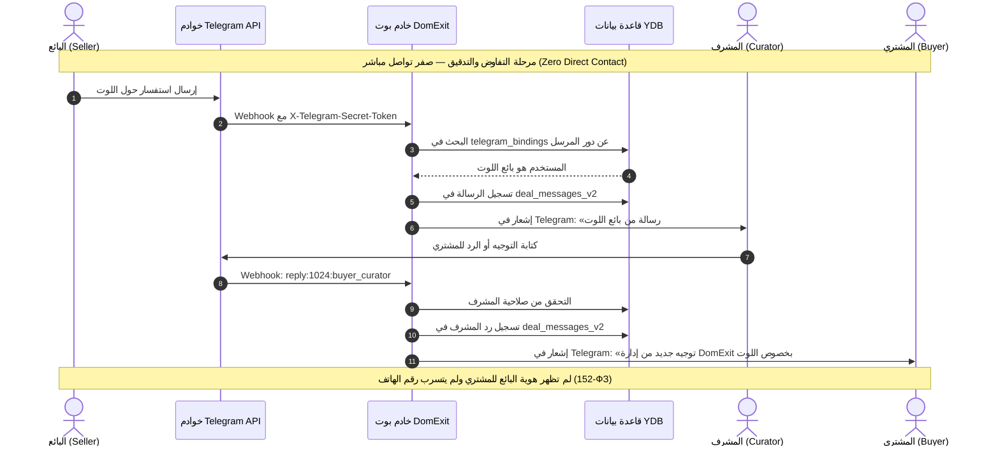

# الفصل 08: نظام تشغيل Telegram، الأتمتة المجدولة، كاسح اتفاقيات مستوى الخدمة، والتعافي من الكوارث

---

## 8.1 البنية المعمارية لنظام تشغيل Telegram (DomExit Telegram OS)

في السوق العقاري والاستثماري الروسي الحديث، لا يمثل تطبيق Telegram مجرد تطبيق تراسل فوري تقليدي، بل هو **بيئة العمل والتشغيل الافتراضية الأولى (De-Facto Operating System)** للمستثمرين ورجال الأعمال وسماسرة العقارات والمديرين التنفيذيين. لا ينتظر المستثمر فتح البريد الإلكتروني أو الدخول إلى لوحة التحكم من حاسوب مكتبي لمتابعة صفقة بملايين الروبلات؛ بل يُدار كل شيء بلحظية عبر الهاتف المحمول.

لهذا السبب، تم بناء منصة DomExit على فلسفة معمارية رائدة: **Telegram OS First**. صُمم النظام بحيث يستطيع كل من مالك المنصة (`Owner`)، والمشرفين ومديري الصفقات (`Curators / Employees`)، والمشترين المعتمدين (`Buyers`)، والبائعين (`Sellers`) قيادة وتتبع دورة حياة الصفقة بالكامل عبر Telegram، بدءاً من تلقي التنبيهات اللحظية، وتغيير مراحل التدقيق والتغليف عبر الأزرار التفاعلية، والتواصل الآمن المتبادل بين الأطراف دون كشف الهويات، وحتى استدعاء كونسيرج الذكاء الاصطناعي.

### 8.1.1 تجريد مزودات التراسل (Messenger Abstraction Layer)

لضمان المرونة الهندسية وتفادي الارتباط الحصري بجهة خارجية واحدة (Vendor Lock-in)، تم بناء طبقة تجريد متكاملة للمراسلة في مجلد `backend/src/lib/messenger/`:

```typescript
// backend/src/lib/messenger/IMessengerProvider.ts
export interface SendMessageOptions {
  chatId: number | string;
  text: string;
  parseMode?: 'HTML' | 'Markdown' | 'MarkdownV2';
  replyMarkup?: any;
  disableWebPagePreview?: boolean;
}

export interface IMessengerProvider {
  readonly name: string;
  isConfigured(): boolean;
  sendMessage(options: SendMessageOptions): Promise<{ ok: boolean; messageId?: number | string }>;
  answerCallbackQuery(options: { callbackQueryId: string; text?: string; showAlert?: boolean }): Promise<boolean>;
  setWebhook(url: string, secretToken?: string): Promise<boolean>;
  deleteWebhook(): Promise<boolean>;
  downloadFile(fileId: string): Promise<Buffer>;
}
```

- **`IMessengerProvider.ts`:** واجهة برمجية موحدة تحدد الدوال الأساسية لإرسال الرسائل، ومعالجة خطافات الويب (Webhooks)، وبناء لوحات المفاتيح التفاعلية، وتنزيل الملفات المرفقة.
- **`TelegramProvider.ts`:** التنفيذ الأساسي المعتمد على واجهة برمجيات Telegram Bot API الرسمية والمتكامل مع معايير الأمان الروسية.
- **`MaxProvider.ts`:** محول تجريدي جاهز للتوسع المستقبلي لدعم شبكات محلية بديلة (مثل منصة التراسل الروسية VK Messenger أو أنظمة المحادثات المؤسسية المغلقة) مع الحفاظ على نفس منطق الأعمال.
- **`messengerRegistry.ts`:** سجل مركزي يدير دورة حياة المزود النشط ويوفر آلية استبدال آمنة عند الحاجة دون تعديل في كود الأعمال الأساسي:
  ```typescript
  // backend/src/lib/messenger/messengerRegistry.ts
  class MessengerRegistry {
    private activeProvider: IMessengerProvider;
    constructor(defaultProvider: IMessengerProvider) {
      this.activeProvider = defaultProvider;
    }
    setProvider(provider: IMessengerProvider) {
      this.activeProvider = provider;
    }
    getProvider(): IMessengerProvider {
      return this.activeProvider;
    }
  }
  ```

### 8.1.2 ربط الحسابات وسجل الاقتران الفيدرالي (`telegram_bindings_v2`)

لتحقيق أعلى درجات الأمان والامتثال لقانون الخصوصية الروسي `152-ФЗ`، لا يعتمد النظام على أسماء المستخدمين (Usernames) المتغيرة في Telegram، بل يرتبط بمعرف الدردشة الرقمي الفريد الثابت (`chatId`).
تُدار عملية الربط عبر خطوتين موثقتين:

```
[المستخدم في واجهة الويب]
          │
          ▼ طلب ربط الحساب (POST /api/telegram/link-token)
┌────────────────────────────────────────────────────────┐
│ توليد رمز مشفر قصير الأجل (عمر 15 دقيقة)                 │
│ الرابط العميق: t.me/DomExitBot?start=link_<token>      │
└──────────────────────────┬─────────────────────────────┘
                           │
                           ▼ نقر الرابط في Telegram
┌────────────────────────────────────────────────────────┐
│ خطاف الويب يستقبل الأمر: /start link_<token>           │
│ فك التشفير، ومطابقة userId، والتحقق من الصلاحية        │
└──────────────────────────┬─────────────────────────────┘
                           │
                           ▼ إنشاء سجل الاقتران المزدوج
┌────────────────────────────────────────────────────────┐
│ YDB table: telegram_bindings_v2                        │
│ 1. المفتاح الأساسي: user:{userId}                      │
│ 2. المفتاح الثانوي: chat:{chatId}                      │
└────────────────────────────────────────────────────────┘
```

يُخزن سجل الاقتران في جدول `telegram_bindings_v2` بمفتاحين لضمان سرعة الاستعلام الثنائي ($O(1)$) دون الحاجة لعمليات مسح عريضة:
- سجل الفهرسة بالمستخدم: `user:{userId}` (للبحث عن قناة مراسلة مستخدم معين عند إرسال الإشعارات).
- سجل الفهرسة بالمحادثة: `chat:{chatId}` (للتعرف الفوري على هوية وصلاحيات مرسل الرسالة عند استقبال Webhook).

```typescript
export interface TelegramBindingRecord {
  id: string; // "user:{userId}" أو "chat:{chatId}"
  userId: string;
  chatId: number | string;
  telegramUsername?: string;
  telegramFirstName?: string;
  role: 'owner' | 'employee' | 'buyer' | 'seller';
  notificationsEnabled: boolean;
  aiConciergeActive?: boolean;
  linkedAt: string;
  lastActiveAt: string;
}
```

### 8.1.3 أمان خطاف الويب وحماية إعادة المحاولة (Webhook Security & Replay Prevention)

يعمل البوت في بيئة الإنتاج حصراً عبر نمط خطاف الويب (`Webhook`) المربوط بخدمة Yandex API Gateway (`POST /api/telegram/webhook`). يتم تأمين المسار وفق الضوابط البرمجية الصارمة التالية في `backend/src/routes/telegram.ts`:

1. **التحقق الآمن من السر السحابي عبر مقارنة زمنية ثابتة (`crypto.timingSafeEqual`):**
   يُطلب فحص ترويسة `X-Telegram-Bot-Api-Secret-Token`. لمنع هجمات التوقيت (Timing Attacks)، لا تُستخدم المقارنة النصية العادية، بل يتم التحقق عبر مكتبة التشفير المعيارية لـ Node.js:
   ```typescript
   const normHeaders = normalizeHeaders(event.headers, event.multiValueHeaders);
   const incomingSecret = (normHeaders['x-telegram-bot-api-secret-token'] || '').trim();
   const expectedSecret = cfg.TELEGRAM_WEBHOOK_SECRET?.trim() || '';

   if (
     !expectedSecret ||
     Buffer.byteLength(incomingSecret) !== Buffer.byteLength(expectedSecret)
   ) {
     return json(event, 403, { error: 'Forbidden: invalid webhook secret' });
   }

   const isAuthorized = crypto.timingSafeEqual(
     Buffer.from(incomingSecret),
     Buffer.from(expectedSecret)
   );
   if (!isAuthorized) {
     return json(event, 403, { error: 'Forbidden: invalid webhook secret' });
   }
   ```
2. **ذاكرة إلغاء التكرار في الذاكرة الحية (Replay De-duplication Ring Buffer):**
   تحسباً لأي تكرار غير مقصود لإرسال نفس التحديث من شبكة Telegram، يحتفظ الخادم بحلقة ذاكرة تتسع لـ 500 معرف تحديث أخير (`update_id`):
   ```typescript
   const seenUpdates = new Set<number>();
   const updateIdsQueue: number[] = [];

   function isDuplicateUpdate(updateId: number): boolean {
     if (!updateId) return false;
     if (seenUpdates.has(updateId)) return true;
     seenUpdates.add(updateId);
     updateIdsQueue.push(updateId);
     if (updateIdsQueue.length > 500) {
       const oldest = updateIdsQueue.shift();
       if (oldest !== undefined) seenUpdates.delete(oldest);
     }
     return false;
   }
   ```
3. **الرد الفوري بالرمز 200 OK:** الاستجابة الفورية لخوادم Telegram خلال أقل من 500 مللي ثانية لمنع انقطاع الاتصال وإعادة الإرسال، مع معالجة منطق الأعمال بشكل غير متزامن.

---

## 8.2 مفرّق الإشعارات الذكي القائم على الأدوار (`notificationDispatcher.ts` & `telegramNotifier.ts`)

تتطلب دورة حياة الصفقات العقارية نظام إشعارات بالغ الدقة يوجه المعلومة الصحيحة للشخص المعني حصراً، دون إغراق القنوات بإشعارات غير ذات صلة. يتولى ملفا `notificationDispatcher.ts` و`telegramNotifier.ts` تطبيق مصفوفة التوجيه الموجهة بالأدوار (Role-Based Notification Dispatcher).

### 8.2.1 جدول أحداث المنصة ومصفوفة التوجيه الوظيفي (Platform Event Matrix)

| كود الحدث | طبيعة الحدث والمستهدف | القناة الأساسية | نص الإشعار والإجراء التفاعلي |
| :--- | :--- | :---: | :--- |
| `LOT_CREATED` | إضافة عقار جديد من بائع (`Owner` و`Curators`) | Telegram OS | إشعار ببدء مرحلة الاستقبال مع بطاقة اللوت وزر «✅ Принять в работу». |
| `LOT_ASSIGNED` | تعيين مشرف محدد للوت (`Assigned Curator`) | Telegram OS | بطاقة مهمة حصرية تتضمن بيانات المجمع وسعر الدفع وزر فحص المستندات. |
| `STAGE_CHANGED` | ترقية مرحلة العقار (`Buyer`, `Seller`, `Curator`) | Telegram OS | تحديث الحالة لجميع الأطراف المعنية وفق مصفوفة الشفافية. |
| `OFFER_SUBMITTED` | تقديم عرض شراء جديد من مشترٍ ذهبي/فضي (`Curator`) | Telegram OS | تفاصيل العرض المالي، نسبة الحصة النقدية، وزر قبول/رفض العرض. |
| `OFFER_ACCEPTED` | قبول العرض المالي من المشرف والبائع (`Buyer`) | Telegram OS | توجيه المشتري لبدء التوقيع الإلكتروني وسداد حساب الضمان الإسكرو. |
| `ESCROW_OPENED` | إيداع المشتري للأموال في بنك الإسكرو (`Seller`, `Curator`) | Telegram OS | تأكيد مصرفي بحجز الأموال وبدء تقديم المعاملة للتسجيل في Rosreestr. |
| `SLA_WARNING` | اقتراب انتهاء مهلة الـ 24/48 ساعة (`Buyer`, `Curator`) | Telegram OS | إنذار برتقالي تذكيري مع عداد تنازلي لتفادي إلغاء الحجز. |
| `RADAR_ALERT` | رصد تغيير تشريعي حرج في القوانين الروسية (`Owner`) | Telegram OS | موجز التعديل القانوني، الأثر على المنصة، ورابط تعديل السياسات. |

### 8.2.2 هرمية قنوات التسليم الفيدرالية والاحتياطية (Delivery Fallback Cascade)

عند وقوع أي حدث في المنصة، يتبع المفرّق مسار تسليم هجين متدرج يضمن وصول التنبيه بنسبة 100%:

```
                       ┌───────────────────────────────┐
                       │     حدث جديد في المنصة        │
                       │     (Event Notification)      │
                       └───────────────┬───────────────┘
                                       │
                                       ▼
                       ┌───────────────────────────────┐
                       │ فحص جدول telegram_bindings_v2 │
                       │ هل يمتلك المستخدم حساب مرتبط؟  │
                       └───────────────┬───────────────┘
                                       │
                        ┌──────────────┴──────────────┐
                        │ نعم                         │ لا / غير مفعل
                        ▼                             ▼
         ┌─────────────────────────────┐┌─────────────────────────────┐
         │ القناة 1: Telegram OS        ││ القناة 2: البريد الإلكتروني │
         │ تسليم لحظي مهيأ بـ HTML     ││ رسالة رسمية مشفرة بـ TLS    │
         │ (telegramClient.sendMessage)││ (emailService.ts)           │
         └──────────────┬──────────────┘└──────────────┬──────────────┘
                        │ فشل الإرسال (Error)          │
                        └──────────────┬───────────────┘
                                       │
                                       ▼
                        ┌─────────────────────────────┐
                        │ القناة 3: سجل التدقيق الثابت │
                        │ حفظ دائم في جدول journal_v2  │
                        │ لا يُفقد التنبيه تحت أي ظرف  │
                        └─────────────────────────────┘
```

1. **القناة الأساسية (Telegram OS):** فحص جدول `telegram_bindings_v2`؛ إذا وُجد اقتراب نشط مع تفعيل الإشعارات (`notificationsEnabled !== false`)، تُرسل الرسالة فوراً بصيغة HTML مهيأة مع لوحة مفاتيح تفاعلية.
2. **القناة الاحتياطية الأولى (البريد الإلكتروني الموثق - `emailService.ts`):** في حال عدم وجود حساب Telegram مرتبط، أو إذا فشل استدعاء Telegram API، يُرسل إشعار بريدي مشفر إلى عنوان البريد الإلكتروني المسجل.
3. **القناة الدائمة (سجل النظام الداخلي - `journal.ts`):** تُسجل نسخة من كافة الأحداث والإشعارات دائماً في جدول `journal_v2` غير القابل للتعديل، بحيث يستطيع المستخدم مراجعتها في أي وقت من لوحة الإشعارات الداخلية داخل المنصة.

### 8.2.3 تعقيم نصوص HTML وقواعد التنسيق الآمن

تُعالج كافة المتغيرات المدخلة في نصوص الرسائل بدالة تعقيم صارمة `escapeHtml()` لمنع تلف رسائل Telegram أو هجمات حقن الوسوم:
```typescript
export function escapeHtml(str: string): string {
  if (!str) return '';
  return str
    .replace(/&/g, '&amp;')
    .replace(/</g, '&lt;')
    .replace(/>/g, '&gt;')
    .replace(/"/g, '&quot;');
}
```

---

## 8.3 أوامر البوت التفاعلية، ومعالجة ردود الأزرار، والترحيل المعزول للمحادثات

يوفر بوت DomExit واجهة تحكم متكاملة تدعم الأوامر النصية وردود الأزرار السريعة (Inline Keyboards) وترحيل الرسائل الآمن.

### 8.3.1 المعالجة البرمجية للأوامر النصية (`telegramCommands.ts`)

تتولى دالة `processTelegramUpdate()` فرز الرسائل الواردة وتوجيهها حسب الأمر والصلاحية:

1. **الأمر التأسيسي `/start` ومعالجة الروابط العميقة:**
   - إذا تضمن الأمر رمز اقتران (`/start link_<token>`): يتم استدعاء دالة تأكيد الربط وربط المعرف `chatId` بحساب المستخدم في YDB.
   - إذا تضمن الأمر معرف لوت عقاري (`/start lot_<lotCode>`): يعرض البوت فوراً بطاقة العقار المختصرة وسعره ونسبة التنازل، مع زر للانتقال المباشر لصفحة العقار على البوابة.
   - في حال الدخول المباشر: عرض رسالة الترحيب وقائمة الإجراءات السريعة وفق دور المستخدم.
2. **الأمر الإداري `/status`:**
   - متاح للمالك والمشرفين فقط.
   - يُظهر إحصائيات حية من قاعدة بيانات YDB: عدد اللوتات في مرحلة التدقيق القانوني (`legal_audit`)، ومرحلة التغليف (`packaging`)، واللوتات النشطة (`active`)، وحالة آخر دورة لكاسح SLA.
3. **الأمر التشغيلي `/tasks` و `/mytasks`:**
   - يستعرض قائمة المهام المعلقة الخاصة بالمشرف مع أزرار الانتقال الفوري للوت المعني.
4. **الأمر التفاعلي `/ai`:**
   - تفعيل وضع المساعد العقاري القانوني الفوري المربوط بـ YandexGPT وفهرس RAG المعرفي.

### 8.3.2 معالجة ردود الأزرار التفاعلية (`telegramCallbacks.ts`)

تتلقى دالة `handleTelegramCallback()` نقرات المستخدمين على الأزرار التفاعلية وتنفذ منطق الأعمال المرتبط بها بأقصى سرعة، مع استدعاء `answerCallbackQuery` فوراً لإيقاف مؤشر التحميل في تطبيق Telegram:

```typescript
// backend/src/lib/telegramCallbacks.ts (مقتطف معالجة المهام)
export async function handleTelegramCallback(cq: any, binding: any, ydb: any, cfg: any): Promise<void> {
  const cqId = cq.id;
  const data = cq.data || '';
  const chatId = cq.message?.chat?.id || cq.from?.id;
  if (!chatId) return;

  // إيقاف مؤشر التحميل في Telegram فوراً
  await telegramClient.answerCallbackQuery({ callback_query_id: cqId });

  // 1. قبول المشرف للمهمة واستلام اللوت
  if (data.startsWith('accept:')) {
    const lotCode = data.split(':')[1];
    const actor = { id: binding.userId, role: binding.role, name: binding.telegramFirstName };
    const result = await assignCuratorToLot({ lotCode, employeeId: binding.userId, actor });
    
    await telegramClient.editMessageText({
      chat_id: chatId,
      message_id: cq.message.message_id,
      text: `✅ <b>Лот #${lotCode} взят в работу куратором</b>\nЭтап переведен в «Юридический аудит».`,
      parse_mode: 'HTML',
    });
    return;
  }

  // 2. إدارة مراحل اللوت (Stage Transition Menu)
  if (data.startsWith('set_stage:')) {
    const [, lotCode, targetStage] = data.split(':');
    const actor = { id: binding.userId, role: binding.role };
    await transitionLotStage({ lotCode, targetStage, actor });
    await telegramClient.sendMessage({
      chat_id: chatId,
      text: `🔄 Этап лота #${lotCode} успешно изменен на <b>${STAGE_LABELS[targetStage] || targetStage}</b>.`,
      parse_mode: 'HTML',
    });
    return;
  }
}
```

- **`accept:<lotCode>` (استلام المهمة):** عندما يُسند لوت جديد، يتلقى المشرف رسالة بزر تفاعلي «✅ Принять в работу». عند النقر، يتحقق النظام من الصلاحية، ويحدث حقل `assignedEmployeeId` في جدول `lots_v2`، وينقل المرحلة إلى `legal_audit`.
- **`stage_menu:<lotCode>` و `set_stage:<lotCode>:<targetStage>` (قائمة المراحل):** تفتح للمشرف قائمة خيارات للانتقال بين المراحل المسموح بها وفق مصفوفة الحوكمة `STAGE_TRANSITIONS` (مثل النقل إلى `packaging` أو `rejected`).
- **`unlink` أو `settings:unlink` (فك اقتران الحساب):** حذف السجلات المزدوجة من جدول `telegram_bindings_v2` وإلغاء الربط بأمان وتأكيد ذلك للمستخدم.

### 8.3.3 نظام الترحيل المعزول لمحادثات الصفقات (Zero Direct Party Contact Relay)

**مبدأ قانوني وأمني قطعي في DomExit:** يُحظر تماماً التواصل المباشر بين المشتري والبائع خارج رقابة وإشراف المنصة، لحماية أطراف الصفقة من الاحتيال، ولمنع تسريب البيانات الشخصية (`152-ФЗ`)، ولتجنب محاولات الالتفاف على التزامات السداد عبر إسكرو.

لتحقيق ذلك، يطبق البوت نظام ترحيل وسيط معزول ثنائي القنوات (Isolated Relay System):
- **قناة البائع والمشرف (`seller_curator`):** يتحدث البائع مع البوت، فيقوم النظام بتغليف رسالته وترحيلها إلى حساب المشرف المخصص للصفقة مع وسم برقم اللوت `#LOT-XXXX`.
- **قناة المشتري والمشرف (`buyer_curator`):** يتحدث المشتري مع البوت، ويصل استفساره إلى المشرف نفسه.
- **الحجب الكامل للبيانات الشخصية:** لا يرى أي طرف اسم الطرف الآخر أو رقم هاتفه أو حسابه على Telegram. يتولى المشرف دور الوسيط المهني الحصري الذي ينقل الاستفسارات والتوضيحات الفنية بعد تنقيحها، مع تسجيل كل رسالة بالمللي ثانية في جدول `deal_messages_v2` في قاعدة بيانات YDB للرجوع إليها في حال حدوث أي نزاع مستقبلي.

---

## 8.4 وضع كونسيرج الذكاء الاصطناعي المباشر ومنع تصادم المشرف البشري (Zero Curator Collision)

يتيح البوت للمستخدمين الدخول في محادثة استشارية حرة مع مساعد الذكاء الاصطناعي عبر الأمر `/ai`. ومع ذلك، فإن أكبر تحدٍ تشغيلي في روبوتات التراسل الهجينة هو **خطر التصادم بين الذكاء الاصطناعي والمشرف البشري (Bot-Curator Collision)** — كأن يتدخل المشرف البشري للإجابة على استفسار دقيق للعميل، بينما يستمر الروبوت الآلي في توليد إجابات متزامنة، مما يربك العميل ويضر بمصداقية المنصة.

تم حل هذه المعضلة عبر بروتوكول حظر التصادم الحتمي في ملف `telegramWorkflow.ts`:

1. **إدارة حالة الجلسة المتزامنة:**
   تحتفظ المنصة بحالة جلسة الكونسيرج في جدول `ai_concierge_sessions_v2` مربوطة بـ `telegramChatId`.
2. **الإلغاء التلقائي اللحظي عند تدخل المشرف (Automatic Curator Preemption):**
   بمجرد أن يرسل المشرف البشري أي رسالة أو رد عبر لوحة التحكم أو عبر البوت، يقوم النظام برصد المعرف الوظيفي للمرسل، وتعطيل استجابة الذكاء الاصطناعي للجلسة فوراً (`handoffStatus = 'resolved'`)، وتوجيه المحادثة لتصبح يدوية بالكامل.
3. **الحماية من تكرار الإجابات:** يتوقف محرك RAG تماماً عن معالجة رسائل العميل في هذه الجلسة طالما أن المحادثة تحت إشراف المشرف، ولا يمكن إعادة تفعيل الذكاء الاصطناعي إلا إذا طلب العميل ذلك صراحة عبر كتابة الأمر `/ai` مجدداً.

---

## 8.5 كاسح اتفاقيات مستوى الخدمة الحتمي (The 15-Minute SLA Sweeper Engine)

تعتمد سرعة وكفاءة منصة DomExit على الانضباط الصارم للوقت. لا يمكن للمنصة أن تترك لوتات معلقة دون مراجعة، أو تسمح بتفويت مواعيد سداد الإسكرو، أو تبقي عروض البيع الحصرية لفئة معينة دون إتاحتها لبقية المستثمرين بعد فوات الأوان.

ملف `backend/src/lib/slaSweeperService.ts` هو **المحرك القلبي النابض للمنصة**؛ حيث يُستدعى كدالة سحابية كل **15 دقيقة** عبر خدمة المجدول السحابي الرسمي `Yandex Cloud Timer` المتكامل مع رسائل طابور `Yandex Message Queue (YMQ)`.

### 8.5.1 تحسين استهلاك الموارد بالمسح الفردي المشترك (Single Shared Lots Scan)

في النسخ الهندسية التقليدية، تقوم كل مهمة فحص بعملية مسح شاملة لجدول العقارات (`Scan lots`)، مما يهدر وحدات القراءة الحاسوبية ويسبب تباطؤاً ملحوظاً.
يحل كاسح SLA في DomExit هذه المشكلة عبر **المسح الفردي المشترك**:
يتم تنفيذ استعلام مسح واحد فقط لجدول `lots_v2` في بداية الدورة وتخزين مصفوفة اللوتات في الذاكرة الحية (`sharedLots`)، ثم تمرير نفس المصفوفة لمعالجة كافة المهام في الدورة، مما يلغي استهلاك القراءة المكرر بنسبة تزيد عن 75%.

### 8.5.2 المهام الحتمية المنفذة كل 15 دقيقة (15-Min Cadence Tasks)

```typescript
export interface SlaSweepResult {
  ok: boolean;
  timestamp: string;
  lotsScanCount: number;
  dailyTasksExecuted: boolean;
  silverWaveOpenedCount: number;
  expiredDropsClosedCount: number;
  priority1DeadlinesAlertedCount: number;
  sellerSlaEscalatedCount: number;
  partnerReservationsExpiredCount: number;
  staleLotsAlertedCount: number;
  prunedRateLimitsCount: number;
  prunedPepOtpsCount: number;
  dryRun?: boolean;
}
```

1. **المهمة 1: فتح الموجة الفضية تلقائياً (`Silver Wave Auto-Open`):**
   - فحص اللوتات في وضع الطرح التدريجي (`staged_drop`) والموجة الذهبية (`gold_wave`).
   - إذا انتهت فترة حصرية الذهب (`now >= goldExclusiveUntil`) ولم تكتمل السعة القصوى للطلبات:
     - ترقية `waveStatus` إلى `silver_wave`.
     - استخراج المشترين في الفئة الفضية وبث إشعار فوري لهم عبر Telegram OS.
2. **المهمة 2: إغلاق نوافذ الطرح المنتهية (`Expired Drops Closure`):**
   - فحص اللوتات التي تجاوزت موعد الإغلاق النهائي (`now >= closesAt`).
   - نقل حالة الطرح إلى `closed_evaluation`.
   - إرسال بطاقة تقييم العروض للمشرف للبدء في مفاضلة طلبات الشراء وتحديد العرض الفائز عبر `buyBoxEngine`.
3. **المهمة 3: تصعيد لوتات المرحلة 0 (`Stage 0 Intake Escalation`):**
   - فحص اللوتات الجديدة في `intake_moderation` التي لم يُعين لها مشرف منذ أكثر من 15 دقيقة.
   - إرسال تنبيه عاجل لجميع المشرفين والمالك في Telegram مع زر تفاعلي للاستلام الفوري لمنع تأخر استقبال العملاء.
4. **المهمة 4: مراقبة المواعيد النهائية ذات الأولوية وتصعيد التأخيرات (24h/48h Priority Deadlines):**
   - مراقبة الصفقات في مرحلة إغلاق العقد `deal_closing` أو الحجز `reserved`:
     - متبقي أقل من 24 ساعة على انتهاء مهلة التوقيع الرقمي أو إيداع الإسكرو: تنبيه تذكيري للمشتري.
     - متبقي أقل من 6 ساعات: إنذار أخير برتقالي للمشتري وتنبيه للمشرف.
     - انقضاء المهلة: إشعار المالك لإلغاء الحجز وإعادة طرح اللوت للجمهور مع معاقبة المشتري الجاد غير الملتزم بخفض تصنيفه.
5. **المهمة 5: رادار ركود اللوتات (10-Day Lot Stagnation Radar):**
   - رصد أي عقار معروض في الكتالوج `active` لم يتلقَّ أي حجز أو طلب شراء جاد منذ 10 أيام.
   - تنبيه المشرف لإعادة تشغيل محرك AVM لمراجعة السعر وخصم التنازل، أو إعادة صياغة الوصف التسويقي بواسطة كاتب الذكاء الاصطناعي.
6. **المهمة 6: إنهاء حجز الوسطاء الشركاء المنتهي (Partner Broker Reservation Expiry):**
   - اللوتات المحجوزة لعملاء مكاتب السمسرة الشريكة التي تجاوزت مدة الـ 48 ساعة دون سداد الضمان.
   - إلغاء الحجز تلقائياً وإعادة العقار للحالة النشطة `active` مع إشعار الوسيط.
7. **المهمة 7: تنظيف الجداول المؤقتة ذات العمر المحدد (TTL Pruning):**
   - حذف سجلات محاولات تسجيل الدخول المنتهية من جدول `rate_limits_v2`.
   - حذف رموز التحقق والتوقيع المنتهية من جدول `pep_otps_v2` للحفاظ على نظافة قاعدة البيانات وتقليص حجم التخزين.

### 8.5.3 نافذة المهام اليومية الاستراتيجية وتصدير DataLens المجرد من الهوية

لضمان عدم التأثير على زمن الاستجابة في النهار، تُخصص أول دورة كاسح تقع بعد الساعة **03:00 فجراً بتوقيت غرينتش (UTC)** لتنفيذ حزمة المهام اليومية الاستراتيجية:

1. **مزامنة سعر الفائدة للبنك المركزي (`syncCbrKeyRate()`):**
   الاتصال التلقائي بموجز الأخبار الرسمي لـ `cbr.ru`، واستخراج نسبة الفائدة الأساسية المحدثة، وتحديث جدول `market_settings` لضبط تقييمات محرك AVM تلقائياً لليوم الجديد.
2. **تشغيل رادار التشريعات الروسية (`runLegislativeRadarScan()`):**
   مسح المصادر الحكومية الستة، وتصفية الأخبار القانونية، وتوليد تنبيهات الامتثال ومسودات مقالات المجلة.
3. **تصدير ذكاء الأعمال المجرد لـ Yandex DataLens (`datalensExportService.ts`):**
   توليد وتحديث التقرير التحليلي الموسع للصفقات والمؤشرات الاستثمارية ورفعه إلى S3 كملفات بتنسيق NDJSON خفيفة خالية تماماً من أي بيانات شخصية (Zero-PII DataLens Export) لتغذية لوحات التحليل البياني للإدارة:

```typescript
// backend/src/modules/proptech-ai/datalensExportService.ts (بوابة الأمان الصارمة)
const EMAIL_REGEX = /[a-zA-Z0-9._%+-]+@[a-zA-Z0-9.-]+\.[a-zA-Z]{2,}/;
const RU_PHONE_REGEX = /(?:\+7|8)[\s\-(]*\d{3}[\s\-)]*\d{3}[\s\-]*\d{2}[\s\-]*\d{2}/;
const INDIVIDUAL_INN_REGEX = /\b\d{12}\b/;
const PASSPORT_REGEX = /\b\d{4}\s*\d{6}\b/;

export function assertZeroPiiInExport(content: string, filename: string): void {
  if (EMAIL_REGEX.test(content)) {
    throw new Error(`[Zero-PII Gate Violation] Email detected in ${filename}. Upload aborted!`);
  }
  if (RU_PHONE_REGEX.test(content)) {
    throw new Error(`[Zero-PII Gate Violation] Phone number detected in ${filename}. Upload aborted!`);
  }
  if (INDIVIDUAL_INN_REGEX.test(content)) {
    throw new Error(`[Zero-PII Gate Violation] 12-digit individual INN detected in ${filename}. Upload aborted!`);
  }
  if (PASSPORT_REGEX.test(content)) {
    throw new Error(`[Zero-PII Gate Violation] Passport pattern detected in ${filename}. Upload aborted!`);
  }
}
```

تنتج هذه الخدمة 4 مجموعات بيانات في المسار السحابي `S3_PRIVATE_BUCKET/_analytics/datalens/`:
- `deals_funnel.ndjson`: تحليل دورة حياة الصفقات، وديناميكيات الخصم، وسرعة دوران العقارات دون ذكر أي اسم أو هاتف.
- `curator_sla_kpi.ndjson`: مقاييس كفاءة المشرفين، ومعدل إنجاز التدقيق القانوني، ونسب الاستجابة.
- `ai_finops_usage.ndjson`: استهلاك وحدات الذكاء الاصطناعي، وتكلفة الرموز لكل لوت شهرياً.
- `journal_seo_metrics.ndjson`: أداء مقالات المجلة، والتحويلات العضوية لكتالوج الفرص الاستثمارية.

---

## 8.6 خدمة النسخ الاحتياطي التلقائي والتعافي من الكوارث (`backupService.ts`)

تُمثل قاعدة بيانات YDB وسجلات الصفقات والعقود أصول الشركة الأكثر قيمة وحساسية. لا تحتمل المنصة أي احتمال لفقدان البيانات نتيجة خطأ بشري أو عطل في مراكز البيانات.
يوفر ملف `backend/src/lib/backupService.ts` نظام نسخ احتياطي فيدرالي آلي مستقل، يعمل بمستوى حماية بنكي متقدم.

### 8.6.1 استدعاء DocAPI المباشر بتوقيع AWS Signature Version 4

نظراً لأن منصة DomExit تتصل بـ Yandex Database عبر بروتوكول متوافق مع Document API / DynamoDB، يتجاوز نظام النسخ الاحتياطي أية مكتبات خارجية غير مستقرة ويقوم باستدعاء واجهات DocAPI مباشرة عبر دالة `callDocApiDirect()`.
تعتمد الدالة على **التوقيع الرقمي الكامل AWS4-HMAC-SHA256**:

```typescript
// backend/src/lib/backupService.ts (اشتقاق توقيع SigV4 للنسخ الاحتياطي)
function getSigningKey(secretKey: string, dateStamp: string, region: string, service: string): Buffer {
  const kDate = crypto.createHmac('sha256', 'AWS4' + secretKey).update(dateStamp).digest();
  const kRegion = crypto.createHmac('sha256', kDate).update(region).digest();
  const kService = crypto.createHmac('sha256', kRegion).update(service).digest();
  return crypto.createHmac('sha256', kService).update('aws4_request').digest();
}
```

- حساب بصمة الترويسات ومحتوى الطلب الثنائي (`sha256Hex(body)`).
- اشتقاق مفتاح التوقيع المتسلسل للتاريخ والمنطقة (`ru-central1`) وخدمة `dynamodb`.
- توليد ترويسة المصادقة الموثقة `Authorization: AWS4-HMAC-SHA256 Credential=...` مع آلية إعادة محاولة تلقائية (3 محاولات) مع تراجع أسي (Exponential Backoff) في حال واجهت الشبكة ضغطاً أو رمز خطأ 503/504.

### 8.6.2 الجدولة اليومية والضغط بـ Gzip (Daily 02:00 UTC Protocol)

يتم تشغيل النسخ الاحتياطي يومياً عند الساعة **02:00 فجراً بتوقيت UTC** (قبل نافذة صيانة الكاسح في 03:00 UTC). يتبع البروتوكول الخطوات التالية:
1. **المسح الشامل لكافة الجداول الـ 20 في YDB v2:** استخراج جميع السجلات عبر استعلامات Scan متتالية تدعم الترقيم التدريجي `ExclusiveStartKey`.
2. **تحويل البيانات وتجريدها من صيغة DynamoDB الأولية:** تمرير السجلات عبر دالة `fromDynamo()` لإنتاج كائنات JSON نظيفة ومقروءة بشرياً:
   ```javascript
   function fromDynamo(attr) {
     if (!attr) return null;
     if ('S' in attr) return attr.S;
     if ('N' in attr) return Number(attr.N);
     if ('BOOL' in attr) return attr.BOOL;
     if ('NULL' in attr) return null;
     if ('L' in attr && Array.isArray(attr.L)) return attr.L.map(fromDynamo);
     if ('M' in attr && typeof attr.M === 'object') {
       const obj = {};
       for (const k of Object.keys(attr.M)) obj[k] = fromDynamo(attr.M[k]);
       return obj;
     }
     return null;
   }
   ```
3. **الضغط الثنائي فائق الكفاءة (Zlib Gzip Compression):** ضغط مصفوفة البيانات الضخمة بمستوى ضغط متقدم (`zlib.gzipSync`)، مما يقلص حجم النسخة الاحتياطية بنسبة تتراوح بين 80% إلى 90%.
4. **الرفع المشفر إلى دلو التخزين الخاص S3:**
   تُحفظ النسخة في مسار مخصص وفق التنسيق التالي:
   `S3_PRIVATE_BUCKET/backups/daily/ydb_backup_{env}_{YYYY-MM-DDTHH-mm-ss}.json.gz`

### 8.6.3 سياسة الاحتفاظ لـ 30 يوماً والتشذيب الآلي (Retention Policy & Auto-Pruning)

لتفادي التراكم اللانهائي للملفات وتضخم تكاليف التخزين في Yandex Object Storage، يطبق النظام سياسة تشذيب حتمية بعد إتمام كل عملية نسخ احتياطي ناجحة:
- استعراض النسخ الاحتياطية المحفوظة في المجلد `backups/daily/`.
- ترتيب النسخ زمنياً من الأحدث إلى الأقدم.
- الاحتفاظ بآخر **30 نسخة احتياطية يومية**، وحذف أي نسخ أقدم بصورة نهائية وآلية عبر أمر `DeleteObjectCommand`.

### 8.6.4 مناورة استعادة البيانات والتعافي من الكوارث (Disaster Recovery Runbook)

تم توثيق واختبار دليل استعادة البيانات في حالات الطوارئ القصوى (مثل تلف قاعدة البيانات أو الرغبة في العودة لحالة سابقة بعد عطل بشري):

```
                        ┌───────────────────────────────┐
                        │   إعلان حالة الطوارئ والتعافي │
                        │  (Disaster Recovery Incident) │
                        └───────────────┬───────────────┘
                                        │
                                        ▼
                        ┌───────────────────────────────┐
                        │ 1. اختيار النسخة المستهدفة    │
                        │ backups/daily/ydb_backup_*.gz │
                        └───────────────┬───────────────┘
                                        │
                                        ▼
                        ┌───────────────────────────────┐
                        │ 2. تنزيل وفك الضغط zlib.gunzip│
                        │ التحقق من سلامة كائن JSON     │
                        └───────────────┬───────────────┘
                                        │
                                        ▼
                        ┌───────────────────────────────┐
                        │ 3. تشغيل تجريبي معزول Dry-Run │
                        │ مطابقة الجداول مع ydbV2Schema │
                        └───────────────┬───────────────┘
                                        │
                                        ▼
                        ┌───────────────────────────────┐
                        │ 4. حقن متسلسل BatchWriteItem  │
                        │ دفعات 25 عنصراً لتجنب التقييد │
                        └───────────────┬───────────────┘
                                        │
                                        ▼
                        ┌───────────────────────────────┐
                        │ 5. اختبارات التكامل والتحقق    │
                        │ تشغيل /api/health والتوثيق    │
                        └───────────────────────────────┘
```

1. **أهداف التعافي المعتمدة (SLA Targets):**
   - **هدف وقت التعافي (RTO - Recovery Time Objective):** أقل من **30 دقيقة** لإعادة النظام بالكامل للعمل.
   - **هدف نقطة التعافي (RPO - Recovery Point Objective):** أقل من **24 ساعة** (نظراً لدورية النسخ اليومية عند 02:00 UTC).
2. **خطوات الاستعادة الإجرائية (Runbook Steps):**
   - **الخطوة 1:** الحصول على مسار النسخة من S3 عبر سطر الأوامر أو لوحة التحكم السحابية:
     ```bash
     yc storage s3 cp s3://domexit-private-storage/backups/daily/ydb_backup_prod_latest.json.gz ./restore.json.gz
     ```
   - **الخطوة 2:** فك ضغط الملف محلياً والتحقق من سلامة البنية:
     ```bash
     gzip -d ./restore.json.gz
     ```
   - **الخطوة 3:** تنفيذ سكربت الصيانة مع راية التأكيد الإلزامية لتفادي أي خطأ غير مقصود:
     ```bash
     node infrastructure/scripts/prod-ydb-maintenance.mjs --confirm-prod
     ```
   - **الخطوة 4:** حقن السجلات عبر دفعات `BatchWriteItem` (25 عنصراً لكل دفعة) مع مراقبة أخطاء الشبكة.
   - **الخطوة 5:** إجراء اختبارات تكامل سريعة (Smoke Tests) تشمل تسجيل الدخول، وفحص لوت اختباري، والتأكد من استقرار نقطة النهاية `/api/health`.

---

## 8.7 مخططات التدفق البياني لنظام Telegram OS ودورة مهام كاسح SLA (Mermaid Diagrams)

### 8.7.1 مخطط ترحيل الرسائل المعزول عبر Telegram OS



### 8.7.2 مخطط دورة مهام كاسح اتفاقيات مستوى الخدمة (SLA Sweeper Cycle)

```mermaid
flowchart TD
    START(["بدء دورة الكاسح (كل 15 دقيقة)<br>Yandex Cloud Timer"]) --> SCAN["مسح فردي مشترك لجدول lots_v2<br>(Single Shared Lots Scan)"]
    
    SCAN --> T1{"المهمة 1: فحص حصرية الذهب<br>now >= goldExclusiveUntil؟"}
    T1 -- نعم --> T1_ACT["ترقية اللوت إلى الموجة الفضية (Silver Wave)<br>بث إشعار فوري لمشتري الفضة في Telegram"]
    T1 -- لا --> T2
    T1_ACT --> T2

    T2{"المهمة 2: فحص موعد إغلاق الطرح<br>now >= closesAt؟"}
    T2 -- نعم --> T2_ACT["إغلاق الطرح وتغيير الحالة إلى closed_evaluation<br>إرسال بطاقة تقييم العروض للمشرف"]
    T2 -- لا --> T3
    T2_ACT --> T3

    T3{"المهمة 3: ركود مرحلة الاستقبال<br>status == intake_moderation لأكثر من 15 دقيقة؟"}
    T3 -- نعم --> T3_ACT["تصعيد عاجل: إرسال تنبيه للمالك وطاقم العمل في Telegram<br>عرض زر تفاعلي لقبول المهمة فورا"]
    T3 -- لا --> T4
    T3_ACT --> T4

    T4{"المهمة 4: مهلات التوقيع والإسكرو<br>متبقي < 24h أو < 6h؟"}
    T4 -- نعم --> T4_ACT["إرسال إنذار أخير للمشتري بالدفع<br>إخطار المشرف لإمكانية إلغاء الحجز"]
    T4 -- لا --> T5
    T4_ACT --> T5

    T5{"المهمة 5: فحص ركود اللوتات<br>نشط لأكثر من 10 أيام دون حركة؟"}
    T5 -- نعم --> T5_ACT["تنبيه المشرف لمراجعة التسعير بـ AVM<br>أو إعادة كتابة الوصف التسويقي بـ AI"]
    T5 -- لا --> T6
    T5_ACT --> T6

    T6["المهمة 7: تنظيف الجداول المؤقتة<br>TTL Pruning لـ rate_limits و pep_otps"] --> T_DAILY{"هل النافذة فجراً بعد 03:00 UTC؟"}

    T_DAILY -- نعم (مرة يومياً) --> D1["1. مزامنة فائدة البنك المركزي cbr.ru<br>2. تشغيل رادار القوانين الروسية<br>3. تصدير DataLens المجرد من PII إلى S3"]
    T_DAILY -- لا --> FINISH(["إنهاء الدورة وحفظ النتيجة في السجل"])
    D1 --> FINISH
```



---

## 8.8 خلاصة الفصل وجاهزية المنظومة

باكتمال تفاصيل هذا الفصل، يتضح بجلاء كيف تشكل أدوات الأتمتة المجدولة ونظام تشغيل Telegram OS شبكة الأمان والتشغيل المتكاملة لمنصة DomExit:
1. **العمليات اللحظية بدون احتكاك:** تحويل Telegram إلى منصة عمليات كاملة تُمكّن المشرفين من قيادة الصفقات، وتوفر للبائعين والمشترين بيئة تواصل آمنة خالية من مخاطر تسريب الهويات أو الاحتيال.
2. **الانضباط الزمني الحتمي لكاسح SLA:** محرك وقائي صارم ينفذ مهام متزامنة كل 15 دقيقة بمسح مشترك واحد، مانعاً أي تراخٍ في إسناد المهام أو تضييع للمهل الزمنية الحساسة للصفقات.
3. **الحصانة السيادية والتعافي الفوري:** بروتوكول نسخ احتياطي يومي مشفر بـ AWS4-HMAC-SHA256 يضمن حفظ أدق تفاصيل الصفقات في S3 مع سياسة احتفاظ لـ 30 يوماً وإمكانية استرجاع فورية.

في الجزء القادم من الكتاب المرجعي (الجزء 5 والأخير — الفصلان 09 و10)، سنقوم بتوثيق **منظومة الأمن السيبراني المتقدم، والامتثال الصارم لقانون البيانات الروسي 152-ФЗ، ومسارات النشر السحابي CI/CD، وإجراءات التشغيل القياسية (SOPs) للطوارئ**، لنختتم هذا الصرح التوثيقي الشامل لمنصة DomExit.
