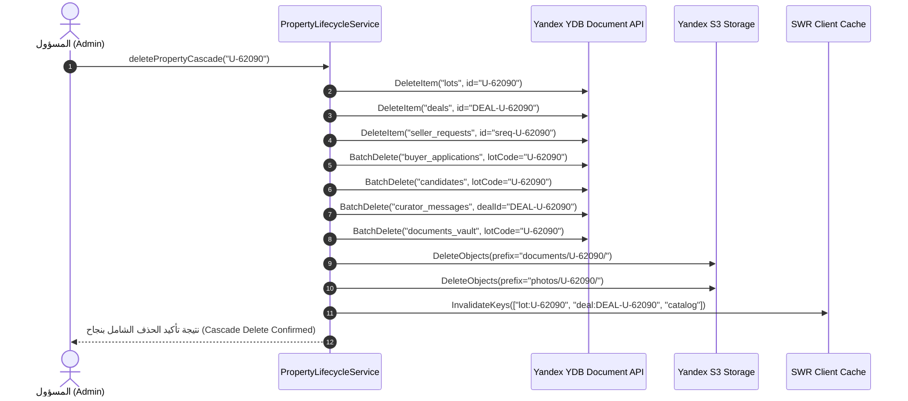

# الفصل الرابع: نماذج البيانات ومخطط قواعد البيانات (Data Models & Database Schema)

يعتمد تطبيق **DomExit** في تخزين وإدارة بياناته على معمارية هجينة سحابية متقدمة ترتكز على **Yandex Cloud**؛ حيث تُدار البيانات العلائقية والمستندية عبر **Yandex YDB Document API** (المتوافقة برمجياً مع بروتوكول DynamoDB JSON-1.0)، بينما تُحفظ الملفات والمستندات الثبوتية والصور الفوتوغرافية في **Yandex Object Storage (S3)**.

تتميز هذه الطبقة بثلاث ركائز معمارية رئيسية:
1. **معمارية المعرّف الموحّد (Canonical Unified ID):** حيث يُمثّل كود العقار (مثل `U-62090`) المعرّف الرئيسي والفريد عبر جميع الجداول (`lots.id === lots.lotCode`، `deals.id === 'DEAL-' + lotCode`، `seller_requests.id === 'sreq-' + lotCode`).
2. **العزل التام بين بيئتي التجربة والإنتاج (Dynamic Dual-Environment Isolation):** عبر محول العناوين `collectionResolver.ts` الذي يقوم ديناميكياً بتوجيه الاستعلامات في بيئة التجربة (Sandbox/Demo) إلى جداول مستقلة مسبوقة بـ `demo_`، مانعاً أي تداخل مع بيانات الإنتاج الحقيقية.
3. **الحذف المتسلسل الشامل (Cascade Deletion):** عبر خدمة `PropertyLifecycleService.deletePropertyCascade` التي تضمن إزالة كافة السجلات المرتبطة بالعقار ومستنداته وصوره ومحادثاته وسجلات كاش المتصفح دفعة واحدة عند الحذف.

---

## 1. المعمارية العامة ومحددات التخزين السحابي

```mermaid
flowchart TD
    subgraph Client Application
        UI[React 18 / Vite UI]
        Gateway[DatabaseGateway]
        SWR[SWRCache & RequestDeduplicator]
        Resolver[collectionResolver]
    end

    subgraph Yandex Cloud Infrastructure
        subgraph YDB Document API
            ProdTables[(26 Production Collections)]
            DemoTables[(22 Demo Collections: demo_*)]
        end
        subgraph Yandex Object Storage S3
            Bucket[(domexit-storage-vault)]
            DocsPath[documents/{lotCode}/*]
            PhotosPath[photos/{lotCode}/*]
        end
    end

    UI --> Gateway
    Gateway --> SWR
    SWR --> Resolver
    Resolver -->|currentEnv === 'production'| ProdTables
    Resolver -->|currentEnv === 'demo'| DemoTables
    UI -->|Presigned Upload / Download| Bucket
    Bucket --> DocsPath
    Bucket --> PhotosPath
```

### بروتوكول الاتصال بـ Yandex YDB Document API
يتم التواصل مع محرك YDB عبر بروتوكول **DynamoDB Wire Protocol (JSON-1.0)** باستخدام توقيع الطلبات **AWS Signature Version 4 (HMAC-SHA256)**:
- **نقطة النهاية الافتراضية (DocAPI Endpoint):** `https://docapi.serverless.yandexcloud.net/ru-central1/b1gbu0q3jqnheri2srsu/etnckg937628mnid7tnb`
- **المنطقة السحابية (Region):** `ru-central1`
- **اسم الخدمة في التوقيع (Signing Service):** `dynamodb`
- **نوع الدفع والتسعير (Billing Mode):** `PAY_PER_REQUEST` (Serverless On-Demand)
- **مخطط المفاتيح (Key Schema):** مفتاح تجزئة واحد لجميع الجداول:
  ```json
  {
    "KeySchema": [{ "AttributeName": "id", "KeyType": "HASH" }],
    "AttributeDefinitions": [{ "AttributeName": "id", "AttributeType": "S" }]
  }
  ```

---

## 2. جدول المجموعات والتطابق بين الإنتاج والتجربة (Collections Matrix)

يتضمن النظام **26 مجموعة في بيئة الإنتاج** و**22 مجموعة معزولة في بيئة التجربة**، بالإضافة إلى مجموعات الإعدادات المشتركة:

| المجموعة في بيئة الإنتاج (Production) | المجموعة في بيئة التجربة (Demo/Sandbox) | الغرض التشغيلي وطبيعة البيانات | نوع المفتاح الأساسي |
| :--- | :--- | :--- | :--- |
| `lots` | `demo_lots` | سجلات العقارات وحصص الاستثمار وإعلانات Переуступка | `id` (String: `U-XXXXX`) |
| `deals` | `demo_deals` | مسارات متابعة الصفقات ومراحلها الخمس ومواعيدها | `id` (String: `DEAL-XXXXX`) |
| `seller_requests` | `demo_seller_requests` | طلبات البائعين الأولية الواردة من استمارة الخروج | `id` (String: `sreq-XXXXX`) |
| `buyer_applications` | `demo_buyer_applications` | طلبات المشترين وحجوزات العقارات | `id` (String: `bapp-XXXXX`) |
| `candidates` | `demo_candidates` | المشترون المرشحون ومطابقتهم مع العقار في Matchmaker | `id` (String: `cnd-XXXXX`) |
| `documents_vault` | `demo_documents_vault` | المستودع المركزي للمستندات والملفات الثبوتية وفحوصاتها | `id` (String: `doc-XXXXX`) |
| `escrow_bridge_chats` | `demo_escrow_bridge_chats` | محادثات جسر الضمان وحسابات الإسكرو بين الأطراف | `id` (String) |
| `curator_messages` | `demo_curator_messages` | سجل رسائل المحادثة الفورية مع المنسق القانوني للعقار | `id` (String) |
| `deal_messages` | `demo_deal_messages` | الرسائل والملاحظات الداخلية في غرفة الصفقات الإدارية | `id` (String) |
| `bank_special_approvals` | `demo_bank_special_approvals` | موافقات البنوك الاستثنائية والرهون وحسابات الإسكرو | `id` (String) |
| `partner_preliminary_requests` | `demo_partner_preliminary_requests` | طلبات الإحالة الأولية الواردة من الشركاء والوسطاء | `id` (String) |
| `audit_logs` | `demo_audit_logs` | سجل الأحداث الرقابي وتتبع العمليات وتعديلات الموظفين | `id` (String: `log-XXXXX`) |
| `partners` | `demo_partners` | شركاء المنصة المعتمدون (وكالات، وسطاء، مستشارون) | `id` (String: `ptn-XXXXX`) |
| `partner_applications` | `demo_partner_applications` | طلبات الانضمام لبرنامج الشركاء B2B | `id` (String: `papp-XXXXX`) |
| `investor_applications` | `demo_investor_applications` | طلبات المستثمرين والمحافظ الاستثمارية المغلقة | `id` (String: `inv-XXXXX`) |
| `partner_banks` | `demo_partner_banks` | البنوك الشريكة المعتمدة لحسابات الإسكرو والتمويل | `id` (String: `bnk-XXXXX`) |
| `bank_employees` | `demo_bank_employees` | مسؤولو الرهن والاعتماد في البنوك الشريكة | `id` (String: `bemp-XXXXX`) |
| `developers` | `demo_developers` | قائمة المطورين العقاريين المعتمدين وسجلاتهم وسجل ИНН | `id` (String: `dev-XXXXX`) |
| `developer_accreditation_requests` | `demo_developer_accreditation_requests` | طلبات اعتماد المطورين العقاريين الجدد | `id` (String: `dar-XXXXX`) |
| `users` | `demo_users` | حسابات المستخدمين والعملاء والمسؤولين والصلاحيات | `id` (String: `usr-XXXXX`) |
| `employees` | `demo_employees` | منسقو الصفقات والمحامون والموظفون الداخليون | `id` (String: `emp-XXXXX`) |
| `platform_settings` | `demo_platform_settings` | مفاتيح الميزات وإعدادات المنصة التشغيلية للبيئة | `id` (String) |
| `market_settings` | *(مشترك دون بادئة)* | معايير السوق المالية (سعر البنك المركزي، فائدة الرهن، الرسوم) | `id` (`singleton_market_settings`) |
| `legal_settings` | *(مشترك دون بادئة)* | بيانات الشركة القانونية الرسمية وسجلات 152-ФЗ | `id` (`legal_settings_singleton`) |
| `legal_documents` | *(مشترك دون بادئة)* | الوثائق والسياسات القانونية وإصداراتها في CMS القانوني | `id` (String: `1.1`, `3.1`, إلخ) |
| `user_consents` | `demo_user_consents` | سجلات موافقات المستخدمين الصريحة على معالجة البيانات الشخصية | `id` (String: `csnt-XXXXX`) |

---

## 3. نماذج البيانات الشاملة (TypeScript Interfaces)

فيما يلي التوثيق الشامل الحرفي لكافة واجهات البيانات المعرفة في النظام داخل `src/types/index.ts` و `src/types/legal.ts`:

### 3.1. نموذج العقار الأساسي (`Lot`)
يُمثّل الكيان الرئيسي لكافة أصول المنصة المعروضة للبيع بنظام نقل حق المطالبة (Переуступка прав требования):

```typescript
export interface Lot {
  id: string; // المعرف الأساسي، مطابق دائماً لكود العقار (مثال: "U-62090")
  lotCode: string; // الكود الرسمي الفريد للعقار
  dealType: 'assignment' | 'cash_out' | 'urgent_exit'; // نوع العملية
  propertyType: 'apartment' | 'studio' | 'euro_two' | 'euro_three' | 'commercial'; // نمط العقار
  residentialComplex: string; // اسم المجمع السكني (ЖК)
  developer: string; // اسم المطور العقاري التجاري
  developerInn?: string; // الرقم الضريبي للمطور العقاري (ИНН) المكون من 10 أرقام
  city: string; // المدينة (مثال: "Москва", "Санкт-Петербург")
  metroStation: string; // أقرب محطة مترو
  metroDistanceMinutes: number; // المسافة للمترو بالدقائق سيراً أو بالمواصلات
  address: string; // العنوان التفصيلي (مع حجب رقم الشقة التزاماً بـ 152-ФЗ)
  floor: number; // الطابق الحالي
  totalFloors: number; // إجمالي طوابق المبنى
  rooms: number | 'studio'; // عدد الغرف أو استوديو
  areaTotal: number; // المساحة الإجمالية بالمتر المربع
  areaLiving: number; // المساحة المعيشية بالمتر المربع
  areaKitchen: number; // مساحة المطبخ بالمتر المربع
  priceAssignment: number; // سعر البيع بنظام التنازل (سعر DomExit) بالروبل
  priceDeveloper: number; // سعر المطور الأصلي للشقق المماثلة بالروبل
  discountAmount: number; // قيمة التوفير المالي الإجمالية (priceDeveloper - priceAssignment)
  discountPercent: number; // نسبة التخفيض المئوية مقارنة بأسعار المطور
  status:
    | 'intake_moderation' // مراجعة الطلب الأولي
    | 'legal_audit' // خاضع للتدقيق القانوني في المحاور الخمسة
    | 'packaging' // التغليف وإعداد المادة التسويقية والصور
    | 'active' // منشور ونشط في الكتالوج العام
    | 'reserved' // محجوز من قبل مشتري، جاري تجهيز الصفقة
    | 'deal_closing' // في مرحلة التوقيع والإسكرو وتسجيل الـ Росреестр
    | 'sold' // تم إغلاق الصفقة بنجاح وتسليم الدفعة
    | 'archived' // مؤرشف أو ملغى
    | 'rejected'; // مرفوض لعدم استيفاء الشروط القانونية
  verificationStatus:
    | 'verified_safe' // اجتاز التدقيق القانوني بنجاح وخالٍ تماماً من الموانع
    | 'required_at_deal' // يستوجب استيفاء وثائق محددة قبل التوقيع النهائي
    | 'condition_found'; // تضمن التدقيق شروطاً أو قيوداً تستدعي موافقة مسبقة
  escrowBank: string; // البنك الضامن لحساب الإسكرو (Сбербанк, ВТБ, Альфа-Банк, ДОМ.РФ)
  escrowAmount: number; // الرصيد المودع فعلياً في حساب الإسكرو لدى البنك
  legalStatus: 'escrow_safe' | 'assigned_clean' | 'developer_consent_pending';
  isApproved: boolean; // علامة الاعتماد النهائي من الإدارة لنشر العقار
  publishedAt: string | null; // تاريخ النشر العام الفعلي (ISO 8601)
  images: string[]; // كافة الروابط الأصلية للصور المرفوعة للعقار
  curatorApprovedImages: string[]; // مصفوفة الروابط للصور التي اعتمدها المنسق للعرض العام
  featured: boolean; // تمييز العقار في الصفحة الرئيسية وشريط الصفقات الساخنة
  urgencyScore: number; // مؤشر سرعة الخروج والأولوية (من 1 إلى 10)
  curator: {
    id: string; // معرف المنسق القانوني المسؤول
    name: string; // الاسم الثلاثي للمنسق
    phone: string; // رقم هاتف المنسق
    telegram: string; // معرف تيليجرام للتواصل المباشر
    avatar: string; // رابط الصورة الشخصية للمنسق
  };
  coordinates: {
    lat: number; // خط العرض الجغرافي لخريطة ياندكس
    lng: number; // خط الطول الجغرافي لخريطة ياندكس
  };
  legalAxes?: LegalAuditAxis[]; // تفاصيل نتائج المحاور القانونية الخمسة
  documents?: DocumentMetadata[]; // مستندات العقار المرفوعة والمدققة
  investorMetrics?: {
    rentalYieldPercent: number; // العائد الإيجاري المتوقع سنوياً
    capitalGrowthPercent: number; // النمو الرأسمالي السنوي المتوقع للعقار
    irrPercent: number; // معدل العائد الداخلي (IRR)
  };
  history?: Array<{
    timestamp: string;
    action: string;
    user: string;
    details: string;
  }>;
  createdAt: string; // تاريخ إنشاء السجل (ISO 8601)
  updatedAt: string; // تاريخ آخر تعديل (ISO 8601)
}
```

### 3.2. نموذج مستندات العقار (`DocumentMetadata`)
يُوثق كل ملف أو عقد أو إشعار مرفوع في مستودع المستندات `documents_vault`:

```typescript
export interface DocumentMetadata {
  id: string; // المعرف الفريد للمستند (مثال: "doc-1732000000000")
  category:
    | 'ddu_contract' // عقد المشاركة في البناء الأصلي (ДДУ)
    | 'developer_consent' // موافقة المطور العقاري الرسمية على التنازل
    | 'payment_reconciliation' // شهادة سداد الدفعات وتسوية الحسابات (Акт сверки расчетов)
    | 'escrow_statement' // كشف رصيد حساب الإسكرو البنكي
    | 'seller_passport' // وثيقة إثبات هوية البائع (جواز السفر الروسي)
    | 'marriage_certificate' // عقد الزواج أو موافقة الزوج/الزوجة الموثقة عدلياً
    | 'egrn_statement' // مستخرج السجل العقاري الفيدرالي (Выписка из ЕГРН)
    | 'power_of_attorney' // وكالة رسمية موثقة إن وجدت
    | 'other'; // وثائق وإشعارات إضافية
  customCategoryTitle?: string; // مسمى الفئة المخصص في حال اختيار "other"
  fileName: string; // اسم الملف الأصلي (مثال: "akt_sverki_2026.pdf")
  fileSize: number; // حجم الملف بالبايت
  mimeType: string; // نوع الوسائط (مثل: application/pdf, image/jpeg, image/png)
  storageUrl: string; // الرابط الدائم في Yandex S3 أو الدالة الخدمية
  status: 'pending' | 'verified' | 'rejected'; // حالة الفحص القانوني
  rejectionReason?: string; // سبب الرفض في حال عدم الاعتماد
  verifiedAt?: string; // تاريخ الاعتماد والتحقق
  verifiedBy?: string; // اسم المحامي الذي تولى التحقق
  uploadedAt: string; // تاريخ الرفع الأولي
  lotCode: string; // كود العقار المرتبط به المستند
  version?: number; // رقم إصدار المستند للتتبع
}
```

### 3.3. نموذج طلب خروج البائع (`SellerExitRequest`)
يمثل طلب العميل الراغب في التخارج وبيع شقته دون غرامات المطور:

```typescript
export interface SellerExitRequest {
  id: string; // معرف الطلب (مثال: "sreq-U-93579")
  lotCode: string; // كود العقار المولد تلقائياً والمربوط بالطلب
  sellerName: string; // الاسم الثلاثي للبائع
  sellerPhone: string; // رقم هاتف البائع بصيغة دولية (+7...)
  sellerEmail: string; // البريد الإلكتروني للبائع
  residentialComplex: string; // اسم المجمع السكني (ЖК)
  developer: string; // اسم المطور العقاري
  developerInn?: string; // الرقم الضريبي للمطور (ИНН)
  city: string; // المدينة
  address: string; // العنوان الإرشادي
  floor: number; // الطابق
  totalFloors: number; // عدد طوابق المبنى
  rooms: number | 'studio'; // نمط الغرف
  areaTotal: number; // المساحة الإجمالية (م2)
  priceAssignment: number; // السعر المطلوب للتنازل بالروبل
  remainingDebt: number; // الرصيد المتبقي لشركة التطوير أو الرهن
  status:
    | 'new' // طلب جديد في انتظار المراجعة
    | 'contacted' // تم التواصل مع البائع
    | 'audit_in_progress' // خاضع للتدقيق القانوني
    | 'packaging' // في استوديو التغليف
    | 'approved' // تم الاعتماد ونشر الإعلان
    | 'rejected'; // تم الاعتذار عن قبول الطلب
  notes?: string; // ملاحظات البائع أو المنسق
  curatorId?: string; // معرف المنسق المعين للطلب
  documents?: DocumentMetadata[]; // المستندات المرفقة مع الطلب
  createdAt: string; // تاريخ تقديم الطلب
  updatedAt: string; // تاريخ التحديث
}
```

### 3.4. نموذج تدقيق المحاور القانونية الخمسة (`LegalAuditAxis` & `LegalAuditCheckpoint`)
تطبق المنصة منهجية تدقيق واقعية محددة في 5 محاور أساسية وفقاً لـ 214-ФЗ:

```typescript
export interface LegalAuditCheckpoint {
  id: string;
  title: string; // عنوان النقطة القانونية باللغة الروسية
  description: string; // الشرح والمستند المعتمد للتحقق
  passed: boolean; // هل تم استيفاء النقطة بنجاح
  verifiedAt?: string;
  verifiedBy?: string;
}

export interface LegalAuditAxis {
  id: string;
  key:
    | 'developer_status' // 1. فحص المطور العقاري وحالة المشروع والتراخيص
    | 'ddu_rights' // 2. فحص عقد المشاركة وسلسلة الملكية والحقوق السابقة
    | 'financial_settlement' // 3. تسوية الحسابات المالية ورصيد الإسكرو وخلو الديون
    | 'third_party_claims' // 4. خلو الحصة من مطالبات الغير، الرهون والورثة
    | 'deal_registration'; // 5. جاهزية مسار التسجيل الحكومي في Росреестр
  name: string; // اسم المحور الكامل
  status: 'verified_safe' | 'required_at_deal' | 'condition_found';
  riskLevel: 'none' | 'low' | 'medium' | 'high';
  verdictNote: string; // الخلاصة القانونية المسجلة للمحور
  checkpoints: LegalAuditCheckpoint[]; // نقاط التحقق التفصيلية التابعة للمحور
  updatedAt: string;
  updatedBy: string;
}
```

### 3.5. نموذج مسار وتتبع الصفقة (`DealTrack`)
يُوثق غرفة العمليات ومحطة إغلاق الصفقة من استلام العربون وحتى تسجيل الـ Росреестр وتحرير الأموال:

```typescript
export interface DealMilestone {
  id: string;
  title: string; // مسمى المرحلة (مثال: "Согласование проекта договора уступки")
  stage: 1 | 2 | 3 | 4 | 5; // رقم المرحلة من 1 إلى 5
  completed: boolean; // هل اكتملت المرحلة
  completedAt: string | null;
  responsibleRole: 'curator' | 'lawyer' | 'bank' | 'seller' | 'buyer';
  notes?: string;
}

export interface DealTrack {
  id: string; // معرف الصفقة المطابق للعقار (مثال: "DEAL-U-62090")
  lotId: string; // معرف العقار
  lotCode: string; // كود العقار الفريد
  stage: 1 | 2 | 3 | 4 | 5; // المرحلة التنفيذية الحالية
  subStage: string; // المرحلة الفرعية النصية
  status: 'in_progress' | 'waiting_bank' | 'signed' | 'registered' | 'closed' | 'cancelled';
  sellerId: string;
  sellerName: string;
  sellerPhone: string;
  sellerEmail: string;
  buyerId?: string;
  buyerName?: string;
  buyerPhone?: string;
  buyerEmail?: string;
  curatorId: string; // المنسق المشرف على الصفقة
  curatorName: string;
  developerId?: string;
  developerName: string;
  escrowBank: string; // البنك الذي يودع فيه المشتري مبلغ الشراء
  priceAgreed: number; // السعر النهائي المتفق عليه للعملية
  depositAmount: number; // مبلغ الحجز المسبق / العربون
  buyerFeeAmount: number; // أتعاب المنصة من المشتري (2.5%)
  sellerProceedsAmount: number; // صافي المبلغ المحول للبائع (0% عمولة)
  escrowReleaseConditions: string[]; // شروط تحرير الدفعات من البنك للبائع
  milestones: DealMilestone[]; // سجل محطات الإنجاز في الصفقة
  notes: string;
  closingDocuments?: DocumentMetadata[]; // العقود الختامية الموقعة ومستخرجات التسجيل
  startedAt: string;
  targetClosingDate: string;
  closedAt?: string;
  updatedAt: string;
}
```

### 3.6. نموذج رسائل المحادثة المباشرة مع المنسق (`CuratorMessage`)
يتيح التواصل اللحظي ثنائي الاتجاه بين العميل (البائع أو المشتري) والمنسق القانوني المخصص للعقار:

```typescript
export interface CuratorMessage {
  id: string; // المعرف الفريد للرسالة
  dealId: string; // معرف الصفقة أو كود العقار المرتبط (مثال: "DEAL-U-62090")
  senderId: string; // معرف مرسل الرسالة
  senderName: string; // اسم المرسل الظاهر
  senderRole: 'client' | 'curator' | 'system'; // دور المرسل
  message: string; // نص الرسالة
  timestamp: string; // توقيت الإرسال (ISO 8601)
  isSystem?: boolean; // هل الرسالة إشعار آلي من النظام
  attachments?: Array<{
    fileName: string;
    fileUrl: string;
    fileSize: number;
    mimeType: string;
  }>;
  clientRead: boolean; // علامة قراءة العميل للرسالة
  curatorRead: boolean; // علامة قراءة المنسق للرسالة
}
```

### 3.7. نموذج المشترين المرشحين والمتقدمين (`BuyerCandidate` & `BuyerApplication`)
يُستخدم في محرك التوفيق الآلي واليدوي (Matchmaker):

```typescript
export interface BuyerCandidate {
  id: string; // معرف السجل
  dealId: string; // الصفقة المرتبطة
  lotId: string; // معرف العقار
  lotCode: string; // كود العقار
  name: string; // اسم المشتري
  phone: string; // رقم هاتف المشتري
  email: string; // البريد الإلكتروني
  financingType: 'cash' | 'family_mortgage' | 'standard_mortgage' | 'escrow_bridge';
  approvedBank?: string; // البنك الذي وافق على التمويل مسبقاً
  approvedAmount?: number; // سقف التمويل البنكي المعتمد
  downPayment: number; // الدفعة الأولى المتوفرة لدى المشتري كاش
  status: 'contacted' | 'approved_by_bank' | 'viewing_scheduled' | 'offer_made' | 'accepted' | 'declined';
  preferredContact: 'phone' | 'telegram' | 'whatsapp';
  notes?: string;
  assignedCuratorId?: string;
  offerPrice?: number;
  escrowBridgeRequested?: boolean; // هل يطلب المشتري تسهيلات تمويل جسر الإسكرو
  createdAt: string;
  updatedAt: string;
}
```

### 3.8. نموذج المطور العقاري المعتمد وطلبات الاعتماد (`AccreditedDeveloper`)

```typescript
export interface AccreditedDeveloper {
  id: string; // المعرف (مثال: "dev-pik", "dev-samolet")
  name: string; // الاسم التجاري (ПИК, Самолет, ЛСР, إلخ)
  inn: string; // الرقم الضريبي الإلزامي المكون من 10 أرقام
  ogrn: string; // السجل التجاري العام المكون من 13 رقماً
  brandColor: string; // لون العلامة التجارية للتنسيق
  logoUrl?: string; // شعار المطور
  status: 'accredited' | 'under_review' | 'blacklisted' | 'suspended';
  rating: number; // تقييم الموثوقية (من 1 إلى 5 نجوم)
  escrowBanks: string[]; // البنوك المعتمدة لحسابات إسكرو هذا المطور
  complexesCount: number; // عدد المجمعات السكنية قيد الإنشاء
  activeLotsCount: number; // عدد الشقق المطروحة عبر DomExit في مشاريعه
  headquartersCity: string;
  foundedYear: number;
  legalEntityName: string; // الاسم القانوني الرسمي الكامل (ООО, ПАО)
  phone: string;
  email: string;
  website: string;
  accreditationDate: string;
  notes?: string;
}

export interface DeveloperAccreditationRequest {
  id: string;
  developerName: string;
  inn: string;
  ogrn: string;
  contactPerson: string;
  contactPhone: string;
  contactEmail: string;
  escrowBanksList: string;
  currentProjects: string;
  status: 'pending' | 'documents_requested' | 'approved' | 'rejected';
  submittedAt: string;
  reviewedAt?: string;
  reviewedBy?: string;
  adminNotes?: string;
}
```

### 3.9. نموذج الموظف ومنسق الصفقات (`Employee`)

```typescript
export interface Employee {
  id: string; // معرف الموظف (مثال: "emp-1")
  name: string; // الاسم الكامل (مثال: "Алексей Смирнов")
  email: string; // البريد المهني
  role: string; // المسمى الوظيفي
  phone: string; // رقم الهاتف المباشر
  telegram: string; // معرف تيليجرام
  whatsapp: string; // رقم الواتساب
  bio: string; // النبذة المهنية والخبرة في 214-ФЗ
  photoUrl: string; // رابط الصورة الشخصية
  activeLotsCount: number; // عدد العقارات المكلف بها حالياً
  closedDealsCount: number; // عدد الصفقات الناجحة المكتملة
  avgSpeedDays: number; // متوسط سرعة إغلاق الصفقة بالأيام
  status: 'active' | 'on_leave' | 'inactive';
  permissions: Array<'legal_audit' | 'packaging' | 'matchmaker' | 'closing' | 'superadmin'>;
}
```

### 3.10. نموذج المستخدم وإدارة الهوية والصلاحيات (`UserProfile`)

```typescript
export interface UserProfile {
  id: string; // معرف المستخدم (usr-XXXXX)
  email: string;
  name: string;
  role: 'guest' | 'buyer' | 'seller' | 'partner' | 'investor' | 'employee' | 'bank' | 'owner';
  activeRole?: 'guest' | 'buyer' | 'seller' | 'partner' | 'investor' | 'employee' | 'bank' | 'owner';
  roles?: Array<'guest' | 'buyer' | 'seller' | 'partner' | 'investor' | 'employee' | 'bank' | 'owner'>;
  phone?: string;
  clientCode?: string; // كود العميل المختصر (مثل: "DEX-STAFF", "DEX-OWNER")
  photoURL?: string;
  assignedEmployeeId?: string; // ربط حساب المستخدم بموظف محدد
  isPartnerApproved?: boolean; // اعتماد صفة الشريك
  isInvestorApproved?: boolean; // اعتماد صفة المستثمر
  partnerRefCode?: string; // كود الإحالة التسويقي للشريك
  favorites?: string[]; // مصفوفة أكواد العقارات المفضلة لدى المستخدم
  registeredAt: string;
  authProvider: 'yandex' | 'firebase' | 'local';
}
```

### 3.11. نماذج الامتثال القانوني وإدارة السياسات والخصوصية (152-ФЗ / CMS)

من ملف `src/types/legal.ts`:

```typescript
export interface LegalSettings {
  id: 'legal_settings_singleton';
  company_name: string; // اسم الشركة الكامل: ООО «ДОМЭКСИТ»
  company_short_name: string; // ООО «ДОМЭКСИТ»
  ogrn: string; // ОГРН 1247700000000
  inn: string; // ИНН 9700000000
  kpp: string; // КПП 770001001
  legal_address: string; // العنوان القانوني المسجل
  moscow_office: string; // عنوان مقر العمليات الفعلي في موسكو
  bank_details: string; // الحساب المصرفي واسم بنك التسوية والـ БИК
  dpo_name: string; // مسؤول حماية البيانات الشخصية (DPO)
  support_phone: string; // هاتف الدعم الفني الموحد
  legal_email: string; // بريد الشؤون القانونية
  privacy_email: string; // بريد طلبات حماية البيانات (152-ФЗ)
  partners_email: string; // بريد الشركاء والوسطاء
  banks_email: string; // بريد التواصل مع البنوك
  security_email: string; // بريد أمن المعلومات
  security_phone: string; // هاتف الطوارئ الأمنية
  domain_url: string; // دومين المنصة الرسمي (https://domexit.ru)
  hosting_info: string; // معلومات مركز البيانات وتوطين السيرفرات في روسيا
  social_links: {
    telegram_channel: string;
    telegram_bot: string;
    vk: string;
    max: string;
  };
  updated_at: string;
}

export interface LegalDocument {
  id: string;
  code: string; // رمز الوثيقة (مثل "1.1", "1.2", "3.1")
  slug: string; // المعرف الرابط (terms, privacy, consent-pd, cookies)
  title: string; // العنوان الرسمي للوثيقة
  short_title: string; // العنوان المختصر
  subtitle_badge: string; // شارة التصنيف (مثال: "Обязательно для сделок")
  legal_basis: string; // السند التشريعي (214-ФЗ, 152-ФЗ, 38-ФЗ)
  summary_box_title: string;
  summary_box_items: string[];
  category: 'general' | 'basic_regulations' | 'transactional' | 'deal_regulations' | 'privacy_consents' | 'partners_b2b' | 'compliance_aml' | 'promotions' | 'archive';
  stage: 'stage_1' | 'stage_2';
  is_visible: boolean;
  show_in_footer: boolean;
  active_revision_id: string;
  active_version: string; // رقم الإصدار النشط (مثال: "2.1")
  active_sha256: string; // بصمة SHA-256 للمحتوى لمنع التلاعب
  updated_at: string;
}

export interface UserConsentLog {
  id: string;
  user_id: string;
  user_name: string;
  phone: string;
  email: string;
  action_type: 'registration' | 'seller_submission' | 'buyer_reservation' | 'partner_application' | 'cookie_consent' | 'policy_reconsent';
  consented_documents: Array<{
    document_slug: string;
    revision_version: string;
    sha256_hash: string;
    is_accepted: boolean;
  }>;
  user_agent: string;
  ip_masked: string; // عنوان الـ IP بعد إخفاء البايت الأخير امتثالاً لسياسة الخصوصية
  created_at: string;
}
```

### 3.12. نموذج معايير السوق المالية العامة (`MarketSettings`)

```typescript
export interface MarketSettings {
  id: 'singleton_market_settings';
  cbrKeyRatePercent: number; // سعر الفائدة الرئيسي للبنك المركزي الروسي (حالياً 21.0%)
  familyMortgageRatePercent: number; // الفائدة التفضيلية للرهن العقاري العائلي (6.0%)
  developerPenaltyPercent: number; // غرامة المطور القانونية عند فسخ العقد أحادياً (15.0%)
  buyerCommissionPercent: number; // رسوم خدمة DomExit للمشتري (2.5%)
  updatedAt: string;
  updatedBy: string;
}
```

---

## 4. معمارية التخزين السحابي للملفات (Yandex Object Storage S3)

تخزن المنصة كافة وثائقها وملفاتها الثبوتية وصور المعرض في حاوية سحابية موحدة مشفرة لدى **Yandex Object Storage**:
- **اسم الحاوية (Bucket Name):** `domexit-storage-vault`
- **نقطة الوصول (S3 Endpoint):** `https://storage.yandexcloud.net`
- **المنطقة الجغرافية (Region):** `ru-central1`

### 4.1. بنية المسارات والمجلدات المعتمدة (S3 Key Conventions)
```text
domexit-storage-vault/
├── documents/
│   └── {lotCode}/                       # مجلد مستندات العقار (مثل U-62090)
│       ├── doc-{timestamp}-ddu.pdf      # عقد المشاركة في البناء الأصلي
│       ├── doc-{timestamp}-akt.pdf      # كشف سداد الحسابات (Акт сверки)
│       └── doc-{timestamp}-consent.pdf  # موافقة المطور على التنازل
├── photos/
│   └── {lotCode}/                       # مجلد صور المعرض واستوديو التغليف
│       ├── photo-{timestamp}-01.webp    # صورة المعرض الرئيسية
│       ├── photo-{timestamp}-02.webp    # صورة المخطط الهندسي
│       └── photo-{timestamp}-03.webp    # صور الإطلالة والواجهة
├── closing/
│   └── {dealId}/                        # مستندات التوقيع والإسكرو المنجزة
│       ├── signed_agreement.pdf         # عقد التنازل الموثق والمسجل
│       └── egrn_completion.pdf          # إشعار تسجيل Росреестр النهائي
└── legal_revisions/                     # نسخ السياسات المجمدة لـ 152-ФЗ
    └── {documentId}_{version}.txt
```

### 4.2. دورة الرفع والتنزيل الآمن (Pre-signed Upload / Download Flow)
1. يطلب المتصفح رفع أو تنزيل ملف عبر دالة سيرفرلس (`/.netlify/functions/s3-upload` أو `/.netlify/functions/s3-download`).
2. تقوم الدالة بالتحقق من هوية المستخدم وصلاحيته للوصول إلى العقار.
3. يتم توليد رابط مسبق التوقيع (Pre-signed URL) باستخدام مفاتيح الوصول لخدمة S3 مع تحديد فترة صلاحية قصيرة (15 دقيقة) وقيد على نوع الوسائط (`ContentType`).
4. يرفع المتصفح الملف مباشرة إلى Yandex S3 دون تحميل خادم التطبيق بيانات الملفات الكبيرة.
5. يُحفظ المسار الناتج في سجل `documents_vault` بجدول YDB.

---

## 5. قواعد الحذف المتسلسل الشامل (Cascade Deletion Rules)

عند قيام المسؤول بحذف عقار من المنصة، تنفذ خدمة `PropertyLifecycleService.deletePropertyCascade(lotCode)` تسلسلاً صارماً يضمن عدم ترك أي سجلات يتيمة في أي جدول أو سلة تخزين:



بهذا تكتمل المواصفة الهندسية الدقيقة لكافة هياكل البيانات وجداول وقواعد النظام دون ترك أي مجال للغموض.
