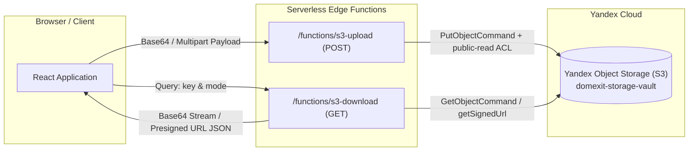
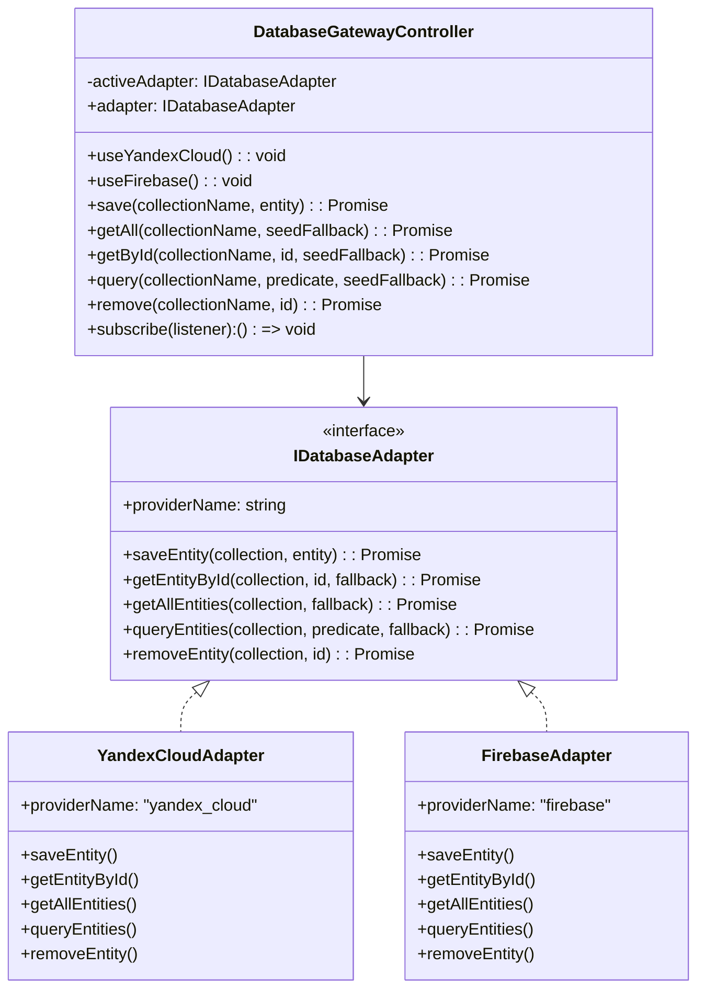

# الفصل الخامس: الدوال السحابية وطبقة الوصول للبيانات والتكاملات السحابية (Backend Serverless, DAL & Cloud Integrations)

تعتمد منصة **DomExit** على معمارية هجينة غير خادمة (Serverless) عالية الكفاءة والأمان. لا يتطلب التطبيق تشغيل خادم مخصص دائم (Dedicated Node.js Server)، بل يعتمد على دوال سيرفرلس دقيقة التخصص (Netlify Functions / Yandex Cloud Functions) لمعالجة المهام الحساسة والملفات، مع طبقة وصول بيانات مركزية موحدة (**Data Access Layer - DAL**) تدير الاتصال المباشر الآمن مع **Yandex YDB Document API** و **Yandex Object Storage (S3)**.

---

## 1. الدوال السحابية غير الخادمة (Serverless Edge Functions)

يحتوي مجلد `netlify/functions/` على دالتين رئيسيتين مكتوبتين بلغة TypeScript وتعملان في بيئة Node.js الحديثة، مزودتين بذاكرة تخزين مؤقت للعميل (Cached S3 Client) وإدارة أمان CORS صارمة.



### 1.1. دالة رفع الملفات السحابية: `netlify/functions/s3-upload.ts`
تتولى هذه الدالة استقبال الملفات والمستندات الثبوتية وعقود الدفع وصور المعرض ورفعها إلى Yandex Object Storage.

#### الميزات المعمارية للدالة:
- **إعادة استخدام عميل S3 (Module-Scope Cached Client):** تحتفظ الدالة بكائن `S3Client` نشط عبر استدعاءات الحاويات الدافئة (Warm Invocations) لمدة 15 دقيقة (`CLIENT_MAX_AGE_MS = 15 * 60 * 1000`) لتفادي إعادة بناء كائن التشفير والاتصال في كل طلب.
- **دعم صيغ متعددة للمدخلات (Multi-format Ingestion):**
  1. كائن JSON يحتوي على حقل `base64Data` أو `dataUrl` أو `content` (مع استخلاص وتنظيف ترويسة Data URI تلقائياً).
  2. تدفق بيانات خام مشفر بـ Base64 (`event.isBase64Encoded === true`).
  3. نص عادي أو ثنائي UTF-8.
- **تحديد مسار الكائن التلقائي:** في حال عدم تزويد اسم الكائن، يتم توليده تلقائياً بصيغة: `uploads/file_${Date.now()}`.
- **إعدادات الأذونات (ACL):** ترفع الدالة الملف بصفة `public-read` لتسهيل استعراض الصور في المتصفح.

#### ترويسات الاستجابة ورموز الحالة:
- `OPTIONS`: يرجع كود `200` مع ترويسات CORS الكاملة:
  ```json
  {
    "Access-Control-Allow-Origin": "*",
    "Access-Control-Allow-Headers": "Content-Type, Authorization, X-Requested-With",
    "Access-Control-Allow-Methods": "GET, POST, PUT, OPTIONS"
  }
  ```
- `POST`: يرجع كود `200` مع بيانات الكائن المرفوع:
  ```json
  {
    "success": true,
    "bucket": "domexit-storage-vault",
    "objectKey": "documents/U-62090/ddu_contract.pdf",
    "storageKey": "documents/U-62090/ddu_contract.pdf",
    "url": "https://storage.yandexcloud.net/domexit-storage-vault/documents/U-62090/ddu_contract.pdf",
    "sizeBytes": 1450280,
    "contentType": "application/pdf"
  }
  ```
- أخطاء الطلب: `400` عند غياب البيانات الثنائية، `405` للطلبات غير المصرح بها، `500` عند فشل الاتصال بـ S3.

---

### 1.2. دالة تنزيل واستعراض الملفات: `netlify/functions/s3-download.ts`
تتولى هذه الدالة قراءة وتنزيل الملفات والمستندات المحمية من سلة التخزين السحابية بنمطين تشغيليين.

#### معلمات الاستعلام (Query Parameters):
- `key` أو `objectKey`: المسار النسبي للملف في الحاوية (مطلوب).
- `mode` أو `format`: نمط التنزيل:
  - `presigned` أو `json`: يولد رابطاً موقعاً مسبقاً (Presigned URL) صالحاً لمدة ساعتين (`expiresIn: 7200`) ويرجعه ككائن JSON دون نقل بيانات الملف عبر الدالة:
    ```json
    {
      "success": true,
      "objectKey": "documents/U-62090/ddu_contract.pdf",
      "presignedUrl": "https://storage.yandexcloud.net/domexit-storage-vault/documents/U-62090/ddu_contract.pdf?X-Amz-Algorithm=..."
    }
    ```
  - `stream` (الوضع الافتراضي): تقرأ الدالة تدفق البيانات الثنائية من S3 عبر `GetObjectCommand` وتحوله إلى Buffer ثم تشفره بـ Base64، وترجعه مباشرة للمتصفح مع الترويسات التالية:
    - `isBase64Encoded: true`
    - `Content-Type: ${contentType}`
    - `Content-Disposition: inline; filename="${encodeURIComponent(filename)}"`
    - `Cache-Control: public, max-age=86400` (تخزين مؤقت لمدة 24 ساعة لرفع كفاءة المتصفح)

---

## 2. طبقة الوصول للبيانات المركزية (Data Access Layer - DAL Gateway)

تُعد وحدة `DatabaseGateway` (`src/dal/DatabaseGateway.ts`) بوابة الدخول الإلزامية والوحيدة لكافة استعلامات وعمليات قواعد البيانات في التطبيق. يُحظر على مكونات واجهة المستخدم أو المستودعات استدعاء محركات البيانات مباشرة.



### 2.1. تكامل التخزين المؤقت وحذف التكرار (SWR Cache & Deduplication)
تحتوي `DatabaseGateway` على طبقتي تحسين للأداء:
1. **ذاكرة التخزين المؤقت المحدثة خلفياً (SWRCache):**
   - مدة صلاحية الكاش الافتراضية: 30 ثانية (`ttlMs = 30_000`).
   - عند طلب البيانات، يتم إرجاع القيمة المخزنة فوراً إن وجدت، مع إطلاق استعلام خلفي في الخلفية لتحديث الكاش تلقائياً (Stale-While-Revalidate).
   - عند تنفيذ عمليتي `save` أو `remove`، تقوم البوابة بإبطال فوري لكافة المفاتيح المرتبطة بالمجموعة:
     ```typescript
     swrCache.invalidatePrefix(`getAll:${resolvedName}`);
     swrCache.invalidatePrefix(`getAll:${collectionName}`);
     swrCache.invalidatePrefix(`getById:${resolvedName}:${entity.id}`);
     swrCache.invalidatePrefix(`getById:${collectionName}:${entity.id}`);
     ```
2. **مانع التكرار المتزامن (Request Deduplicator):**
   - يدمج كافة الطلبات المتزامنة لنفس المفتاح في طلب شبكة واحد عبر `requestDeduplicator.dedupe(cacheKey, fn)` مانعاً إغراق الشبكة بالاستعلامات المتطابقة.

### 2.2. ناقل الأحداث والتحديث اللحظي (Real-time Event Bus)
تدعم البوابة الاشتراك اللحظي في التحديثات عبر دالة `subscribe`:
- تستمع لأحداث النافذة المخصصة: `domexit:dal_updated`.
- تستمع لحدث تبديل البيئة: `domexit:environment_changed`.
- تستمع لأحداث التخزين عبر النوافذ وعلامات التبويب: `window.addEventListener('storage', handleStorage)`.

---

## 3. محول Yandex Cloud ومحاكاة DynamoDB (YandexCloudAdapter)

ينفذ كلاس `YandexCloudDatabaseAdapter` (`src/dal/adapters/YandexCloudAdapter.ts`) واجهة `IDatabaseAdapter` للاتصال بـ **Yandex YDB Document API**.

### 3.1. خوارزمية توقيع الطلبات AWS Signature v4
نظراً لأن YDB Document API متوافقة مع بروتوكول DynamoDB، يتم توقيع كافة الطلبات بواسطة خوارزمية `AWS4-HMAC-SHA256` عبر Web Crypto API الأصلي:
1. استخراج التاريخ بصيغة ISO المصغرة: `YYYYMMDDTHHMMSSZ` والتاريخ المجرد `YYYYMMDD`.
2. توليد بصمة محتوى الطلب (SHA-256 Payload Hash).
3. بناء الطلب المعياري (Canonical Request) متضمناً المسار والترويسات الموقعة (`content-type`, `host`, `x-amz-date`, `x-amz-target`).
4. اشتقاق مفتاح التوقيع المتسلسل (Signing Key):
   $$\text{kDate} = \text{HMAC-SHA256}(\text{"AWS4" + SecretKey}, \text{DateStamp})$$
   $$\text{kRegion} = \text{HMAC-SHA256}(\text{kDate}, \text{Region})$$
   $$\text{kService} = \text{HMAC-SHA256}(\text{kRegion}, \text{"dynamodb"})$$
   $$\text{kSigning} = \text{HMAC-SHA256}(\text{kService}, \text{"aws4_request"})$$
5. حساب التوقيع النهائي عبر تشفير `StringToSign` بمفتاح `kSigning`.

### 3.2. تحويل البيانات (DynamoDB Attribute Value Serialization)
تتولى الدالتان `toDynamoAttribute` و `fromDynamoAttribute` التحويل ثنائي الاتجاه بين كائنات JavaScript العادية وهياكل DynamoDB:
- **الأرقام:** تُحول إلى `{ N: String(val) }`.
- **النصوص:** تُحول إلى `{ S: val }`.
- **القيم المنطقية:** تُحول إلى `{ BOOL: Boolean(val) }`.
- **القيم الفارغة:** تُحول إلى `{ NULL: true }`.
- **المصفوفات:** تُحول إلى `{ L: [ ...items.map(toDynamoAttribute) ] }`.
- **الكائنات المركبة:** تُحول إلى `{ M: { [key]: toDynamoAttribute(val) } }`.

---

## 4. مستودعات البيانات المتخصصة (All 24 Repositories Breakdown)

يحتوي مجلد `src/dal/repositories/` على 24 مستودعاً متخصصاً، ينفرد كل منها بإدارة كيان محدد مع استدعاء `DatabaseGateway`:

| المستودع (Repository) | المجموعة المرتبطة (Collection) | الوظائف والعمليات الرئيسية |
| :--- | :--- | :--- |
| `LotsRepository` | `lots` | إدارة العقارات: استرجاع الكتالوج، جلب العقار بالكود، تحديث البيانات والصور المعتمدة، تحديث الحالة والتدقيق القانوني. |
| `DealsRepository` | `deals` | إدارة الصفقات: إنشاء ومتابعة مراحل الصفقة الخمس، تحديث المبالغ، تسجيل مستندات الإغلاق، وتعيين المنسقين. |
| `SellerRequestsRepository` | `seller_requests` | إدارة طلبات البائعين: استلام طلب الخروج، ربطه بكود العقار، تحديث حالة المراجعة والمستندات المرفقة. |
| `DocumentsVaultRepository` | `documents_vault` | المستودع المركزي للملفات: حفظ وتحديث بيانات الوثائق، ربط المستند بالعقار، والتحقق القانوني أو الرفض. |
| `CuratorChatRepository` | `curator_messages` | إدارة المحادثات الفورية: إرسال الرسائل بين العميل والمنسق، جلب سجل المحادثة، ووضع علامات القراءة. |
| `CandidatesRepository` | `candidates` / `buyer_applications` | إدارة المشترين والمرشحين: مطابقة المشترين في Matchmaker، فحص الجاهزية البنكية، وتسجيل الحجوزات. |
| `DevelopersRepository` | `developers` / `developer_accreditation_requests` | إدارة المطورين: اعتماد المطورين العقاريين، فحص ИНН وسجلات المشاريع وبنوك الإسكرو الشريكة. |
| `BankPortalRepository` | `partner_banks` / `bank_employees` / `bank_special_approvals` | بوابة البنوك: إدارة اعتمادات الرهون الاستثنائية، حسابات الإسكرو، وموظفي التمويل العقاري. |
| `EmployeesRepository` | `employees` | إدارة الموظفين: بيانات منسقي الصفقات، المحامين، الصلاحيات، وإحصائيات سرعة إغلاق الصفقات. |
| `UsersRepository` | `users` | إدارة المستخدمين: ملفات الحسابات، الصلاحيات المتعددة (RBAC)، المفضلة، والمطابقة مع Yandex ID. |
| `PartnersRepository` | `partners` / `partner_applications` | برنامج الشركاء: تسجيل الوكالات والوسطاء، توليد أكواد الإحالة (Ref Codes)، ومتابعة العمولات. |
| `PartnerRequestsRepository` | `partner_preliminary_requests` | طلبات الشركاء: إرسال طلبات ترشيح العملاء المبدئية ومتابعة حالتها لدى المنسقين. |
| `InvestorClubRepository` | `investor_applications` | نادي المستثمرين: استقبال طلبات الانضمام، تحليل الميزانيات، وعرض الفرص الاستثمارية الحصرية. |
| `MarketSettingsRepository` | `market_settings` | معايير السوق: إدارة سعر الفائدة للبنك المركزي (21%)، فائدة الرهن العائلي (6%)، والرسوم. |
| `LegalRepository` | `legal_settings` / `company_legal_profile` | الملف القانوني: بيانات الشركة الرسمية، السجل التجاري، الحساب البنكي، ومسؤول 152-ФЗ. |
| `LegalPoliciesRepository` | `legal_documents` / `legal_revisions` | إدارة السياسات (CMS): نصوص الشروط، سياسة الخصوصية، تجميد الإصدارات وحساب بصمة SHA-256. |
| `UserConsentsRepository` | `user_consents` | سجل الموافقات: تدوين موافقة المستخدم الصريحة على معالجة البيانات الشخصية مع حجب الـ IP. |
| `EscrowBridgeRepository` | `escrow_bridge_chats` | جسر الإسكرو: تسهيلات تحويل الدفعات والحسابات الانتقالية بالتنسيق مع البنوك المعتمدة. |
| `AuditLogsRepository` | `audit_logs` | السجل الرقابي: تسجيل كافة العمليات الإدارية الحساسة وتعديلات الأسعار والتدقيق بهوية المنفذ. |
| `KnowledgeRepository` | *محتوى محلي / كاش* | قاعدة المعرفة: مقالات وأدلة 214-ФЗ القانونية والإرشادات التثقيفية للمشترين والبائعين. |
| `FAQRepository` | *محتوى محلي / كاش* | الأسئلة الشائعة: تصنيفات الأسئلة الأكثر تداولاً وإجاباتها القانونية والمالية الموثقة. |
| `AnalyticsRepository` | *مؤشرات مجمعة* | لوحة المؤشرات: حساب متوسطات الأسعار، نسب التوفير، أحجام الصفقات وسرعة الإغلاق. |
| `SecurityIncidentsRepository` | `security_incidents` | أمن المعلومات: تسجيل محاولات الدخول غير المصرح بها ورصد التعديلات غير المطابقة للمواصفات. |
| `CompanyProfileRepository` | `company_profile` | هوية المنصة: بيانات الاتصال، الدعم الفني، روابط قنوات تيليجرام وشبكة VK الرسمية. |

---

## 5. التكاملات السحابية الخارجية (External Cloud Integrations)

### 5.1. تسجيل الدخول الموحد Yandex ID OAuth 2.0 Flow
يدعم التطبيق المصادقة السريعة والآمنة للعملاء عبر حسابات **Yandex ID**:
- **رابط التخويل المباشر (Authorization URL):**
  ```text
  https://oauth.yandex.ru/authorize?response_type=token&client_id=${VITE_YANDEX_CLIENT_ID}&redirect_uri=${window.location.origin}/auth/callback
  ```
- **آلية استخلاص التوكن (Token Extraction):** عند إعادة توجيه المتصفح إلى مسار الـ Callback، يستخلص التطبيق التوكن من مجزأ العنوان (Hash Fragment: `#access_token=...`).
- **جلب الملف التعريفي للمستخدم:** يستعلم التطبيق من خدمة `https://login.yandex.ru/info?format=json` عبر ترويسة `Authorization: OAuth ${token}` لاسترجاع الاسم الكامل، البريد الإلكتروني، والصورة الشخصية.
- **الربط والإنشاء التلقائي:** يتم فحص جدول `users` في YDB؛ فإذا وُجد المستخدم يتم تسجيل دخوله، وإن لم يوجد يتم إنشاء سجل جديد له برتبة `buyer` أو `seller` مع منحه كود عميل مميز (`DEX-XXXX`).

### 5.2. خرائط ياندكس التفاعلية (Yandex Maps API v3)
يعتمد محرك الخرائط واستعراض المواقع الجغرافية على أحدث إصدار من مكتبة خرائط ياندكس الرسمية **Yandex Maps JS API v3**:
- **خدمة التحميل الديناميكي الموحد (`src/services/yandexMapsService.ts`):**
  - تضمن الدالة `loadYandexMaps()` تحميل السكربت الرسمي لمرة واحدة فقط دون أي تكرار عبر الوعد العام (Global Promise Deduplication):
    ```text
    https://api-maps.yandex.ru/v3/?apikey=${VITE_YANDEX_MAPS_API_KEY}&lang=ru_RU
    ```
  - تنتظر الخدمة اكتمال تهيئة الكائن العام عبر الوعد `window.ymaps3.ready`.
- **المكونات والطبقات الجغرافية:**
  - `YMapDefaultSchemeLayer`: طبقة المخطط الجغرافي الأساسية (تدعم الثيم الداكن والفاتح).
  - `YMapDefaultFeaturesLayer`: طبقة المعالم والحدود الهندسية للمجمعات السكنية.
  - `YMapControls` & `YMapZoomControl`: أزرار التحكم في التكبير والتصغير وتحديد الموقع.
  - `YMapDefaultMarker`: علامات مخصصة تمثل العقارات المعروضة، ملونة بحسب حالة التحقيق والخصم.
- **التغطية الجغرافية:** تدعم الخرائط الإحداثيات الدقيقة لمدن روسيا الاتحادية الرئيسية (موسكو وسانت بطرسبرغ وضواحيهما) مع الإسقاط الجغرافي الصحيح على شبكة المترو.
