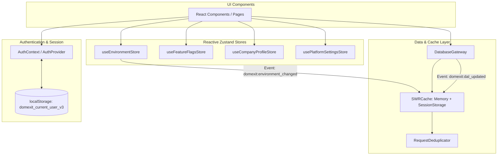
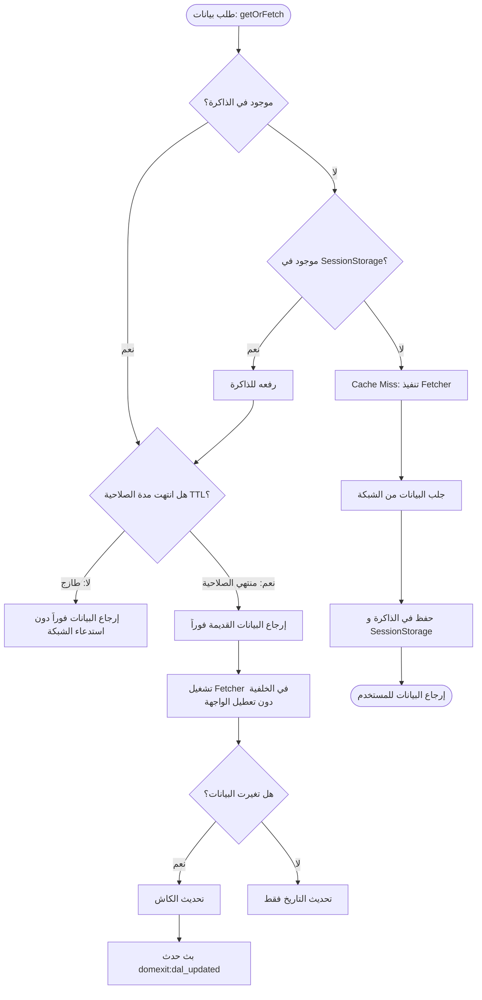

# الفصل السادس: إدارة الحالة والمصادقة ومفاتيح الميزات (State Management, Auth & Feature Flags)

يعتمد تطبيق **DomExit** على هيكلية ثلاثية الطبقات لإدارة الحالة والبيانات:
1. **مخازن الحالة التفاعلية (Zustand Stores):** لإدارة بيئة التشغيل، ومفاتيح الميزات، ومعلومات الشركة العامة بسرعة استجابة لحظية وخفيفة دون إعادة تصيير غير مبررة للواجهة.
2. **سياق المصادقة وإدارة الهوية (`AuthContext`):** لإدارة جلسة المستخدم، وتعدد الأدوار (Multi-Role Switching)، والربط مع Yandex OAuth ومزودي الهوية.
3. **طبقة التخزين المؤقت وحذف التكرار المتزامن (`SWRCache` & `RequestDeduplicator`):** كبديل خفيف وعالي الأداء لـ Redis على مستوى المتصفح، تضمن سرعة استجابة فائقة وإلغاء الاستعلامات المتكررة.

---

## 1. المعمارية العامة لتدفق الحالة



---

## 2. مخازن الحالة العالمية (Zustand Stores)

### 2.1. مخزن بيئة العمل وعزل البيانات: `useEnvironmentStore.ts`
يتحكم في توجيه استعلامات التطبيق بين البيئة الإنتاجية الحقيقية (`production`) وبيئة العرض والتجربة المعزولة (`demo`).

#### القواعد الصارمة لإدارة البيئة:
- **الحماية الحصرية للمالك (Owner-Only Access):** يُحظر حظراً تاماً تفعيل وضع التجربة (`demo`) لأي زائر أو عميل عادي. التبديل إلى `demo` مسموح حصراً للمالك المعتمد المنتهي بحساب `amaas9499@gmail.com` أو صاحب الرتبة `owner`.
- **البيئة الافتراضية الصارمة:** تبدأ كافة الجلسات الجديدة لجميع الزوار على وضع الإنتاج (`production`). في حال محاولة متصفح غير مصرح له تعيين `demo`، يتم إجباره فورياً على العودة إلى `production`.
- **مفتاح التخزين:** `domexit_app_environment` في `localStorage`.

#### بنية الحالة والدوال:
```typescript
export type AppEnvironment = 'demo' | 'production';

interface EnvironmentState {
  currentEnv: AppEnvironment;
  isProduction: boolean;
  setEnvironment: (env: AppEnvironment) => void;
  toggleEnvironment: () => void;
}
```

#### الأحداث الصادرة عند التبديل:
عند استدعاء `setEnvironment`، يبث المخزن حدثين مخصصين عبر النافذة:
1. `domexit:environment_changed`: لإشعار `SWRCache` بمسح كامل الذاكرة المؤقتة فوراً لتفادي تداخل بيانات البيئتين.
2. `domexit:dal_updated`: لإشعار كافة المكونات المعروضة على الشاشة بإعادة جلب بياناتها من المجموعة المطابقة للبيئة الجديدة.

---

### 2.2. مخزن مفاتيح الميزات: `useFeatureFlagsStore.ts`
يتحكم في تفعيل أو تعطيل الميزات التجريبية أو الجزئية بالمنصة، مع مزامنة لحظية بين `localStorage` وجدول `platform_settings` في YDB.

#### الميزات المضبوطة (Feature Flags):
- `enableVipClub`: (القيمة الافتراضية: `false`) إغلاق كتالوج VIP وتحويله إلى نادي المستثمرين المغلق حتى اكتمال بوابة الدفع.
- `enableBankPortal`: (القيمة الافتراضية: `false`) تفعيل بوابة اعتماد موظفي البنوك المباشرة، مع الاعتماد حالياً على الإسكرو اليدوي الموثق.

#### بنية المخزن:
```typescript
export interface FeatureFlagsState {
  enableVipClub: boolean;
  enableBankPortal: boolean;
  setFlag: (key: 'enableVipClub' | 'enableBankPortal', value: boolean) => void;
  toggleFlag: (key: 'enableVipClub' | 'enableBankPortal') => void;
}
```

#### المزامنة المزدوجة (Two-Way Sync):
- يشترك المخزن تلقائياً في `DatabaseGateway.subscribe`؛ عند تعديل وثيقة `feature_flags` في جدول `platform_settings` من قبل المسؤول، يتم تحديث حالة المتصفح و`localStorage` في الوقت الحقيقي.
- عند تعديل أي مفتاح من خلال الواجهة الإدارية عبر `setFlag`، يتم حفظ القيمة محلياً وحفظها في قاعدة البيانات السحابية بشكل غير متزامن.

---

### 2.3. مخازن الإعدادات وهوية الشركة:
- `useCompanyProfileStore.ts`: يدير الملف التعريفي والبيانات القانونية المعتمدة للشركة (`inn`, `kpp`, `ogrn`, `legal_address`, `bank_details`) وتحديثها فورياً في كافة الفواتير والصفحات القانونية.
- `usePlatformSettingsStore.ts`: يدير مؤشرات وضع الصيانة (`isMaintenanceMode`)، وتفعيل المحادثة الحية مع المنسق، وضوابط رفع ملفات S3 المباشرة.
- `usePublicChannelsStore.ts`: يدير قنوات التواصل العامة المعتمدة (قناة تيليجرام، بوت تيليجرام، مجتمع VK، وهاتف الدعم الموحد).

---

## 3. سياق المصادقة وإدارة الجلسات (`AuthContext.tsx`)

يُدير `AuthContext` المصادقة الأمنية، ومطابقة الهويات، والتحكم في الوصول القائم على الأدوار (RBAC).

### 3.1. الحسابات الرئيسية المعتمدة والبيانات التجريبية
- **حسابات المالك الأعلى (Master Owners):** `amaas9499@gmail.com`, `ceo@domexit.ru`.
- **حسابات الموظفين ومنسقي الصفقات (Staff Accounts):** `amaas9494@gmail.com`, `employee@domexit.ru`, `morozov@domexit.ru`.
- **كلمة المرور التجريبية الموحدة للبيئات:** `DomExit2026!`.
- **مفتاح حفظ جلسة المستخدم:** `domexit_current_user_v3` في `localStorage`.

### 3.2. تعدد الأدوار والتبديل الديناميكي (Dynamic Role Switching)
يدعم حساب المستخدم الواحد امتلاك أدوار متعددة مسجلة في مصفوفة `roles: UserRole[]` (مثل: مستخدم يمتلك صلاحية `buyer` و `seller` و `investor`، أو موظف يمتلك صلاحية `employee` و `owner`).

تتيح دالة `switchRole(role)` للمستخدم التبديل اللحظي بين واجهاته المخصصة دون الحاجة لتسجيل الخروج وإعادة تسجيل الدخول:
```typescript
switchRole: (role: UserRole) => {
  if (!user) return;
  const updatedUser = { ...user, activeRole: role };
  setUser(updatedUser);
  localStorage.setItem(STORAGE_KEY, JSON.stringify(updatedUser));
  UsersRepository.save(updatedUser);
};
```

### 3.3. طرق تسجيل الدخول المدعومة
1. **تسجيل الدخول عبر Yandex ID (`loginWithYandex`):** التوجيه إلى خادم OAuth الخاص بشركة ياندكس لاسترجاع التوكن وبيانات الحساب الروسي وتوطين البيانات داخل روسيا.
2. **تسجيل الدخول عبر البريد الإلكتروني وكلمة المرور (`loginWithEmail`):** التحقق من الاعتماد عبر Firebase Auth ومطابقة السجل في جدول `users`.
3. **الدخول التجريبي الفوري (`quickDemoLogin`):** يتيح للمسؤولين ومختبري النظام التبديل بضغطة زر واحدة بين كافة أدوار المنظمة (`owner`, `employee`, `bank`, `partner`, `investor`, `seller`, `buyer`) مع تحميل الملف التعريفي الكامل والصلاحيات الملحقة به فوراً.
4. **إدارة المفضلة (`toggleFavorite`):** إضافة أو إزالة كود العقار من قائمة المفضلة المحفوظة في ملف المستخدم السحابي.

---

## 4. طبقة التخزين المؤقت متعددة المستويات (`SWRCache.ts`)

تنفذ فئة `ClientSWRCache` نمط **Stale-While-Revalidate** على مستويين، مما يلغي الحاجة لخادم Redis خارجي ويوفر زمن استجابة صفري للواجهة.

### 4.1. مستويات التخزين المؤقت (Multi-Tier Caching)
- **المستوى الأول (Tier 1 - In-Memory):** كائن `Map<string, CacheEntry<unknown>>` في ذاكرة جافاسكريبت السريعة، يتم فقدانه عند إعادة تحميل الصفحة.
- **المستوى الثاني (Tier 2 - Session Storage):** تخزين في `sessionStorage` بمفتاح يبدأ بـ `domexit_swr_`، يستمر طوال فترة بقاء علامة تبويب المتصفح مفتوحة.

### 4.2. دورة عمل الاستعلام (SWR Lifecycle)


### 4.3. آليات إبطال الكاش (Cache Invalidation Rules)
- `invalidate(key)`: حذف مفتاح محدد من الذاكرة ومن `sessionStorage`.
- `invalidatePrefix(prefix)`: حذف كافة المفاتيح التي تبدأ ببادئة معينة (مثل `getAll:lots` أو `getById:deals:`).
- `clear()`: مسح شامل للذاكرة و`sessionStorage`، ويتم استدعاؤها تلقائياً عند تغيير بيئة التشغيل عبر حدث `domexit:environment_changed`.

---

## 5. مانع تكرار الطلبات المتزامنة (`RequestDeduplicator.ts`)

عند فتح صفحة تتضمن عدة مكونات تطلب نفس البيانات في نفس اللحظة (مثل طلب كتالوج العقارات من الخريطة والقائمة وشريط الإحصاءات)، يتدخل `RequestDeduplicator` لدمج هذه الطلبات في وعد واحد (In-Flight Promise Coalescing):

```typescript
class RequestDeduplicator {
  private inFlight = new Map<string, Promise<any>>();

  dedupe<T>(key: string, fetcher: () => Promise<T>): Promise<T> {
    const existing = this.inFlight.get(key);
    if (existing) {
      return existing as Promise<T>;
    }

    const promise = fetcher().finally(() => {
      this.inFlight.delete(key);
    });

    this.inFlight.set(key, promise);
    return promise;
  }
}

export const requestDeduplicator = new RequestDeduplicator();
```

يضمن هذا التكامل انعدام التكرار الشبكي وحماية واجهات Yandex Cloud من تجاوز حدود الاستعلام (Rate Limiting).
