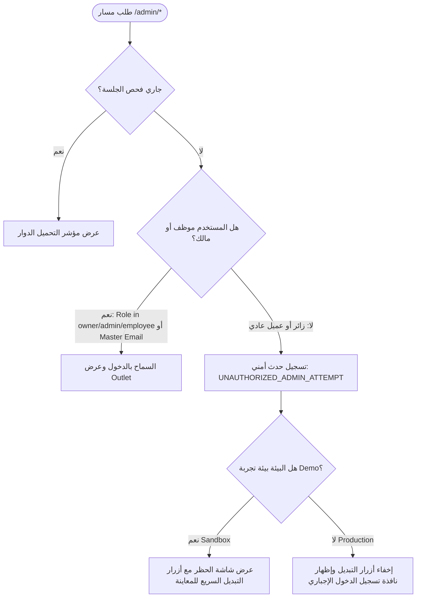

# الفصل السابع: مسارات التطبيق ومصفوفة الصلاحيات والأمان (Routing, RBAC & Security Matrix)

تعتمد منصة **DomExit** على نظام توجيه منضبط وشامل عبر **React Router v6**، محمي بحواجز أمان متعددة المستويات (**AdminRouteGuard**, **BankGatewayErrorBoundary**, **ConsentGateModal**)، مع تطبيق صارم لمصفوفة الصلاحيات والتحكم في الوصول القائم على الأدوار (**Role-Based Access Control - RBAC**)، وضوابط حماية البيانات الشخصية وفقاً للقانون الاتحادي الروسي **152-ФЗ**.

---

## 1. جدول مسارات التطبيق الشامل (Routing Table)

تُدار كافة المسارات عبر المكون المركزي `src/App.tsx`. تم تطبيق التحميل الكسول المخصص (**Lazy Loading via `React.lazy`**) لكافة الصفحات لتقليص حجم الحزمة الأولية إلى أدنى حد ممكن، مع تغليفها بمكون الهيكل العظمي البديل (`PageSkeletonLoader`).

### 1.1. مسارات الواجهة العامة والعملاء (Public & Client Routes)
تعمل هذه المسارات تحت تخطيط `PublicLayout` الموحد الذي يوفر الترويسة والشريط العلوي والتذييل المتوافق مع متطلبات الإفصاح القانوني:

| المسار (Path) | المكون (Component) | مستوى الوصول | الوصف والغرض الوظيفي |
| :--- | :--- | :--- | :--- |
| `/` | `HomePage` | عام (Public) | الواجهة الرئيسية للمنصة، الحاسبة المالية، وشريط الفرص الساخنة. |
| `/sellers` | `SellersPage` | عام (Public) | استمارة تخارج البائعين، حاسبة توفير غرامات المطور (10-15%)، ورفع وثائق ДДУ. |
| `/opportunities` | `OpportunitiesPage` | عام (Public) | كتالوج العقارات الشامل، فلترة الأسعار والمترو والمطورين، وعرض الخريطة التفاعلية. |
| `/catalog` | `Navigate -> /opportunities` | عام (Public) | رابط بديل موجه لكتالوج العقارات المفتوح. |
| `/lot/:id` | `LotDetailsPage` | عام (Public) | الصفحة التفصيلية الكاملة للعقار، معرض الصور المعتمدة، التقرير القانوني، والمحادثة مع المنسق. |
| `/verify/:lotId` | `VerifyCertificatePage` | عام (Public) | شهادة الفحص القانوني الرقمية الموثقة للعقار، الباركود، وبصمة التدقيق. |
| `/how-it-works` | `HowItWorksPage` | عام (Public) | دليل ومراحل عملية التنازل (Переуступка) وفق 214-ФЗ من الألف إلى الياء. |
| `/story` | `StoryPage` | عام (Public) | قصة نشأة DomExit ومهمتها في تحرير أموال المشترين العالقين في أقساط المطورين. |
| `/vip` | `VipCatalogPage` | عام (Public) | كتالوج الصفقات الحصرية ذات العائد المرتفع وبوابة نادي المستثمرين. |
| `/partners` | `PartnersPublicPage` | عام (Public) | برنامج الشركاء والوسطاء العقاريين (B2B)، حاسبة العمولات وطلب الانضمام. |
| `/b2b-partners` | `Navigate -> /partners` | عام (Public) | رابط تحويلي متوافق مع الحملات التسويقية للشركاء. |
| `/investors` | `Navigate -> /vip` | عام (Public) | رابط تحويلي لصفحة المستثمرين. |
| `/portal` | `ClientPortalPage` | عميل مسجل | بوابة العميل الموحدة (متابعة إعلانات البائع، حجوزات المشتري، والمفضلة). |
| `/account` | `ClientPortalPage` | عميل مسجل | مسار بديل لبوابة العميل وإدارة الملف الشخصي. |
| `/tracker` | `Navigate -> /portal` | عميل مسجل | تحويل مباشر لمتابعة الصفقات النشطة. |
| `/client/tracker/:dealId` | `ClientTrackerPage` | عميل مسجل | صفحة التتبع الحي لمراحل الصفقة الخمس وتأكيدات بنك الإسكرو. |

### 1.2. مسارات المركز المعرفي والسياسات القانونية (CMS & Knowledge Hub)
| المسار (Path) | المكون (Component) | مستوى الوصول | الوصف والغرض الوظيفي |
| :--- | :--- | :--- | :--- |
| `/knowledge` | `KnowledgeHubPage` | عام (Public) | بوابة المقالات والأدلة الإرشادية القانونية والمالية وفقاً للقانون 214-ФЗ. |
| `/knowledge/:articleSlug` | `ArticleDetailPage` | عام (Public) | الصفحة الكاملة لقراءة المقال القانوني مع المراجع التشريعية. |
| `/faq` | `FAQPage` | عام (Public) | قاعدة الأسئلة الشائعة المصنفة للبائعين والمشترين وإجراءات الإسكرو. |
| `/legal` | `LegalIndexPage` | عام (Public) | الفهرس المركزي لكافة الوثائق واللوائح والسياسات المعتمدة للمنصة. |
| `/legal/:slug` | `LegalDocumentReaderPage` | عام (Public) | قارئ الوثيقة القانونية مع بصمة SHA-256 وسجل المراجعة النشطة. |
| `/legal/archive` | `LegalArchivePage` | عام (Public) | أرشيف الإصدارات السابقة للسياسات القانونية امتثالاً للائحة 152-ФЗ. |
| `/legal/archive/:slug/:version` | `LegalArchiveSnapshotPage` | عام (Public) | عرض النسخة التاريخية المجمدة للوثيقة القانونية عند تاريخ سريانها. |

### 1.3. مسارات التحويل الخلفي المتوافقة (Backward-Compatible Redirects)
لضمان عدم انقطاع روابط محركات البحث والحملات الإعلانية القديمة:
- `/privacy` $\rightarrow$ `/legal/privacy`
- `/terms` $\rightarrow$ `/legal/terms`
- `/consent-pd` $\rightarrow$ `/legal/consent-pd`
- `/consent-ads` $\rightarrow$ `/legal/consent-ads`
- `/consent-distribution` $\rightarrow$ `/legal/consent-distribution`
- `/cookies` $\rightarrow$ `/legal/cookies`
- `/call-recording` $\rightarrow$ `/legal/call-recording`
- `/app/seller` $\rightarrow$ `/sellers`
- `/app/objects` $\rightarrow$ `/opportunities`
- `/app/objects/:id` $\rightarrow$ `/lot/:id`

### 1.4. مسارات العمليات الإدارية والمغلقة (Admin & Operations Routes)
تخضع كافة هذه المسارات لحماية مشددة بواسطة **`AdminRouteGuard`**:

| المسار (Path) | المكون (Component) | الأدوار المصرح لها | الغرض الوظيفي والعمليات |
| :--- | :--- | :--- | :--- |
| `/admin` | `Navigate -> /admin/dashboard` | `owner`, `employee` | تحويل تلقائي للوحة المؤشرات الرئيسية. |
| `/admin/dashboard` | `AdminDashboardPage` | `owner`, `employee` | لوحة القيادة العامة، الرسوم البيانية، وحجم الصفقات وتوزيع المنسقين. |
| `/admin/pipeline` | `AdminPipelinePage` | `owner`, `employee` | خط أنابيب الصفقات الشامل، فرز الحالات، ونقل العقار بين المراحل. |
| `/admin/packaging/:lotId?` | `AdminPackagingPage` | `owner`, `employee` | استوديو التغليف: اعتماد صور المعرض، تحرير الأسعار، وصياغة الإعلان. |
| `/admin/legal-audit/:lotId?`| `AdminLegalAuditPage` | `owner`, `employee` | لوحة التدقيق القانوني في المحاور الخمسة واعتماد شهادة السلامة. |
| `/admin/ops-audit/:lotId?` | `Navigate -> /admin/legal-audit/:lotId` | `owner`, `employee` | مسار بديل موجه للتدقيق القانوني. |
| `/admin/matchmaker/:lotId?` | `AdminMatchmakerPage` | `owner`, `employee` | محرك توفيق ومطابقة المشترين المسجلين وحملة التمويل المعتمدة مع العقار. |
| `/admin/closing/:dealId?` | `AdminClosingPage` | `owner`, `employee` | غرفة إغلاق الصفقة: التوقيع، شروط تحرير الإسكرو، وإشعار Росреестр. |
| `/admin/brokers` | `AdminBrokersPage` | `owner`, `employee` | إدارة شبكة الوسطاء والشركاء المسجلين وتتبع إحالاتهم وعمولاتهم. |
| `/admin/archive-logs` | `AdminArchiveLogsPage` | `owner` فقط | سجل التدقيق والرقابة الشامل للأحداث والعمليات وتتبع العمليات الحساسة. |
| `/admin/profile` | `AdminCuratorProfilePage` | `owner`, `employee` | الملف المهني للمنسق: عدد الصفقات المنجزة وسرعة التنفيذ والتواصل. |
| `/bank-portal` | `BankPortalPage` | `owner`, `bank` | بوابة موظفي البنوك الشريكة لاعتماد قروض الرهن وحسابات الإسكرو. |
| `/admin/bank-gateway` | `BankPortalPage` | `owner`, `bank` | مسار موازٍ لبوابة البنوك تحت حماية `BankGatewayErrorBoundary`. |

---

## 2. حارس المسارات الإدارية والتأمين الحصري (`AdminRouteGuard.tsx`)

يتحقق المكون `AdminRouteGuard` من هوية المستخدم قبل السماح بعرض أي شاشة إدارية:



### 2.1. منطق الفحص البرمجي للأدوار المصرحة
```typescript
const isStaff = Boolean(
  user &&
    (user.activeRole === 'owner' ||
      user.activeRole === 'admin' ||
      user.activeRole === 'employee' ||
      user.role === 'owner' ||
      user.role === 'admin' ||
      user.role === 'employee' ||
      user.email === 'amaas9499@gmail.com' ||
      user.email === 'amaas9494@gmail.com')
);
```

### 2.2. تسجيل الأحداث الأمنية في Telemetry
في حال محاولة الدخول غير المصرح بها، يتم فورياً استدعاء `securityLogger.log`:
- **كود الحدث:** `UNAUTHORIZED_ADMIN_ATTEMPT`
- **مستوى الخطورة:** `high`
- **التفاصيل:** تسجيل كود العميل وعنوان الـ IP ووقت المحاولة لإحباط هجمات الاستكشاف.

---

## 3. مصفوفة الصلاحيات الشاملة (RBAC Permissions Matrix)

تحدد المنصة 8 أدوار للمستخدمين تضبط صلاحيات القراءة، والإنشاء، والتعديل، والاعتماد، والحذف:

| الوظيفة / العملية داخل النظام | زائر (Guest) | مشترٍ (Buyer) | بائع (Seller) | شريك (Partner) | مستثمر (Investor) | ممثل بنك (Bank) | منسق صفقات (Employee) | مالك المنصة (Owner) |
| :--- | :---: | :---: | :---: | :---: | :---: | :---: | :---: | :---: |
| **تصفح الكتالوج العام (`/opportunities`)** | ✅ | ✅ | ✅ | ✅ | ✅ | ✅ | ✅ | ✅ |
| **استعراض تفاصيل العقار وموقعه (`/lot/:id`)** | ✅ | ✅ | ✅ | ✅ | ✅ | ✅ | ✅ | ✅ |
| **تقديم طلب خروج بائع (`/sellers`)** | ✅ | ✅ | ✅ | ❌ | ❌ | ❌ | ✅ | ✅ |
| **حجز عقار وطلب شراء (`Reserve`)** | ❌ | ✅ | ❌ | ❌ | ✅ | ❌ | ✅ | ✅ |
| **المحادثة المباشرة مع المنسق (`CuratorChat`)** | ❌ | ✅ (لعقاره) | ✅ (لعقاره) | ❌ | ✅ | ❌ | ✅ (لعملائه) | ✅ (شامل) |
| **رفع مستندات الملكية والـ ДДУ** | ❌ | ❌ | ✅ (لعقاره) | ❌ | ❌ | ❌ | ✅ | ✅ |
| **تنزيل الوثائق الرسمية المدققة** | ❌ | ✅ (بعد الحجز) | ✅ (لوثائقه) | ❌ | ✅ | ✅ (للصفقة) | ✅ | ✅ |
| **دخول لوحة القيادة والأنابيب (`/admin/*`)**| ❌ | ❌ | ❌ | ❌ | ❌ | ❌ | ✅ | ✅ |
| **تحرير استوديو التغليف واعتماد الصور** | ❌ | ❌ | ❌ | ❌ | ❌ | ❌ | ✅ | ✅ |
| **تنفيذ التدقيق القانوني وتثبيت النتيجة** | ❌ | ❌ | ❌ | ❌ | ❌ | ❌ | ✅ | ✅ |
| **تشغيل محرك التوفيق (`Matchmaker`)** | ❌ | ❌ | ❌ | ❌ | ❌ | ❌ | ✅ | ✅ |
| **إدارة شروط تحرير الإسكرو والتوقيع** | ❌ | ❌ | ❌ | ❌ | ❌ | ❌ | ✅ | ✅ |
| **اعتماد قروض الرهن وحسابات الإسكرو** | ❌ | ❌ | ❌ | ❌ | ❌ | ✅ | ❌ | ✅ |
| **الحذف المتسلسل الشامل للعقار (`Cascade`)**| ❌ | ❌ | ❌ | ❌ | ❌ | ❌ | ❌ | ✅ |
| **استعراض سجل الأحداث والرقابة (`/admin/archive-logs`)** | ❌ | ❌ | ❌ | ❌ | ❌ | ❌ | ❌ | ✅ |
| **تعديل إعدادات السوق وهوية الشركة ومفاتيح الميزات** | ❌ | ❌ | ❌ | ❌ | ❌ | ❌ | ❌ | ✅ |
| **تبديل بيئة النظام بين Production و Demo** | ❌ | ❌ | ❌ | ❌ | ❌ | ❌ | ❌ | ✅ |

---

## 4. ضوابط عزل البيانات والخصوصية الفيدرالية (152-ФЗ Data Shield)

تلتزم المنصة بمجموعة من المعايير المعمارية الصارمة لحماية خصوصية الأطراف وسرية التعاملات:
1. **حجب رقم الشقة الحقيقي (Apartment Masking):**
   - يُمنع إظهار رقم الشقة أو الوحدة السكنية الدقيق في الواجهة العامة للموقع أو الكتالوج أو خرائط ياندكس.
   - يقتصر الإفصاح العام على اسم المجمع السكني (ЖК)، والطابق، والمساحة، والرمز التعريفي الفريد (`U-XXXXX`).
   - لا يُتاح رقم الشقة الحقيقي إلا في غرفة الإغلاق النهائية الموثقة وبعد توقيع اتفاقية الحجز والسرية.
2. **حجب عناوين الإنترنت (IP Masking):**
   - عند تدوين موافقة المستخدم على معالجة البيانات الشخصية في جدول `user_consents`، يتم حجب البايت الأخير من عنوان الـ IP (مثال: `194.85.120.***`) لمنع تتبع الأفراد دون إذن قضائي.
3. **عزل مهام منسقي الصفقات (Curator Deal Isolation):**
   - في واجهة العمليات الإدارية، يقتصر ظهور الصفقات والعقارات للمنسق العادي على العقارات المسندة إليه رسمياً في حقل `curator.id`، ولا يستطيع الاطلاع على عملاء المنسقين الآخرين إلا من يمتلك رتبة `owner` أو تفويض `superadmin`.

---

## 5. الحماية السحابية وترويسات الأمان (Netlify Edge Security Headers)

تُطبّق منصة الاستضافة على مستوى خوادم الحافة (CDN Edge) سياسات حماية صارمة مضمنة في `netlify.toml`:
- **حظر الملفات الحساسة نهائياً:** منع الوصول لكافة الملفات التي تطابق الأنماط (`.env*`, `.git*`, `*.yaml`, `*.yml`, `package.json`, `tsconfig*`, `*.map`).
- **ترويسة سياسة أمن المحتوى (Content Security Policy - CSP):**
  - حصر استدعاء السكربتات بـ `'self'`, `'unsafe-inline'`, و `https://api-maps.yandex.ru`.
  - حصر الاتصالات الشبكية (`connect-src`) بمستودعات Yandex DocAPI, Yandex S3, Firebase Auth, وخوادم Netlify Functions.
  - منع تضمين الموقع داخل إطارات غير مصرح بها (`X-Frame-Options: SAMEORIGIN` و `frame-ancestors 'self'`).
  - منع استنتاج أنواع الملفات (`X-Content-Type-Options: nosniff`).
