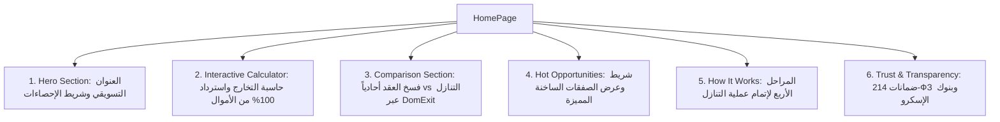
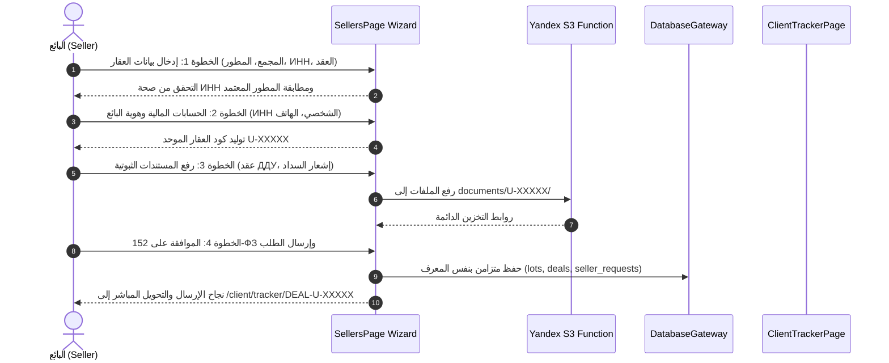
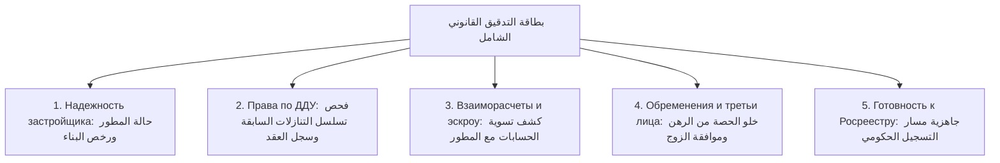
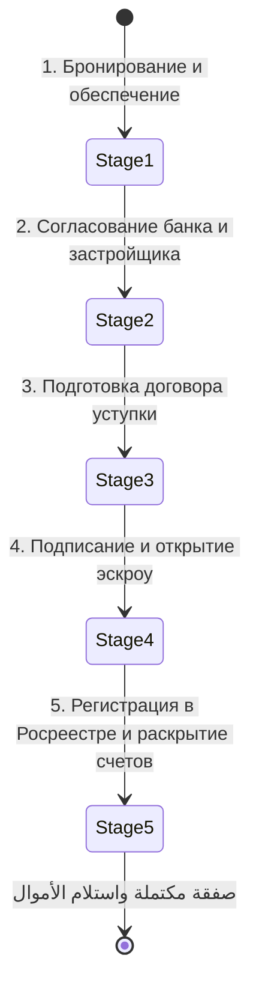

# الفصل الثامن: مواصفات الشاشات العامة وبوابات العملاء (Public & Client Pages Specification)

يوثق هذا الفصل تفاصيل وتصميم وهندسة الشاشات العامة للزوار وبوابات العملاء المخصصة للبائعين والمشترين داخل منصة **DomExit**، متضمناً تدفق البيانات، والحسابات المالية، والمكونات المدمجة، ونصوص الواجهات الروسية الدقيقة.

---

## 1. الصفحة الرئيسية للمنصة (`src/pages/HomePage.tsx`)

تُمثّل واجهة الاستقبال الرئيسية للمنصة؛ صُممت بأسلوب عصري مشرق (Modern Light Aesthetic) مع تباين داكن استراتيجي للثقة والشفافية.

### 1.1. القسم الترويجي والافتتاحي (Hero Section)
- **العنوان الرئيسي (H1):** `«Безопасный выход из новостройки без потери вложенных средств»` (الخروج الآمن من العقارات قيد الإنشاء دون خسارة الأموال المستثمرة).
- **العنوان الفرعي:** شرح آلية التنازل عن حقوق المطالبة (Переуступка прав по 214-ФЗ) واسترداد الدفعات المسددة للمطور دون دفع غرامات فسخ العقد (10-15%).
- **شارات الثقة الفيدرالية:**
  - `«100% по 214-ФЗ»` (متوافق بالكامل مع القانون الفيدرالي 214).
  - `«Расчеты через эскроу»` (تسوية آمنة عبر حسابات الضمان البنكية).
  - `«Электронная регистрация в Росреестре»` (تسجيل إلكتروني رسمي لدى السجل العقاري الحكومي).
- **أزرار الدعوة للإجراء (Call to Action):**
  - زر البائع: `«Продать по переуступке»` $\rightarrow$ يوجه إلى `/sellers`.
  - زر المشتري: `«Смотреть каталог со скидками»` $\rightarrow$ يوجه إلى `/opportunities`.

### 1.2. الحاسبة المالية التفاعلية اللحظية (2-Minute Calculator)
تتيح للبائع حساب المبلغ الذي ينقذه من غرامة المطور:
- **شريط التمرير (Slider):** نطاق المبالغ المسددة للمطور: من 2,000,000 ₽ إلى 20,000,000 ₽ (القيمة الافتراضية: 3,500,000 ₽).
- **معادلة غرامة المطور:**
  $$\text{devPenalty} = \text{paidAmount} \times \left(\frac{\text{developerPenaltyPercent}}{100}\right) = 3,500,000 \times 15\% = 525,000 \text{ \symbol{8381}}$$
- **المبلغ المسترد للبائع عبر DomExit:** `paidAmount` (استرداد 100% من رأس المال المسدد دون اقتطاع غرامة).
- **النموذج السريع:** إدخال رقم الهاتف وإرسال الطلب؛ يُنشئ تلقائياً سجلاً في `deals` مع تسجيل دخول العميل فوراً كبائع.

### 1.3. جدول المقارنة الصريح (Comparison Table)
| وجه المقارنة | الفسخ الأحادي مع المطور (Расторжение ДДУ) | التنازل عبر DomExit (Переуступка прав) |
| :--- | :--- | :--- |
| **الخسارة المالية المقتطعة** | اقتطاع غرامة تعاقدية من 10% إلى 15% من قيمة العقد | **0% خسارة** (استرداد كامل المبلغ المسدد) |
| **المدة الزمنية للاسترداد** | من 6 إلى 12 شهراً مع نزاعات قضائية ومماطلة | **من 14 إلى 21 يوماً** عبر مشترٍ جاهز بتمويل معتمد |
| **التأثير على السجل الائتماني** | تعثر في سداد الأقساط وغرامات تأخير يومية | **سجل ائتماني نظيف** وتسوية بنكية رسمية |
| **آلية استلام الأموال** | شيك مؤجل أو تحويل بعد إشعار الفسخ بمدة طويلة | **تحرير فوري لحساب الإسكرو** بعد تسجيل الـ Росреестр |

---

## 2. استمارة تخارج البائعين (`src/pages/SellersPage.tsx`)

معالج متكامل من 4 خطوات (4-Step Wizard) يجمع بين التدقيق الصارم لبيانات العقار والتحقق من الرقم الضريبي (ИНН) ورفع المستندات إلى Yandex S3 مع ضمان المعرف الموحد:

### 2.1. الخطوة الأولى: بيانات العقار والمطور العقاري (Step 1: Property & Developer)
- **المنطقة والمدينة:** قائمة المدن الروسية الرئيسية (موسكو وضواحيها، سانت بطرسبرغ وضواحيها).
- **المجمع السكني (ЖК):** إدخال اسم المشروع بدقة.
- **المطور العقاري ورقمه الضريبي (ИНН):**
  - اختيار من قائمة المطورين المعتمدين (ПИК, Самолет, ЛСР, Setl Group, ФСК, إلخ).
  - التحقق البرمجي التلقائي من صحة الـ ИНН التجاري المكون من 10 أرقام وفق خوارزمية Modulo-11.
- **رقم عقد المشاركة (ДДУ):** صيغة العقد الرسمية المعتمدة.
- **المواصفات الفنية:** الطابق الحالي، إجمالي طوابق البرج، عدد الغرف (استوديو، 1، 2، 3+)، والمساحة الإجمالية بالمتر المربع.

### 2.2. الخطوة الثانية: الحسابات المالية وهوية البائع (Step 2: Financials & Identity)
- **الحسابات المالية:**
  - السعر التعاقدي الأصلي في عقد المشاركة (Цена по ДДУ).
  - الرصيد المتبقي لشركة التطوير أو بنك الرهن (Остаток задолженности).
  - سعر التنازل المطلوب (Желаемая сумма к получению).
- **بيانات البائع الشخصية:**
  - الاسم الثلاثي للبائع (ФИО полностью).
  - رقم الهاتف الروسي المعتمد (مع قناع الإدخال الإجباري `+7 (XXX) XXX-XX-XX`).
  - البريد الإلكتروني للبائع.
  - الرقم الضريبي الشخصي للبائع (ИНН физлица) المكون من 12 رقماً، مع التحقق من معادلتي التحقق الحسابيتين الثنائيتين (Checksum Modulo 11).

### 2.3. الخطوة الثالثة: مستودع المستندات السحابي (Step 3: Document Vault & Photos)
خانات رفع مخصصة تضمن سلامة التدقيق القانوني قبل إرسال الطلب:
1. **عقد المشاركة في البناء الأصلي (Договор участия в долевом строительстве - ДДУ):** ملف PDF أو صورة واضحة.
2. **كشف سداد الحسابات (Акт сверки взаиморасчетов / Справка об оплате):** يثبت سداد الدفعات الفعلية للمطور.
3. **موافقة المطور العقاري على التنازل (Согласие застройщика на уступку):** إن كانت مطلوبة تعاقدياً.
4. **صور المخطط والشقة (Планировка и фотографии):** صور بصيغ JPEG, PNG, WEBP.
- تُرفع كافة الملفات إلى Yandex S3 عبر مسار موحد مرتبط بكود العقار: `documents/${canonicalLotCode}/...`.

### 2.4. الخطوة الرابعة: التوثيق والإرسال المتزامن (Step 4: Submission & Canonical Linking)
- **إقرار الموافقة الصريحة (152-ФЗ Consent):** خانة اختيار إلزامية للموافقة على معالجة البيانات الشخصية مع حفظ البصمة والـ IP المحجوب في جدول `user_consents`.
- **التسجيل المتزامن الموحد:**
  - توليد كود العقار الفريد: `U-XXXXX`.
  - إنشاء سجل العقار في `lots` بمعرف `U-XXXXX`.
  - إنشاء سجل طلب البائع في `seller_requests` بمعرف `sreq-U-XXXXX`.
  - إنشاء مسار الصفقة في `deals` بمعرف `DEAL-U-XXXXX`.
- **شاشة النجاح والتحويل:** عرض رقم الطلب وتعيين المنسق Алексей Смирнов، مع زر فوري: `«Перейти в трекер сделки»` للتحويل إلى `/client/tracker/DEAL-U-XXXXX`.

---

## 3. كتالوج العقارات والفرص الاستثمارية (`src/pages/OpportunitiesPage.tsx`)

واجهة تصفح شاملة لكافة الحصص والشقق المعروضة بنظام التنازل، مع دعم الفلترة متعددة المعايير والعرض الجغرافي التفاعلي.

### 3.1. شريط التصفية والفلترة الذكي (Advanced Filter Bar)
- **المدينة والمنطقة:** التصفية حسب موسكو أو سانت بطرسبرغ أو الضواحي.
- **نمط الغرف:** استوديو (Студия)، غرفة واحدة (1-комн)، غرفتان (2-комн)، 3 غرف فأكثر (3+ комн).
- **نطاق السعر الإجمالي:** منمنمات اختيار الميزانية بالروبل (مثال: من 5 إلى 15 مليون روبل).
- **نسبة التوفير مقارنة بالمطور:** فلترة الصفقات ذات الخصم (من 5% إلى أكثر من 20%).
- **المسافة لمحطة المترو:** مشياً على الأقدام (حتى 10 دقائق، حتى 15 دقيقة) أو بالمواصلات.
- **المطور العقاري المعتمد:** حصر النتائج في مطورين محددين (ПИК, Самолет, ЛСР).

### 3.2. محول العرض الثنائي (Dual Layout Switcher)
1. **عرض الشبكة (Grid View):** كروت عقارية غنية (`LotCard`) تعرض الصورة المعتمدة، شارات التوفير، السعر، موقع المترو، وتاريخ التسليم.
2. **عرض الخريطة التفاعلية (Yandex Map View):** استعراض جغرافي كامل عبر `ymaps3`؛ تظهر العقارات كعلامات تفاعلية، وبالنقر على أي علامة تظهر نافذة منبثقة مصغرة تحتوي على تفاصيل الشقة ورابط الانتقال إليها.

### 3.3. محرك الترتيب والفرز (Sorting Options)
- `По выгоде (скидка %)`: الترتيب بحسب أعلى نسبة توفير مالي مقارنة بأسعار المطور.
- `По возрастанию цены`: الترتيب من الأقل سعراً إلى الأعلى.
- `По убыванию цены`: الترتيب من الأعلى سعراً إلى الأقل.
- `По срочности выхода`: الترتيب بحسب أولوية وسرعة تخارج البائع.

---

## 4. صفحة تفاصيل العقار الشاملة (`src/pages/LotDetailsPage.tsx`)

تُمثّل هذه الصفحة واجهة العرض الرائدة للمنصة، وتجمع بين التفاصيل العقارية، والتدقيق القانوني الموثق، والمحادثة الفورية مع المنسق.

### 4.1. معرض الصور المعتمد والتغليف الاحترافي
- **مصفوفة الصور المعتمدة فقط:** يعرض المعرض الرئيسي حصراً الصور المعتمدة من قِبل منسق الصفقات (`curatorApprovedImages`) المستخلصة من استوديو التغليف الإداري، مع عزل أي صور غير مدققة.
- **مخطط الشقة الهندسي (Планировка):** صورة مخصصة تستعرض أبعاد الغرف وتوزيع المساحات المعيشية.

### 4.2. شريط المؤشرات المالية والمقارنة السعرية
- **سعر التنازل عبر DomExit (Цена переуступки):** بخط بارز باللون الأبيض والأخضر الزمردي.
- **سعر المطور للشقق المماثلة (Цена у застройщика):** مشطوب باللون الرمادي لإبراز التوفير.
- **شارة التوفير المالي الصافي (Чистая экономия):** بالروبل والنسبة المئوية (مثال: `Экономия: 1 450 000 ₽ (-12%)`).
- **رصيد حساب الإسكرو المودع (Сумма на эскроу-счете):** يوضح المبلغ المؤمن رسمياً في البنك الضامن.

### 4.3. بطاقة التدقيق القانوني الموثقة في المحاور الخمسة (5-Axis Legal Audit Scorecard)
تطبق الصفحة منهجية الشفافية الواقعية المعتمدة في `src/data/legalAuditAxes.ts`:

- **الحالات الواقعية الثلاث المعتمدة:**
  - `verified_safe` (أخضر): فحص مكتمل وخالٍ تماماً من الملاحظات.
  - `required_at_deal` (أزرق/كهرماني): يتطلب مستنداً تكميلياً يتم توقيعه وقت الصفقة مباشرة (مثل موافقة الزوجة العدلية).
  - `condition_found` (كهرماني): شرط تعاقدي مسبق قيد الاستيفاء من قِبل المنسق.
- **رابط شهادة التدقيق الرقمية الموثقة:** زر مباشر `«Смотреть официальный сертификат проверки»` ينقل إلى صفحة الشهادة الرقمية `/verify/:lotId`.

### 4.4. حاسبة الرهن العقاري والتمويل (Mortgage Estimator)
- مقارنة لحظية بين:
  - **الرهن العقاري العائلي المدعوم (Семейная ипотека 6%):** القسط الشهري المخفض.
  - **الرهن العقاري القياسي بسعر البنك المركزي (Стандартная ипотека 21%):** مع توضيح الفارق التراكمي في الأقساط.
- حساب الدفعة الأولى المطلوبة (от 20%) وفترة التمويل (حتى 30 سنة).

### 4.5. بطاقة المنسق المباشر ونافذة المحادثة المباشرة (`CuratorChatWidget`)
- **الملف التعريفي للمنسق المسؤول:** صورة المنسق Алексей Смирнов، المسمى الوظيفي (Ведущий юрист по переуступкам 214-ФЗ)، رقم الهاتف، ورابط تيليجرام.
- **زر المحادثة المباشرة:** `«Чат с куратором»` $\rightarrow$ يفتح نافذة المحادثة الفورية الجانبية (`CuratorChatWidget`) للتواصل اللحظي مع منسق العقار، ومناقشة المستندات، وترتيب معاينة الموقع.
- **زر الحجز الفوري:** `«Забронировать лот»` $\rightarrow$ يفتح نافذة الحجز المالي وتثبيت أسبقية الشراء (`ReservationModal`).

---

## 5. صفحة شهادة التحقق القانوني الرقمية (`src/pages/VerifyCertificatePage.tsx`)

توفر وثيقة رقمية عامة يمكن التحقق منها عبر مسار `/verify/:lotId`:
- **معلومات العقار الرسمية:** كود العقار، المجمع السكني، الطابق، اسم المطور ورقمه الضريبي (ИНН).
- **بصمة التدقيق الرقمية (Verification Fingerprint):** كود مشفر وبصمة SHA-256 تضمن عدم التلاعب بتقرير الفحص بعد اعتماده من الإدارة.
- **اعتماد المحامي المسؤول:** اسم وتوقيع رئيس الدائرة القانونية وتاريخ وساعة تثبيت التدقيق.
- **تفصيل نتائج المحاور الخمسة:** عرض النقاط التي تم فحصها وخلو العقار من القيود القضائية.
- **زر الطباعة والتنزيل:** توليد نسخة قابلة للطباعة بتنسيق رسمي ومرفقة بباركود رقمي.

---

## 6. بوابة العميل ومتابعة الصفقات (`ClientPortalPage` & `ClientTrackerPage`)

### 6.1. بوابة العميل الموحدة (`src/pages/ClientPortalPage.tsx`)
تتضمن واجهة مبوبة متكاملة حسب طبيعة العميل:
- **تبويب البائع (Мои заявки на продажу):** يعرض إعلانات العقارات المقدمة من البائع، وحالتها في خط العمليات، والمستندات المسجلة لها، مع رابط سريع للمحادثة مع المنسق.
- **تبويب المشتري (Мои бронирования и сделки):** يعرض العقارات التي حجزها المشتري، والبنك المعتمد لتمويله، ومسار الصفقة النشط.
- **تبويب المفضلة (Избранные лоты):** قائمة العقارات التي ميزها العميل للمتابعة.

### 6.2. شاشة المتابعة الحية لمراحل الصفقة الخمس (`src/pages/ClientTrackerPage.tsx`)
شريط تقدم تفاعلي يتابع محطات الصفقة خطوة بخطوة بالتواريخ والمستندات:

1. **المرحلة الأولى: الحجز ومبلغ التأمين (Бронирование и обеспечение):** تثبيت سعر العقار وإيداع عربون الحجز التعاقدي.
2. **المرحلة الثانية: موافقة البنك والمطور (Согласование банка и застройщика):** استخراج شهادة سداد الحسابات وموافقة بنك الإسكرو.
3. **المرحلة الثالثة: صياغة عقد التنازل وتدقيقه (Подготовка договора уступки):** مراجعة محامي DomExit لمسودة العقد ومطابقتها مع 214-ФЗ.
4. **المرحلة الرابعة: التوقيع وحجز الأموال (Подписание и открытие эскроу/аккредитива):** توقيع الأطراف وإيداع المشتري لكامل ثمن الشراء في الحساب البنكي المشروط.
5. **المرحلة الخامسة: التسجيل الحكومي وتحرير الأموال (Регистрация в Росреестре и раскрытие счетов):** استلام إشعار التسجيل الإلكتروني من هيئة الـ Росреестр، وتحويل حصة البيع بالكامل لحساب البائع وتحرير عمولة المنصة (2.5%) من حساب المشتري.

---

## 7. صفحات المحتوى والعلامة التجارية والمركز المعرفي (Content, Knowledge & CMS)

- **`HowItWorksPage.tsx`:** الشرح القانوني والعملي الكامل لآلية التنازل عن حقوق المشاركة في البناء مع الرسوم البيانية.
- **`StoryPage.tsx`:** قصة منصة DomExit ومهمتها في حل معضلة أقساط المطورين في ظل رفع البنك المركزي لأسعار الفائدة إلى 21%.
- **`VipCatalogPage.tsx`:** استعراض حصص المستثمرين ذات العوائد المرتفعة، مع بوابة الانضمام لنادي المستثمرين المغلق.
- **`KnowledgeHubPage.tsx` & `ArticleDetailPage.tsx`:** مقالات متخصصة محسنة لمحركات البحث (SEO) تشرح تفاصيل 214-ФЗ، وحسابات الإسكرو، وحقوق الزوجية في العقار.
- **`FAQPage.tsx`:** قاعدة أسئلة شائعة تفاعلية مقسمة للبائعين، والمشترين، والوسطاء، والبنوك الشريكة.
- **`LegalIndexPage.tsx`, `LegalDocumentReaderPage.tsx`, `LegalArchivePage.tsx`:** الواجهات الرسمية لنظام إدارة السياسات والوثائق القانونية المتوافق مع متطلبات 152-ФЗ و 38-ФЗ، متضمنة قارئ النصوص، وتاريخ الإصدارات، وبصمات التشفير SHA-256.
