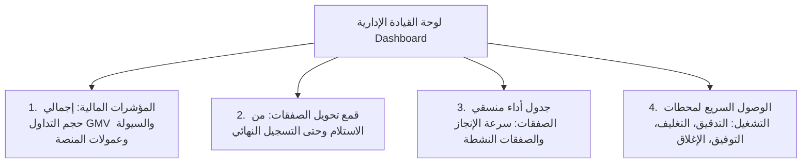
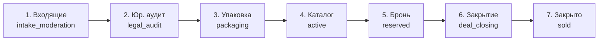
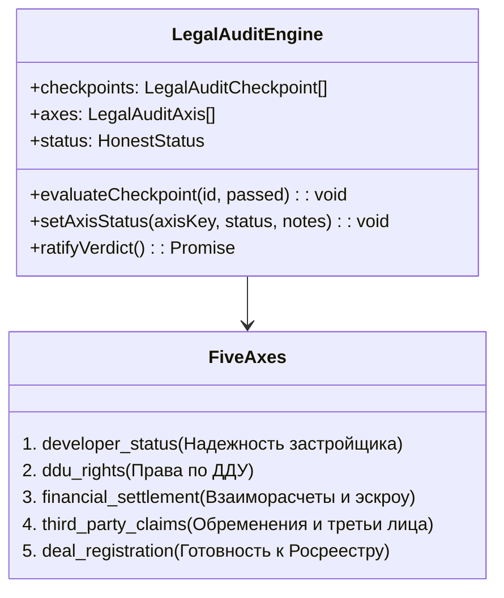

# الفصل التاسع: مواصفات الشاشات الإدارية وغرفة العمليات (Admin & Operations Pages Specification)

توفر منصة **DomExit** منظومة تشغيلية وإدارية خلفية متكاملة لفرق العمل ومنسقي الصفقات (Curators)، والمحامين، والمدققين الماليين، وإدارة المنصة، وممثلي البنوك الشريكة. تقع كافة هذه الشاشات تحت حماية **`AdminRouteGuard`** مع دعم عزل الصفقات لكل منسق وتحديث البيانات المباشر عبر **DAL Gateway**.

---

## 1. لوحة القيادة والمؤشرات العامة (`src/pages/AdminDashboardPage.tsx`)

تُمثّل مركز التحكم والرقابة الشامل للمنصة، وتوفر قراءة لحظية لمؤشرات الأداء التشغيلية والمالية:

### 1.1. المؤشرات التشغيلية والمالية الرئيسية (Key Performance Indicators)
- **إجمالي حجم التداول قيد التنفيذ (GMV по сделкам):** إجمالي القيمة المالية للعقارات النشطة في خط العمليات بالروبل.
- **العقارات النشطة في الكتالوج (Активные лоты):** عدد العقارات المنشورة والمعتمدة المتاحة للمشترين.
- **رؤوس الأموال المحمية للبائعين (Спасенный капитал):** المبالغ التي تم إنقاذها للبائعين من غرامات فسخ العقود لدى المطورين (احتساب 15% من قيمة العقود).
- **أرباح المنصة المتوقعة (Комиссионный пайплайн 2.5%):** إجمالي أتعاب المنصة المستحقة للتحصيل عند إغلاق الصفقات بعد تسجيل الـ Росреестр.
- **متوسط سرعة الإنجاز والتخارج (Средний срок реализации):** يقاس بالأيام (المعدل المستهدف: 14 إلى 21 يوماً).

### 1.2. قمع تدفق الصفقات (Deal Conversion Funnel)
توزيع الحالات عبر المراحل:
1. `Входящие заявки` (الطلبات الواردة حديثاً).
2. `Юридический аудит` (قيد التدقيق القانوني في المحاور الخمسة).
3. `Упаковка лота` (في استوديو التغليف واعتماد الصور).
4. `Активный каталог` (معروض للبيع العام).
5. `Матчмейкинг и бронь` (جاري مطابقة المشترين أو محجوز).
6. `Эскроу и Росреестр` (في مرحلة الإسكرو والتسجيل الحكومي).
7. `Успешно закрытые` (صفقات مكتملة ومحررة الأموال).

### 1.3. جدول توزيع المهام على المنسقين (Curator Workload & Performance)
يعرض لكل منسق قانوني: الاسم، عدد العقارات المسندة، الصفقات المغلقة، ومتوسط سرعة الإغلاق بالأيام، مع مؤشر الأداء العام.

---

## 2. لوحة إدارة خط العمليات وكانبان الصفقات (`src/pages/AdminPipelinePage.tsx`)

تُمثّل شاشة المتابعة اليومية لمديري العمليات والمنسقين، وتعتمد على واجهة كانبان تفاعلية (Kanban Pipeline Board):

### 2.1. أعمدة خط العمليات وحالاتها البرمجية
1. **المراجعة والاستلام الأولي (`intake_moderation`):** فحص أولي لطلب البائع وصحة رقم العقد والمطور.
2. **التدقيق القانوني (`legal_audit`):** فحص المحاور الخمسة وسجلات الإفلاس والمحاكم وسداد المطور.
3. **استوديو التغليف (`packaging`):** تحرير الوصف، إعداد بطاقة السعر، واعتماد الصور الاحترافية.
4. **العرض النشط في الكتالوج (`active`):** العقار معتمد ومتاح للعامة والمستثمرين.
5. **التوفيق والحجز التعاقدي (`reserved`):** تقدم مشترٍ مؤهل بتمويل معتمد وإيداع عربون الحجز.
6. **التوقيع والتسجيل والإسكرو (`deal_closing`):** توقيع عقد التنازل، إيداع الأموال في البنك، والتسجيل في Росреестр.
7. **إغلاق الصفقة بنجاح (`sold`):** تحرير الأموال للبائع واستلام أتعاب المنصة وأرشفة الملف.

### 2.2. الدرج الجانبي التفاعلي المتقدم (CRM Slide-Over Drawer)
عند النقر على أي صفقة أو عقار في الكانبان، يفتح درج جانبي سريع يحتوي على تبويبين:
- **تبويب النظرة العامة (`overview`):**
  - بيانات العقار: العنوان، المطور، الطابق، المساحة، السعر، ونسبة الخصم.
  - بيانات الأطراف: اسم وهاتف البائع، اسم وهاتف المشتري.
  - مستودع المستندات المرفوعة: استعراض وتنزيل عقد الـ ДДУ، شهادة السداد، وموافقة المطور مع مؤشر التحقق.
  - أزرار النقل السريع: الانتقال المباشر لاستوديو التغليف، التدقيق القانوني، التوفيق، أو غرفة الإغلاق.
  - زر الحذف المتسلسل الشامل: متاح للمالك لتنفيذ `PropertyLifecycleService.deletePropertyCascade`.
- **تبويب المحادثة المباشرة مع العميل (`chat`):**
  - تضمين ويدجت المحادثة الحية `CuratorChatWidget` للتواصل اللحظي بين المنسق والعميل دون مغادرة شاشة الكانبان.
  - شارة عدد الرسائل غير المقروءة (`unreadMap`).

---

## 3. استوديو التغليف وإعداد الإعلانات (`src/pages/AdminPackagingPage.tsx`)

يُعد استوديو التغليف محطة إعداد المحتوى التسويقي والفني للعقار لضمان أقصى جاذبية مع الالتزام التام بضوابط الخصوصية لـ **152-ФЗ**.

### 3.1. محرر البيانات والمواصفات الفنية
- **إخفاء رقم الشقة وحجب الطابق (152-ФЗ Privacy):**
  - خيار إخفاء الطابق المحدد (`hideFloor`) واستبداله بنطاق طوابق تقريبي (مثال: `5–10 этаж из 25`) لحماية خصوصية البائع ومنع الوسطاء المتطفلين من الوصول إليه مباشرة.
- **البيانات المكانية والنقل:** تحديد أقرب محطة مترو، والمسافة بالدقائق، ونمط الوصول (مشياً أو بالسيارة)، وإحداثيات الخريطة الدقيقة.
- **المواصفات الإنشائية:** اسم المجمع السكني، المطور، المساحة الإجمالية، ارتفاع الأسقف (مثال: `2.78 м`)، وتاريخ التسليم المتوقع.

### 3.2. الضبط المالي وبطاقة التسعير
- **سعر التنازل عبر DomExit:** السعر النهائي المعروض للمشترين.
- **سعر المطور المعياري للشقق المماثلة:** يتم جلبه من بيانات السوق لإظهار حجم التوفير.
- **الحساب الآلي للخصم والتوفير:** احتساب الخصم المالي الصافي ونسبته المئوية تلقائياً.

### 3.3. نظام اعتماد الصور الفوتوغرافية وفصل المصادر (Photo Curation System)
تعتمد المنصة تصميماً صارماً يفصل بين نوعين من الصور:
1. **صور البائع الأولية غير المعتمدة (`sellerPhotos`):** الصور والمخططات التي رفعها البائع في استمارة التخارج، وتبقى في مسودة الإدارة ولا تظهر في الكتالوج العام.
2. **الصور المعتمدة رسمياً للنشر (`approvedPhotos`):** الصور التي يفحصها المنسق ويعتمدها يدوياً للعرض العام في الكتالوج وصفحة العقار.
- **إجراءات المنسق على الصور:**
  - زر التبديل السريع لاعتماد أو حجب أي صورة (`handleTogglePhotoApproval`).
  - رفع صور احترافية جديدة مباشرة عبر دالة `s3-upload` لتخزينها في مسار `photos/{lotCode}/...`.
  - تحديد الصورة الرئيسية للغلاف (`setCoverImageUrl`).
- **المزامنة اللحظية وإبطال الكاش:** عند حفظ التعديلات عبر زر `«Сохранить изменения и опубликовать»`، يتم حفظ السجل في `LotsRepository` وإبطال كافة مفاتيح الكاش فوراً وبث حدث التحديث للواجهة العامة.

---

## 4. محرك التدقيق القانوني الموثق في المحاور الخمسة (`src/pages/AdminLegalAuditPage.tsx`)

يُدار الفحص القانوني عبر منصة تدقيق احترافية موثقة برمجياً وفقاً لأحكام القانون 214-ФЗ والقوانين الفيدرالية المرتبطة:

### 4.1. تفصيل المحاور الخمسة ونقاط التحقق (The 5 Real Legal Axes)
1. **المحور الأول: موثوقية المطور ورخص المشروع (`developer_status`):**
   - فحص سجل الإفلاس الفيدرالي (ЕФРСБ / Федресурс 127-ФЗ) للمطور والشركة الأم.
   - التحقق من القضايا في كارتوتيكا المحاكم (КАД Арбитраж и ГАС Правосудие).
   - سريان ترخيص البناء والامتثال لتواريخ تسليم المراحل في البوابة الموحدة (ЕИСЖС наш.дом.рф).
2. **المحور الثاني: تسلسل حقوق المشاركة في البناء (`ddu_rights`):**
   - مطابقة العقد الأصلي والملحقات المسجلة في هيئة الـ Росреестр.
   - التحقق من عدم وجود تنازلات سابقة باطلة أو غير مدفوعة الثمن.
3. **المحور الثالث: التسوية المالية ورصيد الإسكرو (`financial_settlement`):**
   - فحص شهادة سداد الحسابات (Акт сверки расчетов) الصادرة ومختومة من المطور.
   - مطابقة كشف إيداع رصيد الإسكرو البنكي وفقاً لمتطلبات البنك المركزي الروسي.
4. **المحور الرابع: خلو الحصة من مطالبات الغير والنزاعات العائلية (`third_party_claims`):**
   - استعلام ملفات التنفيذ الجبري والديون والرهون لدى محصلي الديون القضائيين (ФССП).
   - التحقق من موافقة الزوجة/الزوج الموثقة عدلياً أو شهادة عدم الارتباط الزوجي.
   - التأكد من عدم استخدام أموال دعم الأمومة (Материнский капитал) بطريقة تلزم بتخصيص حصص للأطفال قبل استكمال البناء.
5. **المحور الخامس: الجاهزية للتسجيل الإلكتروني في Росреестр (`deal_registration`):**
   - مطابقة الصياغة القانونية لاتفاقية التنازل (Договор уступки) مع متطلبات الشهر العقاري.
   - التحقق من صلاحية التوقيع الإلكتروني المعزز (УКЭП) لأطراف الصفقة.

### 4.2. الحالات الواقعية الثلاث المعتمدة (Honest Status Framework)
- `verified_safe` (أخضر): فحص مكتمل وآمن تماماً وخالٍ من أي عوائق.
- `required_at_deal` (أزرق/كهرماني): يتطلب مستنداً أو إجراءً يوقع وقت إبرام الصفقة بالبنك.
- `condition_found` (كهرماني): شرط خاص يستدعي تسوية محددة قبل توجيه المشتري.

### 4.3. تثبيت الحكم والاعتماد الرقمي (Ratify Verdict Action)
عند ضغط المحامي على زر `«Зафиксировать вердикт»`:
- يتم تجميد نتائج المحاور ونقاط التحقق مع تدوين اسم المحامي وتاريخ وساعة الاعتماد.
- يتم توليد بصمة تدقيق رقمية SHA-256 وحفظها في وثيقة العقار.
- يتم تحديث حالة العقار في `lots` وتحديث سجل الصفقة المرتبط في `deals`.
- يتم إبطال الكاش وبث التحديث لتنعكس شهادة التدقيق فوراً في صفحة العقار والشهادة الرقمية `/verify/:lotId`.

---

## 5. محرك التوفيق ومطابقة المشترين (`src/pages/AdminMatchmakerPage.tsx`)

يتولى مطابقة قاعدة بيانات المشترين المسجلين في المنصة مع متطلبات العقار المعروض لضمان سرعة إغلاق قياسية:

### 5.1. معايير خوارزمية المطابقة (Matching Engine Criteria)
1. **ملاءمة الميزانية والقدرة المالية (Budget Match):** تطابق سقف تمويل المشتري مع سعر التنازل المطلوب.
2. **جاهزية التمويل البنكي (Bank Approval Readiness):** تفضيل المشترين الحاصلين على موافقة مسبقة على الرهن العقاري من بنك الإسكرو المعتمد للمشروع (Сбер, ВТБ, Альфа).
3. **السيولة الفورية (Cash 48h):** المشترون الجاهزون لدفع الدفعة الأولى كاش وإيداعها في غضون 48 ساعة.
4. **التوزيع الجغرافي ونمط الوحدات:** تطابق رغبات المشتري من حيث المدينة وعدد الغرف.

### 5.2. خط أنابيب المرشحين (Candidate Pipeline)
- `Связались (Contacted)`: تم التواصل مع المشتري وعرض العقار عليه.
- `Одобрен банком (Approved by Bank)`: البنك اعتمد تمويل هذا العقار تحديداً للمشتري.
- `Назначен просмотр (Viewing Scheduled)`: موعد معاينة المجمع السكني وموقع البرج.
- `Выставлен оффер (Offer Made)`: تقديم عرض شراء رسمي.
- `Принят (Accepted)`: قبول العرض وتثبيت الحجز.

### 5.3. إجراء التعيين والحجز (Assign & Reserve Action)
عند اعتماد المرشح:
- يتم ربط المشتري بمسار الصفقة في جدول `deals`.
- تتحول حالة العقار في جدول `lots` إلى `reserved`.
- يتم توليد اتفاقية الحجز المبدئية وإشعار البائع والمنسق فوراً.

---

## 6. غرفة إغلاق الصفقات وحسابات الإسكرو (`src/pages/AdminClosingPage.tsx`)

تُمثّل المحطة النهائية للتنفيذ المالي والقانوني للصفقة، وتُشرف على 5 خطوات تنفيذية محكمة:

### 6.1. مراحل غرفة الإغلاق التنفيذية
- **الخطوة أ (Шаг 1): تثبيت شروط الحجز والتأمين (Бронирование):** التحقق من إيداع عربون الجدية ومطابقة الهويات.
- **الخطوة ب (Шаг 2): موافقة بنك الإسكرو والمطور (Согласование банка):** استلام إشعار البنك الضامن وموافقة شركة التطوير على التنازل.
- **الخطوة ج (Шаг 3): التوقيع وإيداع كامل الثمن (Подписание и депонирование):**
  - توقيع عقد التنازل عن حق المطالبة (Договор уступки).
  - إيداع المشتري لكامل ثمن الشراء في حساب إسكرو بنكي مشروط أو خطاب اعتماد (Аккредитив).
  - رفع إيصال الإيداع المعتمد في مستندات الصفقة.
- **الخطوة د (Шаг 4): التقديم للتسجيل الحكومي (Подача в Росреестр):**
  - إرسال الحزمة إلكترونياً إلى مكاتب الـ Росреестр عبر التوقيع الإلكتروني المعتمد.
  - تسجيل رقم الطلب الحكومي وتتبع سريانه.
- **الخطوة هـ (Шаг 5): تسجيل العقد وتحرير الأموال (Регистрация и раскрытие счетов):**
  - استلام إشعار التسجيل الرسمي بختم الـ Росреестр الإلكتروني.
  - قيام البنك بتحرير كامل قيمة البيع لحساب البائع فوراً دون خصم أي غرامات (0% عمولة على البائع).
  - تحرير عمولة المنصة البالغة 2.5% من حساب المشتري المخصص.
  - نقل حالة العقار إلى `sold` وحالة الصفقة إلى `closed`.

### 6.2. آلية إعادة الطرح الطارئ (Emergency Relist Modal)
في حال تخلف المشتري عن إيداع ثمن الشراء في الحساب البنكي المشروط خلال المهلة المحددة (48 ساعة)، تتيح الغرفة للمنسق إلغاء الحجز بضغطة زر واحدة وإعادة طرح العقار فورياً في الكتالوج العام كصفقة ساخنة مع إشعار المرشحين الاحتياطيين في Matchmaker.

---

## 7. الوحدات الإدارية المساندة (Supporting Back-Office Modules)

- **إدارة شبكة الشركاء والوسطاء (`src/pages/AdminBrokersPage.tsx`):** متابعة طلبات انضمام وكالات العقارات والوسطاء، توليد أكواد الإحالة التسويقية، وتتبع نسب العمولات المستحقة للشركاء.
- **الملف المهني للمنسق (`src/pages/AdminCuratorProfilePage.tsx`):** واجهة مخصصة لكل منسق لاستعراض سجل إنجازاته، متوسط سرعة إغلاق الصفقات، تقييمات العملاء، وإدارة وسائل التواصل.
- **سجل الأحداث والرقابة الأمنية (`src/pages/AdminArchiveLogsPage.tsx`):** سجل غير قابل للتعديل (Immutable Journal) يستعلم من جدول `audit_logs`؛ يوثق كافة التعديلات على الأسعار، والتدقيق القانوني، وعمليات الحذف والاعتماد مع تسجيل هوية المنفذ وعنوان الـ IP ووقت العملية بالثانية.
- **بوابة موظفي البنوك الشريكة (`src/pages/BankPortalPage.tsx`):** شاشة مخصصة لمسؤولي الائتمان في بنوك Сбербанк, ВТБ, Альфа-Банк لمراجعة طلبات الرهن العقاري، وتأكيد فتح حسابات الإسكرو، وإصدار خطابات الموافقة الاستثنائية.
