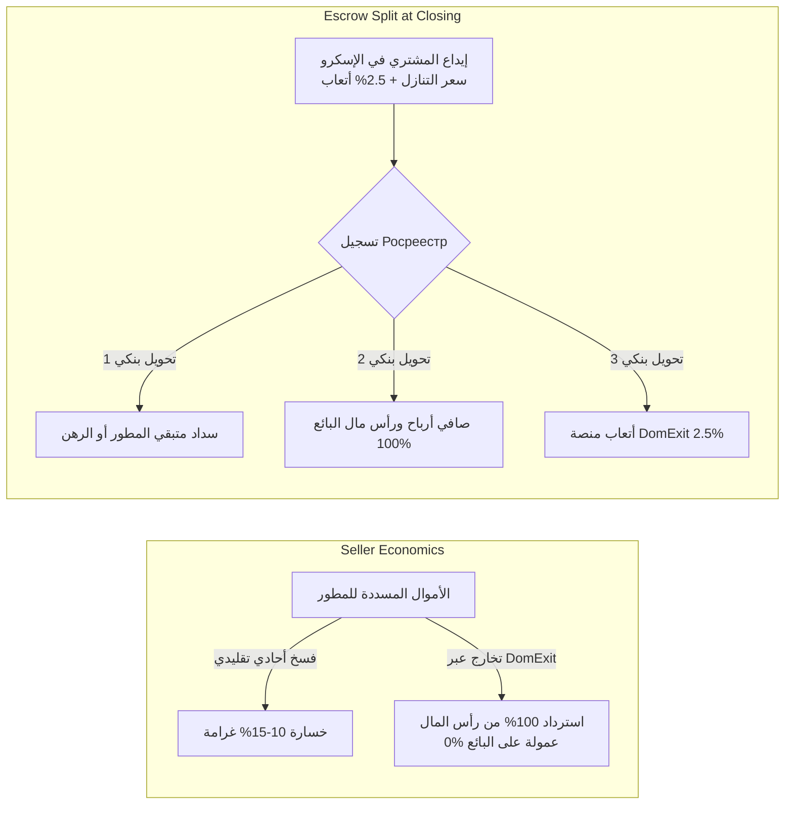

# الفصل الحادي عشر: المحرك المالي والمعادلات الحسابية والخوارزميات (Financial Engine, Formulas & Algorithms)

يرتكز نموذج أعمال **DomExit** على محرك مالي منضبط يهدف إلى توفير بديل عادل وشفاف وعالي السيولة لسوق العقارات قيد الإنشاء في روسيا الاتحادية. يُلغي هذا المحرك خسائر البائعين الناتجة عن غرامات المطورين الجائرة عند التعثر في سداد الأقساط، ويوفر للمشترين خصومات حقيقية مقارنة بأسعار السوق مع حماية حقوق كافة الأطراف عبر حسابات الإسكرو البنكية المشروطة.

---

## 1. الفلسفة الاقتصادية وهيكل تدفق القيمة (Value Flow Architecture)



### المبادئ المالية الذهبية لمنصة DomExit:
1. **عمولة 0% على البائع (Zero Seller Commission):** لا يدفع البائع أي مبالغ أو عمولات للمنصة. يسترد البائع كامل رأس ماله المتفق عليه لإنقاذه من غرامة المطور.
2. **أتعاب نجاح بنسبة 2.5% على المشتري (2.5% Success-Only Buyer Fee):** يدفع المشتري أتعاب خدمة المنصة البالغة 2.5% حصراً بعد اكتمال التسجيل الإلكتروني الرسمي في السجل العقاري الحكومي (Росреестр). يُحظر تحصيل أي مبالغ مسبقة.
3. **حماية رؤوس الأموال من الغرامات:** حماية البائعين من خسارة ما بين 10% إلى 15% من قيمة العقد الإجمالية، وهو ما يعادل ملايين الروبلات في السوق الروسي.

---

## 2. المعادلات الرياضية لاقتصاديات البائع (Seller Exit Economics)

### 2.1. معادلة غرامة المطور التعاقدية (Developer Penalty Formula)
عند طلب البائع فسخ عقد المشاركة (Расторжение ДДУ) من طرف واحد، يقتطع المطور غرامة تعاقدية:
$$\text{Penalty}_{\text{dev}} = \text{PaidAmount} \times \left(\frac{\text{PenaltyRate}_{\text{dev}}}{100}\right)$$
حيث:
- $\text{PaidAmount}$: إجمالي المبالغ المسددة فعلياً للمطور حتى تاريخ التخارج بالروبل.
- $\text{PenaltyRate}_{\text{dev}}$: نسبة غرامة المطور المسجلة في `market_settings` (افتراضياً: $15\%$).

*مثال تطبيقي:*
إذا سدد البائع مبلغ $4,000,000 \text{ \symbol{8381}}$:
$$\text{Penalty}_{\text{dev}} = 4,000,000 \times 15\% = 600,000 \text{ \symbol{8381} (خسارة صافية للبائع)}$$

### 2.2. معادلة رأس المال المحمي والمسترد للبائع (Capital Saved & Net Proceeds)
عبر التنازل (Переуступка) من خلال DomExit، يسترد البائع كامل رصيده المسدد:
$$\text{CapitalSaved} = \text{PaidAmount} \times \left(\frac{\text{developerPenaltyPercent}}{100}\right)$$
$$\text{NetProceeds}_{\text{seller}} = \text{Price}_{\text{agreed}} - \text{Debt}_{\text{remaining}}$$
حيث:
- $\text{Price}_{\text{agreed}}$: سعر التنازل المتفق عليه مع المشتري.
- $\text{Debt}_{\text{remaining}}$: الرصيد المتبقي لشركة التطوير أو بنك الرهن القائم (إن وُجد).

---

## 3. المعادلات الرياضية لاقتصاديات المشتري وأتعاب المنصة (Buyer Economics)

### 3.1. معادلة أتعاب المنصة (DomExit Platform Fee)
$$\text{Fee}_{\text{DomExit}} = \text{Price}_{\text{assignment}} \times 0.025$$
حيث:
- $\text{Price}_{\text{assignment}}$: سعر الشراء بنظام التنازل.
- نسبة العمولة: $2.5\%$ ثابتة.

### 3.2. إجمالي تكلفة الاستحواذ للمشتري (Total Acquisition Cost)
$$\text{TotalCost}_{\text{buyer}} = \text{Price}_{\text{assignment}} + \text{Fee}_{\text{DomExit}} = \text{Price}_{\text{assignment}} \times 1.025$$

### 3.3. معادلة صافي التوفير والخصم للمشتري (Buyer Net Savings & Discount)
مقارنة بسعر المطور للشقق المماثلة في نفس البرج السكني:
$$\text{NetSavings} = \text{Price}_{\text{developer}} - \text{TotalCost}_{\text{buyer}}$$
$$\text{DiscountPercent} = \frac{\text{Price}_{\text{developer}} - \text{Price}_{\text{assignment}}}{\text{Price}_{\text{developer}}} \times 100$$

*مثال تطبيقي:*
- سعر المطور الحالي للشقة: $12,000,000 \text{ \symbol{8381}}$
- سعر التنازل عبر DomExit: $10,200,000 \text{ \symbol{8381}}$
- نسبة الخصم:
  $$\text{DiscountPercent} = \frac{12,000,000 - 10,200,000}{12,000,000} \times 100 = 15\%$$
- أتعاب المنصة (2.5%):
  $$\text{Fee}_{\text{DomExit}} = 10,200,000 \times 0.025 = 255,000 \text{ \symbol{8381}}$$
- إجمالي ما يدفعه المشتري:
  $$\text{TotalCost} = 10,200,000 + 255,000 = 10,455,000 \text{ \symbol{8381}}$$
- صافي التوفير الصافي للمشتري:
  $$\text{NetSavings} = 12,000,000 - 10,455,000 = 1,545,000 \text{ \symbol{8381}}$$

---

## 4. محرك حساب أقساط الرهن العقاري (Mortgage Annuity Engine)

تعتمد المنصة على صيغة الأقساط الثابتة الموحدة (Аннуитетный платеж) المعتمدة لدى البنوك الروسية:

$$M = P \times \frac{r(1+r)^n}{(1+r)^n - 1}$$

حيث:
- $M$: القسط الشهري الثابت بالروبل.
- $P$: مبلغ القرض الأصلي (قيمة العقار ناقصاً الدفعة الأولى):
  $$P = \text{Price}_{\text{assignment}} - \text{DownPayment}$$
- $r$: معدل الفائدة الشهري العشري:
  $$r = \frac{\text{AnnualRate}}{12 \times 100}$$
- $n$: عدد أشهر السداد الإجمالية (مثال: $20 \text{ سنة} \times 12 = 240 \text{ شهراً}$).

### مقارنة البرامج التمويلية في السوق الروسي (2026):
1. **الرهن العقاري العائلي المدعوم (Семейная ипотека 6%):**
   - الفائدة السنوية: $6.0\%$
   - الفائدة الشهرية: $r = \frac{6}{1200} = 0.005$
2. **الرهن العقاري القياسي (Стандартная рыночная ипотека 21%):**
   - الفائدة السنوية المتأثرة بسعر البنك المركزي الروسي: $21.0\%$
   - الفائدة الشهرية: $r = \frac{21}{1200} = 0.0175$

*مقارنة لقرض بقيمة $8,000,000 \text{ \symbol{8381}}$ لمدة 20 سنة (240 شهراً):*
- **قسط الرهن العائلي (6%):** $57,308 \text{ \symbol{8381}/شهر}$ (إجمالي الفوائد: $5.75 \text{ مليون \symbol{8381}}$)
- **قسط الرهن التجاري (21%):** $142,398 \text{ \symbol{8381}/شهر}$ (إجمالي الفوائد: $26.17 \text{ مليون \symbol{8381}}$)
- **الفارق الموفر للمشتري شهرياً:** $85,090 \text{ \symbol{8381}/شهر}$

---

## 5. مقياس عبء الدين الرقابي (ПДН - Показатель долговой нагрузки)

وفقاً لتعليمات البنك المركزي الروسي (ЦБ РФ 5782-У)، يراقب محرك التوفيق (Matchmaker) مؤشر عبء الدين للمشترين:

$$\text{ПДН} = \frac{\sum \text{MonthlyDebtPayments}}{\text{ConfirmedMonthlyNetIncome}} \times 100$$

### مستويات الخطورة الائتمانية:
- **$\text{ПДН} \le 50\%$ (منطقة خضراء - منخفض الخطورة):** موافقة فورية وتسهيل في إجراءات بنك الإسكرو.
- **$50\% < \text{ПДН} \le 80\%$ (منطقة صفراء - متوسط الخطورة):** يتطلب موافقة ائتمانية خاصة (`bank_special_approvals`) وزيادة في الدفعة الأولى.
- **$\text{ПДН} > 80\%$ (منطقة حمراء - عالي الخطورة):** قيود تنظيمية مشددة من البنك المركزي تلزم بوجود ضامن مالي أو زيادة الدفعة النقدية.

---

## 6. مؤشرات الجدوى الاستثمارية لنادي المستثمرين (Investment Metrics)

تُحسب هذه المؤشرات آلياً لصفقات الكتالوج الحصري (`VipCatalogPage`):

### 6.1. العائد الإيجاري الإجمالي المتوقع (Gross Rental Yield)
$$\text{RentalYield} = \frac{\text{MonthlyRent}_{\text{est}} \times 12}{\text{Price}_{\text{assignment}}} \times 100$$

### 6.2. معدل النمو الرأسمالي السنوي حتى الاستلام (Annual Capital Growth)
$$\text{CapitalGrowth} = \frac{\text{Price}_{\text{delivery}} - \text{Price}_{\text{assignment}}}{\text{YearsToDelivery} \times \text{Price}_{\text{assignment}}} \times 100$$

### 6.3. معدل العائد الداخلي التقريبي (Estimated IRR)
$$\text{IRR} \approx \text{RentalYield} + \text{CapitalGrowth} - \text{InflationAdjustment}$$

---

## 7. خوارزمية تقسيم أموال الإسكرو عند الإغلاق (Escrow Settlement Split)

تضمن غرفة العمليات (`AdminClosingPage`) توزيعاً برمجياً دقيقاً لأموال الصفقة المحجوزة في الحساب البنكي المشروط فور ورود إشعار التسجيل الإلكتروني من الـ Росреестр:

```text
إجمالي المبلغ المودع من المشتري:
S_total = Price_assignment + Fee_platform (2.5%)

التحويلات المتزامنة الصادرة من البنك:
1. التحويل الأول (سداد المطور/البنك إن وجد دين قائم):
   S_dev = Debt_remaining
   
2. التحويل الثاني (صافي استرداد البائع 100%):
   S_seller = Price_assignment - Debt_remaining
   
3. التحويل الثالث (حساب التسوية التشغيلي لمنصة DomExit):
   S_domexit = Fee_platform = Price_assignment * 0.025
```

---

## 8. معايير التنسيق المالي واللغوي (Formatting Standards)

تلتزم المنصة بدقة بقواعد التنسيق المالي الروسي المعتمدة في `src/utils/formatters.ts`:
- **فصل الآلاف:** استخدام المسافة غير القابلة للكسر (Non-breaking space: `\u00A0`) بدلاً من الفواصل العادية (مثال: `10 200 000 ₽` وليس `10,200,000`).
- **رمز العملة الروسية:** رمز الروبل الرسمي `₽` يوضع دائماً في نهاية الرقم بعد مسافة فاصلة.
- **النسب المئوية:** تقريب النسب إلى منزلة عشرية واحدة متبوعة برمز `%` مباشرة دون مسافة (مثال: `15.0%`).
- **حظر الرموز الرياضية المعقدة في نصوص العملاء:** استبدال الرموز اللاتينية بصياغة روسية واضحة ومباشرة مثل `«Требуется не менее 20%»` بدلاً من `«>= 20%»`.
