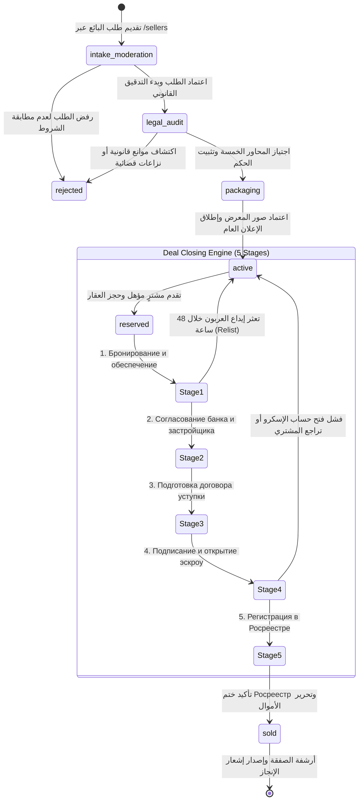
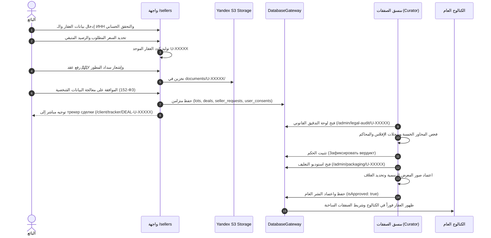
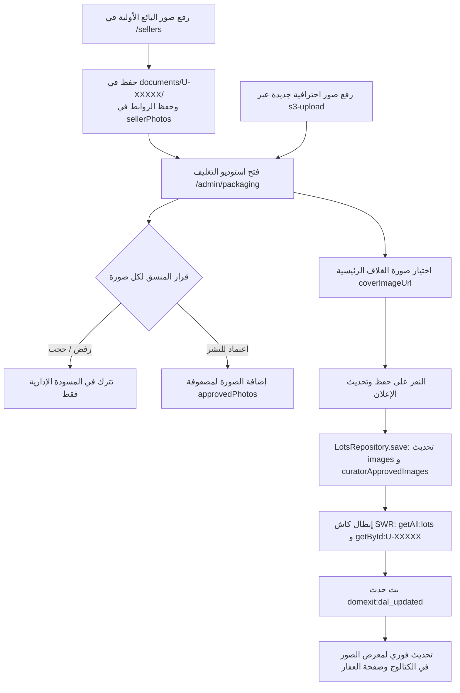
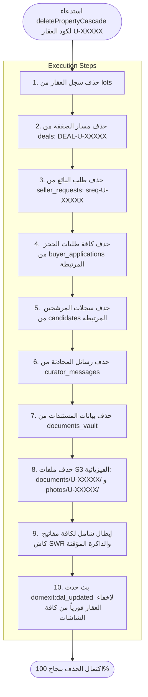

# الفصل الثاني عشر: دورات العمل الشاملة وآلات الحالة (End-to-End Workflows & State Machines)

يوثق هذا الفصل مسارات العمليات المتكاملة (End-to-End Workflows) وآلات الحالة المحدودة (State Machines) التي تقود عمليات منصة **DomExit** من أول نقطة اتصال وحتى إتمام تحويل الأموال وأرشفة الصفقة، مع توضيح الرسوم التوضيحية وشروط الانتقال بين الحالات والمسؤوليات البرمجية والتنفيذية.

---

## 1. آلة حالة العقار والصفقة (The Unified Property & Deal Lifecycle State Machine)

تتطابق دورة حياة العقار (`Lot`) مع مسار الصفقة (`DealTrack`) برابط معرّف موحد (`lot.id === lot.lotCode` و `deal.id === 'DEAL-' + lotCode`).

---

## 2. مسار تخارج البائع الكامل (Seller Exit End-to-End Flow)

---

## 3. مسار استحواذ وحجز المشتري (Buyer Acquisition & Reservation Flow)

1. **الاستكشاف والفلترة (`/opportunities`):** يتصفح المشتري الكتالوج العام أو الخريطة الجغرافية التفاعلية مع فرز العقارات بحسب محطة المترو، نسبة التوفير، أو السعر.
2. **فحص العقار والتقرير القانوني (`/lot/:id`):** يستعرض المشتري صور المعرض المعتمدة، ويطلع على بطاقة المحاور القانونية الخمسة، ويدخل على شهادة الفحص الموثقة برقم الباركود في `/verify/:lotId`.
3. **المحادثة المباشرة مع المنسق (`CuratorChatWidget`):** ينقر المشتري على زر `«Чат с куратором»` لمناقشة جاهزية العقار للرهن البنكي أو طلب مستندات إضافية.
4. **طلب الحجز وتثبيت الصفقة (`ReservationModal`):**
   - يدخل المشتري اسمه، هاتفه، نوع التمويل (كاش، رهن عائلي 6%، رهن قياسي).
   - يتم إرسال الطلب إلى جدول `buyer_applications` وجدول `candidates`.
   - يقوم المنسق في `AdminMatchmakerPage` بمطابقة المشتري وربطه بالصفقة رسمياً.
   - تنتقل حالة العقار في الكتالوج إلى `reserved` (محجوز) لمنع تضارب المشترين.

---

## 4. محرك مراحل الصفقة الخمس التنفيذية (The 5-Stage Closing Engine)

تُدار هذه المراحل بدقة عبر شاشة غرفة الإغلاق (`AdminClosingPage`) وواجهة تتبع العميل (`ClientTrackerPage`):

### المرحلة الأولى: الحجز ومبلغ التأمين (Бронирование и обеспечение)
- **الهدف:** تثبيت جدية الشراء وسحب العقار من العرض العام.
- **الإجراءات:**
  - توقيع اتفاقية الحجز المبدئية رقمياً.
  - إيداع مبلغ التأمين/العربون (Задаток) في حساب الحجز البنكي.
  - مهلة 48 ساعة لتأكيد إيداع العربون؛ في حال التخلف يتم تفعيل إعادة الطرح التلقائي (Emergency Relist).
- **المستندات الناتجة:** إشعار حجز العقار (Соглашение о бронировании).

### المرحلة الثانية: موافقة البنك والمطور العقاري (Согласование банка и застройщика)
- **الهدف:** إزالة أي عوائق ائتمانية أو تعاقدية من أطراف المشروع.
- **الإجراءات:**
  - استخراج كشف سداد الحسابات الرسمي (Акт сверки взаиморасчетов) من المطور مختوماً.
  - استلام موافقة المطور الرسمية على التنازل (إن نص العقد على اشتراطها).
  - الحصول على موافقة بنك التمويل العقاري للمشتري على تمويل الحصة المحددة.
- **المستندات الناتجة:** خطاب اعتماد البنك وموافقة شركة التطوير.

### المرحلة الثالثة: صياغة عقد التنازل وتدقيقه (Подготовка договора уступки)
- **الهدف:** صياغة العقد النهائي بما يحمي حقوق البائع والمشتري وفقاً لـ 214-ФЗ.
- **الإجراءات:**
  - يقوم محامي DomExit المعتمد بإعداد المسودة القانونية لاتفاقية التنازل عن حق المطالبة (Договор уступки прав требования по ДДУ).
  - مراجعة سلسلة المدفوعات والبنود الخاصة بالتسليم والضمانات الإنشائية.
  - مراجعة وتأكيد موافقة الزوج/الزوجة الموثقة عدلياً لكلا الطرفين.
- **المستندات الناتجة:** مسودة عقد التنازل المعتمدة من الدائرة القانونية.

### المرحلة الرابعة: التوقيع وحجز كامل الثمن في الإسكرو (Подписание и открытие эскроу)
- **الهدف:** توثيق التزامات الأطراف وتأمين المبالغ المالية بنكياً قبل التسجيل.
- **الإجراءات:**
  - فتح حساب إسكرو مشروط أو اعتماد مصرفي (Аккредитив) في البنك الضامن.
  - إيداع المشتري لكامل ثمن الشراء المتفق عليه + أتعاب المنصة (2.5%) في الحساب البنكي.
  - توقيع اتفاقية التنازل الرسمية إما حضورياً في فرع البنك أو إلكترونياً بالتوقيع الرقمي المعزز (УКЭП).
  - لا يستطيع البائع سحب الأموال، ولا يستطيع المشتري استردادها إلا بموافقة مشتركة أو انتهاء مهلة التسجيل.
- **المستندات الناتجة:** إشعار إيداع الأموال البنكي والعقد الموقع من الأطراف.

### المرحلة الخامسة: التسجيل الحكومي في Росреестр وتحرير الأموال (Регистрация и раскрытие счетов)
- **الهدف:** نقل الملكية القانونية رسمياً وتحرير كافة المبالغ المالية لمستحقيها.
- **الإجراءات:**
  - إرسال حزمة المعاملة إلكترونياً إلى مكاتب الهيئة الفيدرالية للتسجيل العقاري (Росреестр).
  - تتبع رقم المعاملة الحكومي حتى صدور الإشعار بختم التسجيل الإلكتروني الرسمي (Штамп о регистрации).
  - إرسال إشعار التسجيل المعتمد آلياً إلى البنك الضامن.
  - ينفذ البنك التحويلات المتزامنة الصادرة فوراً:
    1. تحويل كامل صافي رأس مال البيع لحساب البائع (استرداد 100% دون عمولة).
    2. تحويل أتعاب المنصة البالغة 2.5% إلى حساب التسوية الخاص بـ DomExit.
    3. سداد أي مديونية متبقية لشركة التطوير (إن وجدت).
  - تسجيل اكتمال الصفقة ونقل حالتها إلى `sold` وحالة المسار إلى `closed`.
- **المستندات الناتجة:** مستخرج ЕГРН الجديد باسم المشتري، وإشعارات التسوية البنكية الختامية.

---

## 5. دورة اعتماد الصور والنشر العام (Photo Curation & Live Sync Flow)

---

## 6. دورة المحادثة المباشرة مع المنسق (`Curator Live Chat Flow`)

1. **بدء المحادثة:** ينقر العميل (بائع أو مشترٍ) على زر `«Чат с куратором»` في صفحة العقار أو بوابة العميل، مما يفتح المكون `CuratorChatWidget`.
2. **إرسال الرسالة:** يكتب العميل نص الرسالة أو يرفع وثيقة مرفقة. تتولى الدالة `CuratorChatRepository.sendMessage`:
   - حفظ الرسالة في جدول `curator_messages` (أو `demo_curator_messages` بحسب البيئة).
   - وضع علامة `clientRead: true` و `curatorRead: false`.
   - بث حدث `domexit:dal_updated` لإشعار المتصفح.
3. **تنبيه المنسق:**
   - تظهر شارة رقمية حمراء على بطاقة الصفقة في كانبان الإدارة (`AdminPipelinePage`) توضح عدد الرسائل غير المقروءة (`unreadMap`).
   - عند فتح المنسق لدرج الصفقة، يستعرض الرسائل ويرد عليها مباشرة.
4. **تحديث القراءة:** عند فتح الطرف الآخر للمحادثة، يتم تحديث السجلات تلقائياً إلى `curatorRead: true` أو `clientRead: true` لإزالة شارات التنبيه.

---

## 7. دورة الحذف المتسلسل الشامل (Cascade Deletion Flow)

تضمن الدالة `PropertyLifecycleService.deletePropertyCascade(lotCode)` الإزالة المتزامنة التامة دون ترك أي مخلفات:

