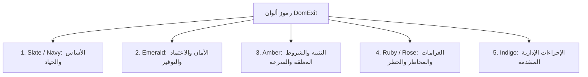

# الفصل الثالث عشر: نظام التصميم ورموز الواجهة وقواعد تجربة المستخدم (Design System, UI Tokens & UX Rules)

تعتمد منصة **DomExit** على نظام تصميم صارم مستوحى من كبرى المنصات المصرفية والتقنية في روسيا، ويجمع بين الشفافية والوضوح للمستخدم العادي والتركيز العالي للمشغلين، مع التزام تام بضوابط الخصوصية المنصوص عليها في القانون الاتحادي الروسي **152-ФЗ**.

---

## 1. فلسفة التصميم الثنائية (Aesthetic Dualism)

تتبنى المنصة استراتيجية بصرية مزدوجة تفصل بوضوح بين بيئتي العمل:
1. **الواجهة العامة للعملاء (Public Vitrine - Clean & Bright Light Mode):**
   - خلفيات بيضاء وسماوية ناصعة (`bg-white`, `bg-slate-50`).
   - حدود دقيقة ناعمة بلون رمادي خفيف (`border-slate-200/80`).
   - عناوين داكنة حاسمة (`text-slate-900`) تعكس الثقة والشفافية التامة والمصداقية القانونية.
2. **غرفة العمليات الإدارية (Operations Cockpit - Deep Slate Dark Mode):**
   - خلفيات كحلية داكنة فائقة التركيز (`bg-slate-950`, `bg-slate-900`).
   - حدود داكنة عالية التباين (`border-slate-800`).
   - مؤشرات وشارات ملونة متوهجة (Glowing Badges) تبرز حالات التدقيق وسرعة الإنجاز دون إجهاد بصر الموظفين.

---

## 2. لوحة الألوان ورموز التصميم الدلالية (Color Palette & Semantic Tokens)



### 2.1. تدرجات الألوان المعيارية (Tailwind Color Tokens)
- **درجات الأساس والحياد (Slate / Navy):**
  - `--navy-950: #020617` (الخلفية العميقة للوحة الإدارة وحارس المسارات).
  - `--navy-900: #0f172a` (لون البطاقات الإدارية والنصوص الرئيسية في الواجهة الفاتحة).
  - `--navy-800: #1e293b` (لون القوائم المنسدلة والحدود النشطة في الوضع الداكن).
  - `slate-600: #475569` (لون النصوص الوصفية والفقرات الإرشادية).
  - `slate-400: #94a3b8` (لون النصوص الثانوية والتذييل).
  - `slate-200: #e2e8f0` (لون الفواصل والحدود في الواجهة الفاتحة).
  - `slate-50: #f8fafc` (لون خلفية الصفحة العامة).
- **ألوان النجاح والاعتماد (Emerald - Safe & Verified):**
  - `--emerald-500: #10b981` (لون الشارات الآمنة `verified_safe`، وتأكيد الإسكرو، ونسبة الخصم).
  - `--emerald-600: #059669` (لون أزرار الحفظ والإجراءات الإيجابية).
  - `--emerald-50: #ecfdf5` (خلفية كروت التوفير وشارات الاعتماد الفيدرالي).
- **ألوان الشروط والتحذير (Amber - Caution & In-Progress):**
  - `amber-500: #f59e0b` (لون شارة `condition_found`، وإيداع الإسكرو قيد الانتظار).
  - `amber-50: #fffbeb` (خلفية الملاحظات القانونية التي تتطلب توقيعاً بالبنك).
- **ألوان المخاطر والغرامات (Ruby / Rose - Penalty & Danger):**
  - `--ruby-500: #ef4444` (لون تحذيرات غرامات المطور 15%، وإلغاء الصفقات، ومحاولات التسلل).
  - `--ruby-50: #fef2f2` (خلفية رسائل الخطأ والتنبيهات الحادة).
- **ألوان العلامة التجارية الإدارية (Indigo / Violet):**
  - `indigo-600: #4f46e5` (لون أزرار تسجيل الدخول الإداري والتبديل السريع).

---

## 3. منظومة الطباعة والخطوط (Typography System)

- **الخط الأساسي للمنصة (Primary Font Stack):**
  ```css
  font-family: -apple-system, BlinkMacSystemFont, "Segoe UI", Roboto, "Helvetica Neue", Arial, sans-serif;
  ```
  يوفر قراءة عربية ولاتينية وسيريلية (Cyrillic) فائقة الوضوح مع تسريع وقت التحميل عبر استغلال خطوط النظام الأصلية للمتصفح دون استدعاء خطوط خارجية ثقيلة.
- **الخط أحادي المسافة (Monospace Font) للأكواد والرموز الرسمية:**
  - يُستخدم `font-mono` لتمثيل كود العقار (`U-62090`)، كود الصفقة (`DEAL-2026-62090`)، الرقم الضريبي للمطور (`ИНН 7700000000`)، وبصمات التشفير SHA-256.

### مقياس العناوين والأحجام (Type Scale):
- **العنوان الرئيسي الضخم (Hero H1):** `text-3xl sm:text-4xl lg:text-5xl font-black tracking-tight text-slate-900`.
- **عنوان القسم (Section H2):** `text-2xl sm:text-3xl font-extrabold text-slate-900 tracking-tight`.
- **عنوان البطاقة (Card H3):** `text-lg sm:text-xl font-bold text-slate-900`.
- **النص العادي (Body Text):** `text-sm sm:text-base text-slate-600 leading-relaxed`.
- **النصوص الدقيقة والملاحظات القانونية (Fine Print & Legal):** `text-xs text-slate-400 font-medium`.

---

## 4. الحواف والظلال والتأثيرات البصرية (Elevations & Blur Effects)

### 4.1. نصف قطر الحواف (Border Radiuses)
- الحواف الصغيرة: `rounded-lg` (`8px`) لحقول الإدخال والأزرار المصغرة.
- الحواف المتوسطة: `rounded-xl` (`12px`) لبطاقات العقار والقوائم المنسدلة.
- الحواف الكبيرة: `rounded-2xl` (`16px`) للحاويات والنوافذ المنبثقة وحاسبات التوفير.
- الحواف الضخمة: `rounded-3xl` (`24px`) للأقسام الكبرى وحاويات لوحة التحكم.
- الحواف الدائرية الكاملة: `rounded-full` للشارات الرقمية، وأزرار الحالة، والكبسولات.

### 4.2. الزجاج الضبابي والتوهج (Glassmorphism & Glow Effects)
- **`.glass-light`:**
  ```css
  background: rgba(255, 255, 255, 0.9);
  backdrop-filter: blur(12px);
  -webkit-backdrop-filter: blur(12px);
  border: 1px solid rgba(226, 232, 240, 0.8);
  ```
- **`.emerald-glow`:** توهج زمردي خفيف حول بطاقات العقارات المعتمدة بالكامل:
  ```css
  box-shadow: 0 0 25px -5px rgba(16, 185, 129, 0.25);
  ```

---

## 5. قواعد حماية الخصوصية وتجربة المستخدم الفيدرالية (152-ФЗ UX Rules)

تلتزم واجهات التطبيق ومكوناته بمجموعة من الضوابط الصارمة للامتثال القانوني وحماية الخصوصية:
1. **الحظر التام لإظهار رقم الشقة:** لا يُعرض رقم الشقة نهائياً في أي بطاقة عامة أو صفحة تفاصيل أو خريطة تفاعلية. يُكتفى بذكر الطابق والمجمع السكني ورقم العقد المشفر.
2. **قناع حجب الطابق (Floor Masking Option):** إتاحة خيار إخفاء رقم الطابق الفعلي للمنسق في استوديو التغليف واستبداله بنطاق تقريبي (مثل `«5–10 этаж»`).
3. **قناع إدخال أرقام الهواتف الروسية:** تقييد حقول الهواتف بصيغة دولية موحدة تبدأ بـ `+7` مع تنسيق فوري للأقواس والمسافات (`+7 (999) 000-00-00`).
4. **حظر إظهار أسماء البنية التحتية السحابية للعملاء:** يُمنع منعاً باتاً ظهور كلمات مثل "Yandex", "Netlify", "Firebase", "S3", "DocAPI" في واجهات الزوار والعملاء؛ ويُستبدل ذلك بمصطلحات قانونية ومصرفية مثل `«Защищенное облачное хранилище»` و `«Банковский контур эскроу»`.
5. **شريط الكوكيز وخانات الموافقة الإلزامية:** توفير روابط تشعبية صريحة للسياسات القانونية عند كل عملية إرسال بيانات، مع حظر التحديد المسبق التلقائي لخانة الموافقة على الرسائل الترويجية (امتثالاً لقانون الإعلانات 38-ФЗ).
