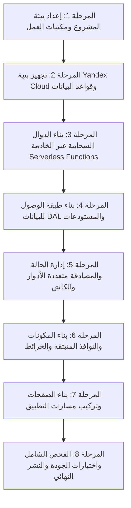

# الفصل الرابع عشر: دليل إعادة البناء الهندسي الشامل من الصفر (Rebuild-from-Scratch Playbook)

يوفر هذا الفصل دليلاً تنفيذياً متسلسلاً خطوة بخطوة (**Master Runbook**) يمكّن أي فريق هندسي أو نموذج ذكاء اصطناعي من إعادة بناء وتأسيس تطبيق **DomExit** بالكامل من الصفر وحتى الإطلاق السحابي الفعلي، مع ضمان عدم إغفال أي جزئية معمارية أو تشغيلية.

---

## 1. خارطة مراحل إعادة التأسيس (Rebuild Roadmap)



---

## 2. المرحلة الأولى: تأسيس بيئة التطوير والمكتبات (Phase 1: Project Setup)

### 2.1. متطلبات بيئة التشغيل
- **Node.js:** الإصدار `18.18.0` أو `20.x` أو أعلى.
- **مدير الحزم:** `npm` (الإصدار 9 أو 10).
- **نظام التشغيل:** Linux, macOS, أو Windows.

### 2.2. تهيئة المشروع وتثبيت المكتبات
1. إنشاء مشروع Vite جديد باستخدام قالب React + TypeScript:
   ```bash
   npm create vite@latest domexit -- --template react-ts
   cd domexit
   ```
2. تثبيت الحزم الأساسية (Runtime Dependencies):
   ```bash
   npm install react react-dom react-router-dom lucide-react zustand
   npm install @aws-sdk/client-s3 @aws-sdk/s3-request-presigner
   npm install firebase
   ```
3. تثبيت حزم التطوير والتنسيق (Dev Dependencies):
   ```bash
   npm install -D tailwindcss @tailwindcss/vite typescript @types/react @types/react-dom @types/node vite
   ```
4. ضبط ملف التنسيق العام `src/index.css`:
   ```css
   @import "tailwindcss";

   @layer base {
     :root {
       --navy-900: #0f172a;
       --navy-950: #020617;
       --navy-800: #1e293b;
       --emerald-500: #10b981;
       --emerald-600: #059669;
       --emerald-50: #ecfdf5;
       --ruby-50: #fef2f2;
       --ruby-500: #ef4444;
     }
     body {
       margin: 0;
       background-color: #f8fafc;
       color: #0f172a;
       font-family: -apple-system, BlinkMacSystemFont, "Segoe UI", Roboto, sans-serif;
     }
   }
   ```
5. ضبط ملف إعدادات الحزمة `vite.config.ts`:
   - تفعيل إضافة الضغط المتقدم (Brotli level 11 و Gzip level 9).
   - ضبط تجزئة الحزم (`manualChunks`) لفصل حزم `vendor-react` و `vendor-aws` و `vendor-icons`.

---

## 3. المرحلة الثانية: تجهيز بنية Yandex Cloud السحابية (Phase 2: Cloud Infrastructure)

### 3.1. حساب الخدمة وصلاحيات IAM في Yandex Cloud
1. الدخول إلى كونسول **Yandex Cloud** وإنشاء مجلد عمل جديد (`Folder`).
2. إنشاء حساب خدمة مخصص (`Service Account`) باسم `domexit-backend-sa`.
3. منح حساب الخدمة الأدوار التالية:
   - `ydb.editor` (لإدارة وإنشاء الجداول والاستعلامات عبر Document API).
   - `storage.uploader` و `storage.viewer` (لإدارة حاوية الملفات S3).
4. توليد مفاتيح وصول ثابتة (`Static Access Keys`):
   - الاحتفاظ بـ `Key ID` في متغير `VITE_YANDEX_ACCESS_KEY_ID`.
   - الاحتفاظ بـ `Secret Key` في متغير `VITE_YANDEX_SECRET_ACCESS_KEY`.

### 3.2. إنشاء قاعدة بيانات YDB Serverless
1. إنشاء قاعدة بيانات جديدة من نوع **Managed Service for YDB** مع تحديد نمط التشغيل **Serverless**.
2. استخراج نقطة اتصال بروتوكول المستندات (`Document API Endpoint`):
   `https://docapi.serverless.yandexcloud.net/ru-central1/...`
3. حفظ نقطة النهاية في متغير `VITE_YANDEX_YDB_DOCAPI_ENDPOINT`.

### 3.3. إنشاء حاوية التخزين السحابي Object Storage (S3)
1. إنشاء حاوية جديدة باسم: `domexit-storage-vault`.
2. ضبط أذونات الحاوية:
   - السماح بالقراءة العامة للكائنات (`Read Objects: Public`).
   - ضبط سياسة CORS للسماح بالطلبات الواردة من دومين التطبيق وترويسات `Content-Type`, `Authorization`.

### 3.4. تهيئة الجداول وحسابات البداية (Database Provisioning)
تشغيل سكربت التأسيس الآلي `src/dal/scripts/initYandexTables.ts`:
- إنشاء **26 مجموعة في الإنتاج** و **22 مجموعة في بيئة التجربة**.
- زرع حسابات المالك الأولي (`Ahmed Abdallah`) والمنسق الرائد (`Алексей Смирнов`).
- زرع بيانات السوق المالية الأولية (`MarketSettings`).

---

## 4. المرحلة الثالثة: الدوال السحابية غير الخادمة (Phase 3: Serverless Functions)

إنشاء مجلد `netlify/functions/` وبناء الدالتين السحابيتين:
1. **`netlify/functions/s3-upload.ts`:**
   - استقبال استدعاءات `POST` المشفرة بـ Base64 أو Multipart.
   - استخدام عميل S3 المخبأ في الذاكرة لتفادي إعادة الاتصال المتكرر.
   - رفع الملفات إلى الحاوية بصفة `public-read` وإرجاع الرابط الدائم.
2. **`netlify/functions/s3-download.ts`:**
   - دعم نمط الروابط الموقعة مسبقاً (`mode=presigned`) مع صلاحية ساعتين.
   - دعم نمط التدفق المباشر للبيانات الثنائية (`mode=stream`) مع ترويسة `Content-Disposition` و `Cache-Control`.
3. **ضبط قواعد التوجيه والحماية في `netlify.toml`:**
   - حجب الملفات الحساسة (`.env`, `.git`, `*.map`).
   - تفعيل ترويسات الأمان `Content-Security-Policy` و `X-Frame-Options`.
   - توجيه كافة المسارات إلى `/index.html` لدعم SPA.

---

## 5. المرحلة الرابعة: طبقة الوصول للبيانات المركزية والمستودعات (Phase 4: DAL & Repositories)

1. **بناء واجهة المحول (`IDatabaseAdapter.ts`):** تحديد دوال `saveEntity`, `getEntityById`, `getAllEntities`, `queryEntities`, `removeEntity`.
2. **بناء محول Yandex Cloud (`YandexCloudAdapter.ts`):**
   - تنفيذ خوارزمية توقيع `AWS Signature v4` باستخدام Web Crypto API.
   - بناء دوال التحويل ثنائية الاتجاه لهياكل بيانات DynamoDB (`toDynamoAttribute` و `fromDynamoAttribute`).
3. **بناء محول عزل البيئات (`collectionResolver.ts`):**
   - اعتراض أسماء المجموعات وتوليد بادئة `demo_` في حال كانت البيئة النشطة هي Sandbox.
4. **بناء بوابة البيانات المركزية (`DatabaseGateway.ts`):**
   - الربط مع ذاكرة الكاش `swrCache` بمهلة صلاحية 30 ثانية.
   - تفعيل مانع التكرار المتزامن `requestDeduplicator`.
   - بث أحداث التحديث اللحظي عبر `domexit:dal_updated`.
5. **بناء المستودعات الـ 24 المتخصصة (`src/dal/repositories/**`):**
   - إنشاء مستودعات: `LotsRepository`, `DealsRepository`, `SellerRequestsRepository`, `DocumentsVaultRepository`, `CuratorChatRepository`, `LegalRepository`, إلخ.

---

## 6. المرحلة الخامسة: إدارة الحالة والمصادقة والذاكرة المؤقتة (Phase 5: State & Auth)

1. **بناء مخازن Zustand (`src/stores/**`):**
   - `useEnvironmentStore.ts`: حظر وضع التجربة على غير المالكين والبدء دائماً بوضع الإنتاج.
   - `useFeatureFlagsStore.ts`: إدارة مفاتيح VIP وبوابة البنوك والمزامنة مع قاعدة البيانات.
   - `useCompanyProfileStore.ts`: إدارة بيانات الشركة الرسمية والـ ИНН والـ ОГРН.
2. **بناء طبقة التخزين المؤقت متعددة المستويات (`SWRCache.ts`):**
   - المستوى الأول في ذاكرة جافاسكريبت والمستوى الثاني في `sessionStorage`.
   - دعم الاستعلام غير المعطل مع التحديث في الخلفية (Stale-While-Revalidate).
3. **بناء سياق المصادقة وإدارة الجلسات (`AuthContext.tsx`):**
   - دعم التبديل الديناميكي بين الأدوار المتعددة للمستخدم الواحد (`switchRole`).
   - دعم تسجيل الدخول المباشر عبر Yandex ID OAuth.
   - توفير نمط الدخول السريع للاختبارات في بيئة التطوير (`quickDemoLogin`).

---

## 7. المرحلة السادسة: بناء المكونات التفاعلية والنوافذ (Phase 6: Components)

بناء المكونات الثلاثين الموثقة في الفصل العاشر، مع التركيز على:
- **المكونات الأساسية:** `PublicLayout`, `UnifiedNavbar`, `UnifiedFooter`, `AdminSidebar`, `AdminHeader`.
- **مكونات الأمان والامتثال:** `AdminRouteGuard`, `ConsentCheckboxes`, `ConsentGateModal`, `CookieConsentBanner`.
- **مكونات العقار والتعاملات:** `LotCard`, `DocumentVaultModal`, `CuratorChatWidget`, `SmartMortgageCalculator`.
- **مكونات الخرائط الجغرافية:** `YandexCatalogMap`, `YandexLotMap`, `AddressAutocompleteInput` بالربط مع مكتبة `ymaps3`.

---

## 8. المرحلة السابعة: تجميع الصفحات وربط المسارات (Phase 7: Pages & Routing)

1. **بناء صفحات العرض العامة:**
   - `HomePage.tsx`, `SellersPage.tsx`, `OpportunitiesPage.tsx`, `LotDetailsPage.tsx`, `VerifyCertificatePage.tsx`, `HowItWorksPage.tsx`, `StoryPage.tsx`.
2. **بناء بوابة العميل:**
   - `ClientPortalPage.tsx` و `ClientTrackerPage.tsx` بمراحله الخمس.
3. **بناء غرفة العمليات الإدارية:**
   - `AdminDashboardPage.tsx`, `AdminPipelinePage.tsx`, `AdminPackagingPage.tsx`, `AdminLegalAuditPage.tsx`, `AdminMatchmakerPage.tsx`, `AdminClosingPage.tsx`.
4. **بناء المركز المعرفي والسياسات القانونية:**
   - صفحات `/legal/*` وصفحات `/knowledge/*` وقاعدة الأسئلة الشائعة `/faq`.
5. **تجميع المسارات في `src/App.tsx`:**
   - تفعيل التحميل الكسول (`React.lazy`) لكافة الصفحات.
   - إحكام حماية المسارات الإدارية بمكون `AdminRouteGuard`.
   - ضبط التحويلات العكسية المتوافقة مع الروابط القديمة.

---

## 9. المرحلة الثامنة: اختبارات الجودة والتحقق والنشر (Phase 8: QA & Production Deploy)

### 9.1. قائمة التحقق الفنية قبل الإطلاق (Pre-Flight Checklist)
1. **فحص الأنواع البرمجية (TypeScript Check):**
   ```bash
   npm run typecheck
   ```
   *يجب أن يجتاز الأمر دون أي خطأ نهائياً (`0 errors`).*
2. **فحص بناء حزم الإنتاج (Production Build):**
   ```bash
   npm run build
   ```
   *يجب أن ينتج مجلد `dist/` متضمناً ملفات HTML و JS و CSS المضغوطة بـ Brotli و Gzip.*
3. **فحص توطين البيانات في روسيا (152-ФЗ Compliance Check):**
   - التحقق من تخزين كافة السجلات في نقطة نهاية YDB الروسية (`ru-central1`).
   - التحقق من رفع الملفات في حاوية Yandex S3 في موسكو.
   - التحقق من حجب أرقام الشقق في الكتالوج العام.
4. **فحص دورة التخارج والحذف المتسلسل (Functional Smoke Test):**
   - تقديم طلب بائع تجريبي برقم ИНН صحيح.
   - التأكد من تطابق المعرف الموحد (`U-XXXXX`) عبر `lots` و `deals` و `seller_requests`.
   - اعتماد الصور في استوديو التغليف وتثبيت التدقيق في لوحة المحاور الخمسة.
   - حذف العقار من الكانبان والتحقق من اختفاء كافة سجلاته وملفاته من قاعدة البيانات وحاوية S3 فورياً.

بإتمام هذه الخطوات الثماني، يصبح تطبيق **DomExit** جاهزاً للتشغيل والإنتاج الفعلي بأعلى معايير الجودة والأمان السحابي.
